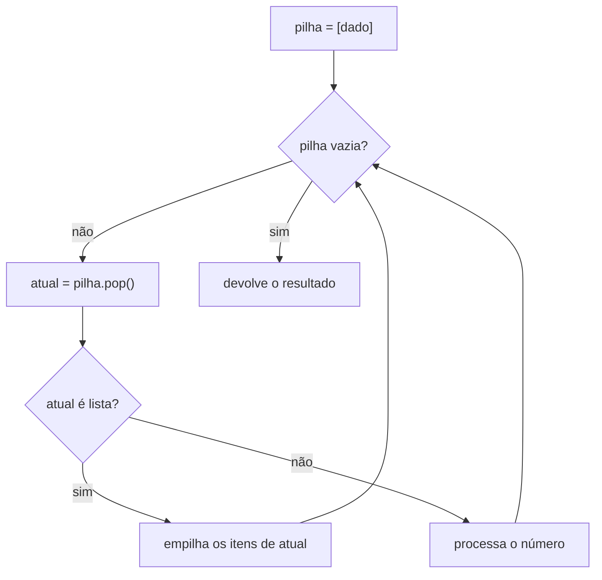

## Passo 1 · Leitura · Caso base, progresso e confiança

No Nível 1 você escreveu `fatorial` e `soma_lista`: uma chamada recursiva, um caso base, um número que diminui. Esses exemplos ficam ótimos com um laço também. A recursão mostra seu valor em **estruturas aninhadas**, em que cada pedaço tem a mesma forma do todo. As notas de uma universidade podem vir como uma lista de unidades, cada unidade uma lista de cursos, cada curso uma lista de turmas. A profundidade muda de um ramo para outro, e nenhum número fixo de laços `for` encaixados dá conta.

Três condições fazem uma função recursiva funcionar:

1. **Caso base para todas as entradas mínimas.** Não basta ter um caso base: ele precisa cobrir todas as formas de chegar ao fim. A lista vazia é a mais esquecida.
2. **Progresso.** Toda chamada recursiva recebe uma entrada estritamente menor (um item a menos, um nível a menos), por isso a sequência de chamadas sempre chega a um caso base.
3. **Confiança na chamada.** No caso recursivo, suponha que a chamada com a entrada menor já devolve a resposta certa e pergunte só: com essa resposta, como monto a do todo? É a hipótese de indução do módulo 1. Se a base e o passo estão certos, a função está certa para qualquer tamanho.

```python
def contar_numeros(dado):
    if not isinstance(dado, list):       # caso base: um número sozinho
        return 1
    total = 0
    for item in dado:                     # lista vazia: o laço não roda, total fica 0
        total += contar_numeros(item)     # confiança: cada item já volta contado
    return total


print(contar_numeros([3, [7, [], [1, 4]], 9]))   # 5
```

Repare que a lista vazia não precisou de `if`: o laço com zero voltas já devolve 0. Nem sempre é assim. Veja o maior número de uma lista aninhada, escrito com `max`:

```python
def maior(dado):
    if not isinstance(dado, list):
        return dado
    return max(maior(item) for item in dado)


maior([3, [], 5])
# ValueError: max() iterable argument is empty
```

A sublista `[]` chega ao `max` sem nenhum valor. O erro só aparece com uma entrada que tem lista vazia, por isso passa despercebido em testes que não a incluem. A correção é decidir o que a lista vazia devolve e tratar esse caso antes.

No visualizador, acompanhe os quadros de `contar_numeros` na pilha: cada sublista abre um quadro novo, que fica esperando os quadros dos seus itens.

```python visualizar
def contar_numeros(dado):
    if not isinstance(dado, list):
        return 1
    total = 0
    for item in dado:
        total += contar_numeros(item)
    return total


print(contar_numeros([3, [7, []], 9]))
```

## Passo 2 · Previsão · Duas chamadas por vez

No Nível 1, a ida e a volta formavam uma linha reta: uma chamada esperava a seguinte. Com **duas** chamadas recursivas no mesmo passo, as chamadas formam uma árvore, e a ordem de execução segue um caminho por ela. Leia o programa sem executar e digite exatamente o que ele imprime.

### Código
```python
def fib(n):
    if n <= 1:
        print("base", n)
        return n
    print("ida", n)
    r = fib(n - 1) + fib(n - 2)
    print("volta", n, r)
    return r


print(fib(4))
```

### Dicas
1. Em `fib(n - 1) + fib(n - 2)`, a primeira chamada termina por inteiro, com todas as chamadas que ela fizer, antes de a segunda começar.
2. A linha `volta` de uma chamada só aparece depois que as duas chamadas filhas devolveram seus valores.
3. Nada impede que a mesma chamada, com o mesmo `n`, aconteça mais de uma vez em ramos diferentes.

### Saída esperada
```text
ida 4
ida 3
ida 2
base 1
base 0
volta 2 1
base 1
volta 3 2
ida 2
base 1
base 0
volta 2 1
volta 4 3
3
```

## Passo 3 · Exercício · Soma e profundidade de listas aninhadas
modo: lacunas

Complete as lacunas (`___`) das duas funções. O `dado` é um número ou uma lista cujos itens são números ou outras listas, em qualquer profundidade.

- `soma_aninhada(dado)` devolve a soma de todos os números. Exemplo: `soma_aninhada([1, [2, [3]], []])` é `6`.
- `profundidade(dado)` devolve quantos níveis de lista há. Um número sozinho tem profundidade 0; uma lista tem 1 a mais que o item mais profundo dela, e a lista vazia tem profundidade 1. Exemplo: `profundidade([1, [2, [3]]])` é `3`.

### Instruções
1. Em `soma_aninhada`, complete o caso base: o que devolver quando `dado` é um número sozinho.
2. Em `soma_aninhada`, some a cada volta a soma completa do item, confiando na chamada recursiva.
3. Em `profundidade`, escolha o valor inicial de `maior` que dá a resposta certa também para a lista vazia.
4. Em `profundidade`, monte a resposta: o nível desta lista mais o do item mais profundo.

### Código inicial
```python
def soma_aninhada(dado):
    if not isinstance(dado, list):
        return ___
    total = 0
    for item in dado:
        total += ___
    return total


def profundidade(dado):
    if not isinstance(dado, list):
        return 0
    maior = ___
    for item in dado:
        p = profundidade(item)
        if p > maior:
            maior = p
    return ___
```

### Solução
```python
def soma_aninhada(dado):
    if not isinstance(dado, list):
        return dado
    total = 0
    for item in dado:
        total += soma_aninhada(item)
    return total


def profundidade(dado):
    if not isinstance(dado, list):
        return 0
    maior = 0
    for item in dado:
        p = profundidade(item)
        if p > maior:
            maior = p
    return 1 + maior
```

### Dicas
1. Quanto vale a soma de "todos os números" de um dado que é um único número?
2. Um item pode ser outra lista, com listas dentro: só a própria função sabe somá-lo inteiro.
3. Na lista vazia o laço não roda, e a resposta tem de sair 1 só com o valor inicial e a última linha.

### Verificação
```json
[
  { "id": "usa-recursao", "checkpoint": 2, "kind": "source", "rule": { "type": "uses", "construct": "recursion" },
    "name": "As funções chamam a si mesmas" },
  { "id": "soma-numero", "checkpoint": 1, "kind": "call", "function": "soma_aninhada", "args": [-4], "expected": -4,
    "name": "soma_aninhada(-4) é -4", "hint": "Um número sozinho é o caso base." },
  { "id": "soma-funda", "checkpoint": 2, "kind": "call", "function": "soma_aninhada", "args": [[1, [2, [3, [4]]], 5]], "expected": 15,
    "name": "soma_aninhada([1, [2, [3, [4]]], 5]) é 15", "hint": "Cada item pode ter listas dentro de listas." },
  { "id": "soma-vazias", "checkpoint": 2, "kind": "expr", "expr": "[soma_aninhada([]), soma_aninhada([[], [[]], 7])]", "expected": [0, 7],
    "name": "Listas vazias somam 0" },
  { "id": "soma-negativos", "checkpoint": 2, "kind": "call", "function": "soma_aninhada", "args": [[[10, -3], [[-7]], 2]], "expected": 2,
    "name": "soma_aninhada([[10, -3], [[-7]], 2]) é 2" },
  { "id": "prof-vazia", "checkpoint": 3, "kind": "expr", "expr": "[profundidade([]), profundidade(7)]", "expected": [1, 0],
    "name": "profundidade([]) é 1 e profundidade(7) é 0", "hint": "A lista vazia é uma lista: tem um nível." },
  { "id": "prof-3", "checkpoint": 4, "kind": "call", "function": "profundidade", "args": [[1, [2, [3]], [4]]], "expected": 3,
    "name": "profundidade([1, [2, [3]], [4]]) é 3" },
  { "id": "prof-vazias-dentro", "checkpoint": 4, "kind": "expr", "expr": "[profundidade([[[[]]]]), profundidade([[], [[5, [6]]], 2])]", "expected": [4, 4],
    "name": "Listas vazias aninhadas também contam como nível", "hint": "[[[[]]]] tem quatro pares de colchetes, um dentro do outro." },
  { "id": "fundo-300", "checkpoint": 4, "kind": "expr",
    "setup": "d = [0]\nfor i in range(1, 300):\n    d = [i, d]",
    "expr": "[soma_aninhada(d), profundidade(d)]", "expected": [44850, 300],
    "name": "Lista com 300 níveis: soma 44850 e profundidade 300" }
]
```

### Soluções erradas
```python name="caso base devolve 0 para o número"
def soma_aninhada(dado):
    if not isinstance(dado, list):
        return 0
    total = 0
    for item in dado:
        total += soma_aninhada(item)
    return total


def profundidade(dado):
    if not isinstance(dado, list):
        return 0
    maior = 0
    for item in dado:
        p = profundidade(item)
        if p > maior:
            maior = p
    return 1 + maior
```
```python name="soma desce só um nível com sum"
def soma_aninhada(dado):
    if not isinstance(dado, list):
        return dado
    total = 0
    for item in dado:
        if isinstance(item, list):
            total += sum(item)
        else:
            total += item
    return total


def profundidade(dado):
    if not isinstance(dado, list):
        return 0
    maior = 0
    for item in dado:
        p = profundidade(item)
        if p > maior:
            maior = p
    return 1 + maior
```
```python name="maior começa em 1"
def soma_aninhada(dado):
    if not isinstance(dado, list):
        return dado
    total = 0
    for item in dado:
        total += soma_aninhada(item)
    return total


def profundidade(dado):
    if not isinstance(dado, list):
        return 0
    maior = 1
    for item in dado:
        p = profundidade(item)
        if p > maior:
            maior = p
    return 1 + maior
```
```python name="max sem tratar a lista vazia"
def soma_aninhada(dado):
    if not isinstance(dado, list):
        return dado
    total = 0
    for item in dado:
        total += soma_aninhada(item)
    return total


def profundidade(dado):
    if not isinstance(dado, list):
        return 0
    return 1 + max(profundidade(item) for item in dado)
```
```python name="esquece de contar o nível atual"
def soma_aninhada(dado):
    if not isinstance(dado, list):
        return dado
    total = 0
    for item in dado:
        total += soma_aninhada(item)
    return total


def profundidade(dado):
    if not isinstance(dado, list):
        return 0
    maior = 0
    for item in dado:
        p = profundidade(item)
        if p > maior:
            maior = p
    return maior
```

## Passo 4 · Leitura · O limite de recursão e a recursão de cauda

Cada chamada que ainda não terminou ocupa um **quadro** na pilha de chamadas: os parâmetros, as variáveis locais e o ponto exato para onde voltar. O Python limita quantos quadros podem estar pendentes ao mesmo tempo. O limite padrão é 1000, e ao passar dele o programa para com `RecursionError: maximum recursion depth exceeded`.

O que conta é a **profundidade**, a maior quantidade de chamadas pendentes ao mesmo tempo, e não o total de chamadas. O `fib(25)` do passo anterior faz 242 785 chamadas, mas nunca mais de 25 estão pendentes juntas. Já uma soma recursiva que avança um índice por chamada tem profundidade igual ao tamanho da lista:

```python
import sys


def soma_cauda(v, i=0, acc=0):
    if i == len(v):
        return acc
    return soma_cauda(v, i + 1, acc + v[i])   # a chamada é a última ação


print(sys.getrecursionlimit())        # 1000
print(soma_cauda(list(range(900))))   # 404550
soma_cauda(list(range(5000)))
# RecursionError: maximum recursion depth exceeded
```

Essa função é de **recursão de cauda**: a chamada recursiva é a última coisa que ela faz, e nada espera a volta para fazer conta (o acumulador `acc` já leva o resultado parcial). Em Scheme e em outras linguagens, o compilador reaproveita o mesmo quadro nesse caso, e a profundidade não cresce. **O CPython não faz essa otimização**: cada chamada empilha um quadro novo, de propósito, para que o *traceback* (o relatório de erro) mostre todas as chamadas. Recursão de cauda em Python estoura o limite como qualquer outra.

A boa notícia é que uma recursão de cauda vira laço mecanicamente. Os parâmetros viram variáveis, e a chamada recursiva vira uma atualização delas:

```python
def soma_laco(v):
    i, acc = 0, 0
    while i != len(v):              # o caso base vira a condição de parada
        i, acc = i + 1, acc + v[i]  # a chamada vira atualização das variáveis
    return acc
```

Aumentar o limite com `sys.setrecursionlimit` só adia o problema: a profundidade continua proporcional à entrada, e cada quadro gasta memória. O limite existe para transformar uma recursão descontrolada num erro legível.

Outro cuidado: avance com **índices**, não com fatias. `soma(v[1:])` copia a lista inteira a cada chamada, e as cópias somam $\frac{n(n-1)}{2}$ elementos, um custo $\Theta(n^2)$ escondido numa recursão que parece linear.

## Passo 5 · Exercício · Índices no lugar de fatias

Escreva duas funções recursivas.

- `eh_palindromo(texto)` devolve `True` se o texto é igual lido de trás para frente, comparando caractere por caractere (maiúsculas contam: `"Ana"` não é palíndromo). Compare as pontas e avance **dois índices**, um de cada lado, numa função auxiliar recursiva. Sem fatias: a verificação conta as fatias feitas no texto.
- `para_binario(n)` devolve a representação binária do inteiro `n >= 0` como texto, sem `bin` nem `format`. Os bits de `n` são os bits de `n // 2` seguidos do último bit, `n % 2`. Exemplos: `para_binario(13)` é `"1101"` e `para_binario(0)` é `"0"`.

### Instruções
1. Em `eh_palindromo`, use uma função auxiliar com os índices `i` e `j` das pontas e um caso base que cubra o texto vazio, o de um caractere e o momento em que os índices se cruzam.
2. No caso recursivo, decida pelas pontas e continue com os índices mais próximos do meio.
3. Em `para_binario`, escreva o caso base para os números que já são um único bit, incluindo o 0.
4. No caso recursivo, junte os bits de `n // 2` com o último bit, na ordem certa.

### Código inicial
```python
def eh_palindromo(texto):
    pass


def para_binario(n):
    pass
```

### Solução
```python
def eh_palindromo(texto):
    def verifica(i, j):
        if i >= j:
            return True
        if texto[i] != texto[j]:
            return False
        return verifica(i + 1, j - 1)

    return verifica(0, len(texto) - 1)


def para_binario(n):
    if n < 2:
        return str(n)
    return para_binario(n // 2) + str(n % 2)
```

### Dicas
1. Num texto de tamanho par os índices nunca ficam iguais: eles se cruzam. Num texto vazio, `j` começa menor que `i`.
2. Pontas diferentes decidem a resposta na hora; pontas iguais não decidem nada sozinhas.
3. Em `para_binario`, qual chamada tem de chegar ao caso base quando `n` é 0? E o 0 tem algum bit para mostrar?

### Verificação
```json
[
  { "id": "usa-recursao", "checkpoint": 2, "kind": "source", "rule": { "type": "uses", "construct": "recursion" },
    "name": "Usa recursão" },
  { "id": "sem-bin", "checkpoint": 4, "kind": "source", "rule": { "type": "not_calls", "name": "bin" },
    "name": "Não usa bin()" },
  { "id": "sem-format", "checkpoint": 4, "kind": "source", "rule": { "type": "not_calls", "name": "format" },
    "name": "Não usa format()" },
  { "id": "pal-curtos", "checkpoint": 1, "kind": "expr", "expr": "[eh_palindromo(''), eh_palindromo('a'), eh_palindromo('ab')]", "expected": [true, true, false],
    "name": "Texto vazio e de um caractere são palíndromos; 'ab' não é", "hint": "Com o texto vazio, j começa em -1." },
  { "id": "pal-impar-par", "checkpoint": 2, "kind": "expr", "expr": "[eh_palindromo('arara'), eh_palindromo('abba'), eh_palindromo('abca'), eh_palindromo('Ana')]", "expected": [true, true, false, false],
    "name": "arara e abba são; abca e Ana não são", "hint": "Pontas iguais no começo não garantem nada: as do meio também precisam bater." },
  { "id": "pal-sem-fatias", "checkpoint": 2, "kind": "expr",
    "setup": "class Texto(str):\n    fatias = 0\n    def __getitem__(self, k):\n        if isinstance(k, slice):\n            Texto.fatias += 1\n        return str.__getitem__(self, k)\nt = Texto('ab' * 150 + 'c' + 'ba' * 150)\nu = Texto('a' * 300 + 'bc' + 'a' * 300)\nr = [eh_palindromo(t), eh_palindromo(u)]",
    "expr": "[r, Texto.fatias]", "expected": [[true, false], 0],
    "name": "Textos de 601 e 602 caracteres, sem nenhuma fatia",
    "hint": "Cada fatia copia o texto. Passe índices para a função auxiliar." },
  { "id": "bin-zero-um", "checkpoint": 3, "kind": "expr", "expr": "[para_binario(0), para_binario(1)]", "expected": ["0", "1"],
    "name": "para_binario(0) é '0' e para_binario(1) é '1'", "hint": "O 0 também precisa de um caso base que devolva um dígito." },
  { "id": "bin-13", "checkpoint": 4, "kind": "call", "function": "para_binario", "args": [13], "expected": "1101",
    "name": "para_binario(13) é '1101'", "hint": "O último bit vai no fim do texto." },
  { "id": "bin-faixa", "checkpoint": 4, "kind": "expr", "expr": "all(para_binario(n) == bin(n)[2:] for n in range(600))", "expected": true,
    "name": "Confere com bin() de 0 a 599" },
  { "id": "bin-grande", "checkpoint": 4, "kind": "expr", "expr": "para_binario(2 ** 60 + 5)", "expected": "1000000000000000000000000000000000000000000000000000000000101",
    "name": "para_binario(2 ** 60 + 5) tem 61 bits" }
]
```

### Soluções erradas
```python name="caso base só com i == j"
def eh_palindromo(texto):
    def verifica(i, j):
        if i == j:
            return True
        if texto[i] != texto[j]:
            return False
        return verifica(i + 1, j - 1)

    return verifica(0, len(texto) - 1)


def para_binario(n):
    if n < 2:
        return str(n)
    return para_binario(n // 2) + str(n % 2)
```
```python name="recursão com fatias"
def eh_palindromo(texto):
    if len(texto) <= 1:
        return True
    if texto[0] != texto[-1]:
        return False
    return eh_palindromo(texto[1:-1])


def para_binario(n):
    if n < 2:
        return str(n)
    return para_binario(n // 2) + str(n % 2)
```
```python name="decide pela primeira dupla de pontas"
def eh_palindromo(texto):
    def verifica(i, j):
        if i >= j:
            return True
        if texto[i] == texto[j]:
            return True
        return False

    return verifica(0, len(texto) - 1)


def para_binario(n):
    if n < 2:
        return str(n)
    return para_binario(n // 2) + str(n % 2)
```
```python name="esquece o return na chamada recursiva"
def eh_palindromo(texto):
    def verifica(i, j):
        if i >= j:
            return True
        if texto[i] != texto[j]:
            return False
        verifica(i + 1, j - 1)

    return verifica(0, len(texto) - 1)


def para_binario(n):
    if n < 2:
        return str(n)
    return para_binario(n // 2) + str(n % 2)
```
```python name="caso base do 0 devolve texto vazio"
def eh_palindromo(texto):
    def verifica(i, j):
        if i >= j:
            return True
        if texto[i] != texto[j]:
            return False
        return verifica(i + 1, j - 1)

    return verifica(0, len(texto) - 1)


def para_binario(n):
    if n == 0:
        return ""
    return para_binario(n // 2) + str(n % 2)
```
```python name="caso base só no 1: o 0 não progride"
def eh_palindromo(texto):
    def verifica(i, j):
        if i >= j:
            return True
        if texto[i] != texto[j]:
            return False
        return verifica(i + 1, j - 1)

    return verifica(0, len(texto) - 1)


def para_binario(n):
    if n == 1:
        return "1"
    return para_binario(n // 2) + str(n % 2)
```
```python name="último bit na frente"
def eh_palindromo(texto):
    def verifica(i, j):
        if i >= j:
            return True
        if texto[i] != texto[j]:
            return False
        return verifica(i + 1, j - 1)

    return verifica(0, len(texto) - 1)


def para_binario(n):
    if n < 2:
        return str(n)
    return str(n % 2) + para_binario(n // 2)
```

## Passo 6 · Leitura · Da recursão à pilha explícita

Nem toda recursão é de cauda. Em `soma_aninhada`, depois de cada chamada ainda há trabalho: somar o resultado e seguir o laço pelos itens restantes. Cada quadro pendente guarda justamente isso, **o que falta fazer** naquele nível. Com uma lista de 5 000 níveis, são 5 000 quadros pendentes, e o `RecursionError` vem antes da resposta.

A saída é guardar o trabalho pendente numa estrutura sua: uma `list` usada como **pilha**, com `append` para empilhar e `pop()` para tirar o último empilhado. É o mesmo mecanismo da pilha de chamadas, mas a lista mora na memória comum e cresce até onde a memória deixar, sem o limite de 1000.



A soma fica assim:

```python
def soma_iterativa(dado):
    total = 0
    pilha = [dado]
    while pilha:
        atual = pilha.pop()
        if isinstance(atual, list):
            pilha.extend(atual)        # cada item vira trabalho pendente
        else:
            total += atual
    return total
```

Para a soma, a ordem em que os números saem não importa. Para **achatar** uma lista, importa. `pop()` tira o último item empilhado, então `pilha.extend([1, 2, 3])` faz o 3 sair primeiro. Para os itens saírem na ordem original, empilhe-os de trás para frente, com `reversed`. Trocar `pop()` por `pop(0)` não resolve: a pilha vira **fila**, os itens de um nível saem antes dos itens de dentro das sublistas, e a ordem muda de outro jeito.

Quando o resultado depende do nível, como na profundidade, cada entrada da pilha precisa levar também a informação que o quadro guardaria: em vez de só a sublista, empilhe o par `(sublista, nível)`.

O espaço continua proporcional à profundidade, ou ao número de itens pendentes: a informação do que falta fazer precisa estar em algum lugar. A diferença é onde ela mora. Na pilha de chamadas, o teto é o limite de recursão; numa lista sua, é a memória da máquina.

No visualizador, observe a `pilha` a cada volta do laço.

```python visualizar
def soma_iterativa(dado):
    total = 0
    pilha = [dado]
    while pilha:
        atual = pilha.pop()
        if isinstance(atual, list):
            pilha.extend(atual)
        else:
            total += atual
    return total


print(soma_iterativa([1, [2, [3]], 4]))
```

## Passo 7 · Exercício · Achatar e medir sem recursão

Escreva as duas funções **sem recursão**, com um laço `while` e uma pilha explícita. A verificação usa uma lista com 5 001 níveis, que estoura o limite de qualquer versão recursiva.

- `achatar_iterativo(dado)` recebe uma lista aninhada e devolve uma lista nova, plana, com os números **na ordem em que aparecem**. A lista recebida não pode mudar. Exemplo: `achatar_iterativo([1, [2, [3]], [], 4])` é `[1, 2, 3, 4]`.
- `profundidade_iterativa(dado)` devolve a mesma profundidade do passo 3: 0 para um número, 1 para a lista vazia, 1 a mais que o item mais profundo para uma lista.

### Instruções
1. Em `achatar_iterativo`, comece a pilha com os itens da lista e repita enquanto houver itens pendentes.
2. Ao tirar uma sublista da pilha, empilhe os itens dela de forma que saiam na ordem original; um número vai para o resultado.
3. Em `profundidade_iterativa`, empilhe pares `(lista, nível)` e guarde o maior nível visto, contando também as listas vazias.

### Código inicial
```python
def achatar_iterativo(dado):
    pass


def profundidade_iterativa(dado):
    pass
```

### Solução
```python
def achatar_iterativo(dado):
    resultado = []
    pilha = list(reversed(dado))
    while pilha:
        item = pilha.pop()
        if isinstance(item, list):
            pilha.extend(reversed(item))
        else:
            resultado.append(item)
    return resultado


def profundidade_iterativa(dado):
    if not isinstance(dado, list):
        return 0
    maior = 0
    pilha = [(dado, 1)]
    while pilha:
        atual, nivel = pilha.pop()
        if nivel > maior:
            maior = nivel
        for item in atual:
            if isinstance(item, list):
                pilha.append((item, nivel + 1))
    return maior
```

### Dicas
1. `pop()` devolve o último empilhado: para o primeiro item sair primeiro, ele tem de ser o último a entrar.
2. `reversed(item)` percorre a sublista de trás para frente sem alterá-la.
3. Uma lista vazia tem nível próprio, mesmo sem nenhum número dentro dela.

### Verificação
```json
[
  { "id": "achatar-ordem", "checkpoint": 2, "kind": "call", "function": "achatar_iterativo", "args": [[1, [2, 3], [[4], [], 5], 6]], "expected": [1, 2, 3, 4, 5, 6],
    "name": "Mantém a ordem original", "hint": "Com pop(), o último empilhado sai primeiro." },
  { "id": "achatar-vazias", "checkpoint": 1, "kind": "expr", "expr": "[achatar_iterativo([]), achatar_iterativo([[], [[]]])]", "expected": [[], []],
    "name": "Listas vazias dão []" },
  { "id": "achatar-textos", "checkpoint": 2, "kind": "call", "function": "achatar_iterativo", "args": [["a", ["b", ["c", "d"]], "e"]], "expected": ["a", "b", "c", "d", "e"],
    "name": "Funciona com textos nas folhas" },
  { "id": "achatar-nao-altera", "checkpoint": 1, "kind": "expr", "setup": "v = [1, [2, [3]], [4, 5]]\nr = achatar_iterativo(v)",
    "expr": "[r, v]", "expected": [[1, 2, 3, 4, 5], [1, [2, [3]], [4, 5]]],
    "name": "Não altera a lista recebida", "hint": "Tirar itens das sublistas originais esvazia a entrada." },
  { "id": "achatar-5001-niveis", "checkpoint": 1, "kind": "expr",
    "setup": "d = [42]\nfor i in range(5000):\n    d = [i, d]\ns = achatar_iterativo(d)",
    "expr": "[len(s), s[0], s[1], s[-2], s[-1]]", "expected": [5001, 4999, 4998, 0, 42],
    "name": "Achata 5001 níveis sem RecursionError", "hint": "Uma versão recursiva estoura o limite de 1000 chamadas pendentes." },
  { "id": "prof-basicos", "checkpoint": 3, "kind": "expr", "expr": "[profundidade_iterativa(7), profundidade_iterativa([]), profundidade_iterativa([1, [2, [3]], [4]])]", "expected": [0, 1, 3],
    "name": "Profundidade de 7, [] e [1, [2, [3]], [4]]" },
  { "id": "prof-vazias", "checkpoint": 3, "kind": "expr", "expr": "[profundidade_iterativa([[]]), profundidade_iterativa([[], [[5, [6]]], [[[[]]]]])]", "expected": [2, 5],
    "name": "Listas vazias contam como nível", "hint": "Empilhe todas as sublistas, mesmo as que não têm números." },
  { "id": "prof-5001-niveis", "checkpoint": 3, "kind": "expr",
    "setup": "d = [42]\nfor i in range(5000):\n    d = [i, d]",
    "expr": "profundidade_iterativa(d)", "expected": 5001,
    "name": "Mede 5001 níveis sem RecursionError" }
]
```

### Soluções erradas
```python name="achatar recursivo estoura em 5001 níveis"
def achatar_iterativo(dado):
    resultado = []
    for item in dado:
        if isinstance(item, list):
            resultado.extend(achatar_iterativo(item))
        else:
            resultado.append(item)
    return resultado


def profundidade_iterativa(dado):
    if not isinstance(dado, list):
        return 0
    maior = 0
    pilha = [(dado, 1)]
    while pilha:
        atual, nivel = pilha.pop()
        if nivel > maior:
            maior = nivel
        for item in atual:
            if isinstance(item, list):
                pilha.append((item, nivel + 1))
    return maior
```
```python name="empilha sem inverter"
def achatar_iterativo(dado):
    resultado = []
    pilha = list(dado)
    while pilha:
        item = pilha.pop()
        if isinstance(item, list):
            pilha.extend(item)
        else:
            resultado.append(item)
    return resultado


def profundidade_iterativa(dado):
    if not isinstance(dado, list):
        return 0
    maior = 0
    pilha = [(dado, 1)]
    while pilha:
        atual, nivel = pilha.pop()
        if nivel > maior:
            maior = nivel
        for item in atual:
            if isinstance(item, list):
                pilha.append((item, nivel + 1))
    return maior
```
```python name="pop(0) transforma a pilha em fila"
def achatar_iterativo(dado):
    resultado = []
    pilha = list(dado)
    while pilha:
        item = pilha.pop(0)
        if isinstance(item, list):
            pilha.extend(item)
        else:
            resultado.append(item)
    return resultado


def profundidade_iterativa(dado):
    if not isinstance(dado, list):
        return 0
    maior = 0
    pilha = [(dado, 1)]
    while pilha:
        atual, nivel = pilha.pop()
        if nivel > maior:
            maior = nivel
        for item in atual:
            if isinstance(item, list):
                pilha.append((item, nivel + 1))
    return maior
```
```python name="esvazia as sublistas da entrada"
def achatar_iterativo(dado):
    resultado = []
    pilha = [dado]
    while pilha:
        topo = pilha[-1]
        if not topo:
            pilha.pop()
            continue
        item = topo.pop(0)
        if isinstance(item, list):
            pilha.append(item)
        else:
            resultado.append(item)
    return resultado


def profundidade_iterativa(dado):
    if not isinstance(dado, list):
        return 0
    maior = 0
    pilha = [(dado, 1)]
    while pilha:
        atual, nivel = pilha.pop()
        if nivel > maior:
            maior = nivel
        for item in atual:
            if isinstance(item, list):
                pilha.append((item, nivel + 1))
    return maior
```
```python name="nível da raiz começa em 0"
def achatar_iterativo(dado):
    resultado = []
    pilha = list(reversed(dado))
    while pilha:
        item = pilha.pop()
        if isinstance(item, list):
            pilha.extend(reversed(item))
        else:
            resultado.append(item)
    return resultado


def profundidade_iterativa(dado):
    if not isinstance(dado, list):
        return 0
    maior = 0
    pilha = [(dado, 0)]
    while pilha:
        atual, nivel = pilha.pop()
        if nivel > maior:
            maior = nivel
        for item in atual:
            if isinstance(item, list):
                pilha.append((item, nivel + 1))
    return maior
```
```python name="conta o nível só quando acha um número"
def achatar_iterativo(dado):
    resultado = []
    pilha = list(reversed(dado))
    while pilha:
        item = pilha.pop()
        if isinstance(item, list):
            pilha.extend(reversed(item))
        else:
            resultado.append(item)
    return resultado


def profundidade_iterativa(dado):
    if not isinstance(dado, list):
        return 0
    maior = 1
    pilha = [(dado, 1)]
    while pilha:
        atual, nivel = pilha.pop()
        for item in atual:
            if isinstance(item, list):
                pilha.append((item, nivel + 1))
            elif nivel > maior:
                maior = nivel
    return maior
```

## Passo 8 · Quiz · Pilha, limite e casos base

### Pergunta
O que acontece ao executar este programa?
```python
def soma_cauda(v, i=0, acc=0):
    if i == len(v):
        return acc
    return soma_cauda(v, i + 1, acc + v[i])


print(soma_cauda(list(range(5000))))
```
- [ ] Imprime `12497500`: como a chamada é a última ação, o Python reaproveita o quadro
- [x] Termina com `RecursionError`: o CPython empilha um quadro por chamada, mesmo na recursão de cauda
- [ ] Imprime `0`, porque `acc` é reiniciado a cada chamada
- [ ] Entra em laço infinito, porque `i` nunca chega a `len(v)`
> São 5 001 chamadas pendentes ao mesmo tempo, e o limite padrão é 1000. Algumas linguagens eliminam a chamada de cauda; o CPython mantém todos os quadros para o *traceback* ficar completo. Reescrever como `while` resolve.

### Pergunta
O que acontece com `menor([])`?
```python
def menor(v):
    if len(v) == 1:
        return v[0]
    resto = menor(v[1:])
    return v[0] if v[0] < resto else resto
```
- [ ] Devolve `None`, porque nenhum `return` é alcançado
- [ ] Levanta `IndexError` ao acessar `v[0]`
- [x] Levanta `RecursionError`: `[][1:]` é `[]` de novo, então a chamada nunca progride nem chega ao caso base
- [ ] Devolve `0`
> O caso base só cobre a lista de um elemento. Com a lista vazia, `len(v) == 1` é falso e a função chama `menor([])` de novo, para sempre, até o limite. O acesso a `v[0]` nunca chega a acontecer, porque vem depois da chamada recursiva. Falta decidir o que a lista vazia devolve, ou recusá-la com um erro claro.

### Pergunta
`fib(25)`, com duas chamadas recursivas por passo, faz 242 785 chamadas. Por que ele termina sem `RecursionError`, enquanto `soma_cauda` com 5 000 itens estoura?
- [ ] Porque o limite de 1000 vale para cada função separadamente, e `fib` é outra função
- [ ] Porque chamadas que devolvem números pequenos não ocupam quadro
- [x] Porque o limite é sobre chamadas pendentes ao mesmo tempo: em `fib(25)`, no máximo 25 estão abertas juntas
- [ ] Porque o Python converte `fib` em laço automaticamente
> Cada chamada de `fib` termina e libera seu quadro antes de a próxima do mesmo nível começar. A profundidade máxima é o caminho mais longo da árvore, 25. O total de chamadas mede o tempo; a profundidade mede a pilha.
