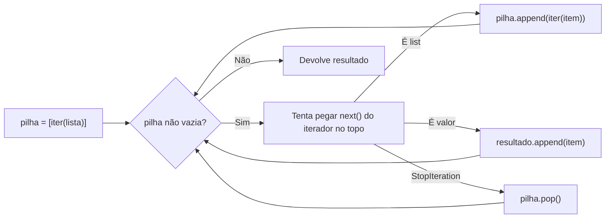

## Passo 1 · Leitura · A pilha de chamadas por dentro e recursão sobre estruturas

Quando uma função chama a si mesma, o Python cria um novo **quadro de ativação (*stack frame*)** na pilha de chamadas, guardando seus parâmetros, variáveis locais e o ponto exato para onde retornar quando a chamada filha terminar.

Isso significa que toda chamada recursiva tem duas fases:
1. **Fase de descida (ida):** o código que aparece **antes** da chamada recursiva roda enquanto os quadros estão sendo empilhados (do problema maior para o caso base).
2. **Fase de subida (volta):** o código que aparece **depois** da chamada recursiva roda na ordem inversa, enquanto os quadros são desempilhados (do caso base de volta à chamada original).

Veja no visualizador como uma função recursiva que percorre uma lista aninhada de profundidade arbitrária empilha e desempilha quadros automaticamente:

```python visualizar
def achatar(elemento):
    resultado = []
    for item in elemento:
        if isinstance(item, list):
            resultado.extend(achatar(item))
        else:
            resultado.append(item)
    return resultado

print(achatar([1, [2, [3, 4]], 5]))
```

#### Explosão na recursão múltipla: o caso de Fibonacci

Quando uma função faz **duas ou mais chamadas recursivas** que recalculam os mesmos subproblemas — como `fib(n) = fib(n - 1) + fib(n - 2)` —, a árvore de chamadas cresce exponencialmente ($\approx 1{,}618^n$). Para `fib(20)`, por exemplo, a função `fib` é chamada **$21\,891$ vezes**! O número total de chamadas $C(n)$ para calcular `fib(n)` satisfaz:

$$
C(0) = 1, \quad C(1) = 1, \quad C(n) = 1 + C(n - 1) + C(n - 2)
$$

## Passo 2 · Previsão · Ida e volta na pilha de chamadas

Leia a função recursiva `rastro(n)` abaixo e digite exatamente o que ela imprime ao ser chamada com `rastro(3)`.

### Código
```python
def rastro(n):
    if n == 0:
        print("base")
        return
    print(f"ida {n}")
    rastro(n - 1)
    print(f"volta {n}")

rastro(3)
```

### Dicas
1. Os prints `"ida ..."` acontecem antes da chamada recursiva, de `3` até `1`.
2. Quando `n == 0`, imprime `"base"` e retorna; a partir daí, os prints `"volta ..."` executam na ordem em que as chamadas desempilham (`1`, `2`, `3`).

### Saída esperada
```text
ida 3
ida 2
ida 1
base
volta 1
volta 2
volta 3
```

## Passo 3 · Exercício · Achatando listas aninhadas e contando chamadas de Fibonacci

Implemente duas funções recursivas:
1. `achatar(lista_aninhada)`: recebe uma lista que pode conter inteiros e outras listas aninhadas em qualquer profundidade (ex.: `[1, [2, [3, [4, [5]]]], 6]`) e devolve uma lista plana com todos os elementos na ordem em que aparecem.
2. `contar_chamadas_fib(n)`: devolve quantas vezes a função recursiva ingênua de Fibonacci é invocada ao calcular `fib(n)` (com casos base `n == 0` e `n == 1` custando `1` chamada cada, e para `n >= 2` custando `1 + contar_chamadas_fib(n - 1) + contar_chamadas_fib(n - 2)`).

### Instruções
1. Em `achatar(lista_aninhada)`, percorra cada `item` da lista: se `isinstance(item, list)` for verdadeiro, chame `achatar(item)` recursivamente e estenda o resultado (`resultado.extend(...)`); senão, adicione `item` (`resultado.append(item)`).
2. Em `contar_chamadas_fib(n)`, se `n <= 1` devolva `1`; caso contrário, devolva `1 + contar_chamadas_fib(n - 1) + contar_chamadas_fib(n - 2)`.

### Código inicial
```python
def achatar(lista_aninhada):
    # Devolva uma lista plana com todos os elementos de lista_aninhada
    pass


def contar_chamadas_fib(n):
    # Devolva o total de chamadas recursivas de fib(n) ingênuo
    pass
```

### Solução
```python
def achatar(lista_aninhada):
    resultado = []
    for item in lista_aninhada:
        if isinstance(item, list):
            resultado.extend(achatar(item))
        else:
            resultado.append(item)
    return resultado


def contar_chamadas_fib(n):
    if n <= 1:
        return 1
    return 1 + contar_chamadas_fib(n - 1) + contar_chamadas_fib(n - 2)
```

### Dicas
1. Cuidado para não esquecer listas vazias aninhadas, como `[1, [], [2, []]]`: o laço `for item in lista_aninhada:` já trata `[]` naturalmente devolvendo `[]`.
2. Em `contar_chamadas_fib(n)`, o `+ 1` representa a chamada atual da própria função antes de somar as chamadas dos dois filhos.

### Verificação
```json
[
  {
    "id": "usa-recursao",
    "checkpoint": 1,
    "kind": "source",
    "rule": { "type": "uses", "construct": "recursion" },
    "name": "Utiliza recursão"
  },
  {
    "id": "achatar-profundidade-5",
    "checkpoint": 1,
    "kind": "call",
    "function": "achatar",
    "args": [[1, [2, [3, [4, [5]]]], [], [6, [7, 8]]]],
    "expected": [1, 2, 3, 4, 5, 6, 7, 8],
    "name": "Achata lista aninhada de profundidade 5 e sublistas vazias"
  },
  {
    "id": "fib-chamadas-pequenos",
    "checkpoint": 2,
    "kind": "expr",
    "expr": "[contar_chamadas_fib(0), contar_chamadas_fib(1), contar_chamadas_fib(2), contar_chamadas_fib(5)]",
    "expected": [1, 1, 3, 15],
    "name": "Conta chamadas de fib para n = 0, 1, 2 e 5: [1, 1, 3, 15]"
  },
  {
    "id": "fib-chamadas-20",
    "checkpoint": 2,
    "kind": "call",
    "function": "contar_chamadas_fib",
    "args": [20],
    "expected": 21891,
    "name": "contar_chamadas_fib(20) devolve 21891 chamadas"
  }
]
```

### Soluções erradas
```python name="achata apenas um nível de aninhamento"
def achatar(lista_aninhada):
    resultado = []
    for item in lista_aninhada:
        if isinstance(item, list):
            resultado.extend(item)
        else:
            resultado.append(item)
    return resultado


def contar_chamadas_fib(n):
    if n <= 1:
        return 1
    return 1 + contar_chamadas_fib(n - 1) + contar_chamadas_fib(n - 2)
```
```python name="esquece de somar 1 pela chamada atual em contar_chamadas_fib"
def achatar(lista_aninhada):
    resultado = []
    for item in lista_aninhada:
        if isinstance(item, list):
            resultado.extend(achatar(item))
        else:
            resultado.append(item)
    return resultado


def contar_chamadas_fib(n):
    if n <= 1:
        return 1
    return contar_chamadas_fib(n - 1) + contar_chamadas_fib(n - 2)
```

## Passo 4 · Leitura · Limite de recursão (`RecursionError`) e conversão para pilha explícita

Por padrão, o Python limita a profundidade da pilha de chamadas a $1\,000$ quadros (`sys.getrecursionlimit()`), levantando `RecursionError` se uma função recursiva ultrapassar esse teto. Além disso, diferente de linguagens funcionais como Scheme, **o Python não faz otimização de recursão de cauda (*tail-call optimization*)** — isto é, mesmo que a chamada recursiva seja a última instrução da função, cada chamada ainda aloca um quadro na pilha para preservar *tracebacks* completos de depuração.

Temos duas maneiras de contornar esse limite:

1. **Reduzir a profundidade para $O(\log n)$ dividindo o problema:** no cálculo recursivo de potência `potencia_rapida(b, e)`, em vez de fazer $b \cdot b^{e-1}$ (profundidade $e$), calculamos `metade = potencia_rapida(b, e // 2)` e multiplicamos `metade * metade` (e por `b` se `e` for ímpar). Para $e = 10^6$, a profundidade cai de $1\,000\,000$ para apenas **20 quadros**!
2. **Trocar a pilha da linguagem por uma pilha explícita (`list`) no *heap*:** qualquer algoritmo recursivo pode ser reescrito de forma iterativa mantendo uma lista `pilha = [...]` controlada com `.append()` e `.pop()`. Como o *heap* de memória não tem o limite de $1\,000$ quadros da *call stack*, `achatar_iterativo` processa listas com profundidade $5\,000$ sem levantar `RecursionError`!



## Passo 5 · Exercício · Potência rápida recursiva e achatamento iterativo para profundidade 5.000

Implemente duas funções:
1. `potencia_rapida(b, e, mod=1_000_000_007)`: calcula $(b^e) \bmod \text{mod}$ de forma **recursiva** dividindo o expoente `e` por 2 a cada chamada, suportando $e = 10^6$ sem estourar o limite de recursão.
2. `achatar_iterativo(lista_aninhada)`: achata uma lista de aninhamento arbitrário (testada com profundidade $5\,000$, que causaria `RecursionError` na versão recursiva!) usando um laço `while` e uma **pilha explícita**, sem chamadas recursivas.

### Instruções
1. Em `potencia_rapida(b, e, mod=1_000_000_007)`:
   - Caso base: se `e == 0`, devolva `1 % mod`.
   - Passo recursivo: calcule `metade = potencia_rapida(b, e // 2, mod)`, faça `quadrado = (metade * metade) % mod` e, se `e % 2 == 1`, devolva `(quadrado * b) % mod` (senão, devolva `quadrado`).
2. Em `achatar_iterativo(lista_aninhada)`:
   - Use uma pilha explícita (por exemplo, `pilha = [iter(lista_aninhada)]` ou empilhando os elementos em ordem reversa `pilha = list(reversed(lista_aninhada))`) e um laço `while pilha:` para extrair todos os elementos não-lista na ordem original, sem usar recursão.

### Código inicial
```python
def potencia_rapida(b, e, mod=1_000_000_007):
    # Calcule (b ** e) % mod recursivamente em O(log e) chamadas
    pass


def achatar_iterativo(lista_aninhada):
    # Achate lista_aninhada usando uma pilha explícita (suporta profundidade 5000)
    pass
```

### Solução
```python
def potencia_rapida(b, e, mod=1_000_000_007):
    if e == 0:
        return 1 % mod
    metade = potencia_rapida(b, e // 2, mod)
    quadrado = (metade * metade) % mod
    if e % 2 == 1:
        return (quadrado * b) % mod
    return quadrado


def achatar_iterativo(lista_aninhada):
    resultado = []
    pilha = [iter(lista_aninhada)]
    while pilha:
        try:
            item = next(pilha[-1])
        except StopIteration:
            pilha.pop()
            continue
        if isinstance(item, list):
            pilha.append(iter(item))
        else:
            resultado.append(item)
    return resultado
```

### Dicas
1. Em `potencia_rapida`, guarde o retorno de `potencia_rapida(b, e // 2, mod)` em uma variável `metade` e faça `metade * metade`: se você chamar `potencia_rapida(b, e // 2) * potencia_rapida(b, e // 2)` duas vezes, o custo volta a ser linear $O(e)$!
2. Em `achatar_iterativo`, se preferir não usar iteradores, você pode inicializar `pilha = list(reversed(lista_aninhada))` e, ao desempilhar `item = pilha.pop()`, se `isinstance(item, list)` fizer `pilha.extend(reversed(item))`, senão `resultado.append(item)`.

### Verificação
```json
[
  {
    "id": "usa-recursao-potencia",
    "checkpoint": 1,
    "kind": "source",
    "rule": { "type": "uses", "construct": "recursion" },
    "name": "potencia_rapida utiliza recursão"
  },
  {
    "id": "potencia-rapida-10e6",
    "checkpoint": 1,
    "kind": "call",
    "function": "potencia_rapida",
    "args": [3, 1000000, 1000000007],
    "expected": 64935414,
    "name": "potencia_rapida(3, 1_000_000) executa em ~20 chamadas e devolve 64935414"
  },
  {
    "id": "achatar-iterativo-basico",
    "checkpoint": 2,
    "kind": "call",
    "function": "achatar_iterativo",
    "args": [[1, [2, 3], [[4], [], 5], 6]],
    "expected": [1, 2, 3, 4, 5, 6],
    "name": "achatar_iterativo preserva a ordem exata dos elementos"
  },
  {
    "id": "achatar-iterativo-profundidade-5000",
    "checkpoint": 2,
    "kind": "expr",
    "setup": "profunda = [42]\nfor i in range(5000):\n    profunda = [i, profunda]\nsaida = achatar_iterativo(profunda)",
    "expr": "[len(saida), saida[0], saida[1], saida[-2], saida[-1]]",
    "expected": [5001, 4999, 4998, 0, 42],
    "name": "achatar_iterativo processa profundidade 5.000 sem RecursionError"
  }
]
```

### Soluções erradas
```python name="usa recursão linear em achatar_iterativo e estoura em profundidade 5000"
def potencia_rapida(b, e, mod=1_000_000_007):
    if e == 0:
        return 1 % mod
    metade = potencia_rapida(b, e // 2, mod)
    quadrado = (metade * metade) % mod
    return (quadrado * b) % mod if e % 2 == 1 else quadrado


def achatar_iterativo(lista_aninhada):
    res = []
    for x in lista_aninhada:
        if isinstance(x, list):
            res.extend(achatar_iterativo(x))
        else:
            res.append(x)
    return res
```
```python name="empilha elementos sem inverter e devolve na ordem trocada"
def potencia_rapida(b, e, mod=1_000_000_007):
    if e == 0:
        return 1 % mod
    metade = potencia_rapida(b, e // 2, mod)
    quadrado = (metade * metade) % mod
    return (quadrado * b) % mod if e % 2 == 1 else quadrado


def achatar_iterativo(lista_aninhada):
    resultado = []
    pilha = list(lista_aninhada)
    while pilha:
        item = pilha.pop()
        if isinstance(item, list):
            pilha.extend(item)
        else:
            resultado.append(item)
    return resultado
```

## Passo 6 · Quiz · Pilha de chamadas e recursão vs. iteração

### Pergunta
Por que escrever `return potencia_rapida(b, e // 2, mod) * potencia_rapida(b, e // 2, mod)` (chamando a função duas vezes em vez de guardar o retorno em uma variável `metade`) destrói a eficiência da exponenciação rápida?
- [ ] Porque o Python proíbe duas chamadas recursivas na mesma expressão `return`.
- [x] Porque cada nível passa a gerar 2 chamadas filhas de tamanho $e/2$, transformando a recorrência em $T(e) = 2T(e/2) + 1$, que faz $\Theta(e)$ chamadas em vez de $\Theta(\log e)$.
- [ ] Porque aumenta a profundidade da pilha de $\log_2 e$ para $e$.
- [ ] Porque causa erro de arredondamento na divisão inteira `e // 2`.
> A profundidade máxima da pilha continua sendo $\approx \log_2 e$, mas a **árvore** de chamadas passa a dobrar de largura a cada nível ($1 + 2 + 4 + \dots + e \approx 2e$ chamadas), desperdiçando toda a vantagem de dividir por 2!

### Pergunta
Quando convertemos um algoritmo recursivo em iterativo usando uma lista `pilha = []` para suportar árvores ou listas com profundidade de $50\,000$ níveis, qual é a complexidade de espaço auxiliar dessa versão iterativa?
- [ ] Passa a ser $O(1)$, pois algoritmos iterativos nunca gastam memória proporcional à entrada.
- [x] Continua sendo $O(d)$ (onde $d$ é a profundidade máxima), mas os dados ficam alocados em uma `list` no *heap* em vez de quadros da *call stack* do interpretador, evitando o limite fixo de `sys.getrecursionlimit()`.
- [ ] Passa a ser $O(2^d)$.
- [ ] Reduz-se sempre para $O(\log d)$.
> A informação sobre "onde estávamos em cada nível pendente" ainda precisa ser guardada na memória; a diferença é que uma `list` no *heap* pode crescer até milhões de elementos (limitada apenas pela RAM), além de cada item da lista ocupar muito menos bytes que um *stack frame* completo do Python.
