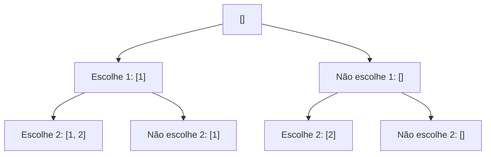

## Passo 1 · Leitura · O esqueleto escolher → recursar → desfazer

Muitos problemas exigem explorar uma árvore de decisões: gerar todos os subconjuntos, permutar elementos ou preencher um tabuleiro respeitando regras. Em vez de criar uma nova cópia da solução parcial a cada ramo da árvore, o **backtracking** mantém **um único estado mutável** (`caminho`) e segue um ritual de três passos para cada escolha candidata:

1. **Escolher:** adiciona a escolha ao estado parcial (`caminho.append(escolha)`).
2. **Recursar:** explora todas as continuações a partir desse novo estado (`explorar(...)`).
3. **Desfazer (*backtrack*):** remove a escolha ao voltar da recursão (`caminho.pop()`), restaurando o estado exato em que estava antes para tentar a próxima alternativa!



#### Duas armadilhas clássicas no backtracking

- **Guardar `caminho` em vez de `caminho[:]` (ou `list(caminho)`):** como `caminho` é a **mesma lista** que será esvaziada pelos `.pop()` seguintes, se você fizer `solucoes.append(caminho)` no caso base, ao final da busca `solucoes` conterá várias referências para a mesma lista vazia `[ [], [], ... ]`! Sempre salve um *snapshot*: `solucoes.append(caminho[:])`.
- **Esquecer o `.pop()`:** sem desfazer a escolha após a chamada recursiva, os elementos dos ramos anteriores se acumulam na lista e corrompem todos os ramos seguintes.

Veja no visualizador como `subconjuntos([1, 2])` constrói os 4 subconjuntos usando uma única lista `caminho`:

```python visualizar
def subconjuntos(lista):
    res = []
    caminho = []
    def backtrack(i):
        res.append(caminho[:])
        for j in range(i, len(lista)):
            caminho.append(lista[j])
            backtrack(j + 1)
            caminho.pop()
    backtrack(0)
    return res

print(subconjuntos([1, 2]))
```

## Passo 2 · Exercício · Gerando subconjuntos e permutações sem `itertools`
modo: lacunas

Complete as lacunas para implementar `subconjuntos(lista)` (em ordem lexicográfica de índices) e `permutacoes(lista)` usando o padrão `append` → recursão → `pop`, **sem usar `import`** (a biblioteca padrão `itertools` faz o mesmo em C, mas aqui o objetivo é dominar o mecanismo).

### Instruções
1. Em `subconjuntos(lista)`, a cada entrada em `explorar(inicio)`, salve uma cópia `caminho[:]` em `resultado`. No laço `for j in range(inicio, len(lista))`, faça `caminho.append(lista[j])`, chame `explorar(j + 1)` e desfaça com `caminho.pop()`.
2. Em `permutacoes(lista)`, quando `len(caminho) == len(lista)`, salve uma cópia `caminho[:]` em `resultado` e retorne. Caso contrário, para cada índice `i` ainda não usado (`not usado[i]`), marque `usado[i] = True`, adicione `lista[i]` a `caminho`, recurse e desfaça ambos (`caminho.pop()` e `usado[i] = False`).

### Código inicial
```python
def subconjuntos(lista):
    resultado = []
    caminho = []

    def explorar(inicio):
        resultado.append(caminho[___])
        for j in range(inicio, len(lista)):
            caminho.append(lista[j])
            explorar(___)
            caminho.___()

    explorar(0)
    return resultado


def permutacoes(lista):
    resultado = []
    caminho = []
    usado = [False] * len(lista)

    def explorar():
        if len(caminho) == len(lista):
            resultado.append(caminho[:])
            return
        for i in range(len(lista)):
            if not usado[i]:
                usado[i] = True
                caminho.append(lista[i])
                explorar()
                caminho.pop()
                usado[i] = ___

    explorar()
    return resultado
```

### Solução
```python
def subconjuntos(lista):
    resultado = []
    caminho = []

    def explorar(inicio):
        resultado.append(caminho[:])
        for j in range(inicio, len(lista)):
            caminho.append(lista[j])
            explorar(j + 1)
            caminho.pop()

    explorar(0)
    return resultado


def permutacoes(lista):
    resultado = []
    caminho = []
    usado = [False] * len(lista)

    def explorar():
        if len(caminho) == len(lista):
            resultado.append(caminho[:])
            return
        for i in range(len(lista)):
            if not usado[i]:
                usado[i] = True
                caminho.append(lista[i])
                explorar()
                caminho.pop()
                usado[i] = False

    explorar()
    return resultado
```

### Dicas
1. `caminho[:]` cria uma cópia rasa da lista atual para que os `.pop()` futuros não alterem o subconjunto já salvo.
2. Em `subconjuntos`, a chamada recursiva passa `j + 1` para só considerar elementos à direita do índice `j`.
3. Em `permutacoes`, ao desfazer a escolha do índice `i`, volte `usado[i]` para `False`.

### Verificação
```json
[
  {
    "id": "sem-import",
    "checkpoint": 1,
    "kind": "source",
    "rule": { "type": "not_uses", "construct": "import" },
    "name": "Não usa import (implementação própria sem itertools)"
  },
  {
    "id": "subconjuntos-123",
    "checkpoint": 1,
    "kind": "call",
    "function": "subconjuntos",
    "args": [[1, 2, 3]],
    "expected": [[], [1], [1, 2], [1, 2, 3], [1, 3], [2], [2, 3], [3]],
    "name": "subconjuntos([1, 2, 3]) devolve os 8 subconjuntos na ordem lexicográfica de índices"
  },
  {
    "id": "permutacoes-123",
    "checkpoint": 2,
    "kind": "call",
    "function": "permutacoes",
    "args": [[1, 2, 3]],
    "expected": [[1, 2, 3], [1, 3, 2], [2, 1, 3], [2, 3, 1], [3, 1, 2], [3, 2, 1]],
    "name": "permutacoes([1, 2, 3]) devolve as 6 permutações em ordem lexicográfica"
  }
]
```

### Soluções erradas
```python name="salva referência para caminho sem copiar com [:]"
def subconjuntos(lista):
    resultado = []
    caminho = []

    def explorar(inicio):
        resultado.append(caminho)
        for j in range(inicio, len(lista)):
            caminho.append(lista[j])
            explorar(j + 1)
            caminho.pop()

    explorar(0)
    return resultado


def permutacoes(lista):
    return []
```
```python name="esquece de restaurar usado[i] = False no backtrack"
def subconjuntos(lista):
    resultado = []
    caminho = []

    def explorar(inicio):
        resultado.append(caminho[:])
        for j in range(inicio, len(lista)):
            caminho.append(lista[j])
            explorar(j + 1)
            caminho.pop()

    explorar(0)
    return resultado


def permutacoes(lista):
    resultado = []
    caminho = []
    usado = [False] * len(lista)

    def explorar():
        if len(caminho) == len(lista):
            resultado.append(caminho[:])
            return
        for i in range(len(lista)):
            if not usado[i]:
                usado[i] = True
                caminho.append(lista[i])
                explorar()
                caminho.pop()

    explorar()
    return resultado
```

## Passo 3 · Leitura · Poda (*pruning*): N-Rainhas e Soma de Subconjuntos

A diferença entre a força bruta cega e o backtracking inteligente é a **poda (*pruning*)**: cortar um ramo inteiro da árvore de busca assim que percebemos que ele violou uma restrição e **jamais** levará a uma solução válida.

#### O problema das $N$-Rainhas

Queremos posicionar $N$ rainhas em um tabuleiro $N \times N$ de xadrez sem que duas rainhas se ataquem (mesma linha, coluna ou diagonal).
- **Força bruta cega:** escolher $8$ casas dentre $64$ tem $\binom{64}{8} \approx 4{,}4 \times 10^9$ configurações.
- **Colocar 1 rainha por linha:** reduz para $8^8 \approx 1{,}67 \times 10^7$ configurações.
- **Backtracking com poda imediata:** ao tentar colocar uma rainha na `(linha, col)`, só avançamos se `col` não estiver ocupada e se nenhuma das duas diagonais estiver ocupada!
  - Na diagonal principal ($\searrow$), todas as casas têm a mesma diferença **`linha - col`**.
  - Na diagonal secundária ($\swarrow$), todas as casas têm a mesma soma **`linha + col`**.

Mantendo três conjuntos (`colunas`, `diag1`, `diag2`), testamos em $O(1)$ se a casa `(linha, col)` é segura. Para $N = 8$, a árvore podada visita apenas $15\,720$ nós e encontra todas as **$92$ soluções** em poucos milissegundos!

#### Poda em Soma de Subconjuntos

Dado um vetor de inteiros positivos `numeros` e um `alvo`, queremos encontrar um subconjunto cuja soma seja exatamente `alvo`. Se em algum ramo a `soma_atual` já **ultrapassar** `alvo` (`soma_atual > alvo`), como todos os números restantes são positivos, podemos **podar** imediatamente esse ramo sem explorar o resto da lista!

## Passo 4 · Exercício · N-Rainhas e Soma de Subconjuntos com poda

Implemente duas funções:
1. `n_rainhas(n)`: devolve o **número total de soluções distintas** para posicionar `n` rainhas em um tabuleiro $n \times n$ sem que nenhuma ataque outra. Deve rodar rapidamente para `n = 8` (devolvendo `92`).
2. `soma_subconjuntos(numeros, alvo)`: recebe uma lista de inteiros positivos `numeros` e um inteiro `alvo` ($\ge 0$), e devolve uma lista contendo um subconjunto de elementos de `numeros` (na ordem em que aparecem) cuja soma seja `alvo`, ou `None` se nenhum subconjunto somar `alvo`.

### Instruções
1. Em `n_rainhas(n)`, mantenha os conjuntos `colunas = set()`, `diag1 = set()` (para `linha - col`) e `diag2 = set()` (para `linha + col`). Na função recursiva `posicionar(linha)`, se `linha == n`, conte `1` solução; caso contrário, tente cada `col` de `0` a `n - 1` que não esteja em `colunas`, nem `linha - col` em `diag1`, nem `linha + col` em `diag2` (adicione aos conjuntos, recurse para `linha + 1` e remova dos conjuntos no *backtrack*).
2. Em `soma_subconjuntos(numeros, alvo)`, faça backtracking podando sempre que `soma_atual > alvo`. Quando `soma_atual == alvo`, devolva `caminho[:]`; se todas as opções falharem, devolva `None`.

### Código inicial
```python
def n_rainhas(n):
    # Devolva a quantidade de soluções para o problema das N-Rainhas
    pass


def soma_subconjuntos(numeros, alvo):
    # Devolva uma lista com os elementos que somam alvo, ou None se impossível
    pass
```

### Solução
```python
def n_rainhas(n):
    colunas = set()
    diag1 = set()
    diag2 = set()
    total = 0

    def posicionar(linha):
        nonlocal total
        if linha == n:
            total += 1
            return
        for col in range(n):
            d1 = linha - col
            d2 = linha + col
            if col not in colunas and d1 not in diag1 and d2 not in diag2:
                colunas.add(col)
                diag1.add(d1)
                diag2.add(d2)
                posicionar(linha + 1)
                colunas.remove(col)
                diag1.remove(d1)
                diag2.remove(d2)

    posicionar(0)
    return total


def soma_subconjuntos(numeros, alvo):
    caminho = []

    def buscar(indice, soma_atual):
        if soma_atual == alvo:
            return caminho[:]
        if soma_atual > alvo or indice == len(numeros):
            return None
        caminho.append(numeros[indice])
        achou = buscar(indice + 1, soma_atual + numeros[indice])
        if achou is not None:
            return achou
        caminho.pop()
        return buscar(indice + 1, soma_atual)

    return buscar(0, 0)
```

### Dicas
1. Em `n_rainhas`, lembre-se de remover `col`, `linha - col` e `linha + col` dos respectivos conjuntos logo após o retorno de `posicionar(linha + 1)`.
2. Em `soma_subconjuntos`, verifique `if soma_atual == alvo:` **antes** de `if indice == len(numeros):`, pois a solução pode usar exatamente o último elemento da lista!

### Verificação
```json
[
  {
    "id": "n-rainhas-pequenos",
    "checkpoint": 1,
    "kind": "expr",
    "expr": "[n_rainhas(1), n_rainhas(4), n_rainhas(5)]",
    "expected": [1, 2, 10],
    "name": "n_rainhas para n = 1, 4 e 5 devolve [1, 2, 10]"
  },
  {
    "id": "n-rainhas-8",
    "checkpoint": 1,
    "kind": "call",
    "function": "n_rainhas",
    "args": [8],
    "expected": 92,
    "name": "n_rainhas(8) devolve 92 rapidamente graças à poda"
  },
  {
    "id": "soma-subconjuntos-encontra",
    "checkpoint": 2,
    "kind": "expr",
    "setup": "res = soma_subconjuntos([3, 34, 4, 12, 5, 2], 9)",
    "expr": "[res is not None and sum(res) == 9, sorted(res) if res else []]",
    "expected": [true, [2, 3, 4]],
    "name": "Encontra subconjunto de [3, 34, 4, 12, 5, 2] que soma 9 (ou [4, 5])",
    "hint": "Qualquer subconjunto válido cuja soma seja 9 é aceito."
  },
  {
    "id": "soma-subconjuntos-impossivel",
    "checkpoint": 2,
    "kind": "call",
    "function": "soma_subconjuntos",
    "args": [[3, 34, 4, 12, 5, 2], 30],
    "expected": null,
    "name": "Devolve None quando nenhum subconjunto soma 30"
  }
]
```

### Soluções erradas
```python name="verifica apenas colunas e ignora diagonais em n_rainhas"
def n_rainhas(n):
    colunas = set()
    total = 0

    def posicionar(linha):
        nonlocal total
        if linha == n:
            total += 1
            return
        for col in range(n):
            if col not in colunas:
                colunas.add(col)
                posicionar(linha + 1)
                colunas.remove(col)

    posicionar(0)
    return total


def soma_subconjuntos(numeros, alvo):
    return None
```
```python name="devolve lista vazia em vez de None quando não há solução em soma_subconjuntos"
def n_rainhas(n):
    colunas, d1, d2 = set(), set(), set()
    total = 0

    def posicionar(l):
        nonlocal total
        if l == n:
            total += 1
            return
        for c in range(n):
            if c not in colunas and (l - c) not in d1 and (l + c) not in d2:
                colunas.add(c)
                d1.add(l - c)
                d2.add(l + c)
                posicionar(l + 1)
                colunas.remove(c)
                d1.remove(l - c)
                d2.remove(l + c)

    posicionar(0)
    return total


def soma_subconjuntos(numeros, alvo):
    return []
```

## Passo 5 · Exercício · Resolvendo um Mini-Sudoku $4 \times 4$

Em um **Mini-Sudoku $4 \times 4$**, a grade tem $4$ linhas, $4$ colunas e $4$ blocos $2 \times 2$, preenchidos com dígitos de `1` a `4` (casas vazias vêm com `0`).

Implemente `resolver_sudoku4(grade)`, que recebe uma matriz $4 \times 4$ (`list[list[int]]`), preenche os zeros usando backtracking e devolve a grade resolvida (ou `None` se não houver solução).

### Instruções
1. Crie uma função auxiliar `pode_colocar(grade, r, c, num)` que verifica se `num` (`1`..`4`) não aparece na linha `r`, nem na coluna `c`, nem no bloco $2 \times 2$ cujo canto superior esquerdo é `((r // 2) * 2, (c // 2) * 2)`.
2. Procure a primeira posição `(r, c)` com `grade[r][c] == 0`. Se não houver nenhuma casa vazia, o tabuleiro está completo: devolva `grade` (ou `True` na auxiliar recursiva).
3. Para a casa vazia `(r, c)`, tente cada `num` de `1` a `4` que passe em `pode_colocar`: atribua `grade[r][c] = num`, chame recursivamente a resolução e, se ela falhar, desfaça fazendo `grade[r][c] = 0` (*backtrack*!).

### Código inicial
```python
def resolver_sudoku4(grade):
    # Resolva o Mini-Sudoku 4x4 com dígitos de 1 a 4 e devolva a grade (ou None)
    pass
```

### Solução
```python
def resolver_sudoku4(grade):
    tabuleiro = [linha[:] for linha in grade]

    def pode_colocar(r, c, num):
        for i in range(4):
            if tabuleiro[r][i] == num or tabuleiro[i][c] == num:
                return False
        br = (r // 2) * 2
        bc = (c // 2) * 2
        for dr in range(2):
            for dc in range(2):
                if tabuleiro[br + dr][bc + dc] == num:
                    return False
        return True

    def backtrack():
        for r in range(4):
            for c in range(4):
                if tabuleiro[r][c] == 0:
                    for num in range(1, 5):
                        if pode_colocar(r, c, num):
                            tabuleiro[r][c] = num
                            if backtrack():
                                return True
                            tabuleiro[r][c] = 0
                    return False
        return True

    if backtrack():
        return tabuleiro
    return None
```

### Dicas
1. Assim que encontrar a primeira célula vazia `tabuleiro[r][c] == 0`, tente os dígitos `1..4` e dê `return False` se nenhum funcionar — nunca continue o laço duplo deixando uma célula vazia para trás!
2. O canto superior esquerdo do sub-bloco $2 \times 2$ da posição `(r, c)` é `(r // 2 * 2, c // 2 * 2)`.

### Verificação
```json
[
  {
    "id": "sudoku4-resolve",
    "checkpoint": 1,
    "kind": "call",
    "function": "resolver_sudoku4",
    "args": [[[1, 0, 0, 4], [0, 0, 1, 0], [0, 1, 0, 0], [4, 0, 0, 1]]],
    "expected": [[1, 2, 3, 4], [3, 4, 1, 2], [2, 1, 4, 3], [4, 3, 2, 1]],
    "name": "Resolve corretamente um Mini-Sudoku 4x4"
  },
  {
    "id": "sudoku4-com-backtrack",
    "checkpoint": 3,
    "kind": "call",
    "function": "resolver_sudoku4",
    "args": [[[0, 0, 2, 1], [1, 2, 3, 4], [2, 0, 1, 3], [0, 1, 4, 2]]],
    "expected": [[4, 3, 2, 1], [1, 2, 3, 4], [2, 4, 1, 3], [3, 1, 4, 2]],
    "name": "Trata caso onde é necessário desfazer células preenchidas após falha mais adiante"
  }
]
```

### Soluções erradas
```python name="esquece de voltar a célula para 0 quando o ramo falha"
def resolver_sudoku4(grade):
    tabuleiro = [linha[:] for linha in grade]

    def pode_colocar(r, c, num):
        for i in range(4):
            if tabuleiro[r][i] == num or tabuleiro[i][c] == num:
                return False
        br, bc = (r // 2) * 2, (c // 2) * 2
        for dr in range(2):
            for dc in range(2):
                if tabuleiro[br + dr][bc + dc] == num:
                    return False
        return True

    def backtrack():
        for r in range(4):
            for c in range(4):
                if tabuleiro[r][c] == 0:
                    for num in range(1, 5):
                        if pode_colocar(r, c, num):
                            tabuleiro[r][c] = num
                            if backtrack():
                                return True
                    return False
        return True

    return tabuleiro if backtrack() else None
```
```python name="não verifica o bloco 2x2"
def resolver_sudoku4(grade):
    tabuleiro = [linha[:] for linha in grade]

    def pode_colocar(r, c, num):
        for i in range(4):
            if tabuleiro[r][i] == num or tabuleiro[i][c] == num:
                return False
        return True

    def backtrack():
        for r in range(4):
            for c in range(4):
                if tabuleiro[r][c] == 0:
                    for num in range(1, 5):
                        if pode_colocar(r, c, num):
                            tabuleiro[r][c] = num
                            if backtrack():
                                return True
                            tabuleiro[r][c] = 0
                    return False
        return True

    return tabuleiro if backtrack() else None
```

## Passo 6 · Quiz · Backtracking e poda

### Pergunta
No esqueleto de geração de subconjuntos com uma única lista mutável `caminho`, o que acontece se no caso base fizermos `resultado.append(caminho)` em vez de `resultado.append(caminho[:])`?
- [ ] O código levanta `TypeError` porque não é permitido anexar uma lista dentro de outra lista.
- [ ] Apenas o primeiro subconjunto sai correto e os demais não são adicionados.
- [x] Todos os elementos de `resultado` apontarão para o mesmo objeto `caminho`, que termina vazio `[]` após todos os `.pop()` do backtracking, resultando em `[ [], [], ..., [] ]`.
- [ ] O algoritmo fica duas vezes mais rápido sem alterar o resultado.
> Em Python, `resultado.append(caminho)` guarda apenas uma referência para a lista `caminho`. Como o backtracking desfaz todas as escolhas até o fim da execução, a lista `caminho` termina vazia e todas as referências apontam para `[]`.

### Pergunta
Qual é o papel da **poda (*pruning*)** na resolução do problema das $8$-Rainhas por backtracking?
- [ ] Reduzir o número de soluções existentes de $8!$ para $92$.
- [x] Interromper imediatamente a exploração de uma configuração parcial na linha $r$ assim que se detecta conflito de coluna ou diagonal com as rainhas das linhas $0 \dots r-1$, evitando gerar as $8^{8-r}$ continuações inválidas daquela subárvore.
- [ ] Substituir a pilha de recursão por uma tabela hash.
- [ ] Garantir que o algoritmo encontre apenas 1 solução em vez de todas as 92.
> A poda não perde nenhuma solução válida: ela apenas descarta subárvores inteiras cuja raiz parcial já viola uma restrição do problema.
