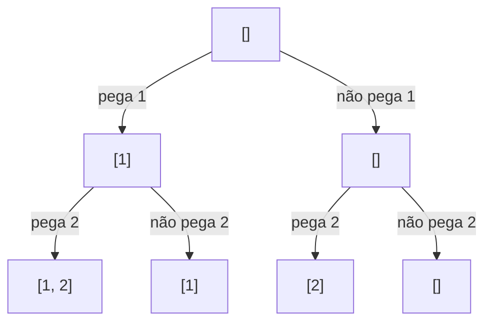

## Passo 1 · Leitura · Escolher, explorar, desfazer

Vários problemas pedem **todas** as respostas que respeitam uma regra: todos os grupos de trabalho possíveis numa turma, todas as ordens de apresentação, todos os jeitos de pagar uma conta com as notas da carteira. A resposta se monta com uma sequência de escolhas, e as escolhas formam uma **árvore**: cada nó é uma solução parcial, e cada filho acrescenta uma escolha.

Para gerar os subconjuntos de `[1, 2]`, a primeira decisão é pegar ou não o 1; a segunda, pegar ou não o 2. As quatro folhas são as quatro respostas.



O **backtracking** percorre essa árvore em profundidade com **uma única lista** `caminho`, que guarda a solução parcial do nó atual. Para cada escolha possível, ele repete o mesmo ritual:

1. **Escolher:** acrescenta a escolha ao estado (`caminho.append(x)`).
2. **Explorar:** chama a si mesmo para resolver o resto a partir desse estado.
3. **Desfazer:** ao voltar, remove a escolha (`caminho.pop()`), e o estado fica exatamente como estava antes. Só assim a próxima alternativa começa do lugar certo.

O desfazer é o que permite usar uma lista só para a árvore inteira. Sem ele, as escolhas de um ramo continuam na lista quando o ramo vizinho começa, e todas as respostas seguintes saem contaminadas.

O outro tropeço é guardar a resposta. Na folha, `caminho` é a resposta certa **naquele instante**, mas a mesma lista vai ser alterada pelos próximos `pop`. Guarde uma cópia, `caminho[:]`.

No visualizador, o mesmo ritual gera as sequências de 2 bits. Observe `caminho` crescer na descida e encolher na volta.

```python visualizar
def sequencias(n):
    res = []
    caminho = []

    def explorar():
        if len(caminho) == n:
            res.append("".join(caminho))
            return
        for bit in "01":
            caminho.append(bit)     # escolher
            explorar()              # explorar
            caminho.pop()           # desfazer

    explorar()
    return res


print(sequencias(2))
```

## Passo 2 · Previsão · A mesma lista em todo lugar

Este programa percorre a árvore do passo anterior, imprime cada folha e guarda a resposta com `res.append(caminho)`, sem cópia. Leia sem executar e digite exatamente o que ele imprime.

### Código
```python
def subconjuntos(v):
    res = []
    caminho = []

    def explorar(i):
        if i == len(v):
            print("folha", caminho)
            res.append(caminho)
            return
        caminho.append(v[i])
        explorar(i + 1)
        caminho.pop()
        explorar(i + 1)

    explorar(0)
    return res


print(subconjuntos([1, 2]))
```

### Dicas
1. Em cada nó, o ramo que pega `v[i]` é explorado antes do ramo que não pega.
2. O `print` mostra o conteúdo de `caminho` no momento em que a folha é alcançada.
3. `res.append(caminho)` guarda uma referência para a lista, não o conteúdo dela. O que há nessa lista quando a última chamada termina?

### Saída esperada
```text
folha [1, 2]
folha [1]
folha [2]
folha []
[[], [], [], []]
```

## Passo 3 · Exercício · Subconjuntos e permutações
modo: lacunas

Complete as lacunas (`___`) de `subconjuntos(lista)` e `permutacoes(lista)`, sem `import` (o `itertools` faz isso em C; aqui o objetivo é o mecanismo).

- `subconjuntos` usa outra forma da árvore: cada nó guarda a resposta parcial e tenta acrescentar cada elemento **à direita** do último escolhido. A saída sai em ordem lexicográfica de índices: `subconjuntos([1, 2, 3])` é `[[], [1], [1, 2], [1, 2, 3], [1, 3], [2], [2, 3], [3]]`.
- `permutacoes` marca em `usado` os índices já colocados no caminho. `permutacoes([1, 2, 3])` começa com `[1, 2, 3]`, `[1, 3, 2]`, `[2, 1, 3]`.

### Instruções
1. Guarde em `resultado` uma cópia do caminho atual, não a própria lista.
2. Depois de escolher `lista[j]`, continue só com os elementos à direita dele.
3. Ao voltar da chamada, desfaça a escolha do caminho.
4. Em `permutacoes`, ao voltar, libere o índice `i` para os próximos ramos.

### Código inicial
```python
def subconjuntos(lista):
    resultado = []
    caminho = []

    def explorar(inicio):
        resultado.append(caminho[___])
        for j in range(inicio, len(lista)):
            caminho.append(lista[j])
            explorar(___)
            caminho.___()

    explorar(0)
    return resultado


def permutacoes(lista):
    resultado = []
    caminho = []
    usado = [False] * len(lista)

    def explorar():
        if len(caminho) == len(lista):
            resultado.append(caminho[:])
            return
        for i in range(len(lista)):
            if not usado[i]:
                usado[i] = True
                caminho.append(lista[i])
                explorar()
                caminho.pop()
                usado[i] = ___

    explorar()
    return resultado
```

### Solução
```python
def subconjuntos(lista):
    resultado = []
    caminho = []

    def explorar(inicio):
        resultado.append(caminho[:])
        for j in range(inicio, len(lista)):
            caminho.append(lista[j])
            explorar(j + 1)
            caminho.pop()

    explorar(0)
    return resultado


def permutacoes(lista):
    resultado = []
    caminho = []
    usado = [False] * len(lista)

    def explorar():
        if len(caminho) == len(lista):
            resultado.append(caminho[:])
            return
        for i in range(len(lista)):
            if not usado[i]:
                usado[i] = True
                caminho.append(lista[i])
                explorar()
                caminho.pop()
                usado[i] = False

    explorar()
    return resultado
```

### Dicas
1. Uma fatia que vai do começo ao fim copia a lista inteira.
2. O próximo nível começa logo depois do índice escolhido agora, e não logo depois de `inicio`.
3. Tudo o que foi marcado na escolha precisa voltar ao que era antes do próximo ramo.

### Verificação
```json
[
  { "id": "sem-import", "checkpoint": 1, "kind": "source", "rule": { "type": "not_uses", "construct": "import" },
    "name": "Não usa import" },
  { "id": "sub-123", "checkpoint": 2, "kind": "call", "function": "subconjuntos", "args": [[1, 2, 3]],
    "expected": [[], [1], [1, 2], [1, 2, 3], [1, 3], [2], [2, 3], [3]],
    "name": "subconjuntos([1, 2, 3]) em ordem lexicográfica de índices", "hint": "Cada subconjunto aparece uma vez, com os elementos na ordem da lista." },
  { "id": "sub-vazia", "checkpoint": 1, "kind": "call", "function": "subconjuntos", "args": [[]], "expected": [[]],
    "name": "subconjuntos([]) é [[]]" },
  { "id": "sub-letras", "checkpoint": 1, "kind": "call", "function": "subconjuntos", "args": [["a", "b"]], "expected": [[], ["a"], ["a", "b"], ["b"]],
    "name": "subconjuntos(['a', 'b'])", "hint": "Se tudo sair vazio, o resultado guarda a própria lista caminho." },
  { "id": "sub-10", "checkpoint": 3, "kind": "expr", "setup": "r = subconjuntos(list(range(10)))",
    "expr": "[len(r), len(set(map(tuple, r))), all(list(s) == sorted(s) for s in r)]", "expected": [1024, 1024, true],
    "name": "10 elementos: 1024 subconjuntos distintos", "hint": "Sem desfazer a escolha, os elementos de um ramo vazam para o seguinte." },
  { "id": "perm-123", "checkpoint": 4, "kind": "call", "function": "permutacoes", "args": [[1, 2, 3]],
    "expected": [[1, 2, 3], [1, 3, 2], [2, 1, 3], [2, 3, 1], [3, 1, 2], [3, 2, 1]],
    "name": "permutacoes([1, 2, 3]) em ordem", "hint": "Um índice usado num ramo precisa ficar livre no ramo seguinte." },
  { "id": "perm-vazia", "checkpoint": 4, "kind": "call", "function": "permutacoes", "args": [[]], "expected": [[]],
    "name": "permutacoes([]) é [[]]" },
  { "id": "perm-6", "checkpoint": 4, "kind": "expr", "setup": "r = permutacoes(list('abcdef'))",
    "expr": "[len(r), len(set(map(tuple, r))), all(sorted(p) == list('abcdef') for p in r)]", "expected": [720, 720, true],
    "name": "6 elementos: 720 permutações distintas" }
]
```

### Soluções erradas
```python name="guarda a lista caminho sem copiar"
def subconjuntos(lista):
    resultado = []
    caminho = []

    def explorar(inicio):
        resultado.append(caminho)
        for j in range(inicio, len(lista)):
            caminho.append(lista[j])
            explorar(j + 1)
            caminho.pop()

    explorar(0)
    return resultado


def permutacoes(lista):
    resultado = []
    caminho = []
    usado = [False] * len(lista)

    def explorar():
        if len(caminho) == len(lista):
            resultado.append(caminho[:])
            return
        for i in range(len(lista)):
            if not usado[i]:
                usado[i] = True
                caminho.append(lista[i])
                explorar()
                caminho.pop()
                usado[i] = False

    explorar()
    return resultado
```
```python name="continua de inicio + 1 em vez de j + 1"
def subconjuntos(lista):
    resultado = []
    caminho = []

    def explorar(inicio):
        resultado.append(caminho[:])
        for j in range(inicio, len(lista)):
            caminho.append(lista[j])
            explorar(inicio + 1)
            caminho.pop()

    explorar(0)
    return resultado


def permutacoes(lista):
    resultado = []
    caminho = []
    usado = [False] * len(lista)

    def explorar():
        if len(caminho) == len(lista):
            resultado.append(caminho[:])
            return
        for i in range(len(lista)):
            if not usado[i]:
                usado[i] = True
                caminho.append(lista[i])
                explorar()
                caminho.pop()
                usado[i] = False

    explorar()
    return resultado
```
```python name="esquece de desfazer a escolha"
def subconjuntos(lista):
    resultado = []
    caminho = []

    def explorar(inicio):
        resultado.append(caminho[:])
        for j in range(inicio, len(lista)):
            caminho.append(lista[j])
            explorar(j + 1)

    explorar(0)
    return resultado


def permutacoes(lista):
    resultado = []
    caminho = []
    usado = [False] * len(lista)

    def explorar():
        if len(caminho) == len(lista):
            resultado.append(caminho[:])
            return
        for i in range(len(lista)):
            if not usado[i]:
                usado[i] = True
                caminho.append(lista[i])
                explorar()
                caminho.pop()
                usado[i] = False

    explorar()
    return resultado
```
```python name="não libera usado[i] na volta"
def subconjuntos(lista):
    resultado = []
    caminho = []

    def explorar(inicio):
        resultado.append(caminho[:])
        for j in range(inicio, len(lista)):
            caminho.append(lista[j])
            explorar(j + 1)
            caminho.pop()

    explorar(0)
    return resultado


def permutacoes(lista):
    resultado = []
    caminho = []
    usado = [False] * len(lista)

    def explorar():
        if len(caminho) == len(lista):
            resultado.append(caminho[:])
            return
        for i in range(len(lista)):
            if not usado[i]:
                usado[i] = True
                caminho.append(lista[i])
                explorar()
                caminho.pop()

    explorar()
    return resultado
```
```python name="permutações sem conferir usado"
def subconjuntos(lista):
    resultado = []
    caminho = []

    def explorar(inicio):
        resultado.append(caminho[:])
        for j in range(inicio, len(lista)):
            caminho.append(lista[j])
            explorar(j + 1)
            caminho.pop()

    explorar(0)
    return resultado


def permutacoes(lista):
    resultado = []
    caminho = []

    def explorar():
        if len(caminho) == len(lista):
            resultado.append(caminho[:])
            return
        for i in range(len(lista)):
            caminho.append(lista[i])
            explorar()
            caminho.pop()

    explorar()
    return resultado
```

## Passo 4 · Leitura · O tamanho da árvore e a primeira poda

Antes de escrever um backtracking, estime quantas folhas a árvore tem. Com $n$ elementos:

| Gerar | Folhas | $n = 10$ | $n = 20$ |
| :--- | :---: | ---: | ---: |
| subconjuntos | $2^n$ | $1\,024$ | $1\,048\,576$ |
| permutações | $n!$ | $3\,628\,800$ | $\approx 2{,}4 \times 10^{18}$ |
| combinações de $k$ | $\binom{n}{k}$ | $\binom{10}{3} = 120$ | $\binom{20}{3} = 1\,140$ |

Um computador faz da ordem de $10^7$ chamadas de função Python por segundo. Gerar as $2{,}4 \times 10^{18}$ permutações de 20 itens levaria milhares de anos; nenhuma otimização de código resolve isso. O que resolve é **não visitar** a maior parte da árvore.

As **combinações** escolhem $k$ elementos de $n$, sem importar a ordem: os grupos de 3 alunos numa turma de 20. É a árvore dos subconjuntos, guardando só os nós com exatamente $k$ elementos. A versão direta para de descer quando o caminho chega a $k$, mas ainda visita todo nó com menos de $k$ elementos:

```python
chamadas = 0


def combinacoes_sem_poda(lista, k):
    res, caminho = [], []

    def explorar(inicio):
        global chamadas
        chamadas += 1
        if len(caminho) == k:
            res.append(caminho[:])
            return
        for j in range(inicio, len(lista)):
            caminho.append(lista[j])
            explorar(j + 1)
            caminho.pop()

    explorar(0)
    return res


print(len(combinacoes_sem_poda(list(range(16)), 14)), chamadas)   # 120 65520
```

São 65 520 chamadas para 120 respostas. Quase todas descem por ramos sem saída: um caminho com 2 elementos que começou no índice 13 nunca chega a 14 elementos, porque só restam 3 índices.

Essa é a **poda**: antes de descer, pergunte se ainda dá para chegar a uma resposta. Se o caminho tem $c$ elementos e restam $n - j$ índices a partir de $j$, só faz sentido continuar quando $c + (n - j) \ge k$. Com essa condição, o mesmo exemplo cai para cerca de 700 chamadas.

A poda precisa ser **segura**: só corte um ramo quando tiver certeza de que nenhuma folha dele é resposta. Errar a desigualdade por um, com `>` no lugar de `>=`, corta exatamente os ramos em que os elementos restantes completam o grupo na conta certa, e respostas somem sem nenhum erro aparecer.

## Passo 5 · Exercício · Combinações com poda

Escreva `combinacoes(lista, k)`, que devolve todas as combinações de `k` elementos de `lista` (`k >= 0`), cada uma com os elementos na ordem da lista, em ordem lexicográfica de índices. Sem `import`. A verificação conta as chamadas recursivas: com 16 elementos e `k = 14`, aceite no máximo 3 000.

Exemplo: `combinacoes(["Ana", "Bia", "Caio"], 2)` é `[["Ana", "Bia"], ["Ana", "Caio"], ["Bia", "Caio"]]`.

### Instruções
1. Guarde uma cópia do caminho quando ele tiver `k` elementos.
2. Escolha cada próximo elemento à direita do último escolhido e desfaça a escolha na volta.
3. Não desça por um ramo em que os elementos restantes não bastam para completar `k`, sem cortar nenhum ramo que ainda completa.

### Código inicial
```python
def combinacoes(lista, k):
    pass
```

### Solução
```python
def combinacoes(lista, k):
    n = len(lista)
    resultado = []
    caminho = []

    def explorar(inicio):
        if len(caminho) == k:
            resultado.append(caminho[:])
            return
        faltam = k - len(caminho)
        for j in range(inicio, n - faltam + 1):
            caminho.append(lista[j])
            explorar(j + 1)
            caminho.pop()

    explorar(0)
    return resultado
```

### Dicas
1. Se faltam `f` elementos, o primeiro deles pode ser escolhido no índice `n - f` no máximo: depois dele ainda precisam caber `f - 1`.
2. Teste a borda na mão: com `lista` de 4 elementos e `k = 4`, só existe um caminho, e ele precisa sobreviver à poda.
3. `k = 0` tem uma resposta: o grupo vazio.

### Verificação
```json
[
  { "id": "sem-import", "checkpoint": 2, "kind": "source", "rule": { "type": "not_uses", "construct": "import" },
    "name": "Não usa import" },
  { "id": "usa-recursao", "checkpoint": 2, "kind": "source", "rule": { "type": "uses", "construct": "recursion" },
    "name": "Usa recursão" },
  { "id": "c-4-2", "checkpoint": 2, "kind": "call", "function": "combinacoes", "args": [[1, 2, 3, 4], 2],
    "expected": [[1, 2], [1, 3], [1, 4], [2, 3], [2, 4], [3, 4]],
    "name": "combinacoes([1, 2, 3, 4], 2)", "hint": "Cada próximo elemento vem à direita do último escolhido." },
  { "id": "c-k0", "checkpoint": 1, "kind": "call", "function": "combinacoes", "args": [[5, 6, 7], 0], "expected": [[]],
    "name": "k = 0 dá [[]]" },
  { "id": "c-k-n", "checkpoint": 3, "kind": "expr", "expr": "[combinacoes([5, 6, 7, 8], 4), combinacoes(['x'], 1)]", "expected": [[[5, 6, 7, 8]], [["x"]]],
    "name": "k igual ao tamanho dá a própria lista", "hint": "Quando os restantes completam k na conta exata, o ramo ainda tem resposta." },
  { "id": "c-k-maior", "checkpoint": 3, "kind": "expr", "expr": "[combinacoes([1, 2], 3), combinacoes([], 1)]", "expected": [[], []],
    "name": "k maior que o tamanho dá []" },
  { "id": "c-nomes", "checkpoint": 2, "kind": "call", "function": "combinacoes", "args": [["Ana", "Bia", "Caio", "Davi", "Eva"], 3],
    "expected": [["Ana", "Bia", "Caio"], ["Ana", "Bia", "Davi"], ["Ana", "Bia", "Eva"], ["Ana", "Caio", "Davi"], ["Ana", "Caio", "Eva"], ["Ana", "Davi", "Eva"], ["Bia", "Caio", "Davi"], ["Bia", "Caio", "Eva"], ["Bia", "Davi", "Eva"], ["Caio", "Davi", "Eva"]],
    "name": "Grupos de 3 entre 5 alunos" },
  { "id": "c-10-4", "checkpoint": 3, "kind": "expr", "setup": "r = combinacoes(list(range(10)), 4)",
    "expr": "[len(r), len(set(map(tuple, r))), all(len(c) == 4 and list(c) == sorted(c) for c in r)]", "expected": [210, 210, true],
    "name": "10 escolhe 4: 210 combinações distintas" },
  { "id": "c-poda", "checkpoint": 3, "kind": "expr",
    "setup": "import sys\n_n = [0]\ndef _perfil(frame, evento, arg):\n    if evento == 'call' and frame.f_back is not None and frame.f_back.f_code is frame.f_code:\n        _n[0] += 1\nsys.setprofile(_perfil)\ntry:\n    r = combinacoes(list(range(16)), 14)\nfinally:\n    sys.setprofile(None)",
    "expr": "[len(r), r[0][-1], r[-1][0], _n[0] <= 3000]", "expected": [120, 13, 2, true],
    "name": "16 escolhe 14 com no máximo 3000 chamadas recursivas",
    "hint": "Sem poda, a árvore visita mais de 65 mil nós para achar 120 respostas." }
]
```

### Soluções erradas
```python name="sem poda"
def combinacoes(lista, k):
    n = len(lista)
    resultado = []
    caminho = []

    def explorar(inicio):
        if len(caminho) == k:
            resultado.append(caminho[:])
            return
        for j in range(inicio, n):
            caminho.append(lista[j])
            explorar(j + 1)
            caminho.pop()

    explorar(0)
    return resultado
```
```python name="poda com um índice a menos"
def combinacoes(lista, k):
    n = len(lista)
    resultado = []
    caminho = []

    def explorar(inicio):
        if len(caminho) == k:
            resultado.append(caminho[:])
            return
        faltam = k - len(caminho)
        for j in range(inicio, n - faltam):
            caminho.append(lista[j])
            explorar(j + 1)
            caminho.pop()

    explorar(0)
    return resultado
```
```python name="poda corta quando os restantes completam exatamente"
def combinacoes(lista, k):
    n = len(lista)
    resultado = []
    caminho = []

    def explorar(inicio):
        if len(caminho) == k:
            resultado.append(caminho[:])
            return
        if len(caminho) + (n - inicio) <= k:
            return
        for j in range(inicio, n):
            caminho.append(lista[j])
            explorar(j + 1)
            caminho.pop()

    explorar(0)
    return resultado
```
```python name="gera todos os subconjuntos e filtra pelo tamanho"
def combinacoes(lista, k):
    resultado = []
    caminho = []

    def explorar(i):
        if i == len(lista):
            if len(caminho) == k:
                resultado.append(caminho[:])
            return
        caminho.append(lista[i])
        explorar(i + 1)
        caminho.pop()
        explorar(i + 1)

    explorar(0)
    return resultado
```
```python name="continua de inicio + 1"
def combinacoes(lista, k):
    n = len(lista)
    resultado = []
    caminho = []

    def explorar(inicio):
        if len(caminho) == k:
            resultado.append(caminho[:])
            return
        faltam = k - len(caminho)
        for j in range(inicio, n - faltam + 1):
            caminho.append(lista[j])
            explorar(inicio + 1)
            caminho.pop()

    explorar(0)
    return resultado
```

## Passo 6 · Leitura · Poda segura: N rainhas e soma de subconjuntos

No problema das **$N$ rainhas**, coloque $N$ rainhas num tabuleiro $N \times N$ sem que duas se ataquem na mesma linha, coluna ou diagonal. Força bruta pura escolhe 8 casas entre 64: $\binom{64}{8} \approx 4{,}4 \times 10^9$ configurações. Como duas rainhas na mesma linha sempre se atacam, ponha **uma por linha**: a escolha em cada nível é a coluna. Isso dá $8^8 \approx 1{,}7 \times 10^7$ folhas, ou $8! = 40\,320$ se as colunas também não se repetem.

Para testar uma casa em $O(1)$, guarde três conjuntos: as colunas ocupadas, as diagonais $\searrow$ e as diagonais $\swarrow$. Numa diagonal $\searrow$, todas as casas têm a mesma diferença `linha - col`; numa $\swarrow$, a mesma soma `linha + col`. A rainha que entra marca os três conjuntos, e a volta desmarca **os três**. Esquecer de desmarcar um deles deixa uma diagonal bloqueada para sempre, e soluções somem.

Por que essa poda é segura? Se duas rainhas já se atacam nas primeiras linhas, nenhuma escolha nas linhas de baixo desfaz o ataque: toda folha daquele ramo é inválida. Testar a diagonal só na folha dá a mesma resposta, mas visita 109 601 nós para $N = 8$; testar a cada linha visita 2 057.

Na **soma de subconjuntos**, procuramos os subconjuntos de uma lista de inteiros **positivos** com soma igual a um alvo. Se a soma parcial já passou do alvo, pode cortar: somar positivos só aumenta. A segurança vem da hipótese "positivos". Com `[5, -3]` e alvo 2, a soma parcial 5 já passou do alvo, mas $5 + (-3) = 2$ é resposta. A mesma poda, com negativos, perde soluções.

Dá para cortar ainda mais com a lista ordenada: num laço de `j` crescente, se `soma + v[j]` passa do alvo, todos os `v[j]` seguintes também passam, e um `break` encerra o laço. Sem ordenar, o `break` corta números menores que viriam depois. E ordene uma cópia, com `sorted`: `.sort()` altera a lista de quem chamou.

```python
v = sorted(numeros)            # cópia ordenada; a lista original não muda
for j in range(inicio, len(v)):
    if soma + v[j] > alvo:
        break                  # seguro só porque v está em ordem crescente
```

A ordem dos testes também conta. Quem testa "acabaram os índices" antes de "a soma chegou ao alvo" perde toda resposta que usa o último elemento da lista.

## Passo 7 · Exercício · N rainhas e soma de subconjuntos

Escreva duas funções com backtracking e poda. A verificação conta as chamadas recursivas.

- `n_rainhas(n)` devolve quantas soluções existem para `n` rainhas (`n >= 1`). Para `n = 8`, são 92, com no máximo 20 000 chamadas recursivas.
- `soma_subconjuntos(numeros, alvo)` recebe inteiros positivos e um `alvo >= 0` e devolve **todos** os subconjuntos com soma `alvo`, cada um como lista. A ordem não importa, nem a das listas nem a dos números dentro delas. Posições diferentes contam como subconjuntos diferentes, mesmo com valores iguais. A lista recebida não pode mudar. Exemplo: `soma_subconjuntos([3, 34, 4, 12, 5, 2], 9)` tem `[3, 4, 2]` e `[4, 5]`.

### Instruções
1. Em `n_rainhas`, ponha uma rainha por linha e só desça quando a coluna e as duas diagonais da casa estiverem livres.
2. Na volta, desmarque tudo o que a rainha marcou.
3. Em `soma_subconjuntos`, registre a resposta quando a soma chegar ao alvo e corte os ramos que já passaram dele.
4. Não altere a lista recebida e não perca respostas que usam o último número.

### Código inicial
```python
def n_rainhas(n):
    pass


def soma_subconjuntos(numeros, alvo):
    pass
```

### Solução
```python
def n_rainhas(n):
    colunas = set()
    diag1 = set()
    diag2 = set()
    total = 0

    def posicionar(linha):
        nonlocal total
        if linha == n:
            total += 1
            return
        for col in range(n):
            d1 = linha - col
            d2 = linha + col
            if col not in colunas and d1 not in diag1 and d2 not in diag2:
                colunas.add(col)
                diag1.add(d1)
                diag2.add(d2)
                posicionar(linha + 1)
                colunas.remove(col)
                diag1.remove(d1)
                diag2.remove(d2)

    posicionar(0)
    return total


def soma_subconjuntos(numeros, alvo):
    v = sorted(numeros)
    resultado = []
    caminho = []

    def buscar(inicio, soma):
        if soma == alvo:
            resultado.append(caminho[:])
            return
        for j in range(inicio, len(v)):
            if soma + v[j] > alvo:
                break
            caminho.append(v[j])
            buscar(j + 1, soma + v[j])
            caminho.pop()

    buscar(0, 0)
    return resultado
```

### Dicas
1. Duas casas estão na mesma diagonal quando têm a mesma `linha - col` ou a mesma `linha + col`.
2. Com números positivos, se a soma já chegou ao alvo, acrescentar mais números só a faz passar dele.
3. Para cortar com `break`, os números precisam estar em ordem crescente; ordenar a lista recebida no lugar muda a lista de quem chamou.

### Verificação
```json
[
  { "id": "rainhas-pequenas", "checkpoint": 1, "kind": "expr", "expr": "[n_rainhas(n) for n in range(1, 7)]", "expected": [1, 0, 0, 2, 10, 4],
    "name": "n_rainhas de 1 a 6: 1, 0, 0, 2, 10, 4", "hint": "Confira as duas diagonais, linha - col e linha + col." },
  { "id": "rainhas-7", "checkpoint": 2, "kind": "call", "function": "n_rainhas", "args": [7], "expected": 40,
    "name": "n_rainhas(7) é 40", "hint": "Uma marca que não é desfeita bloqueia casas livres nos ramos seguintes." },
  { "id": "rainhas-8-poda", "checkpoint": 1, "kind": "expr",
    "setup": "import sys\n_n = [0]\ndef _perfil(frame, evento, arg):\n    if evento == 'call' and frame.f_back is not None and frame.f_back.f_code is frame.f_code:\n        _n[0] += 1\nsys.setprofile(_perfil)\ntry:\n    r = n_rainhas(8)\nfinally:\n    sys.setprofile(None)",
    "expr": "[r, _n[0] <= 20000]", "expected": [92, true],
    "name": "n_rainhas(8) é 92 com no máximo 20000 chamadas recursivas",
    "hint": "Testar as diagonais só com o tabuleiro cheio visita mais de 100 mil nós." },
  { "id": "soma-exemplo", "checkpoint": 3, "kind": "expr", "expr": "sorted(sorted(s) for s in soma_subconjuntos([3, 34, 4, 12, 5, 2], 9))", "expected": [[2, 3, 4], [4, 5]],
    "name": "[3, 34, 4, 12, 5, 2] com alvo 9", "hint": "Sem ordenar, um break corta números menores que viriam depois." },
  { "id": "soma-impossivel-zero", "checkpoint": 3, "kind": "expr", "expr": "[soma_subconjuntos([3, 34, 4, 12, 5, 2], 30), soma_subconjuntos([5, 3], 0)]", "expected": [[], [[]]],
    "name": "Sem resposta dá []; alvo 0 dá [[]]" },
  { "id": "soma-ultimo", "checkpoint": 4, "kind": "expr", "expr": "[sorted(sorted(s) for s in soma_subconjuntos([2, 4, 6], 6)), soma_subconjuntos([8, 6, 1], 1)]", "expected": [[[2, 4], [6]], [[1]]],
    "name": "Respostas que usam o último número", "hint": "Teste se a soma chegou ao alvo antes de testar se os índices acabaram." },
  { "id": "soma-repetidos", "checkpoint": 3, "kind": "expr", "expr": "soma_subconjuntos([1, 1, 1], 2)", "expected": [[1, 1], [1, 1], [1, 1]],
    "name": "Posições diferentes contam: [1, 1, 1] com alvo 2 tem 3 respostas" },
  { "id": "soma-nao-altera", "checkpoint": 4, "kind": "expr", "setup": "v = [7, 3, 12, 5]\nr = soma_subconjuntos(v, 15)",
    "expr": "[v, sorted(sorted(s) for s in r)]", "expected": [[7, 3, 12, 5], [[3, 5, 7], [3, 12]]],
    "name": "Não altera a lista recebida", "hint": "sorted(v) cria uma cópia; v.sort() muda a lista de quem chamou." },
  { "id": "soma-poda", "checkpoint": 3, "kind": "expr",
    "setup": "import sys\nv = [7, 3, 12, 5, 1, 9, 4, 15, 2, 8, 11, 6, 14, 10, 13, 16]\n_n = [0]\ndef _perfil(frame, evento, arg):\n    if evento == 'call' and frame.f_back is not None and frame.f_back.f_code is frame.f_code:\n        _n[0] += 1\nsys.setprofile(_perfil)\ntry:\n    r = soma_subconjuntos(v, 15)\nfinally:\n    sys.setprofile(None)",
    "expr": "[len(r), all(sum(s) == 15 for s in r), len(set(tuple(sorted(s)) for s in r)), _n[0] <= 2000]", "expected": [27, true, 27, true],
    "name": "16 números, alvo 15: 27 respostas com no máximo 2000 chamadas recursivas",
    "hint": "Sem poda, a árvore tem 2^16 folhas." }
]
```

### Soluções erradas
```python name="rainhas sem a diagonal linha + col"
def n_rainhas(n):
    colunas = set()
    diag1 = set()
    total = 0

    def posicionar(linha):
        nonlocal total
        if linha == n:
            total += 1
            return
        for col in range(n):
            if col not in colunas and linha - col not in diag1:
                colunas.add(col)
                diag1.add(linha - col)
                posicionar(linha + 1)
                colunas.remove(col)
                diag1.remove(linha - col)

    posicionar(0)
    return total


def soma_subconjuntos(numeros, alvo):
    v = sorted(numeros)
    resultado = []
    caminho = []

    def buscar(inicio, soma):
        if soma == alvo:
            resultado.append(caminho[:])
            return
        for j in range(inicio, len(v)):
            if soma + v[j] > alvo:
                break
            caminho.append(v[j])
            buscar(j + 1, soma + v[j])
            caminho.pop()

    buscar(0, 0)
    return resultado
```
```python name="rainhas testa as diagonais só no tabuleiro cheio"
def n_rainhas(n):
    usado = [False] * n
    cols = []
    total = 0

    def sem_ataque():
        for i in range(n):
            for j in range(i + 1, n):
                if abs(cols[i] - cols[j]) == j - i:
                    return False
        return True

    def posicionar(linha):
        nonlocal total
        if linha == n:
            if sem_ataque():
                total += 1
            return
        for col in range(n):
            if not usado[col]:
                usado[col] = True
                cols.append(col)
                posicionar(linha + 1)
                cols.pop()
                usado[col] = False

    posicionar(0)
    return total


def soma_subconjuntos(numeros, alvo):
    v = sorted(numeros)
    resultado = []
    caminho = []

    def buscar(inicio, soma):
        if soma == alvo:
            resultado.append(caminho[:])
            return
        for j in range(inicio, len(v)):
            if soma + v[j] > alvo:
                break
            caminho.append(v[j])
            buscar(j + 1, soma + v[j])
            caminho.pop()

    buscar(0, 0)
    return resultado
```
```python name="rainhas não desmarca a diagonal linha + col"
def n_rainhas(n):
    colunas = set()
    diag1 = set()
    diag2 = set()
    total = 0

    def posicionar(linha):
        nonlocal total
        if linha == n:
            total += 1
            return
        for col in range(n):
            d1 = linha - col
            d2 = linha + col
            if col not in colunas and d1 not in diag1 and d2 not in diag2:
                colunas.add(col)
                diag1.add(d1)
                diag2.add(d2)
                posicionar(linha + 1)
                colunas.remove(col)
                diag1.remove(d1)

    posicionar(0)
    return total


def soma_subconjuntos(numeros, alvo):
    v = sorted(numeros)
    resultado = []
    caminho = []

    def buscar(inicio, soma):
        if soma == alvo:
            resultado.append(caminho[:])
            return
        for j in range(inicio, len(v)):
            if soma + v[j] > alvo:
                break
            caminho.append(v[j])
            buscar(j + 1, soma + v[j])
            caminho.pop()

    buscar(0, 0)
    return resultado
```
```python name="break sem ordenar os números"
def n_rainhas(n):
    colunas = set()
    diag1 = set()
    diag2 = set()
    total = 0

    def posicionar(linha):
        nonlocal total
        if linha == n:
            total += 1
            return
        for col in range(n):
            d1 = linha - col
            d2 = linha + col
            if col not in colunas and d1 not in diag1 and d2 not in diag2:
                colunas.add(col)
                diag1.add(d1)
                diag2.add(d2)
                posicionar(linha + 1)
                colunas.remove(col)
                diag1.remove(d1)
                diag2.remove(d2)

    posicionar(0)
    return total


def soma_subconjuntos(numeros, alvo):
    resultado = []
    caminho = []

    def buscar(inicio, soma):
        if soma == alvo:
            resultado.append(caminho[:])
            return
        for j in range(inicio, len(numeros)):
            if soma + numeros[j] > alvo:
                break
            caminho.append(numeros[j])
            buscar(j + 1, soma + numeros[j])
            caminho.pop()

    buscar(0, 0)
    return resultado
```
```python name="soma sem poda: só confere no fim"
def n_rainhas(n):
    colunas = set()
    diag1 = set()
    diag2 = set()
    total = 0

    def posicionar(linha):
        nonlocal total
        if linha == n:
            total += 1
            return
        for col in range(n):
            d1 = linha - col
            d2 = linha + col
            if col not in colunas and d1 not in diag1 and d2 not in diag2:
                colunas.add(col)
                diag1.add(d1)
                diag2.add(d2)
                posicionar(linha + 1)
                colunas.remove(col)
                diag1.remove(d1)
                diag2.remove(d2)

    posicionar(0)
    return total


def soma_subconjuntos(numeros, alvo):
    resultado = []
    caminho = []

    def buscar(i, soma):
        if i == len(numeros):
            if soma == alvo:
                resultado.append(caminho[:])
            return
        caminho.append(numeros[i])
        buscar(i + 1, soma + numeros[i])
        caminho.pop()
        buscar(i + 1, soma)

    buscar(0, 0)
    return resultado
```
```python name="testa o fim da lista antes de testar o alvo"
def n_rainhas(n):
    colunas = set()
    diag1 = set()
    diag2 = set()
    total = 0

    def posicionar(linha):
        nonlocal total
        if linha == n:
            total += 1
            return
        for col in range(n):
            d1 = linha - col
            d2 = linha + col
            if col not in colunas and d1 not in diag1 and d2 not in diag2:
                colunas.add(col)
                diag1.add(d1)
                diag2.add(d2)
                posicionar(linha + 1)
                colunas.remove(col)
                diag1.remove(d1)
                diag2.remove(d2)

    posicionar(0)
    return total


def soma_subconjuntos(numeros, alvo):
    resultado = []
    caminho = []

    def buscar(i, soma):
        if soma > alvo or i == len(numeros):
            return
        if soma == alvo:
            resultado.append(caminho[:])
            return
        caminho.append(numeros[i])
        buscar(i + 1, soma + numeros[i])
        caminho.pop()
        buscar(i + 1, soma)

    buscar(0, 0)
    return resultado
```
```python name="ordena a lista recebida no lugar"
def n_rainhas(n):
    colunas = set()
    diag1 = set()
    diag2 = set()
    total = 0

    def posicionar(linha):
        nonlocal total
        if linha == n:
            total += 1
            return
        for col in range(n):
            d1 = linha - col
            d2 = linha + col
            if col not in colunas and d1 not in diag1 and d2 not in diag2:
                colunas.add(col)
                diag1.add(d1)
                diag2.add(d2)
                posicionar(linha + 1)
                colunas.remove(col)
                diag1.remove(d1)
                diag2.remove(d2)

    posicionar(0)
    return total


def soma_subconjuntos(numeros, alvo):
    numeros.sort()
    resultado = []
    caminho = []

    def buscar(inicio, soma):
        if soma == alvo:
            resultado.append(caminho[:])
            return
        for j in range(inicio, len(numeros)):
            if soma + numeros[j] > alvo:
                break
            caminho.append(numeros[j])
            buscar(j + 1, soma + numeros[j])
            caminho.pop()

    buscar(0, 0)
    return resultado
```

## Passo 8 · Quiz · Árvores, desfazer e poda

### Pergunta
Uma comissão de 3 pessoas será escolhida entre 40 inscritos. Um colega propõe gerar todos os subconjuntos dos 40 e guardar os de tamanho 3. Qual é o problema?
- [ ] Nenhum: subconjuntos e combinações são a mesma árvore e custam o mesmo
- [x] A árvore dos subconjuntos tem $2^{40} \approx 1{,}1 \times 10^{12}$ folhas para achar $\binom{40}{3} = 9\,880$ respostas; o backtracking de combinações com poda visita só ramos que ainda podem fechar um grupo de 3
- [ ] O problema é a memória: guardar $9\,880$ listas não cabe
- [ ] O problema é a recursão: 40 níveis estouram o limite de 1000
> Estime antes de programar. A profundidade é só 40, bem abaixo do limite, e as respostas são poucas; o que inviabiliza é visitar um trilhão de folhas. A árvore de combinações nunca desce por um ramo com mais de 3 escolhidos nem por um ramo em que os inscritos restantes não completam o grupo.

### Pergunta
Em `n_rainhas`, um colega esqueceu a linha `diag2.remove(d2)` na volta da recursão. O que acontece com a contagem de soluções?
- [ ] Nada: a diagonal é testada de novo na próxima chamada
- [ ] O programa termina com `KeyError`
- [x] Ela sai menor que a certa: as diagonais `linha + col` ficam marcadas depois que o ramo termina e bloqueiam casas livres nos ramos seguintes
- [ ] Ela sai maior que a certa, porque menos casas são testadas
> O conjunto `diag2` só cresce. Uma rainha retirada continua "atacando" pela diagonal $\swarrow$, e ramos com solução são podados sem motivo. Para $N = 8$, a contagem cai de 92 para 0. Tudo o que a escolha marca, a volta desmarca.

### Pergunta
Na soma de subconjuntos, a lista agora pode ter números **negativos**. Qual poda continua segura?
- [ ] Cortar o ramo quando a soma parcial passar do alvo
- [ ] Ordenar a lista e dar `break` quando `soma + v[j]` passar do alvo
- [x] Cortar quando a soma parcial mais todos os positivos ainda disponíveis não alcança o alvo
- [ ] Cortar quando a soma parcial ficar negativa
> Com negativos, uma soma acima do alvo ainda pode descer: com `[5, -3]` e alvo 2, o ramo do 5 tem resposta. As duas primeiras podas dependem de "somar só aumenta". Já a soma parcial mais todos os positivos restantes é o maior valor que aquele ramo pode atingir; se nem ela alcança o alvo, nenhuma folha do ramo alcança. A poda segura vem de um limite que nenhuma escolha futura consegue ultrapassar.
