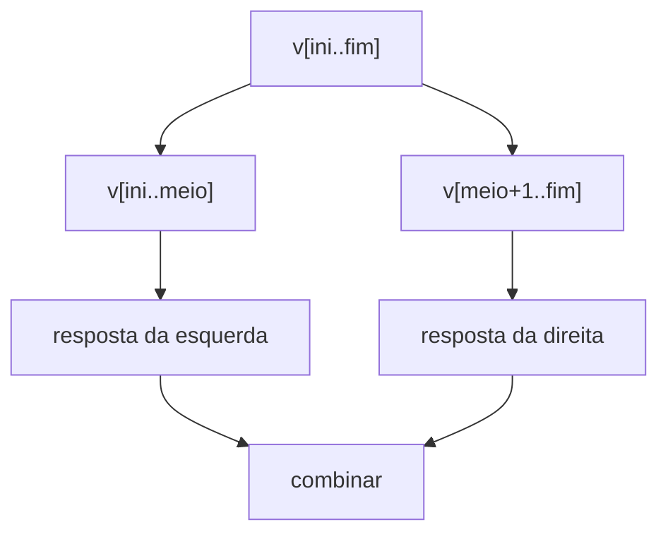

## Passo 1 · Leitura · Dividir, conquistar e combinar

**Divisão e conquista** resolve um problema de tamanho $n$ em três etapas:

1. **Dividir:** partir a entrada em pedaços menores do mesmo tipo, quase sempre ao meio. Com o trecho `v[ini..fim]`, inclusive nas duas pontas, `meio = (ini + fim) // 2` e as metades são `v[ini..meio]` e `v[meio+1..fim]`.
2. **Conquistar:** resolver cada pedaço com a própria função, até o caso base (um elemento só, ou nenhum).
3. **Combinar:** juntar as respostas dos pedaços na resposta do todo.



O custo se lê nas etapas. Se cada chamada faz $a$ chamadas de tamanho $n/2$ e gasta $f(n)$ para dividir e combinar, então $T(n) = a\,T(n/2) + f(n)$. Dois exemplos com $f(n)$ constante mostram que o número de chamadas manda:

```python
def soma_dc(v, ini, fim):
    if ini == fim:
        return v[ini]
    meio = (ini + fim) // 2
    return soma_dc(v, ini, meio) + soma_dc(v, meio + 1, fim)   # duas chamadas
```

`soma_dc` resolve as duas metades: $T(n) = 2T(n/2) + \Theta(1)$. A árvore tem $n$ folhas e $n - 1$ nós internos, e o total é $\Theta(n)$, o mesmo de um laço. Para somar, dividir não compensa; serve só para ver a forma.

A **busca binária** numa lista ordenada compara o alvo com `v[meio]` e descarta uma metade inteira: **uma** chamada só, $T(n) = T(n/2) + \Theta(1)$, que dá $\Theta(\log n)$. Atenção aos limites. Os novos trechos são `[ini, meio - 1]` e `[meio + 1, fim]`, porque `v[meio]` já foi testado. Passar `meio` no lugar de `meio + 1` parece inofensivo, mas quando `fim == ini + 1` o meio é o próprio `ini`, o trecho não diminui e a chamada se repete até o `RecursionError`.

Então quando dividir compensa? Quando combinar sai **barato** comparado ao que a força bruta faz através da fronteira. Contar pares fora de ordem numa lista testa $\frac{n(n-1)}{2}$ pares; com as duas metades já ordenadas, os pares que atravessam a fronteira se contam numa passada linear, e o total cai para $\Theta(n \log n)$. É o assunto dos próximos passos.

## Passo 2 · Exercício · Máximo e busca binária recursivos

Escreva duas funções recursivas.

- `maximo_dc(lista)` devolve o maior elemento de uma lista não vazia, dividindo o trecho ao meio, sem `max()`. A verificação usa uma lista de 5 000 elementos.
- `busca_binaria_rec(lista, alvo, ini=0, fim=None)` procura `alvo` na lista ordenada, no trecho `lista[ini..fim]` (com `fim` `None`, use o último índice), e devolve o índice dele ou `-1`. Sem fatias: a verificação conta quantas vezes a lista é lida e quantas fatias são criadas.

### Instruções
1. Em `maximo_dc`, use uma função auxiliar com `ini` e `fim`: um elemento é o caso base; senão, divida em `[ini, meio]` e `[meio + 1, fim]` e combine com uma comparação.
2. Em `busca_binaria_rec`, trate o trecho vazio como caso base e compare o alvo com o elemento do meio.
3. Continue só na metade em que o alvo pode estar, excluindo o meio já testado.

### Código inicial
```python
def maximo_dc(lista):
    pass


def busca_binaria_rec(lista, alvo, ini=0, fim=None):
    pass
```

### Solução
```python
def maximo_dc(lista):
    def resolver(ini, fim):
        if ini == fim:
            return lista[ini]
        meio = (ini + fim) // 2
        esq = resolver(ini, meio)
        dir = resolver(meio + 1, fim)
        return esq if esq >= dir else dir

    return resolver(0, len(lista) - 1)


def busca_binaria_rec(lista, alvo, ini=0, fim=None):
    if fim is None:
        fim = len(lista) - 1
    if ini > fim:
        return -1
    meio = (ini + fim) // 2
    if lista[meio] == alvo:
        return meio
    if alvo < lista[meio]:
        return busca_binaria_rec(lista, alvo, ini, meio - 1)
    return busca_binaria_rec(lista, alvo, meio + 1, fim)
```

### Dicas
1. Com `ini` e `fim` inclusivos, as metades `[ini, meio]` e `[meio + 1, fim]` nunca ficam vazias quando o trecho tem 2 ou mais elementos.
2. O trecho fica vazio quando `ini` passa de `fim`; com a lista vazia, isso já vale na primeira chamada.
3. Um trecho de um elemento ainda precisa ser examinado: ele pode ser o alvo.

### Verificação
```json
[
  { "id": "sem-max", "checkpoint": 1, "kind": "source", "rule": { "type": "not_calls", "name": "max" },
    "name": "Não usa max()" },
  { "id": "usa-recursao", "checkpoint": 1, "kind": "source", "rule": { "type": "uses", "construct": "recursion" },
    "name": "Usa recursão" },
  { "id": "max-basicos", "checkpoint": 1, "kind": "expr", "expr": "[maximo_dc([42]), maximo_dc([3, 19, 7, 25, 2, 18]), maximo_dc([-10, -3, -50, -1, -8])]", "expected": [42, 25, -1],
    "name": "maximo_dc com 1 elemento, positivos e negativos" },
  { "id": "max-pontas", "checkpoint": 1, "kind": "expr", "expr": "[maximo_dc([9, 1, 2]), maximo_dc([1, 2, 9]), maximo_dc([4, 4])]", "expected": [9, 9, 4],
    "name": "O maior na primeira posição, na última e empatado" },
  { "id": "max-5000", "checkpoint": 1, "kind": "expr", "expr": "maximo_dc([(i * 7919) % 5000 for i in range(5000)])", "expected": 4999,
    "name": "5000 elementos sem RecursionError", "hint": "Tirar um elemento por chamada empilha 5000 chamadas; dividir ao meio empilha cerca de 13." },
  { "id": "busca-achados", "checkpoint": 2, "kind": "expr", "setup": "v = [2, 5, 8, 12, 16, 23, 38, 56, 72, 91]",
    "expr": "[busca_binaria_rec(v, 2), busca_binaria_rec(v, 23), busca_binaria_rec(v, 91), busca_binaria_rec(v, 12)]", "expected": [0, 5, 9, 3],
    "name": "Acha o primeiro, o do meio, o último e o 12", "hint": "Um trecho de um elemento ainda pode conter o alvo." },
  { "id": "busca-ausentes", "checkpoint": 3, "kind": "expr", "setup": "v = [2, 5, 8, 12, 16, 23, 38, 56, 72, 91]",
    "expr": "[busca_binaria_rec(v, 1), busca_binaria_rec(v, 50), busca_binaria_rec(v, 100)]", "expected": [-1, -1, -1],
    "name": "Ausentes abaixo, no meio e acima devolvem -1", "hint": "Se o trecho não diminui a cada chamada, a recursão não para." },
  { "id": "busca-pequenas", "checkpoint": 2, "kind": "expr", "expr": "[busca_binaria_rec([], 10), busca_binaria_rec([7], 7), busca_binaria_rec([7], 3), busca_binaria_rec([4, 9], 9), busca_binaria_rec([4, 9], 4)]", "expected": [-1, 0, -1, 1, 0],
    "name": "Listas com 0, 1 e 2 elementos" },
  { "id": "busca-trecho", "checkpoint": 3, "kind": "expr", "expr": "[busca_binaria_rec([1, 3, 5, 7, 9], 3, 2, 4), busca_binaria_rec([1, 3, 5, 7, 9], 7, 2, 4)]", "expected": [-1, 3],
    "name": "Respeita ini e fim recebidos" },
  { "id": "busca-leituras", "checkpoint": 3, "kind": "expr",
    "setup": "class Lida(list):\n    leituras = 0\n    fatias = 0\n    def __getitem__(self, k):\n        if isinstance(k, slice):\n            Lida.fatias += 1\n        else:\n            Lida.leituras += 1\n        return list.__getitem__(self, k)\nv = Lida(range(0, 200000, 2))\nr = [busca_binaria_rec(v, 0), busca_binaria_rec(v, 123456), busca_binaria_rec(v, 199998), busca_binaria_rec(v, 77777)]",
    "expr": "[r, Lida.leituras <= 4 * 40, Lida.fatias]", "expected": [[0, 61728, 99999, -1], true, 0],
    "name": "100 mil elementos: no máximo 40 leituras por busca e nenhuma fatia",
    "hint": "Fatias copiam metade da lista a cada chamada: passe ini e fim." }
]
```

### Soluções erradas
```python name="busca continua do meio, sem excluí-lo"
def maximo_dc(lista):
    def resolver(ini, fim):
        if ini == fim:
            return lista[ini]
        meio = (ini + fim) // 2
        esq = resolver(ini, meio)
        dir = resolver(meio + 1, fim)
        return esq if esq >= dir else dir

    return resolver(0, len(lista) - 1)


def busca_binaria_rec(lista, alvo, ini=0, fim=None):
    if fim is None:
        fim = len(lista) - 1
    if ini > fim:
        return -1
    meio = (ini + fim) // 2
    if lista[meio] == alvo:
        return meio
    if alvo < lista[meio]:
        return busca_binaria_rec(lista, alvo, ini, meio - 1)
    return busca_binaria_rec(lista, alvo, meio, fim)
```
```python name="busca para com um elemento sem testá-lo"
def maximo_dc(lista):
    def resolver(ini, fim):
        if ini == fim:
            return lista[ini]
        meio = (ini + fim) // 2
        esq = resolver(ini, meio)
        dir = resolver(meio + 1, fim)
        return esq if esq >= dir else dir

    return resolver(0, len(lista) - 1)


def busca_binaria_rec(lista, alvo, ini=0, fim=None):
    if fim is None:
        fim = len(lista) - 1
    if ini >= fim:
        return -1
    meio = (ini + fim) // 2
    if lista[meio] == alvo:
        return meio
    if alvo < lista[meio]:
        return busca_binaria_rec(lista, alvo, ini, meio - 1)
    return busca_binaria_rec(lista, alvo, meio + 1, fim)
```
```python name="busca com fatias e deslocamento"
def maximo_dc(lista):
    def resolver(ini, fim):
        if ini == fim:
            return lista[ini]
        meio = (ini + fim) // 2
        esq = resolver(ini, meio)
        dir = resolver(meio + 1, fim)
        return esq if esq >= dir else dir

    return resolver(0, len(lista) - 1)


def busca_binaria_rec(lista, alvo, ini=0, fim=None):
    if fim is None:
        fim = len(lista) - 1
    if ini > fim:
        return -1
    meio = (ini + fim) // 2
    if lista[meio] == alvo:
        return meio
    if alvo < lista[meio]:
        return busca_binaria_rec(lista[:meio], alvo)
    r = busca_binaria_rec(lista[meio + 1:fim + 1], alvo)
    return -1 if r == -1 else meio + 1 + r
```
```python name="busca com fatias perde o deslocamento"
def maximo_dc(lista):
    def resolver(ini, fim):
        if ini == fim:
            return lista[ini]
        meio = (ini + fim) // 2
        esq = resolver(ini, meio)
        dir = resolver(meio + 1, fim)
        return esq if esq >= dir else dir

    return resolver(0, len(lista) - 1)


def busca_binaria_rec(lista, alvo, ini=0, fim=None):
    if not lista:
        return -1
    meio = len(lista) // 2
    if lista[meio] == alvo:
        return meio
    if alvo < lista[meio]:
        return busca_binaria_rec(lista[:meio], alvo)
    return busca_binaria_rec(lista[meio + 1:], alvo)
```
```python name="máximo divide em [ini, meio - 1] e [meio, fim]"
def maximo_dc(lista):
    def resolver(ini, fim):
        if ini == fim:
            return lista[ini]
        meio = (ini + fim) // 2
        esq = resolver(ini, meio - 1)
        dir = resolver(meio, fim)
        return esq if esq >= dir else dir

    return resolver(0, len(lista) - 1)


def busca_binaria_rec(lista, alvo, ini=0, fim=None):
    if fim is None:
        fim = len(lista) - 1
    if ini > fim:
        return -1
    meio = (ini + fim) // 2
    if lista[meio] == alvo:
        return meio
    if alvo < lista[meio]:
        return busca_binaria_rec(lista, alvo, ini, meio - 1)
    return busca_binaria_rec(lista, alvo, meio + 1, fim)
```
```python name="máximo tira um elemento por chamada"
def maximo_dc(lista):
    def resolver(ini):
        if ini == len(lista) - 1:
            return lista[ini]
        resto = resolver(ini + 1)
        return lista[ini] if lista[ini] >= resto else resto

    return resolver(0)


def busca_binaria_rec(lista, alvo, ini=0, fim=None):
    if fim is None:
        fim = len(lista) - 1
    if ini > fim:
        return -1
    meio = (ini + fim) // 2
    if lista[meio] == alvo:
        return meio
    if alvo < lista[meio]:
        return busca_binaria_rec(lista, alvo, ini, meio - 1)
    return busca_binaria_rec(lista, alvo, meio + 1, fim)
```

## Passo 3 · Leitura · Intercalar e contar inversões

A etapa de combinar mais usada é a **intercalação**: juntar duas listas já ordenadas `a` e `b` numa só, ordenada. Dois índices, `i` em `a` e `j` em `b`, apontam o menor elemento que falta em cada lista. A cada volta, o menor dos dois vai para o resultado, e só o índice dele avança. Quando uma lista acaba, o resto da outra já está em ordem e entra inteiro.

Cada comparação coloca um elemento no resultado, então intercalar listas de tamanhos $n_1$ e $n_2$ faz no máximo $n_1 + n_2 - 1$ comparações: custo $\Theta(n_1 + n_2)$. O jeito tentador de escrever, com `a.pop(0)`, esconde um custo $\Theta(n)$ em cada retirada, porque todos os elementos seguintes andam uma posição (módulo 2). A intercalação vira quadrática e ainda esvazia as listas de quem chamou.

```python visualizar
def intercalar(a, b):
    res = []
    i = j = 0
    while i < len(a) and j < len(b):
        if a[i] <= b[j]:
            res.append(a[i])
            i += 1
        else:
            res.append(b[j])
            j += 1
    res.extend(a[i:])
    res.extend(b[j:])
    return res


print(intercalar([1, 4, 7], [2, 3, 9]))
```

Uma **inversão** numa lista `v` é um par de posições $p < q$ com `v[p] > v[q]`: um elemento maior antes de um menor. A lista ordenada tem 0 inversões e a lista em ordem decrescente tem $\frac{n(n-1)}{2}$, o máximo. O número mede o quanto a lista está fora de ordem. Comparar o ranking de uma turma em duas provas, por exemplo, é contar as inversões de uma ordem em relação à outra.

A força bruta testa todos os pares: $\Theta(n^2)$ comparações, mais de 500 mil com $n = 1\,024$. Com divisão e conquista:

1. Conte as inversões da metade esquerda e as da direita, recursivamente. Cada chamada também devolve sua metade **ordenada**.
2. Faltam as inversões **cruzadas**, com um elemento em cada metade. Ordenar uma metade não muda quantas existem, porque todo elemento da esquerda continua antes de todo elemento da direita.
3. Conte-as durante a intercalação. Quando `esq[i] > dir[j]`, o `dir[j]` forma inversão com `esq[i]` e com **todos** os que vêm depois de `esq[i]`, que são maiores ou iguais a ele. São `len(esq) - i` inversões de uma vez, contadas em $O(1)$.

Empates não são inversões: com `esq[i] == dir[j]`, o da esquerda sai primeiro, sem contar nada. Por isso a comparação é `<=`.

O trabalho fora das chamadas é a intercalação, $\Theta(n)$: $T(n) = 2T(n/2) + \Theta(n)$, que dá $\Theta(n \log n)$. É o padrão que o merge sort vai repetir no módulo 4.

## Passo 4 · Exercício · Monte a intercalação
modo: ordenar

Ordene e indente as linhas para montar `intercalar(a, b)`, que recebe duas listas ordenadas e devolve uma lista nova, ordenada, com os elementos das duas. As listas recebidas não podem mudar. Duas linhas estão sobrando.

### Instruções
1. Comece o resultado vazio e os dois índices no começo das listas.
2. Enquanto as duas listas tiverem elementos, copie o menor dos dois atuais e avance só o índice dele.
3. Ao sair do laço, copie o que sobrou de cada lista e devolva o resultado.

### Solução
```python
def intercalar(a, b):
    res = []
    i, j = 0, 0
    while i < len(a) and j < len(b):
        if a[i] <= b[j]:
            res.append(a[i])
            i += 1
        else:
            res.append(b[j])
            j += 1
    res.extend(a[i:])
    res.extend(b[j:])
    return res
```

### Distratores
```python
while i < len(a) or j < len(b):
res.append(a.pop(0))
```

### Dicas
1. O laço só pode comparar `a[i]` com `b[j]` enquanto os dois índices são válidos.
2. Quando o laço termina, não dá para saber de antemão qual das listas ainda tem elementos.
3. `pop(0)` altera a lista de quem chamou e desloca todos os elementos restantes.

### Verificação
```json
[
  { "id": "sem-pop", "checkpoint": 2, "kind": "source", "rule": { "type": "not_calls", "name": "pop" },
    "name": "Não usa pop()" },
  { "id": "intercala", "checkpoint": 2, "kind": "call", "function": "intercalar", "args": [[1, 3, 5, 7], [2, 4, 6, 8, 10]], "expected": [1, 2, 3, 4, 5, 6, 7, 8, 10],
    "name": "intercalar([1, 3, 5, 7], [2, 4, 6, 8, 10])" },
  { "id": "sobra-a", "checkpoint": 3, "kind": "call", "function": "intercalar", "args": [[4, 8, 9], [1, 2]], "expected": [1, 2, 4, 8, 9],
    "name": "Sobra em a", "hint": "Quando b acaba, o resto de a ainda precisa entrar." },
  { "id": "sobra-b", "checkpoint": 3, "kind": "call", "function": "intercalar", "args": [[1, 3], [2, 5, 7]], "expected": [1, 2, 3, 5, 7],
    "name": "Sobra em b" },
  { "id": "vazias", "checkpoint": 1, "kind": "expr", "expr": "[intercalar([], [1, 2]), intercalar([1, 2], []), intercalar([], [])]", "expected": [[1, 2], [1, 2], []],
    "name": "Listas vazias" },
  { "id": "repetidos", "checkpoint": 2, "kind": "call", "function": "intercalar", "args": [[1, 2, 2], [2, 3]], "expected": [1, 2, 2, 2, 3],
    "name": "Elementos repetidos" },
  { "id": "nao-altera", "checkpoint": 1, "kind": "expr", "setup": "a = [1, 4]\nb = [2, 3]\nr = intercalar(a, b)",
    "expr": "[r, a, b]", "expected": [[1, 2, 3, 4], [1, 4], [2, 3]],
    "name": "Não altera as listas recebidas" },
  { "id": "comparacoes", "checkpoint": 2, "kind": "expr",
    "setup": "class K:\n    n = 0\n    def __init__(self, v):\n        self.v = v\n    def __lt__(self, o):\n        K.n += 1\n        return self.v < o.v\n    def __le__(self, o):\n        K.n += 1\n        return self.v <= o.v\n    def __gt__(self, o):\n        K.n += 1\n        return self.v > o.v\n    def __ge__(self, o):\n        K.n += 1\n        return self.v >= o.v\nr = intercalar([K(2 * i) for i in range(50)], [K(2 * i + 1) for i in range(50)])",
    "expr": "[[x.v for x in r] == list(range(100)), K.n <= 99]", "expected": [true, true],
    "name": "50 + 50 elementos com no máximo 99 comparações" }
]
```

### Soluções erradas
```python name="esquece a sobra de b"
def intercalar(a, b):
    res = []
    i, j = 0, 0
    while i < len(a) and j < len(b):
        if a[i] <= b[j]:
            res.append(a[i])
            i += 1
        else:
            res.append(b[j])
            j += 1
    res.extend(a[i:])
    return res
```
```python name="esquece a sobra de a"
def intercalar(a, b):
    res = []
    i, j = 0, 0
    while i < len(a) and j < len(b):
        if a[i] <= b[j]:
            res.append(a[i])
            i += 1
        else:
            res.append(b[j])
            j += 1
    res.extend(b[j:])
    return res
```
```python name="retira com pop(0)"
def intercalar(a, b):
    res = []
    while a and b:
        if a[0] <= b[0]:
            res.append(a.pop(0))
        else:
            res.append(b.pop(0))
    res.extend(a)
    res.extend(b)
    return res
```
```python name="laço com or passa do fim de uma lista"
def intercalar(a, b):
    res = []
    i, j = 0, 0
    while i < len(a) or j < len(b):
        if a[i] <= b[j]:
            res.append(a[i])
            i += 1
        else:
            res.append(b[j])
            j += 1
    return res
```

## Passo 5 · Exercício · Contar inversões em n log n

Escreva `contar_inversoes(lista)`, que devolve o número de pares $p < q$ com `lista[p] > lista[q]`, por divisão e conquista. A lista recebida não pode mudar. A verificação conta as comparações entre elementos: com 1 024 elementos, aceite no máximo 12 000 (a força bruta faz mais de 500 mil).

Exemplo: `contar_inversoes([2, 4, 1, 3, 5])` é `3`, pelos pares (2, 1), (4, 1) e (4, 3).

### Instruções
1. Use uma função auxiliar que devolve a tupla `(sublista_ordenada, inversões)`, com caso base para listas de 0 ou 1 elemento.
2. Some as inversões das duas metades às cruzadas, contadas durante a intercalação delas.
3. Quando o elemento da direita sair antes, some de uma vez todos os elementos que ainda restam na esquerda; empates não contam.

### Código inicial
```python
def contar_inversoes(lista):
    pass
```

### Solução
```python
def contar_inversoes(lista):
    def ordenar_e_contar(v):
        if len(v) <= 1:
            return list(v), 0
        meio = len(v) // 2
        esq, inv_esq = ordenar_e_contar(v[:meio])
        dir, inv_dir = ordenar_e_contar(v[meio:])
        res = []
        i = 0
        j = 0
        cruzadas = 0
        while i < len(esq) and j < len(dir):
            if esq[i] <= dir[j]:
                res.append(esq[i])
                i += 1
            else:
                res.append(dir[j])
                j += 1
                cruzadas += len(esq) - i
        res.extend(esq[i:])
        res.extend(dir[j:])
        return res, inv_esq + inv_dir + cruzadas

    return ordenar_e_contar(lista)[1]
```

### Dicas
1. A contagem das cruzadas só funciona se as duas metades chegarem ordenadas à intercalação.
2. Quando `esq[i] > dir[j]`, quantos elementos da esquerda são maiores que `dir[j]`?
3. Dois elementos iguais não formam inversão: no empate, o da esquerda sai primeiro.

### Verificação
```json
[
  { "id": "usa-recursao", "checkpoint": 1, "kind": "source", "rule": { "type": "uses", "construct": "recursion" },
    "name": "Usa recursão" },
  { "id": "pequenas", "checkpoint": 2, "kind": "expr", "expr": "[contar_inversoes([1, 2, 3, 4]), contar_inversoes([2, 4, 1, 3, 5]), contar_inversoes([5, 4, 3, 2, 1])]", "expected": [0, 3, 10],
    "name": "Ordenada (0), [2, 4, 1, 3, 5] (3) e decrescente de 5 (10)", "hint": "Pares não vizinhos também são inversões." },
  { "id": "bordas", "checkpoint": 1, "kind": "expr", "expr": "[contar_inversoes([]), contar_inversoes([7]), contar_inversoes([2, 1])]", "expected": [0, 0, 1],
    "name": "Listas com 0, 1 e 2 elementos" },
  { "id": "iguais", "checkpoint": 3, "kind": "expr", "expr": "[contar_inversoes([2, 2, 1, 2]), contar_inversoes([3, 3, 3]), contar_inversoes([1, 3, 3, 2])]", "expected": [2, 0, 2],
    "name": "Iguais não são inversões", "hint": "No empate, o elemento da esquerda sai primeiro, sem contar." },
  { "id": "cruzadas", "checkpoint": 3, "kind": "call", "function": "contar_inversoes", "args": [[6, 7, 8, 1, 2]], "expected": 6,
    "name": "contar_inversoes([6, 7, 8, 1, 2]) é 6", "hint": "Quando um elemento da direita sai, ele forma inversão com todos os que restam na esquerda." },
  { "id": "confere-bruta", "checkpoint": 2, "kind": "expr", "setup": "w = [(i * 37) % 101 for i in range(200)]",
    "expr": "contar_inversoes(w) == sum(1 for p in range(200) for q in range(p + 1, 200) if w[p] > w[q])", "expected": true,
    "name": "Confere com a força bruta em 200 elementos", "hint": "As metades precisam voltar ordenadas para a intercalação de cima." },
  { "id": "nao-altera", "checkpoint": 1, "kind": "expr", "setup": "v = [3, 1, 2]\nr = contar_inversoes(v)",
    "expr": "[r, v]", "expected": [2, [3, 1, 2]], "name": "Não altera a lista recebida" },
  { "id": "comparacoes", "checkpoint": 2, "kind": "expr",
    "setup": "class K:\n    n = 0\n    def __init__(self, v):\n        self.v = v\n    def __lt__(self, o):\n        K.n += 1\n        return self.v < o.v\n    def __le__(self, o):\n        K.n += 1\n        return self.v <= o.v\n    def __gt__(self, o):\n        K.n += 1\n        return self.v > o.v\n    def __ge__(self, o):\n        K.n += 1\n        return self.v >= o.v\nv = [K((i * 389) % 1024) for i in range(1024)]\nr = contar_inversoes(v)",
    "expr": "[r, K.n <= 12000]", "expected": [262092, true],
    "name": "1024 elementos: 262092 inversões com no máximo 12000 comparações",
    "hint": "Testar todos os pares faz mais de 500 mil comparações." }
]
```

### Soluções erradas
```python name="força bruta com todos os pares"
def contar_inversoes(lista):
    total = 0
    for p in range(len(lista)):
        for q in range(p + 1, len(lista)):
            if lista[p] > lista[q]:
                total += 1
    return total
```
```python name="< na intercalação conta os empates"
def contar_inversoes(lista):
    def ordenar_e_contar(v):
        if len(v) <= 1:
            return list(v), 0
        meio = len(v) // 2
        esq, inv_esq = ordenar_e_contar(v[:meio])
        dir, inv_dir = ordenar_e_contar(v[meio:])
        res = []
        i = 0
        j = 0
        cruzadas = 0
        while i < len(esq) and j < len(dir):
            if esq[i] < dir[j]:
                res.append(esq[i])
                i += 1
            else:
                res.append(dir[j])
                j += 1
                cruzadas += len(esq) - i
        res.extend(esq[i:])
        res.extend(dir[j:])
        return res, inv_esq + inv_dir + cruzadas

    return ordenar_e_contar(lista)[1]
```
```python name="soma 1 em vez de len(esq) - i"
def contar_inversoes(lista):
    def ordenar_e_contar(v):
        if len(v) <= 1:
            return list(v), 0
        meio = len(v) // 2
        esq, inv_esq = ordenar_e_contar(v[:meio])
        dir, inv_dir = ordenar_e_contar(v[meio:])
        res = []
        i = 0
        j = 0
        cruzadas = 0
        while i < len(esq) and j < len(dir):
            if esq[i] <= dir[j]:
                res.append(esq[i])
                i += 1
            else:
                res.append(dir[j])
                j += 1
                cruzadas += 1
        res.extend(esq[i:])
        res.extend(dir[j:])
        return res, inv_esq + inv_dir + cruzadas

    return ordenar_e_contar(lista)[1]
```
```python name="soma o que resta na direita"
def contar_inversoes(lista):
    def ordenar_e_contar(v):
        if len(v) <= 1:
            return list(v), 0
        meio = len(v) // 2
        esq, inv_esq = ordenar_e_contar(v[:meio])
        dir, inv_dir = ordenar_e_contar(v[meio:])
        res = []
        i = 0
        j = 0
        cruzadas = 0
        while i < len(esq) and j < len(dir):
            if esq[i] <= dir[j]:
                res.append(esq[i])
                i += 1
            else:
                res.append(dir[j])
                j += 1
                cruzadas += len(dir) - j
        res.extend(esq[i:])
        res.extend(dir[j:])
        return res, inv_esq + inv_dir + cruzadas

    return ordenar_e_contar(lista)[1]
```
```python name="devolve a metade original, sem ordenar"
def contar_inversoes(lista):
    def ordenar_e_contar(v):
        if len(v) <= 1:
            return list(v), 0
        meio = len(v) // 2
        esq, inv_esq = ordenar_e_contar(v[:meio])
        dir, inv_dir = ordenar_e_contar(v[meio:])
        i = 0
        j = 0
        cruzadas = 0
        while i < len(esq) and j < len(dir):
            if esq[i] <= dir[j]:
                i += 1
            else:
                j += 1
                cruzadas += len(esq) - i
        return list(v), inv_esq + inv_dir + cruzadas

    return ordenar_e_contar(lista)[1]
```
```python name="conta só vizinhos fora de ordem"
def contar_inversoes(lista):
    total = 0
    for p in range(len(lista) - 1):
        if lista[p] > lista[p + 1]:
            total += 1
    return total
```

## Passo 6 · Leitura · Soma máxima: o que cruza a fronteira

Uma lanchonete do campus anotou o saldo de cada dia: `[-2, 1, -3, 4, -1, 2, 1, -5, 4]`. Qual sequência de **dias seguidos** deu o maior saldo total? A resposta é `[4, -1, 2, 1]`, com soma 6. Formalmente: a maior soma de um trecho contíguo **não vazio** de `v`. Com todos os dias negativos, a resposta é o menos negativo deles, e não 0.

A força bruta testa todo início `i` e estende o fim `j`, reaproveitando a soma anterior:

```python
def soma_maxima_bruta(v):
    melhor = v[0]
    for i in range(len(v)):
        soma = 0
        for j in range(i, len(v)):
            soma += v[j]              # soma de v[i..j] a partir de v[i..j-1]
            if soma > melhor:
                melhor = soma
    return melhor
```

São $\frac{n(n+1)}{2}$ somas: $\Theta(n^2)$.

Divida no meio. O melhor trecho de `v[ini..fim]` está em um de três lugares:

1. inteiro na metade esquerda: a recursão resolve;
2. inteiro na metade direita: a recursão resolve;
3. **cruzando a fronteira**, com pelo menos `v[meio]` e `v[meio + 1]`.

O terceiro caso é o combinar, e é onde moram os erros. Um trecho que cruza é um pedaço que **termina** em `meio` grudado num pedaço que **começa** em `meio + 1`. As duas escolhas são independentes: o melhor trecho que cruza é a melhor soma terminando em `meio` mais a melhor soma começando em `meio + 1`. Cada uma sai de uma varredura que parte da fronteira:

```python
soma = 0
melhor_esq = v[meio]
for i in range(meio, ini - 1, -1):    # de meio para a esquerda
    soma += v[i]
    if soma > melhor_esq:
        melhor_esq = soma
```

O lado direito é o espelho, de `meio + 1` até `fim`. Três erros comuns na fronteira:

- **Esquecer o terceiro caso** e devolver só o melhor das duas metades: em `[-5, 4, -1, 3, -9, 2]`, perde o `[4, -1, 3]`, que atravessa o meio.
- **Varrer a esquerda a partir de `ini`.** Isso calcula somas que **começam** em `ini`, e não que terminam em `meio`: o pedaço não encosta na fronteira.
- **Começar `melhor_esq` em 0.** Isso deixa um lado vazio, e o trecho "cruzando" pode não cruzar nada. Com todos os valores negativos, a resposta sai 0.

A varredura custa $\Theta(n)$ por nível, então $T(n) = 2T(n/2) + \Theta(n)$: $\Theta(n \log n)$. Com $n = 10^5$, são cerca de $1{,}7 \times 10^6$ somas, contra $5 \times 10^9$ da força bruta. Existe uma solução em $\Theta(n)$ para esse problema, o algoritmo de Kadane; aqui, o objetivo é acertar o combinar na fronteira.

## Passo 7 · Exercício · Soma máxima por divisão e conquista

Escreva `soma_maxima(v)`, que recebe uma lista **não vazia** de inteiros e devolve a maior soma de um trecho contíguo não vazio, por divisão e conquista. A lista recebida não pode mudar. A verificação conta as somas feitas com os elementos: com 1 024 elementos, aceite no máximo 15 000 (a força bruta faz mais de 500 mil).

Exemplo: `soma_maxima([-2, 1, -3, 4, -1, 2, 1, -5, 4])` é `6`.

### Instruções
1. Use uma função auxiliar com `ini` e `fim`; um elemento só é o caso base.
2. Resolva as duas metades recursivamente.
3. Calcule o melhor trecho que cruza a fronteira: a melhor soma que termina em `meio` mais a melhor que começa em `meio + 1`.
4. Devolva o maior dos três candidatos.

### Código inicial
```python
def soma_maxima(v):
    pass
```

### Solução
```python
def soma_maxima(v):
    def resolver(ini, fim):
        if ini == fim:
            return v[ini]
        meio = (ini + fim) // 2
        melhor_esq = resolver(ini, meio)
        melhor_dir = resolver(meio + 1, fim)

        soma = 0
        termina_no_meio = v[meio]
        for i in range(meio, ini - 1, -1):
            soma = soma + v[i]
            if soma > termina_no_meio:
                termina_no_meio = soma

        soma = 0
        comeca_depois = v[meio + 1]
        for j in range(meio + 1, fim + 1):
            soma = soma + v[j]
            if soma > comeca_depois:
                comeca_depois = soma

        cruzando = termina_no_meio + comeca_depois
        melhor = melhor_esq
        if melhor_dir > melhor:
            melhor = melhor_dir
        if cruzando > melhor:
            melhor = cruzando
        return melhor

    return resolver(0, len(v) - 1)
```

### Dicas
1. Um trecho de um elemento só tem uma soma possível.
2. As varreduras do trecho que cruza partem da fronteira e se afastam dela.
3. Os melhores lados do trecho que cruza começam valendo o primeiro elemento junto à fronteira, e não 0.

### Verificação
```json
[
  { "id": "usa-recursao", "checkpoint": 2, "kind": "source", "rule": { "type": "uses", "construct": "recursion" },
    "name": "Usa recursão" },
  { "id": "classico", "checkpoint": 4, "kind": "call", "function": "soma_maxima", "args": [[-2, 1, -3, 4, -1, 2, 1, -5, 4]], "expected": 6,
    "name": "soma_maxima([-2, 1, -3, 4, -1, 2, 1, -5, 4]) é 6" },
  { "id": "um", "checkpoint": 1, "kind": "expr", "expr": "[soma_maxima([5]), soma_maxima([-7])]", "expected": [5, -7],
    "name": "Um elemento só" },
  { "id": "negativos", "checkpoint": 3, "kind": "call", "function": "soma_maxima", "args": [[-8, -3, -6, -2, -5, -4]], "expected": -2,
    "name": "Todos negativos: o menos negativo", "hint": "O trecho não pode ser vazio: os melhores lados não começam em 0." },
  { "id": "cruza", "checkpoint": 3, "kind": "call", "function": "soma_maxima", "args": [[-5, 4, -1, 3, -9, 2]], "expected": 6,
    "name": "O melhor trecho atravessa o meio", "hint": "O melhor trecho pode ter um pedaço em cada metade." },
  { "id": "positivos-zeros", "checkpoint": 4, "kind": "expr", "expr": "[soma_maxima([3, 1, 4, 1, 5]), soma_maxima([0, -1, 0]), soma_maxima([2, -1, 2, -1, 2])]", "expected": [14, 0, 4],
    "name": "Todos positivos, zeros e alternados" },
  { "id": "confere-bruta", "checkpoint": 3, "kind": "expr",
    "setup": "w = [((i * 73) % 41) - 20 for i in range(300)]\nbruta = w[0]\nfor i in range(300):\n    s = 0\n    for j in range(i, 300):\n        s += w[j]\n        if s > bruta:\n            bruta = s",
    "expr": "[soma_maxima(w), bruta]", "expected": [46, 46],
    "name": "Confere com a força bruta em 300 elementos", "hint": "A melhor soma que cruza termina em meio e começa em meio + 1." },
  { "id": "nao-altera", "checkpoint": 1, "kind": "expr", "setup": "v = [2, -5, 3]\nr = soma_maxima(v)",
    "expr": "[r, v]", "expected": [3, [2, -5, 3]], "name": "Não altera a lista recebida" },
  { "id": "somas", "checkpoint": 2, "kind": "expr",
    "setup": "class N:\n    somas = 0\n    def __init__(self, v):\n        self.v = v\n    @staticmethod\n    def _x(o):\n        return o.v if isinstance(o, N) else o\n    def __add__(self, o):\n        N.somas += 1\n        return N(self.v + N._x(o))\n    __radd__ = __add__\n    def __sub__(self, o):\n        N.somas += 1\n        return N(self.v - N._x(o))\n    def __rsub__(self, o):\n        N.somas += 1\n        return N(N._x(o) - self.v)\n    def __lt__(self, o):\n        return self.v < N._x(o)\n    def __le__(self, o):\n        return self.v <= N._x(o)\n    def __gt__(self, o):\n        return self.v > N._x(o)\n    def __ge__(self, o):\n        return self.v >= N._x(o)\n    def __eq__(self, o):\n        return self.v == N._x(o)\n    def __int__(self):\n        return self.v\nr = soma_maxima([N(((i * 389) % 1024) - 512) for i in range(1024)])",
    "expr": "[int(r), N.somas <= 15000]", "expected": [1666, true],
    "name": "1024 elementos com no máximo 15000 somas",
    "hint": "Testar todos os inícios e fins faz mais de 500 mil somas." }
]
```

### Soluções erradas
```python name="esquece o trecho que cruza o meio"
def soma_maxima(v):
    def resolver(ini, fim):
        if ini == fim:
            return v[ini]
        meio = (ini + fim) // 2
        melhor_esq = resolver(ini, meio)
        melhor_dir = resolver(meio + 1, fim)
        return melhor_esq if melhor_esq >= melhor_dir else melhor_dir

    return resolver(0, len(v) - 1)
```
```python name="lados do trecho que cruza começam em 0"
def soma_maxima(v):
    def resolver(ini, fim):
        if ini == fim:
            return v[ini]
        meio = (ini + fim) // 2
        melhor_esq = resolver(ini, meio)
        melhor_dir = resolver(meio + 1, fim)

        soma = 0
        termina_no_meio = 0
        for i in range(meio, ini - 1, -1):
            soma = soma + v[i]
            if soma > termina_no_meio:
                termina_no_meio = soma

        soma = 0
        comeca_depois = 0
        for j in range(meio + 1, fim + 1):
            soma = soma + v[j]
            if soma > comeca_depois:
                comeca_depois = soma

        cruzando = termina_no_meio + comeca_depois
        melhor = melhor_esq
        if melhor_dir > melhor:
            melhor = melhor_dir
        if cruzando > melhor:
            melhor = cruzando
        return melhor

    return resolver(0, len(v) - 1)
```
```python name="varre a esquerda a partir de ini"
def soma_maxima(v):
    def resolver(ini, fim):
        if ini == fim:
            return v[ini]
        meio = (ini + fim) // 2
        melhor_esq = resolver(ini, meio)
        melhor_dir = resolver(meio + 1, fim)

        soma = 0
        termina_no_meio = v[ini]
        for i in range(ini, meio + 1):
            soma = soma + v[i]
            if soma > termina_no_meio:
                termina_no_meio = soma

        soma = 0
        comeca_depois = v[meio + 1]
        for j in range(meio + 1, fim + 1):
            soma = soma + v[j]
            if soma > comeca_depois:
                comeca_depois = soma

        cruzando = termina_no_meio + comeca_depois
        melhor = melhor_esq
        if melhor_dir > melhor:
            melhor = melhor_dir
        if cruzando > melhor:
            melhor = cruzando
        return melhor

    return resolver(0, len(v) - 1)
```
```python name="v[meio] entra nos dois lados do trecho que cruza"
def soma_maxima(v):
    def resolver(ini, fim):
        if ini == fim:
            return v[ini]
        meio = (ini + fim) // 2
        melhor_esq = resolver(ini, meio)
        melhor_dir = resolver(meio + 1, fim)

        soma = 0
        termina_no_meio = v[meio]
        for i in range(meio, ini - 1, -1):
            soma = soma + v[i]
            if soma > termina_no_meio:
                termina_no_meio = soma

        soma = 0
        comeca_depois = v[meio]
        for j in range(meio, fim + 1):
            soma = soma + v[j]
            if soma > comeca_depois:
                comeca_depois = soma

        cruzando = termina_no_meio + comeca_depois
        melhor = melhor_esq
        if melhor_dir > melhor:
            melhor = melhor_dir
        if cruzando > melhor:
            melhor = cruzando
        return melhor

    return resolver(0, len(v) - 1)
```
```python name="divide em [ini, meio] e [meio, fim]"
def soma_maxima(v):
    def resolver(ini, fim):
        if ini == fim:
            return v[ini]
        meio = (ini + fim) // 2
        melhor_esq = resolver(ini, meio)
        melhor_dir = resolver(meio, fim)

        soma = 0
        termina_no_meio = v[meio]
        for i in range(meio, ini - 1, -1):
            soma = soma + v[i]
            if soma > termina_no_meio:
                termina_no_meio = soma

        soma = 0
        comeca_depois = v[meio + 1]
        for j in range(meio + 1, fim + 1):
            soma = soma + v[j]
            if soma > comeca_depois:
                comeca_depois = soma

        cruzando = termina_no_meio + comeca_depois
        melhor = melhor_esq
        if melhor_dir > melhor:
            melhor = melhor_dir
        if cruzando > melhor:
            melhor = cruzando
        return melhor

    return resolver(0, len(v) - 1)
```
```python name="força bruta com todos os inícios e fins"
def soma_maxima(v):
    melhor = v[0]
    for i in range(len(v)):
        soma = 0
        for j in range(i, len(v)):
            soma = soma + v[j]
            if soma > melhor:
                melhor = soma
    return melhor
```

## Passo 8 · Quiz · Dividir, combinar e o custo

### Pergunta
`maximo_dc` e `busca_binaria_rec` dividem a entrada ao meio e fazem trabalho constante fora das chamadas. Por que um é $\Theta(n)$ e o outro $\Theta(\log n)$?
- [ ] Porque `maximo_dc` gasta $\Theta(n)$ para combinar, e a busca gasta $\Theta(1)$
- [x] Porque `maximo_dc` resolve as duas metades, $T(n) = 2T(n/2) + \Theta(1)$, e a busca descarta uma metade e faz uma chamada só, $T(n) = T(n/2) + \Theta(1)$
- [ ] Porque a busca binária não usa a pilha de chamadas
- [ ] Porque `maximo_dc` divide a lista em quatro partes
> Com duas chamadas por nível, a árvore tem $n$ folhas e cerca de $2n$ nós: $\Theta(n)$. Com uma chamada por nível, as chamadas formam um caminho de $\log_2 n$ nós. O número de chamadas recursivas pesa tanto quanto o trabalho de combinar.

### Pergunta
Na contagem de inversões, a intercalação das metades ordenadas `esq = [2, 5, 9]` e `dir = [3, 4]` começa. Quando `dir[0] = 3` sai para o resultado, quantas inversões cruzadas são somadas nesse instante?
- [ ] 1, o par (2, 3)
- [x] 2, os pares (5, 3) e (9, 3)
- [ ] 3, todos os elementos de `esq`
- [ ] 1, o par (5, 3)
> O 2 já saiu antes, porque $2 \le 3$; então `i = 1`. O 3 sai agora porque é menor que `esq[1] = 5`, e como `esq` está ordenada, todos de `esq[1:]` são maiores que 3: `len(esq) - i = 2` inversões, somadas de uma vez.

### Pergunta
Na soma máxima, por que o melhor trecho que cruza o meio sai em $\Theta(n)$, sem testar todos os pares de início na esquerda e fim na direita?
- [ ] Porque o trecho que cruza é sempre a lista inteira
- [ ] Porque basta somar `v[meio] + v[meio + 1]`
- [x] Porque a parte esquerda (que termina em `meio`) e a direita (que começa em `meio + 1`) se escolhem independentemente: a melhor de cada lado sai de uma varredura a partir da fronteira
- [ ] Porque as duas metades já voltaram ordenadas da recursão
> A soma de um trecho que cruza é a soma da parte esquerda mais a da direita, e a escolha de um lado não muda as opções do outro. Então o melhor par é o melhor sufixo da esquerda mais o melhor prefixo da direita: duas varreduras lineares, em vez de $\Theta(n^2)$ pares. Ordenar as metades destruiria a contiguidade, que é o que o problema exige.
