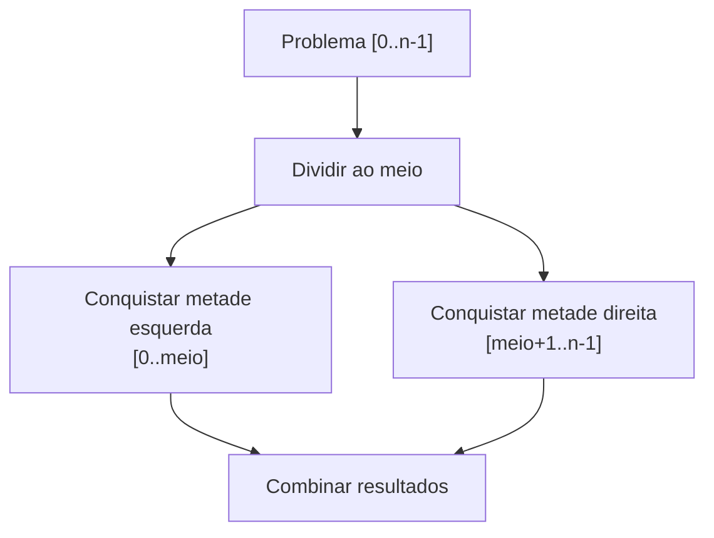

## Passo 1 · Leitura · Dividir, conquistar e combinar

O paradigma de **Divisão e Conquista (*Divide and Conquer*)** resolve um problema de tamanho $n$ em três etapas bem definidas:

1. **Dividir:** partir a instância atual em subproblemas menores do mesmo tipo (geralmente dividindo o intervalo $[ini, fim]$ ao meio em `meio = (ini + fim) // 2`).
2. **Conquistar:** resolver cada subproblema recursivamente (ou diretamente, quando o tamanho chega ao caso base $n \le 1$).
3. **Combinar:** juntar as respostas dos subproblemas para formar a resposta do problema original.



#### Dois exemplos fundamentais

1. **Máximo por divisão e conquista (2 ramos):** para achar o maior elemento de `lista[ini..fim]` sem usar `max()`, dividimos ao meio, achamos o máximo da esquerda `m_esq`, o máximo da direita `m_dir` e combinamos em $O(1)$ devolvendo `m_esq if m_esq >= m_dir else m_dir`. A recorrência é $T(n) = 2T(n/2) + O(1) \implies \Theta(n)$.
2. **Busca binária recursiva (1 ramo só!):** em uma lista ordenada, comparamos `alvo` com `lista[meio]`. Se `alvo < lista[meio]`, descartamos toda a metade direita e chamamos apenas `busca_binaria_rec(lista, alvo, ini, meio - 1)`; se `alvo > lista[meio]`, chamamos apenas `busca_binaria_rec(lista, alvo, meio + 1, fim)`. Como fazemos **1 única chamada recursiva** de tamanho $n/2$, a recorrência é $T(n) = T(n/2) + O(1) \implies \Theta(\log n)$.

> **Cuidado clássico:** na busca binária recursiva, os novos limites devem ser `meio - 1` (à esquerda) e `meio + 1` (à direita). Se você passar `meio` sem somar 1 quando `ini + 1 == fim`, como `(ini + fim) // 2 == ini`, o intervalo nunca diminui e a função entra em recursão infinita!

## Passo 2 · Exercício · Máximo por divisão e conquista e busca binária recursiva

Implemente duas funções recursivas (sem usar a função embutida `max`):
1. `maximo_dc(lista)`: recebe uma lista não vazia de números e devolve o maior elemento dividindo o intervalo `[ini, fim]` ao meio recursivamente.
2. `busca_binaria_rec(lista, alvo, ini=0, fim=None)`: procura `alvo` na sublista ordenada `lista[ini..fim]` (se `fim is None`, use `len(lista) - 1`). Devolve o índice de `alvo` ou `-1` se não existir.

### Instruções
1. Em `maximo_dc(lista)`, defina uma função auxiliar recursiva ` resolver(ini, fim)` (ou passe índices): se `ini == fim`, devolva `lista[ini]`; caso contrário, calcule `meio = (ini + fim) // 2`, obtenha `esq = resolver(ini, meio)` e `dir = resolver(meio + 1, fim)`, e devolva o maior dos dois com `if/else` (sem `max()`).
2. Em `busca_binaria_rec(lista, alvo, ini=0, fim=None)`, inicialize `fim = len(lista) - 1` quando `fim is None`. Se `ini > fim`, devolva `-1`. Calcule `meio = (ini + fim) // 2`: se `lista[meio] == alvo`, devolva `meio`; se `alvo < lista[meio]`, recurse em `[ini, meio - 1]`; senão, recurse em `[meio + 1, fim]`.

### Código inicial
```python
def maximo_dc(lista):
    # Encontre o maior elemento por divisão e conquista (sem usar max())
    pass


def busca_binaria_rec(lista, alvo, ini=0, fim=None):
    # Procure alvo recursivamente em lista[ini..fim] e devolva o índice ou -1
    pass
```

### Solução
```python
def maximo_dc(lista):
    def resolver(ini, fim):
        if ini == fim:
            return lista[ini]
        meio = (ini + fim) // 2
        esq = resolver(ini, meio)
        dir = resolver(meio + 1, fim)
        return esq if esq >= dir else dir

    return resolver(0, len(lista) - 1)


def busca_binaria_rec(lista, alvo, ini=0, fim=None):
    if fim is None:
        fim = len(lista) - 1
    if ini > fim:
        return -1
    meio = (ini + fim) // 2
    if lista[meio] == alvo:
        return meio
    if alvo < lista[meio]:
        return busca_binaria_rec(lista, alvo, ini, meio - 1)
    return busca_binaria_rec(lista, alvo, meio + 1, fim)
```

### Dicas
1. Em `maximo_dc`, use índices `(ini, fim)` em vez de fatiar `lista[:meio]`, assim não há cópia de sublistas e o caso base é simplesmente `if ini == fim: return lista[ini]`.
2. Em `busca_binaria_rec`, o caso base de falha é `if ini > fim: return -1` (que também trata automaticamente `lista == []`, pois `ini = 0` e `fim = -1`).

### Verificação
```json
[
  {
    "id": "sem-max",
    "checkpoint": 1,
    "kind": "source",
    "rule": { "type": "not_calls", "name": "max" },
    "name": "Não usa a função embutida max()"
  },
  {
    "id": "usa-recursao",
    "checkpoint": 1,
    "kind": "source",
    "rule": { "type": "uses", "construct": "recursion" },
    "name": "Utiliza recursão"
  },
  {
    "id": "maximo-dc-casos",
    "checkpoint": 1,
    "kind": "expr",
    "expr": "[maximo_dc([42]), maximo_dc([3, 19, 7, 25, 2, 18]), maximo_dc([-10, -3, -50, -1, -8])]",
    "expected": [42, 25, -1],
    "name": "maximo_dc funciona para 1 elemento, positivos e todos negativos"
  },
  {
    "id": "busca-binaria-rec-casos",
    "checkpoint": 2,
    "kind": "expr",
    "setup": "v = [2, 5, 8, 12, 16, 23, 38, 56, 72, 91]",
    "expr": "[busca_binaria_rec(v, 2), busca_binaria_rec(v, 23), busca_binaria_rec(v, 91), busca_binaria_rec(v, 50), busca_binaria_rec([], 10)]",
    "expected": [0, 5, 9, -1, -1],
    "name": "busca_binaria_rec encontra início, meio, fim e devolve -1 quando ausente ou vazia"
  }
]
```

### Soluções erradas
```python name="esquece de excluir meio (meio em vez de meio + 1) e entra em recursão infinita"
def maximo_dc(lista):
    return lista[0]


def busca_binaria_rec(lista, alvo, ini=0, fim=None):
    if fim is None:
        fim = len(lista) - 1
    if ini >= fim:
        return ini if (lista and lista[ini] == alvo) else -1
    meio = (ini + fim) // 2
    if lista[meio] == alvo:
        return meio
    if alvo < lista[meio]:
        return busca_binaria_rec(lista, alvo, ini, meio)
    return busca_binaria_rec(lista, alvo, meio, fim)
```
```python name="falha para listas com números negativos em maximo_dc"
def maximo_dc(lista):
    maior = 0
    for x in lista:
        if x > maior:
            maior = x
    return maior


def busca_binaria_rec(lista, alvo, ini=0, fim=None):
    return -1
```

## Passo 3 · Leitura · Intercalação linear e contagem de inversões em $O(n \log n)$

A etapa de **combinação** mais famosa da computação é a **intercalação (*merge*)** de duas listas já ordenadas `a` e `b` em uma única lista ordenada. Mantemos dois índices `i = 0` (em `a`) e `j = 0` (em `b`): a cada passo, comparamos `a[i]` com `b[j]`, anexamos o menor em `resultado` e avançamos apenas o índice daquele que foi escolhido. Quando uma das listas termina, copiamos o restante da outra com `.extend()`.

Como cada comparação avança `i` ou `j` em $+1$, intercalar duas listas de tamanhos $n_1$ e $n_2$ leva tempo estritamente **linear $\Theta(n_1 + n_2)$**! *(Jamais use `a.pop(0)` para intercalar: como vimos no Módulo 2, `pop(0)` custa $O(n)$ e estraga a intercalação para $O(n^2)$!)*

Veja a intercalação em ação no visualizador:

```python visualizar
def intercalar(a, b):
    res = []
    i = j = 0
    while i < len(a) and j < len(b):
        if a[i] <= b[j]:
            res.append(a[i])
            i += 1
        else:
            res.append(b[j])
            j += 1
    res.extend(a[i:])
    res.extend(b[j:])
    return res

print(intercalar([1, 4, 7], [2, 3, 9]))
```

#### Contando inversões em $O(n \log n)$

Em uma lista `v`, uma **inversão** é qualquer par de índices $(p, q)$ com $p < q$ tal que $v[p] > v[q]$ (um elemento maior aparecendo antes de um menor). O número de inversões mede o quão "fora de ordem" a lista está ($0$ se ordenada; $\frac{n(n-1)}{2}$ se invertida).

Testar todos os pares $(p, q)$ custa $\Theta(n^2)$. Com divisão e conquista, contamos as inversões em **$\Theta(n \log n)$** acoplando a contagem ao *Merge Sort*:
1. Dividimos a lista ao meio e contamos recursivamente as inversões internas da metade esquerda (`inv_esq`, que já devolve a metade esquerda ordenada) e da metade direita (`inv_dir`, que já devolve a metade direita ordenada).
2. Ao intercalar as duas metades ordenadas `esq` e `dir`:
   - Se `esq[i] <= dir[j]`, `esq[i]` não forma inversão com `dir[j]`.
   - Se `esq[i] > dir[j]`, então **todos os elementos restantes em `esq` a partir de `i`** (`esq[i], esq[i+1], ..., esq[-1]`, que são `len(esq) - i` elementos!) também são maiores que `dir[j]`, pois `esq` está ordenada! Somamos **`len(esq) - i`** ao contador de inversões de uma só vez!

## Passo 4 · Exercício · Intercalando duas listas ordenadas em $O(n + m)$
modo: ordenar

Ordene e indente as linhas para montar `intercalar(a, b)`, que recebe duas listas ordenadas `a` e `b` e devolve uma nova lista ordenada com todos os elementos de ambas em tempo linear $O(\text{len}(a) + \text{len}(b))$. Há duas linhas distratoras.

### Instruções
1. Inicialize `res = []`, `i = 0` e `j = 0`.
2. Enquanto `i < len(a) and j < len(b)`, compare `a[i] <= b[j]`: se verdadeiro, anexe `a[i]` e incremente `i += 1`; senão, anexe `b[j]` e incremente `j += 1`.
3. Ao sair do laço, estenda `res` com `a[i:]` e `b[j:]` e devolva `res`.

### Solução
```python
def intercalar(a, b):
    res = []
    i, j = 0, 0
    while i < len(a) and j < len(b):
        if a[i] <= b[j]:
            res.append(a[i])
            i += 1
        else:
            res.append(b[j])
            j += 1
    res.extend(a[i:])
    res.extend(b[j:])
    return res
```

### Distratores
```python
while i < len(a) or j < len(b):
res.append(a.pop(0))
```

### Dicas
1. O laço `while` deve rodar apenas enquanto **ambas** as listas ainda têm elementos (`i < len(a) and j < len(b)`).
2. Os dois `.extend()` após o `while` copiam as sobras da lista que ainda não chegou ao fim.

### Verificação
```json
[
  {
    "id": "sem-pop",
    "checkpoint": 2,
    "kind": "source",
    "rule": { "type": "not_calls", "name": "pop" },
    "name": "Não usa pop() (percorre com índices i e j em O(n + m))"
  },
  {
    "id": "intercalar-basico",
    "checkpoint": 2,
    "kind": "call",
    "function": "intercalar",
    "args": [[1, 3, 5, 7], [2, 4, 6, 8, 10]],
    "expected": [1, 2, 3, 4, 5, 6, 7, 8, 10],
    "name": "Intercala [1, 3, 5, 7] e [2, 4, 6, 8, 10]"
  },
  {
    "id": "intercalar-vazias-e-repetidos",
    "checkpoint": 3,
    "kind": "expr",
    "expr": "[intercalar([], [1, 2]), intercalar([1, 2], []), intercalar([1, 2, 2], [2, 3])]",
    "expected": [[1, 2], [1, 2], [1, 2, 2, 2, 3]],
    "name": "Trata listas vazias e elementos repetidos"
  },
  {
    "id": "intercalar-100k-linear",
    "checkpoint": 3,
    "kind": "expr",
    "setup": "a = list(range(0, 100000, 2))\nb = list(range(1, 100000, 2))\nc = intercalar(a, b)",
    "expr": "[len(c), c[:5], c[-2:]]",
    "expected": [100000, [0, 1, 2, 3, 4], [99998, 99999]],
    "name": "Intercala 100.000 elementos em tempo linear O(n)"
  }
]
```

### Soluções erradas
```python name="esquece de anexar o restante da segunda lista"
def intercalar(a, b):
    res = []
    i, j = 0, 0
    while i < len(a) and j < len(b):
        if a[i] <= b[j]:
            res.append(a[i])
            i += 1
        else:
            res.append(b[j])
            j += 1
    return res
```
```python name="usa pop(0) quadrático e estoura tempo para 100k"
def intercalar(a, b):
    a = list(a)
    b = list(b)
    res = []
    while a and b:
        if a[0] <= b[0]:
            res.append(a.pop(0))
        else:
            res.append(b.pop(0))
    res.extend(a)
    res.extend(b)
    return res
```

## Passo 5 · Exercício · Contando inversões em $O(n \log n)$

Implemente `contar_inversoes(lista)`, que recebe uma lista de números e devolve o número total de pares $(i, j)$ com $i < j$ e `lista[i] > lista[j]`. Sua implementação será testada com uma lista de $20\,000$ elementos, portanto o algoritmo quadrático de força bruta estourará o tempo limite!

### Instruções
1. Defina uma função auxiliar recursiva `ordenar_e_contar(sublista)` que devolve uma tupla `(lista_ordenada, total_inversoes)`.
2. Caso base: se `len(sublista) <= 1`, devolva `(sublista, 0)`.
3. Divida `sublista` ao meio, chame `esq, inv_esq = ordenar_e_contar(sublista[:meio])` e `dir, inv_dir = ordenar_e_contar(sublista[meio:])`.
4. Intercale `esq` e `dir`: sempre que `esq[i] <= dir[j]`, anexe `esq[i]` e avance `i`; quando `esq[i] > dir[j]`, anexe `dir[j]`, avance `j` e some `len(esq) - i` ao contador `inv_cruzadas`. Devolva `(intercalada, inv_esq + inv_dir + inv_cruzadas)` e, em `contar_inversoes(lista)`, retorne apenas o total de inversões.

### Código inicial
```python
def contar_inversoes(lista):
    # Conte o total de inversões (i < j e lista[i] > lista[j]) em O(n log n)
    pass
```

### Solução
```python
def contar_inversoes(lista):
    def ordenar_e_contar(v):
        n = len(v)
        if n <= 1:
            return v, 0
        meio = n // 2
        esq, inv_esq = ordenar_e_contar(v[:meio])
        dir, inv_dir = ordenar_e_contar(v[meio:])
        res = []
        i = 0
        j = 0
        inv_cruzadas = 0
        tam_esq = len(esq)
        tam_dir = len(dir)
        while i < tam_esq and j < tam_dir:
            if esq[i] <= dir[j]:
                res.append(esq[i])
                i += 1
            else:
                res.append(dir[j])
                j += 1
                inv_cruzadas += tam_esq - i
        res.extend(esq[i:])
        res.extend(dir[j:])
        return res, inv_esq + inv_dir + inv_cruzadas

    _, total = ordenar_e_contar(lista)
    return total
```

### Dicas
1. Para elementos iguais (`esq[i] == dir[j]`), isso **não** é uma inversão: por isso usamos `if esq[i] <= dir[j]:` para consumir primeiro o elemento da esquerda sem incrementar `inv_cruzadas`.
2. Quando `esq[i] > dir[j]`, todos os `len(esq) - i` elementos que restam em `esq` são maiores que `dir[j]`.

### Verificação
```json
[
  {
    "id": "inversoes-pequenas",
    "checkpoint": 1,
    "kind": "expr",
    "expr": "[contar_inversoes([1, 2, 3, 4]), contar_inversoes([2, 4, 1, 3, 5]), contar_inversoes([5, 4, 3, 2, 1])]",
    "expected": [0, 3, 10],
    "name": "Calcula inversões para lista ordenada (0), [2, 4, 1, 3, 5] (3) e reversa de 5 itens (10)"
  },
  {
    "id": "inversoes-Com-iguais",
    "checkpoint": 4,
    "kind": "call",
    "function": "contar_inversoes",
    "args": [[2, 2, 1, 2]],
    "expected": 2,
    "name": "Não conta elementos iguais como inversão ([2, 2, 1, 2] -> 2)"
  },
  {
    "id": "inversoes-20k-desempenho",
    "checkpoint": 4,
    "kind": "expr",
    "setup": "v = list(range(20000, 0, -1))",
    "expr": "contar_inversoes(v)",
    "expected": 199990000,
    "name": "Conta as 199.990.000 inversões de 20.000 elementos em ordem reversa em O(n log n)"
  }
]
```

### Soluções erradas
```python name="conta apenas inversões entre elementos vizinhos adjacentes"
def contar_inversoes(lista):
    cont = 0
    for i in range(len(lista) - 1):
        if lista[i] > lista[i + 1]:
            cont += 1
    return cont
```
```python name="soma apenas 1 em vez de len(esq) - i quando esq[i] > dir[j]"
def contar_inversoes(lista):
    def ordenar_e_contar(v):
        if len(v) <= 1:
            return v, 0
        meio = len(v) // 2
        esq, ie = ordenar_e_contar(v[:meio])
        dir, idir = ordenar_e_contar(v[meio:])
        res = []
        i = j = ic = 0
        while i < len(esq) and j < len(dir):
            if esq[i] <= dir[j]:
                res.append(esq[i])
                i += 1
            else:
                res.append(dir[j])
                j += 1
                ic += 1
        res.extend(esq[i:])
        res.extend(dir[j:])
        return res, ie + idir + ic

    return ordenar_e_contar(lista)[1]
```

## Passo 6 · Quiz · Divisão e conquista

### Pergunta
Qual é a diferença estrutural entre as recorrências de `maximo_dc(lista)` e `busca_binaria_rec(lista, alvo)` que explica por que o primeiro é $\Theta(n)$ e o segundo é $\Theta(\log n)$?
- [ ] `maximo_dc` faz trabalho $\Theta(n)$ para combinar, enquanto `busca_binaria_rec` faz trabalho $\Theta(1)$.
- [x] `maximo_dc` precisa resolver **as duas metades** ($T(n) = 2T(n/2) + O(1) \implies \Theta(n)$), enquanto `busca_binaria_rec` usa a ordenação para descartar uma metade inteira e fazer **apenas uma chamada recursiva** ($T(n) = T(n/2) + O(1) \implies \Theta(\log n)$).
- [ ] `busca_binaria_rec` não usa a pilha de chamadas.
- [ ] `maximo_dc` divide a lista em 4 partes em vez de 2.
> Ambos fazem trabalho constante $O(1)$ fora da recursão, mas fazer $2$ chamadas de tamanho $n/2$ cria uma árvore com $n$ folhas ($\Theta(n)$), enquanto fazer $1$ chamada de tamanho $n/2$ cria apenas um caminho único de comprimento $\log_2 n$.

### Pergunta
Na contagem de inversões por divisão e conquista, durante a intercalação de duas metades já ordenadas `esq` e `dir`, encontramos `esq[i] > dir[j]`. Quantas inversões envolvendo `dir[j]` e elementos de `esq` acabamos de descobrir nesse exato passo?
- [ ] Apenas $1$ inversão (o par `(esq[i], dir[j])`).
- [ ] `i` inversões (todos os elementos de `esq` antes de `i`).
- [x] `len(esq) - i` inversões, pois como `esq` está ordenada, `esq[i]` e todos os elementos à direita dele em `esq` são maiores que `dir[j]` e estavam originalmente à esquerda de `dir[j]`.
- [ ] `len(dir) - j` inversões.
> É justamente somar `len(esq) - i` em $O(1)$ que permite contar até $\frac{n(n-1)}{2} \approx 2 \times 10^8$ inversões fazendo apenas $\approx n \log_2 n$ passos de intercalação!
