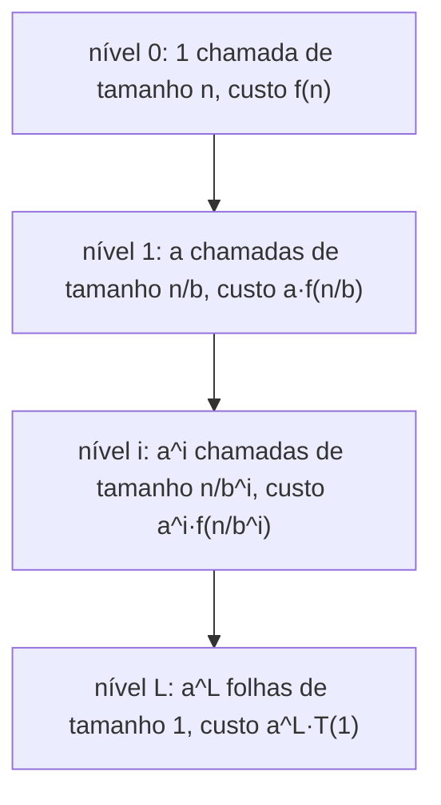

## Passo 1 · Leitura · Do código à recorrência

Para escrever o custo $T(n)$ de uma função recursiva, responda três perguntas sobre **uma execução** dela:

- **$a$:** quantas chamadas recursivas acontecem de fato? Duas chamadas escritas em ramos diferentes de um `if`/`else` contam como uma, porque só uma roda.
- **$b$:** cada chamada recebe uma entrada de que tamanho? Se é $n/b$, o $b$ é o fator de divisão.
- **$f(n)$:** quanto custa todo o resto, dividir e combinar? Inclua os custos escondidos: uma fatia `v[meio:]` copia os elementos, e um `+` entre listas também.

Daí sai $T(n) = a\,T(n/b) + f(n)$, com $a \ge 1$ e $b > 1$ constantes. A pergunta do $f(n)$ é a que mais engana. Esta busca binária parece ser $\Theta(\log n)$:

```python
def busca(v, alvo):
    if not v:
        return False
    meio = len(v) // 2
    if v[meio] == alvo:
        return True
    if alvo < v[meio]:
        return busca(v[:meio], alvo)       # uma chamada, com metade
    return busca(v[meio + 1:], alvo)       # mas a fatia copia ~n/2 elementos
```

Uma chamada só, com metade da entrada: $a = 1$, $b = 2$. Mas a fatia custa $\Theta(n)$, então $T(n) = T(n/2) + \Theta(n)$. As cópias somam $\frac{n}{2} + \frac{n}{4} + \dots < n$, e a busca inteira é $\Theta(n)$, tão lenta quanto olhar elemento por elemento. Com índices `ini` e `fim`, $f(n)$ volta a ser $\Theta(1)$ e o custo a $\Theta(\log n)$.

Para resolver uma recorrência, desenhe a **árvore de recursão**. No nível $i$ há $a^i$ chamadas, cada uma com entrada de tamanho $n/b^i$ e custo $f(n/b^i)$ fora das chamadas filhas. Os tamanhos chegam a 1 depois de $L = \log_b n$ níveis, e o último nível tem $a^L = n^{\log_b a}$ folhas.



Somando nível por nível:

$$
T(n) = \sum_{i=0}^{L-1} a^i \, f\!\left(\frac{n}{b^i}\right) + n^{\log_b a} \cdot T(1)
$$

A igualdade $a^{\log_b n} = n^{\log_b a}$ vem de escrever os dois lados como potência de $b$: ambos valem $b^{\log_b a \cdot \log_b n}$. Assim, o número de folhas é uma potência de $n$, e o expoente $\log_b a$ é o personagem principal do resto da lição.

Nem toda recorrência tem esse formato. `soma(v, i)` que avança um índice e percorre o resto da lista a cada chamada dá $T(n) = T(n - 1) + \Theta(n)$: a entrada **diminui de 1**, não é dividida, e não existe $b$.

## Passo 2 · Exercício · Trabalho por nível da árvore

Escreva `trabalho_por_nivel(a, b, f, n)`, que devolve a lista com o custo total de cada nível da árvore de recursão de $T(n) = a\,T(n/b) + f(n)$, com $T(1) = 1$. `n` é uma potência de `b` e `f` é uma função que recebe o tamanho e devolve o custo. Os valores são inteiros exatos.

- Nos níveis com tamanho maior que 1, o custo é (número de chamadas do nível) × `f(tamanho)`.
- O último nível tem as folhas, de tamanho 1, e cada folha custa `T(1) = 1`.

Exemplo: `trabalho_por_nivel(4, 2, lambda m: m, 8)` é `[8, 16, 32, 64]`: um nó de tamanho 8, quatro de tamanho 4, dezesseis de tamanho 2 e 64 folhas. A soma da lista é $T(n)$.

### Instruções
1. Comece com uma chamada do tamanho `n` e, a cada nível, multiplique o número de chamadas por `a` e divida o tamanho por `b`, com divisão inteira.
2. Enquanto o tamanho for maior que 1, guarde o custo do nível.
3. Termine com o nível das folhas, que custam 1 cada, e devolva a lista.

### Código inicial
```python
def trabalho_por_nivel(a, b, f, n):
    pass
```

### Solução
```python
def trabalho_por_nivel(a, b, f, n):
    niveis = []
    tamanho = n
    nos = 1
    while tamanho > 1:
        niveis.append(nos * f(tamanho))
        tamanho = tamanho // b
        nos = nos * a
    niveis.append(nos)
    return niveis
```

### Dicas
1. Um nível não custa só `f(tamanho)`: todas as chamadas dele pagam esse valor.
2. As folhas são as chamadas de tamanho 1, e o custo delas é `T(1)`, não `f(1)`.
3. `/` devolve `float` mesmo quando a divisão é exata.

### Verificação
```json
[
  { "id": "merge", "checkpoint": 2, "kind": "expr", "expr": "trabalho_por_nivel(2, 2, lambda m: m, 8)", "expected": [8, 8, 8, 8],
    "name": "2T(n/2) + n com n = 8: [8, 8, 8, 8]", "hint": "Cada nível tem a^i chamadas, e todas pagam f do seu tamanho." },
  { "id": "folhas-dominam", "checkpoint": 1, "kind": "expr", "expr": "[trabalho_por_nivel(4, 2, lambda m: m, 16), trabalho_por_nivel(5, 4, lambda m: m, 64)]", "expected": [[16, 32, 64, 128, 256], [64, 80, 100, 125]],
    "name": "4T(n/2) + n com n = 16 e 5T(n/4) + n com n = 64" },
  { "id": "raiz-domina", "checkpoint": 2, "kind": "expr", "expr": "[trabalho_por_nivel(1, 2, lambda m: m, 16), trabalho_por_nivel(3, 3, lambda m: m * m, 27)]", "expected": [[16, 8, 4, 2, 1], [729, 243, 81, 27]],
    "name": "T(n/2) + n com n = 16 e 3T(n/3) + n² com n = 27" },
  { "id": "folhas-custam-1", "checkpoint": 3, "kind": "expr", "expr": "[trabalho_por_nivel(2, 2, lambda m: 3 * m, 4), trabalho_por_nivel(2, 2, lambda m: 1, 8)]", "expected": [[12, 12, 4], [1, 2, 4, 8]],
    "name": "As folhas custam T(1) = 1, não f(1)", "hint": "Com f(m) = 3m, f(1) vale 3, mas cada folha custa 1." },
  { "id": "n-1", "checkpoint": 3, "kind": "expr", "expr": "trabalho_por_nivel(3, 2, lambda m: m, 1)", "expected": [1],
    "name": "n = 1: só a folha" },
  { "id": "inteiros", "checkpoint": 1, "kind": "expr", "setup": "r = trabalho_por_nivel(8, 2, lambda m: m * m, 2 ** 10)",
    "expr": "[len(r), sum(r), all(type(x) is int for x in r)]", "expected": [11, 2146435072, true],
    "name": "8T(n/2) + n² com n = 1024: 11 níveis, inteiros exatos", "hint": "Use // para o tamanho." },
  { "id": "soma-e-T", "checkpoint": 3, "kind": "expr", "expr": "[sum(trabalho_por_nivel(2, 2, lambda m: m, 1024)), len(trabalho_por_nivel(1, 2, lambda m: 1, 2 ** 30))]", "expected": [11264, 31],
    "name": "A soma é T(n): 11264 para o merge sort com n = 1024; a busca binária com n = 2^30 tem 31 níveis" }
]
```

### Soluções erradas
```python name="esquece de multiplicar pelo número de chamadas"
def trabalho_por_nivel(a, b, f, n):
    niveis = []
    tamanho = n
    while tamanho > 1:
        niveis.append(f(tamanho))
        tamanho = tamanho // b
    niveis.append(1)
    return niveis
```
```python name="esquece o nível das folhas"
def trabalho_por_nivel(a, b, f, n):
    niveis = []
    tamanho = n
    nos = 1
    while tamanho > 1:
        niveis.append(nos * f(tamanho))
        tamanho = tamanho // b
        nos = nos * a
    return niveis
```
```python name="folhas custam f(1)"
def trabalho_por_nivel(a, b, f, n):
    niveis = []
    tamanho = n
    nos = 1
    while tamanho >= 1:
        niveis.append(nos * f(tamanho))
        tamanho = tamanho // b
        nos = nos * a
    return niveis
```
```python name="multiplica o número de chamadas por b em vez de a"
def trabalho_por_nivel(a, b, f, n):
    niveis = []
    tamanho = n
    nos = 1
    while tamanho > 1:
        niveis.append(nos * f(tamanho))
        tamanho = tamanho // b
        nos = nos * b
    niveis.append(nos)
    return niveis
```
```python name="divide com / e devolve float"
def trabalho_por_nivel(a, b, f, n):
    niveis = []
    tamanho = n
    nos = 1
    while tamanho > 1:
        niveis.append(nos * f(tamanho))
        tamanho = tamanho / b
        nos = nos * a
    niveis.append(nos)
    return niveis
```

## Passo 3 · Previsão · Quem domina a árvore

A função abaixo é a mesma do exercício anterior. O programa imprime o custo por nível e o total de quatro recorrências, todas com $n = 16$. Leia sem executar e digite exatamente o que ele imprime.

### Código
```python
def niveis(a, b, f, n):
    linha = []
    tamanho, nos = n, 1
    while tamanho > 1:
        linha.append(nos * f(tamanho))
        tamanho //= b
        nos *= a
    linha.append(nos)
    return linha


for nome, a, f in [("2T(n/2) + n", 2, lambda m: m),
                   ("4T(n/2) + n", 4, lambda m: m),
                   ("T(n/2) + n", 1, lambda m: m),
                   ("2T(n/2) + n*n", 2, lambda m: m * m)]:
    linha = niveis(a, 2, f, 16)
    print(nome, linha, sum(linha))
```

### Dicas
1. Com $n = 16$ e $b = 2$, os tamanhos são 16, 8, 4, 2 e 1: cinco níveis, o último de folhas.
2. Em cada nível, o número de chamadas é multiplicado por `a` e o custo de cada uma é `f` do novo tamanho.
3. As folhas custam 1 cada: o último número de cada lista é a quantidade de folhas.

### Saída esperada
```text
2T(n/2) + n [16, 16, 16, 16, 16] 80
4T(n/2) + n [16, 32, 64, 128, 256] 496
T(n/2) + n [16, 8, 4, 2, 1] 31
2T(n/2) + n*n [256, 128, 64, 32, 16] 496
```

## Passo 4 · Leitura · O Teorema Mestre e quando ele não se aplica

Na Previsão, quando o custo por nível **cresce** para baixo, as folhas mandam; quando é **igual** em todo nível, multiplica-se pelo número de níveis; quando **cai**, a raiz manda. O Teorema Mestre faz disso uma regra. Para $T(n) = a\,T(n/b) + f(n)$, com $a \ge 1$ e $b > 1$ constantes, compare $f(n)$ com $n^{\log_b a}$, o custo das folhas:

1. Se $f(n) = O(n^{\log_b a - \varepsilon})$ para algum $\varepsilon > 0$, então $T(n) = \Theta(n^{\log_b a})$.
2. Se $f(n) = \Theta(n^{\log_b a})$, então $T(n) = \Theta(n^{\log_b a} \log n)$.
3. Se $f(n) = \Omega(n^{\log_b a + \varepsilon})$ para algum $\varepsilon > 0$ **e** vale a condição de regularidade $a\,f(n/b) \le c\,f(n)$ para alguma constante $c < 1$ e todo $n$ grande, então $T(n) = \Theta(f(n))$.

A regularidade garante que o custo cai de um nível para o seguinte. Quando $f(n) = \Theta(n^k)$, ela vale sozinha: $a(n/b)^k = \frac{a}{b^k} n^k$, e $\frac{a}{b^k} < 1$ no caso 3. Então basta comparar $k$ com $\log_b a$:

| Recorrência | $\log_b a$ | $k$ | Caso | Solução |
| :--- | :---: | :---: | :---: | :--- |
| $T(n/2) + 1$ (busca binária) | 0 | 0 | 2 | $\Theta(\log n)$ |
| $2T(n/2) + n$ (merge sort) | 1 | 1 | 2 | $\Theta(n \log n)$ |
| $4T(n/2) + n$ | 2 | 1 | 1 | $\Theta(n^2)$ |
| $3T(n/2) + n$ (Karatsuba) | $\approx 1{,}585$ | 1 | 1 | $\Theta(n^{\log_2 3})$ |
| $T(n/2) + n$ | 0 | 1 | 3 | $\Theta(n)$ |

Compare sem ponto flutuante. Como $b > 1$, $k < \log_b a$ equivale a $b^k < a$, uma conta exata com inteiros. Já `math.log(125, 5)` dá `3.0000000000000004`, e o teste `k == math.log(a, b)` erra o caso 2 de $125\,T(n/5) + n^3$.

O teorema **não se aplica** quando:

- **A entrada diminui por subtração.** $T(n) = T(n-1) + n$ não tem $b$; ler ali "caso 3, $\Theta(n)$" é o erro clássico. A expansão dá $\frac{n(n+1)}{2}$, $\Theta(n^2)$.
- **$f(n)$ cai no vão entre dois casos.** Em $2T(n/2) + n \log n$, $f$ é maior que $n^{\log_2 2} = n$, mas não por um fator polinomial $n^{\varepsilon}$: nenhum dos três casos vale. A árvore resolve: o nível $i$ custa $n \log_2 (n/2^i)$, e a soma dá $\Theta(n \log^2 n)$.
- **Os pedaços têm tamanhos diferentes**, como $T(n/3) + T(2n/3) + n$, ou $a$ e $b$ não são constantes.

## Passo 5 · Exercício · Classificador do Teorema Mestre

Escreva `teorema_mestre(a, b, k, j=0)` para $T(n) = a\,T(n/b) + f(n)$ com $f(n) = \Theta(n^k \log^j n)$, em que `a >= 1`, `b >= 2` e `k >= 0` são inteiros e `j` é um inteiro (pode ser negativo). Devolva a tupla `(caso, e, p)`, que significa $T(n) = \Theta(n^e \log^p n)$, ou `None` quando a forma básica do teorema não se aplica.

- Caso 1 ($k < \log_b a$): `(1, log_b(a), 0)`, com o expoente como número (`math.log(a, b)` serve aqui, porque o caso já foi decidido).
- Caso 2 ($k = \log_b a$): `(2, k, 1)` quando `j == 0`; com `j != 0`, $f$ está no vão e a resposta é `None`.
- Caso 3 ($k > \log_b a$): `(3, k, j)`, porque o custo é o da raiz, $f(n)$.

Exemplos: `teorema_mestre(2, 2, 1)` é `(2, 1, 1)`, o merge sort; `teorema_mestre(2, 2, 1, 1)` é `None`.

### Instruções
1. Decida o caso comparando $b^k$ com $a$ em inteiros, sem comparar números de ponto flutuante.
2. No caso 2, devolva o $\log n$ a mais quando `j` for 0 e `None` quando `j` não for 0.
3. Nos casos 1 e 3, devolva o expoente de quem domina: as folhas ou a raiz.

### Código inicial
```python
import math


def teorema_mestre(a, b, k, j=0):
    pass
```

### Solução
```python
import math


def teorema_mestre(a, b, k, j=0):
    if b ** k < a:
        return (1, math.log(a, b), 0)
    if b ** k == a:
        if j == 0:
            return (2, k, 1)
        return None
    return (3, k, j)
```

### Dicas
1. Como $b > 1$, a função $x \mapsto b^x$ é crescente: comparar $k$ com $\log_b a$ é o mesmo que comparar $b^k$ com $a$.
2. O número de chamadas $a$ sozinho não decide nada: $4T(n/2) + n^2$ tem quatro chamadas e mesmo assim é caso 2.
3. No caso 3 o custo total é o da raiz, $f(n)$ inteira, com o seu fator de $\log$.

### Verificação
```json
[
  { "id": "caso-2", "checkpoint": 2, "kind": "expr", "expr": "[teorema_mestre(2, 2, 1), teorema_mestre(1, 2, 0), teorema_mestre(4, 2, 2), teorema_mestre(9, 3, 2)]", "expected": [[2, 1, 1], [2, 0, 1], [2, 2, 1], [2, 2, 1]],
    "name": "Caso 2: merge sort, busca binária, 4T(n/2) + n² e 9T(n/3) + n²", "hint": "Com empate, cada um dos log n níveis custa o mesmo." },
  { "id": "caso-1", "checkpoint": 3, "kind": "expr", "setup": "r = [teorema_mestre(4, 2, 1), teorema_mestre(3, 2, 1), teorema_mestre(7, 2, 2), teorema_mestre(16, 4, 1)]",
    "expr": "[[c, round(e, 6), p] for c, e, p in r]", "expected": [[1, 2.0, 0], [1, 1.584963, 0], [1, 2.807355, 0], [1, 2.0, 0]],
    "name": "Caso 1: 4T(n/2) + n, Karatsuba, Strassen e 16T(n/4) + n", "hint": "Nas folhas, o expoente é log_b a, não k." },
  { "id": "caso-3", "checkpoint": 3, "kind": "expr", "expr": "[teorema_mestre(2, 2, 2), teorema_mestre(1, 2, 1), teorema_mestre(2, 4, 1)]", "expected": [[3, 2, 0], [3, 1, 0], [3, 1, 0]],
    "name": "Caso 3: 2T(n/2) + n², T(n/2) + n e 2T(n/4) + n", "hint": "Compare b ** k com a, não k com a." },
  { "id": "sem-float", "checkpoint": 1, "kind": "expr", "expr": "[teorema_mestre(125, 5, 3), teorema_mestre(243, 3, 5), teorema_mestre(8, 2, 3)]", "expected": [[2, 3, 1], [2, 5, 1], [2, 3, 1]],
    "name": "Empates exatos: 125T(n/5) + n³, 243T(n/3) + n⁵ e 8T(n/2) + n³",
    "hint": "math.log(125, 5) não é exatamente 3. Compare b ** k com a." },
  { "id": "vao", "checkpoint": 2, "kind": "expr", "expr": "[teorema_mestre(2, 2, 1, 1), teorema_mestre(2, 2, 1, -1), teorema_mestre(1, 2, 0, 2)]", "expected": [null, null, null],
    "name": "f no vão do caso 2: 2T(n/2) + n log n não tem resposta pela forma básica", "hint": "No caso 2, um fator de log em f tira a recorrência do alcance do teorema básico." },
  { "id": "log-fora-do-vao", "checkpoint": 3, "kind": "expr", "setup": "r = [teorema_mestre(2, 2, 2, 1), teorema_mestre(2, 2, 2, -1), teorema_mestre(4, 2, 1, 5)]",
    "expr": "[[c, round(e, 6), p] for c, e, p in r]", "expected": [[3, 2, 1], [3, 2, -1], [1, 2.0, 0]],
    "name": "Fora do empate, o log de f só aparece no caso 3", "hint": "No caso 3 a resposta é a própria f(n), com o seu log." }
]
```

### Soluções erradas
```python name="compara k com math.log(a, b) em ponto flutuante"
import math


def teorema_mestre(a, b, k, j=0):
    c = math.log(a, b)
    if k < c:
        return (1, c, 0)
    if k == c:
        if j == 0:
            return (2, k, 1)
        return None
    return (3, k, j)
```
```python name="troca a e b no logaritmo"
import math


def teorema_mestre(a, b, k, j=0):
    c = math.log(b, a) if a > 1 else 0
    if k < c:
        return (1, c, 0)
    if abs(k - c) < 1e-9:
        if j == 0:
            return (2, k, 1)
        return None
    return (3, k, j)
```
```python name="compara k com o número de chamadas a"
import math


def teorema_mestre(a, b, k, j=0):
    if k < a:
        return (1, math.log(a, b), 0)
    if k == a:
        if j == 0:
            return (2, k, 1)
        return None
    return (3, k, j)
```
```python name="caso 2 sem o log n a mais"
import math


def teorema_mestre(a, b, k, j=0):
    if b ** k < a:
        return (1, math.log(a, b), 0)
    if b ** k == a:
        if j == 0:
            return (2, k, 0)
        return None
    return (3, k, j)
```
```python name="ignora o log de f no empate"
import math


def teorema_mestre(a, b, k, j=0):
    if b ** k < a:
        return (1, math.log(a, b), 0)
    if b ** k == a:
        return (2, k, 1)
    return (3, k, j)
```
```python name="caso 3 devolve o expoente das folhas"
import math


def teorema_mestre(a, b, k, j=0):
    if b ** k < a:
        return (1, math.log(a, b), 0)
    if b ** k == a:
        if j == 0:
            return (2, k, 1)
        return None
    return (3, math.log(a, b), 0)
```

## Passo 6 · Leitura · Expansão, árvore e substituição

Quando o Teorema Mestre não serve, três técnicas resolvem quase tudo o que aparece neste nível.

**Expansão.** Abra a recorrência algumas vezes até ver o padrão. Com $T(n) = 2T(n-1) + 1$ e $T(0) = 0$, a recorrência das Torres de Hanói:

$$
T(n) = 2T(n-1) + 1 = 4T(n-2) + 2 + 1 = \dots = 2^n T(0) + (2^{n-1} + \dots + 2 + 1) = 2^n - 1
$$

Subtrair de 1 com duas chamadas dá custo **exponencial**. Uma chamada a mais em cada nível multiplica o total, e é por isso que a recursão dupla do Fibonacci ingênuo explode.

**Árvore com pedaços desiguais.** Em $T(n) = T(n/3) + T(2n/3) + n$, cada nível completo da árvore soma $n$, porque os tamanhos dos pedaços de um nível somam $n$. O ramo mais curto, que sempre pega $n/3$, acaba em $\log_3 n$ níveis; o mais longo, que sempre pega $2n/3$, em $\log_{3/2} n$. Então o total fica entre $n \log_3 n$ e $n \log_{3/2} n$: $\Theta(n \log n)$.

**Substituição.** Chute a resposta e prove por indução que ela vale. Para $T(n) = 2T(n/2) + n$ com $T(1) = 1$ e $n$ potência de 2, chute $T(n) = n \log_2 n + n$. A base vale: $T(1) = 0 + 1 = 1$. Supondo que vale para $n/2$:

$$
T(n) = 2\left(\frac{n}{2}\log_2 \frac{n}{2} + \frac{n}{2}\right) + n = n(\log_2 n - 1) + n + n = n \log_2 n + n
$$

É exatamente o que o seu `trabalho_por_nivel` somou para $n = 1\,024$: $10\,240 + 1\,024 = 11\,264$.

A armadilha da substituição é a constante. Tente provar $T(n) \le c\,n$ para a mesma recorrência: $T(n) \le 2c\frac{n}{2} + n = c\,n + n$. Escrever "$c\,n + n = O(n)$, provado" está **errado**: a hipótese pedia $T(n) \le c\,n$ com a **mesma** $c$, e $c\,n + n$ passa de $c\,n$ para todo $n$. O $+n$ que sobra em cada passo mostra que o chute é pequeno demais.

A verificação numérica complementa as provas. Simular $T(n)$ para vários $n$ e olhar a razão $T(2n)/T(n)$ desmente um chute errado rapidamente: perto de 2 sugere $\Theta(n)$, perto de 4 sugere $\Theta(n^2)$. Mas só a prova garante o resultado para todo $n$.

## Passo 7 · Quiz · Montar, classificar e desconfiar

### Pergunta
Qual é a recorrência desta função, e o custo dela?
```python
def maior(v):
    if len(v) == 1:
        return v[0]
    meio = len(v) // 2
    esq = maior(v[:meio])
    dir = maior(v[meio:])
    return esq if esq >= dir else dir
```
- [ ] $T(n) = 2T(n/2) + \Theta(1)$, então $\Theta(n)$
- [x] $T(n) = 2T(n/2) + \Theta(n)$, então $\Theta(n \log n)$, por causa das fatias
- [ ] $T(n) = T(n/2) + \Theta(n)$, então $\Theta(n)$
- [ ] $T(n) = T(n-1) + \Theta(1)$, então $\Theta(n)$
> São duas chamadas de tamanho $n/2$, mas as fatias `v[:meio]` e `v[meio:]` copiam os $n$ elementos a cada chamada: $f(n) = \Theta(n)$. É o caso 2, como o merge sort. Com índices `ini` e `fim`, $f(n)$ cai para $\Theta(1)$ e o custo para $\Theta(n)$.

### Pergunta
Um colega analisou $T(n) = T(n-1) + n$ assim: "$a = 1$ e $f(n) = n$; como $k = 1 > \log_b 1 = 0$, é o caso 3 e $T(n) = \Theta(n)$". Onde está o erro?
- [ ] Em nenhum lugar: o caso 3 vale porque $f$ cresce mais que o custo das folhas
- [ ] O caso certo é o 2, e a resposta é $\Theta(n \log n)$
- [x] A entrada diminui de 1, não é dividida por uma constante $b > 1$: o teorema não se aplica, e a expansão $n + (n-1) + \dots + 1$ dá $\Theta(n^2)$
- [ ] Faltou a condição de regularidade, que falha e leva ao caso 1
> O $b$ do teorema é o fator que **divide** a entrada. Com $T(n-1)$, a árvore é um caminho de $n$ níveis, e o custo dos níveis cai devagar: $n, n-1, n-2, \dots$. A soma é $\frac{n(n+1)}{2}$.

### Pergunta
Qual afirmação sobre $T(n) = 2T(n/2) + n \log n$ está correta?
- [ ] É caso 2 da forma básica, porque $f(n) = n \log n$ é $\Theta(n)$
- [ ] É caso 3: $f(n)$ é maior que $n$, então $T(n) = \Theta(n \log n)$
- [x] A forma básica não se aplica: $f(n)$ é maior que $n^{\log_2 2} = n$, mas não por um fator $n^{\varepsilon}$; pela árvore, $T(n) = \Theta(n \log^2 n)$
- [ ] É caso 1, porque são duas chamadas recursivas
> O caso 3 exige $f(n) = \Omega(n^{1+\varepsilon})$, e $\log n$ cresce mais devagar que qualquer $n^{\varepsilon}$. Na árvore, o nível $i$ custa $n \log_2(n/2^i) = n(\log_2 n - i)$; somando os $\log_2 n$ níveis, sai $\Theta(n \log^2 n)$.
