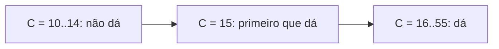

## Passo 1 · Leitura · O invariante que impede o bug

A **busca linear** olha os elementos um a um. Ela funciona em qualquer lista e custa $O(n)$ no pior caso: com $1\,000\,000$ de matrículas, até um milhão de comparações. Se a lista está **ordenada**, dá para fazer muito melhor. A **busca binária** olha o elemento do meio e, com uma única comparação, descarta metade dos candidatos.

Metade de metade de metade... depois de $k$ comparações sobram no máximo $n / 2^k$ candidatos. Por isso a busca binária faz no máximo

$$
\lfloor \log_2 n \rfloor + 1
$$

iterações: 20 para um milhão de elementos.

A ideia é simples; acertar os índices é que é difícil. A saída é escrever, antes do código, o **invariante**: uma frase que é verdadeira no começo de toda volta do laço.

> **Invariante:** se `alvo` está na lista, o índice dele está no intervalo fechado `[lo, hi]`.

Cada linha do código existe para manter essa frase verdadeira:

```python
def busca_binaria(lista, alvo):
    lo, hi = 0, len(lista) - 1      # início: [0, n-1] é a lista toda
    while lo <= hi:                 # [lo, hi] ainda tem candidato
        meio = (lo + hi) // 2
        if lista[meio] == alvo:
            return meio
        if lista[meio] < alvo:      # tudo em [lo, meio] é menor que alvo
            lo = meio + 1
        else:                       # tudo em [meio, hi] é maior que alvo
            hi = meio - 1
    return -1                       # [lo, hi] vazio: alvo não está lá
```

- **Início:** com `lo = 0` e `hi = n - 1`, o intervalo é a lista inteira; a frase vale.
- **Manutenção:** se `lista[meio] < alvo`, a ordenação garante que `meio` e todos à esquerda dele também são menores. Descartá-los com `lo = meio + 1` não perde o alvo.
- **Término:** a cada volta o intervalo perde pelo menos um elemento (o `meio`), então o laço acaba. Quando `lo > hi`, o intervalo está vazio e, pelo invariante, o alvo não existe.

A condição é `lo <= hi`, e não `lo < hi`: quando `lo == hi` ainda resta **um** candidato a testar. Trocar por `<` pula esse último elemento e a lista `[5]` passa a "não conter" o 5.

No visualizador, acompanhe `lo` e `hi` se aproximando até se cruzarem na busca do 10, que não está na lista.

```python visualizar
def busca_binaria(lista, alvo):
    lo = 0
    hi = len(lista) - 1
    while lo <= hi:
        meio = (lo + hi) // 2
        if lista[meio] == alvo:
            return meio
        if lista[meio] < alvo:
            lo = meio + 1
        else:
            hi = meio - 1
    return -1


print(busca_binaria([2, 5, 8, 12, 16, 23, 38], 16))
print(busca_binaria([2, 5, 8, 12, 16, 23, 38], 10))
```

## Passo 2 · Previsão · lo, hi e meio quando o alvo não está

O programa abaixo faz a busca binária do 10 na lista do passo anterior e imprime `lo`, `hi`, `meio` e o elemento do meio a cada volta. Leia sem executar e digite exatamente o que ele imprime.

### Código
```python
numeros = [2, 5, 8, 12, 16, 23, 38]
alvo = 10
lo = 0
hi = len(numeros) - 1
while lo <= hi:
    meio = (lo + hi) // 2
    print(lo, hi, meio, numeros[meio])
    if numeros[meio] == alvo:
        break
    if numeros[meio] < alvo:
        lo = meio + 1
    else:
        hi = meio - 1
print("fim:", lo, hi)
```

### Dicas
1. Na primeira volta, `meio = (0 + 6) // 2`. O elemento lá é maior ou menor que 10?
2. O laço só para quando `lo` passa de `hi`. Na última volta, `lo` e `hi` são iguais.
3. Ao terminar, `lo` aponta para onde o 10 deveria ser inserido.

### Saída esperada
```text
0 6 3 12
0 2 1 5
2 2 2 8
fim: 3 2
```

## Passo 3 · Exercício · Busca binária iterativa
modo: lacunas

Complete as lacunas (`___`) de `busca_binaria(lista, alvo)`. A lista está em ordem crescente e não tem repetidos; a função devolve o índice de `alvo` ou `-1` se ele não estiver lá. A verificação também conta quantas vezes sua função lê a lista: numa lista de um milhão de elementos, ela pode ler no máximo 50 posições.

### Instruções
1. Mantenha o laço enquanto o intervalo fechado `[lo, hi]` tiver pelo menos um candidato.
2. Calcule o índice do meio com divisão inteira.
3. Se o elemento do meio é menor que o alvo, descarte o meio e tudo à esquerda dele; se é maior, descarte o meio e tudo à direita.

### Código inicial
```python
def busca_binaria(lista, alvo):
    lo = 0
    hi = len(lista) - 1
    while lo ___ hi:
        meio = (lo + hi) ___ 2
        if lista[meio] == alvo:
            return meio
        if lista[meio] < alvo:
            lo = ___
        else:
            hi = ___
    return -1
```

### Solução
```python
def busca_binaria(lista, alvo):
    lo = 0
    hi = len(lista) - 1
    while lo <= hi:
        meio = (lo + hi) // 2
        if lista[meio] == alvo:
            return meio
        if lista[meio] < alvo:
            lo = meio + 1
        else:
            hi = meio - 1
    return -1
```

### Dicas
1. Quando `lo == hi`, ainda sobra um elemento para testar. A condição precisa deixar o laço rodar nesse caso.
2. Índice de lista precisa ser `int`: `/` devolve `float` mesmo em `6 / 2`.
3. O `meio` já foi comparado. O novo intervalo não deve incluí-lo, senão ele pode nunca encolher.

### Verificação
```json
[
  { "id": "vazia", "checkpoint": 1, "kind": "call", "function": "busca_binaria", "args": [[], 5], "expected": -1,
    "name": "busca_binaria([], 5) é -1" },
  { "id": "um-presente", "checkpoint": 1, "kind": "call", "function": "busca_binaria", "args": [[5], 5], "expected": 0,
    "name": "busca_binaria([5], 5) é 0", "hint": "Com um único elemento, lo e hi são iguais. O laço precisa rodar mesmo assim." },
  { "id": "um-ausente", "checkpoint": 1, "kind": "call", "function": "busca_binaria", "args": [[5], 3], "expected": -1,
    "name": "busca_binaria([5], 3) é -1" },
  { "id": "ultima-posicao", "checkpoint": 3, "kind": "call", "function": "busca_binaria", "args": [[4, 9], 9], "expected": 1,
    "name": "busca_binaria([4, 9], 9) é 1" },
  { "id": "primeira-posicao", "checkpoint": 3, "kind": "call", "function": "busca_binaria", "args": [[1, 3, 5, 7, 9, 11], 1], "expected": 0,
    "name": "busca_binaria([1, 3, 5, 7, 9, 11], 1) é 0" },
  { "id": "maior-que-todos", "checkpoint": 3, "kind": "call", "function": "busca_binaria", "args": [[1, 3, 5, 7], 8], "expected": -1,
    "name": "busca_binaria([1, 3, 5, 7], 8) é -1", "hint": "Procure um valor maior que o último: hi nunca pode apontar para fora da lista." },
  { "id": "ausente-no-meio", "checkpoint": 3, "kind": "call", "function": "busca_binaria", "args": [[10, 20, 30, 40, 50], 35], "expected": -1,
    "name": "busca_binaria([10, 20, 30, 40, 50], 35) é -1" },
  { "id": "log-n-leituras", "checkpoint": 2, "kind": "expr",
    "setup": "class Contada:\n    def __init__(self, dados):\n        self.dados = dados\n        self.leituras = 0\n    def __len__(self):\n        return len(self.dados)\n    def __getitem__(self, i):\n        self.leituras += 1\n        return self.dados[i]\nv = Contada(list(range(0, 2000000, 2)))\nr = busca_binaria(v, 777778)",
    "expr": "[r, v.leituras <= 50]", "expected": [388889, true],
    "name": "Acha o alvo em um milhão de elementos lendo no máximo 50 posições",
    "hint": "Percorrer a lista do começo é busca linear. Cada volta deve descartar metade do intervalo." }
]
```

### Soluções erradas
```python name="lo < hi pula o último candidato"
def busca_binaria(lista, alvo):
    lo = 0
    hi = len(lista) - 1
    while lo < hi:
        meio = (lo + hi) // 2
        if lista[meio] == alvo:
            return meio
        if lista[meio] < alvo:
            lo = meio + 1
        else:
            hi = meio - 1
    return -1
```
```python name="hi começa em len(lista) com intervalo fechado"
def busca_binaria(lista, alvo):
    lo = 0
    hi = len(lista)
    while lo <= hi:
        meio = (lo + hi) // 2
        if lista[meio] == alvo:
            return meio
        if lista[meio] < alvo:
            lo = meio + 1
        else:
            hi = meio - 1
    return -1
```
```python name="divisão com / produz índice float"
def busca_binaria(lista, alvo):
    lo = 0
    hi = len(lista) - 1
    while lo <= hi:
        meio = (lo + hi) / 2
        if lista[meio] == alvo:
            return meio
        if lista[meio] < alvo:
            lo = meio + 1
        else:
            hi = meio - 1
    return -1
```
```python name="busca linear correta, mas O(n)"
def busca_binaria(lista, alvo):
    for i in range(len(lista)):
        if lista[i] == alvo:
            return i
    return -1
```

## Passo 4 · Leitura · Com repetidos: limite inferior e primeira ocorrência

Na lista `[10, 20, 20, 20, 30]`, a busca do passo anterior pode devolver qualquer um dos índices 1, 2 ou 3 para o 20: depende de onde o `meio` cair. Para saber **onde começa** o bloco de 20, a pergunta muda. Em vez de "onde está o 20?", pergunte: **qual é o menor índice `i` com `lista[i] >= x`?** Essa posição se chama **limite inferior** (*lower bound*). Se todos forem menores que `x`, a resposta é `len(lista)`: o lugar onde `x` seria inserido no fim.

Agora o invariante usa um intervalo **semiaberto** `[lo, hi)`, e é ele que dita cada linha:

> **Invariante:** tudo em `lista[:lo]` é `< x` e tudo em `lista[hi:]` é `>= x`.

```python
def limite_inferior(lista, x):
    lo, hi = 0, len(lista)          # nada classificado ainda: vale por vacuidade
    while lo < hi:                  # [lo, hi) ainda tem posição a classificar
        meio = (lo + hi) // 2
        if lista[meio] < x:
            lo = meio + 1           # meio vai para o lado "< x"
        else:
            hi = meio               # meio vai para o lado ">= x": ele pode ser a resposta
    return lo                       # lo == hi: a fronteira entre os dois lados
```

Repare nas duas diferenças em relação ao passo 1, que andam juntas. `hi = meio` (sem `- 1`) porque `meio` pode ser a resposta e não pode ser descartado. E o laço é `lo < hi`: com `lo <= hi`, quando `lo == hi` o `meio` vale `lo`, `hi = meio` não muda nada e o laço **nunca termina**.

A primeira ocorrência sai de graça: calcule `i = limite_inferior(lista, alvo)` e confira se `i` está dentro da lista e se `lista[i] == alvo`. Para a **última** ocorrência, troque `<` por `<=` na comparação: você obtém o menor índice com `lista[i] > x` (o *limite superior*), e a última ocorrência fica uma posição antes.

O erro comum aqui é achar o 20 com a busca do passo 1 e depois andar para a esquerda enquanto o vizinho for 20. A resposta sai certa, mas numa lista com cem mil valores iguais esse "andar" lê cem mil posições: a busca virou linear. A biblioteca padrão traz as duas fronteiras prontas em `bisect.bisect_left` e `bisect.bisect_right`; aqui você vai escrevê-las para entender o que elas garantem.

## Passo 5 · Exercício · Primeira e última ocorrência

Escreva três funções para listas em ordem crescente, que **podem ter repetidos**, sem importar `bisect` e lendo no máximo 60 posições da lista por chamada, mesmo que a lista tenha cem mil elementos iguais:

- `limite_inferior(lista, x)`: o menor índice `i` com `lista[i] >= x`, ou `len(lista)` se não houver. Em `[10, 20, 20, 30]`: `limite_inferior(lista, 20)` é `1`, `limite_inferior(lista, 25)` é `3` e `limite_inferior(lista, 99)` é `4`.
- `primeira_ocorrencia(lista, alvo)`: o menor índice com `lista[i] == alvo`, ou `-1`.
- `ultima_ocorrencia(lista, alvo)`: o maior índice com `lista[i] == alvo`, ou `-1`. Em `[10, 20, 20, 30]`, a última ocorrência do 20 é `2`.

### Instruções
1. Escreva `limite_inferior(lista, x)` com o invariante semiaberto da leitura.
2. Escreva `primeira_ocorrencia(lista, alvo)` usando `limite_inferior`. Cuidado com o índice que cai fora da lista.
3. Escreva `ultima_ocorrencia(lista, alvo)`. Dica: ache o primeiro índice com valor **maior** que `alvo` e olhe uma posição antes.

### Código inicial
```python
def limite_inferior(lista, x):
    pass


def primeira_ocorrencia(lista, alvo):
    pass


def ultima_ocorrencia(lista, alvo):
    pass
```

### Solução
```python
def limite_inferior(lista, x):
    lo = 0
    hi = len(lista)
    while lo < hi:
        meio = (lo + hi) // 2
        if lista[meio] < x:
            lo = meio + 1
        else:
            hi = meio
    return lo


def limite_superior(lista, x):
    lo = 0
    hi = len(lista)
    while lo < hi:
        meio = (lo + hi) // 2
        if lista[meio] <= x:
            lo = meio + 1
        else:
            hi = meio
    return lo


def primeira_ocorrencia(lista, alvo):
    i = limite_inferior(lista, alvo)
    if i < len(lista) and lista[i] == alvo:
        return i
    return -1


def ultima_ocorrencia(lista, alvo):
    i = limite_superior(lista, alvo) - 1
    if i >= 0 and lista[i] == alvo:
        return i
    return -1
```

### Dicas
1. Em `limite_inferior`, quando `lista[meio] >= x`, o `meio` pode ser a resposta: ele não pode sair do intervalo.
2. `limite_inferior` pode devolver `len(lista)`. Antes de ler `lista[i]`, confira se `i` é um índice válido.
3. Para a última ocorrência, a fronteira que interessa separa `<= alvo` de `> alvo`.

### Verificação
```json
[
  { "id": "sem-bisect", "checkpoint": 1, "kind": "source", "rule": { "type": "not_uses", "construct": "import" },
    "name": "Implementação própria, sem importar bisect" },
  { "id": "li-antes", "checkpoint": 1, "kind": "call", "function": "limite_inferior", "args": [[10, 20, 20, 20, 30, 40], 5], "expected": 0,
    "name": "limite_inferior([10, 20, 20, 20, 30, 40], 5) é 0" },
  { "id": "li-repetidos", "checkpoint": 1, "kind": "call", "function": "limite_inferior", "args": [[10, 20, 20, 20, 30, 40], 20], "expected": 1,
    "name": "limite_inferior([10, 20, 20, 20, 30, 40], 20) é 1", "hint": "Com repetidos, a resposta é o começo do bloco, não o fim." },
  { "id": "li-entre", "checkpoint": 1, "kind": "call", "function": "limite_inferior", "args": [[10, 20, 20, 20, 30, 40], 25], "expected": 4,
    "name": "limite_inferior([10, 20, 20, 20, 30, 40], 25) é 4" },
  { "id": "li-depois", "checkpoint": 1, "kind": "call", "function": "limite_inferior", "args": [[10, 20, 20, 20, 30, 40], 50], "expected": 6,
    "name": "limite_inferior([10, 20, 20, 20, 30, 40], 50) é 6" },
  { "id": "li-vazia", "checkpoint": 1, "kind": "call", "function": "limite_inferior", "args": [[], 10], "expected": 0,
    "name": "limite_inferior([], 10) é 0" },
  { "id": "primeira-bloco", "checkpoint": 2, "kind": "call", "function": "primeira_ocorrencia", "args": [[5, 5, 5, 8, 8, 10, 10, 10, 10], 10], "expected": 5,
    "name": "primeira_ocorrencia([5, 5, 5, 8, 8, 10, 10, 10, 10], 10) é 5" },
  { "id": "primeira-ausente-fim", "checkpoint": 2, "kind": "call", "function": "primeira_ocorrencia", "args": [[5, 5, 5, 8, 8, 10, 10, 10, 10], 99], "expected": -1,
    "name": "primeira_ocorrencia(..., 99) é -1", "hint": "Para um valor maior que todos, o limite inferior é len(lista)." },
  { "id": "primeira-ausente-meio", "checkpoint": 2, "kind": "call", "function": "primeira_ocorrencia", "args": [[5, 5, 5, 8, 8, 10, 10, 10, 10], 7], "expected": -1,
    "name": "primeira_ocorrencia(..., 7) é -1" },
  { "id": "ultima-bloco", "checkpoint": 3, "kind": "call", "function": "ultima_ocorrencia", "args": [[5, 5, 5, 8, 8, 10, 10, 10, 10], 8], "expected": 4,
    "name": "ultima_ocorrencia([5, 5, 5, 8, 8, 10, 10, 10, 10], 8) é 4" },
  { "id": "ultima-no-fim", "checkpoint": 3, "kind": "call", "function": "ultima_ocorrencia", "args": [[5, 5, 5, 8, 8, 10, 10, 10, 10], 10], "expected": 8,
    "name": "ultima_ocorrencia(..., 10) é 8" },
  { "id": "ultima-ausente", "checkpoint": 3, "kind": "call", "function": "ultima_ocorrencia", "args": [[5, 5, 5, 8, 8, 10, 10, 10, 10], 4], "expected": -1,
    "name": "ultima_ocorrencia(..., 4) é -1", "hint": "Para um valor menor que todos, uma posição antes da fronteira é o índice -1, que no Python é o último elemento." },
  { "id": "log-n-iguais", "checkpoint": 2, "kind": "expr",
    "setup": "class Contada:\n    def __init__(self, dados):\n        self.dados = dados\n        self.leituras = 0\n    def __len__(self):\n        return len(self.dados)\n    def __getitem__(self, i):\n        self.leituras += 1\n        return self.dados[i]\nv = Contada([7] * 100000)\nr1 = primeira_ocorrencia(v, 7)\nl1 = v.leituras\nv.leituras = 0\nr2 = ultima_ocorrencia(v, 7)",
    "expr": "[r1, r2, l1 <= 60, v.leituras <= 60]", "expected": [0, 99999, true, true],
    "name": "Em cem mil valores iguais, acha a primeira e a última lendo no máximo 60 posições",
    "hint": "Achar um 7 qualquer e andar até a ponta do bloco é linear. A busca precisa parar já na fronteira." }
]
```

### Soluções erradas
```python name="acha um e anda até a ponta do bloco"
def limite_inferior(lista, x):
    lo = 0
    hi = len(lista)
    while lo < hi:
        meio = (lo + hi) // 2
        if lista[meio] < x:
            lo = meio + 1
        else:
            hi = meio
    return lo


def busca(lista, alvo):
    lo, hi = 0, len(lista) - 1
    while lo <= hi:
        meio = (lo + hi) // 2
        if lista[meio] == alvo:
            return meio
        if lista[meio] < alvo:
            lo = meio + 1
        else:
            hi = meio - 1
    return -1


def primeira_ocorrencia(lista, alvo):
    i = busca(lista, alvo)
    while i > 0 and lista[i - 1] == alvo:
        i -= 1
    return i


def ultima_ocorrencia(lista, alvo):
    i = busca(lista, alvo)
    while i != -1 and i < len(lista) - 1 and lista[i + 1] == alvo:
        i += 1
    return i
```
```python name="<= em limite_inferior calcula o limite superior"
def limite_inferior(lista, x):
    lo = 0
    hi = len(lista)
    while lo < hi:
        meio = (lo + hi) // 2
        if lista[meio] <= x:
            lo = meio + 1
        else:
            hi = meio
    return lo


def primeira_ocorrencia(lista, alvo):
    i = limite_inferior(lista, alvo)
    if i < len(lista) and lista[i] == alvo:
        return i
    return -1


def ultima_ocorrencia(lista, alvo):
    i = limite_inferior(lista, alvo) - 1
    if i >= 0 and lista[i] == alvo:
        return i
    return -1
```
```python name="lê lista[i] sem conferir se i está dentro da lista"
def limite_inferior(lista, x):
    lo = 0
    hi = len(lista)
    while lo < hi:
        meio = (lo + hi) // 2
        if lista[meio] < x:
            lo = meio + 1
        else:
            hi = meio
    return lo


def limite_superior(lista, x):
    lo = 0
    hi = len(lista)
    while lo < hi:
        meio = (lo + hi) // 2
        if lista[meio] <= x:
            lo = meio + 1
        else:
            hi = meio
    return lo


def primeira_ocorrencia(lista, alvo):
    i = limite_inferior(lista, alvo)
    if lista[i] == alvo:
        return i
    return -1


def ultima_ocorrencia(lista, alvo):
    i = limite_superior(lista, alvo) - 1
    if lista[i] == alvo:
        return i
    return -1
```
```python name="última ocorrência sem o - 1"
def limite_inferior(lista, x):
    lo = 0
    hi = len(lista)
    while lo < hi:
        meio = (lo + hi) // 2
        if lista[meio] < x:
            lo = meio + 1
        else:
            hi = meio
    return lo


def limite_superior(lista, x):
    lo = 0
    hi = len(lista)
    while lo < hi:
        meio = (lo + hi) // 2
        if lista[meio] <= x:
            lo = meio + 1
        else:
            hi = meio
    return lo


def primeira_ocorrencia(lista, alvo):
    i = limite_inferior(lista, alvo)
    if i < len(lista) and lista[i] == alvo:
        return i
    return -1


def ultima_ocorrencia(lista, alvo):
    i = limite_superior(lista, alvo)
    if i > 0 and lista[i - 1] == alvo:
        return i
    return -1
```

## Passo 6 · Leitura · Busca binária na resposta

A busca binária não precisa de uma lista. Ela precisa de uma pergunta de sim ou não cuja resposta **muda uma única vez** ao longo de um intervalo de inteiros: `False, False, ..., False, True, True, ..., True`. Uma função assim se chama **monotônica**. O que se procura é a fronteira, o primeiro `True`, e o raciocínio é o do limite inferior: o invariante agora diz que tudo abaixo de `lo` é `False` e tudo a partir de `hi` é `True`.



O exemplo do diagrama vem de uma transportadora. Os pacotes `[1, 2, ..., 10]` precisam sair **na ordem da fila**, em no máximo 5 dias. A cada dia o caminhão leva pacotes consecutivos sem passar da capacidade $C$. Se um caminhão de capacidade $C$ consegue, qualquer caminhão maior também consegue: a pergunta "dá com capacidade $C$?" é monotônica. E ela é fácil de responder: simule gulosamente, enchendo cada dia até o próximo pacote não caber.

```python
def consegue(pesos, dias, cap):
    dias_usados, carga = 1, 0
    for p in pesos:
        if carga + p > cap:        # não cabe: começa outro dia com este pacote
            dias_usados += 1
            carga = p
        else:
            carga += p
    return dias_usados <= dias
```

O intervalo de busca também sai do problema: a capacidade nunca é menor que o pacote mais pesado (senão ele não sai nunca) e nunca precisa passar da soma de todos (tudo num dia). Com pesos até $10^9$, testar capacidade por capacidade seria inviável. A busca binária testa cerca de $\log_2(\text{soma})$ capacidades, cada uma em $O(n)$.

Um erro de intuição comum é dividir o peso total pelos dias: $\lceil 55 / 5 \rceil = 11$. Mas pacotes não se dividem nem mudam de ordem, e com capacidade 11 são necessários 7 dias.

O mesmo esquema calcula a **raiz quadrada inteira** $\lfloor \sqrt{n} \rfloor$, o maior $x$ com $x^2 \le n$. Aqui `float` não serve: `int((10**18 - 1) ** 0.5)` dá `1000000000`, porque um `float` guarda só 53 bits de mantissa e $10^{18} - 1$ é arredondado para $10^{18}$. Com `meio * meio <= n`, os inteiros do Python são exatos em qualquer tamanho.

## Passo 7 · Exercício · Raiz inteira e capacidade do caminhão

Escreva as duas funções com busca binária na resposta:

- `raiz_inteira(n)`: para um inteiro $n \ge 0$ (pode ter 30 dígitos), devolve o maior inteiro `x` com `x * x <= n`. Sem `math`, sem `** 0.5`. Exemplos: `raiz_inteira(15)` é `3` e `raiz_inteira(16)` é `4`.
- `menor_capacidade(pesos, dias)`: devolve a menor capacidade inteira que entrega todos os `pesos`, na ordem, em no máximo `dias` dias. A lista não é vazia, todos os pesos são positivos e `1 <= dias <= len(pesos)`. Exemplo: `menor_capacidade([1, 2, 3, 4, 5, 6, 7, 8, 9, 10], 5)` é `15`.

### Instruções
1. Escreva `raiz_inteira(n)` buscando no intervalo `[0, n]` e comparando só inteiros.
2. Dentro de `menor_capacidade`, escreva a simulação gulosa que responde se uma capacidade dá conta em até `dias` dias.
3. Faça a busca binária da menor capacidade entre o maior pacote e a soma de todos.

### Código inicial
```python
def raiz_inteira(n):
    pass


def menor_capacidade(pesos, dias):
    pass
```

### Solução
```python
def raiz_inteira(n):
    lo = 0
    hi = n
    resposta = 0
    while lo <= hi:
        meio = (lo + hi) // 2
        if meio * meio <= n:
            resposta = meio
            lo = meio + 1
        else:
            hi = meio - 1
    return resposta


def menor_capacidade(pesos, dias):
    def consegue(cap):
        dias_usados = 1
        carga = 0
        for p in pesos:
            if carga + p > cap:
                dias_usados += 1
                carga = p
            else:
                carga += p
        return dias_usados <= dias

    lo = max(pesos)
    hi = sum(pesos)
    while lo < hi:
        meio = (lo + hi) // 2
        if consegue(meio):
            hi = meio
        else:
            lo = meio + 1
    return lo
```

### Dicas
1. Em `raiz_inteira`, todo `meio` com `meio * meio <= n` é candidato: guarde-o e procure um maior.
2. Na simulação, o pacote que não coube no dia atual é o primeiro do dia seguinte: ele entra na carga nova.
3. A pergunta "a capacidade `meio` dá conta?" é monotônica: se dá, a resposta é `meio` ou algo menor; se não dá, é algo maior que `meio`.

### Verificação
```json
[
  { "id": "raiz-0", "checkpoint": 1, "kind": "call", "function": "raiz_inteira", "args": [0], "expected": 0,
    "name": "raiz_inteira(0) é 0" },
  { "id": "raiz-1", "checkpoint": 1, "kind": "call", "function": "raiz_inteira", "args": [1], "expected": 1,
    "name": "raiz_inteira(1) é 1" },
  { "id": "raiz-99", "checkpoint": 1, "kind": "call", "function": "raiz_inteira", "args": [99], "expected": 9,
    "name": "raiz_inteira(99) é 9" },
  { "id": "raiz-100", "checkpoint": 1, "kind": "call", "function": "raiz_inteira", "args": [100], "expected": 10,
    "name": "raiz_inteira(100) é 10" },
  { "id": "raiz-10e18", "checkpoint": 1, "kind": "expr", "expr": "raiz_inteira(10**18 - 1)", "expected": 999999999,
    "name": "raiz_inteira(10**18 - 1) é 999999999", "hint": "float tem 53 bits de mantissa e arredonda 10**18 - 1. Compare só inteiros." },
  { "id": "raiz-30-digitos", "checkpoint": 1, "kind": "expr", "expr": "raiz_inteira(10**30 + 12345)", "expected": 1000000000000000,
    "name": "raiz_inteira(10**30 + 12345) é 10**15" },
  { "id": "cap-exemplo", "checkpoint": 3, "kind": "call", "function": "menor_capacidade", "args": [[7, 2, 5, 10, 8], 2], "expected": 18,
    "name": "menor_capacidade([7, 2, 5, 10, 8], 2) é 18", "hint": "Dividir a soma pelos dias ignora que os pacotes não se dividem." },
  { "id": "cap-tres-dias", "checkpoint": 3, "kind": "call", "function": "menor_capacidade", "args": [[3, 2, 2, 4, 1, 4], 3], "expected": 6,
    "name": "menor_capacidade([3, 2, 2, 4, 1, 4], 3) é 6" },
  { "id": "cap-um-por-dia", "checkpoint": 3, "kind": "call", "function": "menor_capacidade", "args": [[5, 5, 5, 5], 4], "expected": 5,
    "name": "menor_capacidade([5, 5, 5, 5], 4) é 5" },
  { "id": "cap-pacote-pesado", "checkpoint": 3, "kind": "call", "function": "menor_capacidade", "args": [[1, 1, 1, 9], 2], "expected": 9,
    "name": "menor_capacidade([1, 1, 1, 9], 2) é 9" },
  { "id": "cap-simulacao", "checkpoint": 2, "kind": "call", "function": "menor_capacidade", "args": [[6, 1, 1, 6, 1, 1, 6], 3], "expected": 8,
    "name": "menor_capacidade([6, 1, 1, 6, 1, 1, 6], 3) é 8", "hint": "Ao abrir um dia novo, a carga dele já começa com o pacote que não coube." },
  { "id": "cap-pesos-grandes", "checkpoint": 3, "kind": "expr", "expr": "menor_capacidade([10**9] * 6 + [1], 2)", "expected": 3000000001,
    "name": "menor_capacidade([10**9] * 6 + [1], 2) é 3000000001", "hint": "Testar capacidade por capacidade não termina a tempo: use busca binária." }
]
```

### Soluções erradas
```python name="raiz com float"
def raiz_inteira(n):
    return int(n ** 0.5)


def menor_capacidade(pesos, dias):
    def consegue(cap):
        dias_usados = 1
        carga = 0
        for p in pesos:
            if carga + p > cap:
                dias_usados += 1
                carga = p
            else:
                carga += p
        return dias_usados <= dias

    lo = max(pesos)
    hi = sum(pesos)
    while lo < hi:
        meio = (lo + hi) // 2
        if consegue(meio):
            hi = meio
        else:
            lo = meio + 1
    return lo
```
```python name="divide o peso total pelos dias"
def raiz_inteira(n):
    lo = 0
    hi = n
    resposta = 0
    while lo <= hi:
        meio = (lo + hi) // 2
        if meio * meio <= n:
            resposta = meio
            lo = meio + 1
        else:
            hi = meio - 1
    return resposta


def menor_capacidade(pesos, dias):
    return max(max(pesos), (sum(pesos) + dias - 1) // dias)
```
```python name="dia novo começa com carga zero"
def raiz_inteira(n):
    lo = 0
    hi = n
    resposta = 0
    while lo <= hi:
        meio = (lo + hi) // 2
        if meio * meio <= n:
            resposta = meio
            lo = meio + 1
        else:
            hi = meio - 1
    return resposta


def menor_capacidade(pesos, dias):
    def consegue(cap):
        dias_usados = 1
        carga = 0
        for p in pesos:
            if carga + p > cap:
                dias_usados += 1
                carga = 0
            else:
                carga += p
        return dias_usados <= dias

    lo = max(pesos)
    hi = sum(pesos)
    while lo < hi:
        meio = (lo + hi) // 2
        if consegue(meio):
            hi = meio
        else:
            lo = meio + 1
    return lo
```
```python name="raiz busca só até n // 2"
def raiz_inteira(n):
    lo = 0
    hi = n // 2
    resposta = 0
    while lo <= hi:
        meio = (lo + hi) // 2
        if meio * meio <= n:
            resposta = meio
            lo = meio + 1
        else:
            hi = meio - 1
    return resposta


def menor_capacidade(pesos, dias):
    def consegue(cap):
        dias_usados = 1
        carga = 0
        for p in pesos:
            if carga + p > cap:
                dias_usados += 1
                carga = p
            else:
                carga += p
        return dias_usados <= dias

    lo = max(pesos)
    hi = sum(pesos)
    while lo < hi:
        meio = (lo + hi) // 2
        if consegue(meio):
            hi = meio
        else:
            lo = meio + 1
    return lo
```
```python name="descarta o meio que dá conta"
def raiz_inteira(n):
    lo = 0
    hi = n
    resposta = 0
    while lo <= hi:
        meio = (lo + hi) // 2
        if meio * meio <= n:
            resposta = meio
            lo = meio + 1
        else:
            hi = meio - 1
    return resposta


def menor_capacidade(pesos, dias):
    def consegue(cap):
        dias_usados = 1
        carga = 0
        for p in pesos:
            if carga + p > cap:
                dias_usados += 1
                carga = p
            else:
                carga += p
        return dias_usados <= dias

    lo = max(pesos)
    hi = sum(pesos)
    while lo < hi:
        meio = (lo + hi) // 2
        if consegue(meio):
            hi = meio - 1
        else:
            lo = meio + 1
    return lo
```

## Passo 8 · Quiz · Invariantes e escolhas

### Pergunta
Uma colega escreveu esta busca e chamou `busca([3, 8], 1)`. O que acontece?
```python
def busca(lista, alvo):
    lo, hi = 0, len(lista) - 1
    while lo <= hi:
        meio = (lo + hi) // 2
        if lista[meio] == alvo:
            return meio
        if lista[meio] < alvo:
            lo = meio + 1
        else:
            hi = meio
    return -1
```
- [ ] Devolve `-1` depois de duas voltas
- [ ] Devolve `0`, a posição onde o 1 seria inserido
- [x] Entra em laço infinito
- [ ] Levanta `IndexError`
> Na primeira volta `meio = 0` e `3 > 1`, então `hi = 0`. Agora `lo == hi == 0`, `meio` continua 0 e `hi = meio` não muda nada: o intervalo nunca encolhe. Com `while lo <= hi`, o ramo precisa ser `hi = meio - 1`; `hi = meio` só combina com `while lo < hi`.

### Pergunta
Um sistema recebe uma lista **desordenada** de $10^6$ matrículas e depois responde $50\,000$ consultas "esta matrícula está na lista?". Qual estratégia faz menos trabalho no total?
- [ ] Busca linear em cada consulta: cada uma custa só $O(n)$
- [x] Ordenar uma vez, em $O(n \log n)$, e responder cada consulta com busca binária em $O(\log n)$
- [ ] Ordenar a lista de novo antes de cada consulta e usar busca binária
- [ ] Busca binária direto na lista desordenada, que já é $O(\log n)$
> Linear: $5 \cdot 10^4 \times 10^6 = 5 \cdot 10^{10}$ comparações. Ordenar uma vez custa cerca de $2 \cdot 10^7$ e as consultas, $5 \cdot 10^4 \times 20 = 10^6$. Para **uma** consulta só, a busca linear venceria; busca binária em lista desordenada dá respostas erradas.

### Pergunta
Em qual destes problemas a busca binária na resposta **não** funciona diretamente?
- [ ] A menor velocidade inteira, em km/h, para percorrer uma lista de trechos em no máximo $T$ horas
- [ ] O menor número de caixas de uma fila do RU para atender todos em até 30 minutos
- [x] O menor inteiro $x \ge 1$ cujo quadrado termina no dígito 6
- [ ] O maior tamanho de lado de quadrado que cabe $n$ vezes num terreno retangular
> Nos outros três, se um valor serve, todos os maiores (ou menores) também servem: a resposta muda uma única vez. "O quadrado termina em 6" vale para 4 e 6, falha para 5 e 7 e volta a valer para 14 e 16: não é monotônica, e a busca pode descartar a metade que tem a resposta.
