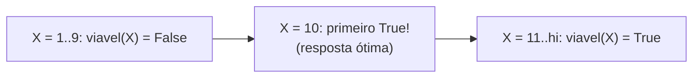

## Passo 1 · Leitura · Busca binária sem bugs: invariantes e limites

Quando uma lista **não está ordenada** (ou quando faremos apenas uma única busca em dados recém-chegados), a **busca linear** $O(n)$ é a melhor escolha: ordenar custa $O(n \log n)$, portanto só vale a pena ordenar se formos realizar **muitas buscas** sobre a mesma coleção!

Quando a lista já está ordenada, a **busca binária** reduz o espaço de busca pela metade a cada comparação, fazendo no máximo $\lfloor\log_2 n\rfloor + 1$ comparações ($\le 20$ passos para $1\,000\,000$ de elementos).

#### Por que tanta gente erra os limites da busca binária?

Quase todo bug em busca binária (laço infinito quando sobram 2 elementos ou *off-by-one* nas pontas) nasce de misturar intervalos fechados `[lo, hi]` com semiabertos `[lo, hi)`. Veja como o **invariante fechado `[lo, hi]`** elimina qualquer dúvida:

- **Invariante:** *"Se `alvo` existe na lista, seu índice está dentro do intervalo fechado `[lo, hi]` ($lo \le \text{índice} \le hi$)."*
- **Inicialização:** `lo = 0` e `hi = len(lista) - 1`.
- **Condição do laço:** `while lo <= hi:` (porque quando `lo == hi`, o intervalo `[lo, lo]` ainda contém **1 candidato** que precisa ser testado!).
- **Atualização:** calculamos `meio = (lo + hi) // 2`. Se `lista[meio]` não é o `alvo`, o índice `meio` já foi testado e descartado: logo reduzimos para `[lo, meio - 1]` (`hi = meio - 1`) ou `[meio + 1, hi]` (`lo = meio + 1`). Como o tamanho do intervalo diminui estritamente a cada passo, o laço **sempre termina**!

Veja no visualizador a busca binária iterativa mantendo o invariante `[lo, hi]`:

```python visualizar
def busca_binaria(lista, alvo):
    lo = 0
    hi = len(lista) - 1
    while lo <= hi:
        meio = (lo + hi) // 2
        if lista[meio] == alvo:
            return meio
        if lista[meio] < alvo:
            lo = meio + 1
        else:
            hi = meio - 1
    return -1

print(busca_binaria([2, 5, 8, 12, 16, 23, 38], 16))
print(busca_binaria([2, 5, 8, 12, 16, 23, 38], 10))
```

## Passo 2 · Exercício · Busca binária iterativa
modo: lacunas

Complete as lacunas de `busca_binaria(lista, alvo)` para procurar `alvo` em uma lista ordenada de até $10^6$ elementos e devolver seu índice (ou `-1` se não estiver presente).

### Instruções
1. Inicialize `lo = 0` e `hi = len(lista) - 1` e mantenha o laço enquanto `lo <= hi`.
2. Calcule `meio = (lo + hi) // 2` usando divisão inteira.
3. Quando `lista[meio] < alvo`, avance `lo = meio + 1`; quando `lista[meio] > alvo`, recue `hi = meio - 1`. Se o laço terminar sem encontrar, devolva `-1`.

### Código inicial
```python
def busca_binaria(lista, alvo):
    lo = 0
    hi = len(lista) - 1
    while lo ___ hi:
        meio = (lo + hi) ___ 2
        if lista[meio] == alvo:
            return meio
        if lista[meio] < alvo:
            lo = ___
        else:
            hi = meio - 1
    return -1
```

### Solução
```python
def busca_binaria(lista, alvo):
    lo = 0
    hi = len(lista) - 1
    while lo <= hi:
        meio = (lo + hi) // 2
        if lista[meio] == alvo:
            return meio
        if lista[meio] < alvo:
            lo = meio + 1
        else:
            hi = meio - 1
    return -1
```

### Dicas
1. A condição `lo <= hi` é essencial para testar listas de 1 único elemento (onde `lo == 0` e `hi == 0`).
2. Índices de listas em Python precisam ser inteiros: use `//` em `(lo + hi) // 2`.

### Verificação
```json
[
  {
    "id": "bb-1-e-2-elementos",
    "checkpoint": 1,
    "kind": "expr",
    "expr": "[busca_binaria([], 5), busca_binaria([5], 5), busca_binaria([5], 3), busca_binaria([4, 9], 4), busca_binaria([4, 9], 9)]",
    "expected": [-1, 0, -1, 0, 1],
    "name": "Funciona para lista vazia, 1 elemento e 2 elementos nas pontas"
  },
  {
    "id": "bb-1-milhao",
    "checkpoint": 3,
    "kind": "expr",
    "setup": "grande = list(range(0, 2000000, 2))",
    "expr": "[busca_binaria(grande, 0), busca_binaria(grande, 1999998), busca_binaria(grande, 543210), busca_binaria(grande, 543211)]",
    "expected": [0, 999999, 271605, -1],
    "name": "Busca em lista de 1.000.000 de elementos em O(log n)"
  }
]
```

### Soluções erradas
```python name="usa lo < hi e falha em lista de 1 elemento ou quando alvo está na ponta"
def busca_binaria(lista, alvo):
    lo = 0
    hi = len(lista) - 1
    while lo < hi:
        meio = (lo + hi) // 2
        if lista[meio] == alvo:
            return meio
        if lista[meio] < alvo:
            lo = meio + 1
        else:
            hi = meio - 1
    return -1
```
```python name="faz lo = meio sem somar 1 e entra em laço infinito"
def busca_binaria(lista, alvo):
    lo = 0
    hi = len(lista) - 1
    while lo <= hi:
        meio = (lo + hi) // 2
        if lista[meio] == alvo:
            return meio
        if lista[meio] < alvo:
            lo = meio
        else:
            hi = meio - 1
    return -1
```

## Passo 3 · Leitura · Limite inferior (`bisect_left`), primeira ocorrência e busca binária na resposta

E quando a lista ordenada tem **elementos repetidos**, como `[10, 20, 20, 20, 30]`, e queremos encontrar especificamente o **primeiro índice** onde `20` aparece? Ou, de forma ainda mais geral, o **limite inferior (*lower bound*)**: o menor índice `i` tal que `lista[i] >= x` (ou `len(lista)` se todos os elementos forem menores que `x`)?

Para encontrar o limite inferior em `[0, len(lista)]`:
- Mantemos `lo = 0` e `hi = len(lista)` (intervalo de resposta `[lo, hi]`).
- Enquanto `lo < hi`, calculamos `meio = (lo + hi) // 2`:
  - Se `lista[meio] < x`, `meio` é pequeno demais: `lo = meio + 1`.
  - Se `lista[meio] >= x`, `meio` pode ser a resposta (ou pode haver outro `>= x` ainda mais à esquerda): fazemos `hi = meio`!
- Quando o laço termina (`lo == hi`), `lo` é exatamente o menor índice com `lista[lo] >= x`!

Na biblioteca padrão do Python, o módulo `bisect` já traz `bisect.bisect_left(lista, x)` (primeiro índice com `>= x`), `bisect.bisect_right(lista, x)` (primeiro índice com `> x`) e `bisect.insort(lista, x)` (insere mantendo a ordem, mas lembre-se: a busca do ponto custa $O(\log n)$ e a inserção na lista custa $O(n)$!).

#### Busca binária na resposta (otimização monotônica)

A busca binária não serve apenas para listas! Sempre que temos uma pergunta do tipo *"qual é o menor valor $X \in [lo, hi]$ que torna a condição `viavel(X)` verdadeira?"* e a função `viavel(X)` é **monotônica** (`False, False, ..., False, True, True, ...`), podemos fazer busca binária diretamente no intervalo de respostas $[lo, hi]$:



Exemplos clássicos:
1. **Raiz quadrada inteira $\lfloor\sqrt{n}\rfloor$:** maior inteiro $x \in [0, n]$ tal que $x^2 \le n$.
2. **Menor capacidade de caminhão para entregar pacotes em $D$ dias:** dada uma fila de pacotes `pesos` (que devem ser enviados na ordem da fila) e um prazo `dias`, se um caminhão de capacidade $C$ consegue entregar tudo em $\le D$ dias, qualquer caminhão de capacidade $> C$ também consegue! Logo fazemos busca binária para $C$ entre `max(pesos)` e `sum(pesos)`.

## Passo 4 · Exercício · Limite inferior e primeira ocorrência

Implemente `limite_inferior(lista, x)` e `primeira_ocorrencia(lista, alvo)` usando busca binária (sem percorrer a lista linearmente e sem `import bisect`):
1. `limite_inferior(lista, x)`: devolve o menor índice `i` ($0 \le i \le \text{len}(lista)$) tal que todos os elementos em `lista[:i]` são estritamente menores que `x` (e `lista[i] >= x` caso `i < len(lista)`).
2. `primeira_ocorrencia(lista, alvo)`: devolve o menor índice `i` tal que `lista[i] == alvo`, ou `-1` se `alvo` não estiver na lista.

### Instruções
1. Em `limite_inferior(lista, x)`, inicialize `lo = 0` e `hi = len(lista)`. Enquanto `lo < hi`, calcule `meio = (lo + hi) // 2`: se `lista[meio] < x`, faça `lo = meio + 1`; senão, faça `hi = meio`. Devolva `lo`.
2. Em `primeira_ocorrencia(lista, alvo)`, chame `i = limite_inferior(lista, alvo)` e verifique se `i < len(lista) and lista[i] == alvo`: se sim, devolva `i`; senão, devolva `-1`.

### Código inicial
```python
def limite_inferior(lista, x):
    # Devolva o menor índice i com lista[i] >= x (ou len(lista) se não houver)
    pass


def primeira_ocorrencia(lista, alvo):
    # Devolva o primeiro índice onde lista[i] == alvo, ou -1 se ausente
    pass
```

### Solução
```python
def limite_inferior(lista, x):
    lo = 0
    hi = len(lista)
    while lo < hi:
        meio = (lo + hi) // 2
        if lista[meio] < x:
            lo = meio + 1
        else:
            hi = meio
    return lo


def primeira_ocorrencia(lista, alvo):
    i = limite_inferior(lista, alvo)
    if i < len(lista) and lista[i] == alvo:
        return i
    return -1
```

### Dicas
1. Em `limite_inferior`, como `hi = meio` (e não `meio - 1`), a condição do laço é `while lo < hi:` — quando `lo == hi`, encontramos a posição exata!
2. Uma vez que `limite_inferior(lista, alvo)` devolve a primeira posição $\ge \text{alvo}$, `primeira_ocorrencia` só precisa checar se essa posição está dentro da lista e contém `alvo`.

### Verificação
```json
[
  {
    "id": "sem-import-bisect",
    "checkpoint": 1,
    "kind": "source",
    "rule": { "type": "not_uses", "construct": "import" },
    "name": "Implementação própria sem import bisect"
  },
  {
    "id": "limite-inferior-casos",
    "checkpoint": 1,
    "kind": "expr",
    "setup": "v = [10, 20, 20, 20, 30, 40]",
    "expr": "[limite_inferior(v, 5), limite_inferior(v, 20), limite_inferior(v, 25), limite_inferior(v, 50), limite_inferior([], 10)]",
    "expected": [0, 1, 4, 6, 0],
    "name": "limite_inferior funciona antes do início (0), em duplicatas (1), no meio (4) e após o fim (6)"
  },
  {
    "id": "primeira-ocorrencia-duplicatas",
    "checkpoint": 2,
    "kind": "expr",
    "setup": "v = [5, 5, 5, 8, 8, 10, 10, 10, 10]",
    "expr": "[primeira_ocorrencia(v, 5), primeira_ocorrencia(v, 8), primeira_ocorrencia(v, 10), primeira_ocorrencia(v, 7), primeira_ocorrencia(v, 99)]",
    "expected": [0, 3, 5, -1, -1],
    "name": "primeira_ocorrencia devolve sempre o primeiro índice de elementos repetidos ou -1"
  }
]
```

### Soluções erradas
```python name="devolve qualquer ocorrência encontrada no meio em vez da primeira"
def limite_inferior(lista, x):
    for i, v in enumerate(lista):
        if v >= x:
            return i
    return len(lista)


def primeira_ocorrencia(lista, alvo):
    lo, hi = 0, len(lista) - 1
    while lo <= hi:
        m = (lo + hi) // 2
        if lista[m] == alvo:
            return m
        if lista[m] < alvo:
            lo = m + 1
        else:
            hi = m - 1
    return -1
```
```python name="usa <= em vez de < em limite_inferior (calcula bisect_right em vez de bisect_left)"
def limite_inferior(lista, x):
    lo = 0
    hi = len(lista)
    while lo < hi:
        meio = (lo + hi) // 2
        if lista[meio] <= x:
            lo = meio + 1
        else:
            hi = meio
    return lo


def primeira_ocorrencia(lista, alvo):
    i = limite_inferior(lista, alvo)
    if i < len(lista) and lista[i] == alvo:
        return i
    return -1
```

## Passo 5 · Exercício · Busca binária na resposta: raiz inteira e capacidade de entrega

Implemente duas aplicações de **busca binária na resposta**:
1. `raiz_inteira(n)`: recebe um inteiro $n \ge 0$ (até $10^{18}$) e devolve o maior inteiro $x$ tal que $x^2 \le n$, usando busca binária em $[0, n]$ (sem `math.isqrt`, `math.sqrt` nem `** 0.5`, que perdem precisão de ponto flutuante em $10^{18}$!).
2. `menor_capacidade(pesos, dias)`: uma transportadora precisa enviar os pacotes da lista `pesos` **na ordem dada** em no máximo `dias` dias. A cada dia, o caminhão carrega pacotes consecutivos sem ultrapassar sua capacidade $C$. Devolva a **menor capacidade inteira $C$** capaz de entregar todos os pacotes em $\le \text{dias}$ dias.

### Instruções
1. Em `raiz_inteira(n)`, faça busca binária no intervalo `lo = 0`, `hi = n`: a cada passo, teste se `meio * meio <= n` (guardando `meio` como melhor resposta até agora e tentando `lo = meio + 1`; senão `hi = meio - 1`).
2. Em `menor_capacidade(pesos, dias)`, escreva uma função auxiliar `consegue(cap)` que simula o carregamento guloso dia a dia (começando com `dias_usados = 1` e `carga_atual = 0`; se `carga_atual + p > cap`, abre novo dia `dias_usados += 1` e `carga_atual = p`) e devolve `dias_usados <= dias`.
3. Faça busca binária para `cap` entre `lo = max(pesos)` e `hi = sum(pesos)` para encontrar a menor capacidade onde `consegue(cap)` é `True`.

### Código inicial
```python
def raiz_inteira(n):
    # Devolva o maior inteiro x tal que x * x <= n por busca binária
    pass


def menor_capacidade(pesos, dias):
    # Devolva a menor capacidade de caminhão que entrega pesos em <= dias
    pass
```

### Solução
```python
def raiz_inteira(n):
    lo = 0
    hi = n
    resposta = 0
    while lo <= hi:
        meio = (lo + hi) // 2
        if meio * meio <= n:
            resposta = meio
            lo = meio + 1
        else:
            hi = meio - 1
    return resposta


def menor_capacidade(pesos, dias):
    def consegue(cap):
        dias_usados = 1
        carga = 0
        for p in pesos:
            if carga + p > cap:
                dias_usados += 1
                carga = p
            else:
                carga += p
        return dias_usados <= dias

    lo = max(pesos)
    hi = sum(pesos)
    while lo < hi:
        meio = (lo + hi) // 2
        if consegue(meio):
            hi = meio
        else:
            lo = meio + 1
    return lo
```

### Dicas
1. Por que float falha para $n = 10^{18} - 1$? Porque um `float` de 64 bits tem apenas 53 bits de mantissa ($\approx 9 \times 10^{15}$), arredondando $(10^{18} - 1)^{0,5}$ para $10^9$ em vez de $999\,999\,999$! Já `meio * meio <= n` usa inteiros de precisão arbitrária do Python e é 100% exato.
2. Em `menor_capacidade`, a menor capacidade possível nunca pode ser menor que o pacote mais pesado (`lo = max(pesos)`), e a maior necessária é levar tudo em 1 único dia (`hi = sum(pesos)`).

### Verificação
```json
[
  {
    "id": "raiz-pequenos",
    "checkpoint": 1,
    "kind": "expr",
    "expr": "[raiz_inteira(0), raiz_inteira(1), raiz_inteira(15), raiz_inteira(16), raiz_inteira(17)]",
    "expected": [0, 1, 3, 4, 4],
    "name": "Calcula raiz inteira para 0, 1, 15, 16 e 17"
  },
  {
    "id": "raiz-precisao-10e18",
    "checkpoint": 1,
    "kind": "expr",
    "expr": "[raiz_inteira(10**18 - 1), raiz_inteira(10**18)]",
    "expected": [999999999, 1000000000],
    "name": "Calcula raiz_inteira(10^18 - 1) == 999999999 com precisão exata em O(log n)",
    "hint": "Use aritmética inteira (meio * meio <= n) na busca binária; float perde precisão acima de 2^53."
  },
  {
    "id": "capacidade-exemplos",
    "checkpoint": 3,
    "kind": "expr",
    "expr": "[menor_capacidade([1, 2, 3, 4, 5, 6, 7, 8, 9, 10], 5), menor_capacidade([3, 2, 2, 4, 1, 4], 3), menor_capacidade([1, 2, 3, 1, 1], 4)]",
    "expected": [15, 6, 3],
    "name": "Encontra a menor capacidade para [1..10] em 5 dias (15) e demais casos"
  }
]
```

### Soluções erradas
```python name="usa float ** 0.5 e erra em 10**18 - 1 por perda de precisão"
def raiz_inteira(n):
    return int(n ** 0.5)


def menor_capacidade(pesos, dias):
    return sum(pesos) // dias
```
```python name="usa apenas a média sum(pesos)/dias ignorando que pacotes não podem ser divididos"
def raiz_inteira(n):
    lo, hi, ans = 0, n, 0
    while lo <= hi:
        m = (lo + hi) // 2
        if m * m <= n:
            ans = m
            lo = m + 1
        else:
            hi = m - 1
    return ans


def menor_capacidade(pesos, dias):
    return max(max(pesos), (sum(pesos) + dias - 1) // dias)
```

## Passo 6 · Quiz · Invariantes e armadilhas da busca binária

### Pergunta
O que acontece se você combinar a condição de laço `while lo <= hi:` com a atualização `hi = meio` (em vez de `hi = meio - 1`) na busca binária?
- [ ] O algoritmo continua correto e faz uma comparação a menos.
- [x] Quando o intervalo encolher para `lo == hi` e `lista[meio] > alvo`, `meio` será igual a `lo` e `hi = meio` não mudará o valor de `hi`, prendendo o programa em um **laço infinito**.
- [ ] O algoritmo levanta `IndexError`.
- [ ] O algoritmo passa a devolver a última ocorrência do elemento.
> Com `lo == hi`, temos `meio = lo`. Se o ramo executar `hi = meio`, tanto `lo` quanto `hi` permanecem idênticos e a condição `lo <= hi` nunca se torna falsa! Por isso, `while lo <= hi:` exige `hi = meio - 1` e `lo = meio + 1`, enquanto `hi = meio` exige `while lo < hi:`.

### Pergunta
Você recebe uma lista **desordenada** com $1\,000\,000$ de números e precisa verificar se **um único** valor `alvo` está presente nela. Qual estratégia tem menor complexidade assintótica?
- [ ] Ordenar a lista com `lista.sort()` e aplicar busca binária, totalizando $O(\log n)$.
- [x] Fazer busca linear diretamente (`alvo in lista`) em $O(n)$, pois ordenar a lista antes custaria $O(n \log n)$, que é mais caro do que varrer a lista uma única vez.
- [ ] Aplicar busca binária diretamente na lista sem ordenar.
- [ ] Converter a lista para tupla e aplicar `bisect_left`.
> A busca binária exige que a lista já esteja ordenada. Ordenar custa $\Theta(n \log n)$: só compensa pagar esse custo se formos fazer muitas buscas seguidas na mesma lista!
