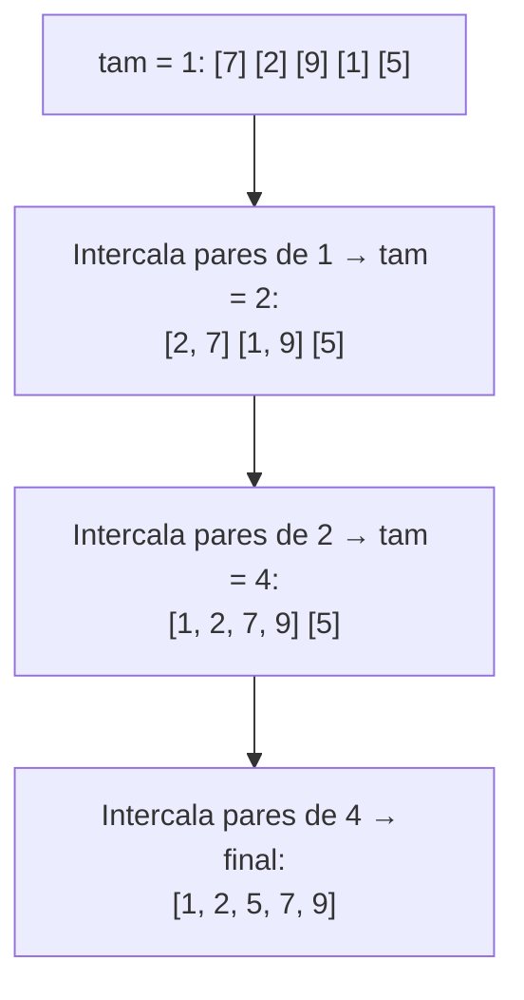

## Passo 1 · Leitura · Merge Sort top-down e o segredo da estabilidade

O **Merge Sort** (criado por John von Neumann em 1945) aplica divisão e conquista diretamente à ordenação:
1. **Caso base:** uma lista de tamanho $0$ ou $1$ já está ordenada.
2. **Dividir e conquistar:** dividimos a lista ao meio (`meio = len(lista) // 2`), ordenamos recursivamente a metade esquerda `esq = merge_sort(lista[:meio])` e a metade direita `dir = merge_sort(lista[meio:])`.
3. **Combinar:** intercalamos `esq` e `dir` em tempo linear $\Theta(n)$ com `intercalar(esq, dir)`.

Pelo Caso 2 do Teorema Mestre ($T(n) = 2T(n/2) + \Theta(n)$), o Merge Sort tem custo garantido **$\Theta(n \log n)$ no melhor, no médio e no pior caso**! Não existe nenhuma entrada capaz de degradar o Merge Sort para quadrático. Em troca dessa garantia, ele utiliza **$\Theta(n)$ de espaço auxiliar** para criar as listas intercaladas.

#### Por que o `<=` na intercalação garante a estabilidade?

Suponha que estamos ordenando registros `(nota, nome)` pela `nota` e temos dois alunos com a mesma nota: `(8, "Ana")` na metade esquerda `esq` e `(8, "Bruno")` na metade direita `dir`. Como `esq` veio da primeira metade da lista original, `"Ana"` aparecia antes de `"Bruno"`.

Quando `intercalar(esq, dir)` compara `esq[i]` e `dir[j]`:
- Se usarmos **`<=`** (`if esq[i] <= dir[j]:`), em caso de empate escolhemos primeiro o elemento da **esquerda** (`esq[i]`), preservando `"Ana"` antes de `"Bruno"` (**estável**!).
- Se usarmos **`<`** (`if esq[i] < dir[j]:`), em caso de empate cairíamos no `else` e colocaríamos `dir[j]` (`"Bruno"`) na frente de `esq[i]` (`"Ana"`), **destruindo a estabilidade**!

## Passo 2 · Exercício · Merge Sort recursivo e ordenação estável por chave

Implemente três funções (**sem usar `sorted()` nem `.sort()`**):
1. `intercalar(a, b, chave=None)`: intercala duas listas ordenadas `a` e `b` de forma **estável**. Se `chave` for `None`, compara os próprios elementos (`a[i] <= b[j]`); se `chave` for uma função (ex.: `lambda r: r["nota"]`), compara `chave(a[i]) <= chave(b[j])`.
2. `merge_sort(lista)`: devolve uma nova lista ordenada usando `intercalar`. Deve ordenar $50\,000$ elementos rapidamente.
3. `ordenar_por_chave(registros, chave)`: devolve uma nova lista com `registros` ordenados de forma **estável** segundo a função `chave(item)`.

### Instruções
1. Em `intercalar(a, b, chave=None)`, mantenha dois índices `i = 0` e `j = 0`. Compare `a[i] <= b[j]` (quando `chave is None`) ou `chave(a[i]) <= chave(b[j])` (quando `chave` é fornecida): use `<=` para preservar a estabilidade!
2. Em `merge_sort(lista)`, se `len(lista) <= 1` devolva `list(lista)`; senão divida ao meio, chame `merge_sort` nas duas metades e combine com `intercalar`.
3. Em `ordenar_por_chave(registros, chave)`, aplique a mesma lógica de divisão e conquista passando `chave` para `intercalar`.

### Código inicial
```python
def intercalar(a, b, chave=None):
    # Intercale a e b de forma estável (usando <=) segundo chave (se fornecida)
    pass


def merge_sort(lista):
    # Ordene lista recursivamente em O(n log n) usando intercalar
    pass


def ordenar_por_chave(registros, chave):
    # Ordene registros de forma estável segundo a função chave
    pass
```

### Solução
```python
def intercalar(a, b, chave=None):
    res = []
    i = 0
    j = 0
    ta = len(a)
    tb = len(b)
    if chave is None:
        while i < ta and j < tb:
            if a[i] <= b[j]:
                res.append(a[i])
                i += 1
            else:
                res.append(b[j])
                j += 1
    else:
        while i < ta and j < tb:
            if chave(a[i]) <= chave(b[j]):
                res.append(a[i])
                i += 1
            else:
                res.append(b[j])
                j += 1
    res.extend(a[i:])
    res.extend(b[j:])
    return res


def merge_sort(lista):
    n = len(lista)
    if n <= 1:
        return list(lista)
    meio = n // 2
    esq = merge_sort(lista[:meio])
    dir = merge_sort(lista[meio:])
    return intercalar(esq, dir)


def ordenar_por_chave(registros, chave):
    n = len(registros)
    if n <= 1:
        return list(registros)
    meio = n // 2
    esq = ordenar_por_chave(registros[:meio], chave)
    dir = ordenar_por_chave(registros[meio:], chave)
    return intercalar(esq, dir, chave)
```

### Dicas
1. Em `ordenar_por_chave`, cuidado para não comparar as tuplas/dicionários inteiros em caso de empate: compare **apenas** `chave(a[i]) <= chave(b[j])`! Se duas chaves empatarem, o `<=` garante que o elemento de `a` (que aparecia antes) saia primeiro.
2. Caso base: `if len(lista) <= 1: return list(lista)` cobre tanto listas de 1 elemento quanto a lista vazia `[]`.

### Verificação
```json
[
  {
    "id": "sem-sorted",
    "checkpoint": 2,
    "kind": "source",
    "rule": { "type": "not_calls", "name": "sorted" },
    "name": "Não usa sorted()"
  },
  {
    "id": "sem-sort",
    "checkpoint": 2,
    "kind": "source",
    "rule": { "type": "not_calls", "name": "sort" },
    "name": "Não usa .sort()"
  },
  {
    "id": "merge-sort-casos",
    "checkpoint": 2,
    "kind": "expr",
    "expr": "[merge_sort([]), merge_sort([7]), merge_sort([9, 3, 7, 1, 5, 3, 2])]",
    "expected": [[], [7], [1, 2, 3, 3, 5, 7, 9]],
    "name": "merge_sort ordena lista vazia, unitária e com elementos repetidos"
  },
  {
    "id": "estabilidade-por-chave",
    "checkpoint": 3,
    "kind": "expr",
    "setup": "dados = [{'id': 1, 'nota': 8}, {'id': 2, 'nota': 5}, {'id': 3, 'nota': 8}, {'id': 4, 'nota': 5}, {'id': 5, 'nota': 8}]\nord_dados = ordenar_por_chave(dados, lambda r: r['nota'])",
    "expr": "[(r['nota'], r['id']) for r in ord_dados]",
    "expected": [[5, 2], [5, 4], [8, 1], [8, 3], [8, 5]],
    "name": "ordenar_por_chave preserva a ordem original (estabilidade) quando as chaves empatam"
  },
  {
    "id": "merge-sort-50k",
    "checkpoint": 2,
    "kind": "expr",
    "setup": "v = [(i * 31337) % 50000 for i in range(50000)]\nr = merge_sort(v)",
    "expr": "[len(r), r[:4], r[-2:], all(r[k] <= r[k+1] for k in range(len(r)-1))]",
    "expected": [50000, [0, 1, 2, 3], [49998, 49999], true],
    "name": "merge_sort ordena 50.000 elementos em O(n log n)"
  }
]
```

### Soluções erradas
```python name="usa < em vez de <= no merge e perde a estabilidade"
def intercalar(a, b, chave=None):
    res = []
    i = j = 0
    f = chave if chave is not None else (lambda x: x)
    while i < len(a) and j < len(b):
        if f(a[i]) < f(b[j]):
            res.append(a[i])
            i += 1
        else:
            res.append(b[j])
            j += 1
    res.extend(a[i:])
    res.extend(b[j:])
    return res


def merge_sort(lista):
    if len(lista) <= 1:
        return list(lista)
    m = len(lista) // 2
    return intercalar(merge_sort(lista[:m]), merge_sort(lista[m:]))


def ordenar_por_chave(registros, chave):
    if len(registros) <= 1:
        return list(registros)
    m = len(registros) // 2
    return intercalar(ordenar_por_chave(registros[:m], chave), ordenar_por_chave(registros[m:], chave), chave)
```
```python name="esquece de tratar lista vazia no caso base"
def intercalar(a, b, chave=None):
    return a + b


def merge_sort(lista):
    if len(lista) == 1:
        return list(lista)
    m = len(lista) // 2
    return intercalar(merge_sort(lista[:m]), merge_sort(lista[m:]))


def ordenar_por_chave(registros, chave):
    return list(registros)
```

## Passo 3 · Leitura · Merge Sort iterativo (*bottom-up*)

Precisamos mesmo da pilha de recursão para fazer Merge Sort? Não!
Na versão **bottom-up (de baixo para cima)**, pulamos a fase de descida recursiva e começamos diretamente pelas folhas da árvore:

1. **Largura `tam = 1`:** toda sublista de tamanho $1$ já está ordenada! Intercalamos pares adjacentes de tamanho $1$ (`v[0:1]` com `v[1:2]`, `v[2:3]` com `v[3:4]`, …) formando blocos ordenados de tamanho $2$.
2. **Largura `tam = 2`:** intercalamos pares adjacentes de tamanho $2$ (`v[0:2]` com `v[2:4]`, …) formando blocos ordenados de tamanho $4$.
3. **Dobramos `tam *= 2`** ($1, 2, 4, 8, 16, \dots$) até que `tam >= len(v)`!



Veja a versão *bottom-up* no visualizador:

```python visualizar
def merge_sort_bottom_up(lista):
    v = list(lista)
    n = len(v)
    tam = 1
    while tam < n:
        novo = []
        for ini in range(0, n, 2 * tam):
            esq = v[ini : ini + tam]
            dir = v[ini + tam : ini + 2 * tam]
            i = j = 0
            while i < len(esq) and j < len(dir):
                if esq[i] <= dir[j]:
                    novo.append(esq[i])
                    i += 1
                else:
                    novo.append(dir[j])
                    j += 1
            novo.extend(esq[i:])
            novo.extend(dir[j:])
        v = novo
        tam *= 2
    return v

print(merge_sort_bottom_up([7, 2, 9, 1, 5]))
```

Como não faz nenhuma chamada recursiva, `merge_sort_bottom_up` nunca usa a pilha de chamadas! Além disso, esse mesmo esquema é usado na **ordenação externa** (quando um arquivo de $500\text{ GB}$ não cabe na RAM: ordenamos blocos de $1\text{ GB}$ na memória e intercalamos os blocos em disco) e na ordenação de **listas encadeadas**.

## Passo 4 · Exercício · Implementando `merge_sort_bottom_up(lista)` sem recursão

Implemente `merge_sort_bottom_up(lista)` de forma puramente iterativa (dobrando `tam = 1, 2, 4, ...` enquanto `tam < len(v)`), **sem usar recursão, `sorted()` ou `.sort()`**. Para comprovar que sua função não usa recursão, a verificação reduzirá `sys.setrecursionlimit` ao mínimo antes de ordenar $10\,000$ elementos!

### Instruções
1. Copie a entrada com `v = list(lista)` e inicialize `tam = 1`.
2. Enquanto `tam < len(v)`, percorra `ini` em `range(0, len(v), 2 * tam)`, intercale as fatias `v[ini : ini + tam]` e `v[ini + tam : ini + 2 * tam]` e dobre `tam *= 2`.
3. Devolva a lista ordenada `v`.

### Código inicial
```python
def merge_sort_bottom_up(lista):
    # Ordene lista iterativamente (bottom-up) dobrando tam = 1, 2, 4...
    pass
```

### Solução
```python
def merge_sort_bottom_up(lista):
    v = list(lista)
    n = len(v)
    tam = 1
    while tam < n:
        novo = []
        for ini in range(0, n, 2 * tam):
            esq = v[ini : ini + tam]
            dir = v[ini + tam : ini + 2 * tam]
            i = 0
            j = 0
            te = len(esq)
            td = len(dir)
            while i < te and j < td:
                if esq[i] <= dir[j]:
                    novo.append(esq[i])
                    i += 1
                else:
                    novo.append(dir[j])
                    j += 1
            novo.extend(esq[i:])
            novo.extend(dir[j:])
        v = novo
        tam *= 2
    return v
```

### Dicas
1. Quando `n` não é potência de 2 (ex.: `n = 5`), na última janela do `for` a fatia `dir = v[ini + tam : ini + 2 * tam]` pode ser mais curta que `tam` ou até vazia `[]`. A intercalação com `novo.extend(esq[i:])` já lida com isso sem precisar de `if` extra!
2. Não se esqueça de dobrar `tam *= 2` ao final de cada passagem do `while`.

### Verificação
```json
[
  {
    "id": "sem-sorted",
    "checkpoint": 1,
    "kind": "source",
    "rule": { "type": "not_calls", "name": "sorted" },
    "name": "Não usa sorted()"
  },
  {
    "id": "sem-sort",
    "checkpoint": 1,
    "kind": "source",
    "rule": { "type": "not_calls", "name": "sort" },
    "name": "Não usa .sort()"
  },
  {
    "id": "bottom-up-nao-potencia-de-2",
    "checkpoint": 2,
    "kind": "expr",
    "expr": "[merge_sort_bottom_up([]), merge_sort_bottom_up([3]), merge_sort_bottom_up([7, 2, 9, 1, 5, 4, 8])]",
    "expected": [[], [3], [1, 2, 4, 5, 7, 8, 9]],
    "name": "Ordena tamanhos que não são potência de 2 (0, 1 e 7 elementos)"
  },
  {
    "id": "bottom-up-10k-sem-recursao",
    "checkpoint": 3,
    "kind": "expr",
    "setup": "import sys\n_lim = sys.getrecursionlimit()\nv = [(i * 7919) % 10000 for i in range(10000)]\nsys.setrecursionlimit(25)\ntry:\n    r = merge_sort_bottom_up(v)\nfinally:\n    sys.setrecursionlimit(_lim)",
    "expr": "[len(r), r[:4], r[-2:], all(r[k] <= r[k+1] for k in range(len(r)-1))]",
    "expected": [10000, [0, 1, 2, 3], [9998, 9999], true],
    "name": "Ordena 10.000 elementos com limite de recursão reduzido a 25 (iterativo bottom-up)"
  }
]
```

### Soluções erradas
```python name="usa recursão disfarçada e estoura com setrecursionlimit(25)"
def merge_sort_bottom_up(lista):
    def rec(n):
        if n <= 0:
            return 0
        return rec(n - 1) + 1
    if len(lista) > 10:
        rec(30)
    return list(lista)
```
```python name="faz apenas uma passagem tam = 1 sem dobrar tam"
def merge_sort_bottom_up(lista):
    v = list(lista)
    n = len(v)
    tam = 1
    novo = []
    for ini in range(0, n, 2 * tam):
        esq = v[ini : ini + tam]
        dir = v[ini + tam : ini + 2 * tam]
        novo.extend(esq if not dir or esq[0] <= dir[0] else dir + esq)
    return novo
```

## Passo 5 · Quiz · Complexidade e propriedades do Merge Sort

### Pergunta
Qual é a complexidade de **tempo** (no melhor e no pior caso) e de **espaço auxiliar** do Merge Sort clássico sobre um vetor de $n$ elementos?
- [ ] Tempo $O(n)$ no melhor caso, $O(n \log n)$ no pior caso e espaço auxiliar $O(1)$.
- [x] Tempo $\Theta(n \log n)$ tanto no melhor quanto no pior caso, e espaço auxiliar $\Theta(n)$ para o vetor de intercalação.
- [ ] Tempo $O(n \log n)$ no caso médio, $O(n^2)$ no pior caso e espaço auxiliar $O(\log n)$.
- [ ] Tempo $\Theta(n^2)$ e espaço $\Theta(n \log n)$.
> O Merge Sort divide sempre ao meio e percorre todos os $n$ elementos em cada um dos $\log_2 n$ níveis de intercalação, independentemente de os dados já estarem ordenados ou não ($\Theta(n \log n)$ em todos os casos), precisando de um buffer auxiliar de tamanho $\Theta(n)$.

### Pergunta
Por que a versão *bottom-up* do Merge Sort faz $\lceil\log_2 n\rceil$ passagens completas pelo vetor?
- [ ] Porque a cada passagem o maior elemento flutua uma posição para a direita.
- [x] Porque a largura `tam` dos blocos já ordenados começa em $1$ e **dobra** a cada passagem ($1, 2, 4, 8, \dots, 2^k$) até alcançar ou superar $n$.
- [ ] Porque ela escolhe um pivô aleatório a cada passagem.
- [ ] Porque ela descarta metade dos elementos a cada passagem.
> Como a largura dos blocos ordenados dobra a cada passagem ($2^k \ge n \iff k = \lceil\log_2 n\rceil$) e cada passagem intercala todos os $n$ elementos em tempo $\Theta(n)$, o custo total é $\Theta(n \log n)$.
