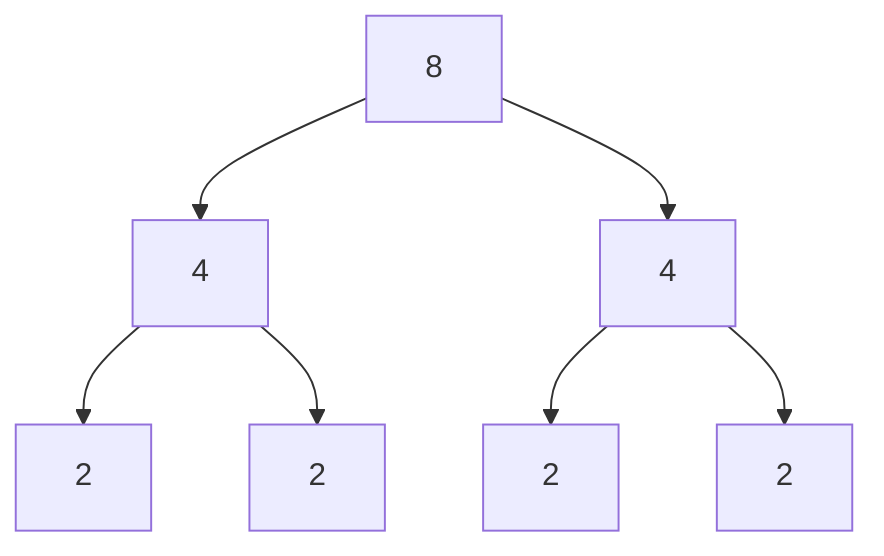

## Passo 1 · Leitura · Intercalar com estabilidade

No módulo de divisão e conquista você escreveu `intercalar(a, b)`, que junta duas listas ordenadas em tempo linear. O **merge sort** é essa função mais duas linhas de recursão:

1. **Caso base:** lista com 0 ou 1 elemento já está ordenada.
2. **Dividir:** corte no meio e ordene cada metade com o próprio merge sort.
3. **Combinar:** intercale as duas metades ordenadas.

```python
def intercalar(a, b):
    res, i, j = [], 0, 0
    while i < len(a) and j < len(b):
        if a[i] <= b[j]:          # empate: sai primeiro o da esquerda
            res.append(a[i])
            i += 1
        else:
            res.append(b[j])
            j += 1
    res.extend(a[i:])             # sobrou um lado só: já está ordenado
    res.extend(b[j:])
    return res


def merge_sort(lista):
    if len(lista) <= 1:
        return list(lista)
    meio = len(lista) // 2
    return intercalar(merge_sort(lista[:meio]), merge_sort(lista[meio:]))
```

A correção da intercalação vem de um invariante: **no começo de cada volta, `res` contém os `i + j` menores elementos de `a` e `b`, em ordem, e `a[i]` e `b[j]` são os menores que ainda faltam.** O menor de todos os que faltam é um desses dois, porque cada lista está ordenada. Copiar o menor deles mantém a frase verdadeira. Quando um lado acaba, o resto do outro é maior ou igual a tudo em `res` e já está ordenado: basta estender.

Agora o detalhe que separa um merge sort correto de um quase correto: o `<=`. Ordene alunos pela nota, com `(8, "Ana")` na metade esquerda e `(8, "Bia")` na direita. Ana veio antes na lista original, porque a metade esquerda é o começo da lista. Com `<=`, no empate sai `a[i]`, a Ana: a ordem original se mantém e o algoritmo é **estável**. Com `<`, o empate cai no `else`, a Bia passa na frente e a estabilidade some, sem nenhum erro aparecer. Com números inteiros a diferença é invisível, porque dois 8 são indistinguíveis; com registros, a saída muda.

Outro erro comum está no caso base. Com `if len(lista) == 1`, a lista vazia nunca chega ao caso base: `[][:0]` é `[]` de novo, e o Python responde `RecursionError: maximum recursion depth exceeded`.

Repare também que o merge sort **não mexe na lista recebida**: as fatias `lista[:meio]` são cópias e o resultado é uma lista nova.

## Passo 2 · Exercício · Merge sort recursivo
modo: lacunas

Complete as lacunas (`___`) de `intercalar(a, b)` e `merge_sort(lista)`. `merge_sort` devolve uma **lista nova** ordenada e não altera a recebida. A verificação ordena registros que se comparam só pela nota, para conferir a estabilidade.

### Instruções
1. Em `intercalar`, no empate, copie primeiro o elemento de `a`.
2. Em `intercalar`, depois do laço, copie o que sobrou de cada lado.
3. Em `merge_sort`, pare em listas com 0 ou 1 elemento.
4. Em `merge_sort`, ordene recursivamente a metade esquerda.

### Código inicial
```python
def intercalar(a, b):
    res = []
    i = 0
    j = 0
    while i < len(a) and j < len(b):
        if a[i] ___ b[j]:
            res.append(a[i])
            i += 1
        else:
            res.append(b[j])
            j += 1
    res.extend(a[___:])
    res.extend(b[j:])
    return res


def merge_sort(lista):
    if len(lista) ___ 1:
        return list(lista)
    meio = len(lista) // 2
    esq = merge_sort(lista[___])
    dir = merge_sort(lista[meio:])
    return intercalar(esq, dir)
```

### Solução
```python
def intercalar(a, b):
    res = []
    i = 0
    j = 0
    while i < len(a) and j < len(b):
        if a[i] <= b[j]:
            res.append(a[i])
            i += 1
        else:
            res.append(b[j])
            j += 1
    res.extend(a[i:])
    res.extend(b[j:])
    return res


def merge_sort(lista):
    if len(lista) <= 1:
        return list(lista)
    meio = len(lista) // 2
    esq = merge_sort(lista[:meio])
    dir = merge_sort(lista[meio:])
    return intercalar(esq, dir)
```

### Dicas
1. O empate decide a estabilidade: qual comparação manda o elemento de `a` primeiro quando os dois são iguais?
2. Quando o laço termina, um dos lados ainda pode ter elementos, e não dá para saber de antemão qual.
3. A lista vazia também é caso base.

### Verificação
```json
[
  { "id": "sem-sorted", "checkpoint": 3, "kind": "source", "rule": { "type": "not_calls", "name": "sorted" },
    "name": "Não usa sorted()" },
  { "id": "intercala-sobra-a", "checkpoint": 2, "kind": "call", "function": "intercalar", "args": [[4, 8, 9], [1, 2]], "expected": [1, 2, 4, 8, 9],
    "name": "intercalar([4, 8, 9], [1, 2]) é [1, 2, 4, 8, 9]", "hint": "Quando b acaba, o resto de a ainda precisa entrar." },
  { "id": "intercala-sobra-b", "checkpoint": 2, "kind": "call", "function": "intercalar", "args": [[1, 3], [2, 5, 7]], "expected": [1, 2, 3, 5, 7],
    "name": "intercalar([1, 3], [2, 5, 7]) é [1, 2, 3, 5, 7]" },
  { "id": "ms-misturada", "checkpoint": 4, "kind": "call", "function": "merge_sort", "args": [[38, 27, 43, 3, 9, 82, 10]], "expected": [3, 9, 10, 27, 38, 43, 82],
    "name": "merge_sort([38, 27, 43, 3, 9, 82, 10])" },
  { "id": "ms-repetidos", "checkpoint": 4, "kind": "call", "function": "merge_sort", "args": [[2, -1, 2, 0, -1, 7]], "expected": [-1, -1, 0, 2, 2, 7],
    "name": "merge_sort com repetidos e negativos" },
  { "id": "ms-vazia", "checkpoint": 3, "kind": "call", "function": "merge_sort", "args": [[]], "expected": [],
    "name": "merge_sort([]) é []", "hint": "Com == 1 no caso base, a lista vazia se divide para sempre." },
  { "id": "ms-um", "checkpoint": 3, "kind": "call", "function": "merge_sort", "args": [[42]], "expected": [42],
    "name": "merge_sort([42]) é [42]" },
  { "id": "ms-nao-altera", "checkpoint": 4, "kind": "expr", "setup": "v = [3, 1, 2]\nr = merge_sort(v)",
    "expr": "[r, v]", "expected": [[1, 2, 3], [3, 1, 2]], "name": "merge_sort devolve lista nova e não altera a recebida" },
  { "id": "ms-estavel", "checkpoint": 1, "kind": "expr",
    "setup": "class Aluno:\n    def __init__(self, nota, nome):\n        self.nota = nota\n        self.nome = nome\n    def __lt__(self, o):\n        return self.nota < o.nota\n    def __le__(self, o):\n        return self.nota <= o.nota\n    def __gt__(self, o):\n        return self.nota > o.nota\n    def __ge__(self, o):\n        return self.nota >= o.nota\nv = [Aluno(8, 'Ana'), Aluno(5, 'Bia'), Aluno(8, 'Caio'), Aluno(5, 'Davi'), Aluno(8, 'Eva'), Aluno(6, 'Fabi')]\nr = merge_sort(v)",
    "expr": "[a.nome for a in r]", "expected": ["Bia", "Davi", "Fabi", "Ana", "Caio", "Eva"],
    "name": "merge_sort é estável: notas iguais mantêm a ordem original", "hint": "Com <, no empate o elemento da direita passa na frente." }
]
```

### Soluções erradas
```python name="< na intercalação perde a estabilidade"
def intercalar(a, b):
    res = []
    i = 0
    j = 0
    while i < len(a) and j < len(b):
        if a[i] < b[j]:
            res.append(a[i])
            i += 1
        else:
            res.append(b[j])
            j += 1
    res.extend(a[i:])
    res.extend(b[j:])
    return res


def merge_sort(lista):
    if len(lista) <= 1:
        return list(lista)
    meio = len(lista) // 2
    esq = merge_sort(lista[:meio])
    dir = merge_sort(lista[meio:])
    return intercalar(esq, dir)
```
```python name="caso base == 1 não para na lista vazia"
def intercalar(a, b):
    res = []
    i = 0
    j = 0
    while i < len(a) and j < len(b):
        if a[i] <= b[j]:
            res.append(a[i])
            i += 1
        else:
            res.append(b[j])
            j += 1
    res.extend(a[i:])
    res.extend(b[j:])
    return res


def merge_sort(lista):
    if len(lista) == 1:
        return list(lista)
    meio = len(lista) // 2
    esq = merge_sort(lista[:meio])
    dir = merge_sort(lista[meio:])
    return intercalar(esq, dir)
```
```python name="esquece a sobra de a"
def intercalar(a, b):
    res = []
    i = 0
    j = 0
    while i < len(a) and j < len(b):
        if a[i] <= b[j]:
            res.append(a[i])
            i += 1
        else:
            res.append(b[j])
            j += 1
    res.extend(b[j:])
    return res


def merge_sort(lista):
    if len(lista) <= 1:
        return list(lista)
    meio = len(lista) // 2
    esq = merge_sort(lista[:meio])
    dir = merge_sort(lista[meio:])
    return intercalar(esq, dir)
```
```python name="intercala a metade esquerda sem ordená-la"
def intercalar(a, b):
    res = []
    i = 0
    j = 0
    while i < len(a) and j < len(b):
        if a[i] <= b[j]:
            res.append(a[i])
            i += 1
        else:
            res.append(b[j])
            j += 1
    res.extend(a[i:])
    res.extend(b[j:])
    return res


def merge_sort(lista):
    if len(lista) <= 1:
        return list(lista)
    meio = len(lista) // 2
    esq = lista[:meio]
    dir = merge_sort(lista[meio:])
    return intercalar(esq, dir)
```

## Passo 3 · Leitura · De onde vem o n log n

Desenhe as chamadas do merge sort para $n = 8$ como uma árvore. Cada nó é uma chamada; o número é o tamanho da lista que ela recebe.



Cada nó de tamanho 2 ainda se divide em duas folhas de tamanho 1, o caso base (omitidas no desenho).

Agora some o trabalho **por nível**, não por chamada. A intercalação de listas que somam $m$ elementos custa $\Theta(m)$: no máximo $m - 1$ comparações e exatamente $m$ cópias.

- No nível 0, uma intercalação de 8 elementos: trabalho 8.
- No nível 1, duas de 4: trabalho $4 + 4 = 8$.
- No nível 2, quatro de 2: trabalho 8.

Em todo nível, as listas são pedaços **disjuntos** da entrada, então somam $n$. E quantos níveis há? O tamanho cai pela metade a cada nível, de $n$ até 1: são $\log_2 n$ níveis com intercalação. Logo

$$
T(n) = \underbrace{n + n + \dots + n}_{\log_2 n \text{ níveis}} = n \log_2 n .
$$

Quando $n$ não é potência de 2, as metades diferem em 1 elemento e o número de níveis é $\lceil \log_2 n \rceil$: o total continua $\Theta(n \log n)$. É a mesma conclusão do caso 2 do Teorema Mestre para $T(n) = 2T(n/2) + \Theta(n)$, mas a árvore mostra **por quê**: o trabalho é igual em todos os níveis, e há logaritmo de níveis.

Nada nessa conta depende da ordem dos dados. Lista ordenada, invertida ou aleatória: as divisões são sempre no meio e cada nível sempre copia os $n$ elementos. O merge sort é $\Theta(n \log n)$ no melhor, no médio e no pior caso. Compare com a inserção, que é linear em lista ordenada e quadrática em lista invertida.

O preço é **memória**. Cada intercalação cria uma lista nova do tamanho do que intercala, então há $\Theta(n)$ de espaço auxiliar, mais $O(\log n)$ quadros na pilha de recursão. A inserção ordena com $O(1)$ extra.

```python
for n in [8, 1024, 1_000_000]:
    niveis = (n - 1).bit_length()       # ceil(log2 n)
    print(n, niveis, n * niveis)        # 8 3 24 | 1024 10 10240 | 1000000 20 20000000
```

## Passo 4 · Previsão · A ordem das intercalações

Esta versão do merge sort imprime cada intercalação antes de fazê-la. A lista tem 5 elementos, então as metades não têm o mesmo tamanho. Leia sem executar e digite exatamente o que o programa imprime.

### Código
```python
def intercalar(a, b):
    res = []
    i = j = 0
    while i < len(a) and j < len(b):
        if a[i] <= b[j]:
            res.append(a[i])
            i += 1
        else:
            res.append(b[j])
            j += 1
    return res + a[i:] + b[j:]


def merge_sort(lista):
    if len(lista) <= 1:
        return list(lista)
    meio = len(lista) // 2
    esq = merge_sort(lista[:meio])
    dir = merge_sort(lista[meio:])
    print("intercala", esq, dir)
    return intercalar(esq, dir)


print(merge_sort([5, 2, 4, 1, 3]))
```

### Dicas
1. Com 5 elementos, `meio = 2`: a esquerda é `[5, 2]` e a direita é `[4, 1, 3]`.
2. A metade esquerda inteira termina, com todas as suas intercalações, antes de a direita começar.
3. O `print` acontece depois que as duas metades já voltaram ordenadas.

### Saída esperada
```text
intercala [5] [2]
intercala [1] [3]
intercala [4] [1, 3]
intercala [2, 5] [1, 3, 4]
[1, 2, 3, 4, 5]
```

## Passo 5 · Leitura · Merge sort sem recursão (bottom-up)

A árvore do passo 3 sugere outro caminho. A recursão desce até as folhas e só então começa a intercalar, de baixo para cima. Dá para pular a descida e começar direto pelas folhas:

1. Com `tam = 1`, todo bloco de 1 elemento está ordenado. Intercale os pares vizinhos `v[0:1]` com `v[1:2]`, `v[2:3]` com `v[3:4]`... Agora há blocos ordenados de tamanho 2.
2. Com `tam = 2`, intercale `v[0:2]` com `v[2:4]`, `v[4:6]` com `v[6:8]`... Blocos de 4.
3. Dobre `tam` até que um bloco cubra a lista toda, isto é, até `tam >= n`.

O invariante da passagem é: **antes de cada passagem, `v` é uma sequência de blocos ordenados de tamanho `tam`, e só o último pode ser menor.** A passagem intercala os blocos dois a dois e dobra `tam`, o que mantém a frase. Quando `tam >= n`, há um único bloco: a lista inteira, ordenada.

Quando $n$ não é potência de 2, sobra no fim um bloco sem par, ou um par em que a direita é mais curta. As fatias do Python resolvem os dois casos: `v[ini + tam : ini + 2 * tam]` vira uma lista curta ou vazia, e a intercalação com uma lista vazia devolve a outra intacta.

São $\lceil \log_2 n \rceil$ passagens, cada uma copiando os $n$ elementos: o mesmo $\Theta(n \log n)$ da versão recursiva, sem nenhuma chamada recursiva. Por isso a pilha não cresce com $n$. O esquema também é a base da **ordenação externa**, usada quando os dados não cabem na memória: blocos são ordenados um a um e depois intercalados em passagens sobre o disco.

Um erro comum é a condição de parada. Com `while tam < n // 2`, em $n = 5$ o laço faz as passagens de `tam = 1` e deixa de fazer as de `tam = 2` e `tam = 4`. A condição certa sai do invariante: enquanto houver mais de um bloco, isto é, `tam < n`.

No visualizador, observe `v` depois de cada passagem: blocos de 2, depois de 4, depois a lista inteira.

```python visualizar
def intercalar(a, b):
    res = []
    i = j = 0
    while i < len(a) and j < len(b):
        if a[i] <= b[j]:
            res.append(a[i])
            i += 1
        else:
            res.append(b[j])
            j += 1
    return res + a[i:] + b[j:]


v = [7, 2, 9, 1, 5]
tam = 1
while tam < len(v):
    novo = []
    for ini in range(0, len(v), 2 * tam):
        novo.extend(intercalar(v[ini:ini + tam], v[ini + tam:ini + 2 * tam]))
    v = novo
    tam *= 2
print(v)
```

## Passo 6 · Exercício · merge_sort_bottom_up

Escreva `merge_sort_bottom_up(lista)`, que devolve uma **lista nova** ordenada pelo esquema de baixo para cima, **sem recursão**, sem `sorted()` e sem `.sort()`. A lista recebida não pode mudar, e a ordenação precisa ser estável. Você pode escrever uma função auxiliar de intercalação. A verificação acompanha as chamadas de função durante a ordenação: chamadas aninhadas em profundidade crescente com $n$ indicam recursão.

### Instruções
1. Comece com uma cópia da lista e blocos de tamanho 1.
2. Em cada passagem, intercale os blocos vizinhos dois a dois, de forma estável.
3. Dobre o tamanho do bloco até ele cobrir a lista toda e devolva o resultado.

### Código inicial
```python
def merge_sort_bottom_up(lista):
    pass
```

### Solução
```python
def intercalar(a, b):
    res = []
    i = 0
    j = 0
    while i < len(a) and j < len(b):
        if a[i] <= b[j]:
            res.append(a[i])
            i += 1
        else:
            res.append(b[j])
            j += 1
    res.extend(a[i:])
    res.extend(b[j:])
    return res


def merge_sort_bottom_up(lista):
    v = list(lista)
    n = len(v)
    tam = 1
    while tam < n:
        novo = []
        for ini in range(0, n, 2 * tam):
            esq = v[ini:ini + tam]
            dir = v[ini + tam:ini + 2 * tam]
            novo.extend(intercalar(esq, dir))
        v = novo
        tam *= 2
    return v
```

### Dicas
1. O laço externo roda enquanto houver mais de um bloco.
2. O último bloco pode não ter par, ou ter um par mais curto: fatias fora do fim viram listas curtas ou vazias, sem erro.
3. Estabilidade: no empate, o bloco da esquerda sai primeiro.

### Verificação
```json
[
  { "id": "sem-sorted", "checkpoint": 2, "kind": "source", "rule": { "type": "not_calls", "name": "sorted" },
    "name": "Não usa sorted()" },
  { "id": "sem-sort", "checkpoint": 2, "kind": "source", "rule": { "type": "not_calls", "name": "sort" },
    "name": "Não usa .sort()" },
  { "id": "cinco", "checkpoint": 3, "kind": "call", "function": "merge_sort_bottom_up", "args": [[7, 2, 9, 1, 5]], "expected": [1, 2, 5, 7, 9],
    "name": "Ordena 5 elementos (não é potência de 2)", "hint": "Pare só quando um bloco cobrir a lista toda." },
  { "id": "nove", "checkpoint": 3, "kind": "call", "function": "merge_sort_bottom_up", "args": [[9, 8, 7, 6, 5, 4, 3, 2, 1]], "expected": [1, 2, 3, 4, 5, 6, 7, 8, 9],
    "name": "Ordena 9 elementos em ordem decrescente" },
  { "id": "bordas", "checkpoint": 1, "kind": "expr", "expr": "[merge_sort_bottom_up([]), merge_sort_bottom_up([3]), merge_sort_bottom_up([2, 1])]",
    "expected": [[], [3], [1, 2]], "name": "Listas com 0, 1 e 2 elementos" },
  { "id": "repetidos", "checkpoint": 2, "kind": "call", "function": "merge_sort_bottom_up", "args": [[4, 1, 4, 1, 0, 4]], "expected": [0, 1, 1, 4, 4, 4],
    "name": "Ordena com repetidos", "hint": "Depois do laço da intercalação, sobra elemento em um dos lados." },
  { "id": "nao-altera", "checkpoint": 1, "kind": "expr", "setup": "v = [3, 1, 2]\nr = merge_sort_bottom_up(v)",
    "expr": "[r, v]", "expected": [[1, 2, 3], [3, 1, 2]], "name": "Devolve lista nova e não altera a recebida" },
  { "id": "estavel", "checkpoint": 2, "kind": "expr",
    "setup": "class Aluno:\n    def __init__(self, nota, nome):\n        self.nota = nota\n        self.nome = nome\n    def __lt__(self, o):\n        return self.nota < o.nota\n    def __le__(self, o):\n        return self.nota <= o.nota\n    def __gt__(self, o):\n        return self.nota > o.nota\n    def __ge__(self, o):\n        return self.nota >= o.nota\nv = [Aluno(8, 'Ana'), Aluno(5, 'Bia'), Aluno(8, 'Caio'), Aluno(5, 'Davi'), Aluno(8, 'Eva')]\nr = merge_sort_bottom_up(v)",
    "expr": "[a.nome for a in r]", "expected": ["Bia", "Davi", "Ana", "Caio", "Eva"], "name": "A ordenação é estável" },
  { "id": "sem-recursao", "checkpoint": 3, "kind": "expr",
    "setup": "import sys\n_arq = merge_sort_bottom_up.__code__.co_filename\n_prof = {'d': 0, 'max': 0}\ndef _perfil(frame, evento, arg):\n    if frame.f_code.co_filename == _arq:\n        if evento == 'call':\n            _prof['d'] += 1\n            _prof['max'] = max(_prof['max'], _prof['d'])\n        elif evento == 'return':\n            _prof['d'] -= 1\nsys.setprofile(_perfil)\ntry:\n    r = merge_sort_bottom_up(list(range(1024, 0, -1)))\nfinally:\n    sys.setprofile(None)",
    "expr": "[r == list(range(1, 1025)), _prof['max'] <= 4]", "expected": [true, true],
    "name": "Ordena 1024 elementos sem chamadas recursivas",
    "hint": "A profundidade de chamadas cresceu com n: há recursão. Use um laço que dobra o tamanho do bloco." }
]
```

### Soluções erradas
```python name="versão recursiva com o nome de bottom-up"
def intercalar(a, b):
    res = []
    i = 0
    j = 0
    while i < len(a) and j < len(b):
        if a[i] <= b[j]:
            res.append(a[i])
            i += 1
        else:
            res.append(b[j])
            j += 1
    res.extend(a[i:])
    res.extend(b[j:])
    return res


def merge_sort_bottom_up(lista):
    if len(lista) <= 1:
        return list(lista)
    meio = len(lista) // 2
    return intercalar(merge_sort_bottom_up(lista[:meio]), merge_sort_bottom_up(lista[meio:]))
```
```python name="para cedo com tam < n // 2"
def intercalar(a, b):
    res = []
    i = 0
    j = 0
    while i < len(a) and j < len(b):
        if a[i] <= b[j]:
            res.append(a[i])
            i += 1
        else:
            res.append(b[j])
            j += 1
    res.extend(a[i:])
    res.extend(b[j:])
    return res


def merge_sort_bottom_up(lista):
    v = list(lista)
    n = len(v)
    tam = 1
    while tam < n // 2:
        novo = []
        for ini in range(0, n, 2 * tam):
            novo.extend(intercalar(v[ini:ini + tam], v[ini + tam:ini + 2 * tam]))
        v = novo
        tam *= 2
    return v
```
```python name="< na intercalação dos blocos"
def intercalar(a, b):
    res = []
    i = 0
    j = 0
    while i < len(a) and j < len(b):
        if a[i] < b[j]:
            res.append(a[i])
            i += 1
        else:
            res.append(b[j])
            j += 1
    res.extend(a[i:])
    res.extend(b[j:])
    return res


def merge_sort_bottom_up(lista):
    v = list(lista)
    n = len(v)
    tam = 1
    while tam < n:
        novo = []
        for ini in range(0, n, 2 * tam):
            novo.extend(intercalar(v[ini:ini + tam], v[ini + tam:ini + 2 * tam]))
        v = novo
        tam *= 2
    return v
```
```python name="perde a sobra do bloco da esquerda"
def intercalar(a, b):
    res = []
    i = 0
    j = 0
    while i < len(a) and j < len(b):
        if a[i] <= b[j]:
            res.append(a[i])
            i += 1
        else:
            res.append(b[j])
            j += 1
    res.extend(b[j:])
    return res


def merge_sort_bottom_up(lista):
    v = list(lista)
    n = len(v)
    tam = 1
    while tam < n:
        novo = []
        for ini in range(0, n, 2 * tam):
            novo.extend(intercalar(v[ini:ini + tam], v[ini + tam:ini + 2 * tam]))
        v = novo
        tam *= 2
    return v
```

## Passo 7 · Exercício · Juntar k listas ordenadas

A secretaria recebe de cada um dos $k$ campi uma lista de inscrições já ordenada por horário e precisa de uma lista única, ordenada. Seja $N$ o total de elementos. O jeito mais óbvio é acumular: intercale a primeira com a segunda, o resultado com a terceira, e assim por diante. Mas o acumulado cresce a cada passo e é copiado de novo em toda intercalação. Com $k$ listas de tamanho $N/k$, as cópias somam $\frac{N}{k}(2 + 3 + \dots + k) = \Theta(N k)$.

A ideia do bottom-up resolve: intercale as listas **duas a duas**, em rodadas. Cada rodada copia os $N$ elementos uma vez e reduz o número de listas pela metade, então há $\lceil \log_2 k \rceil$ rodadas e o custo é $\Theta(N \log k)$. Com 64 listas de 16 elementos, são cerca de $6\,000$ comparações contra mais de $30\,000$ do acumulado. Juntar tudo e ordenar de novo também desperdiça: custa $\Theta(N \log N)$ e ignora que as listas já vêm ordenadas.

Escreva `intercalar_k(listas)`, que recebe uma lista de listas ordenadas e devolve uma lista nova com todos os elementos, ordenada, usando a `intercalar` já pronta no código inicial. Sem `sorted()` nem `.sort()`. Empates saem na ordem das listas: um elemento da lista 0 sai antes de um igual da lista 1. Exemplo: `intercalar_k([[1, 5], [2, 3], [4]])` é `[1, 2, 3, 4, 5]`.

### Instruções
1. Trate `listas` vazia, devolvendo `[]`.
2. Em cada rodada, intercale as listas vizinhas duas a duas, a da esquerda como primeiro argumento. Uma lista que sobrar sem par passa para a próxima rodada.
3. Repita as rodadas até sobrar uma só lista e devolva-a.

### Código inicial
```python
def intercalar(a, b):
    res = []
    i = 0
    j = 0
    while i < len(a) and j < len(b):
        if a[i] <= b[j]:
            res.append(a[i])
            i += 1
        else:
            res.append(b[j])
            j += 1
    res.extend(a[i:])
    res.extend(b[j:])
    return res


def intercalar_k(listas):
    pass
```

### Solução
```python
def intercalar(a, b):
    res = []
    i = 0
    j = 0
    while i < len(a) and j < len(b):
        if a[i] <= b[j]:
            res.append(a[i])
            i += 1
        else:
            res.append(b[j])
            j += 1
    res.extend(a[i:])
    res.extend(b[j:])
    return res


def intercalar_k(listas):
    if not listas:
        return []
    atual = [list(l) for l in listas]
    while len(atual) > 1:
        proxima = []
        for i in range(0, len(atual), 2):
            if i + 1 < len(atual):
                proxima.append(intercalar(atual[i], atual[i + 1]))
            else:
                proxima.append(atual[i])
        atual = proxima
    return atual[0]
```

### Dicas
1. Uma rodada com 5 listas produz 3: duas intercalações e uma lista que passa direto.
2. Em `range(0, len(atual), 2)`, o índice `i + 1` pode não existir na última volta.
3. Para manter a ordem das listas nos empates, a lista de índice menor vai como primeiro argumento de `intercalar`.

### Verificação
```json
[
  { "id": "sem-sorted", "checkpoint": 2, "kind": "source", "rule": { "type": "not_calls", "name": "sorted" },
    "name": "Não usa sorted()" },
  { "id": "vazia", "checkpoint": 1, "kind": "call", "function": "intercalar_k", "args": [[]], "expected": [],
    "name": "intercalar_k([]) é []" },
  { "id": "listas-vazias", "checkpoint": 1, "kind": "call", "function": "intercalar_k", "args": [[[], [], []]], "expected": [],
    "name": "intercalar_k([[], [], []]) é []" },
  { "id": "uma", "checkpoint": 3, "kind": "call", "function": "intercalar_k", "args": [[[2, 4, 6]]], "expected": [2, 4, 6],
    "name": "Uma lista só volta igual" },
  { "id": "tres-impar", "checkpoint": 2, "kind": "call", "function": "intercalar_k", "args": [[[3, 9], [1, 10], [2, 4, 8]]], "expected": [1, 2, 3, 4, 8, 9, 10],
    "name": "Três listas: a que sobra sem par não se perde", "hint": "Com número ímpar de listas, a última passa para a próxima rodada." },
  { "id": "cinco", "checkpoint": 3, "kind": "call", "function": "intercalar_k", "args": [[[5], [], [1, 7], [3], [0, 2, 9]]], "expected": [0, 1, 2, 3, 5, 7, 9],
    "name": "Cinco listas, uma delas vazia" },
  { "id": "empates", "checkpoint": 2, "kind": "expr",
    "setup": "class Insc:\n    def __init__(self, hora, quem):\n        self.hora = hora\n        self.quem = quem\n    def __lt__(self, o):\n        return self.hora < o.hora\n    def __le__(self, o):\n        return self.hora <= o.hora\n    def __gt__(self, o):\n        return self.hora > o.hora\n    def __ge__(self, o):\n        return self.hora >= o.hora\nr = intercalar_k([[Insc(1, 'a1'), Insc(3, 'a3')], [Insc(1, 'b1'), Insc(2, 'b2')], [Insc(1, 'c1')]])",
    "expr": "[x.quem for x in r]", "expected": ["a1", "b1", "c1", "b2", "a3"],
    "name": "Empates saem na ordem das listas", "hint": "A lista de índice menor vai como primeiro argumento de intercalar." },
  { "id": "n-log-k", "checkpoint": 2, "kind": "expr",
    "setup": "class K:\n    n = 0\n    def __init__(self, v):\n        self.v = v\n    def __lt__(self, o):\n        K.n += 1\n        return self.v < o.v\n    def __le__(self, o):\n        K.n += 1\n        return self.v <= o.v\n    def __gt__(self, o):\n        K.n += 1\n        return self.v > o.v\n    def __ge__(self, o):\n        K.n += 1\n        return self.v >= o.v\nlistas = [[K(k + 64 * i) for i in range(16)] for k in range(64)]\nK.n = 0\nr = intercalar_k(listas)",
    "expr": "[[x.v for x in r] == list(range(1024)), K.n <= 7000]", "expected": [true, true],
    "name": "64 listas de 16: no máximo 7000 comparações (N log k)",
    "hint": "Acumular numa lista só, ou juntar tudo e reordenar, compara demais. Intercale duas a duas, em rodadas." }
]
```

### Soluções erradas
```python name="acumula: Θ(N·k) comparações"
def intercalar(a, b):
    res = []
    i = 0
    j = 0
    while i < len(a) and j < len(b):
        if a[i] <= b[j]:
            res.append(a[i])
            i += 1
        else:
            res.append(b[j])
            j += 1
    res.extend(a[i:])
    res.extend(b[j:])
    return res


def intercalar_k(listas):
    resultado = []
    for lista in listas:
        resultado = intercalar(resultado, lista)
    return resultado
```
```python name="junta tudo e ordena de novo"
def intercalar(a, b):
    res = []
    i = 0
    j = 0
    while i < len(a) and j < len(b):
        if a[i] <= b[j]:
            res.append(a[i])
            i += 1
        else:
            res.append(b[j])
            j += 1
    res.extend(a[i:])
    res.extend(b[j:])
    return res


def merge_sort(v):
    if len(v) <= 1:
        return list(v)
    m = len(v) // 2
    return intercalar(merge_sort(v[:m]), merge_sort(v[m:]))


def intercalar_k(listas):
    todos = []
    for lista in listas:
        todos.extend(lista)
    return merge_sort(todos)
```
```python name="perde a lista sem par"
def intercalar(a, b):
    res = []
    i = 0
    j = 0
    while i < len(a) and j < len(b):
        if a[i] <= b[j]:
            res.append(a[i])
            i += 1
        else:
            res.append(b[j])
            j += 1
    res.extend(a[i:])
    res.extend(b[j:])
    return res


def intercalar_k(listas):
    if not listas:
        return []
    atual = [list(l) for l in listas]
    while len(atual) > 1:
        proxima = []
        for i in range(0, len(atual) - 1, 2):
            proxima.append(intercalar(atual[i], atual[i + 1]))
        atual = proxima
    return atual[0]
```
```python name="intercala com a lista da direita primeiro"
def intercalar(a, b):
    res = []
    i = 0
    j = 0
    while i < len(a) and j < len(b):
        if a[i] <= b[j]:
            res.append(a[i])
            i += 1
        else:
            res.append(b[j])
            j += 1
    res.extend(a[i:])
    res.extend(b[j:])
    return res


def intercalar_k(listas):
    if not listas:
        return []
    atual = [list(l) for l in listas]
    while len(atual) > 1:
        proxima = []
        for i in range(0, len(atual), 2):
            if i + 1 < len(atual):
                proxima.append(intercalar(atual[i + 1], atual[i]))
            else:
                proxima.append(atual[i])
        atual = proxima
    return atual[0]
```

## Passo 8 · Quiz · Custo, memória e estabilidade

### Pergunta
O merge sort ordena uma lista que **já está ordenada**, com $n = 1\,024$ elementos. Quantos níveis de intercalação a árvore de recursão tem, e quanto trabalho cada nível faz?
- [ ] 1 nível: a intercalação percebe que já está tudo em ordem e para
- [x] 10 níveis, cada um copiando os $1\,024$ elementos
- [ ] $1\,024$ níveis, cada um com uma comparação
- [ ] 10 níveis, mas o trabalho cai pela metade a cada nível
> A divisão é sempre no meio, sem olhar os valores: $\log_2 1024 = 10$ níveis. Em cada nível, as listas intercaladas são pedaços disjuntos da entrada e somam $n$. Total $\Theta(n \log n)$, mesmo com a entrada ordenada. O que muda com dados ordenados é só o número de comparações de cada intercalação, não o de cópias.

### Pergunta
Um colega trocou `if a[i] <= b[j]` por `if a[i] < b[j]` na intercalação. Os testes com listas de inteiros continuam passando. O que mudou?
- [ ] Nada: para inteiros e para registros, o resultado é o mesmo
- [ ] O algoritmo passou a ter pior caso $\Theta(n^2)$
- [x] Em empates, o elemento da metade direita sai primeiro: com registros, quem empata perde a ordem original
- [ ] A lista vazia passou a causar `RecursionError`
> Com inteiros, dois valores iguais são indistinguíveis e o defeito não aparece. Com registros comparados por uma chave, como alunos pela nota, a saída muda: o merge sort deixa de ser estável. O custo continua $\Theta(n \log n)$.

### Pergunta
Você precisa ordenar $10^8$ registros e a memória livre dá para apenas uma cópia extra pequena, bem menor que os dados. O merge sort como foi escrito aqui é adequado?
- [ ] Sim: ele é $\Theta(n \log n)$ no pior caso, então é sempre a melhor escolha
- [x] Não como está: ele precisa de $\Theta(n)$ de memória extra para as intercalações; seria preciso ordenar blocos que cabem na memória e intercalá-los em disco
- [ ] Não: ele usa $\Theta(n^2)$ de memória
- [ ] Sim: a versão bottom-up não usa memória extra nenhuma
> Recursivo ou bottom-up, cada intercalação cria uma lista do tamanho do que intercala: $\Theta(n)$ extra. A bottom-up economiza só a pilha de recursão. Quando os dados não cabem, a saída é a ordenação externa: blocos ordenados na memória, intercalados em passagens sobre o disco.
