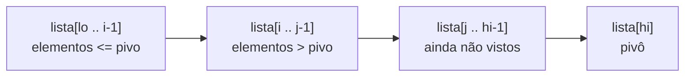

## Passo 1 · Leitura · Particionamento de Lomuto e o Quick Sort *in-place*

Enquanto o Merge Sort divide no meio sem olhar os valores e faz todo o trabalho pesado ao **combinar**, o **Quick Sort** (criado por Tony Hoare em 1959) faz exatamente o oposto: todo o trabalho acontece na fase de **divisão** — chamada **particionamento** — e a combinação não faz nada!

#### O particionamento de Lomuto

Dado um subvetor `lista[lo..hi]`, escolhemos `pivo = lista[hi]` e reorganizamos os elementos *in-place* de modo que:
- Todos os elementos **$\le \text{pivo}$** fiquem à esquerda da posição final `i` do pivô;
- O próprio `pivo` fique exatamente na sua **posição definitiva `i`**;
- Todos os elementos **$>\text{pivo}$** fiquem à direita de `i`.

Para fazer isso em uma única varredura linear $\Theta(hi - lo)$, mantemos uma fronteira `i = lo` (onde o próximo elemento $\le \text{pivo}$ será colocado) e percorremos `j` de `lo` até `hi - 1`:
- Sempre que `lista[j] <= pivo`, trocamos `lista[i]` com `lista[j]` e avançamos `i += 1`.
- Ao final do laço, trocamos `lista[i]` com `lista[hi]` (colocando o pivô na fronteira `i`) e devolvemos `i`.



Uma vez que `p = particionar(lista, lo, hi)` coloca o pivô na posição final `p`, basta chamar recursivamente nas duas metades **excluindo `p`**: `[lo, p - 1]` e `[p + 1, hi]`!

Veja o particionamento de Lomuto no visualizador:

```python visualizar
def particionar(lista, lo, hi):
    pivo = lista[hi]
    i = lo
    for j in range(lo, hi):
        if lista[j] <= pivo:
            lista[i], lista[j] = lista[j], lista[i]
            i += 1
    lista[i], lista[hi] = lista[hi], lista[i]
    return i

dados = [8, 3, 7, 1, 9, 2, 5]
pos = particionar(dados, 0, len(dados) - 1)
print("Posição do pivô 5:", pos, "-> lista:", dados)
```

## Passo 2 · Exercício · Particionamento de Lomuto e Quick Sort *in-place*

Implemente `particionar(lista, lo, hi)` pelo esquema de Lomuto (usando `lista[hi]` como pivô) e `quick_sort(lista)` ordenando a própria `lista` *in-place* e devolvendo-a, **sem usar `sorted()` nem `.sort()`**.

### Instruções
1. Em `particionar(lista, lo, hi)`, escolha `pivo = lista[hi]` e inicialize `i = lo`. Para cada `j` em `range(lo, hi)`, se `lista[j] <= pivo`, troque `lista[i]` com `lista[j]` e incremente `i += 1`. Ao final do laço, troque `lista[i]` com `lista[hi]` e devolva `i`.
2. Em `quick_sort(lista)`, defina uma auxiliar recursiva `_qs(lo, hi)`: quando `lo < hi`, chame `p = particionar(lista, lo, hi)` e recurse em `_qs(lo, p - 1)` e `_qs(p + 1, hi)`. Devolva `lista`.

### Código inicial
```python
def particionar(lista, lo, hi):
    # Particione lista[lo..hi] com pivô lista[hi] (Lomuto) e devolva o índice final do pivô
    pass


def quick_sort(lista):
    # Ordene lista in-place usando particionar e devolva lista
    pass
```

### Solução
```python
def particionar(lista, lo, hi):
    pivo = lista[hi]
    i = lo
    for j in range(lo, hi):
        if lista[j] <= pivo:
            lista[i], lista[j] = lista[j], lista[i]
            i += 1
    lista[i], lista[hi] = lista[hi], lista[i]
    return i


def quick_sort(lista):
    def _qs(lo, hi):
        if lo < hi:
            p = particionar(lista, lo, hi)
            _qs(lo, p - 1)
            _qs(p + 1, hi)

    _qs(0, len(lista) - 1)
    return lista
```

### Dicas
1. Não se esqueça da troca final `lista[i], lista[hi] = lista[hi], lista[i]` após o `for`: é ela que coloca o pivô entre os menores/iguais e os maiores!
2. Nas chamadas recursivas, exclua o índice `p` (`_qs(lo, p - 1)` e `_qs(p + 1, hi)`), pois `lista[p]` já está na posição definitiva.

### Verificação
```json
[
  {
    "id": "sem-sorted",
    "checkpoint": 2,
    "kind": "source",
    "rule": { "type": "not_calls", "name": "sorted" },
    "name": "Não usa sorted()"
  },
  {
    "id": "sem-sort",
    "checkpoint": 2,
    "kind": "source",
    "rule": { "type": "not_calls", "name": "sort" },
    "name": "Não usa .sort()"
  },
  {
    "id": "invariante-lomuto",
    "checkpoint": 1,
    "kind": "expr",
    "setup": "v = [8, 3, 7, 1, 9, 2, 5]\np = particionar(v, 0, len(v) - 1)",
    "expr": "[p, v[p], all(x <= 5 for x in v[:p]), all(x > 5 for x in v[p+1:])]",
    "expected": [3, 5, true, true],
    "name": "particionar posiciona o pivô 5 no índice 3 com todos <= 5 à esquerda e > 5 à direita"
  },
  {
    "id": "quick-sort-in-place",
    "checkpoint": 2,
    "kind": "expr",
    "setup": "v = [10, -2, 7, 7, 0, 15, 3, 1]\nret = quick_sort(v)",
    "expr": "[v, ret is v, quick_sort([]), quick_sort([42])]",
    "expected": [[-2, 0, 1, 3, 7, 7, 10, 15], true, [], [42]],
    "name": "quick_sort ordena in-place e trata listas vazias, unitárias e com repetidos"
  }
]
```

### Soluções erradas
```python name="esquece de colocar o pivô na posição final i ao terminar o laço"
def particionar(lista, lo, hi):
    pivo = lista[hi]
    i = lo
    for j in range(lo, hi):
        if lista[j] <= pivo:
            lista[i], lista[j] = lista[j], lista[i]
            i += 1
    return i


def quick_sort(lista):
    return lista
```
```python name="inclui p na chamada recursiva e entra em recursão infinita"
def particionar(lista, lo, hi):
    pivo = lista[hi]
    i = lo
    for j in range(lo, hi):
        if lista[j] <= pivo:
            lista[i], lista[j] = lista[j], lista[i]
            i += 1
    lista[i], lista[hi] = lista[hi], lista[i]
    return i


def quick_sort(lista):
    def _qs(lo, hi):
        if lo < hi:
            p = particionar(lista, lo, hi)
            _qs(lo, p)
            _qs(p, hi)

    _qs(0, len(lista) - 1)
    return lista
```

## Passo 3 · Leitura · O pior caso $O(n^2)$, pivô aleatório (3-way) e o Quickselect $O(n)$

#### O calcanhar de Aquiles do pivô fixo

O que acontece com o `quick_sort` de pivô fixo (`lista[hi]`) quando a lista **já vem ordenada** `[1, 2, 3, ..., n]`?
O pivô `lista[hi]` é sempre o maior elemento! A partição divide o vetor de tamanho $n$ em um lado esquerdo de tamanho **$n - 1$** e um lado direito de tamanho **$0$**:

$$
T(n) = T(n - 1) + \Theta(n) \implies \Theta(n^2) \text{ de tempo e } \Theta(n) \text{ de profundidade na pilha!}
$$

Para uma lista ordenada de $20\,000$ elementos, o Quick Sort de pivô fixo estoura `RecursionError` (e levaria centenas de milhões de comparações).

Como resolver?
1. **Escolha aleatória do pivô (`random.randint(lo, hi)`):** escolhemos um índice aleatório em `[lo, hi]` como pivô! Com isso, nenhuma entrada específica (nem mesmo ordenada ou invertida) provoca o pior caso: o tempo esperado passa a ser **$\Theta(n \log n)$ para qualquer entrada**.
2. **Particionamento em 3 vias (*Dutch National Flag*):** quando há muitos elementos repetidos, dividimos `lista[lo..hi]` em três faixas: **menores que o pivô** (`< pivo`), **iguais ao pivô** (`== pivo`) e **maiores que o pivô** (`> pivo`), recursando apenas nos menores e nos maiores.

#### Quickselect: encontrando o $k$-ésimo menor em tempo linear $O(n)$ médio!

E se quisermos encontrar apenas o **$k$-ésimo menor elemento** (índice `k` em base 0 se a lista estivesse ordenada, como a mediana em `k = n // 2`) sem precisar ordenar a lista inteira?
Ordenar tudo com `sorted(lista)[k]` custa $\Theta(n \log n)$. Mas com o **Quickselect** (também de Hoare), após particionar `lista[lo..hi]` em torno de um pivô na posição `p`:
- Se `k == p`, achamos! Devolvemos `lista[p]`.
- Se `k < p`, o elemento procurado está garantidamente na metade **esquerda**: descartamos a direita e buscamos apenas em `[lo, p - 1]`.
- Se `k > p`, descartamos a esquerda e buscamos apenas em `[p + 1, hi]`.

Como seguimos **apenas um ramo** a cada passo, o trabalho médio é uma série geométrica $n + \frac{n}{2} + \frac{n}{4} + \dots < 2n = \Theta(n)$!

## Passo 4 · Exercício · Quick Sort aleatorizado e Quickselect em $O(n)$ médio

Implemente duas funções (**sem usar `sorted()` nem `.sort()`**):
1. `quick_sort_aleatorio(lista)`: ordena `lista` *in-place* e devolve-a usando pivô escolhido aleatoriamente (`random.randint(lo, hi)`) e particionamento em 3 vias (ou Lomuto com troca do pivô aleatório para `hi`), de modo a ordenar uma lista **já ordenada de $20\,000$ elementos** rapidamente e sem `RecursionError`.
2. `k_esimo_menor(lista, k)`: recebe uma `lista` não vazia e um índice `k` ($0 \le k < \text{len}(lista)$) e devolve o elemento que estaria na posição `k` se `lista` fosse ordenada em ordem crescente, usando o algoritmo **Quickselect**.

### Instruções
1. Em `quick_sort_aleatorio(lista)`, para ordenar um intervalo `[lo, hi]`, sorteie `pivo = lista[random.randint(lo, hi)]` e particione em 3 faixas (`menores`, `iguais`, `maiores` *in-place* com três índices `lt`, `i`, `gt`) para suportar tanto listas já ordenadas de $20\,000$ itens quanto listas com muitos repetidos. Devolva `lista`.
2. Em `k_esimo_menor(lista, k)`, trabalhe sobre uma cópia `v = list(lista)` com `lo = 0` e `hi = len(v) - 1`. A cada passo, escolha um pivô aleatório em `[lo, hi]`, particione `v[lo..hi]` e compare `k` com a posição (ou faixa) do pivô para restringir a busca a um único lado até encontrar `v[k]`.

### Código inicial
```python
import random


def quick_sort_aleatorio(lista):
    # Ordene lista in-place com pivô aleatório e devolva lista
    pass


def k_esimo_menor(lista, k):
    # Devolva o elemento de índice k (0-based) da ordem crescente usando Quickselect
    pass
```

### Solução
```python
import random


def _particionar_3vias(v, lo, hi):
    pivo = v[random.randint(lo, hi)]
    lt = lo
    i = lo
    gt = hi
    while i <= gt:
        if v[i] < pivo:
            v[lt], v[i] = v[i], v[lt]
            lt += 1
            i += 1
        elif v[i] > pivo:
            v[i], v[gt] = v[gt], v[i]
            gt -= 1
        else:
            i += 1
    return lt, gt


def quick_sort_aleatorio(lista):
    def _qs(lo, hi):
        if lo < hi:
            lt, gt = _particionar_3vias(lista, lo, hi)
            _qs(lo, lt - 1)
            _qs(gt + 1, hi)

    _qs(0, len(lista) - 1)
    return lista


def k_esimo_menor(lista, k):
    v = list(lista)
    lo = 0
    hi = len(v) - 1
    while lo <= hi:
        lt, gt = _particionar_3vias(v, lo, hi)
        if lt <= k <= gt:
            return v[k]
        if k < lt:
            hi = lt - 1
        else:
            lo = gt + 1
    return v[k]
```

### Dicas
1. No particionamento em 3 vias (`lt`, `i`, `gt`), ao final do `while i <= gt:`, todos os elementos em `v[lo : lt]` são `< pivo`, todos em `v[lt : gt + 1]` são `== pivo` e todos em `v[gt + 1 : hi + 1]` são `> pivo`.
2. Se você usar Lomuto simples em `quick_sort_aleatorio`, basta sortear `idx = random.randint(lo, hi)`, trocar `lista[idx], lista[hi] = lista[hi], lista[idx]` e chamar o `particionar(lista, lo, hi)` normal!

### Verificação
```json
[
  {
    "id": "sem-sorted",
    "checkpoint": 1,
    "kind": "source",
    "rule": { "type": "not_calls", "name": "sorted" },
    "name": "Não usa sorted()"
  },
  {
    "id": "sem-sort",
    "checkpoint": 1,
    "kind": "source",
    "rule": { "type": "not_calls", "name": "sort" },
    "name": "Não usa .sort()"
  },
  {
    "id": "qs-aleatorio-20k-ordenados",
    "checkpoint": 1,
    "kind": "expr",
    "setup": "v = list(range(20000))\nret = quick_sort_aleatorio(v)",
    "expr": "[ret is v, len(v), v[0], v[10000], v[-1], all(v[i] <= v[i+1] for i in range(len(v)-1))]",
    "expected": [true, 20000, 0, 10000, 19999, true],
    "name": "quick_sort_aleatorio ordena lista já ordenada de 20.000 elementos in-place em O(n log n)"
  },
  {
    "id": "quickselect-casos",
    "checkpoint": 2,
    "kind": "expr",
    "setup": "dados = [9, 1, 5, 3, 7, 2, 8, 6, 4, 0]",
    "expr": "[k_esimo_menor(dados, 0), k_esimo_menor(dados, 4), k_esimo_menor(dados, 9), k_esimo_menor([5, 2, 5, 1, 5], 2)]",
    "expected": [0, 4, 9, 5],
    "name": "k_esimo_menor encontra mínimo (k=0), mediana (k=4), máximo (k=9) e trata duplicatas"
  }
]
```

### Soluções erradas
```python name="usa pivô fixo lista[hi] e estoura RecursionError em lista ordenada de 20k"
def quick_sort_aleatorio(lista):
    def part(lo, hi):
        pivo = lista[hi]
        i = lo
        for j in range(lo, hi):
            if lista[j] <= pivo:
                lista[i], lista[j] = lista[j], lista[i]
                i += 1
        lista[i], lista[hi] = lista[hi], lista[i]
        return i

    def _qs(lo, hi):
        if lo < hi:
            p = part(lo, hi)
            _qs(lo, p - 1)
            _qs(p + 1, hi)

    _qs(0, len(lista) - 1)
    return lista


def k_esimo_menor(lista, k):
    return lista[k]
```
```python name="interpreta k como 1-based em vez de 0-based em k_esimo_menor"
import random


def quick_sort_aleatorio(lista):
    return lista


def k_esimo_menor(lista, k):
    return lista[k - 1]
```

## Passo 5 · Quiz · Quick Sort, pivôs e Quickselect

### Pergunta
Quando o Quick Sort com pivô fixo no último elemento (`lista[hi]`) atinge seu **pior caso $\Theta(n^2)$**?
- [ ] Quando os elementos estão embaralhados de forma uniformemente aleatória.
- [x] Quando a lista já está ordenada (crescente ou decrescente) ou tem todos os elementos iguais (sem particionamento em 3 vias), pois a partição produz um lado com $n - 1$ elementos e outro com $0$ elementos a cada nível.
- [ ] Quando $n$ é uma potência de 2.
- [ ] Quando o pivô cai exatamente na mediana da sublista.
> O melhor caso do Quick Sort ocorre quando o pivô divide a lista ao meio (mediana: $T(n) = 2T(n/2) + \Theta(n) \implies \Theta(n \log n)$). Já quando o pivô é sistematicamente o menor ou o maior elemento, a árvore de recursão degenera em uma linha de altura $n$, somando $(n-1) + (n-2) + \dots + 1 = \Theta(n^2)$.

### Pergunta
Por que o **Quickselect** encontra o $k$-ésimo menor elemento em tempo médio **$\Theta(n)$**, enquanto o **Quick Sort** leva tempo médio **$\Theta(n \log n)$**?
- [ ] Porque o Quickselect não faz particionamento.
- [x] Porque após cada particionamento $\Theta(n)$, o Quickselect descarta uma das duas metades e faz **apenas uma chamada recursiva** (onde o índice $k$ está), resultando na soma geométrica $n + n/2 + n/4 + \dots = \Theta(n)$, enquanto o Quick Sort recursa nas duas metades.
- [ ] Porque o Quickselect usa uma tabela hash auxiliar.
- [ ] Porque o Quickselect sempre escolhe a mediana exata no primeiro passo.
> Em termos do Teorema Mestre (no caso médio onde o pivô divide aproximadamente ao meio), o Quick Sort tem $a = 2, b = 2 \implies \Theta(n \log n)$, enquanto o Quickselect tem $a = 1, b = 2 \implies \Theta(n)$!
