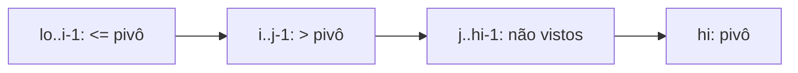

## Passo 1 · Leitura · Partição de Lomuto e seu invariante

O merge sort divide no meio sem olhar os valores e faz o trabalho ao **combinar**. O **quick sort** faz o contrário: o trabalho está em **dividir**, e combinar não custa nada. A divisão se chama **partição**: escolha um elemento, o **pivô**, e reorganize o trecho `lista[lo..hi]` para que os elementos `<=` pivô fiquem à esquerda dele e os `>` pivô à direita. O pivô termina na sua **posição definitiva**: a mesma que ele terá na lista ordenada. Depois, basta ordenar cada lado, recursivamente, sem nunca mais tocar no pivô.

Na partição de **Lomuto**, o pivô é o último elemento, `lista[hi]`. Um índice `j` varre o trecho e um índice `i` marca a fronteira da região dos pequenos. O invariante, no começo de cada volta do `for`, divide o trecho em quatro faixas:



```python
def particionar(lista, lo, hi):
    pivo = lista[hi]
    i = lo                               # região "<= pivô" começa vazia
    for j in range(lo, hi):              # hi fica de fora: é o pivô
        if lista[j] <= pivo:
            lista[i], lista[j] = lista[j], lista[i]   # traz o pequeno para a fronteira
            i += 1
    lista[i], lista[hi] = lista[hi], lista[i]         # pivô entre as duas regiões
    return i
```

- **Início:** `i = j = lo`, as duas primeiras faixas estão vazias; o invariante vale.
- **Manutenção:** se `lista[j] > pivo`, basta avançar `j`: a faixa dos grandes cresce. Se `lista[j] <= pivo`, a troca leva o pequeno para a posição `i` (o primeiro dos grandes, que vai para a posição `j`) e `i` avança.
- **Término:** com `j = hi`, não há mais não vistos. A troca final põe o pivô em `i`, entre os pequenos e os grandes, e `i` é devolvido.

Os erros comuns saem do invariante. Varrer com `range(lo, hi + 1)` inclui o próprio pivô na varredura. Começar com `i = 0` em vez de `i = lo` mistura o trecho com o resto da lista quando a recursão particiona um pedaço do meio. Esquecer a troca final deixa o pivô fora do lugar, e o índice devolvido aponta para outro elemento.

No visualizador, observe `i` parado enquanto `j` passa pelos grandes, e a troca final.

```python visualizar
def particionar(lista, lo, hi):
    pivo = lista[hi]
    i = lo
    for j in range(lo, hi):
        if lista[j] <= pivo:
            lista[i], lista[j] = lista[j], lista[i]
            i += 1
    lista[i], lista[hi] = lista[hi], lista[i]
    return i


dados = [8, 3, 7, 1, 9, 2, 5]
pos = particionar(dados, 0, len(dados) - 1)
print(pos, dados)
```

## Passo 2 · Exercício · Monte particionar
modo: ordenar

Arraste as linhas para montar `particionar(lista, lo, hi)` pelo esquema de Lomuto e ajuste a indentação. A função reorganiza só o trecho `lista[lo..hi]` (os dois índices inclusive), usa `lista[hi]` como pivô e devolve a posição final do pivô. Duas linhas estão sobrando.

### Instruções
1. Guarde o pivô e comece a região dos pequenos vazia, no início do trecho.
2. Varra o trecho sem o pivô, trazendo cada elemento `<=` pivô para a fronteira.
3. Ponha o pivô entre as duas regiões e devolva a posição dele.

### Solução
```python
def particionar(lista, lo, hi):
    pivo = lista[hi]
    i = lo
    for j in range(lo, hi):
        if lista[j] <= pivo:
            lista[i], lista[j] = lista[j], lista[i]
            i += 1
    lista[i], lista[hi] = lista[hi], lista[i]
    return i
```

### Distratores
```python
for j in range(lo, hi + 1):
i = 0
```

### Verificação
```json
[
  { "id": "posicao", "checkpoint": 3, "kind": "expr", "setup": "v = [6, 2, 9, 4, 7, 3, 5]\np = particionar(v, 0, 6)",
    "expr": "[p, v[p]]", "expected": [3, 5], "name": "Em [6, 2, 9, 4, 7, 3, 5], o pivô 5 vai para a posição 3" },
  { "id": "lados", "checkpoint": 2, "kind": "expr", "setup": "v = [6, 2, 9, 4, 7, 3, 5]\np = particionar(v, 0, 6)",
    "expr": "[all(x <= 5 for x in v[:p]), all(x > 5 for x in v[p + 1:]), sorted(v) == [2, 3, 4, 5, 6, 7, 9]]",
    "expected": [true, true, true], "name": "À esquerda só <= pivô, à direita só > pivô, nenhum elemento perdido" },
  { "id": "trecho-do-meio", "checkpoint": 1, "kind": "expr", "setup": "v = [9, 8, 4, 1, 3, 2, 0]\np = particionar(v, 2, 5)",
    "expr": "[p, v]", "expected": [3, [9, 8, 1, 2, 3, 4, 0]],
    "name": "particionar(v, 2, 5) só mexe nas posições 2 a 5", "hint": "A região dos pequenos começa em lo, não em 0." },
  { "id": "pivo-maximo", "checkpoint": 3, "kind": "expr", "setup": "v = [3, 1, 2, 9]\np = particionar(v, 0, 3)",
    "expr": "[p, v]", "expected": [3, [3, 1, 2, 9]], "name": "Pivô maior que todos fica no fim" },
  { "id": "pivo-minimo", "checkpoint": 3, "kind": "expr", "setup": "v = [4, 7, 5, 0]\np = particionar(v, 0, 3)",
    "expr": "[p, v]", "expected": [0, [0, 7, 5, 4]], "name": "Pivô menor que todos vai para o início",
    "hint": "Sem a troca final, o pivô não sai do fim." },
  { "id": "iguais", "checkpoint": 2, "kind": "expr", "setup": "v = [5, 5, 5]\np = particionar(v, 0, 2)",
    "expr": "[p, v]", "expected": [2, [5, 5, 5]], "name": "Com todos iguais ao pivô, todos vão para a esquerda" }
]
```

### Soluções erradas
```python name="varre incluindo o pivô"
def particionar(lista, lo, hi):
    pivo = lista[hi]
    i = lo
    for j in range(lo, hi + 1):
        if lista[j] <= pivo:
            lista[i], lista[j] = lista[j], lista[i]
            i += 1
    lista[i - 1], lista[hi] = lista[hi], lista[i - 1]
    return i
```
```python name="região dos pequenos começa em 0"
def particionar(lista, lo, hi):
    pivo = lista[hi]
    i = 0
    for j in range(lo, hi):
        if lista[j] <= pivo:
            lista[i], lista[j] = lista[j], lista[i]
            i += 1
    lista[i], lista[hi] = lista[hi], lista[i]
    return i
```
```python name="esquece a troca final"
def particionar(lista, lo, hi):
    pivo = lista[hi]
    i = lo
    for j in range(lo, hi):
        if lista[j] <= pivo:
            lista[i], lista[j] = lista[j], lista[i]
            i += 1
    return i
```

## Passo 3 · Exercício · quick_sort no lugar

Continue no código do passo anterior. Escreva `quick_sort(lista)`, que ordena a própria lista recebida usando `particionar` e não devolve nada, como `list.sort()`. Sem `sorted()` nem `.sort()`.

O esqueleto é uma função interna recursiva que ordena o trecho `[lo, hi]`:

```python
def quick_sort(lista):
    def ordenar_trecho(lo, hi):
        ...                      # trecho com 0 ou 1 elemento: nada a fazer
    ordenar_trecho(0, len(lista) - 1)
```

Depois de `p = particionar(lista, lo, hi)`, o pivô em `p` já está na posição definitiva: as chamadas recursivas cobrem `[lo, p - 1]` e `[p + 1, hi]`, **sem** o `p`. Incluí-lo em um dos lados é um erro comum: quando o pivô é o maior do trecho, `p == hi`, a chamada `ordenar_trecho(lo, p)` recebe exatamente o mesmo trecho e a recursão nunca termina.

### Instruções
1. Defina `quick_sort(lista)` com uma função interna que ordena o trecho `[lo, hi]` e pare em trechos com menos de 2 elementos.
2. Particione o trecho e ordene recursivamente os dois lados, excluindo o pivô.
3. Ordene a lista toda, no lugar, chamando a função interna com os índices da primeira e da última posição.

### Solução
```python
def particionar(lista, lo, hi):
    pivo = lista[hi]
    i = lo
    for j in range(lo, hi):
        if lista[j] <= pivo:
            lista[i], lista[j] = lista[j], lista[i]
            i += 1
    lista[i], lista[hi] = lista[hi], lista[i]
    return i


def quick_sort(lista):
    def ordenar_trecho(lo, hi):
        if lo < hi:
            p = particionar(lista, lo, hi)
            ordenar_trecho(lo, p - 1)
            ordenar_trecho(p + 1, hi)

    ordenar_trecho(0, len(lista) - 1)
```

### Dicas
1. Um trecho `[lo, hi]` tem pelo menos 2 elementos quando `lo < hi`.
2. O último índice válido é `len(lista) - 1`.
3. Se você criar listas novas com compreensões, a lista recebida não muda: o exercício pede ordenação no lugar.

### Verificação
```json
[
  { "id": "sem-sorted", "checkpoint": 2, "kind": "source", "rule": { "type": "not_calls", "name": "sorted" },
    "name": "Não usa sorted()" },
  { "id": "sem-sort", "checkpoint": 2, "kind": "source", "rule": { "type": "not_calls", "name": "sort" },
    "name": "Não usa .sort()" },
  { "id": "misturada", "checkpoint": 2, "kind": "expr", "setup": "v = [10, -2, 7, 0, 15, 3, 1]\nquick_sort(v)",
    "expr": "v", "expected": [-2, 0, 1, 3, 7, 10, 15], "name": "Ordena [10, -2, 7, 0, 15, 3, 1] no lugar",
    "hint": "Quando o pivô é o maior do trecho, p == hi: o lado esquerdo não pode incluir p." },
  { "id": "repetidos", "checkpoint": 2, "kind": "expr", "setup": "v = [4, 1, 4, 2, 4, 1]\nquick_sort(v)",
    "expr": "v", "expected": [1, 1, 2, 4, 4, 4], "name": "Ordena com repetidos sem perder nenhum",
    "hint": "Elementos iguais ao pivô também precisam continuar na lista." },
  { "id": "bordas", "checkpoint": 1, "kind": "expr", "setup": "a = []\nb = [42]\nc = [2, 1]\nquick_sort(a)\nquick_sort(b)\nquick_sort(c)",
    "expr": "[a, b, c]", "expected": [[], [42], [1, 2]], "name": "Listas com 0, 1 e 2 elementos" },
  { "id": "decrescente", "checkpoint": 3, "kind": "expr", "setup": "v = [9, 8, 7, 6, 5, 4, 3, 2, 1, 0]\nquick_sort(v)",
    "expr": "v", "expected": [0, 1, 2, 3, 4, 5, 6, 7, 8, 9], "name": "Ordena lista decrescente de 10" },
  { "id": "no-lugar", "checkpoint": 3, "kind": "expr", "setup": "v = [3, 1, 2]\nalias = v\nquick_sort(v)",
    "expr": "[alias, alias is v]", "expected": [[1, 2, 3], true], "name": "A própria lista recebida fica ordenada" }
]
```

### Soluções erradas
```python name="inclui o pivô no lado esquerdo"
def particionar(lista, lo, hi):
    pivo = lista[hi]
    i = lo
    for j in range(lo, hi):
        if lista[j] <= pivo:
            lista[i], lista[j] = lista[j], lista[i]
            i += 1
    lista[i], lista[hi] = lista[hi], lista[i]
    return i


def quick_sort(lista):
    def ordenar_trecho(lo, hi):
        if lo < hi:
            p = particionar(lista, lo, hi)
            ordenar_trecho(lo, p)
            ordenar_trecho(p + 1, hi)

    ordenar_trecho(0, len(lista) - 1)
```
```python name="último índice len(lista) em vez de len(lista) - 1"
def particionar(lista, lo, hi):
    pivo = lista[hi]
    i = lo
    for j in range(lo, hi):
        if lista[j] <= pivo:
            lista[i], lista[j] = lista[j], lista[i]
            i += 1
    lista[i], lista[hi] = lista[hi], lista[i]
    return i


def quick_sort(lista):
    def ordenar_trecho(lo, hi):
        if lo < hi:
            p = particionar(lista, lo, hi)
            ordenar_trecho(lo, p - 1)
            ordenar_trecho(p + 1, hi)

    ordenar_trecho(0, len(lista))
```
```python name="versão com compreensões perde os repetidos do pivô"
def quick_sort(lista):
    def ordenar(v):
        if len(v) <= 1:
            return v
        pivo = v[-1]
        menores = [x for x in v if x < pivo]
        maiores = [x for x in v if x > pivo]
        return ordenar(menores) + [pivo] + ordenar(maiores)

    lista[:] = ordenar(lista)
```
```python name="devolve uma lista nova e não ordena a recebida"
def particionar(lista, lo, hi):
    pivo = lista[hi]
    i = lo
    for j in range(lo, hi):
        if lista[j] <= pivo:
            lista[i], lista[j] = lista[j], lista[i]
            i += 1
    lista[i], lista[hi] = lista[hi], lista[i]
    return i


def quick_sort(lista):
    v = list(lista)

    def ordenar_trecho(lo, hi):
        if lo < hi:
            p = particionar(v, lo, hi)
            ordenar_trecho(lo, p - 1)
            ordenar_trecho(p + 1, hi)

    ordenar_trecho(0, len(v) - 1)
    return v
```

## Passo 4 · Leitura · O pior caso e o pivô aleatório

Quando a partição corta o trecho ao meio, a árvore de recursão é a do merge sort: $\log_2 n$ níveis com $n$ comparações cada, $\Theta(n \log n)$. Mas o pivô fixo `lista[hi]` não garante corte nenhum. Numa lista **já ordenada**, o último elemento é sempre o maior: a partição devolve um lado com $n - 1$ elementos e outro vazio. A recorrência vira

$$
T(n) = T(n-1) + (n - 1) \quad\Rightarrow\quad T(n) = \sum_{m=1}^{n-1} m = \frac{n(n-1)}{2} = \Theta(n^2).
$$

Com $n = 3\,000$, são cerca de 4,5 milhões de comparações. E há um problema mais imediato em Python: a recursão tem profundidade $n$. O limite padrão é de 1000 quadros, e a ordenação para com `RecursionError: maximum recursion depth exceeded`. Entrada ordenada não é caso raro: é o que acontece quando alguém reordena uma lista que já estava em ordem.

```python
v = list(range(3000))
quick_sort(v)      # pivô fixo: RecursionError: maximum recursion depth exceeded
```

A correção clássica é **sortear o pivô**: escolha um índice aleatório em `[lo, hi]`, troque esse elemento com `lista[hi]` e particione normalmente. Nenhuma entrada específica força o pior caso, porque o pior caso agora depende do sorteio, não dos dados. O número **esperado** de comparações, para qualquer entrada, é cerca de $2n \ln n \approx 1{,}39\, n \log_2 n$, e a profundidade esperada da recursão é $O(\log n)$. Esperado não é garantido: um azar extremo ainda dá $\Theta(n^2)$, mas a probabilidade disso é desprezível.

Sobra um caso que o sorteio não resolve: **muitos elementos iguais**. Em `[7] * 3000`, todo pivô é 7, e Lomuto manda todos os `<= 7` para a esquerda: o corte é $n - 1$ e $0$ de novo, com qualquer sorteio. A saída é a **partição em três vias**, que separa o trecho em `< pivô`, `== pivô` e `> pivô` e só recursa nas pontas. Seu invariante tem três índices `lt`, `i` e `gt`:

- `lista[lo:lt]` são os menores que o pivô;
- `lista[lt:i]` são os iguais;
- `lista[i:gt + 1]` ainda não foram vistos;
- `lista[gt + 1:hi + 1]` são os maiores.

O laço roda enquanto houver não vistos, isto é, `while i <= gt`. Com todos iguais, uma única partição põe tudo no meio e a recursão termina na hora.

## Passo 5 · Exercício · Quick sort aleatorizado em três vias

Escreva `quick_sort_aleatorio(lista)`, que ordena a própria lista recebida, sem devolver nada, com **pivô sorteado** por `random` e **partição em três vias**. Sem `sorted()` nem `.sort()`. A verificação ordena listas de $3\,000$ elementos já ordenadas, invertidas e com todos os valores iguais, com o limite padrão de recursão.

O laço da partição em três vias, para o trecho `[lo, hi]` e um valor `pivo` já sorteado, compara `lista[i]` com o pivô:

- menor: troque `lista[lt]` com `lista[i]` e avance `lt` e `i`;
- maior: troque `lista[i]` com `lista[gt]` e recue `gt`, **sem** avançar `i`, porque o elemento que veio de `gt` ainda não foi visto;
- igual: só avance `i`.

Ao final, os iguais ocupam `[lt, gt]`, e a recursão segue em `[lo, lt - 1]` e `[gt + 1, hi]`.

### Instruções
1. Sorteie o pivô do trecho `[lo, hi]` com `random`.
2. Particione o trecho em três vias, mantendo o invariante com `lt`, `i` e `gt`.
3. Ordene recursivamente só as faixas dos menores e dos maiores.

### Código inicial
```python
import random


def quick_sort_aleatorio(lista):
    pass
```

### Solução
```python
import random


def particionar_3vias(v, lo, hi):
    pivo = v[random.randint(lo, hi)]
    lt = lo
    i = lo
    gt = hi
    while i <= gt:
        if v[i] < pivo:
            v[lt], v[i] = v[i], v[lt]
            lt += 1
            i += 1
        elif v[i] > pivo:
            v[i], v[gt] = v[gt], v[i]
            gt -= 1
        else:
            i += 1
    return lt, gt


def quick_sort_aleatorio(lista):
    def ordenar_trecho(lo, hi):
        if lo < hi:
            lt, gt = particionar_3vias(lista, lo, hi)
            ordenar_trecho(lo, lt - 1)
            ordenar_trecho(gt + 1, hi)

    ordenar_trecho(0, len(lista) - 1)
```

### Dicas
1. Sortear um índice e continuar usando `lista[hi]` como pivô não muda nada: o pivô precisa ser o sorteado.
2. Com Lomuto, mesmo sorteando, uma lista de valores todos iguais vira o pior caso. A terceira faixa existe para isso.
3. O elemento em `gt` também é um não visto: o laço precisa rodar enquanto `i <= gt`.

### Verificação
```json
[
  { "id": "sem-sorted", "checkpoint": 3, "kind": "source", "rule": { "type": "not_calls", "name": "sorted" },
    "name": "Não usa sorted()" },
  { "id": "sem-sort", "checkpoint": 3, "kind": "source", "rule": { "type": "not_calls", "name": "sort" },
    "name": "Não usa .sort()" },
  { "id": "usa-random", "checkpoint": 1, "kind": "source", "rule": { "type": "imports", "module": "random" },
    "name": "Sorteia o pivô com random" },
  { "id": "pequena", "checkpoint": 2, "kind": "expr", "setup": "import random\nrandom.seed(7)\nv = [3, 9, 1, 7, 3, 0, 8, 3, 5, 2]\nquick_sort_aleatorio(v)",
    "expr": "v", "expected": [0, 1, 2, 3, 3, 3, 5, 7, 8, 9], "name": "Ordena [3, 9, 1, 7, 3, 0, 8, 3, 5, 2] no lugar",
    "hint": "O elemento na posição gt também precisa ser classificado antes de o laço parar." },
  { "id": "bordas", "checkpoint": 2, "kind": "expr", "setup": "import random\nrandom.seed(7)\na = []\nb = [1]\nquick_sort_aleatorio(a)\nquick_sort_aleatorio(b)",
    "expr": "[a, b]", "expected": [[], [1]], "name": "Listas com 0 e 1 elemento" },
  { "id": "ordenada-3000", "checkpoint": 1, "kind": "expr", "setup": "import random\nrandom.seed(7)\nv = list(range(3000))\nquick_sort_aleatorio(v)",
    "expr": "v == list(range(3000))", "expected": true, "name": "Lista já ordenada de 3000 sem RecursionError",
    "hint": "Com pivô fixo no fim, a lista ordenada vira o pior caso, com profundidade n." },
  { "id": "invertida-3000", "checkpoint": 1, "kind": "expr", "setup": "import random\nrandom.seed(8)\nv = list(range(3000, 0, -1))\nquick_sort_aleatorio(v)",
    "expr": "v == list(range(1, 3001))", "expected": true, "name": "Lista invertida de 3000 sem RecursionError" },
  { "id": "iguais-3000", "checkpoint": 3, "kind": "expr", "setup": "import random\nrandom.seed(9)\nv = [7] * 3000\nquick_sort_aleatorio(v)",
    "expr": "v == [7] * 3000", "expected": true, "name": "3000 valores iguais sem RecursionError",
    "hint": "Com todos iguais, Lomuto corta em n - 1 e 0 com qualquer pivô. Separe a faixa dos iguais." },
  { "id": "poucos-valores", "checkpoint": 3, "kind": "expr", "setup": "import random\nrandom.seed(10)\nv = [(i * 37) % 5 for i in range(2000)]\nesperado = [k for k in range(5) for _ in range(400)]\nquick_sort_aleatorio(v)",
    "expr": "v == esperado", "expected": true, "name": "2000 elementos com só 5 valores distintos" }
]
```

### Soluções erradas
```python name="pivô fixo no fim"
import random


def particionar(lista, lo, hi):
    pivo = lista[hi]
    i = lo
    for j in range(lo, hi):
        if lista[j] <= pivo:
            lista[i], lista[j] = lista[j], lista[i]
            i += 1
    lista[i], lista[hi] = lista[hi], lista[i]
    return i


def quick_sort_aleatorio(lista):
    def ordenar_trecho(lo, hi):
        if lo < hi:
            p = particionar(lista, lo, hi)
            ordenar_trecho(lo, p - 1)
            ordenar_trecho(p + 1, hi)

    ordenar_trecho(0, len(lista) - 1)
```
```python name="pivô sorteado, mas Lomuto em duas vias"
import random


def particionar(lista, lo, hi):
    k = random.randint(lo, hi)
    lista[k], lista[hi] = lista[hi], lista[k]
    pivo = lista[hi]
    i = lo
    for j in range(lo, hi):
        if lista[j] <= pivo:
            lista[i], lista[j] = lista[j], lista[i]
            i += 1
    lista[i], lista[hi] = lista[hi], lista[i]
    return i


def quick_sort_aleatorio(lista):
    def ordenar_trecho(lo, hi):
        if lo < hi:
            p = particionar(lista, lo, hi)
            ordenar_trecho(lo, p - 1)
            ordenar_trecho(p + 1, hi)

    ordenar_trecho(0, len(lista) - 1)
```
```python name="sorteia o índice mas o pivô continua sendo lista[hi]"
import random


def particionar_3vias(v, lo, hi):
    k = random.randint(lo, hi)
    pivo = v[hi]
    lt = lo
    i = lo
    gt = hi
    while i <= gt:
        if v[i] < pivo:
            v[lt], v[i] = v[i], v[lt]
            lt += 1
            i += 1
        elif v[i] > pivo:
            v[i], v[gt] = v[gt], v[i]
            gt -= 1
        else:
            i += 1
    return lt, gt


def quick_sort_aleatorio(lista):
    def ordenar_trecho(lo, hi):
        if lo < hi:
            lt, gt = particionar_3vias(lista, lo, hi)
            ordenar_trecho(lo, lt - 1)
            ordenar_trecho(gt + 1, hi)

    ordenar_trecho(0, len(lista) - 1)
```
```python name="while i < gt deixa um elemento sem classificar"
import random


def particionar_3vias(v, lo, hi):
    pivo = v[random.randint(lo, hi)]
    lt = lo
    i = lo
    gt = hi
    while i < gt:
        if v[i] < pivo:
            v[lt], v[i] = v[i], v[lt]
            lt += 1
            i += 1
        elif v[i] > pivo:
            v[i], v[gt] = v[gt], v[i]
            gt -= 1
        else:
            i += 1
    return lt, gt


def quick_sort_aleatorio(lista):
    def ordenar_trecho(lo, hi):
        if lo < hi:
            lt, gt = particionar_3vias(lista, lo, hi)
            ordenar_trecho(lo, lt - 1)
            ordenar_trecho(gt + 1, hi)

    ordenar_trecho(0, len(lista) - 1)
```

## Passo 6 · Exercício · Quickselect: o k-ésimo menor

Para achar a mediana de uma lista, ordenar tudo custa $\Theta(n \log n)$. Mas depois de uma partição você já sabe em que faixa o elemento procurado está. Se os iguais ao pivô ocupam as posições `[lt, gt]` e a posição `k` cai nessa faixa, a resposta é o pivô. Se `k < lt`, a resposta está entre os menores, e os maiores podem ser **descartados**; se `k > gt`, o contrário. Esse é o **quickselect**: uma partição por rodada e um lado só.

Com pivô aleatório, cada rodada descarta em média uma fração constante do trecho, e o trabalho fica parecido com $n + \frac{n}{2} + \frac{n}{4} + \dots \le 2n$: $\Theta(n)$ esperado. A partição de três vias do passo anterior serve sem mudança. Repare que `k` é uma posição **na lista inteira**, e não muda de rodada para rodada: só `lo` e `hi` se fecham em torno dele.

Escreva `k_esimo_menor(lista, k)`, que devolve o elemento que estaria na posição `k` (contando de 0) se a lista estivesse em ordem crescente. A lista não é vazia, `0 <= k < len(lista)`, e a **lista recebida não pode mudar**. Sem `sorted()` nem `.sort()`. Exemplo: `k_esimo_menor([9, 1, 5, 3, 7], 2)` é `5`. A verificação conta as comparações em uma lista de $20\,000$ elementos: ordenar tudo passa do limite.

### Instruções
1. Trabalhe numa cópia da lista, com o trecho de busca `[lo, hi]` começando na lista toda.
2. A cada rodada, particione o trecho em três vias com pivô sorteado.
3. Se `k` cai na faixa dos iguais, devolva o elemento; senão, continue só no lado que contém `k`.

### Código inicial
```python
import random


def k_esimo_menor(lista, k):
    pass
```

### Solução
```python
import random


def particionar_3vias(v, lo, hi):
    pivo = v[random.randint(lo, hi)]
    lt = lo
    i = lo
    gt = hi
    while i <= gt:
        if v[i] < pivo:
            v[lt], v[i] = v[i], v[lt]
            lt += 1
            i += 1
        elif v[i] > pivo:
            v[i], v[gt] = v[gt], v[i]
            gt -= 1
        else:
            i += 1
    return lt, gt


def k_esimo_menor(lista, k):
    v = list(lista)
    lo = 0
    hi = len(v) - 1
    while True:
        lt, gt = particionar_3vias(v, lo, hi)
        if k < lt:
            hi = lt - 1
        elif k > gt:
            lo = gt + 1
        else:
            return v[k]
```

### Dicas
1. `k` é uma posição da lista inteira: ela não muda quando o trecho encolhe.
2. Depois da partição, as posições `lt` a `gt` já têm seus valores definitivos.
3. Se preferir fatias e compreensões, ao ir para os maiores o novo `k` desconta os menores **e** os iguais.

### Verificação
```json
[
  { "id": "sem-sorted", "checkpoint": 2, "kind": "source", "rule": { "type": "not_calls", "name": "sorted" },
    "name": "Não usa sorted()" },
  { "id": "sem-sort", "checkpoint": 2, "kind": "source", "rule": { "type": "not_calls", "name": "sort" },
    "name": "Não usa .sort()" },
  { "id": "minimo", "checkpoint": 3, "kind": "expr", "setup": "import random\nrandom.seed(7)", "expr": "k_esimo_menor([9, 1, 5, 3, 7, 2, 8, 6, 4, 0], 0)", "expected": 0,
    "name": "k = 0 é o mínimo", "hint": "k conta a partir de 0." },
  { "id": "maximo", "checkpoint": 3, "kind": "expr", "setup": "import random\nrandom.seed(7)", "expr": "k_esimo_menor([9, 1, 5, 3, 7, 2, 8, 6, 4, 0], 9)", "expected": 9,
    "name": "k = 9 é o máximo de 10" },
  { "id": "mediana", "checkpoint": 3, "kind": "expr", "setup": "import random\nrandom.seed(7)", "expr": "k_esimo_menor([9, 1, 5, 3, 7, 2, 8, 6, 4, 0], 4)", "expected": 4,
    "name": "k = 4 em [9, 1, 5, 3, 7, 2, 8, 6, 4, 0] é 4" },
  { "id": "repetidos", "checkpoint": 3, "kind": "expr", "setup": "import random\nrandom.seed(7)",
    "expr": "[k_esimo_menor([5, 2, 5, 1, 5, 9], k) for k in range(6)]", "expected": [1, 2, 5, 5, 5, 9],
    "name": "Com repetidos, todas as posições de [5, 2, 5, 1, 5, 9]",
    "hint": "Ao descartar a faixa dos menores e a dos iguais, a posição k não muda de significado." },
  { "id": "nao-altera", "checkpoint": 1, "kind": "expr", "setup": "import random\nrandom.seed(7)\nv = [4, 8, 1, 6]\nr = k_esimo_menor(v, 1)",
    "expr": "[r, v]", "expected": [4, [4, 8, 1, 6]], "name": "Não altera a lista recebida", "hint": "Particione uma cópia." },
  { "id": "linear", "checkpoint": 2, "kind": "expr",
    "setup": "import random\nrandom.seed(7)\nclass K:\n    n = 0\n    def __init__(self, v):\n        self.v = v\n    def __lt__(self, o):\n        K.n += 1\n        return self.v < o.v\n    def __le__(self, o):\n        K.n += 1\n        return self.v <= o.v\n    def __gt__(self, o):\n        K.n += 1\n        return self.v > o.v\n    def __ge__(self, o):\n        K.n += 1\n        return self.v >= o.v\n    def __eq__(self, o):\n        return self.v == o.v\ndados = [K((i * 7919) % 20000) for i in range(20000)]\nK.n = 0\nr = k_esimo_menor(dados, 1000)",
    "expr": "[r.v, K.n <= 200000]", "expected": [1000, true],
    "name": "Em 20000 elementos, no máximo 200000 comparações",
    "hint": "Ordenar tudo e indexar compara demais. Depois de cada partição, siga só o lado que contém k." }
]
```

### Soluções erradas
```python name="ordena tudo com quick sort e indexa"
import random


def particionar_3vias(v, lo, hi):
    pivo = v[random.randint(lo, hi)]
    lt = lo
    i = lo
    gt = hi
    while i <= gt:
        if v[i] < pivo:
            v[lt], v[i] = v[i], v[lt]
            lt += 1
            i += 1
        elif v[i] > pivo:
            v[i], v[gt] = v[gt], v[i]
            gt -= 1
        else:
            i += 1
    return lt, gt


def k_esimo_menor(lista, k):
    v = list(lista)

    def ordenar_trecho(lo, hi):
        if lo < hi:
            lt, gt = particionar_3vias(v, lo, hi)
            ordenar_trecho(lo, lt - 1)
            ordenar_trecho(gt + 1, hi)

    ordenar_trecho(0, len(v) - 1)
    return v[k]
```
```python name="particiona a própria lista recebida"
import random


def particionar_3vias(v, lo, hi):
    pivo = v[random.randint(lo, hi)]
    lt = lo
    i = lo
    gt = hi
    while i <= gt:
        if v[i] < pivo:
            v[lt], v[i] = v[i], v[lt]
            lt += 1
            i += 1
        elif v[i] > pivo:
            v[i], v[gt] = v[gt], v[i]
            gt -= 1
        else:
            i += 1
    return lt, gt


def k_esimo_menor(lista, k):
    v = lista
    lo = 0
    hi = len(v) - 1
    while True:
        lt, gt = particionar_3vias(v, lo, hi)
        if k < lt:
            hi = lt - 1
        elif k > gt:
            lo = gt + 1
        else:
            return v[k]
```
```python name="ao ir para os maiores, esquece de descontar os iguais"
import random


def k_esimo_menor(lista, k):
    pivo = random.choice(lista)
    menores = [x for x in lista if x < pivo]
    iguais = [x for x in lista if x == pivo]
    maiores = [x for x in lista if x > pivo]
    if k < len(menores):
        return k_esimo_menor(menores, k)
    if k < len(menores) + len(iguais):
        return pivo
    return k_esimo_menor(maiores, k - len(menores))
```
```python name="trata k como posição contada a partir de 1"
import random


def particionar_3vias(v, lo, hi):
    pivo = v[random.randint(lo, hi)]
    lt = lo
    i = lo
    gt = hi
    while i <= gt:
        if v[i] < pivo:
            v[lt], v[i] = v[i], v[lt]
            lt += 1
            i += 1
        elif v[i] > pivo:
            v[i], v[gt] = v[gt], v[i]
            gt -= 1
        else:
            i += 1
    return lt, gt


def k_esimo_menor(lista, k):
    k = k - 1
    v = list(lista)
    lo = 0
    hi = len(v) - 1
    while True:
        lt, gt = particionar_3vias(v, lo, hi)
        if k < lt:
            hi = lt - 1
        elif k > gt:
            lo = gt + 1
        else:
            return v[k]
```

## Passo 7 · Quiz · Pivôs e escolhas

### Pergunta
O quick sort com pivô fixo `lista[hi]` e partição de Lomuto recebe cada uma das listas abaixo, todas com $n = 2\,000$. Em qual delas ele **não** degrada para $\Theta(n^2)$?
- [ ] Lista já em ordem crescente
- [ ] Lista em ordem decrescente
- [ ] Lista com os $2\,000$ valores iguais
- [x] Lista embaralhada com valores distintos
> Em ordem crescente o pivô é sempre o maior; em ordem decrescente, sempre o menor; com todos iguais, Lomuto manda todos para a esquerda. Nos três casos o corte é $n - 1$ e $0$. Numa lista embaralhada, o pivô cai perto do meio na maioria das vezes e o custo é $\Theta(n \log n)$.

### Pergunta
Sortear o pivô torna o quick sort $\Theta(n \log n)$ em que sentido?
- [ ] No pior caso, para qualquer entrada: nenhum sorteio leva a $\Theta(n^2)$
- [x] Em valor esperado, para qualquer entrada: o pior caso ainda existe, mas depende do azar no sorteio e não dos dados
- [ ] Só para entradas aleatórias; entradas ordenadas continuam $\Theta(n^2)$
- [ ] Em todos os casos, porque o pivô sorteado é sempre a mediana
> O sorteio troca "existe uma entrada ruim" por "existe uma sequência de sorteios ruim", e essa tem probabilidade desprezível. O merge sort, em comparação, garante $\Theta(n \log n)$ no pior caso, mas usa $\Theta(n)$ de memória extra.

### Pergunta
Por que o quickselect é $\Theta(n)$ esperado e o quick sort é $\Theta(n \log n)$ esperado, se os dois usam a mesma partição?
- [ ] Porque o quickselect usa uma partição mais rápida
- [x] Porque depois de cada partição o quickselect continua em um só lado, e o trabalho por rodada cai geometricamente
- [ ] Porque o quickselect sempre acerta a mediana na primeira partição
- [ ] Porque o quickselect não precisa comparar elementos
> O quick sort segue nos dois lados: cada nível da árvore soma $n$, e há cerca de $\log n$ níveis. O quickselect descarta um lado inteiro: com cortes perto do meio, $n + \frac{n}{2} + \frac{n}{4} + \dots \le 2n$.
