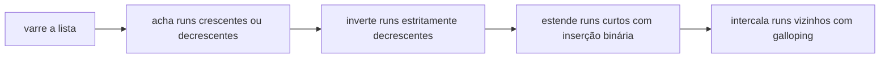

## Passo 1 · Leitura · sorted, .sort() e a chave

Depois de escrever quatro algoritmos de ordenação, é hora de usar o que o Python já traz. São duas ferramentas, com o mesmo algoritmo por baixo:

- `sorted(iteravel, key=..., reverse=...)` aceita qualquer iterável (lista, tupla, conjunto, chaves de dicionário), **não altera** o original e devolve uma **lista nova**.
- `lista.sort(key=..., reverse=...)` só existe em listas, ordena **no lugar** e devolve `None`.

O erro clássico é misturar os dois: `ordenada = notas.sort()` guarda `None` em `ordenada`, e o defeito aparece longe, com `TypeError: 'NoneType' object is not subscriptable` na primeira vez que alguém fizer `ordenada[0]`. A convenção do Python é essa: método que altera o objeto no lugar devolve `None`.

O parâmetro `key` recebe uma função que transforma cada elemento na **chave** usada nas comparações. O Python chama essa função **uma vez por elemento**, guarda as $n$ chaves e ordena comparando as chaves; os elementos só acompanham. Com $n$ alunos, `key=calcular_score` roda $n$ vezes, e não uma vez por comparação.

Para vários critérios, a chave é uma **tupla**. Tuplas se comparam posição a posição: a segunda posição só é olhada quando a primeira empata. Para ordenar por nota decrescente e, no empate, por nome crescente, não use `reverse=True`: ele inverte a **tupla inteira**, e os nomes também sairiam de Z para A. Com números, inverta só aquele critério trocando o sinal:

```python
alunos = [
    {"nome": "Caio", "nota": 8.5},
    {"nome": "Ana", "nota": 9.0},
    {"nome": "Bia", "nota": 8.5},
]
por_nota = sorted(alunos, key=lambda a: (-a["nota"], a["nome"]))
print([a["nome"] for a in por_nota])        # ['Ana', 'Bia', 'Caio']

errado = sorted(alunos, key=lambda a: (a["nota"], a["nome"]), reverse=True)
print([a["nome"] for a in errado])          # ['Ana', 'Caio', 'Bia']
```

A chave também resolve comparações que a ordem natural faz errado. Versões de software como `"1.10.2"` e `"1.9.0"` comparadas como texto saem trocadas: o texto compara caractere a caractere, e `"1"` vem antes de `"9"`, então `"1.10.2" < "1.9.0"`. Transformar cada versão na tupla de inteiros `(1, 10, 2)` faz a comparação ser número a número. Já `v.split(".")` não basta: produz uma lista de **textos**, `["1", "10", "2"]`, e o problema volta.

## Passo 2 · Previsão · Duas ordenações seguidas

O programa ordena a mesma turma de dois jeitos. Na segunda parte, ordena **duas vezes seguidas**, primeiro pelo nome e depois pela nota. Leia sem executar e digite exatamente o que ele imprime.

### Código
```python
alunos = [("Davi", 7), ("Ana", 9), ("Caio", 7), ("Bia", 9), ("Eva", 8)]

print([nome for nome, _ in sorted(alunos, key=lambda a: a[1])])

passo1 = sorted(alunos, key=lambda a: a[0])
passo2 = sorted(passo1, key=lambda a: a[1], reverse=True)
for nome, nota in passo2:
    print(nome, nota)
```

### Dicas
1. A chave da primeira linha é só a nota. Quem empata na nota sai em que ordem?
2. A ordenação do Python é estável: empates mantêm a ordem que tinham **na lista de entrada daquela chamada**.
3. `reverse=True` não desfaz a estabilidade: os empates continuam na ordem da entrada.

### Saída esperada
```text
['Davi', 'Caio', 'Eva', 'Ana', 'Bia']
Ana 9
Bia 9
Eva 8
Caio 7
Davi 7
```

## Passo 3 · Exercício · Vários critérios com key

Escreva três funções com `sorted` e `key`. Nenhuma pode alterar a lista recebida.

- `ordenar_alunos(alunos)`: recebe dicionários `{"nome": str, "nota": float, "idade": int}` e devolve uma lista nova por **nota decrescente**, depois **idade crescente**, depois **nome crescente**.
- `ordenar_versoes(versoes)`: recebe textos como `"1.10.2"` e devolve uma lista nova em ordem numérica, parte a parte. `"2.0"` vem antes de `"2.0.1"`.
- `ordenar_por_frequencia(palavras)`: devolve cada palavra **distinta** uma vez, da mais frequente para a menos frequente; no empate, em ordem alfabética. Exemplo: `["pera", "uva", "pera", "kiwi", "uva"]` dá `["pera", "uva", "kiwi"]`.

### Instruções
1. Em `ordenar_alunos`, use uma tupla como chave e inverta só a nota.
2. Em `ordenar_versoes`, a chave transforma cada versão numa tupla de inteiros.
3. Em `ordenar_por_frequencia`, conte as palavras e ordene as distintas por frequência decrescente e texto crescente.

### Código inicial
```python
def ordenar_alunos(alunos):
    pass


def ordenar_versoes(versoes):
    pass


def ordenar_por_frequencia(palavras):
    pass
```

### Solução
```python
from collections import Counter


def ordenar_alunos(alunos):
    return sorted(alunos, key=lambda a: (-a["nota"], a["idade"], a["nome"]))


def ordenar_versoes(versoes):
    return sorted(versoes, key=lambda v: tuple(int(parte) for parte in v.split(".")))


def ordenar_por_frequencia(palavras):
    contagem = Counter(palavras)
    return sorted(contagem, key=lambda p: (-contagem[p], p))
```

### Dicas
1. `reverse=True` inverte todos os critérios da tupla de uma vez.
2. `"10" < "9"` é `True` em texto. A chave precisa de números.
3. Na frequência, o desempate não é a ordem em que as palavras apareceram.

### Verificação
```json
[
  { "id": "alunos-turma", "checkpoint": 1, "kind": "expr",
    "setup": "entrada = [\n  {'nome': 'Caio', 'nota': 8.5, 'idade': 21},\n  {'nome': 'Ana', 'nota': 9.0, 'idade': 22},\n  {'nome': 'Bruno', 'nota': 8.5, 'idade': 20},\n  {'nome': 'Beatriz', 'nota': 8.5, 'idade': 20},\n  {'nome': 'Davi', 'nota': 9.0, 'idade': 19}\n]",
    "expr": "[a['nome'] for a in ordenar_alunos(entrada)]", "expected": ["Davi", "Ana", "Beatriz", "Bruno", "Caio"],
    "name": "Nota decrescente, idade crescente, nome crescente", "hint": "Inverta só a nota; idade e nome continuam crescentes." },
  { "id": "alunos-nao-altera", "checkpoint": 1, "kind": "expr",
    "setup": "entrada = [{'nome': 'Eva', 'nota': 5.0, 'idade': 30}, {'nome': 'Rui', 'nota': 7.0, 'idade': 30}]\nr = ordenar_alunos(entrada)",
    "expr": "[[a['nome'] for a in r], [a['nome'] for a in entrada]]", "expected": [["Rui", "Eva"], ["Eva", "Rui"]],
    "name": "Devolve lista nova e não altera a recebida", "hint": "list.sort() altera a lista e devolve None." },
  { "id": "versoes", "checkpoint": 2, "kind": "call", "function": "ordenar_versoes",
    "args": [["1.10.2", "1.2.0", "1.9.10", "1.9.2", "2.0.0", "0.99.9"]],
    "expected": ["0.99.9", "1.2.0", "1.9.2", "1.9.10", "1.10.2", "2.0.0"],
    "name": "1.9.2 < 1.9.10 < 1.10.2", "hint": "Compare as partes como números, não como texto." },
  { "id": "versoes-tamanhos", "checkpoint": 2, "kind": "call", "function": "ordenar_versoes",
    "args": [["2.0.1", "10.0", "2.0", "3"]], "expected": ["2.0", "2.0.1", "3", "10.0"],
    "name": "Versões com quantidades diferentes de partes" },
  { "id": "frequencia", "checkpoint": 3, "kind": "call", "function": "ordenar_por_frequencia",
    "args": [["uva", "banana", "maca", "banana", "uva", "abacaxi", "pera", "banana", "maca"]],
    "expected": ["banana", "maca", "uva", "abacaxi", "pera"], "name": "Frequência decrescente, empate em ordem alfabética",
    "hint": "maca e uva aparecem 2 vezes cada: o desempate é alfabético." },
  { "id": "frequencia-empate-total", "checkpoint": 3, "kind": "call", "function": "ordenar_por_frequencia",
    "args": [["sol", "lua", "mar"]], "expected": ["lua", "mar", "sol"], "name": "Todas com frequência 1: ordem alfabética" },
  { "id": "frequencia-vazia", "checkpoint": 3, "kind": "call", "function": "ordenar_por_frequencia", "args": [[]], "expected": [],
    "name": "Lista vazia dá []" }
]
```

### Soluções erradas
```python name="reverse=True inverte todos os critérios"
from collections import Counter


def ordenar_alunos(alunos):
    return sorted(alunos, key=lambda a: (a["nota"], a["idade"], a["nome"]), reverse=True)


def ordenar_versoes(versoes):
    return sorted(versoes, key=lambda v: tuple(int(parte) for parte in v.split(".")))


def ordenar_por_frequencia(palavras):
    contagem = Counter(palavras)
    return sorted(contagem, key=lambda p: (-contagem[p], p))
```
```python name="versões partidas mas ainda comparadas como texto"
from collections import Counter


def ordenar_alunos(alunos):
    return sorted(alunos, key=lambda a: (-a["nota"], a["idade"], a["nome"]))


def ordenar_versoes(versoes):
    return sorted(versoes, key=lambda v: v.split("."))


def ordenar_por_frequencia(palavras):
    contagem = Counter(palavras)
    return sorted(contagem, key=lambda p: (-contagem[p], p))
```
```python name="desempata pela ordem de aparição"
from collections import Counter


def ordenar_alunos(alunos):
    return sorted(alunos, key=lambda a: (-a["nota"], a["idade"], a["nome"]))


def ordenar_versoes(versoes):
    return sorted(versoes, key=lambda v: tuple(int(parte) for parte in v.split(".")))


def ordenar_por_frequencia(palavras):
    contagem = Counter(palavras)
    return sorted(contagem, key=lambda p: -contagem[p])
```
```python name="ordena no lugar a lista recebida"
from collections import Counter


def ordenar_alunos(alunos):
    alunos.sort(key=lambda a: (-a["nota"], a["idade"], a["nome"]))
    return alunos


def ordenar_versoes(versoes):
    return sorted(versoes, key=lambda v: tuple(int(parte) for parte in v.split(".")))


def ordenar_por_frequencia(palavras):
    contagem = Counter(palavras)
    return sorted(contagem, key=lambda p: (-contagem[p], p))
```

## Passo 4 · Leitura · Estabilidade em cadeia e o Timsort

A previsão mostrou a ordenação do Python mantendo empates na ordem de entrada: ela é **estável**, e a documentação garante isso. A estabilidade permite ordenar por vários critérios em **várias passagens**: ordene primeiro pelo critério **menos** importante e por último pelo **mais** importante. A última passagem decide a ordem principal; nos empates dela, sobrevive a ordem deixada pelas anteriores.

Isso resolve o caso em que o sinal não ajuda: critérios de texto em direções opostas. Não existe `-"Clarice"`. Para autor decrescente e título crescente:

```python
por_titulo = sorted(livros, key=lambda l: l[1])                    # critério secundário
resultado = sorted(por_titulo, key=lambda l: l[0], reverse=True)   # critério principal
```

Inverter a ordem das passagens é o erro comum: a última passagem passaria a ser a do título, e a lista sairia ordenada por título.

Por baixo de `sorted` e `.sort()` está o **Timsort**, criado para o Python e baseado em duas observações sobre dados reais: eles costumam ter trechos já ordenados, e a inserção é rápida em trechos curtos.



1. Ele varre a lista procurando **runs**: trechos já crescentes, ou **estritamente** decrescentes, que ele inverte no lugar. "Estritamente" importa: inverter um trecho com iguais trocaria a ordem deles e quebraria a estabilidade.
2. Runs curtos são estendidos até um tamanho mínimo, entre 32 e 64, com inserção que acha a posição por busca binária.
3. Os runs são intercalados dois a dois, como no merge sort. Quando um lado vence muitas comparações seguidas, a intercalação entra no modo **galloping**: procura com saltos exponenciais até onde copiar em bloco, em vez de comparar um a um. Desde o Python 3.11, a escolha de quais runs intercalar segue a regra *powersort*.

Consequência: uma lista já ordenada é um único run, e `sorted` faz $n - 1$ comparações. Uma lista em ordem estritamente decrescente também: é um run invertido em $O(n)$. Uma lista ordenada com alguns elementos anexados no fim vira poucos runs e custa perto de $O(n)$. Só dados sem estrutura pagam o $\Theta(n \log n)$ completo.

## Passo 5 · Exercício · Autor decrescente, título crescente

A biblioteca quer a estante em ordem de **autor decrescente** (de Z para A) e, para o mesmo autor, **título crescente**. Cada livro é uma tupla `(autor, titulo)` de textos.

Escreva `ordenar_estante(livros)`, que devolve uma lista nova nessa ordem, sem alterar a recebida, aproveitando a estabilidade de `sorted`. Exemplo:

```python
ordenar_estante([("Assis", "Helena"), ("Rosa", "Sagarana"), ("Assis", "Dom Casmurro")])
# [("Rosa", "Sagarana"), ("Assis", "Dom Casmurro"), ("Assis", "Helena")]
```

### Instruções
1. Faça a primeira passagem pelo critério secundário, o título.
2. Faça a última passagem pelo critério principal, o autor, em ordem decrescente.
3. Devolva uma lista nova, sem alterar a recebida.

### Código inicial
```python
def ordenar_estante(livros):
    pass
```

### Solução
```python
def ordenar_estante(livros):
    por_titulo = sorted(livros, key=lambda livro: livro[1])
    return sorted(por_titulo, key=lambda livro: livro[0], reverse=True)
```

### Dicas
1. `reverse=True` numa tupla `(autor, titulo)` inverte também os títulos.
2. Quem decide a ordem final é a **última** passagem.
3. Nos empates de autor, a última passagem preserva a ordem que a primeira deixou.

### Verificação
```json
[
  { "id": "estante", "checkpoint": 2, "kind": "call", "function": "ordenar_estante",
    "args": [[["Rosa", "Sagarana"], ["Clarice", "Laços de família"], ["Rosa", "Grande sertão"], ["Assis", "Quincas Borba"], ["Clarice", "A hora da estrela"], ["Assis", "Helena"]]],
    "expected": [["Rosa", "Grande sertão"], ["Rosa", "Sagarana"], ["Clarice", "A hora da estrela"], ["Clarice", "Laços de família"], ["Assis", "Helena"], ["Assis", "Quincas Borba"]],
    "name": "Autor de Z para A; títulos do mesmo autor de A para Z", "hint": "Os títulos de cada autor precisam continuar crescentes." },
  { "id": "um-autor", "checkpoint": 1, "kind": "call", "function": "ordenar_estante",
    "args": [[["Lispector", "Perto do coração selvagem"], ["Lispector", "A paixão segundo G.H."], ["Lispector", "Uma aprendizagem"]]],
    "expected": [["Lispector", "A paixão segundo G.H."], ["Lispector", "Perto do coração selvagem"], ["Lispector", "Uma aprendizagem"]],
    "name": "Um autor só: só os títulos decidem" },
  { "id": "autores-distintos", "checkpoint": 2, "kind": "call", "function": "ordenar_estante",
    "args": [[["Bandeira", "Libertinagem"], ["Quintana", "Rua dos cataventos"], ["Meireles", "Viagem"]]],
    "expected": [["Quintana", "Rua dos cataventos"], ["Meireles", "Viagem"], ["Bandeira", "Libertinagem"]],
    "name": "Autores todos diferentes: só o autor decide", "hint": "A última passagem é a do critério principal." },
  { "id": "vazia", "checkpoint": 3, "kind": "call", "function": "ordenar_estante", "args": [[]], "expected": [],
    "name": "ordenar_estante([]) é []" },
  { "id": "nao-altera", "checkpoint": 3, "kind": "expr",
    "setup": "entrada = [('Assis', 'Helena'), ('Rosa', 'Sagarana'), ('Assis', 'Dom Casmurro')]\nr = ordenar_estante(entrada)",
    "expr": "[r, entrada]",
    "expected": [[["Rosa", "Sagarana"], ["Assis", "Dom Casmurro"], ["Assis", "Helena"]], [["Assis", "Helena"], ["Rosa", "Sagarana"], ["Assis", "Dom Casmurro"]]],
    "name": "Devolve lista nova e não altera a recebida" }
]
```

### Soluções erradas
```python name="tupla com reverse=True inverte os títulos"
def ordenar_estante(livros):
    return sorted(livros, key=lambda livro: (livro[0], livro[1]), reverse=True)
```
```python name="passagens na ordem trocada"
def ordenar_estante(livros):
    por_autor = sorted(livros, key=lambda livro: livro[0], reverse=True)
    return sorted(por_autor, key=lambda livro: livro[1])
```
```python name="esquece de inverter o autor"
def ordenar_estante(livros):
    por_titulo = sorted(livros, key=lambda livro: livro[1])
    return sorted(por_titulo, key=lambda livro: livro[0])
```
```python name="ordena a lista recebida no lugar"
def ordenar_estante(livros):
    livros.sort(key=lambda livro: livro[1])
    livros.sort(key=lambda livro: livro[0], reverse=True)
    return livros
```

## Passo 6 · Leitura · Quando a ordem depende do par: cmp_to_key

Uma chave atribui a cada elemento, sozinho, um valor comparável. Há problemas em que isso não é natural, porque a decisão "quem vem antes" depende dos **dois** elementos juntos.

Exemplo: dados inteiros não negativos, em que ordem concatená-los para formar o **maior** número? Com `[3, 30, 34, 5, 9]`:

- ordem numérica decrescente dá `"3430953"`;
- ordem de texto decrescente põe `"30"` antes de `"3"`, porque `"30" > "3"`, e dá `"9534303"`;
- mas `"3"` antes de `"30"` forma `"330"`, que é maior que `"303"`. O máximo é `"9534330"`.

A regra certa compara as duas concatenações: `x` vem antes de `y` quando `x + y > y + x`. Uma função de comparação de dois argumentos, no estilo antigo, devolve um número **negativo** se `a` vem antes de `b`, **positivo** se vem depois e **zero** no empate. `functools.cmp_to_key` transforma essa função numa chave aceita por `sorted`:

```python
from functools import cmp_to_key


def comparar(x, y):
    if x + y > y + x:
        return -1      # x vem antes
    if x + y < y + x:
        return 1       # x vem depois
    return 0


print(sorted(["3", "30", "34", "5", "9"], key=cmp_to_key(comparar)))
# ['9', '5', '34', '3', '30']
```

Dois cuidados. Primeiro, o sinal: trocar `-1` e `1` não dá erro, só inverte a ordem, e a função passa a montar o **menor** número. Segundo, a comparação precisa ser **consistente**: se `a` vem antes de `b` e `b` antes de `c`, então `a` vem antes de `c`. Uma comparação inconsistente não levanta exceção; a ordenação devolve uma ordem qualquer. A regra das concatenações é consistente, o que se prova, mas não é óbvio.

Prefira `key` sempre que houver uma chave natural. Com `key`, a função roda $n$ vezes; com `cmp_to_key`, a comparação roda a cada par comparado, cerca de $n \log_2 n$ vezes.

Por fim, o caso de borda: `[0, 0]` concatenado dá `"00"`, que não é como se escreve o número zero. Se o primeiro caractere do resultado é `"0"`, todos eram zero, e a resposta é `"0"`.

## Passo 7 · Exercício · O maior número concatenado

Escreva `maior_numero_concatenado(numeros)`, que recebe uma lista não vazia de inteiros não negativos e devolve, como texto, o maior número formado pela concatenação de todos eles, usando `functools.cmp_to_key`. Exemplos: `[10, 2]` dá `"210"`; `[0, 0]` dá `"0"`.

### Instruções
1. Converta os números para texto.
2. Ordene com uma comparação que põe `x` antes de `y` quando `x + y > y + x`, usando `cmp_to_key`.
3. Junte as partes e devolva `"0"` quando todos forem zero.

### Código inicial
```python
from functools import cmp_to_key


def maior_numero_concatenado(numeros):
    pass
```

### Solução
```python
from functools import cmp_to_key


def maior_numero_concatenado(numeros):
    partes = [str(n) for n in numeros]

    def comparar(x, y):
        if x + y > y + x:
            return -1
        if x + y < y + x:
            return 1
        return 0

    resultado = "".join(sorted(partes, key=cmp_to_key(comparar)))
    if resultado[0] == "0":
        return "0"
    return resultado
```

### Dicas
1. Negativo significa "o primeiro argumento vem antes".
2. Ordenar os textos em ordem decrescente erra quando um é prefixo do outro, como `"12"` e `"121"`.
3. Só um resultado que começa com `"0"` precisa de tratamento especial.

### Verificação
```json
[
  { "id": "usa-cmp-to-key", "checkpoint": 2, "kind": "source", "rule": { "type": "calls", "name": "cmp_to_key" },
    "name": "Usa functools.cmp_to_key" },
  { "id": "dois", "checkpoint": 2, "kind": "call", "function": "maior_numero_concatenado", "args": [[10, 2]], "expected": "210",
    "name": "[10, 2] dá '210'", "hint": "A ordem numérica decrescente põe 10 antes de 2." },
  { "id": "prefixo", "checkpoint": 2, "kind": "call", "function": "maior_numero_concatenado", "args": [[12, 121]], "expected": "12121",
    "name": "[12, 121] dá '12121'", "hint": "'12' é prefixo de '121': compare as duas concatenações." },
  { "id": "prefixo-2", "checkpoint": 2, "kind": "call", "function": "maior_numero_concatenado", "args": [[824, 8247]], "expected": "8248247",
    "name": "[824, 8247] dá '8248247'" },
  { "id": "tres", "checkpoint": 2, "kind": "call", "function": "maior_numero_concatenado", "args": [[8, 89, 898]], "expected": "898988",
    "name": "[8, 89, 898] dá '898988'" },
  { "id": "com-zero", "checkpoint": 3, "kind": "call", "function": "maior_numero_concatenado", "args": [[20, 1, 9, 0]], "expected": "92010",
    "name": "[20, 1, 9, 0] dá '92010'" },
  { "id": "zeros", "checkpoint": 3, "kind": "call", "function": "maior_numero_concatenado", "args": [[0, 0, 0]], "expected": "0",
    "name": "[0, 0, 0] dá '0'", "hint": "Todos zero: o número é 0, não 000." },
  { "id": "um", "checkpoint": 1, "kind": "call", "function": "maior_numero_concatenado", "args": [[7]], "expected": "7", "type": "str",
    "name": "[7] dá '7' (texto)" }
]
```

### Soluções erradas
```python name="ordem de texto decrescente"
from functools import cmp_to_key


def maior_numero_concatenado(numeros):
    def comparar(x, y):
        if x > y:
            return -1
        if x < y:
            return 1
        return 0

    resultado = "".join(sorted((str(n) for n in numeros), key=cmp_to_key(comparar)))
    return "0" if resultado[0] == "0" else resultado
```
```python name="ordem numérica decrescente"
from functools import cmp_to_key


def maior_numero_concatenado(numeros):
    def comparar(a, b):
        return b - a

    resultado = "".join(str(n) for n in sorted(numeros, key=cmp_to_key(comparar)))
    return "0" if resultado[0] == "0" else resultado
```
```python name="sinais trocados montam o menor número"
from functools import cmp_to_key


def maior_numero_concatenado(numeros):
    def comparar(x, y):
        if x + y > y + x:
            return 1
        if x + y < y + x:
            return -1
        return 0

    resultado = "".join(sorted((str(n) for n in numeros), key=cmp_to_key(comparar)))
    return "0" if resultado[0] == "0" else resultado
```
```python name="devolve '000' quando todos são zero"
from functools import cmp_to_key


def maior_numero_concatenado(numeros):
    def comparar(x, y):
        if x + y > y + x:
            return -1
        if x + y < y + x:
            return 1
        return 0

    return "".join(sorted((str(n) for n in numeros), key=cmp_to_key(comparar)))
```

## Passo 8 · Quiz · sorted por dentro

### Pergunta
O que este programa imprime?
```python
notas = [7, 3, 9]
ordenadas = notas.sort()
print(notas, ordenadas)
```
- [ ] `[7, 3, 9] [3, 7, 9]`
- [ ] `[3, 7, 9] [3, 7, 9]`
- [x] `[3, 7, 9] None`
- [ ] `[7, 3, 9] None`
> `.sort()` ordena a própria lista e devolve `None`. A lista `notas` muda; `ordenadas` fica com `None`. Para ter uma lista nova e manter a original, use `sorted(notas)`.

### Pergunta
`calcular_score(item)` leva 1 ms. Para ordenar $1\,024$ itens, quanto tempo vai em chamadas de `calcular_score` com `sorted(itens, key=calcular_score)` e com um comparador `cmp_to_key` que chama `calcular_score` nos dois argumentos?
- [ ] Cerca de 1 s nos dois casos, porque o algoritmo é o mesmo
- [x] Cerca de 1 s com `key` e cerca de 20 s com o comparador
- [ ] Cerca de 10 s com `key` e cerca de 1 s com o comparador
- [ ] Cerca de 17 minutos nos dois casos, porque são $n^2$ chamadas
> Com `key`, a função roda uma vez por item: $1\,024$ chamadas. Com o comparador, roda duas vezes por comparação, e são cerca de $n \log_2 n \approx 10\,000$ comparações: perto de $20\,000$ chamadas.

### Pergunta
Qual destas listas, com $n = 10^6$ elementos distintos, o `sorted` do Python ordena com cerca de $n$ comparações?
- [ ] Uma lista embaralhada aleatoriamente
- [x] Uma lista em ordem estritamente decrescente
- [ ] Nenhuma: `sorted` é sempre $\Theta(n \log n)$
- [ ] Só uma lista que já está em ordem crescente; a decrescente é o pior caso
> O Timsort reconhece runs. A lista decrescente inteira é um único run estritamente decrescente: ele a inverte no lugar e termina, com cerca de $n$ comparações. A crescente também é um run só. A embaralhada não tem runs longos e paga $\Theta(n \log n)$.
