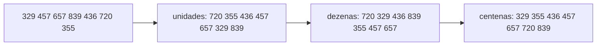

## Passo 1 · Leitura · Por que comparar custa pelo menos n log n

Merge sort, quick sort aleatorizado, Timsort: os melhores algoritmos que você viu ficam em $\Theta(n \log n)$. Não é falta de esperteza. **Todo** algoritmo que só descobre a ordem comparando pares de elementos precisa de $\Omega(n \log n)$ comparações no pior caso. A prova é curta.

Fixe um algoritmo de comparação e um $n$. Cada execução é uma sequência de perguntas "`a[i] <= a[j]`?", e a próxima pergunta depende das respostas anteriores. Desenhe todas as execuções possíveis como uma **árvore de decisão**: cada nó interno é uma comparação, com dois ramos (sim e não), e cada folha é uma resposta final, uma permutação que põe a entrada em ordem.

1. **A árvore precisa de pelo menos $n!$ folhas.** Para entradas com valores distintos, cada uma das $n!$ ordens iniciais exige uma permutação diferente para ser desfeita. Se duas ordens chegassem à mesma folha, o algoritmo erraria uma delas.
2. **Uma árvore binária de altura $h$ tem no máximo $2^h$ folhas.** A altura é o número de comparações do pior caso.

Juntando: $2^h \ge n!$, ou seja, $h \ge \log_2(n!)$. Falta ver que $\log_2(n!)$ cresce como $n \log n$. Metade dos fatores de $n!$ são pelo menos $n/2$, então $n! \ge (n/2)^{n/2}$, e

$$
h \;\ge\; \log_2(n!) \;\ge\; \frac{n}{2}\log_2 \frac{n}{2} \;=\; \Omega(n \log n).
$$

```python
import math

for n in [3, 10, 1000]:
    minimo = math.ceil(math.log2(math.factorial(n)))
    print(n, minimo)        # 3 3 | 10 22 | 1000 8530
```

Para 3 elementos, nenhum algoritmo de comparação garante a resposta com menos de 3 comparações; para 1000, com menos de 8530.

O limite vale para algoritmos de **comparação**. A saída é não comparar: se as chaves são inteiros num intervalo pequeno, o próprio valor da chave pode virar um **índice de lista**. Ler `cont[chave]` não é uma pergunta de sim ou não; é um acesso que escolhe entre $k$ posições de uma vez, e a árvore de decisão deixa de descrever o algoritmo. É o que fazem as ordenações desta lição.

## Passo 2 · Leitura · Counting sort estável

O **counting sort** ordena registros cuja chave é um inteiro entre `menor` e `maior`. Seja $k$ = `maior - menor + 1` o tamanho do intervalo. São três passagens:

1. **Contar.** `cont[c]` guarda quantos registros têm a chave `menor + c`. O deslocamento `- menor` é o que permite chaves negativas: a menor chave vai para o índice 0.
2. **Somar prefixos.** Faça `cont[c] += cont[c - 1]` da esquerda para a direita. Agora `cont[c]` é quantos registros têm chave **até** `menor + c`, ou seja, a posição logo **depois** do último lugar reservado para essa chave na saída.
3. **Posicionar de trás para frente.** Percorra a entrada do fim para o começo. Para cada registro, decremente `cont[c]` e ponha o registro em `saida[cont[c]]`.

Por que de trás para frente? O último registro com chave `c` na entrada ocupa a última vaga de `c`; o penúltimo, a penúltima; e assim por diante. Registros com chaves iguais saem na ordem em que entraram: o algoritmo é **estável**. Percorrendo do começo para o fim com o mesmo decremento, os iguais sairiam **invertidos**.

Cuidado com chaves negativas sem o deslocamento. `cont[-1]` não dá erro em Python: é o **último** elemento da lista. A chave $-1$ é contada como se fosse a maior, e a saída fica errada em silêncio.

Custo: as passagens 1 e 3 são $\Theta(n)$ e a passagem 2 é $\Theta(k)$. Total $\Theta(n + k)$ de tempo e $\Theta(n + k)$ de memória. Com $k = O(n)$, como $100\,000$ notas inteiras de 0 a 10, isso é linear. Com $k$ enorme, não: ordenar 10 números entre 0 e $10^9$ aloca uma lista de um bilhão de contadores. O counting sort só vale quando o intervalo das chaves é pequeno perto de $n$.

No visualizador, observe `cont` depois das somas de prefixo e as vagas sendo ocupadas de trás para frente.

```python visualizar
registros = [(2, "Ana"), (0, "Bia"), (2, "Caio"), (1, "Davi"), (0, "Eva")]
cont = [0] * 3
for chave, _ in registros:
    cont[chave] += 1
for c in range(1, 3):
    cont[c] += cont[c - 1]
saida = [None] * len(registros)
for registro in reversed(registros):
    cont[registro[0]] -= 1
    saida[cont[registro[0]]] = registro
print(saida)
```

## Passo 3 · Exercício · counting_sort com chaves negativas
modo: lacunas

Complete as lacunas (`___`) de `counting_sort(registros)`. Cada registro é uma tupla `(chave, valor)` com chave inteira, que pode ser negativa. A função devolve uma **lista nova** ordenada pela chave, de forma estável, sem `sorted()` nem `.sort()`, e sem alterar a recebida.

### Instruções
1. Crie um contador para cada chave possível entre a menor e a maior, inclusive as duas.
2. Conte cada chave deslocada pela menor, e some os prefixos.
3. Posicione os registros percorrendo a entrada de trás para frente.

### Código inicial
```python
def counting_sort(registros):
    if not registros:
        return []
    menor = min(chave for chave, _ in registros)
    maior = max(chave for chave, _ in registros)
    cont = [0] * (maior - menor + ___)
    for chave, _ in registros:
        cont[chave - ___] += 1
    for c in range(1, len(cont)):
        cont[c] += cont[___]
    saida = [None] * len(registros)
    for registro in ___(registros):
        c = registro[0] - menor
        cont[c] -= 1
        saida[cont[c]] = registro
    return saida
```

### Solução
```python
def counting_sort(registros):
    if not registros:
        return []
    menor = min(chave for chave, _ in registros)
    maior = max(chave for chave, _ in registros)
    cont = [0] * (maior - menor + 1)
    for chave, _ in registros:
        cont[chave - menor] += 1
    for c in range(1, len(cont)):
        cont[c] += cont[c - 1]
    saida = [None] * len(registros)
    for registro in reversed(registros):
        c = registro[0] - menor
        cont[c] -= 1
        saida[cont[c]] = registro
    return saida
```

### Dicas
1. De 2 a 5 há 4 chaves possíveis, não 3.
2. A soma de prefixo acumula o contador anterior.
3. Qual percurso faz o último registro de cada chave ocupar a última vaga dela?

### Verificação
```json
[
  { "id": "sem-sorted", "checkpoint": 2, "kind": "source", "rule": { "type": "not_calls", "name": "sorted" },
    "name": "Não usa sorted()" },
  { "id": "estavel", "checkpoint": 3, "kind": "call", "function": "counting_sort",
    "args": [[[3, "a"], [1, "b"], [3, "c"], [0, "d"], [1, "e"], [3, "f"]]],
    "expected": [[0, "d"], [1, "b"], [1, "e"], [3, "a"], [3, "c"], [3, "f"]],
    "name": "Ordena pela chave e mantém a ordem de chegada dos empates", "hint": "Percorrendo do começo, os empates saem invertidos." },
  { "id": "negativas", "checkpoint": 2, "kind": "call", "function": "counting_sort",
    "args": [[[2, "Ana"], [-3, "Bia"], [0, "Caio"], [-3, "Davi"], [2, "Eva"]]],
    "expected": [[-3, "Bia"], [-3, "Davi"], [0, "Caio"], [2, "Ana"], [2, "Eva"]],
    "name": "Chaves negativas", "hint": "cont[-3] não dá erro em Python: é a terceira posição a partir do fim. Desloque as chaves pela menor." },
  { "id": "chave-maxima", "checkpoint": 1, "kind": "call", "function": "counting_sort",
    "args": [[[5, "x"], [2, "y"], [4, "z"]]], "expected": [[2, "y"], [4, "z"], [5, "x"]],
    "name": "A maior chave também tem contador", "hint": "O intervalo inclui as duas pontas." },
  { "id": "todas-iguais", "checkpoint": 3, "kind": "call", "function": "counting_sort",
    "args": [[[7, "p"], [7, "q"], [7, "r"]]], "expected": [[7, "p"], [7, "q"], [7, "r"]],
    "name": "Todas as chaves iguais: a ordem não muda" },
  { "id": "bordas", "checkpoint": 1, "kind": "expr", "expr": "[counting_sort([]), counting_sort([(-1, 'só')])]",
    "expected": [[], [[-1, "só"]]], "name": "Listas com 0 e 1 registro" },
  { "id": "nao-altera", "checkpoint": 3, "kind": "expr", "setup": "v = [(1, 'b'), (0, 'a')]\nr = counting_sort(v)",
    "expr": "[r, v]", "expected": [[[0, "a"], [1, "b"]], [[1, "b"], [0, "a"]]], "name": "Devolve lista nova e não altera a recebida" }
]
```

### Soluções erradas
```python name="posiciona do começo para o fim e inverte os empates"
def counting_sort(registros):
    if not registros:
        return []
    menor = min(chave for chave, _ in registros)
    maior = max(chave for chave, _ in registros)
    cont = [0] * (maior - menor + 1)
    for chave, _ in registros:
        cont[chave - menor] += 1
    for c in range(1, len(cont)):
        cont[c] += cont[c - 1]
    saida = [None] * len(registros)
    for registro in registros:
        c = registro[0] - menor
        cont[c] -= 1
        saida[cont[c]] = registro
    return saida
```
```python name="sem deslocamento: chave negativa vira índice do fim"
def counting_sort(registros):
    if not registros:
        return []
    maior = max(chave for chave, _ in registros)
    cont = [0] * (maior + 1)
    for chave, _ in registros:
        cont[chave] += 1
    for c in range(1, len(cont)):
        cont[c] += cont[c - 1]
    saida = [None] * len(registros)
    for registro in reversed(registros):
        cont[registro[0]] -= 1
        saida[cont[registro[0]]] = registro
    return saida
```
```python name="um contador a menos"
def counting_sort(registros):
    if not registros:
        return []
    menor = min(chave for chave, _ in registros)
    maior = max(chave for chave, _ in registros)
    cont = [0] * (maior - menor)
    for chave, _ in registros:
        cont[chave - menor] += 1
    for c in range(1, len(cont)):
        cont[c] += cont[c - 1]
    saida = [None] * len(registros)
    for registro in reversed(registros):
        c = registro[0] - menor
        cont[c] -= 1
        saida[cont[c]] = registro
    return saida
```
```python name="esquece as somas de prefixo"
def counting_sort(registros):
    if not registros:
        return []
    menor = min(chave for chave, _ in registros)
    maior = max(chave for chave, _ in registros)
    cont = [0] * (maior - menor + 1)
    for chave, _ in registros:
        cont[chave - menor] += 1
    saida = [None] * len(registros)
    for registro in reversed(registros):
        c = registro[0] - menor
        cont[c] -= 1
        saida[cont[c]] = registro
    return saida
```

## Passo 4 · Leitura · Radix sort LSD e bucket sort

Para ordenar $100\,000$ números de até 9 dígitos, o counting sort direto precisaria de um bilhão de contadores. O **radix sort LSD** (*least significant digit*, dígito menos significativo) contorna isso: ordena **dígito por dígito**, das unidades para a casa mais alta, com uma ordenação **estável** em cada passagem. Cada passagem só tem 10 chaves possíveis, de 0 a 9.



A correção é um invariante, provado por indução: **depois da passagem pelo dígito $d$, a lista está ordenada pelos $d$ últimos dígitos.** Na passagem seguinte, dois números com dígitos diferentes na nova casa saem na ordem certa por causa dela. Dois números com o **mesmo** dígito, como 436 e 457 na casa das centenas, mantêm a ordem em que estavam, por estabilidade, e essa ordem já era a dos dígitos de baixo, pela hipótese. Sem estabilidade, a passagem das centenas poderia pôr 457 antes de 436 e desfazer o trabalho anterior.

Em Python, a ordenação estável de cada passagem cabe em 10 listas, os **baldes**: `append` preserva a ordem de chegada, e concatenar os baldes de 0 a 9 dá a passagem.

```python
def passagem(v, exp):
    baldes = [[] for _ in range(10)]
    for x in v:
        baldes[(x // exp) % 10].append(x)    # dígito da casa exp
    return [x for balde in baldes for x in balde]
```

Com $d$ dígitos na base $b$, o custo é $\Theta(d \cdot (n + b))$. Para inteiros de até 9 dígitos, são 9 passagens lineares. A quantidade de passagens sai do maior número: continue enquanto `maior // exp > 0`. O erro comum é `while exp < maior`, que para cedo quando o maior é uma potência de 10: com `maior = 100`, a casa das centenas nunca é processada.

O **bucket sort** é outra ordenação sem comparação global. Para $n$ números reais espalhados **uniformemente** em $[0, 1)$, crie $n$ baldes, ponha cada $x$ no balde $\lfloor n x \rfloor$, ordene cada balde (são pequenos) e concatene. O tempo **esperado** é $\Theta(n)$, mas ele depende da suposição: se todos os valores caírem no mesmo balde, o custo é o da ordenação usada dentro dele.

## Passo 5 · Exercício · Radix sort e CEPs

Escreva duas funções, sem `sorted()` nem `.sort()`:

- `radix_sort(lista)`: recebe inteiros **não negativos** e devolve uma lista nova, ordenada pelo radix sort LSD em base 10.
- `ordenar_ceps(ceps)`: recebe CEPs como **textos** de exatamente 8 dígitos, como `"05508090"`, e devolve uma lista nova de textos ordenados, com uma passagem estável por posição, da última (índice 7) para a primeira (índice 0). Os zeros à esquerda fazem parte do CEP.

### Instruções
1. Em `radix_sort`, faça passagens estáveis por casa decimal, das unidades para cima, enquanto houver dígito no maior número.
2. Em `ordenar_ceps`, faça uma passagem estável por posição do texto, da direita para a esquerda.
3. Nas duas, devolva uma lista nova sem alterar a recebida.

### Código inicial
```python
def radix_sort(lista):
    pass


def ordenar_ceps(ceps):
    pass
```

### Solução
```python
def radix_sort(lista):
    if not lista:
        return []
    v = list(lista)
    maior = max(v)
    exp = 1
    while maior // exp > 0:
        baldes = [[] for _ in range(10)]
        for x in v:
            baldes[(x // exp) % 10].append(x)
        v = [x for balde in baldes for x in balde]
        exp *= 10
    return v


def ordenar_ceps(ceps):
    v = list(ceps)
    for pos in range(7, -1, -1):
        baldes = [[] for _ in range(10)]
        for cep in v:
            baldes[int(cep[pos])].append(cep)
        v = [cep for balde in baldes for cep in balde]
    return v
```

### Dicas
1. O dígito da casa `exp` (1, 10, 100...) de `x` é `(x // exp) % 10`.
2. Se o maior número é 100, ainda há um dígito na casa das centenas.
3. Converter o CEP para `int` perde os zeros à esquerda: trate cada posição do texto.

### Verificação
```json
[
  { "id": "sem-sorted", "checkpoint": 1, "kind": "source", "rule": { "type": "not_calls", "name": "sorted" },
    "name": "Não usa sorted()" },
  { "id": "sem-sort", "checkpoint": 1, "kind": "source", "rule": { "type": "not_calls", "name": "sort" },
    "name": "Não usa .sort()" },
  { "id": "radix-misturada", "checkpoint": 1, "kind": "call", "function": "radix_sort", "args": [[170, 45, 75, 90, 802, 24, 2, 66]],
    "expected": [2, 24, 45, 66, 75, 90, 170, 802], "name": "Números com quantidades diferentes de dígitos" },
  { "id": "radix-potencia-10", "checkpoint": 1, "kind": "call", "function": "radix_sort", "args": [[100, 5, 10, 99]],
    "expected": [5, 10, 99, 100], "name": "O maior número é uma potência de 10", "hint": "Com maior = 100, a casa das centenas ainda precisa de uma passagem." },
  { "id": "radix-bordas", "checkpoint": 3, "kind": "expr", "expr": "[radix_sort([]), radix_sort([0, 0, 0]), radix_sort([7])]",
    "expected": [[], [0, 0, 0], [7]], "name": "Lista vazia, só zeros e um elemento" },
  { "id": "radix-grande", "checkpoint": 1, "kind": "expr",
    "setup": "v = [(i * 104729) % 1000000000 for i in range(20000)]\nr = radix_sort(v)",
    "expr": "[len(r), r == sorted(v)]", "expected": [20000, true], "name": "20000 inteiros de até 9 dígitos",
    "hint": "Cada passagem precisa ser estável: o balde preserva a ordem de chegada." },
  { "id": "radix-nao-altera", "checkpoint": 3, "kind": "expr", "setup": "v = [30, 1, 20]\nr = radix_sort(v)",
    "expr": "[r, v]", "expected": [[1, 20, 30], [30, 1, 20]], "name": "radix_sort não altera a lista recebida" },
  { "id": "ceps", "checkpoint": 2, "kind": "call", "function": "ordenar_ceps",
    "args": [["05508090", "01310100", "13566590", "05508000", "01310000", "80010000"]],
    "expected": ["01310000", "01310100", "05508000", "05508090", "13566590", "80010000"],
    "name": "Ordena CEPs com zeros à esquerda", "hint": "As passagens vão da última posição para a primeira." },
  { "id": "ceps-texto", "checkpoint": 2, "kind": "expr", "expr": "[type(c).__name__ for c in ordenar_ceps(['09000000', '01000000'])]",
    "expected": ["str", "str"], "name": "ordenar_ceps devolve textos, com os zeros à esquerda", "hint": "Não converta o CEP inteiro para int." },
  { "id": "ceps-vazia", "checkpoint": 2, "kind": "call", "function": "ordenar_ceps", "args": [[]], "expected": [],
    "name": "ordenar_ceps([]) é []" }
]
```

### Soluções erradas
```python name="while exp < maior para cedo"
def radix_sort(lista):
    if not lista:
        return []
    v = list(lista)
    maior = max(v)
    exp = 1
    while exp < maior:
        baldes = [[] for _ in range(10)]
        for x in v:
            baldes[(x // exp) % 10].append(x)
        v = [x for balde in baldes for x in balde]
        exp *= 10
    return v


def ordenar_ceps(ceps):
    v = list(ceps)
    for pos in range(7, -1, -1):
        baldes = [[] for _ in range(10)]
        for cep in v:
            baldes[int(cep[pos])].append(cep)
        v = [cep for balde in baldes for cep in balde]
    return v
```
```python name="balde que insere no começo não é estável"
def radix_sort(lista):
    if not lista:
        return []
    v = list(lista)
    maior = max(v)
    exp = 1
    while maior // exp > 0:
        baldes = [[] for _ in range(10)]
        for x in v:
            baldes[(x // exp) % 10].insert(0, x)
        v = [x for balde in baldes for x in balde]
        exp *= 10
    return v


def ordenar_ceps(ceps):
    v = list(ceps)
    for pos in range(7, -1, -1):
        baldes = [[] for _ in range(10)]
        for cep in v:
            baldes[int(cep[pos])].append(cep)
        v = [cep for balde in baldes for cep in balde]
    return v
```
```python name="CEPs da primeira posição para a última"
def radix_sort(lista):
    if not lista:
        return []
    v = list(lista)
    maior = max(v)
    exp = 1
    while maior // exp > 0:
        baldes = [[] for _ in range(10)]
        for x in v:
            baldes[(x // exp) % 10].append(x)
        v = [x for balde in baldes for x in balde]
        exp *= 10
    return v


def ordenar_ceps(ceps):
    v = list(ceps)
    for pos in range(8):
        baldes = [[] for _ in range(10)]
        for cep in v:
            baldes[int(cep[pos])].append(cep)
        v = [cep for balde in baldes for cep in balde]
    return v
```
```python name="converte o CEP para int e perde os zeros"
def radix_sort(lista):
    if not lista:
        return []
    v = list(lista)
    maior = max(v)
    exp = 1
    while maior // exp > 0:
        baldes = [[] for _ in range(10)]
        for x in v:
            baldes[(x // exp) % 10].append(x)
        v = [x for balde in baldes for x in balde]
        exp *= 10
    return v


def ordenar_ceps(ceps):
    return [str(c) for c in radix_sort([int(c) for c in ceps])]
```

## Passo 6 · Quiz · Quando ordenar sem comparar

### Pergunta
Um colega diz: "o radix sort ordena inteiros de 9 dígitos em tempo linear, então o limite $\Omega(n \log n)$ está errado". O que responder?
- [ ] Ele tem razão: o limite só vale para listas pequenas
- [x] O limite vale para algoritmos que só comparam pares; o radix sort usa os dígitos como índices de baldes, o que a árvore de decisão não descreve
- [ ] O radix sort também faz $\Omega(n \log n)$ comparações, só que escondidas na concatenação dos baldes
- [ ] O limite vale só no caso médio; no pior caso, qualquer algoritmo pode ser linear
> A prova conta folhas de uma árvore em que cada nó é uma pergunta de sim ou não. `baldes[digito]` escolhe entre 10 destinos num acesso só; o radix sort não é um algoritmo de comparação, e o limite não se aplica a ele.

### Pergunta
No radix sort LSD, a passagem de cada dígito usa uma ordenação que **não** é estável. O que acontece?
- [ ] Nada: a última passagem, pelo dígito mais alto, decide a ordem sozinha
- [ ] Só os números repetidos ficam fora de ordem
- [x] A saída pode sair errada: números com o mesmo dígito na casa atual podem trocar de lugar e desfazer a ordem dos dígitos de baixo
- [ ] O algoritmo fica mais lento, mas continua correto
> O invariante "ordenado pelos $d$ últimos dígitos" depende da estabilidade: nos empates do dígito atual, a ordem precisa ser a deixada pelas passagens anteriores. Sem isso, 457 pode passar à frente de 436 na passagem das centenas.

### Pergunta
Qual destas tarefas é um bom caso para o counting sort?
- [x] Ordenar $500\,000$ respostas de uma pesquisa com notas inteiras de 1 a 5, mantendo a ordem de chegada nos empates
- [ ] Ordenar 20 números inteiros entre 0 e $10^{12}$
- [ ] Ordenar $10\,000$ nomes de alunos em ordem alfabética
- [ ] Ordenar $10^6$ números reais entre 0 e 1 com muitas casas decimais
> O custo é $\Theta(n + k)$: com $k = 5$ e $n = 500\,000$, é linear e estável. Com $k = 10^{12}$, a lista de contadores não cabe na memória. Nomes não são inteiros pequenos, e reais não servem como índice; para reais uniformes em $[0, 1)$, o bucket sort é a opção.
