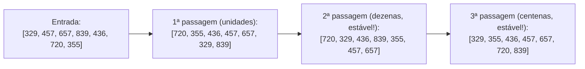

## Passo 1 · Leitura · O limite $\Omega(n \log n)$ por comparação e o Counting Sort estável

Por que nenhum algoritmo de ordenação baseado **apenas em comparações** entre elementos (`a <= b`) consegue ser mais rápido que $\Omega(n \log n)$ no pior caso?

Imagine uma **árvore de decisão** onde cada nó interno é uma comparação `x <= y` (2 ramos: Sim ou Não) e cada folha é uma das **$n!$ permutações possíveis** da entrada. Para conseguir distinguir todas as $n!$ ordens possíveis, uma árvore binária de altura $h$ precisa ter pelo menos $n!$ folhas ($2^h \ge n!$). Pela aproximação de Stirling:

$$
h \ge \log_2(n!) \approx n \log_2 n - 1{,}44n \implies h = \Omega(n \log n)
$$

Como escapar desse limite? **Não comparando elementos entre si**, mas usando o próprio valor inteiro da chave como **índice direto em um vetor de contadores**!

#### Counting Sort estável em $\Theta(n + k)$

Suponha que queremos ordenar $n$ registros `(chave, valor)` onde cada `chave` é um inteiro no intervalo $[0, k]$:
1. **Contagem (histograma):** criamos `cont = [0] * (k + 1)` e contamos quantas vezes cada chave aparece.
2. **Soma de prefixos (posições acumuladas):** fazemos `cont[c] += cont[c - 1]` para `c` de `1` até `k`. Agora, `cont[c]` indica quantos elementos têm chave $\le c$ (ou seja, a posição final logo após o último elemento de chave `c`).
3. **Posicionamento estável (de trás para frente!):** criamos `saida = [None] * n` e percorremos a lista original **do fim para o início** (`for item in reversed(lista):`). Para cada `item` de chave `c`, decrementamos `cont[c] -= 1` e colocamos `saida[cont[c]] = item`.

Por que percorrer **de trás para frente**? Porque como `cont[c]` começa na última vaga disponível para a chave `c` e vai recuando (`cont[c] -= 1`), o último elemento de chave `c` da entrada ocupa a última vaga de `c` na saída, preservando a **estabilidade**!

> **Quando usar (e quando NÃO usar):** o Counting Sort custa $\Theta(n + k)$ em tempo e memória. Se $k = O(n)$ (ex.: ordenar $100\,000$ notas inteiras de $0$ a $100$), ele é $\Theta(n)$! Mas se $n = 10$ e uma das chaves for $k = 10^9$, alocar `[0] * (10**9 + 1)` estoura a memória!

## Passo 2 · Exercício · Histograma de notas e Counting Sort estável

Implemente duas funções (**sem usar `sorted()` nem `.sort()`**):
1. `histograma_de_notas(notas)`: recebe uma lista de notas inteiras no intervalo `[0, 10]` e devolve uma lista de tamanho `11` onde a posição `i` contém quantas vezes a nota `i` apareceu.
2. `counting_sort(registros, k)`: recebe uma lista de tuplas `(chave, valor)` onde `0 <= chave <= k` e devolve uma nova lista ordenada de forma **estável** pela `chave`, usando o algoritmo Counting Sort em tempo $O(n + k)$.

### Instruções
1. Em `histograma_de_notas(notas)`, crie `freq = [0] * 11`, percorra `notas` incrementando `freq[nota] += 1` e devolva `freq`.
2. Em `counting_sort(registros, k)`, se `not registros` devolva `[]`. Crie `cont = [0] * (k + 1)` (cuidado com o `+ 1` para incluir a chave `k`!), conte as frequências de `item[0]`, acumule as somas de prefixo (`for c in range(1, k + 1): cont[c] += cont[c - 1]`) e preencha `saida = [None] * len(registros)` percorrendo `reversed(registros)`.

### Código inicial
```python
def histograma_de_notas(notas):
    # Devolva uma lista de 11 posições com a frequência de cada nota de 0 a 10
    pass


def counting_sort(registros, k):
    # Ordene registros (chave, valor) de forma estável em O(n + k) sem usar sorted/sort
    pass
```

### Solução
```python
def histograma_de_notas(notas):
    freq = [0] * 11
    for nota in notas:
        freq[nota] += 1
    return freq


def counting_sort(registros, k):
    n = len(registros)
    if n == 0:
        return []
    cont = [0] * (k + 1)
    for chave, _ in registros:
        cont[chave] += 1
    for c in range(1, k + 1):
        cont[c] += cont[c - 1]
    saida = [None] * n
    for item in reversed(registros):
        chave = item[0]
        cont[chave] -= 1
        saida[cont[chave]] = item
    return saida
```

### Dicas
1. Também é possível implementar o Counting Sort estável com uma lista de listas (baldes): `baldes = [[] for _ in range(k + 1)]`, fazendo `baldes[chave].append(item)` na ordem normal e depois concatenando todos os baldes! Ambas as abordagens têm tempo e espaço $\Theta(n + k)$ e são estáveis.
2. Não se esqueça de alocar `k + 1` posições para que a chave máxima `k` não levante `IndexError`.

### Verificação
```json
[
  {
    "id": "sem-sorted",
    "checkpoint": 2,
    "kind": "source",
    "rule": { "type": "not_calls", "name": "sorted" },
    "name": "Não usa sorted()"
  },
  {
    "id": "sem-sort",
    "checkpoint": 2,
    "kind": "source",
    "rule": { "type": "not_calls", "name": "sort" },
    "name": "Não usa .sort()"
  },
  {
    "id": "histograma-teste",
    "checkpoint": 1,
    "kind": "call",
    "function": "histograma_de_notas",
    "args": [[10, 7, 8, 10, 0, 7, 10]],
    "expected": [1, 0, 0, 0, 0, 0, 0, 2, 1, 0, 3],
    "name": "histograma_de_notas conta frequências de 0 a 10 corretamente"
  },
  {
    "id": "counting-sort-estavel",
    "checkpoint": 2,
    "kind": "call",
    "function": "counting_sort",
    "args": [[[3, "a"], [1, "b"], [3, "c"], [0, "d"], [1, "e"], [3, "f"]], 3],
    "expected": [[0, "d"], [1, "b"], [1, "e"], [3, "a"], [3, "c"], [3, "f"]],
    "name": "counting_sort ordena e preserva a ordem relativa de chaves iguais (estabilidade)"
  }
]
```

### Soluções erradas
```python name="percorre de frente para trás ao decrementar cont e inverte a ordem de iguais"
def histograma_de_notas(notas):
    freq = [0] * 11
    for nota in notas:
        freq[nota] += 1
    return freq


def counting_sort(registros, k):
    n = len(registros)
    cont = [0] * (k + 1)
    for chave, _ in registros:
        cont[chave] += 1
    for c in range(1, k + 1):
        cont[c] += cont[c - 1]
    saida = [None] * n
    for item in registros:
        chave = item[0]
        cont[chave] -= 1
        saida[cont[chave]] = item
    return saida
```
```python name="aloca k posições em vez de k + 1 e falha quando chave == k"
def histograma_de_notas(notas):
    return [0] * 11


def counting_sort(registros, k):
    baldes = [[] for _ in range(k)]
    for item in registros:
        baldes[item[0]].append(item)
    return [x for b in baldes for x in b]
```

## Passo 3 · Leitura · Radix Sort LSD: ordenando números grandes dígito a dígito

E se precisarmos ordenar $n = 100\,000$ números que vão até $10^9$ (ou CPFs de 11 dígitos, ou CEPs de 8 dígitos)?
O Counting Sort direto é inviável porque $k = 10^9$. Mas entra em cena o **Radix Sort LSD (*Least Significant Digit*)**:

Em vez de ordenar pelo número inteiro de uma vez, ordenamos os números **dígito por dígito, do menos significativo (unidades) para o mais significativo**, usando um **Counting Sort estável** de base $10$ ($k = 9$, apenas 10 baldes de `0` a `9`!) em cada passagem!



Por que é obrigatório começar pelo dígito **menos significativo** e usar uma ordenação **estável** em cada dígito?
Porque quando empatamos na casa das centenas (ex.: `436` e `457`, ambos com centena `4`), a **estabilidade** preserva a ordem em que eles já estavam da passagem anterior — que era a ordem correta das dezenas e unidades (`36 < 57`)!

Com $d$ dígitos na base $b$, o Radix Sort executa $d$ passagens de custo $\Theta(n + b)$, totalizando **$\Theta(d \cdot (n + b))$**. Para CEPs de 8 dígitos ($d = 8, b = 10$), ele ordena qualquer lista em exatamente 8 passagens lineares!

Veja o Radix Sort LSD em ação no visualizador:

```python visualizar
def radix_sort(lista):
    if not lista:
        return []
    v = list(lista)
    maior = max(v)
    exp = 1
    while maior // exp > 0:
        baldes = [[] for _ in range(10)]
        for num in v:
            digito = (num // exp) % 10
            baldes[digito].append(num)
        v = [num for balde in baldes for num in balde]
        exp *= 10
    return v

print(radix_sort([329, 457, 657, 839, 436, 720, 355]))
```

## Passo 4 · Exercício · Radix Sort LSD para inteiros e ordenação de CEPs

Implemente duas funções (**sem usar `sorted()` nem `.sort()`**):
1. `radix_sort(lista)`: ordena uma lista de inteiros não negativos (até $10^9$) usando Radix Sort LSD em base 10 (ou base 256) e devolve a nova lista ordenada. Deve ordenar $20\,000$ números rapidamente.
2. `ordenar_ceps(ceps)`: recebe uma lista de strings de CEPs de exatamente 8 dígitos numéricos (ex.: `["05508090", "01310100", "05508000"]`) e devolve uma nova lista ordenada aplicando Counting Sort estável dígito a dígito, da última posição (`pos = 7`) até a primeira (`pos = 0`).

### Instruções
1. Em `radix_sort(lista)`, se `not lista` devolva `[]`. Enquanto `maior // exp > 0` (começando em `exp = 1` e multiplicando `exp *= 10`), distribua cada número `num` no balde `(num // exp) % 10` e reconstrua a lista concatenando os 10 baldes em ordem.
2. Em `ordenar_ceps(ceps)`, percorra `pos` de `7` até `0` (`range(7, -1, -1)`): em cada posição, distribua cada string `cep` em 10 baldes segundo `int(cep[pos])` e reconstrua a lista concatenando os baldes.

### Código inicial
```python
def radix_sort(lista):
    # Ordene inteiros não negativos usando Radix Sort LSD (sem sorted/sort)
    pass


def ordenar_ceps(ceps):
    # Ordene strings de 8 dígitos ("05508090") dígito a dígito da direita para a esquerda
    pass
```

### Solução
```python
def radix_sort(lista):
    if not lista:
        return []
    v = list(lista)
    maior = max(v)
    exp = 1
    while maior // exp > 0:
        baldes = [[] for _ in range(10)]
        for num in v:
            digito = (num // exp) % 10
            baldes[digito].append(num)
        v = [num for balde in baldes for num in balde]
        exp *= 10
    return v


def ordenar_ceps(ceps):
    v = list(ceps)
    for pos in range(7, -1, -1):
        baldes = [[] for _ in range(10)]
        for cep in v:
            baldes[int(cep[pos])].append(cep)
        v = [cep for balde in baldes for cep in balde]
    return v
```

### Dicas
1. Para extrair o dígito da casa `exp` ($1, 10, 100, \dots$) de um inteiro `num`, use `(num // exp) % 10`.
2. Em `ordenar_ceps`, percorrer `pos` de `7` até `0` garante que o dígito mais significativo (`pos = 0`, à esquerda) seja processado por último, decidindo a ordem final com desempate estável dos dígitos anteriores!

### Verificação
```json
[
  {
    "id": "sem-sorted",
    "checkpoint": 1,
    "kind": "source",
    "rule": { "type": "not_calls", "name": "sorted" },
    "name": "Não usa sorted()"
  },
  {
    "id": "sem-sort",
    "checkpoint": 1,
    "kind": "source",
    "rule": { "type": "not_calls", "name": "sort" },
    "name": "Não usa .sort()"
  },
  {
    "id": "radix-casos",
    "checkpoint": 1,
    "kind": "expr",
    "expr": "[radix_sort([]), radix_sort([0, 0, 0]), radix_sort([170, 45, 75, 90, 802, 24, 2, 66])]",
    "expected": [[], [0, 0, 0], [2, 24, 45, 66, 75, 90, 170, 802]],
    "name": "radix_sort ordena lista vazia, zeros e números com quantidades diferentes de dígitos"
  },
  {
    "id": "radix-20k-grandes",
    "checkpoint": 1,
    "kind": "expr",
    "setup": "v = [(i * 104729) % 1000000000 for i in range(20000)]\nr = radix_sort(v)",
    "expr": "[len(r), r[0], all(r[i] <= r[i+1] for i in range(len(r)-1))]",
    "expected": [20000, 0, true],
    "name": "radix_sort ordena 20.000 inteiros de até 9 dígitos rapidamente"
  },
  {
    "id": "ceps-teste",
    "checkpoint": 2,
    "kind": "call",
    "function": "ordenar_ceps",
    "args": [["05508090", "01310100", "05508000", "01310000", "13566590"]],
    "expected": ["01310000", "01310100", "05508000", "05508090", "13566590"],
    "name": "ordenar_ceps ordena CEPs de 8 dígitos corretamente"
  }
]
```

### Soluções erradas
```python name="processa dígitos do mais significativo para o menos significativo no Radix Sort"
def radix_sort(lista):
    if not lista:
        return []
    v = list(lista)
    exp = 1000
    while exp >= 1:
        baldes = [[] for _ in range(10)]
        for num in v:
            baldes[(num // exp) % 10].append(num)
        v = [num for b in baldes for num in b]
        exp //= 10
    return v


def ordenar_ceps(ceps):
    v = list(ceps)
    for pos in range(8):
        baldes = [[] for _ in range(10)]
        for cep in v:
            baldes[int(cep[pos])].append(cep)
        v = [cep for b in baldes for cep in b]
    return v
```
```python name="ordena apenas pelo último dígito e para"
def radix_sort(lista):
    if not lista:
        return []
    baldes = [[] for _ in range(10)]
    for num in lista:
        baldes[num % 10].append(num)
    return [num for b in baldes for num in b]


def ordenar_ceps(ceps):
    return list(ceps)
```

## Passo 5 · Quiz · Quando as ordenações lineares vencem (e quando falham)

### Pergunta
Por que o Counting Sort e o Radix Sort conseguem ordenar em tempo linear $O(n)$ (quando $k = O(n)$ e $d$ é constante), aparentando "quebrar" o limite inferior teórico $\Omega(n \log n)$ da ordenação?
- [ ] Porque o limite $\Omega(n \log n)$ estava matematicamente errado.
- [x] Porque o limite $\Omega(n \log n)$ aplica-se exclusivamente a algoritmos **baseados em comparações** (onde cada decisão tem apenas 2 saídas: $\le$ ou $>$). O Counting Sort usa o valor da chave como índice de array ($k$ saídas simultâneas em $O(1)$), explorando a estrutura interna dos inteiros sem compará-los entre si.
- [ ] Porque eles usam recursão de cauda.
- [ ] Porque eles só funcionam para listas já ordenadas.
> Na árvore de decisão de um algoritmo por comparação, cada passo ramifica em 2 ($\log_2(n!) = \Omega(n \log n)$). Já indexar um vetor de $k$ posições a partir do valor inteiro da chave não é uma comparação binária!

### Pergunta
O que acontece no **Radix Sort LSD** se o algoritmo usado para ordenar cada dígito individual **não for estável**?
- [ ] O algoritmo continua funcionando perfeitamente, apenas um pouco mais lento.
- [x] O algoritmo produz uma saída **incorreta**, pois ao ordenar pelo dígito mais significativo (ex.: centenas), elementos com a mesma centena (`457` e `436`) podem trocar de posição entre si, destruindo a ordenação das dezenas e unidades conquistada nas passagens anteriores!
- [ ] Apenas elementos duplicados ficam fora de ordem.
- [ ] O algoritmo levanta `ValueError`.
> A corretude do Radix Sort LSD depende crucialmente da **estabilidade** de cada passagem: quando dois números empatam no dígito atual, eles precisam manter a ordem relativa determinada pelos dígitos menos significativos já processados.
