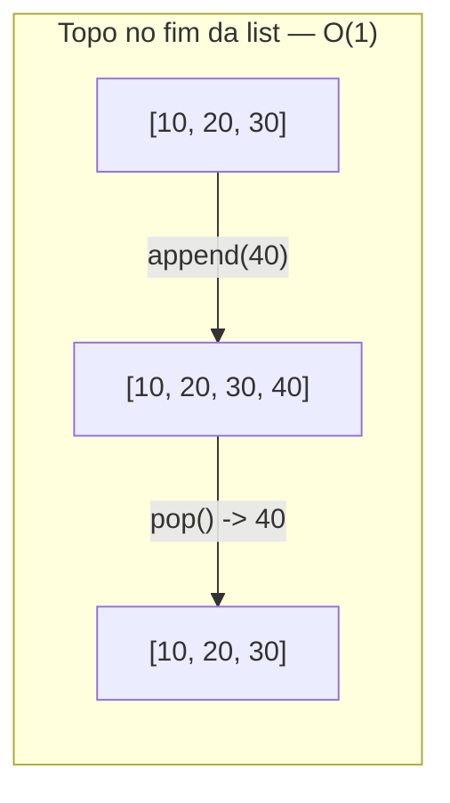

## Passo 1 · Leitura · Pilhas (LIFO) em $O(1)$ e balanceamento de delimitadores

Uma **pilha** (*stack*) é uma estrutura de dados linear regida pela disciplina **LIFO** (*Last-In, First-Out* — o último a entrar é o primeiro a sair). Pense em uma pilha de pratos ou na pilha de quadros de execução (*call stack*) do próprio interpretador Python: você sempre coloca um novo prato no **topo** e retira apenas o prato que está no **topo**.

#### Por que o topo da pilha em Python deve ser o final da `list`?

Como vimos no Módulo 2, a `list` do Python é um **vetor dinâmico** contíguo na memória:
- Inserir ou remover no **final** (`dados.append(x)` e `dados.pop()`) tem custo **$O(1)$ amortizado**, pois não desloca nenhum outro elemento.
- Inserir ou remover no **início** (`dados.insert(0, x)` e `dados.pop(0)`) tem custo **$O(n)$**, pois precisa deslocar todos os $n - 1$ elementos restantes na memória. Empilhar e desempilhar $n$ itens usando o índice `0` degrada um algoritmo linear $O(n)$ para quadrático $O(n^2)$!



#### Aplicação clássica: balanceamento de delimitadores `()[]{}`

Compiladores e editores de código verificam se parênteses `()`, colchetes `[]` e chaves `{}` estão balanceados percorrendo o texto da esquerda para a direita com uma pilha:
1. Ao encontrar um delimitador de **abertura** (`(`, `[`, `{`), **empilhamos** esse caractere.
2. Ao encontrar um delimitador de **fechamento** (`)`, `]`, `}`):
   - Se a pilha estiver **vazia**, fechamos algo que nunca abriu $\to$ **desbalanceado** (`False`).
   - Desempilhamos o topo e verificamos se ele forma o par correspondente (ex.: `(` com `)`). Se não corresponder (como em `([)]`), a ordem de aninhamento foi violada $\to$ **desbalanceado** (`False`).
3. Ao terminar o texto, a expressão só é válida se a pilha estiver **completamente vazia** (caso contrário, sobraram delimitadores abertos sem fechamento, como em `(()`).

Veja no visualizador como a pilha rastreia o aninhamento em `"{[()()]}"`:

```python visualizar
pares = {")": "(", "]": "[", "}": "{"}
aberturas = set("([{")

def verificar_expressao(texto):
    pilha = []
    for ch in texto:
        if ch in aberturas:
            pilha.append(ch)
        elif ch in pares:
            if not pilha or pilha[-1] != pares[ch]:
                return False
            pilha.pop()
    return len(pilha) == 0

ok_1 = verificar_expressao("{[()()]}")
ok_2 = verificar_expressao("([)]")
print("'{[()()]}' ->", ok_1)
print("'([)]' ->", ok_2)
```

## Passo 2 · Exercício · Classe `Pilha` e verificação de delimitadores

modo: lacunas

Complete a implementação da classe `Pilha` sobre uma `list` com operações em $O(1)$ e da função `balanceado(texto)` para validar expressões contendo `()`, `[]` e `{}` (ignorando quaisquer outros caracteres como letras, números e operadores).

### Instruções

1. Na classe `Pilha`, implemente `empilhar(valor)` adicionando no fim de `self._dados`, `desempilhar()` removendo e devolvendo o topo (ou lançando `IndexError` se a pilha estiver vazia) e `topo()` devolvendo o elemento do topo sem removê-lo (também lançando `IndexError` se vazia).
2. Implemente `balanceado(texto: str) -> bool` usando uma pilha para verificar se todos os delimitadores `()`, `[]` e `{}` abrem e fecham na ordem correta e se não restam aberturas pendentes no final.

### Código inicial

```python
class Pilha:
    def __init__(self):
        self._dados = []

    def empilhar(self, valor):
        self._dados.___(valor)

    def desempilhar(self):
        if self.vazia():
            raise IndexError("pilha vazia")
        return self._dados.___()

    def topo(self):
        if self.vazia():
            raise IndexError("pilha vazia")
        return self._dados[___]

    def vazia(self) -> bool:
        return len(self._dados) == 0

    def __len__(self) -> int:
        return len(self._dados)


def balanceado(texto: str) -> bool:
    pares = {")": "(", "]": "[", "}": "{"}
    aberturas = set("([{")
    pilha = []
    for ch in texto:
        if ch in aberturas:
            pilha.append(ch)
        elif ch in pares:
            if not pilha or pilha.pop() != ___:
                return False
    return ___
```

### Solução

```python
class Pilha:
    def __init__(self):
        self._dados = []

    def empilhar(self, valor):
        self._dados.append(valor)

    def desempilhar(self):
        if self.vazia():
            raise IndexError("pilha vazia")
        return self._dados.pop()

    def topo(self):
        if self.vazia():
            raise IndexError("pilha vazia")
        return self._dados[-1]

    def vazia(self) -> bool:
        return len(self._dados) == 0

    def __len__(self) -> int:
        return len(self._dados)


def balanceado(texto: str) -> bool:
    pares = {")": "(", "]": "[", "}": "{"}
    aberturas = set("([{")
    pilha = []
    for ch in texto:
        if ch in aberturas:
            pilha.append(ch)
        elif ch in pares:
            if not pilha or pilha.pop() != pares[ch]:
                return False
    return len(pilha) == 0
```

### Dicas

1. Para manter operações em $O(1)$, use `append(valor)` para empilhar, `pop()` (sem argumentos) para desempilhar e o índice `[-1]` para espiar o topo.
2. Em `balanceado`, quando encontramos um fechamento `ch`, o topo desempilhado `pilha.pop()` deve ser igual a `pares[ch]`.
3. Ao fim do laço `for`, todos os delimitadores abertos devem ter sido fechados, isto é, `len(pilha) == 0` (ou `not pilha`).

### Verificação

```json
[
  {
    "id": "pilha-lifo-operacoes",
    "name": "Operações LIFO de empilhar, topo, desempilhar e vazia",
    "checkpoint": 1,
    "kind": "expr",
    "setup": "p = Pilha()\np.empilhar(10)\np.empilhar(20)\np.empilhar(30)\nt1 = p.topo()\nd1 = p.desempilhar()\nd2 = p.desempilhar()\ntam = len(p)",
    "expr": "(t1, d1, d2, tam, p.vazia(), p.desempilhar(), p.vazia())",
    "expected": [30, 30, 20, 1, false, 10, true]
  },
  {
    "id": "pilha-vazia-excecao",
    "name": "Desempilhar de pilha vazia lança IndexError",
    "checkpoint": 1,
    "kind": "expr",
    "setup": "p = Pilha()",
    "expr": "p.desempilhar()",
    "raises": "IndexError"
  },
  {
    "id": "topo-vazia-excecao",
    "name": "Consultar topo de pilha vazia lança IndexError",
    "checkpoint": 1,
    "kind": "expr",
    "setup": "p = Pilha()",
    "expr": "p.topo()",
    "raises": "IndexError"
  },
  {
    "id": "balanceado-validos",
    "name": "Delimitadores corretamente aninhados",
    "checkpoint": 2,
    "kind": "expr",
    "expr": "[balanceado(''), balanceado('a + (b * [c - {d}])'), balanceado('()[]{}'), balanceado('{[()()] }')]",
    "expected": [true, true, true, true]
  },
  {
    "id": "balanceado-invalidos",
    "name": "Ordem cruzada, fechamento sem abertura e abertura sem fechamento",
    "checkpoint": 2,
    "kind": "expr",
    "expr": "[balanceado(')('), balanceado('([)]'), balanceado('((()'), balanceado('()]')]",
    "expected": [false, false, false, false]
  }
]
```

### Soluções erradas

```python name="Usa pop(0) como FIFO em vez de LIFO na Pilha"
class Pilha:
    def __init__(self):
        self._dados = []

    def empilhar(self, valor):
        self._dados.append(valor)

    def desempilhar(self):
        if self.vazia():
            raise IndexError("pilha vazia")
        return self._dados.pop(0)

    def topo(self):
        if self.vazia():
            raise IndexError("pilha vazia")
        return self._dados[0]

    def vazia(self) -> bool:
        return len(self._dados) == 0

    def __len__(self) -> int:
        return len(self._dados)


def balanceado(texto: str) -> bool:
    pares = {")": "(", "]": "[", "}": "{"}
    aberturas = set("([{")
    pilha = []
    for ch in texto:
        if ch in aberturas:
            pilha.append(ch)
        elif ch in pares:
            if not pilha or pilha.pop() != pares[ch]:
                return False
    return len(pilha) == 0
```

```python name="Checa apenas contagem de aberturas e fechamentos sem validar a ordem"
class Pilha:
    def __init__(self):
        self._dados = []

    def empilhar(self, valor):
        self._dados.append(valor)

    def desempilhar(self):
        if self.vazia():
            raise IndexError("pilha vazia")
        return self._dados.pop()

    def topo(self):
        if self.vazia():
            raise IndexError("pilha vazia")
        return self._dados[-1]

    def vazia(self) -> bool:
        return len(self._dados) == 0

    def __len__(self) -> int:
        return len(self._dados)


def balanceado(texto: str) -> bool:
    return (
        texto.count("(") == texto.count(")")
        and texto.count("[") == texto.count("]")
        and texto.count("{") == texto.count("}")
    )
```

```python name="Esquece de verificar se a pilha ficou vazia ao final de balanceado"
class Pilha:
    def __init__(self):
        self._dados = []

    def empilhar(self, valor):
        self._dados.append(valor)

    def desempilhar(self):
        if self.vazia():
            raise IndexError("pilha vazia")
        return self._dados.pop()

    def topo(self):
        if self.vazia():
            raise IndexError("pilha vazia")
        return self._dados[-1]

    def vazia(self) -> bool:
        return len(self._dados) == 0

    def __len__(self) -> int:
        return len(self._dados)


def balanceado(texto: str) -> bool:
    pares = {")": "(", "]": "[", "}": "{"}
    aberturas = set("([{")
    pilha = []
    for ch in texto:
        if ch in aberturas:
            pilha.append(ch)
        elif ch in pares:
            if not pilha or pilha.pop() != pares[ch]:
                return False
    return True
```

## Passo 3 · Leitura · Notação Polonesa Reversa (RPN), *Shunting-Yard* e desfazer/refazer

#### 1. Avaliando expressões em Notação Polonesa Reversa (posfixa)

Na notação **infixa** tradicional, como `(3 + 4) * 2`, precisamos de parênteses e regras de precedência para saber qual operação executar primeiro. Já na **Notação Polonesa Reversa** (RPN ou **posfixa**), cada operador vem **imediatamente após** seus operandos: `3 4 + 2 *`. A grande vantagem é que a RPN **não precisa de parênteses** e pode ser avaliada em uma única passagem da esquerda para a direita com uma pilha:
- Se o token for um **número**, convertemos para `float` e **empilhamos**.
- Se o token for um **operador** (`+`, `-`, `*`, `/`, `^`):
  1. Desempilhamos o **operando direito** (`b = pilha.pop()`).
  2. Desempilhamos o **operando esquerdo** (`a = pilha.pop()`).
  3. Empilhamos o resultado de `a op b`.

> **Atenção à ordem dos operandos!** Como `b` foi empilhado depois de `a`, `b` sai primeiro no `pop()`. Em operações não comutativas como subtração (`-`), divisão (`/`) e potência (`^`), inverter `a` e `b` calcula `b - a` em vez de `a - b`!

#### 2. Algoritmo *Shunting-Yard* de Dijkstra (infixa $\to$ posfixa)

Como converter uma expressão infixa tokenizada como `["3", "+", "4", "*", "2", "/", "(", "1", "-", "5", ")", "^", "2", "^", "3"]` para posfixa? Edsger Dijkstra criou o algoritmo do **pátio de manobras ferroviárias** (*Shunting-Yard*), que usa uma **fila de saída** e uma **pilha de operadores**:

| Operador | Precedência | Associatividade |
| :--- | :---: | :---: |
| `+`, `-` | `1` | Esquerda (`(a - b) - c`) |
| `*`, `/` | `2` | Esquerda (`(a / b) / c`) |
| `^` | `3` | **Direita** (`2 ^ 3 ^ 2 = 2 ^ (3 ^ 2) = 512`) |

Para cada `token` da entrada:
- **Operando** (qualquer token que não seja operador nem parêntese): vai direto para a lista `saida`.
- **Parêntese de abertura `"("`**: empilha na `pilha_op`.
- **Parêntese de fechamento `")"`**: desempilha operadores da `pilha_op` para `saida` até encontrar `"("` no topo, e então descarta o `"("`.
- **Operador `op`**: enquanto a `pilha_op` não estiver vazia, o topo for um operador `topo` (não `"("`), e:
  - `prec[topo] > prec[op]`, **ou**
  - `prec[topo] == prec[op]` e `op` for associativo à **esquerda** (`op != "^"`),
  desempilhamos `topo` para `saida`. Depois, empilhamos `op`.
- Ao fim dos tokens, desempilhamos todos os operadores restantes da `pilha_op` para `saida`.

#### 3. Duas pilhas: histórico de Desfazer (*Undo*) e Refazer (*Redo*)

Em editores de texto e navegadores web, o mecanismo de **Desfazer / Refazer** usa **duas pilhas**:
- `pilha_desfazer`: guarda os estados anteriores sempre que uma nova edição é realizada.
- `pilha_refazer`: guarda os estados desfeitos pelo comando `DESFAZER`.
- **Regra de ouro**: quando o usuário faz uma **nova edição** (`INSERIR`), a linha do tempo se ramifica e a `pilha_refazer` deve ser **esvaziada** (`pilha_refazer.clear()`).

## Passo 4 · Previsão · Duas pilhas em ação: histórico de desfazer e refazer

Analise a simulação de um editor de texto com duas pilhas (`desfazer` e `refazer`) e preveja a saída impressa.

### Código

```python
texto = ""
desfazer = []
refazer = []

comandos = [
    ("INSERIR", "Python"),
    ("INSERIR", " 3"),
    ("INSERIR", ".14"),
    ("DESFAZER", ""),
    ("DESFAZER", ""),
    ("REFAZER", ""),
    ("INSERIR", " USP"),
    ("REFAZER", ""),
]

for acao, arg in comandos:
    if acao == "INSERIR":
        desfazer.append(texto)
        texto = texto + arg
        refazer.clear()
    elif acao == "DESFAZER" and desfazer:
        refazer.append(texto)
        texto = desfazer.pop()
    elif acao == "REFAZER" and refazer:
        desfazer.append(texto)
        texto = refazer.pop()

print("Texto:", texto)
print("Topo desfazer:", desfazer[-1])
print("Tamanho refazer:", len(refazer))
```

### Dicas

1. Após as três inserções iniciais, `texto` vale `"Python 3.14"` e `desfazer` contém `["", "Python", "Python 3"]`.
2. Dois comandos `"DESFAZER"` voltam `texto` para `"Python"` e empilham `"Python 3.14"` e `"Python 3"` em `refazer`. O `"REFAZER"` seguinte restaura `"Python 3"`.
3. Quando `("INSERIR", " USP")` executa, `"Python 3"` vai para `desfazer`, `texto` vira `"Python 3 USP"` e `refazer.clear()` esvazia a pilha de refazer — fazendo o último `"REFAZER"` não ter efeito!

### Saída esperada

```text
Texto: Python 3 USP
Topo desfazer: Python 3
Tamanho refazer: 0
```

## Passo 5 · Exercício · Avaliador RPN, *Shunting-Yard* e editor com desfazer/refazer

Implemente três funções clássicas baseadas em pilhas: `avaliar_rpn(tokens)`, `infixa_para_posfixa(tokens)` e `editor_com_desfazer(comandos)`.

### Instruções

1. Implemente `avaliar_rpn(tokens: list[str]) -> float` que avalia uma lista de tokens em notação posfixa com os operadores `"+"`, `"-"`, `"*"`, `"/"` e `"^"` (exponenciação `a ** b`). Devolva o resultado final como `float`. Lembre-se de que o primeiro valor desempilhado é o operando **direito** (`b`) e o segundo é o operando **esquerdo** (`a`).
2. Implemente `infixa_para_posfixa(tokens: list[str]) -> list[str]` aplicando o algoritmo *Shunting-Yard* para converter uma lista de tokens em notação infixa (contendo operandos, parênteses `"("`, `")"` e operadores `"+"`, `"-"`, `"*"`, `"/"`, `"^"`) para notação posfixa. Considere precedência `1` para `+`/`-`, `2` para `*`/`/` (associativos à esquerda) e `3` para `^` (associativo à **direita**).
3. Implemente `editor_com_desfazer(comandos: list[str]) -> str` que começa com `texto = ""` e processa comandos nos formatos `"INSERIR <trecho>"` (concatena `<trecho>` ao texto atual, salva o estado anterior na pilha de desfazer e limpa a pilha de refazer), `"DESFAZER"` e `"REFAZER"` (ignorando se a respectiva pilha estiver vazia), devolvendo o texto final.

### Código inicial

```python
def avaliar_rpn(tokens: list[str]) -> float:
    # Avalie a expressão em notação posfixa (RPN)
    pass


def infixa_para_posfixa(tokens: list[str]) -> list[str]:
    # Converta a lista de tokens infixa para posfixa com Shunting-Yard
    pass


def editor_com_desfazer(comandos: list[str]) -> str:
    # Simule o editor com pilhas de desfazer e refazer
    pass
```

### Solução

```python
def avaliar_rpn(tokens: list[str]) -> float:
    pilha: list[float] = []
    operadores = {"+", "-", "*", "/", "^"}
    for token in tokens:
        if token in operadores:
            b = pilha.pop()
            a = pilha.pop()
            if token == "+":
                pilha.append(a + b)
            elif token == "-":
                pilha.append(a - b)
            elif token == "*":
                pilha.append(a * b)
            elif token == "/":
                pilha.append(a / b)
            elif token == "^":
                pilha.append(a ** b)
        else:
            pilha.append(float(token))
    return float(pilha[-1])


def infixa_para_posfixa(tokens: list[str]) -> list[str]:
    prec = {"+": 1, "-": 1, "*": 2, "/": 2, "^": 3}
    saida: list[str] = []
    pilha_op: list[str] = []

    for token in tokens:
        if token == "(":
            pilha_op.append(token)
        elif token == ")":
            while pilha_op and pilha_op[-1] != "(":
                saida.append(pilha_op.pop())
            pilha_op.pop()
        elif token in prec:
            while (
                pilha_op
                and pilha_op[-1] in prec
                and (
                    prec[pilha_op[-1]] > prec[token]
                    or (prec[pilha_op[-1]] == prec[token] and token != "^")
                )
            ):
                saida.append(pilha_op.pop())
            pilha_op.append(token)
        else:
            saida.append(token)

    while pilha_op:
        saida.append(pilha_op.pop())
    return saida


def editor_com_desfazer(comandos: list[str]) -> str:
    texto = ""
    desfazer: list[str] = []
    refazer: list[str] = []

    for cmd in comandos:
        if cmd.startswith("INSERIR "):
            trecho = cmd[len("INSERIR "):]
            desfazer.append(texto)
            texto = texto + trecho
            refazer.clear()
        elif cmd == "DESFAZER":
            if desfazer:
                refazer.append(texto)
                texto = desfazer.pop()
        elif cmd == "REFAZER":
            if refazer:
                desfazer.append(texto)
                texto = refazer.pop()
    return texto
```

### Dicas

1. Em `avaliar_rpn`, cuidado com a ordem de desempilhamento: `b = pilha.pop()` vem primeiro (topo da pilha, operando direito) e `a = pilha.pop()` vem em seguida (operando esquerdo).
2. Em `infixa_para_posfixa`, um operador `token` de associatividade à direita (`"^"`) **não** desempilha outro `"^"` que já esteja no topo da `pilha_op`, porque `2 ^ 3 ^ 2` significa `2 ^ (3 ^ 2)`.
3. Em `editor_com_desfazer`, use `cmd[8:]` (ou `cmd[len("INSERIR "):]`) para extrair exatamente o trecho após `"INSERIR "`, preservando espaços internos, e lembre-se de chamar `refazer.clear()` a cada nova inserção.

### Verificação

```json
[
  {
    "id": "rpn-basico",
    "name": "Avalia expressão RPN com soma e multiplicação",
    "checkpoint": 1,
    "kind": "call",
    "function": "avaliar_rpn",
    "args": [["3", "4", "+", "2", "*"]],
    "expected": 14.0,
    "tolerance": 1e-9
  },
  {
    "id": "rpn-ordem-operandos",
    "name": "Respeita a ordem dos operandos em subtração, divisão e potência",
    "checkpoint": 1,
    "kind": "call",
    "function": "avaliar_rpn",
    "args": [["10", "6", "-", "2", "/", "3", "^"]],
    "expected": 8.0,
    "tolerance": 1e-9
  },
  {
    "id": "shunting-yard-precedencia",
    "name": "Converte infixa com parênteses e precedência para posfixa",
    "checkpoint": 2,
    "kind": "call",
    "function": "infixa_para_posfixa",
    "args": [["3", "+", "4", "*", "(", "2", "-", "1", ")"]],
    "expected": ["3", "4", "2", "1", "-", "*", "+"]
  },
  {
    "id": "shunting-yard-potencia-direita",
    "name": "Trata associatividade à direita do operador ^ e à esquerda de -",
    "checkpoint": 2,
    "kind": "expr",
    "expr": "(infixa_para_posfixa(['2', '^', '3', '^', '2']), infixa_para_posfixa(['10', '-', '4', '-', '1']))",
    "expected": [["2", "3", "2", "^", "^"], ["10", "4", "-", "1", "-"]]
  },
  {
    "id": "editor-desfazer-refazer",
    "name": "Simula editor com INSERIR, DESFAZER, REFAZER e limpeza de histórico futuro",
    "checkpoint": 3,
    "kind": "call",
    "function": "editor_com_desfazer",
    "args": [[
      "INSERIR Ola",
      "INSERIR  mundo",
      "INSERIR !",
      "DESFAZER",
      "DESFAZER",
      "REFAZER",
      "INSERIR  Python",
      "REFAZER",
      "DESFAZER",
      "REFAZER"
    ]],
    "expected": "Ola mundo Python"
  }
]
```

### Soluções erradas

```python name="Inverte a ordem dos operandos (b - a em vez de a - b) no avaliador RPN"
def avaliar_rpn(tokens: list[str]) -> float:
    pilha: list[float] = []
    operadores = {"+", "-", "*", "/", "^"}
    for token in tokens:
        if token in operadores:
            a = pilha.pop()
            b = pilha.pop()
            if token == "+":
                pilha.append(a + b)
            elif token == "-":
                pilha.append(a - b)
            elif token == "*":
                pilha.append(a * b)
            elif token == "/":
                pilha.append(a / b)
            elif token == "^":
                pilha.append(a ** b)
        else:
            pilha.append(float(token))
    return float(pilha[-1])


def infixa_para_posfixa(tokens: list[str]) -> list[str]:
    prec = {"+": 1, "-": 1, "*": 2, "/": 2, "^": 3}
    saida: list[str] = []
    pilha_op: list[str] = []
    for token in tokens:
        if token == "(":
            pilha_op.append(token)
        elif token == ")":
            while pilha_op and pilha_op[-1] != "(":
                saida.append(pilha_op.pop())
            pilha_op.pop()
        elif token in prec:
            while (
                pilha_op
                and pilha_op[-1] in prec
                and (
                    prec[pilha_op[-1]] > prec[token]
                    or (prec[pilha_op[-1]] == prec[token] and token != "^")
                )
            ):
                saida.append(pilha_op.pop())
            pilha_op.append(token)
        else:
            saida.append(token)
    while pilha_op:
        saida.append(pilha_op.pop())
    return saida


def editor_com_desfazer(comandos: list[str]) -> str:
    texto = ""
    desfazer: list[str] = []
    refazer: list[str] = []
    for cmd in comandos:
        if cmd.startswith("INSERIR "):
            desfazer.append(texto)
            texto += cmd[8:]
            refazer.clear()
        elif cmd == "DESFAZER" and desfazer:
            refazer.append(texto)
            texto = desfazer.pop()
        elif cmd == "REFAZER" and refazer:
            desfazer.append(texto)
            texto = refazer.pop()
    return texto
```

```python name="Trata o operador ^ como associativo à esquerda no Shunting-Yard"
def avaliar_rpn(tokens: list[str]) -> float:
    pilha: list[float] = []
    operadores = {"+", "-", "*", "/", "^"}
    for token in tokens:
        if token in operadores:
            b = pilha.pop()
            a = pilha.pop()
            if token == "+":
                pilha.append(a + b)
            elif token == "-":
                pilha.append(a - b)
            elif token == "*":
                pilha.append(a * b)
            elif token == "/":
                pilha.append(a / b)
            elif token == "^":
                pilha.append(a ** b)
        else:
            pilha.append(float(token))
    return float(pilha[-1])


def infixa_para_posfixa(tokens: list[str]) -> list[str]:
    prec = {"+": 1, "-": 1, "*": 2, "/": 2, "^": 3}
    saida: list[str] = []
    pilha_op: list[str] = []
    for token in tokens:
        if token == "(":
            pilha_op.append(token)
        elif token == ")":
            while pilha_op and pilha_op[-1] != "(":
                saida.append(pilha_op.pop())
            pilha_op.pop()
        elif token in prec:
            while pilha_op and pilha_op[-1] in prec and prec[pilha_op[-1]] >= prec[token]:
                saida.append(pilha_op.pop())
            pilha_op.append(token)
        else:
            saida.append(token)
    while pilha_op:
        saida.append(pilha_op.pop())
    return saida


def editor_com_desfazer(comandos: list[str]) -> str:
    texto = ""
    desfazer: list[str] = []
    refazer: list[str] = []
    for cmd in comandos:
        if cmd.startswith("INSERIR "):
            desfazer.append(texto)
            texto += cmd[8:]
            refazer.clear()
        elif cmd == "DESFAZER" and desfazer:
            refazer.append(texto)
            texto = desfazer.pop()
        elif cmd == "REFAZER" and refazer:
            desfazer.append(texto)
            texto = refazer.pop()
    return texto
```

```python name="Esquece de limpar a pilha de refazer quando ocorre uma nova inserção"
def avaliar_rpn(tokens: list[str]) -> float:
    pilha: list[float] = []
    operadores = {"+", "-", "*", "/", "^"}
    for token in tokens:
        if token in operadores:
            b = pilha.pop()
            a = pilha.pop()
            if token == "+":
                pilha.append(a + b)
            elif token == "-":
                pilha.append(a - b)
            elif token == "*":
                pilha.append(a * b)
            elif token == "/":
                pilha.append(a / b)
            elif token == "^":
                pilha.append(a ** b)
        else:
            pilha.append(float(token))
    return float(pilha[-1])


def infixa_para_posfixa(tokens: list[str]) -> list[str]:
    prec = {"+": 1, "-": 1, "*": 2, "/": 2, "^": 3}
    saida: list[str] = []
    pilha_op: list[str] = []
    for token in tokens:
        if token == "(":
            pilha_op.append(token)
        elif token == ")":
            while pilha_op and pilha_op[-1] != "(":
                saida.append(pilha_op.pop())
            pilha_op.pop()
        elif token in prec:
            while (
                pilha_op
                and pilha_op[-1] in prec
                and (
                    prec[pilha_op[-1]] > prec[token]
                    or (prec[pilha_op[-1]] == prec[token] and token != "^")
                )
            ):
                saida.append(pilha_op.pop())
            pilha_op.append(token)
        else:
            saida.append(token)
    while pilha_op:
        saida.append(pilha_op.pop())
    return saida


def editor_com_desfazer(comandos: list[str]) -> str:
    texto = ""
    desfazer: list[str] = []
    refazer: list[str] = []
    for cmd in comandos:
        if cmd.startswith("INSERIR "):
            desfazer.append(texto)
            texto += cmd[8:]
        elif cmd == "DESFAZER" and desfazer:
            refazer.append(texto)
            texto = desfazer.pop()
        elif cmd == "REFAZER" and refazer:
            desfazer.append(texto)
            texto = refazer.pop()
    return texto
```

## Passo 6 · Quiz · LIFO, RPN e complexidade de pilhas

### Pergunta

Por que em Python implementamos o topo de uma pilha no **final** de uma `list` (`append` e `pop()`) em vez do **início** (`insert(0, x)` e `pop(0)`)?

- [ ] Porque `list.pop(0)` não existe na biblioteca padrão do Python.
- [x] Porque `append` e `pop()` no final da `list` operam em $O(1)$ amortizado, enquanto `insert(0, x)` e `pop(0)` precisam deslocar todos os $n$ elementos na memória em tempo $O(n)$.
- [ ] Porque `append` ordena automaticamente os elementos inseridos na pilha.
- [ ] Porque o início da lista é reservado apenas para estruturas recursivas.

> A `list` do CPython é um vetor contíguo de ponteiros. Modificar o índice `0` obriga o deslocamento físico de todos os elementos seguintes ($O(n)$), enquanto operar no fim aproveita a capacidade pré-alocada em $O(1)$ amortizado.

### Pergunta

Ao avaliar a expressão posfixa (RPN) `["15", "3", "/", "2", "-"]`, qual é a sequência de operações executada na pilha e o resultado final?

- [ ] Empilha 15, empilha 3, divide $3 / 15 = 0.2$, empilha 2, subtrai $2 - 0.2 = 1.8$.
- [x] Empilha 15, empilha 3, desempilha $b=3$ e $a=15$, empilha $15 / 3 = 5.0$, empilha 2, desempilha $b=2$ e $a=5.0$, e devolve $5.0 - 2 = 3.0$.
- [ ] Empilha 15, 3 e 2, subtrai $3 - 2 = 1$, e divide $15 / 1 = 15.0$.
- [ ] A expressão é inválida porque não contém parênteses.

> Na RPN, cada operador atua sobre os dois operandos imediatamente anteriores na pilha, onde o topo recém-desempilhado é o operando direito ($b$) e o próximo é o operando esquerdo ($a$).

### Pergunta

Por que a função ingênua que apenas verifica `texto.count("(") == texto.count(")")` falha ao testar se uma string tem parênteses balanceados?

- [ ] Porque `str.count` tem complexidade exponencial $O(2^n)$.
- [x] Porque ela ignora a ordem e o aninhamento: strings inválidas como `")("` ou `"([)]"` têm a mesma quantidade de aberturas e fechamentos, mas fecham delimitadores na ordem errada.
- [ ] Porque `str.count` diferencia letras maiúsculas de minúsculas.
- [ ] Porque parênteses aninhados como `"(())"` têm mais fechamentos do que aberturas.

> O balanceamento exige duas invariantes: em nenhum prefixo da string pode haver um fechamento que não corresponda à abertura mais recente ainda pendente (LIFO), e ao final não podem sobrar aberturas.
