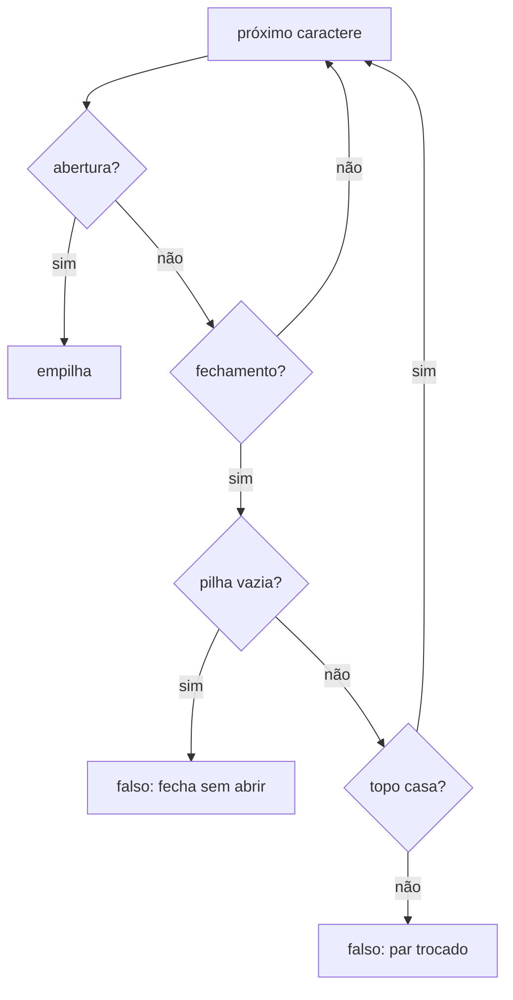

## Passo 1 · Leitura · LIFO no fim da list e delimitadores balanceados

Uma **pilha** guarda itens de forma que o último a entrar é o primeiro a sair (LIFO, *last in, first out*). Só o **topo** é acessível: empilhar põe um item no topo, desempilhar tira o item do topo e espiar lê o topo sem tirar.

Em Python, a pilha é uma `list` com o topo no **fim**. `append(x)` e `pop()` custam $O(1)$ amortizado, porque nenhum outro elemento se move. Pôr o topo no começo, com `insert(0, x)` e `pop(0)`, também dá uma pilha correta, mas cada operação desloca os outros $n-1$ elementos uma posição: $n$ operações passam a custar $\Theta(n^2)$.

```python
class Pilha:
    def __init__(self):
        self._dados = []

    def empilhar(self, valor):
        self._dados.append(valor)

    def desempilhar(self):
        if not self._dados:
            raise IndexError("pilha vazia")
        return self._dados.pop()
```

A classe esconde a lista (ninguém mexe no meio dela) e troca o `IndexError: pop from empty list` da `list` por uma mensagem que diz o que aconteceu.

Você usa uma pilha toda vez que chama uma função. Cada chamada empilha um **quadro** com as variáveis locais; o `return` desempilha e volta para quem chamou. O *traceback* lista esses quadros, do mais antigo ao mais recente. Recursão funda demais estoura o limite da pilha de chamadas: `RecursionError: maximum recursion depth exceeded`. Trocar recursão por uma `list` usada como pilha, como no módulo 3, é fazer esse trabalho à mão.

#### Delimitadores balanceados

Num texto como `f(a[0], {1: 2})`, cada fechamento precisa casar com a abertura **mais recente que ainda está aberta**. É exatamente o topo de uma pilha. Há três formas de errar, e cada uma aparece num momento diferente:



Ao fim do texto, sobrar algo na pilha também é erro: `((x)` deixou um parêntese aberto. Contar aberturas e fechamentos não basta: `)(` tem um de cada e está errado.

```python visualizar
pares = {")": "(", "]": "[", "}": "{"}

def balanceado(texto):
    pilha = []
    for ch in texto:
        if ch in "([{":
            pilha.append(ch)
        elif ch in pares:
            if not pilha or pilha.pop() != pares[ch]:
                return False
    return not pilha

print(balanceado("{[()()]}"))
print(balanceado("([)]"))
```

## Passo 2 · Exercício · Classe Pilha e balanceado
modo: lacunas

Complete as lacunas (`___`) da classe `Pilha` e da função `balanceado(texto)`, que usa a classe. A função ignora qualquer caractere que não seja `()[]{}`.

### Instruções
1. Em `desempilhar` e `topo`, opere no fim da lista: o topo é o último elemento.
2. Um fechamento encontrado com a pilha vazia torna o texto desbalanceado.
3. Um fechamento precisa casar com a abertura que está no topo.
4. No fim do texto, só está balanceado se nada ficou aberto.

### Código inicial
```python
class Pilha:
    def __init__(self):
        self._dados = []

    def empilhar(self, valor):
        self._dados.append(valor)

    def desempilhar(self):
        if self.vazia():
            raise IndexError("pilha vazia")
        return self._dados.___

    def topo(self):
        if self.vazia():
            raise IndexError("pilha vazia")
        return self._dados[___]

    def vazia(self):
        return len(self._dados) == 0

    def __len__(self):
        return len(self._dados)


PARES = {")": "(", "]": "[", "}": "{"}


def balanceado(texto):
    pilha = Pilha()
    for ch in texto:
        if ch in "([{":
            pilha.empilhar(ch)
        elif ch in PARES:
            if ___:
                return False
            if pilha.desempilhar() != ___:
                return False
    return ___
```

### Solução
```python
class Pilha:
    def __init__(self):
        self._dados = []

    def empilhar(self, valor):
        self._dados.append(valor)

    def desempilhar(self):
        if self.vazia():
            raise IndexError("pilha vazia")
        return self._dados.pop()

    def topo(self):
        if self.vazia():
            raise IndexError("pilha vazia")
        return self._dados[-1]

    def vazia(self):
        return len(self._dados) == 0

    def __len__(self):
        return len(self._dados)


PARES = {")": "(", "]": "[", "}": "{"}


def balanceado(texto):
    pilha = Pilha()
    for ch in texto:
        if ch in "([{":
            pilha.empilhar(ch)
        elif ch in PARES:
            if pilha.vazia():
                return False
            if pilha.desempilhar() != PARES[ch]:
                return False
    return pilha.vazia()
```

### Dicas
1. `pop()` sem argumento tira o último elemento; um índice negativo lê a partir do fim.
2. O dicionário `PARES` responde "qual abertura este fechamento espera?".
3. Teste `")("` e `"((x)"` de cabeça: cada um falha numa linha diferente.

### Verificação
```json
[
  { "id": "lifo", "checkpoint": 1, "kind": "expr",
    "setup": "p = Pilha()\nfor v in [3, 1, 4]:\n    p.empilhar(v)",
    "expr": "[p.desempilhar(), p.desempilhar(), len(p)]", "expected": [4, 1, 1],
    "name": "Desempilha na ordem inversa da entrada", "hint": "O último empilhado é o primeiro a sair." },
  { "id": "topo-nao-remove", "checkpoint": 1, "kind": "expr",
    "setup": "p = Pilha()\np.empilhar('x')\np.empilhar('y')",
    "expr": "[p.topo(), p.topo(), len(p)]", "expected": ["y", "y", 2],
    "name": "topo() lê o último sem remover" },
  { "id": "vazia-erro", "checkpoint": 1, "kind": "expr", "setup": "p = Pilha()", "expr": "p.topo()",
    "raises": "IndexError", "name": "topo() de pilha vazia levanta IndexError" },
  { "id": "vazio", "checkpoint": 4, "kind": "call", "function": "balanceado", "args": [""], "expected": true, "type": "bool",
    "name": "Texto vazio está balanceado" },
  { "id": "codigo-real", "checkpoint": 3, "kind": "call", "function": "balanceado", "args": ["print(notas[0], {'a': (1, 2)})"],
    "expected": true, "type": "bool", "name": "Aceita código com outros caracteres no meio" },
  { "id": "aninhado", "checkpoint": 3, "kind": "call", "function": "balanceado", "args": ["[{()}]()"], "expected": true,
    "name": "balanceado('[{()}]()') é True" },
  { "id": "fecha-primeiro", "checkpoint": 2, "kind": "call", "function": "balanceado", "args": [")("], "expected": false,
    "name": "balanceado(')(') é False", "hint": "Um fechamento com a pilha vazia não tem com quem casar." },
  { "id": "fecha-sem-abrir", "checkpoint": 2, "kind": "call", "function": "balanceado", "args": ["x]"], "expected": false,
    "name": "balanceado('x]') é False (e não levanta erro)" },
  { "id": "cruzado", "checkpoint": 3, "kind": "call", "function": "balanceado", "args": ["{(})"], "expected": false,
    "name": "balanceado('{(})') é False", "hint": "Quem fecha primeiro precisa ser o último que abriu." },
  { "id": "par-errado", "checkpoint": 3, "kind": "call", "function": "balanceado", "args": ["(]"], "expected": false,
    "name": "balanceado('(]') é False" },
  { "id": "sobra", "checkpoint": 4, "kind": "call", "function": "balanceado", "args": ["((x)"], "expected": false,
    "name": "balanceado('((x)') é False", "hint": "O que ainda está na pilha quando o texto acaba?" }
]
```

### Soluções erradas
```python name="topo no começo da lista (vira fila)"
class Pilha:
    def __init__(self):
        self._dados = []

    def empilhar(self, valor):
        self._dados.append(valor)

    def desempilhar(self):
        if self.vazia():
            raise IndexError("pilha vazia")
        return self._dados.pop(0)

    def topo(self):
        if self.vazia():
            raise IndexError("pilha vazia")
        return self._dados[0]

    def vazia(self):
        return len(self._dados) == 0

    def __len__(self):
        return len(self._dados)


PARES = {")": "(", "]": "[", "}": "{"}


def balanceado(texto):
    pilha = Pilha()
    for ch in texto:
        if ch in "([{":
            pilha.empilhar(ch)
        elif ch in PARES:
            if pilha.vazia():
                return False
            if pilha.desempilhar() != PARES[ch]:
                return False
    return pilha.vazia()
```
```python name="não testa a pilha vazia antes de desempilhar"
class Pilha:
    def __init__(self):
        self._dados = []

    def empilhar(self, valor):
        self._dados.append(valor)

    def desempilhar(self):
        if self.vazia():
            raise IndexError("pilha vazia")
        return self._dados.pop()

    def topo(self):
        if self.vazia():
            raise IndexError("pilha vazia")
        return self._dados[-1]

    def vazia(self):
        return len(self._dados) == 0

    def __len__(self):
        return len(self._dados)


PARES = {")": "(", "]": "[", "}": "{"}


def balanceado(texto):
    pilha = Pilha()
    for ch in texto:
        if ch in "([{":
            pilha.empilhar(ch)
        elif ch in PARES:
            if pilha.desempilhar() != PARES[ch]:
                return False
    return pilha.vazia()
```
```python name="esquece as aberturas que sobraram"
class Pilha:
    def __init__(self):
        self._dados = []

    def empilhar(self, valor):
        self._dados.append(valor)

    def desempilhar(self):
        if self.vazia():
            raise IndexError("pilha vazia")
        return self._dados.pop()

    def topo(self):
        if self.vazia():
            raise IndexError("pilha vazia")
        return self._dados[-1]

    def vazia(self):
        return len(self._dados) == 0

    def __len__(self):
        return len(self._dados)


PARES = {")": "(", "]": "[", "}": "{"}


def balanceado(texto):
    pilha = Pilha()
    for ch in texto:
        if ch in "([{":
            pilha.empilhar(ch)
        elif ch in PARES:
            if pilha.vazia():
                return False
            if pilha.desempilhar() != PARES[ch]:
                return False
    return True
```
```python name="só controla a profundidade, sem casar o tipo"
class Pilha:
    def __init__(self):
        self._dados = []

    def empilhar(self, valor):
        self._dados.append(valor)

    def desempilhar(self):
        if self.vazia():
            raise IndexError("pilha vazia")
        return self._dados.pop()

    def topo(self):
        if self.vazia():
            raise IndexError("pilha vazia")
        return self._dados[-1]

    def vazia(self):
        return len(self._dados) == 0

    def __len__(self):
        return len(self._dados)


PARES = {")": "(", "]": "[", "}": "{"}


def balanceado(texto):
    pilha = Pilha()
    for ch in texto:
        if ch in "([{":
            pilha.empilhar(ch)
        elif ch in PARES:
            if pilha.vazia():
                return False
            pilha.desempilhar()
    return pilha.vazia()
```
```python name="conta aberturas e fechamentos"
class Pilha:
    def __init__(self):
        self._dados = []

    def empilhar(self, valor):
        self._dados.append(valor)

    def desempilhar(self):
        if self.vazia():
            raise IndexError("pilha vazia")
        return self._dados.pop()

    def topo(self):
        if self.vazia():
            raise IndexError("pilha vazia")
        return self._dados[-1]

    def vazia(self):
        return len(self._dados) == 0

    def __len__(self):
        return len(self._dados)


PARES = {")": "(", "]": "[", "}": "{"}


def balanceado(texto):
    return all(texto.count(a) == texto.count(f) for f, a in PARES.items())
```

## Passo 3 · Leitura · Notação posfixa e shunting-yard

Na notação **infixa**, o operador fica entre os operandos: `(3 + 4) * 2`. Para avaliá-la é preciso saber precedência e respeitar parênteses. Na notação **posfixa** (ou polonesa reversa, RPN), o operador vem **depois** dos dois operandos: `3 4 + 2 *`. Ela não precisa de parênteses: `3 4 + 2 *` vale 14 e `3 4 2 * +` vale 11, e a ordem dos tokens já diz tudo.

Avaliar posfixa é uma passagem com uma pilha de números. Número: empilha. Operador: desempilha dois, aplica e empilha o resultado. No fim, a pilha precisa ter **exatamente um** valor.

| token | pilha depois |
|---|---|
| `7` | `[7]` |
| `2` | `[7, 2]` |
| `-` | `[5]` |
| `3` | `[5, 3]` |
| `*` | `[15]` |

A ordem importa. O primeiro `pop()` devolve o operando **direito**: em `7 2 -`, sai primeiro o 2 e depois o 7, e a conta é $7 - 2$. Inverter dá $-5$ e só aparece com `-`, `/` e `^`, que não são comutativos.

Uma expressão malformada aparece como pilha errada: em `1 +` falta operando quando o `+` chega, e em `1 2` sobram dois valores no fim. Trate os dois casos com um `ValueError` claro, em vez de deixar escapar o `IndexError` do `pop()`.

Os tokens chegam como texto, e `"-3"` e `"2.5"` são números. Por isso, decida "é operador?" pelo conjunto `{"+", "-", "*", "/", "^"}`, e não por `token.isdigit()`, que é falso para os dois.

#### De infixa para posfixa: shunting-yard

O algoritmo de Dijkstra percorre a infixa com uma lista de saída e uma **pilha de operadores**:

- operando: vai direto para a saída;
- `(`: empilha;
- `)`: desempilha para a saída até achar o `(`, que é descartado;
- operador `op`: antes de empilhá-lo, desempilha para a saída os operadores do topo que precisam ser calculados antes dele: os de precedência maior, e os de precedência igual quando `op` é associativo à esquerda;
- no fim: desempilha tudo para a saída.

Precedência: `+ -` valem 1, `* /` valem 2 e `^` vale 3. `-` é associativo à esquerda: `8 - 3 - 1` é $(8-3)-1$. `^` é associativo à direita: `2 ^ 3 ^ 2` é $2^{(3^2)} = 512$. Por isso um `^` que chega **não** tira outro `^` do topo.

## Passo 4 · Exercício · Avaliar posfixa

Escreva `avaliar_rpn(tokens)`, que recebe uma lista de tokens em notação posfixa e devolve o valor como `float`.

### Instruções
1. Números (inclusive negativos, como `"-3"`, e decimais, como `"2.5"`) são empilhados como `float`. Os operadores são `+`, `-`, `*`, `/` e `^` (potência); o primeiro valor desempilhado é o operando direito.
2. Se um operador encontrar menos de dois valores na pilha, levante `ValueError` com uma mensagem que contenha `malformada`.
3. Se no fim a pilha não tiver exatamente um valor, levante `ValueError` com uma mensagem que contenha `malformada`. Caso contrário, devolva esse valor.

### Código inicial
```python
OPERADORES = {"+", "-", "*", "/", "^"}


def avaliar_rpn(tokens):
    pass
```

### Solução
```python
OPERADORES = {"+", "-", "*", "/", "^"}


def aplicar(op, a, b):
    if op == "+":
        return a + b
    if op == "-":
        return a - b
    if op == "*":
        return a * b
    if op == "/":
        return a / b
    return a ** b


def avaliar_rpn(tokens):
    pilha = []
    for token in tokens:
        if token in OPERADORES:
            if len(pilha) < 2:
                raise ValueError("expressão malformada: falta operando")
            b = pilha.pop()
            a = pilha.pop()
            pilha.append(aplicar(token, a, b))
        else:
            pilha.append(float(token))
    if len(pilha) != 1:
        raise ValueError("expressão malformada: sobraram valores")
    return pilha[0]
```

### Dicas
1. Separe a conta numa função `aplicar(op, a, b)`; o laço só cuida da pilha.
2. Confira com `7 2 -`: o resultado tem que ser 5.
3. Os dois erros acontecem em lugares diferentes: um dentro do laço, outro depois dele.

### Verificação
```json
[
  { "id": "soma", "checkpoint": 1, "kind": "call", "function": "avaliar_rpn", "args": [["2", "3", "+"]], "expected": 5.0, "type": "float",
    "name": "avaliar_rpn(['2', '3', '+']) é 5.0" },
  { "id": "subtracao", "checkpoint": 1, "kind": "call", "function": "avaliar_rpn", "args": [["9", "4", "-"]], "expected": 5.0,
    "tolerance": 1e-9, "name": "avaliar_rpn(['9', '4', '-']) é 5.0", "hint": "O primeiro pop() é o operando da direita." },
  { "id": "divisoes", "checkpoint": 1, "kind": "call", "function": "avaliar_rpn", "args": [["8", "2", "/", "2", "/"]], "expected": 2.0,
    "tolerance": 1e-9, "name": "avaliar_rpn(['8', '2', '/', '2', '/']) é 2.0" },
  { "id": "potencia", "checkpoint": 1, "kind": "call", "function": "avaliar_rpn", "args": [["2", "3", "2", "^", "^"]], "expected": 512.0,
    "tolerance": 1e-9, "name": "avaliar_rpn(['2', '3', '2', '^', '^']) é 512.0" },
  { "id": "decimal", "checkpoint": 1, "kind": "call", "function": "avaliar_rpn", "args": [["4", "13", "5", "/", "+"]], "expected": 6.6,
    "tolerance": 1e-9, "name": "avaliar_rpn(['4', '13', '5', '/', '+']) é 6.6" },
  { "id": "negativo", "checkpoint": 1, "kind": "call", "function": "avaliar_rpn", "args": [["-3", "2.5", "*"]], "expected": -7.5,
    "tolerance": 1e-9, "name": "Aceita os números '-3' e '2.5'", "hint": "'-3' e '2.5' não são só dígitos, mas são números." },
  { "id": "so-um", "checkpoint": 3, "kind": "call", "function": "avaliar_rpn", "args": [["42"]], "expected": 42.0, "type": "float",
    "name": "avaliar_rpn(['42']) é 42.0" },
  { "id": "falta-operando", "checkpoint": 2, "kind": "expr", "expr": "avaliar_rpn(['1', '+'])", "raises": "ValueError",
    "message_contains": "malformada", "name": "['1', '+'] levanta ValueError", "hint": "Confira o tamanho da pilha antes de desempilhar." },
  { "id": "so-operador", "checkpoint": 2, "kind": "expr", "expr": "avaliar_rpn(['*'])", "raises": "ValueError",
    "message_contains": "malformada", "name": "['*'] levanta ValueError" },
  { "id": "sobra", "checkpoint": 3, "kind": "expr", "expr": "avaliar_rpn(['1', '2', '3', '+'])", "raises": "ValueError",
    "message_contains": "malformada", "name": "['1', '2', '3', '+'] levanta ValueError", "hint": "Quantos valores restam na pilha no fim?" },
  { "id": "vazia", "checkpoint": 3, "kind": "expr", "expr": "avaliar_rpn([])", "raises": "ValueError",
    "message_contains": "malformada", "name": "Lista vazia levanta ValueError" }
]
```

### Soluções erradas
```python name="operandos na ordem trocada"
OPERADORES = {"+", "-", "*", "/", "^"}


def aplicar(op, a, b):
    if op == "+":
        return a + b
    if op == "-":
        return a - b
    if op == "*":
        return a * b
    if op == "/":
        return a / b
    return a ** b


def avaliar_rpn(tokens):
    pilha = []
    for token in tokens:
        if token in OPERADORES:
            if len(pilha) < 2:
                raise ValueError("expressão malformada: falta operando")
            a = pilha.pop()
            b = pilha.pop()
            pilha.append(aplicar(token, a, b))
        else:
            pilha.append(float(token))
    if len(pilha) != 1:
        raise ValueError("expressão malformada: sobraram valores")
    return pilha[0]
```
```python name="reconhece número com isdigit"
OPERADORES = {"+", "-", "*", "/", "^"}


def aplicar(op, a, b):
    if op == "+":
        return a + b
    if op == "-":
        return a - b
    if op == "*":
        return a * b
    if op == "/":
        return a / b
    return a ** b


def avaliar_rpn(tokens):
    pilha = []
    for token in tokens:
        if token.isdigit():
            pilha.append(float(token))
        else:
            if len(pilha) < 2:
                raise ValueError("expressão malformada: falta operando")
            b = pilha.pop()
            a = pilha.pop()
            pilha.append(aplicar(token, a, b))
    if len(pilha) != 1:
        raise ValueError("expressão malformada: sobraram valores")
    return pilha[0]
```
```python name="converte com int"
OPERADORES = {"+", "-", "*", "/", "^"}


def aplicar(op, a, b):
    if op == "+":
        return a + b
    if op == "-":
        return a - b
    if op == "*":
        return a * b
    if op == "/":
        return a / b
    return a ** b


def avaliar_rpn(tokens):
    pilha = []
    for token in tokens:
        if token in OPERADORES:
            if len(pilha) < 2:
                raise ValueError("expressão malformada: falta operando")
            b = pilha.pop()
            a = pilha.pop()
            pilha.append(aplicar(token, a, b))
        else:
            pilha.append(int(token))
    if len(pilha) != 1:
        raise ValueError("expressão malformada: sobraram valores")
    return pilha[0]
```
```python name="não confere a falta de operando"
OPERADORES = {"+", "-", "*", "/", "^"}


def aplicar(op, a, b):
    if op == "+":
        return a + b
    if op == "-":
        return a - b
    if op == "*":
        return a * b
    if op == "/":
        return a / b
    return a ** b


def avaliar_rpn(tokens):
    pilha = []
    for token in tokens:
        if token in OPERADORES:
            b = pilha.pop()
            a = pilha.pop()
            pilha.append(aplicar(token, a, b))
        else:
            pilha.append(float(token))
    if len(pilha) != 1:
        raise ValueError("expressão malformada: sobraram valores")
    return pilha[0]
```
```python name="devolve o topo sem conferir a sobra"
OPERADORES = {"+", "-", "*", "/", "^"}


def aplicar(op, a, b):
    if op == "+":
        return a + b
    if op == "-":
        return a - b
    if op == "*":
        return a * b
    if op == "/":
        return a / b
    return a ** b


def avaliar_rpn(tokens):
    pilha = []
    for token in tokens:
        if token in OPERADORES:
            if len(pilha) < 2:
                raise ValueError("expressão malformada: falta operando")
            b = pilha.pop()
            a = pilha.pop()
            pilha.append(aplicar(token, a, b))
        else:
            pilha.append(float(token))
    if not pilha:
        raise ValueError("expressão malformada: vazia")
    return pilha[-1]
```

## Passo 5 · Exercício · De infixa para posfixa

Escreva `infixa_para_posfixa(tokens)` com o algoritmo shunting-yard do passo 3. A entrada é uma lista de tokens infixos (operandos, `(`, `)` e os operadores `+ - * / ^`), sempre bem formada; a saída é a lista de tokens em posfixa.

### Instruções
1. Operandos vão direto para a saída; operadores esperam na pilha e saem respeitando a precedência (`+ -` = 1, `* /` = 2, `^` = 3).
2. `(` é empilhado; `)` desempilha para a saída até o `(` correspondente, que é descartado e nunca aparece na saída.
3. Em precedência igual, `+ - * /` são associativos à esquerda e `^` é associativo à direita. No fim, os operadores que restam na pilha vão para a saída.

### Código inicial
```python
PRECEDENCIA = {"+": 1, "-": 1, "*": 2, "/": 2, "^": 3}


def infixa_para_posfixa(tokens):
    pass
```

### Solução
```python
PRECEDENCIA = {"+": 1, "-": 1, "*": 2, "/": 2, "^": 3}


def sai_antes(topo, op):
    if topo not in PRECEDENCIA:
        return False
    if PRECEDENCIA[topo] > PRECEDENCIA[op]:
        return True
    return PRECEDENCIA[topo] == PRECEDENCIA[op] and op != "^"


def infixa_para_posfixa(tokens):
    saida = []
    pilha = []
    for token in tokens:
        if token == "(":
            pilha.append(token)
        elif token == ")":
            while pilha[-1] != "(":
                saida.append(pilha.pop())
            pilha.pop()
        elif token in PRECEDENCIA:
            while pilha and sai_antes(pilha[-1], token):
                saida.append(pilha.pop())
            pilha.append(token)
        else:
            saida.append(token)
    while pilha:
        saida.append(pilha.pop())
    return saida
```

### Dicas
1. Escreva uma função `sai_antes(topo, op)` que responde se o operador do topo deve ir para a saída antes de `op` entrar.
2. Um `(` no topo funciona como parede: nenhum operador passa dele.
3. Confira à mão `a - b - c` (deve dar `a b - c -`) e `a ^ b ^ c` (deve dar `a b c ^ ^`).

### Verificação
```json
[
  { "id": "precedencia", "checkpoint": 1, "kind": "call", "function": "infixa_para_posfixa", "args": [["a", "+", "b", "*", "c"]],
    "expected": ["a", "b", "c", "*", "+"], "name": "a + b * c vira a b c * +" },
  { "id": "precedencia-2", "checkpoint": 1, "kind": "call", "function": "infixa_para_posfixa", "args": [["a", "*", "b", "+", "c"]],
    "expected": ["a", "b", "*", "c", "+"], "name": "a * b + c vira a b * c +" },
  { "id": "um-operando", "checkpoint": 1, "kind": "call", "function": "infixa_para_posfixa", "args": [["x"]], "expected": ["x"],
    "name": "Um operando sozinho continua igual" },
  { "id": "parenteses", "checkpoint": 2, "kind": "call", "function": "infixa_para_posfixa",
    "args": [["(", "a", "+", "b", ")", "*", "c"]], "expected": ["a", "b", "+", "c", "*"],
    "name": "( a + b ) * c vira a b + c *", "hint": "O ( nunca vai para a saída." },
  { "id": "parenteses-duplos", "checkpoint": 2, "kind": "call", "function": "infixa_para_posfixa",
    "args": [["(", "(", "7", ")", ")"]], "expected": ["7"], "name": "( ( 7 ) ) vira só 7" },
  { "id": "esquerda", "checkpoint": 3, "kind": "call", "function": "infixa_para_posfixa", "args": [["8", "-", "3", "-", "1"]],
    "expected": ["8", "3", "-", "1", "-"], "name": "8 - 3 - 1 é (8 - 3) - 1",
    "hint": "Com precedência igual e associatividade à esquerda, o operador do topo sai antes." },
  { "id": "esquerda-div", "checkpoint": 3, "kind": "call", "function": "infixa_para_posfixa", "args": [["a", "/", "b", "*", "c"]],
    "expected": ["a", "b", "/", "c", "*"], "name": "a / b * c é (a / b) * c" },
  { "id": "direita", "checkpoint": 3, "kind": "call", "function": "infixa_para_posfixa", "args": [["2", "^", "3", "^", "2"]],
    "expected": ["2", "3", "2", "^", "^"], "name": "2 ^ 3 ^ 2 é 2 ^ (3 ^ 2)", "hint": "Um ^ que chega não tira outro ^ do topo." },
  { "id": "misto", "checkpoint": 3, "kind": "call", "function": "infixa_para_posfixa",
    "args": [["a", "*", "(", "b", "+", "c", ")", "^", "2", "-", "d"]], "expected": ["a", "b", "c", "+", "2", "^", "*", "d", "-"],
    "name": "a * ( b + c ) ^ 2 - d" }
]
```

### Soluções erradas
```python name="trata ^ como associativo à esquerda"
PRECEDENCIA = {"+": 1, "-": 1, "*": 2, "/": 2, "^": 3}


def infixa_para_posfixa(tokens):
    saida = []
    pilha = []
    for token in tokens:
        if token == "(":
            pilha.append(token)
        elif token == ")":
            while pilha[-1] != "(":
                saida.append(pilha.pop())
            pilha.pop()
        elif token in PRECEDENCIA:
            while pilha and pilha[-1] in PRECEDENCIA and PRECEDENCIA[pilha[-1]] >= PRECEDENCIA[token]:
                saida.append(pilha.pop())
            pilha.append(token)
        else:
            saida.append(token)
    while pilha:
        saida.append(pilha.pop())
    return saida
```
```python name="só desempilha precedência estritamente maior"
PRECEDENCIA = {"+": 1, "-": 1, "*": 2, "/": 2, "^": 3}


def infixa_para_posfixa(tokens):
    saida = []
    pilha = []
    for token in tokens:
        if token == "(":
            pilha.append(token)
        elif token == ")":
            while pilha[-1] != "(":
                saida.append(pilha.pop())
            pilha.pop()
        elif token in PRECEDENCIA:
            while pilha and pilha[-1] in PRECEDENCIA and PRECEDENCIA[pilha[-1]] > PRECEDENCIA[token]:
                saida.append(pilha.pop())
            pilha.append(token)
        else:
            saida.append(token)
    while pilha:
        saida.append(pilha.pop())
    return saida
```
```python name="não descarta o ( ao fechar"
PRECEDENCIA = {"+": 1, "-": 1, "*": 2, "/": 2, "^": 3}


def sai_antes(topo, op):
    if topo not in PRECEDENCIA:
        return False
    if PRECEDENCIA[topo] > PRECEDENCIA[op]:
        return True
    return PRECEDENCIA[topo] == PRECEDENCIA[op] and op != "^"


def infixa_para_posfixa(tokens):
    saida = []
    pilha = []
    for token in tokens:
        if token == "(":
            pilha.append(token)
        elif token == ")":
            while pilha[-1] != "(":
                saida.append(pilha.pop())
        elif token in PRECEDENCIA:
            while pilha and sai_antes(pilha[-1], token):
                saida.append(pilha.pop())
            pilha.append(token)
        else:
            saida.append(token)
    while pilha:
        saida.append(pilha.pop())
    return saida
```
```python name="consulta a precedência do ( no topo"
PRECEDENCIA = {"+": 1, "-": 1, "*": 2, "/": 2, "^": 3}


def infixa_para_posfixa(tokens):
    saida = []
    pilha = []
    for token in tokens:
        if token == "(":
            pilha.append(token)
        elif token == ")":
            while pilha[-1] != "(":
                saida.append(pilha.pop())
            pilha.pop()
        elif token in PRECEDENCIA:
            while pilha and PRECEDENCIA[pilha[-1]] >= PRECEDENCIA[token] and token != "^":
                saida.append(pilha.pop())
            pilha.append(token)
        else:
            saida.append(token)
    while pilha:
        saida.append(pilha.pop())
    return saida
```
```python name="esquece os operadores que sobraram na pilha"
PRECEDENCIA = {"+": 1, "-": 1, "*": 2, "/": 2, "^": 3}


def sai_antes(topo, op):
    if topo not in PRECEDENCIA:
        return False
    if PRECEDENCIA[topo] > PRECEDENCIA[op]:
        return True
    return PRECEDENCIA[topo] == PRECEDENCIA[op] and op != "^"


def infixa_para_posfixa(tokens):
    saida = []
    pilha = []
    for token in tokens:
        if token == "(":
            pilha.append(token)
        elif token == ")":
            while pilha[-1] != "(":
                saida.append(pilha.pop())
            pilha.pop()
        elif token in PRECEDENCIA:
            while pilha and sai_antes(pilha[-1], token):
                saida.append(pilha.pop())
            pilha.append(token)
        else:
            saida.append(token)
    return saida
```

## Passo 6 · Previsão · Duas pilhas: desfazer e refazer

Editores guardam o histórico em **duas pilhas**. Antes de cada edição, o texto atual vai para `desfazer`. Desfazer tira o estado do topo de `desfazer` e guarda o atual em `refazer`; refazer faz o caminho inverso. Uma edição nova **esvazia** `refazer`: o futuro que tinha sido desfeito deixa de existir.

Leia o programa sem executar e digite exatamente o que ele imprime.

### Código
```python
texto = ""
desfazer = []
refazer = []

comandos = [
    ("ESCREVER", "Olá"),
    ("ESCREVER", ", mundo"),
    ("ESCREVER", "!"),
    ("DESFAZER", ""),
    ("DESFAZER", ""),
    ("REFAZER", ""),
    ("ESCREVER", "?"),
    ("REFAZER", ""),
]

for acao, trecho in comandos:
    if acao == "ESCREVER":
        desfazer.append(texto)
        texto = texto + trecho
        refazer.clear()
    elif acao == "DESFAZER" and desfazer:
        refazer.append(texto)
        texto = desfazer.pop()
    elif acao == "REFAZER" and refazer:
        desfazer.append(texto)
        texto = refazer.pop()

print(texto)
print(desfazer)
print(len(refazer))
```

### Dicas
1. Anote as duas pilhas numa tabela, uma linha por comando.
2. Cada `DESFAZER` move um estado de uma pilha para a outra; nenhum estado se perde.
3. Olhe com atenção o que o último `ESCREVER` faz com `refazer` antes do último comando.

### Saída esperada
```text
Olá, mundo?
['', 'Olá', 'Olá, mundo']
0
```

## Passo 7 · Exercício · Editor com desfazer e refazer

Escreva `editor(comandos)`, que começa com o texto vazio, executa uma lista de comandos e devolve o texto final. Os comandos são:

- `"ESCREVER <trecho>"`: acrescenta ao fim tudo o que vem depois de `"ESCREVER "`, espaços incluídos;
- `"APAGAR <n>"`: apaga os `n` últimos caracteres (todos, se houver menos de `n`; `n` pode ser 0);
- `"DESFAZER"` e `"REFAZER"`: como no passo anterior; com a pilha correspondente vazia, não fazem nada.

### Instruções
1. `ESCREVER` e `APAGAR` são edições: guarde o texto anterior na pilha de desfazer antes de alterar.
2. `DESFAZER` e `REFAZER` movem estados entre as duas pilhas e são ignorados quando a pilha de onde tirariam está vazia.
3. Toda edição nova esvazia a pilha de refazer.

### Código inicial
```python
def editor(comandos):
    texto = ""
    return texto
```

### Solução
```python
def editor(comandos):
    texto = ""
    desfazer = []
    refazer = []
    for comando in comandos:
        if comando.startswith("ESCREVER "):
            desfazer.append(texto)
            texto = texto + comando[len("ESCREVER "):]
            refazer.clear()
        elif comando.startswith("APAGAR "):
            n = int(comando[len("APAGAR "):])
            desfazer.append(texto)
            texto = texto[:max(len(texto) - n, 0)]
            refazer.clear()
        elif comando == "DESFAZER":
            if desfazer:
                refazer.append(texto)
                texto = desfazer.pop()
        elif comando == "REFAZER":
            if refazer:
                desfazer.append(texto)
                texto = refazer.pop()
    return texto
```

### Dicas
1. Cuidado com `texto[:-n]` quando `n` é 0: teste no terminal o que `"abc"[:-0]` devolve.
2. Para pegar o trecho, corte a string pelo tamanho do prefixo, sem `split`: o trecho pode começar com espaço.
3. Desfazer e refazer são simétricos: o estado que sai de uma pilha vira o texto, e o texto atual vai para a outra.

### Verificação
```json
[
  { "id": "escreve", "checkpoint": 1, "kind": "call", "function": "editor", "args": [["ESCREVER ab", "ESCREVER cd"]], "expected": "abcd",
    "name": "Duas escritas viram abcd" },
  { "id": "espacos", "checkpoint": 1, "kind": "call", "function": "editor", "args": [["ESCREVER um", "ESCREVER  dois"]], "expected": "um dois",
    "name": "Preserva o espaço no começo do trecho", "hint": "O trecho é tudo depois de 'ESCREVER ', inclusive espaços." },
  { "id": "apaga", "checkpoint": 1, "kind": "call", "function": "editor", "args": [["ESCREVER texto", "APAGAR 2"]], "expected": "tex",
    "name": "APAGAR 2 tira os dois últimos" },
  { "id": "apaga-demais", "checkpoint": 1, "kind": "call", "function": "editor", "args": [["ESCREVER abc", "APAGAR 10"]], "expected": "",
    "name": "APAGAR mais do que existe deixa o texto vazio" },
  { "id": "apaga-zero", "checkpoint": 1, "kind": "call", "function": "editor", "args": [["ESCREVER abc", "APAGAR 0"]], "expected": "abc",
    "name": "APAGAR 0 não apaga nada", "hint": "Qual é o valor de 'abc'[:-0]?" },
  { "id": "desfaz", "checkpoint": 2, "kind": "call", "function": "editor", "args": [["ESCREVER a", "ESCREVER b", "DESFAZER"]], "expected": "a",
    "name": "DESFAZER volta ao estado anterior" },
  { "id": "desfaz-apagar", "checkpoint": 2, "kind": "call", "function": "editor", "args": [["ESCREVER prova", "APAGAR 3", "DESFAZER"]],
    "expected": "prova", "name": "DESFAZER também desfaz APAGAR" },
  { "id": "refaz", "checkpoint": 2, "kind": "call", "function": "editor",
    "args": [["ESCREVER a", "ESCREVER b", "ESCREVER c", "DESFAZER", "DESFAZER", "REFAZER"]], "expected": "ab",
    "name": "REFAZER recupera o último estado desfeito" },
  { "id": "pilhas-vazias", "checkpoint": 2, "kind": "call", "function": "editor", "args": [["DESFAZER", "REFAZER", "ESCREVER x", "REFAZER"]],
    "expected": "x", "name": "DESFAZER e REFAZER sem histórico não fazem nada", "hint": "Teste se a pilha tem algo antes de desempilhar." },
  { "id": "limpa-refazer", "checkpoint": 3, "kind": "call", "function": "editor", "args": [["ESCREVER a", "DESFAZER", "ESCREVER b", "REFAZER"]],
    "expected": "b", "name": "Edição nova apaga o futuro desfeito", "hint": "Depois de uma edição nova, ainda faz sentido refazer?" },
  { "id": "longo", "checkpoint": 3, "kind": "call", "function": "editor",
    "args": [["ESCREVER abc", "APAGAR 1", "DESFAZER", "DESFAZER", "REFAZER", "ESCREVER !", "DESFAZER", "REFAZER", "REFAZER"]],
    "expected": "abc!", "name": "Sequência longa com as quatro operações" }
]
```

### Soluções erradas
```python name="não esvazia o refazer numa edição nova"
def editor(comandos):
    texto = ""
    desfazer = []
    refazer = []
    for comando in comandos:
        if comando.startswith("ESCREVER "):
            desfazer.append(texto)
            texto = texto + comando[len("ESCREVER "):]
        elif comando.startswith("APAGAR "):
            n = int(comando[len("APAGAR "):])
            desfazer.append(texto)
            texto = texto[:max(len(texto) - n, 0)]
        elif comando == "DESFAZER":
            if desfazer:
                refazer.append(texto)
                texto = desfazer.pop()
        elif comando == "REFAZER":
            if refazer:
                desfazer.append(texto)
                texto = refazer.pop()
    return texto
```
```python name="DESFAZER não guarda o estado em refazer"
def editor(comandos):
    texto = ""
    desfazer = []
    refazer = []
    for comando in comandos:
        if comando.startswith("ESCREVER "):
            desfazer.append(texto)
            texto = texto + comando[len("ESCREVER "):]
            refazer.clear()
        elif comando.startswith("APAGAR "):
            n = int(comando[len("APAGAR "):])
            desfazer.append(texto)
            texto = texto[:max(len(texto) - n, 0)]
            refazer.clear()
        elif comando == "DESFAZER":
            if desfazer:
                texto = desfazer.pop()
        elif comando == "REFAZER":
            if refazer:
                desfazer.append(texto)
                texto = refazer.pop()
    return texto
```
```python name="apaga com texto[:-n]"
def editor(comandos):
    texto = ""
    desfazer = []
    refazer = []
    for comando in comandos:
        if comando.startswith("ESCREVER "):
            desfazer.append(texto)
            texto = texto + comando[len("ESCREVER "):]
            refazer.clear()
        elif comando.startswith("APAGAR "):
            n = int(comando[len("APAGAR "):])
            desfazer.append(texto)
            texto = texto[:-n]
            refazer.clear()
        elif comando == "DESFAZER":
            if desfazer:
                refazer.append(texto)
                texto = desfazer.pop()
        elif comando == "REFAZER":
            if refazer:
                desfazer.append(texto)
                texto = refazer.pop()
    return texto
```
```python name="desempilha sem conferir se há histórico"
def editor(comandos):
    texto = ""
    desfazer = []
    refazer = []
    for comando in comandos:
        if comando.startswith("ESCREVER "):
            desfazer.append(texto)
            texto = texto + comando[len("ESCREVER "):]
            refazer.clear()
        elif comando.startswith("APAGAR "):
            n = int(comando[len("APAGAR "):])
            desfazer.append(texto)
            texto = texto[:max(len(texto) - n, 0)]
            refazer.clear()
        elif comando == "DESFAZER":
            refazer.append(texto)
            texto = desfazer.pop()
        elif comando == "REFAZER":
            desfazer.append(texto)
            texto = refazer.pop()
    return texto
```
```python name="pega o trecho com split"
def editor(comandos):
    texto = ""
    desfazer = []
    refazer = []
    for comando in comandos:
        partes = comando.split()
        if partes[0] == "ESCREVER":
            desfazer.append(texto)
            texto = texto + partes[1]
            refazer.clear()
        elif partes[0] == "APAGAR":
            desfazer.append(texto)
            texto = texto[:max(len(texto) - int(partes[1]), 0)]
            refazer.clear()
        elif comando == "DESFAZER":
            if desfazer:
                refazer.append(texto)
                texto = desfazer.pop()
        elif comando == "REFAZER":
            if refazer:
                desfazer.append(texto)
                texto = refazer.pop()
    return texto
```

## Passo 8 · Quiz · Pilhas no lugar certo

### Pergunta
A função recursiva `visitar(no)` imprime o nó e depois visita cada filho, da esquerda para a direita; na árvore abaixo ela imprime `A B D C`. Um colega trocou a recursão por uma pilha explícita. O que a versão dele imprime?
```python
arvore = {"A": ["B", "C"], "B": ["D"], "C": [], "D": []}
pilha = ["A"]
while pilha:
    no = pilha.pop()
    print(no, end=" ")
    pilha.extend(arvore[no])
```
- [x] `A C B D`: o último filho empilhado é o primeiro a sair; para imitar a recursão, seria preciso empilhar os filhos em ordem inversa.
- [ ] `A B D C`: a pilha explícita faz exatamente o que a pilha de chamadas fazia.
- [ ] `A B C D`: a pilha visita a árvore por níveis.
- [ ] `D B C A`: a pilha imprime primeiro o que está mais fundo.
> A pilha de chamadas guarda "o que falta fazer" na ordem certa porque a recursão visita B inteiro antes de olhar para C. Com `extend(["B", "C"])`, o C fica no topo e sai primeiro. `pilha.extend(reversed(arvore[no]))` recupera a ordem `A B D C`.

### Pergunta
Quanto vale a expressão posfixa `10 2 5 - -`?
- [x] 13, porque é $10 - (2 - 5)$.
- [ ] 3, porque é $(10 - 2) - 5$.
- [ ] $-13$, porque o primeiro valor desempilhado fica à esquerda.
- [ ] A expressão é inválida: dois operadores seguidos não são permitidos.
> O primeiro `-` encontra 2 e 5 no topo e deixa $-3$; o segundo encontra 10 e $-3$ e calcula $10 - (-3) = 13$. Para obter $(10 - 2) - 5$ a posfixa seria `10 2 - 5 -`.

### Pergunta
Num editor com duas pilhas, você escreve `A`, depois `B`, depois `C`, desfaz duas vezes e escreve `D`. O que acontece se você pedir REFAZER agora?
- [x] Nada: escrever `D` esvaziou a pilha de refazer, e o texto continua `AD`.
- [ ] O texto volta a `ABC`, porque os estados desfeitos continuam guardados.
- [ ] O texto vira `ABD`, porque o refazer reaplica `B` antes do `D`.
- [ ] O editor levanta `IndexError`, porque a pilha de refazer está vazia.
> Uma edição nova cria outra linha do tempo. Os estados desfeitos pertencem à linha antiga, por isso `refazer.clear()`. Um editor bem escrito confere se a pilha está vazia antes de desempilhar e simplesmente ignora o comando.
