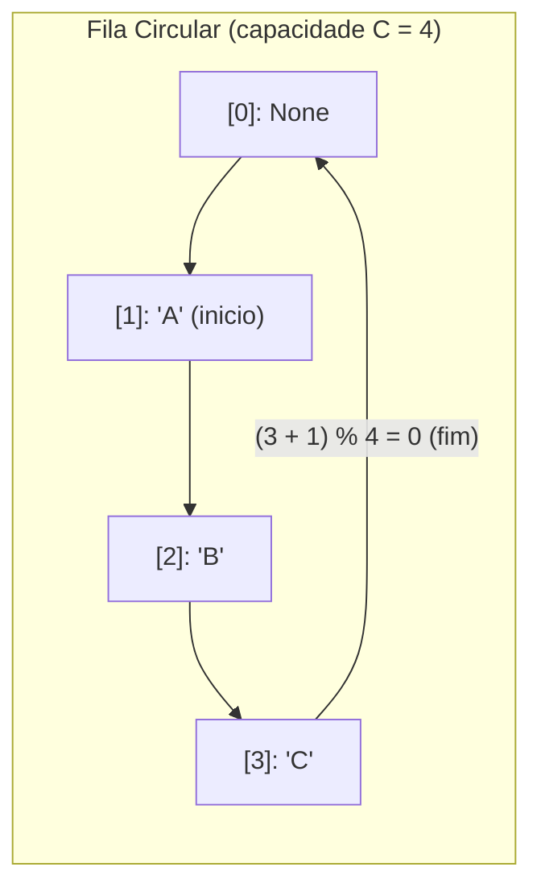

## Passo 1 · Leitura · Filas (FIFO), fila circular e `collections.deque`

Uma **fila** (*queue*) segue a disciplina **FIFO** (*First-In, First-Out* — o primeiro a entrar é o primeiro a sair), exatamente como uma fila de atendimento: novos elementos entram no **fim** (*enqueue*) e saem pelo **início** (*dequeue*).

#### O erro clássico: por que nunca usar `list.pop(0)` como fila?

Se usarmos uma `list` comum com `fila.append(x)` e `fila.pop(0)`, cada remoção no índice `0` desloca todos os $n - 1$ elementos restantes na memória, custando **$O(n)$**. Processar $10^5$ elementos em uma fila assim executa cerca de $5 \times 10^9$ deslocamentos!

Existem duas maneiras clássicas de obter `enfileirar` e `desenfileirar` em **$O(1)$**:

#### 1. Fila circular em vetor de capacidade fixa (*Ring Buffer*)

Se sabemos o limite máximo $C$ de elementos simultâneos na fila, alocamos uma lista fixa `dados = [None] * C` e mantemos dois ponteiros de índice (`inicio` e `fim`) mais um contador `tamanho`:
- **Enfileirar (`x`)**: se `tamanho == C`, a fila está **cheia** (`OverflowError`). Caso contrário, gravamos `dados[fim] = x`, avançamos ciclicamente com aritmética modular:
  $$\text{fim} = (\text{fim} + 1) \bmod C$$
  e incrementamos `tamanho += 1`.
- **Desenfileirar**: se `tamanho == 0`, a fila está **vazia** (`IndexError`). Caso contrário, lemos `valor = dados[inicio]`, limpamos `dados[inicio] = None`, avançamos:
  $$\text{inicio} = (\text{inicio} + 1) \bmod C$$
  decrementamos `tamanho -= 1` e devolvemos `valor`.

> **Por que manter `tamanho`?** Tanto na fila vazia quanto na fila totalmente cheia, os ponteiros `inicio` e `fim` coincidem (`inicio == fim`). Manter o contador explícito `tamanho` permite distinguir imediatamente `vazia()` (`tamanho == 0`) de `cheia()` (`tamanho == C`) sem desperdiçar uma posição do vetor.



#### 2. `collections.deque` (fila de duas pontas)

Na biblioteca padrão do Python, `collections.deque` (*double-ended queue*) é implementada como uma lista duplamente encadeada de blocos fixos. Isso garante **$O(1)$ real** nas duas extremidades:
- Inserir/remover à direita: `d.append(x)` e `d.pop()` — $O(1)$.
- Inserir/remover à esquerda: `d.appendleft(x)` e `d.popleft()` — $O(1)$.
- Histórico limitado: `deque(maxlen=k)` mantém automaticamente apenas os **últimos $k$ elementos**; ao dar `append` quando cheia, o item mais antigo da outra ponta é descartado em $O(1)$!

## Passo 2 · Exercício · `FilaCircular`, últimos $k$ eventos e simulação de atendimento

Implemente a classe `FilaCircular`, o filtro de janela `ultimos_k(eventos, k)` com `deque(maxlen=k)` e a simulação discreta `simular_atendimento(chegadas, duracao)`.

### Instruções

1. Implemente a classe `FilaCircular(capacidade: int)` com vetor fixo `[None] * capacidade`, ponteiros `inicio` e `fim` avanzando módulo `capacidade`, e métodos `vazia() -> bool`, `cheia() -> bool`, `__len__() -> int`, `enfileirar(valor)` (lançando `OverflowError` se `cheia()`) e `desenfileirar()` (lançando `IndexError` se `vazia()`).
2. Implemente `ultimos_k(eventos: list, k: int) -> list` que devolve uma `list` com os últimos `k` elementos de `eventos` na ordem em que ocorreram (ou `[]` se `k <= 0`), usando `deque(maxlen=k)`.
3. Implemente `simular_atendimento(chegadas: list[float], duracao: float) -> float` que recebe uma lista ordenada de instantes de chegada a um guichê único onde cada atendimento leva `duracao` unidades de tempo. Um cliente que chega no instante `t` começa a ser atendido em `inicio = max(t, livre_em)`, espera `inicio - t`, e deixa o guichê ocupado até `inicio + duracao`. Devolva o **tempo médio de espera** (`0.0` se `chegadas` for vazia).

### Código inicial

```python
from collections import deque


class FilaCircular:
    def __init__(self, capacidade: int):
        self.capacidade = capacidade
        self.dados = [None] * capacidade
        self.inicio = 0
        self.fim = 0
        self.tamanho = 0

    def vazia(self) -> bool:
        pass

    def cheia(self) -> bool:
        pass

    def __len__(self) -> int:
        pass

    def enfileirar(self, valor) -> None:
        pass

    def desenfileirar(self):
        pass


def ultimos_k(eventos: list, k: int) -> list:
    pass


def simular_atendimento(chegadas: list[float], duracao: float) -> float:
    pass
```

### Solução

```python
from collections import deque


class FilaCircular:
    def __init__(self, capacidade: int):
        self.capacidade = capacidade
        self.dados = [None] * capacidade
        self.inicio = 0
        self.fim = 0
        self.tamanho = 0

    def vazia(self) -> bool:
        return self.tamanho == 0

    def cheia(self) -> bool:
        return self.tamanho == self.capacidade

    def __len__(self) -> int:
        return self.tamanho

    def enfileirar(self, valor) -> None:
        if self.cheia():
            raise OverflowError("fila cheia")
        self.dados[self.fim] = valor
        self.fim = (self.fim + 1) % self.capacidade
        self.tamanho += 1

    def desenfileirar(self):
        if self.vazia():
            raise IndexError("fila vazia")
        valor = self.dados[self.inicio]
        self.dados[self.inicio] = None
        self.inicio = (self.inicio + 1) % self.capacidade
        self.tamanho -= 1
        return valor


def ultimos_k(eventos: list, k: int) -> list:
    if k <= 0:
        return []
    janela = deque(eventos, maxlen=k)
    return list(janela)


def simular_atendimento(chegadas: list[float], duracao: float) -> float:
    if not chegadas:
        return 0.0
    fila = deque(chegadas)
    livre_em = 0.0
    soma_espera = 0.0
    n = len(chegadas)
    while fila:
        t = fila.popleft()
        inicio_atendimento = max(t, livre_em)
        soma_espera += inicio_atendimento - t
        livre_em = inicio_atendimento + duracao
    return soma_espera / n
```

### Dicas

1. Em `FilaCircular`, avance `self.fim = (self.fim + 1) % self.capacidade` ao enfileirar e `self.inicio = (self.inicio + 1) % self.capacidade` ao desenfileirar, atualizando `self.tamanho`.
2. Em `ultimos_k`, se `k <= 0` devolva `[]`; caso contrário, `list(deque(eventos, maxlen=k))` já retém exatamente os últimos `k` itens.
3. Em `simular_atendimento`, desenfileire cada chegada `t` com `popleft()`, calcule `inicio = max(t, livre_em)`, acumule `inicio - t` e atualize `livre_em = inicio + duracao`.

### Verificação

```json
[
  {
    "id": "fila-circular-ciclo",
    "name": "FilaCircular dá a volta no vetor fixo mantendo ordem FIFO",
    "checkpoint": 1,
    "kind": "expr",
    "setup": "f = FilaCircular(3)\nf.enfileirar('A')\nf.enfileirar('B')\nf.enfileirar('C')\ncheia_1 = f.cheia()\nx1 = f.desenfileirar()\nx2 = f.desenfileirar()\nf.enfileirar('D')\nf.enfileirar('E')\nx3 = f.desenfileirar()\nx4 = f.desenfileirar()\nx5 = f.desenfileirar()",
    "expr": "(cheia_1, x1, x2, x3, x4, x5, f.vazia(), len(f))",
    "expected": [true, "A", "B", "C", "D", "E", true, 0]
  },
  {
    "id": "fila-circular-cheia-excecao",
    "name": "Enfileirar em FilaCircular cheia lança OverflowError",
    "checkpoint": 1,
    "kind": "expr",
    "setup": "f = FilaCircular(2)\nf.enfileirar(1)\nf.enfileirar(2)",
    "expr": "f.enfileirar(3)",
    "raises": "OverflowError"
  },
  {
    "id": "fila-circular-vazia-excecao",
    "name": "Desenfileirar de FilaCircular vazia lança IndexError",
    "checkpoint": 1,
    "kind": "expr",
    "setup": "f = FilaCircular(2)",
    "expr": "f.desenfileirar()",
    "raises": "IndexError"
  },
  {
    "id": "ultimos-k-teste",
    "name": "ultimos_k devolve os k eventos mais recentes",
    "checkpoint": 2,
    "kind": "expr",
    "expr": "(ultimos_k([10, 20, 30, 40, 50], 3), ultimos_k([1, 2], 5), ultimos_k([1, 2, 3], 0))",
    "expected": [[30, 40, 50], [1, 2], []]
  },
  {
    "id": "simular-atendimento-espera",
    "name": "Calcula tempo médio de espera na fila de atendimento",
    "checkpoint": 3,
    "kind": "call",
    "function": "simular_atendimento",
    "args": [[0.0, 1.0, 2.0, 15.0], 4.0],
    "expected": 2.25,
    "tolerance": 1e-9
  }
]
```

### Soluções erradas

```python name="Confunde fila cheia com fila vazia usando apenas inicio == fim sem contador"
from collections import deque


class FilaCircular:
    def __init__(self, capacidade: int):
        self.capacidade = capacidade
        self.dados = [None] * capacidade
        self.inicio = 0
        self.fim = 0

    def vazia(self) -> bool:
        return self.inicio == self.fim

    def cheia(self) -> bool:
        return (self.fim + 1) % self.capacidade == self.inicio

    def __len__(self) -> int:
        return (self.fim - self.inicio) % self.capacidade

    def enfileirar(self, valor) -> None:
        if self.cheia():
            raise OverflowError("fila cheia")
        self.dados[self.fim] = valor
        self.fim = (self.fim + 1) % self.capacidade

    def desenfileirar(self):
        if self.vazia():
            raise IndexError("fila vazia")
        valor = self.dados[self.inicio]
        self.inicio = (self.inicio + 1) % self.capacidade
        return valor


def ultimos_k(eventos: list, k: int) -> list:
    if k <= 0:
        return []
    return list(deque(eventos, maxlen=k))


def simular_atendimento(chegadas: list[float], duracao: float) -> float:
    if not chegadas:
        return 0.0
    livre_em = 0.0
    soma = 0.0
    for t in chegadas:
        ini = max(t, livre_em)
        soma += ini - t
        livre_em = ini + duracao
    return soma / len(chegadas)
```

```python name="Não aguarda o cliente chegar quando o guichê fica ocioso (usa livre_em direto)"
from collections import deque


class FilaCircular:
    def __init__(self, capacidade: int):
        self.capacidade = capacidade
        self.dados = [None] * capacidade
        self.inicio = 0
        self.fim = 0
        self.tamanho = 0

    def vazia(self) -> bool:
        return self.tamanho == 0

    def cheia(self) -> bool:
        return self.tamanho == self.capacidade

    def __len__(self) -> int:
        return self.tamanho

    def enfileirar(self, valor) -> None:
        if self.cheia():
            raise OverflowError("fila cheia")
        self.dados[self.fim] = valor
        self.fim = (self.fim + 1) % self.capacidade
        self.tamanho += 1

    def desenfileirar(self):
        if self.vazia():
            raise IndexError("fila vazia")
        valor = self.dados[self.inicio]
        self.dados[self.inicio] = None
        self.inicio = (self.inicio + 1) % self.capacidade
        self.tamanho -= 1
        return valor


def ultimos_k(eventos: list, k: int) -> list:
    if k <= 0:
        return []
    return list(deque(eventos, maxlen=k))


def simular_atendimento(chegadas: list[float], duracao: float) -> float:
    if not chegadas:
        return 0.0
    livre_em = chegadas[0]
    soma = 0.0
    for t in chegadas:
        soma += livre_em - t
        livre_em += duracao
    return soma / len(chegadas)
```

## Passo 3 · Leitura · Janela deslizante e a deque monotônica em $O(n)$

Considere o seguinte problema clássico: dada uma lista `lista` de $n$ números e um tamanho de janela $k$ ($1 \le k \le n$), queremos calcular o **máximo de cada sublista contígua de comprimento $k$**:
$$\text{resultado}[i] = \max(\text{lista}[i \dots i + k - 1]) \quad \text{para } i = 0, 1, \dots, n - k$$

A solução ingênua `[max(lista[i:i+k]) for i in range(len(lista) - k + 1)]` recalcula o máximo do zero a cada passo, custando **$O(nk)$**. Se $n = 10^5$ e $k = 5 \times 10^4$, são bilhões de comparações!

#### Como resolver em $O(n)$ com uma Deque Monotônica Decrescente?

A ideia central é guardar na `deque` **índices** da lista em ordem **estritamente decrescente de seus valores** (`lista[d[0]] >= lista[d[1]] >= ...`).

Imagine que estamos avançando a borda direita da janela para o índice `i` com valor `x = lista[i]`:
1. **Expurgar índices fora da janela (pela esquerda)**: se o índice na frente da deque `d[0]` já saiu da janela atual (isto é, `d[0] <= i - k`), removemos com `d.popleft()`.
2. **Manter a monotonicidade (pela direita)**: qualquer índice `j` no final da deque (`d[-1]`) cujo valor `lista[j] <= x` é **mais antigo** que `i` e **menor ou igual** a `x`. Portanto, ele **jamais** poderá ser o máximo desta janela nem de nenhuma janela futura! Descartamos todos esses índices inúteis com `d.pop()` enquanto `d and lista[d[-1]] <= x`.
3. **Inserir o índice atual**: fazemos `d.append(i)`.
4. **Registrar a resposta**: a partir de `i >= k - 1` (quando a primeira janela de tamanho $k$ está completa), o maior elemento da janela atual está garantidamente na **frente da deque**: `lista[d[0]]`!

#### Por que o custo total é $O(n)$?

Cada um dos $n$ índices `0, 1, ..., n - 1` entra na `deque` **exatamente uma vez** (`append`) e sai da `deque` **no máximo uma vez** (seja por `popleft()` quando expira da janela, seja por `pop()` quando é dominado por um elemento maior à direita). Logo, o número total de operações na `deque` ao longo de todo o algoritmo é limitado por $2n = O(n)$, independentemente do tamanho $k$ da janela!

## Passo 4 · Exercício · Máximo em janela deslizante em $O(n)$

Implemente `maximo_janela(lista: list[int], k: int) -> list[int]` usando uma deque monotônica de índices em tempo $O(n)$.

### Instruções

1. Se `not lista` ou `k <= 0` ou `k > len(lista)`, devolva `[]`.
2. Percorra `i, valor` em `enumerate(lista)` mantendo uma `deque` de índices candidatos:
   - Remova da frente (`popleft()`) o índice `d[0]` se ele estiver fora da janela (`d[0] <= i - k`).
   - Remova do final (`pop()`) todos os índices `d[-1]` tais que `lista[d[-1]] <= valor`.
   - Adicione `i` ao final da deque e, quando `i >= k - 1`, acrescente `lista[d[0]]` à lista de resposta.
3. Não use a função embutida `max()` — sua solução será testada também com $n = 20\,000$ e $k = 2\,000$.

### Código inicial

```python
from collections import deque


def maximo_janela(lista: list[int], k: int) -> list[int]:
    # Devolva o máximo de cada janela de tamanho k em tempo O(n)
    pass
```

### Solução

```python
from collections import deque


def maximo_janela(lista: list[int], k: int) -> list[int]:
    n = len(lista)
    if n == 0 or k <= 0 or k > n:
        return []
    d: deque[int] = deque()
    resultado: list[int] = []

    for i, valor in enumerate(lista):
        while d and d[0] <= i - k:
            d.popleft()
        while d and lista[d[-1]] <= valor:
            d.pop()
        d.append(i)
        if i >= k - 1:
            resultado.append(lista[d[0]])

    return resultado
```

### Dicas

1. Guarde **índices** (`i`) na `deque`, e não apenas os valores, pois você precisa verificar se o elemento na frente (`d[0]`) já saiu da janela (`d[0] <= i - k`).
2. Ao chegar um novo `valor = lista[i]`, desempilhe pela **direita** (`d.pop()`) enquanto `d and lista[d[-1]] <= valor`.
3. A primeira janela completa termina no índice `i = k - 1`; a partir daí, o máximo da janela é sempre `lista[d[0]]`.

### Verificação

```json
[
  {
    "id": "maximo-janela-exemplo",
    "name": "Calcula os máximos para janelas de tamanho 3",
    "checkpoint": 1,
    "kind": "call",
    "function": "maximo_janela",
    "args": [[1, 3, -1, -3, 5, 3, 6, 7], 3],
    "expected": [3, 3, 5, 5, 6, 7]
  },
  {
    "id": "maximo-janela-decrescente",
    "name": "Descarta elementos que saem pela esquerda em sequência estritamente decrescente",
    "checkpoint": 2,
    "kind": "call",
    "function": "maximo_janela",
    "args": [[9, 8, 7, 6, 5, 4], 2],
    "expected": [9, 8, 7, 6, 5]
  },
  {
    "id": "maximo-janela-bordas",
    "name": "Casos de borda: k = 1, k = len(lista) e lista vazia",
    "checkpoint": 1,
    "kind": "expr",
    "expr": "(maximo_janela([4, 2, 7], 1), maximo_janela([4, 2, 7], 3), maximo_janela([], 2))",
    "expected": [[4, 2, 7], [7], []]
  },
  {
    "id": "maximo-janela-escala-on",
    "name": "Executa em O(n) para n = 20.000 e k = 2.000",
    "checkpoint": 3,
    "kind": "expr",
    "setup": "dados = [(i * 1103515245 + 12345) % 100000 for i in range(20000)]\nres = maximo_janela(dados, 2000)",
    "expr": "(len(res), res[0], res[5000], res[-1])",
    "expected": [18001, 99995, 99955, 99840]
  },
  {
    "id": "maximo-janela-sem-max",
    "name": "Não usa a função embutida max() a cada janela",
    "checkpoint": 3,
    "kind": "source",
    "rule": { "type": "not_calls", "name": "max" }
  }
]
```

### Soluções erradas

```python name="Esquece de remover da frente da deque os índices que já saíram da janela"
from collections import deque


def maximo_janela(lista: list[int], k: int) -> list[int]:
    n = len(lista)
    if n == 0 or k <= 0 or k > n:
        return []
    d: deque[int] = deque()
    resultado: list[int] = []
    for i, valor in enumerate(lista):
        while d and lista[d[-1]] <= valor:
            d.pop()
        d.append(i)
        if i >= k - 1:
            resultado.append(lista[d[0]])
    return resultado
```

```python name="Remove pelo lado errado (popleft em vez de pop) ao manter a monotonicidade"
from collections import deque


def maximo_janela(lista: list[int], k: int) -> list[int]:
    n = len(lista)
    if n == 0 or k <= 0 or k > n:
        return []
    d: deque[int] = deque()
    resultado: list[int] = []
    for i, valor in enumerate(lista):
        while d and d[0] <= i - k:
            d.popleft()
        while d and lista[d[0]] <= valor:
            d.popleft()
        d.append(i)
        if i >= k - 1:
            resultado.append(lista[d[0]])
    return resultado
```

```python name="Usa max() na fatia a cada janela em O(n*k)"
from collections import deque


def maximo_janela(lista: list[int], k: int) -> list[int]:
    if not lista or k <= 0 or k > len(lista):
        return []
    return [max(lista[i : i + k]) for i in range(len(lista) - k + 1)]
```

## Passo 5 · Quiz · Filas, `deque` e deque monotônica

### Pergunta

Qual é a complexidade de tempo para enfileirar e desenfileirar $n$ elementos usando `collections.deque` (`append` e `popleft`) em comparação com `list` (`append` e `pop(0)`)?

- [ ] Ambas custam $O(n)$ no total.
- [x] `deque` executa as $n$ operações em $O(n)$ no total ($O(1)$ por operação), enquanto `list.pop(0)` custa $O(n)$ por remoção, resultando em $O(n^2)$ no total.
- [ ] `list` é mais rápida porque usa menos memória que `deque`.
- [ ] `deque.popleft()` custa $O(\log n)$ porque mantém os elementos ordenados.

> `collections.deque` encadeia blocos de memória e mantém ponteiros para ambas as extremidades, permitindo `append` e `popleft` em tempo constante $O(1)$.

### Pergunta

Em uma `FilaCircular` de capacidade $C$, se o índice atual de `fim` é $C - 1$, para qual índice ele avança após inserir mais um elemento?

- [ ] $C$
- [x] $0$, calculado por $(\text{fim} + 1) \bmod C$.
- [ ] $-1$
- [ ] $1$

> A aritmética modular `(fim + 1) % C` faz o ponteiro dar a volta do último índice `C - 1` de volta para o índice `0`.

### Pergunta

Por que o algoritmo da deque monotônica para o máximo em janela deslizante de tamanho $k$ tem complexidade de tempo $O(n)$ e não $O(nk)$, apesar de possuir laços `while` dentro do laço `for`?

- [ ] Porque os laços `while` executam apenas quando $k = 1$.
- [x] Por análise amortizada: cada um dos $n$ índices é inserido na deque exatamente uma vez (`append`) e removido no máximo uma vez (`pop` ou `popleft`), totalizando no máximo $2n$ operações de deque em toda a execução.
- [ ] Porque a deque nunca armazena mais de 2 elementos.
- [ ] Porque o Python paraleliza automaticamente operações em `collections.deque`.

> Um elemento removido por `pop()` ou `popleft()` nunca volta para a deque. Assim, a soma de todas as iterações dos laços `while` ao longo das $n$ passagens do `for` não pode ultrapassar $n$.
