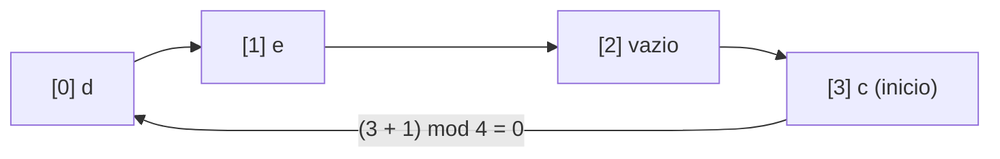

## Passo 1 · Leitura · FIFO e o custo escondido de list.pop(0)

Uma **fila** atende na ordem de chegada (FIFO, *first in, first out*): quem entra vai para o **fim**, quem sai sai pela **frente**. Fila de impressão, senhas de atendimento e a busca em largura do módulo 7 funcionam assim.

A tentação é usar uma `list` com `append` para entrar e `pop(0)` para sair. O resultado está certo, mas o custo não. A `list` guarda referências em posições contíguas; tirar a posição 0 obriga a mover cada uma das outras $n-1$ referências uma casa para a esquerda. Esvaziar uma fila de $n$ itens move

$$
(n-1) + (n-2) + \dots + 1 + 0 = \frac{n(n-1)}{2}
$$

referências: $\Theta(n^2)$. Com 100 mil pedidos são cerca de $5 \times 10^9$ movimentos, e dobrar a fila quadruplica o trabalho.

`collections.deque` (*double-ended queue*) resolve isso. Por dentro, ela é uma lista duplamente ligada de **blocos** de tamanho fixo, com referências para as duas pontas. Por isso as quatro operações das pontas custam $O(1)$:

```python
from collections import deque

fila = deque()
fila.append("ana")        # entra no fim
fila.append("bia")
fila.popleft()            # sai pela frente: 'ana'
fila.appendleft("caio")   # entra pela frente
fila.pop()                # sai pelo fim: 'bia'
```

Com as duas pontas baratas, a mesma `deque` serve de fila (`append` + `popleft`) e de pilha (`append` + `pop`). Há mais duas ferramentas:

- `deque(maxlen=k)` guarda só os $k$ itens mais recentes: ao inserir com a `deque` cheia, o item da **outra ponta** é descartado.
- `d.rotate(r)` gira a `deque` $r$ posições para a direita (os últimos $r$ vão para a frente); com $r$ negativo, gira para a esquerda. Custa $O(|r|)$.

O preço: o meio é caro. `d[i]` precisa andar pelos blocos e custa $O(n)$ perto do meio, e fatias não existem: `d[0:2]` levanta `TypeError: sequence index must be integer, not 'slice'`. Tirar de uma `deque` vazia levanta `IndexError: pop from an empty deque`. Escolha `list` quando precisa de acesso por índice; escolha `deque` quando o trabalho acontece nas pontas.

## Passo 2 · Previsão · As duas pontas, maxlen e rotate

O programa usa as operações do passo anterior. Leia sem executar e digite exatamente o que ele imprime.

### Código
```python
from collections import deque

d = deque([1, 2, 3])
d.append(4)
d.appendleft(0)
print(list(d))
print(d.popleft(), d.pop())
d.rotate(1)
print(list(d))

ultimos = deque(maxlen=3)
for letra in "abcde":
    ultimos.append(letra)
print("".join(ultimos))
ultimos.appendleft("z")
print("".join(ultimos))
```

### Dicas
1. `popleft()` e `pop()` tiram das pontas opostas; anote a `deque` depois de cada linha.
2. `rotate(1)` leva o último elemento para a frente.
3. Com `maxlen`, quem sai é sempre o item da ponta oposta à da inserção.

### Saída esperada
```text
[0, 1, 2, 3, 4]
0 4
[3, 1, 2]
cde
zcd
```

## Passo 3 · Leitura · Fila circular: arranjo fixo e índices módulo n

Às vezes a capacidade é fixa e conhecida: o *buffer* de um teclado, as últimas leituras de um sensor, um servidor que aceita no máximo $C$ pedidos pendentes. Aí dá para fazer uma fila sem nenhuma alocação depois de criada: um arranjo `[None] * C`, o índice `inicio` da frente e a quantidade `tamanho`.

O **invariante** diz onde estão os elementos:

> Os itens da fila ocupam as posições `inicio`, `inicio + 1`, …, `inicio + tamanho - 1`, todas tomadas módulo $C$, na ordem de chegada.

Daí saem as duas operações, ambas $O(1)$:

$$
\text{livre} = (\text{inicio} + \text{tamanho}) \bmod C \qquad \text{inicio} \leftarrow (\text{inicio} + 1) \bmod C
$$

Enfileirar grava em `livre` e soma 1 ao tamanho. Desenfileirar lê `dados[inicio]`, apaga a posição (para não segurar uma referência morta), avança `inicio` e subtrai 1. O módulo faz o índice dar a volta: depois da posição $C-1$ vem a 0.



No desenho, `inicio = 3` e `tamanho = 3`: a ordem é `c`, `d`, `e`, e a próxima escrita vai em $(3 + 3) \bmod 4 = 2$.

Dois erros são comuns. O primeiro é esquecer o módulo: o índice passa de $C-1$ para $C$ e vem `IndexError: list assignment index out of range` justamente quando a fila tem espaço, porque o espaço livre está no começo do arranjo. O segundo é guardar `inicio` e `fim` sem o `tamanho`: com a fila vazia e com a fila cheia, `inicio == fim` nos dois casos. Quem segue esse caminho precisa deixar uma posição sempre vazia, e a capacidade real vira $C-1$.

```python visualizar
C = 4
dados = [None] * C
inicio = 0
tamanho = 0
for letra in "abcde":
    if tamanho == C:
        dados[inicio] = None
        inicio = (inicio + 1) % C
        tamanho -= 1
    livre = (inicio + tamanho) % C
    dados[livre] = letra
    tamanho += 1
print(dados, inicio, tamanho)
```

## Passo 4 · Exercício · FilaCircular
modo: lacunas

Complete as lacunas (`___`) da classe `FilaCircular`. O arranjo `_dados` tem tamanho fixo: nunca use `append`, `insert` ou `pop` nele.

### Instruções
1. A fila está cheia quando a quantidade de itens chega à capacidade do arranjo.
2. Enfileirar grava na posição livre, calculada a partir de `_inicio` e `_tamanho`, com módulo.
3. Desenfileirar avança `_inicio` uma posição, dando a volta no fim do arranjo.
4. `para_lista()` devolve os itens da frente para o fim, sem alterar a fila.

### Código inicial
```python
class FilaCircular:
    def __init__(self, capacidade):
        self._dados = [None] * capacidade
        self._inicio = 0
        self._tamanho = 0

    def __len__(self):
        return self._tamanho

    def vazia(self):
        return self._tamanho == 0

    def cheia(self):
        return self._tamanho == ___

    def enfileirar(self, valor):
        if self.cheia():
            raise OverflowError("fila cheia")
        livre = (self._inicio + ___) % len(self._dados)
        self._dados[livre] = valor
        self._tamanho += 1

    def desenfileirar(self):
        if self.vazia():
            raise IndexError("fila vazia")
        valor = self._dados[self._inicio]
        self._dados[self._inicio] = None
        self._inicio = ___
        self._tamanho -= 1
        return valor

    def para_lista(self):
        return [self._dados[___] for i in range(self._tamanho)]
```

### Solução
```python
class FilaCircular:
    def __init__(self, capacidade):
        self._dados = [None] * capacidade
        self._inicio = 0
        self._tamanho = 0

    def __len__(self):
        return self._tamanho

    def vazia(self):
        return self._tamanho == 0

    def cheia(self):
        return self._tamanho == len(self._dados)

    def enfileirar(self, valor):
        if self.cheia():
            raise OverflowError("fila cheia")
        livre = (self._inicio + self._tamanho) % len(self._dados)
        self._dados[livre] = valor
        self._tamanho += 1

    def desenfileirar(self):
        if self.vazia():
            raise IndexError("fila vazia")
        valor = self._dados[self._inicio]
        self._dados[self._inicio] = None
        self._inicio = (self._inicio + 1) % len(self._dados)
        self._tamanho -= 1
        return valor

    def para_lista(self):
        return [self._dados[(self._inicio + i) % len(self._dados)] for i in range(self._tamanho)]
```

### Dicas
1. A capacidade é o tamanho do arranjo, que nunca muda.
2. Releia o invariante do passo anterior: o $i$-ésimo item da fila está em `(inicio + i) mod C`.
3. Simule a capacidade 3 com `a`, `b`, `c`, duas saídas e duas entradas: onde cada letra vai parar?

### Verificação
```json
[
  { "id": "fifo", "checkpoint": 2, "kind": "expr",
    "setup": "f = FilaCircular(4)\nfor v in [7, 8, 9]:\n    f.enfileirar(v)",
    "expr": "[f.desenfileirar(), f.desenfileirar(), len(f)]", "expected": [7, 8, 1],
    "name": "Sai na ordem de chegada" },
  { "id": "volta", "checkpoint": 3, "kind": "expr",
    "setup": "f = FilaCircular(3)\nfor v in 'abc':\n    f.enfileirar(v)\nf.desenfileirar()\nf.desenfileirar()\nf.enfileirar('d')\nf.enfileirar('e')",
    "expr": "[f.para_lista(), f._dados, f.cheia()]", "expected": [["c", "d", "e"], ["d", "e", "c"], true],
    "name": "Dá a volta no arranjo fixo", "hint": "Depois da última posição, a próxima é a 0." },
  { "id": "cheia-exata", "checkpoint": 1, "kind": "expr",
    "setup": "f = FilaCircular(3)\nfor v in [1, 2, 3]:\n    f.enfileirar(v)",
    "expr": "[len(f), f.cheia(), f.para_lista()]", "expected": [3, true, [1, 2, 3]],
    "name": "Capacidade 3 guarda 3 itens", "hint": "Com o tamanho guardado à parte, nenhuma posição precisa ficar vazia." },
  { "id": "estouro", "checkpoint": 1, "kind": "expr", "setup": "f = FilaCircular(2)\nf.enfileirar(1)\nf.enfileirar(2)",
    "expr": "f.enfileirar(3)", "raises": "OverflowError", "name": "Enfileirar na fila cheia levanta OverflowError" },
  { "id": "vazia", "checkpoint": 3, "kind": "expr", "setup": "f = FilaCircular(2)", "expr": "f.desenfileirar()",
    "raises": "IndexError", "name": "Desenfileirar da fila vazia levanta IndexError" },
  { "id": "limpa", "checkpoint": 3, "kind": "expr",
    "setup": "f = FilaCircular(3)\nf.enfileirar('x')\nf.enfileirar('y')\nf.desenfileirar()",
    "expr": "f._dados", "expected": [null, "y", null], "name": "A posição que sai volta a ser None" },
  { "id": "muitas-voltas", "checkpoint": 3, "kind": "expr",
    "setup": "f = FilaCircular(4)\nsaiu = []\nfor i in range(1000):\n    f.enfileirar(i)\n    if i >= 3:\n        saiu.append(f.desenfileirar())",
    "expr": "[len(f), saiu[:3], saiu[-1], len(f._dados), f.para_lista()]", "expected": [3, [0, 1, 2], 996, 4, [997, 998, 999]],
    "name": "Mil entradas numa fila de capacidade 4" },
  { "id": "capacidade-1", "checkpoint": 2, "kind": "expr",
    "setup": "f = FilaCircular(1)\nf.enfileirar('u')\nprimeiro = f.desenfileirar()\nf.enfileirar('v')",
    "expr": "[primeiro, f.para_lista(), f.cheia()]", "expected": ["u", ["v"], true], "name": "Funciona com capacidade 1" },
  { "id": "para-lista-vazia", "checkpoint": 4, "kind": "expr", "setup": "f = FilaCircular(5)", "expr": "f.para_lista()",
    "expected": [], "name": "para_lista() da fila vazia é []" }
]
```

### Soluções erradas
```python name="avança o início sem módulo"
class FilaCircular:
    def __init__(self, capacidade):
        self._dados = [None] * capacidade
        self._inicio = 0
        self._tamanho = 0

    def __len__(self):
        return self._tamanho

    def vazia(self):
        return self._tamanho == 0

    def cheia(self):
        return self._tamanho == len(self._dados)

    def enfileirar(self, valor):
        if self.cheia():
            raise OverflowError("fila cheia")
        livre = (self._inicio + self._tamanho) % len(self._dados)
        self._dados[livre] = valor
        self._tamanho += 1

    def desenfileirar(self):
        if self.vazia():
            raise IndexError("fila vazia")
        valor = self._dados[self._inicio]
        self._dados[self._inicio] = None
        self._inicio = self._inicio + 1
        self._tamanho -= 1
        return valor

    def para_lista(self):
        return [self._dados[(self._inicio + i) % len(self._dados)] for i in range(self._tamanho)]
```
```python name="posição livre ignora o início"
class FilaCircular:
    def __init__(self, capacidade):
        self._dados = [None] * capacidade
        self._inicio = 0
        self._tamanho = 0

    def __len__(self):
        return self._tamanho

    def vazia(self):
        return self._tamanho == 0

    def cheia(self):
        return self._tamanho == len(self._dados)

    def enfileirar(self, valor):
        if self.cheia():
            raise OverflowError("fila cheia")
        livre = self._tamanho % len(self._dados)
        self._dados[livre] = valor
        self._tamanho += 1

    def desenfileirar(self):
        if self.vazia():
            raise IndexError("fila vazia")
        valor = self._dados[self._inicio]
        self._dados[self._inicio] = None
        self._inicio = (self._inicio + 1) % len(self._dados)
        self._tamanho -= 1
        return valor

    def para_lista(self):
        return [self._dados[(self._inicio + i) % len(self._dados)] for i in range(self._tamanho)]
```
```python name="cheia com uma posição de folga"
class FilaCircular:
    def __init__(self, capacidade):
        self._dados = [None] * capacidade
        self._inicio = 0
        self._tamanho = 0

    def __len__(self):
        return self._tamanho

    def vazia(self):
        return self._tamanho == 0

    def cheia(self):
        return self._tamanho == len(self._dados) - 1

    def enfileirar(self, valor):
        if self.cheia():
            raise OverflowError("fila cheia")
        livre = (self._inicio + self._tamanho) % len(self._dados)
        self._dados[livre] = valor
        self._tamanho += 1

    def desenfileirar(self):
        if self.vazia():
            raise IndexError("fila vazia")
        valor = self._dados[self._inicio]
        self._dados[self._inicio] = None
        self._inicio = (self._inicio + 1) % len(self._dados)
        self._tamanho -= 1
        return valor

    def para_lista(self):
        return [self._dados[(self._inicio + i) % len(self._dados)] for i in range(self._tamanho)]
```
```python name="para_lista lê a partir da posição 0"
class FilaCircular:
    def __init__(self, capacidade):
        self._dados = [None] * capacidade
        self._inicio = 0
        self._tamanho = 0

    def __len__(self):
        return self._tamanho

    def vazia(self):
        return self._tamanho == 0

    def cheia(self):
        return self._tamanho == len(self._dados)

    def enfileirar(self, valor):
        if self.cheia():
            raise OverflowError("fila cheia")
        livre = (self._inicio + self._tamanho) % len(self._dados)
        self._dados[livre] = valor
        self._tamanho += 1

    def desenfileirar(self):
        if self.vazia():
            raise IndexError("fila vazia")
        valor = self._dados[self._inicio]
        self._dados[self._inicio] = None
        self._inicio = (self._inicio + 1) % len(self._dados)
        self._tamanho -= 1
        return valor

    def para_lista(self):
        return [self._dados[i] for i in range(self._tamanho)]
```
```python name="não limpa a posição que sai"
class FilaCircular:
    def __init__(self, capacidade):
        self._dados = [None] * capacidade
        self._inicio = 0
        self._tamanho = 0

    def __len__(self):
        return self._tamanho

    def vazia(self):
        return self._tamanho == 0

    def cheia(self):
        return self._tamanho == len(self._dados)

    def enfileirar(self, valor):
        if self.cheia():
            raise OverflowError("fila cheia")
        livre = (self._inicio + self._tamanho) % len(self._dados)
        self._dados[livre] = valor
        self._tamanho += 1

    def desenfileirar(self):
        if self.vazia():
            raise IndexError("fila vazia")
        valor = self._dados[self._inicio]
        self._inicio = (self._inicio + 1) % len(self._dados)
        self._tamanho -= 1
        return valor

    def para_lista(self):
        return [self._dados[(self._inicio + i) % len(self._dados)] for i in range(self._tamanho)]
```

## Passo 5 · Exercício · Round-robin e Josephus com deque

Duas simulações em que a fila gira. No escalonamento **round-robin**, cada processo usa o processador por no máximo `quantum` unidades de tempo; se ainda falta, volta para o fim da fila. Com `[("A", 3), ("B", 1), ("C", 4)]` e quantum 2: A roda de 0 a 2 e volta; B termina em 3; C roda de 3 a 5 e volta; A termina em 6; C termina em 8. O resultado é `[("B", 3), ("A", 6), ("C", 8)]`.

No problema de **Josephus**, as pessoas `1..n` estão em roda; contando a partir da pessoa atual, a `k`-ésima sai e a contagem recomeça na seguinte. Com `n = 7` e `k = 3`, a ordem de saída é `[3, 6, 2, 7, 5, 1, 4]`.

### Instruções
1. `round_robin(processos, quantum)` recebe uma lista de pares `(nome, tempo)` (tempos ≥ 1) e devolve a lista de pares `(nome, instante_de_termino)` na ordem em que os processos terminam. O relógio começa em 0 e avança só o tempo efetivamente usado. Não altere a lista recebida.
2. Use uma `deque`: tire da frente com `popleft()` e devolva ao fim com `append()`. Não use `pop`.
3. `josephus(n, k)` devolve a ordem de saída das pessoas `1..n`, usando `rotate` e `popleft` de uma `deque`.
4. As duas funções levantam `ValueError` se `quantum`, `n` ou `k` for menor que 1.

### Código inicial
```python
from collections import deque


def round_robin(processos, quantum):
    pass


def josephus(n, k):
    pass
```

### Solução
```python
from collections import deque


def round_robin(processos, quantum):
    if quantum < 1:
        raise ValueError("quantum precisa ser pelo menos 1")
    fila = deque(processos)
    relogio = 0
    concluidos = []
    while fila:
        nome, restante = fila.popleft()
        fatia = min(quantum, restante)
        relogio += fatia
        restante -= fatia
        if restante > 0:
            fila.append((nome, restante))
        else:
            concluidos.append((nome, relogio))
    return concluidos


def josephus(n, k):
    if n < 1 or k < 1:
        raise ValueError("n e k precisam ser pelo menos 1")
    roda = deque(range(1, n + 1))
    ordem = []
    while roda:
        roda.rotate(-(k - 1))
        ordem.append(roda.popleft())
    return ordem
```

### Dicas
1. No round-robin, o tempo usado numa vez é o menor entre o quantum e o que falta.
2. Em Josephus, os `k - 1` primeiros da contagem passam da frente para o fim; depois sai quem está na frente. Qual sinal de `rotate` faz isso?
3. Confira Josephus com `k = 1`: a ordem tem que ser `1, 2, …, n`.

### Verificação
```json
[
  { "id": "rr-volta", "checkpoint": 1, "kind": "call", "function": "round_robin", "args": [[["w", 4], ["v", 6], ["u", 2]], 3],
    "expected": [["u", 8], ["w", 9], ["v", 12]], "name": "round_robin com quantum 3",
    "hint": "Quem ainda tem tempo restante volta para o fim da fila." },
  { "id": "rr-quantum-grande", "checkpoint": 1, "kind": "call", "function": "round_robin",
    "args": [[["ana", 5], ["bia", 2], ["caio", 3]], 10], "expected": [["ana", 5], ["bia", 7], ["caio", 10]],
    "name": "Quantum maior que todos vira atendimento por ordem de chegada" },
  { "id": "rr-quantum-1", "checkpoint": 1, "kind": "call", "function": "round_robin", "args": [[["x", 3], ["y", 2], ["z", 1]], 1],
    "expected": [["z", 3], ["y", 5], ["x", 6]], "name": "Quantum 1 alterna um passo de cada" },
  { "id": "rr-exato", "checkpoint": 1, "kind": "call", "function": "round_robin", "args": [[["A", 2], ["B", 3]], 2],
    "expected": [["A", 2], ["B", 5]], "name": "Processo com tempo igual ao quantum termina na primeira vez",
    "hint": "Se o que falta cabe exatamente no quantum, o processo termina agora." },
  { "id": "rr-relogio", "checkpoint": 1, "kind": "call", "function": "round_robin", "args": [[["p", 1], ["q", 1]], 5],
    "expected": [["p", 1], ["q", 2]], "name": "O relógio avança só o tempo usado", "hint": "Quem termina antes do quantum libera o processador na hora." },
  { "id": "rr-vazio", "checkpoint": 1, "kind": "call", "function": "round_robin", "args": [[], 2], "expected": [],
    "name": "Sem processos, nada termina" },
  { "id": "rr-nao-altera", "checkpoint": 1, "kind": "expr", "setup": "procs = [('a', 3), ('b', 1)]\nround_robin(procs, 1)",
    "expr": "procs", "expected": [["a", 3], ["b", 1]], "name": "Não altera a lista recebida" },
  { "id": "rr-grande", "checkpoint": 1, "kind": "expr",
    "setup": "procs = [('p%d' % i, (i * 13) % 5 + 1) for i in range(2000)]\nr = round_robin(procs, 2)",
    "expr": "[len(r), r[0], r[1000], r[-1]]", "expected": [2000, ["p0", 1], ["p501", 4102], ["p1998", 6000]],
    "name": "2000 processos" },
  { "id": "usa-popleft", "checkpoint": 2, "kind": "source", "rule": { "type": "calls", "name": "popleft" },
    "name": "Tira da frente com popleft()" },
  { "id": "sem-pop", "checkpoint": 2, "kind": "source", "rule": { "type": "not_calls", "name": "pop" },
    "name": "Não usa pop (pop(0) numa list custa O(n))", "hint": "Numa deque, a frente sai com popleft()." },
  { "id": "jos-7-3", "checkpoint": 3, "kind": "call", "function": "josephus", "args": [10, 4], "expected": [4, 8, 2, 7, 3, 10, 9, 1, 6, 5],
    "name": "josephus(10, 4)", "hint": "Gire para a esquerda k - 1 posições e tire da frente." },
  { "id": "jos-6-2", "checkpoint": 3, "kind": "call", "function": "josephus", "args": [6, 2], "expected": [2, 4, 6, 3, 1, 5],
    "name": "josephus(6, 2)" },
  { "id": "jos-k1", "checkpoint": 3, "kind": "call", "function": "josephus", "args": [5, 1], "expected": [1, 2, 3, 4, 5],
    "name": "josephus(5, 1) sai em ordem" },
  { "id": "jos-1", "checkpoint": 3, "kind": "call", "function": "josephus", "args": [1, 9], "expected": [1],
    "name": "josephus(1, 9) é [1]" },
  { "id": "rr-quantum-0", "checkpoint": 4, "kind": "expr", "expr": "round_robin([('a', 1)], 0)", "raises": "ValueError",
    "name": "quantum 0 levanta ValueError" },
  { "id": "jos-k0", "checkpoint": 4, "kind": "expr", "expr": "josephus(4, 0)", "raises": "ValueError",
    "name": "josephus(4, 0) levanta ValueError" }
]
```

### Soluções erradas
```python name="avança o relógio um quantum inteiro"
from collections import deque


def round_robin(processos, quantum):
    if quantum < 1:
        raise ValueError("quantum precisa ser pelo menos 1")
    fila = deque(processos)
    relogio = 0
    concluidos = []
    while fila:
        nome, restante = fila.popleft()
        relogio += quantum
        restante -= quantum
        if restante > 0:
            fila.append((nome, restante))
        else:
            concluidos.append((nome, relogio))
    return concluidos


def josephus(n, k):
    if n < 1 or k < 1:
        raise ValueError("n e k precisam ser pelo menos 1")
    roda = deque(range(1, n + 1))
    ordem = []
    while roda:
        roda.rotate(-(k - 1))
        ordem.append(roda.popleft())
    return ordem
```
```python name="volta para a fila quando o que falta é igual ao quantum"
from collections import deque


def round_robin(processos, quantum):
    if quantum < 1:
        raise ValueError("quantum precisa ser pelo menos 1")
    fila = deque(processos)
    relogio = 0
    concluidos = []
    while fila:
        nome, restante = fila.popleft()
        if restante >= quantum:
            relogio += quantum
            fila.append((nome, restante - quantum))
        else:
            relogio += restante
            concluidos.append((nome, relogio))
    return concluidos


def josephus(n, k):
    if n < 1 or k < 1:
        raise ValueError("n e k precisam ser pelo menos 1")
    roda = deque(range(1, n + 1))
    ordem = []
    while roda:
        roda.rotate(-(k - 1))
        ordem.append(roda.popleft())
    return ordem
```
```python name="fila em list com pop(0)"
from collections import deque


def round_robin(processos, quantum):
    if quantum < 1:
        raise ValueError("quantum precisa ser pelo menos 1")
    fila = list(processos)
    relogio = 0
    concluidos = []
    while fila:
        nome, restante = fila.pop(0)
        fatia = min(quantum, restante)
        relogio += fatia
        restante -= fatia
        if restante > 0:
            fila.append((nome, restante))
        else:
            concluidos.append((nome, relogio))
    return concluidos


def josephus(n, k):
    if n < 1 or k < 1:
        raise ValueError("n e k precisam ser pelo menos 1")
    roda = deque(range(1, n + 1))
    ordem = []
    while roda:
        roda.rotate(-(k - 1))
        ordem.append(roda.popleft())
    return ordem
```
```python name="gira k posições em vez de k - 1"
from collections import deque


def round_robin(processos, quantum):
    if quantum < 1:
        raise ValueError("quantum precisa ser pelo menos 1")
    fila = deque(processos)
    relogio = 0
    concluidos = []
    while fila:
        nome, restante = fila.popleft()
        fatia = min(quantum, restante)
        relogio += fatia
        restante -= fatia
        if restante > 0:
            fila.append((nome, restante))
        else:
            concluidos.append((nome, relogio))
    return concluidos


def josephus(n, k):
    if n < 1 or k < 1:
        raise ValueError("n e k precisam ser pelo menos 1")
    roda = deque(range(1, n + 1))
    ordem = []
    while roda:
        roda.rotate(-k)
        ordem.append(roda.popleft())
    return ordem
```
```python name="gira para o lado errado"
from collections import deque


def round_robin(processos, quantum):
    if quantum < 1:
        raise ValueError("quantum precisa ser pelo menos 1")
    fila = deque(processos)
    relogio = 0
    concluidos = []
    while fila:
        nome, restante = fila.popleft()
        fatia = min(quantum, restante)
        relogio += fatia
        restante -= fatia
        if restante > 0:
            fila.append((nome, restante))
        else:
            concluidos.append((nome, relogio))
    return concluidos


def josephus(n, k):
    if n < 1 or k < 1:
        raise ValueError("n e k precisam ser pelo menos 1")
    roda = deque(range(1, n + 1))
    ordem = []
    while roda:
        roda.rotate(k - 1)
        ordem.append(roda.popleft())
    return ordem
```
```python name="devolve à frente da fila (appendleft)"
from collections import deque


def round_robin(processos, quantum):
    if quantum < 1:
        raise ValueError("quantum precisa ser pelo menos 1")
    fila = deque(processos)
    relogio = 0
    concluidos = []
    while fila:
        nome, restante = fila.popleft()
        fatia = min(quantum, restante)
        relogio += fatia
        restante -= fatia
        if restante > 0:
            fila.appendleft((nome, restante))
        else:
            concluidos.append((nome, relogio))
    return concluidos


def josephus(n, k):
    if n < 1 or k < 1:
        raise ValueError("n e k precisam ser pelo menos 1")
    roda = deque(range(1, n + 1))
    ordem = []
    while roda:
        roda.rotate(-(k - 1))
        ordem.append(roda.popleft())
    return ordem
```

## Passo 6 · Leitura · Máximo em janela deslizante com deque monotônica

Dada uma lista de $n$ números e um tamanho $k$, queremos o máximo de cada janela contígua de $k$ elementos: as leituras de temperatura mais altas de cada intervalo de 5 minutos, por exemplo. Há $n - k + 1$ janelas.

O jeito direto, `max(lista[i:i + k])` para cada `i`, refaz $k - 1$ comparações por janela: $\Theta((n-k+1)\,k)$, que com $n = 10^5$ e $k = 5 \times 10^4$ passa de $10^9$.

A observação que salva: se um elemento mais novo é **maior ou igual** a um mais velho, o mais velho nunca mais será máximo de janela nenhuma, porque sai antes e perde para o novo em todas as janelas que ainda compartilham. Ele pode ser descartado na hora.

Guarde numa `deque` os **índices** dos candidatos a máximo. O invariante é:

> Os índices na `deque` estão em ordem crescente, pertencem à janela atual, e os valores correspondentes são **estritamente decrescentes**. Logo, a frente é o máximo da janela.

Para cada novo índice `i` com valor `x`:

1. se a frente saiu da janela (`d[0] <= i - k`), tire-a com `popleft()`;
2. enquanto o valor do fim for `<= x`, tire-o com `pop()`: é um mais velho dominado;
3. `append(i)`;
4. se `i >= k - 1`, a janela que termina em `i` está completa e seu máximo é `lista[d[0]]`.

Guardamos índices, e não valores, porque o passo 1 precisa saber **quando** cada candidato entrou. Comparar valores para decidir a expiração erra quando há repetidos: o candidato da frente pode ser um 2 novo, e não o 2 que acabou de sair da janela.

Por que é linear, se há `while` dentro do `for`? Cada índice entra na `deque` **uma** vez e sai **no máximo uma** vez, por `pop()` ou por `popleft()`. Cada comparação do passo 2 ou tira alguém (no máximo $n$ vezes no total) ou encerra o `while` (uma vez por `i`). Então o total de comparações entre valores é no máximo $2n$, qualquer que seja $k$. Esse raciocínio, que soma o trabalho de todas as voltas em vez de multiplicar o pior caso de uma volta, é **análise amortizada**, a mesma do `append` da `list` no módulo 2.

## Passo 7 · Exercício · maximo_janela em O(n)

Escreva `maximo_janela(lista, k)` com a deque monotônica do passo anterior. A verificação conta as comparações entre valores da lista: com 2000 elementos e $k = 200$, sua função pode fazer no máximo 6000.

### Instruções
1. Se `k < 1`, levante `ValueError`. Se `k` for maior que o tamanho da lista (inclusive lista vazia), devolva `[]`.
2. Mantenha na `deque` só índices da janela atual, tirando pela frente quem expirou.
3. Antes de inserir um índice, tire pelo fim os índices cujos valores são menores ou iguais ao novo.
4. A partir da primeira janela completa, acrescente à resposta o valor da frente. A lista recebida não pode ser alterada.

### Código inicial
```python
from collections import deque


def maximo_janela(lista, k):
    pass
```

### Solução
```python
from collections import deque


def maximo_janela(lista, k):
    if k < 1:
        raise ValueError("k precisa ser pelo menos 1")
    if k > len(lista):
        return []
    d = deque()
    resposta = []
    for i, valor in enumerate(lista):
        if d and d[0] <= i - k:
            d.popleft()
        while d and lista[d[-1]] <= valor:
            d.pop()
        d.append(i)
        if i >= k - 1:
            resposta.append(lista[d[0]])
    return resposta
```

### Dicas
1. A comparação que decide a expiração é entre índices, não entre valores.
2. Pelo fim saem os dominados; pela frente sai quem ficou velho demais.
3. A primeira janela completa termina no índice `k - 1`.

### Verificação
```json
[
  { "id": "exemplo", "checkpoint": 4, "kind": "call", "function": "maximo_janela", "args": [[4, 2, 12, 3, 8, 1, 5, 7], 3],
    "expected": [12, 12, 12, 8, 8, 7], "name": "maximo_janela([4, 2, 12, 3, 8, 1, 5, 7], 3)" },
  { "id": "decrescente", "checkpoint": 2, "kind": "call", "function": "maximo_janela", "args": [[9, 8, 7, 6, 5, 4], 2],
    "expected": [9, 8, 7, 6, 5], "name": "Lista decrescente: a frente expira a cada passo",
    "hint": "O índice da frente pode ter saído da janela." },
  { "id": "repetidos", "checkpoint": 3, "kind": "call", "function": "maximo_janela", "args": [[2, 2, 2, 1], 2],
    "expected": [2, 2, 2], "name": "Valores repetidos", "hint": "Guarde índices: dois 2 diferentes têm índices diferentes." },
  { "id": "negativos", "checkpoint": 3, "kind": "call", "function": "maximo_janela", "args": [[-5, -1, -3, -4, -2], 2],
    "expected": [-1, -1, -3, -2], "name": "Números negativos" },
  { "id": "k1", "checkpoint": 4, "kind": "call", "function": "maximo_janela", "args": [[3, 1, 2], 1], "expected": [3, 1, 2],
    "name": "k = 1 devolve a própria lista" },
  { "id": "k-n", "checkpoint": 4, "kind": "call", "function": "maximo_janela", "args": [[3, 9, 2], 3], "expected": [9],
    "name": "k igual ao tamanho dá uma janela só", "hint": "A primeira janela completa termina no índice k - 1." },
  { "id": "k-maior", "checkpoint": 1, "kind": "call", "function": "maximo_janela", "args": [[1, 2], 3], "expected": [],
    "name": "k maior que a lista devolve []" },
  { "id": "vazia", "checkpoint": 1, "kind": "call", "function": "maximo_janela", "args": [[], 1], "expected": [],
    "name": "Lista vazia devolve []" },
  { "id": "k0", "checkpoint": 1, "kind": "expr", "expr": "maximo_janela([1, 2], 0)", "raises": "ValueError",
    "name": "k = 0 levanta ValueError" },
  { "id": "nao-altera", "checkpoint": 4, "kind": "expr", "setup": "v = [5, 1, 4, 2]\nmaximo_janela(v, 2)", "expr": "v",
    "expected": [5, 1, 4, 2], "name": "Não altera a lista recebida" },
  { "id": "conta-comparacoes", "checkpoint": 3, "kind": "expr",
    "setup": "class Num:\n    comparacoes = 0\n    def __init__(self, v):\n        self.v = v\n    def _o(self, outro):\n        Num.comparacoes += 1\n        return outro.v if isinstance(outro, Num) else outro\n    def __lt__(self, o):\n        return self.v < self._o(o)\n    def __le__(self, o):\n        return self.v <= self._o(o)\n    def __gt__(self, o):\n        return self.v > self._o(o)\n    def __ge__(self, o):\n        return self.v >= self._o(o)\n    def __eq__(self, o):\n        return self.v == self._o(o)\n    def __ne__(self, o):\n        return self.v != self._o(o)\n    __hash__ = object.__hash__\ndados = [(i * 7919) % 1009 for i in range(2000)]\nref = [max(dados[i:i + 200]) for i in range(len(dados) - 199)]\nnums = [Num(x) for x in dados]\nNum.comparacoes = 0\nr = maximo_janela(nums, 200)\nok = [x.v if isinstance(x, Num) else x for x in r] == ref",
    "expr": "[ok, Num.comparacoes <= 6000]", "expected": [true, true],
    "name": "2000 elementos e k = 200 com no máximo 6000 comparações",
    "hint": "Recalcular o máximo de cada janela custa cerca de k comparações por janela." }
]
```

### Soluções erradas
```python name="não tira da frente quem saiu da janela"
from collections import deque


def maximo_janela(lista, k):
    if k < 1:
        raise ValueError("k precisa ser pelo menos 1")
    if k > len(lista):
        return []
    d = deque()
    resposta = []
    for i, valor in enumerate(lista):
        while d and lista[d[-1]] <= valor:
            d.pop()
        d.append(i)
        if i >= k - 1:
            resposta.append(lista[d[0]])
    return resposta
```
```python name="tira os dominados pela frente"
from collections import deque


def maximo_janela(lista, k):
    if k < 1:
        raise ValueError("k precisa ser pelo menos 1")
    if k > len(lista):
        return []
    d = deque()
    resposta = []
    for i, valor in enumerate(lista):
        if d and d[0] <= i - k:
            d.popleft()
        while d and lista[d[0]] <= valor:
            d.popleft()
        d.append(i)
        if i >= k - 1:
            resposta.append(lista[d[0]])
    return resposta
```
```python name="guarda valores e expira por comparação de valor"
from collections import deque


def maximo_janela(lista, k):
    if k < 1:
        raise ValueError("k precisa ser pelo menos 1")
    if k > len(lista):
        return []
    d = deque()
    resposta = []
    for i, valor in enumerate(lista):
        if i >= k and d and d[0] == lista[i - k]:
            d.popleft()
        while d and d[-1] <= valor:
            d.pop()
        d.append(valor)
        if i >= k - 1:
            resposta.append(d[0])
    return resposta
```
```python name="max de cada fatia (O(nk))"
from collections import deque


def maximo_janela(lista, k):
    if k < 1:
        raise ValueError("k precisa ser pelo menos 1")
    if k > len(lista):
        return []
    return [max(lista[i:i + k]) for i in range(len(lista) - k + 1)]
```
```python name="max de uma deque com maxlen (O(nk))"
from collections import deque


def maximo_janela(lista, k):
    if k < 1:
        raise ValueError("k precisa ser pelo menos 1")
    if k > len(lista):
        return []
    janela = deque(maxlen=k)
    resposta = []
    for i, valor in enumerate(lista):
        janela.append(valor)
        if i >= k - 1:
            resposta.append(max(janela))
    return resposta
```
```python name="começa a responder um passo tarde"
from collections import deque


def maximo_janela(lista, k):
    if k < 1:
        raise ValueError("k precisa ser pelo menos 1")
    if k > len(lista):
        return []
    d = deque()
    resposta = []
    for i, valor in enumerate(lista):
        if d and d[0] <= i - k:
            d.popleft()
        while d and lista[d[-1]] <= valor:
            d.pop()
        d.append(i)
        if i >= k:
            resposta.append(lista[d[0]])
    return resposta
```

## Passo 8 · Quiz · Fila certa para cada problema

### Pergunta
Um programa esvazia uma fila de `n` pedidos com `while fila: pedido = fila.pop(0)`, em que `fila` é uma `list`. Se a quantidade de pedidos dobrar, o tempo para esvaziar a fila fica multiplicado por aproximadamente:
- [x] 4, porque cada `pop(0)` move todos os que ficaram e o total é $n(n-1)/2$ movimentos.
- [ ] 2, porque cada pedido é removido uma vez só.
- [ ] 1, porque `pop(0)` custa $O(1)$ como `pop()`.
- [ ] $\log_2 n$, porque a `list` divide o trabalho ao meio a cada remoção.
> Remover cada pedido é uma operação, mas cada uma desloca o resto da lista. A soma $(n-1) + \dots + 0$ é quadrática: dobrar $n$ quadruplica o trabalho. Com `deque.popleft()`, o total cai para $\Theta(n)$ e dobrar $n$ dobra o tempo.

### Pergunta
Uma `FilaCircular` com arranjo de capacidade 5 está com `inicio = 3` e `tamanho = 4`. Em que posição do arranjo o próximo `enfileirar` grava?
- [x] 2, porque $(3 + 4) \bmod 5 = 2$.
- [ ] 7, porque a posição livre é `inicio + tamanho`.
- [ ] 0, porque depois do fim do arranjo sempre se volta à posição 0.
- [ ] Nenhuma: com 4 itens numa capacidade 5 a fila já está cheia.
> Os itens ocupam 3, 4, 0 e 1. A posição livre é a seguinte à do último item, $(\text{inicio} + \text{tamanho}) \bmod C = 2$. A fila só fica cheia quando `tamanho` chega a 5.

### Pergunta
No máximo em janela com $k = 3$, a `deque` de índices está `[2, 4]`. Chega o índice 5 com um valor maior que `lista[4]` e menor que `lista[2]`. Como fica a `deque` depois de processar o índice 5?
- [x] `[5]`: o índice 2 expirou ($2 \le 5 - 3$) e o 4 foi dominado pelo novo valor.
- [ ] `[2, 5]`: o 4 é dominado, mas o 2 ainda tem o maior valor.
- [ ] `[2, 4, 5]`: a `deque` só perde elementos pela frente.
- [ ] `[4, 5]`: o 2 expirou e o 4 continua como candidato.
> A janela que termina em 5 é `[3, 4, 5]`: o índice 2 já saiu, mesmo tendo o maior valor. O 4 tem valor menor que o do 5 e sai antes dele, então nunca mais será máximo. Sobra só o 5.
