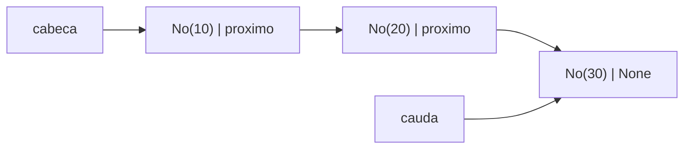

## Passo 1 · Leitura · Nós e referências, cabeça e cauda, e inversão *in-place*

Diferente de uma `list` do Python (que armazena referências em um bloco **contíguo** de memória), uma **lista ligada simples** (*singly linked list*) é formada por objetos independentes chamados **nós** (`No`). Cada nó guarda dois atributos:
- `valor`: o dado armazenado naquele ponto.
- `proximo`: a referência para o próximo `No` da sequência (ou `None` se for o último).



#### Comparação de custos: `ListaLigada` vs `list` do Python

Mantendo referências para `cabeca` (primeiro nó), `cauda` (último nó) e um contador `_tamanho`:

| Operação | `ListaLigada` (com `cabeca` e `cauda`) | `list` do Python (vetor dinâmico) |
| :--- | :---: | :---: |
| Inserir no **início** | **$O(1)$** | $O(n)$ (desloca todos os itens) |
| Remover do **início** | **$O(1)$** | $O(n)$ (desloca todos os itens) |
| Inserir no **fim** | **$O(1)$** (graças ao ponteiro `cauda`) | **$O(1)$** amortizado |
| Acesso por índice `i` | $O(n)$ (precisa caminhar nó a nó) | **$O(1)$** (endereço direto) |
| Busca / remoção por valor | $O(n)$ | $O(n)$ |

#### Inversão *in-place* com três ponteiros

Para inverter uma lista ligada sem criar novos nós (em $O(1)$ de memória auxiliar e $O(n)$ de tempo), percorremos a lista redirecionando cada seta `atual.proximo` para trás usando três variáveis: `anterior`, `atual` e `proximo_temp`.

> **Cuidado clássico**: antes de fazer `atual.proximo = anterior`, é **obrigatório** salvar `proximo_temp = atual.proximo`! Caso contrário, perdemos a referência para todo o restante da lista.

Acompanhe no visualizador a troca de ponteiros passo a passo:

```python visualizar
class No:
    def __init__(self, valor, proximo=None):
        self.valor = valor
        self.proximo = proximo

n3 = No(30)
n2 = No(20, n3)
n1 = No(10, n2)
cabeca = n1

anterior = None
atual = cabeca
while atual is not None:
    proximo_temp = atual.proximo
    atual.proximo = anterior
    anterior = atual
    atual = proximo_temp

nova_cabeca = anterior
valores = []
p = nova_cabeca
while p is not None:
    valores.append(p.valor)
    p = p.proximo
print("Invertida:", valores)
```

#### Técnica dos dois ponteiros: Tartaruga e Lebre (Floyd) e $k$-ésimo do fim

1. **Detecção de ciclo (algoritmo de Floyd)**: se o `proximo` de algum nó aponta de volta para um nó anterior, um laço `while atual is not None` entra em **loop infinito**. Para detectar ciclos em $O(n)$ de tempo e $O(1)$ de memória, avançamos dois ponteiros a partir da cabeça:
   - `lento` (tartaruga) avança **1 passo** por vez (`lento = lento.proximo`).
   - `rapido` (lebre) avança **2 passos** por vez (`rapido = rapido.proximo.proximo`).
   Se `rapido` chegar a `None`, não há ciclo. Se houver ciclo, a lebre dará uma volta e **alcançará a tartaruga** (`lento is rapido`)!
2. **$k$-ésimo elemento a partir do fim em uma única passagem**: avançamos um ponteiro `adiantado` por $k$ passos. Em seguida, caminhamos `lento` e `adiantado` juntos, 1 passo por vez, até `adiantado` chegar a `None`. Como a distância entre eles é sempre $k$, `lento` estará exatamente no $k$-ésimo nó a partir do fim!

## Passo 2 · Previsão · A ordem das atribuições ao manipular ponteiros

Observe o que acontece no código abaixo ao remover o segundo nó e inserir um novo nó na cabeça da lista. Preveja a saída exata.

### Código

```python
class No:
    def __init__(self, valor, proximo=None):
        self.valor = valor
        self.proximo = proximo

a = No("A")
b = No("B")
c = No("C")
a.proximo = b
b.proximo = c

# Pula o nó 'b' ligando 'a' diretamente ao próximo de 'b'
a.proximo = b.proximo

# Insere 'z' antes de 'a'
z = No("Z", a)
cabeca = z

saida = []
atual = cabeca
while atual is not None:
    saida.append(atual.valor)
    atual = atual.proximo

print(" -> ".join(saida))
print("b ainda aponta para:", b.proximo.valor)
```

### Dicas

1. Inicialmente temos `A -> B -> C`. A linha `a.proximo = b.proximo` faz `a.proximo` apontar diretamente para `c`, deixando `b` fora do caminho que parte de `a`.
2. Em seguida, `z = No("Z", a)` cria o nó `"Z"` cujo `proximo` é `a`, formando `Z -> A -> C`.
3. Note que `b.proximo` nunca foi alterado: o objeto `b` continua apontando para `c`!

### Saída esperada

```text
Z -> A -> C
b ainda aponta para: C
```

## Passo 3 · Exercício · Detectando ciclo com tartaruga e lebre (Floyd)

modo: ordenar

Ordene as linhas abaixo para implementar a classe `No` e a função `tem_ciclo(cabeca)` usando o algoritmo da tartaruga e da lebre de Floyd em $O(n)$ de tempo e $O(1)$ de memória auxiliar.

### Instruções

1. Defina a classe `No` com `__init__(self, valor, proximo=None)`.
2. Na função `tem_ciclo(cabeca)`, inicialize `lento = cabeca` e `rapido = cabeca`.
3. Enquanto `rapido is not None and rapido.proximo is not None`, avance `lento` em 1 passo e `rapido` em 2 passos; se `lento is rapido`, devolva `True`. Se o laço terminar, devolva `False`.

### Solução

```python
class No:
    def __init__(self, valor, proximo=None):
        self.valor = valor
        self.proximo = proximo


def tem_ciclo(cabeca) -> bool:
    lento = cabeca
    rapido = cabeca
    while rapido is not None and rapido.proximo is not None:
        lento = lento.proximo
        rapido = rapido.proximo.proximo
        if lento is rapido:
            return True
    return False
```

### Dicas

1. A definição da classe `No` vem primeiro, atribuindo `self.valor = valor` e `self.proximo = proximo`.
2. Dentro de `tem_ciclo(cabeca)`, a comparação `if lento is rapido:` deve ficar **depois** de avançar `lento` e `rapido` dentro do `while` (caso contrário, eles seriam iguais logo no início!).
3. O `return False` fica fora do `while`, quando `rapido` (ou `rapido.proximo`) atinge `None`.

### Verificação

```json
[
  {
    "id": "sem-ciclo",
    "name": "Devolve False para lista vazia, unitária e linear sem ciclo",
    "checkpoint": 1,
    "kind": "expr",
    "setup": "n1 = No(1, No(2, No(3, No(4))))",
    "expr": "[tem_ciclo(None), tem_ciclo(No(10)), tem_ciclo(n1)]",
    "expected": [false, false, false]
  },
  {
    "id": "com-ciclo-meio",
    "name": "Detecta ciclo que fecha no meio ou na cabeça da lista",
    "checkpoint": 3,
    "kind": "expr",
    "setup": "a = No(1)\nb = No(2)\nc = No(3)\nd = No(4)\na.proximo = b\nb.proximo = c\nc.proximo = d\nd.proximo = b\nsolo = No(99)\nsolo.proximo = solo",
    "expr": "[tem_ciclo(a), tem_ciclo(solo)]",
    "expected": [true, true]
  }
]
```

### Soluções erradas

```python name="Testa lento is rapido antes de avançar os ponteiros (devolve sempre True)"
class No:
    def __init__(self, valor, proximo=None):
        self.valor = valor
        self.proximo = proximo


def tem_ciclo(cabeca) -> bool:
    lento = cabeca
    rapido = cabeca
    while rapido is not None and rapido.proximo is not None:
        if lento is rapido:
            return True
        lento = lento.proximo
        rapido = rapido.proximo.proximo
    return False
```

```python name="Avança ambos os ponteiros apenas 1 passo por vez"
class No:
    def __init__(self, valor, proximo=None):
        self.valor = valor
        self.proximo = proximo


def tem_ciclo(cabeca) -> bool:
    lento = cabeca
    rapido = cabeca
    while rapido is not None and rapido.proximo is not None:
        lento = lento.proximo
        rapido = rapido.proximo
        if lento is rapido:
            return True
    return False
```

## Passo 4 · Exercício · Classe `ListaLigada` completa e inversão *in-place*

Implemente a classe `ListaLigada` mantendo `cabeca`, `cauda` e `_tamanho` para garantir `inserir_inicio` e `inserir_fim` em $O(1)$, além de `buscar`, `remover`, `__iter__`, `__len__` e `inverter` *in-place*.

### Instruções

1. Mantenha `self.cabeca = None`, `self.cauda = None` e `self._tamanho = 0`. Implemente `inserir_inicio(valor)` e `inserir_fim(valor)` em **$O(1)$** atualizando `cabeca`, `cauda` e `_tamanho` (cuidado quando a lista estava vazia!).
2. Implemente `buscar(valor) -> bool` (devolve `True` se `valor` estiver na lista, ou `False` caso contrário), `remover(valor) -> bool` (remove a **primeira ocorrência** de `valor` atualizando `cabeca` e `cauda` se necessário, decrementa `_tamanho` e devolve `True`; ou devolve `False` se não encontrar), `__len__()` e `__iter__()` (gerador que produz os valores do início ao fim).
3. Implemente `inverter() -> None` que inverte a lista ligada **in-place** redirecionando os ponteiros `proximo` de cada nó (sem criar novos nós e sem chamar `reversed`), atualizando também `self.cabeca` e `self.cauda`.

### Código inicial

```python
class No:
    def __init__(self, valor, proximo=None):
        self.valor = valor
        self.proximo = proximo


class ListaLigada:
    def __init__(self):
        self.cabeca = None
        self.cauda = None
        self._tamanho = 0

    def __len__(self) -> int:
        pass

    def __iter__(self):
        pass

    def inserir_inicio(self, valor) -> None:
        pass

    def inserir_fim(self, valor) -> None:
        pass

    def buscar(self, valor) -> bool:
        pass

    def remover(self, valor) -> bool:
        pass

    def inverter(self) -> None:
        pass
```

### Solução

```python
class No:
    def __init__(self, valor, proximo=None):
        self.valor = valor
        self.proximo = proximo


class ListaLigada:
    def __init__(self):
        self.cabeca = None
        self.cauda = None
        self._tamanho = 0

    def __len__(self) -> int:
        return self._tamanho

    def __iter__(self):
        atual = self.cabeca
        while atual is not None:
            yield atual.valor
            atual = atual.proximo

    def inserir_inicio(self, valor) -> None:
        novo = No(valor, self.cabeca)
        self.cabeca = novo
        if self.cauda is None:
            self.cauda = novo
        self._tamanho += 1

    def inserir_fim(self, valor) -> None:
        novo = No(valor)
        if self.cauda is None:
            self.cabeca = novo
            self.cauda = novo
        else:
            self.cauda.proximo = novo
            self.cauda = novo
        self._tamanho += 1

    def buscar(self, valor) -> bool:
        for item in self:
            if item == valor:
                return True
        return False

    def remover(self, valor) -> bool:
        anterior = None
        atual = self.cabeca
        while atual is not None:
            if atual.valor == valor:
                if anterior is None:
                    self.cabeca = atual.proximo
                else:
                    anterior.proximo = atual.proximo
                if atual is self.cauda:
                    self.cauda = anterior
                self._tamanho -= 1
                return True
            anterior = atual
            atual = atual.proximo
        return False

    def inverter(self) -> None:
        self.cauda = self.cabeca
        anterior = None
        atual = self.cabeca
        while atual is not None:
            proximo_temp = atual.proximo
            atual.proximo = anterior
            anterior = atual
            atual = proximo_temp
        self.cabeca = anterior
```

### Dicas

1. Em `inserir_inicio`, se `self.cauda is None` (lista estava vazia), a nova `cauda` também passa a ser o `novo` nó. Em `inserir_fim`, ligue `self.cauda.proximo = novo` e atualize `self.cauda = novo` em $O(1)$.
2. Em `remover(valor)`, trate dois casos especiais: quando o nó removido é a `cabeca` (`anterior is None`, então `self.cabeca = atual.proximo`) e quando o nó removido é a `cauda` (`atual is self.cauda`, então `self.cauda = anterior`).
3. Em `inverter()`, antes do laço, lembre-se de que a antiga `self.cabeca` passará a ser a nova `self.cauda`!

### Verificação

```json
[
  {
    "id": "insercao-inicio-fim-iter",
    "name": "Inserções no início e no fim mantêm ordem, tamanho, cabeça e cauda",
    "checkpoint": 1,
    "kind": "expr",
    "setup": "ll = ListaLigada()\nll.inserir_fim(20)\nll.inserir_inicio(10)\nll.inserir_fim(30)\nll.inserir_inicio(5)",
    "expr": "(list(ll), len(ll), ll.cabeca.valor, ll.cauda.valor)",
    "expected": [[5, 10, 20, 30], 4, 5, 30]
  },
  {
    "id": "buscar-e-remover-casos",
    "name": "Busca e remoção na cabeça, no meio, na cauda e em elemento inexistente",
    "checkpoint": 2,
    "kind": "expr",
    "setup": "ll = ListaLigada()\nfor v in [10, 20, 30, 40]:\n    ll.inserir_fim(v)\nb1 = ll.buscar(30)\nb2 = ll.buscar(99)\nr_cabeca = ll.remover(10)\nr_cauda = ll.remover(40)\nll.inserir_fim(50)\nr_meio = ll.remover(30)\nr_inex = ll.remover(999)",
    "expr": "(b1, b2, r_cabeca, r_cauda, r_meio, r_inex, list(ll), len(ll), ll.cabeca.valor, ll.cauda.valor)",
    "expected": [true, false, true, true, true, false, [20, 50], 2, 20, 50]
  },
  {
    "id": "inverter-in-place",
    "name": "Inverte a lista in-place reutilizando os mesmos objetos No e atualizando cauda",
    "checkpoint": 3,
    "kind": "expr",
    "setup": "ll = ListaLigada()\nfor v in [1, 2, 3, 4]:\n    ll.inserir_fim(v)\nids_antes = []\np = ll.cabeca\nwhile p:\n    ids_antes.append(id(p))\n    p = p.proximo\nll.inverter()\nids_depois = []\np = ll.cabeca\nwhile p:\n    ids_depois.append(id(p))\n    p = p.proximo\nll.inserir_fim(0)",
    "expr": "(list(ll), ids_depois == ids_antes[::-1], ll.cabeca.valor, ll.cauda.valor)",
    "expected": [[4, 3, 2, 1, 0], true, 4, 0]
  },
  {
    "id": "inverter-sem-reversed",
    "name": "Não usa reversed() para inverter",
    "checkpoint": 3,
    "kind": "source",
    "rule": { "type": "not_calls", "name": "reversed" }
  }
]
```

### Soluções erradas

```python name="Esquece de atualizar self.cauda ao remover o último nó ou inverter"
class No:
    def __init__(self, valor, proximo=None):
        self.valor = valor
        self.proximo = proximo


class ListaLigada:
    def __init__(self):
        self.cabeca = None
        self.cauda = None
        self._tamanho = 0

    def __len__(self) -> int:
        return self._tamanho

    def __iter__(self):
        atual = self.cabeca
        while atual is not None:
            yield atual.valor
            atual = atual.proximo

    def inserir_inicio(self, valor) -> None:
        novo = No(valor, self.cabeca)
        self.cabeca = novo
        if self.cauda is None:
            self.cauda = novo
        self._tamanho += 1

    def inserir_fim(self, valor) -> None:
        novo = No(valor)
        if self.cauda is None:
            self.cabeca = novo
            self.cauda = novo
        else:
            self.cauda.proximo = novo
            self.cauda = novo
        self._tamanho += 1

    def buscar(self, valor) -> bool:
        return any(x == valor for x in self)

    def remover(self, valor) -> bool:
        anterior = None
        atual = self.cabeca
        while atual is not None:
            if atual.valor == valor:
                if anterior is None:
                    self.cabeca = atual.proximo
                else:
                    anterior.proximo = atual.proximo
                self._tamanho -= 1
                return True
            anterior = atual
            atual = atual.proximo
        return False

    def inverter(self) -> None:
        anterior = None
        atual = self.cabeca
        while atual is not None:
            proximo_temp = atual.proximo
            atual.proximo = anterior
            anterior = atual
            atual = proximo_temp
        self.cabeca = anterior
```

```python name="Não trata a remoção da cabeça da lista (anterior is None)"
class No:
    def __init__(self, valor, proximo=None):
        self.valor = valor
        self.proximo = proximo


class ListaLigada:
    def __init__(self):
        self.cabeca = None
        self.cauda = None
        self._tamanho = 0

    def __len__(self) -> int:
        return self._tamanho

    def __iter__(self):
        atual = self.cabeca
        while atual is not None:
            yield atual.valor
            atual = atual.proximo

    def inserir_inicio(self, valor) -> None:
        novo = No(valor, self.cabeca)
        self.cabeca = novo
        if self.cauda is None:
            self.cauda = novo
        self._tamanho += 1

    def inserir_fim(self, valor) -> None:
        novo = No(valor)
        if self.cauda is None:
            self.cabeca = novo
            self.cauda = novo
        else:
            self.cauda.proximo = novo
            self.cauda = novo
        self._tamanho += 1

    def buscar(self, valor) -> bool:
        return any(x == valor for x in self)

    def remover(self, valor) -> bool:
        anterior = self.cabeca
        atual = self.cabeca.proximo if self.cabeca else None
        while atual is not None:
            if atual.valor == valor:
                anterior.proximo = atual.proximo
                if atual is self.cauda:
                    self.cauda = anterior
                self._tamanho -= 1
                return True
            anterior = atual
            atual = atual.proximo
        return False

    def inverter(self) -> None:
        self.cauda = self.cabeca
        anterior = None
        atual = self.cabeca
        while atual is not None:
            proximo_temp = atual.proximo
            atual.proximo = anterior
            anterior = atual
            atual = proximo_temp
        self.cabeca = anterior
```

## Passo 5 · Exercício · $k$-ésimo a partir do fim e intercalação de listas ordenadas

Implemente duas funções clássicas sobre nós encadeados (`No(valor, proximo)`): `k_esimo_do_fim(cabeca, k)` e `intercalar_ordenadas(a, b)`.

### Instruções

1. Implemente `k_esimo_do_fim(cabeca, k: int)` que devolve o **valor** do $k$-ésimo nó a partir do fim da lista ligada (`k = 1` é o último nó, `k = 2` é o penúltimo, etc.). Se `k <= 0` ou `k` for maior que o comprimento da lista, devolva `None`. Use a técnica dos dois ponteiros distanciados por `k` passos.
2. Implemente `intercalar_ordenadas(a, b)` que recebe as cabeças `a` e `b` de duas listas ligadas já ordenadas em ordem crescente e devolve a cabeça de uma única lista ligada ordenada formada religando os nós existentes (use um **nó sentinela** temporário `dummy = No(0)` para simplificar a construção).

### Código inicial

```python
class No:
    def __init__(self, valor, proximo=None):
        self.valor = valor
        self.proximo = proximo


def k_esimo_do_fim(cabeca, k: int):
    # Devolva o valor do k-ésimo nó a partir do fim (ou None se inválido)
    pass


def intercalar_ordenadas(a, b):
    # Intercale as listas ligadas ordenadas 'a' e 'b' e devolva a nova cabeça
    pass
```

### Solução

```python
class No:
    def __init__(self, valor, proximo=None):
        self.valor = valor
        self.proximo = proximo


def k_esimo_do_fim(cabeca, k: int):
    if k <= 0 or cabeca is None:
        return None
    adiantado = cabeca
    for _ in range(k):
        if adiantado is None:
            return None
        adiantado = adiantado.proximo
    lento = cabeca
    while adiantado is not None:
        lento = lento.proximo
        adiantado = adiantado.proximo
    return lento.valor


def intercalar_ordenadas(a, b):
    sentinela = No(0)
    cauda = sentinela
    while a is not None and b is not None:
        if a.valor <= b.valor:
            cauda.proximo = a
            a = a.proximo
        else:
            cauda.proximo = b
            b = b.proximo
        cauda = cauda.proximo
    cauda.proximo = a if a is not None else b
    return sentinela.proximo
```

### Dicas

1. Em `k_esimo_do_fim`, faça um laço `for _ in range(k):`: se `adiantado` for `None` antes de completar os `k` passos, `k` é maior que o tamanho da lista — devolva `None`.
2. Depois de abrir a vantagem de `k` passos, avance `lento` e `adiantado` juntos enquanto `adiantado is not None`.
3. Em `intercalar_ordenadas`, ao sair do `while a is not None and b is not None`, basta fazer `cauda.proximo = a if a is not None else b` para anexar o restante da lista que sobrou em $O(1)$!

### Verificação

```json
[
  {
    "id": "k-esimo-do-fim-validos",
    "name": "Encontra último, penúltimo e primeiro elemento com k_esimo_do_fim",
    "checkpoint": 1,
    "kind": "expr",
    "setup": "c = No(10, No(20, No(30, No(40, No(50)))))",
    "expr": "(k_esimo_do_fim(c, 1), k_esimo_do_fim(c, 2), k_esimo_do_fim(c, 5))",
    "expected": [50, 40, 10]
  },
  {
    "id": "k-esimo-do-fim-invalidos",
    "name": "Devolve None quando k > tamanho, k <= 0 ou lista vazia",
    "checkpoint": 1,
    "kind": "expr",
    "setup": "c = No(10, No(20))",
    "expr": "(k_esimo_do_fim(c, 3), k_esimo_do_fim(c, 0), k_esimo_do_fim(None, 1))",
    "expected": [null, null, null]
  },
  {
    "id": "intercalar-ordenadas-teste",
    "name": "Intercala duas listas ligadas ordenadas religando os nós",
    "checkpoint": 2,
    "kind": "expr",
    "setup": "a = No(1, No(4, No(7)))\nb = No(2, No(3, No(4, No(9))))\nh = intercalar_ordenadas(a, b)\nres = []\nwhile h is not None:\n    res.append(h.valor)\n    h = h.proximo\nh_vazia = intercalar_ordenadas(None, No(5))",
    "expr": "(res, h_vazia.valor)",
    "expected": [[1, 2, 3, 4, 4, 7, 9], 5]
  }
]
```

### Soluções erradas

```python name="Erra por 1 passo em k_esimo_do_fim (para em adiantado.proximo is not None)"
class No:
    def __init__(self, valor, proximo=None):
        self.valor = valor
        self.proximo = proximo


def k_esimo_do_fim(cabeca, k: int):
    if k <= 0 or cabeca is None:
        return None
    adiantado = cabeca
    for _ in range(k):
        if adiantado is None:
            return None
        adiantado = adiantado.proximo
    lento = cabeca
    while adiantado is not None and adiantado.proximo is not None:
        lento = lento.proximo
        adiantado = adiantado.proximo
    return lento.valor


def intercalar_ordenadas(a, b):
    sentinela = No(0)
    cauda = sentinela
    while a is not None and b is not None:
        if a.valor <= b.valor:
            cauda.proximo = a
            a = a.proximo
        else:
            cauda.proximo = b
            b = b.proximo
        cauda = cauda.proximo
    cauda.proximo = a if a is not None else b
    return sentinela.proximo
```

```python name="Esquece de anexar os nós restantes de a ou b ao fim de intercalar_ordenadas"
class No:
    def __init__(self, valor, proximo=None):
        self.valor = valor
        self.proximo = proximo


def k_esimo_do_fim(cabeca, k: int):
    if k <= 0 or cabeca is None:
        return None
    adiantado = cabeca
    for _ in range(k):
        if adiantado is None:
            return None
        adiantado = adiantado.proximo
    lento = cabeca
    while adiantado is not None:
        lento = lento.proximo
        adiantado = adiantado.proximo
    return lento.valor


def intercalar_ordenadas(a, b):
    sentinela = No(0)
    cauda = sentinela
    while a is not None and b is not None:
        if a.valor <= b.valor:
            cauda.proximo = a
            a = a.proximo
        else:
            cauda.proximo = b
            b = b.proximo
        cauda = cauda.proximo
    return sentinela.proximo
```

## Passo 6 · Quiz · Custos de listas ligadas vs `list`

### Pergunta

Por que acessar o $i$-ésimo elemento de uma lista ligada simples de $n$ elementos custa $O(n)$ no pior caso, enquanto em uma `list` do Python (`lista[i]`) custa $O(1)$?

- [ ] Porque a lista ligada precisa ordenar seus elementos antes de cada acesso.
- [x] Porque os nós da lista ligada estão espalhados na memória e só podem ser alcançados seguindo os ponteiros `proximo` um a um a partir da cabeça, enquanto a `list` armazena referências em posições contíguas de memória (`endereco_base + i * tamanho_ponteiro`).
- [ ] Porque o Python proíbe o operador `[]` em classes definidas pelo usuário.
- [ ] Porque a `list` usa uma árvore binária interna.

> Sem contiguidade física na memória, não existe aritmética de ponteiros para saltar diretamente ao índice $i$: é obrigatório caminhar pelos $i$ nós anteriores.

### Pergunta

Se uma `ListaLigada` mantiver apenas o ponteiro `cabeca` (sem ponteiro `cauda`), qual é o custo de `inserir_fim(valor)` em uma lista com $n$ elementos?

- [ ] $O(1)$
- [ ] $O(\log n)$
- [x] $O(n)$, pois será necessário percorrer todos os $n$ nós a partir de `cabeca` até encontrar o último nó (`atual.proximo is None`).
- [ ] $O(n^2)$

> Guardar a referência `self.cauda` para o último nó reduz o custo de `inserir_fim` de $O(n)$ para $O(1)$. Já remover o último nó em uma lista **simplesmente** ligada continua custando $O(n)$ mesmo com `cauda`, porque precisamos atualizar o penúltimo nó!
