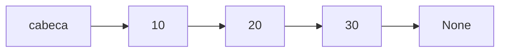

## Passo 1 · Leitura · Nós, referências e o custo de cada operação

A `list` do Python guarda referências em posições **contíguas** de memória: o elemento `i` está num endereço calculável, por isso `lista[i]` custa $O(1)$. O preço aparece no meio: inserir ou remover na posição `i` desloca todos os que vêm depois.

Uma **lista ligada simples** troca contiguidade por referências. Cada **nó** é um objeto com o valor e uma referência para o próximo nó; o último aponta para `None`. A lista em si é só a referência para o primeiro nó, a **cabeça**.

```python
class No:
    def __init__(self, valor, proximo=None):
        self.valor = valor
        self.proximo = proximo

cabeca = No(10, No(20, No(30)))
atual = cabeca
while atual is not None:      # percorrer: O(n)
    print(atual.valor)
    atual = atual.proximo
```



Mudar a estrutura é mudar setas, e isso não depende do tamanho da lista. **Dado o nó**, inserir ou remover logo depois dele custa $O(1)$:

| operação | lista ligada | `list` |
|---|---|---|
| inserir/remover na frente | $O(1)$ | $O(n)$ |
| inserir/remover logo após um nó que você já tem | $O(1)$ | $O(n)$ |
| acessar a posição `i` | $O(i)$ | $O(1)$ |
| buscar um valor | $O(n)$ | $O(n)$ |

O "dado o nó" é a letra miúda: para remover o valor 20 você ainda precisa **achá-lo**, e a busca é $O(n)$. A lista ligada ganha quando o programa já guarda referências para os nós, como o cursor de um editor ou o cache do fim deste módulo.

Três erros aparecem em quase todo código de lista ligada:

- **Perder o resto da lista.** `cabeca = No(5)` cria um nó novo sem ligá-lo aos antigos; os antigos ficam sem referência e o coletor de lixo os apaga. O certo é `cabeca = No(5, cabeca)`.
- **Atribuir na ordem errada.** Para inserir `novo` depois de `no`, primeiro `novo.proximo = no.proximo`, depois `no.proximo = novo`. Invertidas, as duas linhas fazem `novo` apontar para si mesmo: um ciclo.
- **Andar além do fim.** `atual.proximo.valor` com `atual.proximo` igual a `None` levanta `AttributeError: 'NoneType' object has no attribute 'valor'`.

Com um ciclo, o laço `while atual is not None` nunca termina: o `None` nunca chega.

## Passo 2 · Previsão · A ordem das atribuições

O programa faz três tentativas de alterar uma lista `A -> B -> C`. A função `mostrar` imprime no máximo 6 valores, para que um ciclo não trave o programa. Leia sem executar e digite exatamente o que ele imprime.

### Código
```python
class No:
    def __init__(self, valor, proximo=None):
        self.valor = valor
        self.proximo = proximo


def mostrar(cabeca, limite=6):
    valores = []
    atual = cabeca
    while atual is not None and len(valores) < limite:
        valores.append(atual.valor)
        atual = atual.proximo
    print(" -> ".join(valores))


cabeca = No("A", No("B", No("C")))
x = No("X")
x.proximo = cabeca.proximo
cabeca.proximo = x
mostrar(cabeca)

cabeca = No("A", No("B", No("C")))
y = No("Y")
cabeca.proximo = y
y.proximo = cabeca.proximo
mostrar(cabeca)

cabeca = No("A", No("B", No("C")))
cabeca = No("Z")
mostrar(cabeca)
```

### Dicas
1. Desenhe as setas e atualize o desenho a cada atribuição, na ordem em que elas acontecem.
2. Na segunda tentativa, quando `y.proximo = cabeca.proximo` roda, para quem `cabeca.proximo` já aponta?
3. Na terceira, `No("Z")` é criado com `proximo` igual a quê?

### Saída esperada
```text
A -> X -> B -> C
A -> Y -> Y -> Y -> Y -> Y
Z
```

## Passo 3 · Exercício · ListaLigada com cabeça e cauda
modo: lacunas

Uma `ListaLigada` guarda a cabeça, a **cauda** (o último nó) e o tamanho. Com a cauda, inserir no fim custa $O(1)$: não é preciso andar até o último nó. Complete as lacunas (`___`).

### Instruções
1. O iterador anda nó a nó da cabeça até o fim, produzindo os valores.
2. `inserir_inicio` liga o nó novo à antiga cabeça; numa lista vazia, ele também é a cauda.
3. `inserir_fim` liga o nó novo depois da cauda atual, sem percorrer a lista, e o nó novo passa a ser a cauda.
4. `buscar(valor)` devolve o **nó** com aquele valor (o primeiro, se houver vários) ou `None`.

### Código inicial
```python
class No:
    def __init__(self, valor, proximo=None):
        self.valor = valor
        self.proximo = proximo


class ListaLigada:
    def __init__(self):
        self.cabeca = None
        self.cauda = None
        self._tamanho = 0

    def __len__(self):
        return self._tamanho

    def __iter__(self):
        atual = self.cabeca
        while atual is not None:
            yield atual.valor
            atual = ___

    def inserir_inicio(self, valor):
        self.cabeca = No(valor, ___)
        if self.cauda is None:
            self.cauda = self.cabeca
        self._tamanho += 1

    def inserir_fim(self, valor):
        novo = No(valor)
        if self.cauda is None:
            self.cabeca = novo
        else:
            ___ = novo
        self.cauda = ___
        self._tamanho += 1

    def buscar(self, valor):
        atual = self.cabeca
        while atual is not None:
            if atual.valor == valor:
                return ___
            atual = atual.proximo
        return None
```

### Solução
```python
class No:
    def __init__(self, valor, proximo=None):
        self.valor = valor
        self.proximo = proximo


class ListaLigada:
    def __init__(self):
        self.cabeca = None
        self.cauda = None
        self._tamanho = 0

    def __len__(self):
        return self._tamanho

    def __iter__(self):
        atual = self.cabeca
        while atual is not None:
            yield atual.valor
            atual = atual.proximo

    def inserir_inicio(self, valor):
        self.cabeca = No(valor, self.cabeca)
        if self.cauda is None:
            self.cauda = self.cabeca
        self._tamanho += 1

    def inserir_fim(self, valor):
        novo = No(valor)
        if self.cauda is None:
            self.cabeca = novo
        else:
            self.cauda.proximo = novo
        self.cauda = novo
        self._tamanho += 1

    def buscar(self, valor):
        atual = self.cabeca
        while atual is not None:
            if atual.valor == valor:
                return atual
            atual = atual.proximo
        return None
```

### Dicas
1. Releia o primeiro erro do passo 1: o nó novo da frente precisa apontar para alguém.
2. Quem é o último nó antes da inserção no fim? A seta que muda sai dele.
3. Devolver o nó, e não o valor, permite as operações $O(1)$ "dado o nó" do próximo passo.

### Verificação
```json
[
  { "id": "fim", "checkpoint": 3, "kind": "expr",
    "setup": "ll = ListaLigada()\nfor v in [4, 5, 6]:\n    ll.inserir_fim(v)",
    "expr": "[list(ll), len(ll), ll.cabeca.valor, ll.cauda.valor]", "expected": [[4, 5, 6], 3, 4, 6],
    "name": "inserir_fim mantém a ordem e a cauda", "hint": "A cauda precisa mudar a cada inserção no fim." },
  { "id": "inicio", "checkpoint": 2, "kind": "expr",
    "setup": "ll = ListaLigada()\nfor v in [4, 5, 6]:\n    ll.inserir_inicio(v)",
    "expr": "[list(ll), len(ll), ll.cauda.valor]", "expected": [[6, 5, 4], 3, 4],
    "name": "inserir_inicio não perde o resto", "hint": "O nó novo precisa apontar para a cabeça antiga." },
  { "id": "misto", "checkpoint": 3, "kind": "expr",
    "setup": "ll = ListaLigada()\nll.inserir_inicio('b')\nll.inserir_fim('c')\nll.inserir_inicio('a')\nll.inserir_fim('d')",
    "expr": "[list(ll), ll.cabeca.valor, ll.cauda.valor, ll.cauda.proximo is None]", "expected": [["a", "b", "c", "d"], "a", "d", true],
    "name": "Inserções alternadas no início e no fim", "hint": "Depois de inserir no início de uma lista vazia, quem é a cauda?" },
  { "id": "vazia", "checkpoint": 1, "kind": "expr", "setup": "ll = ListaLigada()",
    "expr": "[list(ll), len(ll), ll.cabeca is None, ll.cauda is None]", "expected": [[], 0, true, true],
    "name": "Lista nova está vazia" },
  { "id": "fim-o1", "checkpoint": 3, "kind": "expr",
    "setup": "leituras = [0]\ndef _ler(self):\n    leituras[0] += 1\n    return self.__dict__['proximo']\ndef _gravar(self, v):\n    self.__dict__['proximo'] = v\nNo.proximo = property(_ler, _gravar)\nll = ListaLigada()\nfor i in range(500):\n    ll.inserir_fim(i)",
    "expr": "[len(ll), ll.cauda.valor, leituras[0] <= 10]", "expected": [500, 499, true],
    "name": "inserir_fim não percorre a lista", "hint": "Com a cauda guardada, nenhuma seta precisa ser lida para achar o último nó." },
  { "id": "buscar-no", "checkpoint": 4, "kind": "expr",
    "setup": "ll = ListaLigada()\nfor v in [10, 20, 30]:\n    ll.inserir_fim(v)\nno = ll.buscar(20)",
    "expr": "[no is ll.cabeca.proximo, no.valor]", "expected": [true, 20],
    "name": "buscar devolve o próprio nó", "hint": "Devolva o objeto No, não o valor nem True." },
  { "id": "buscar-primeiro", "checkpoint": 4, "kind": "expr",
    "setup": "ll = ListaLigada()\nfor v in [7, 8, 7]:\n    ll.inserir_fim(v)",
    "expr": "ll.buscar(7) is ll.cabeca", "expected": true, "name": "Com repetidos, devolve o primeiro" },
  { "id": "buscar-ausente", "checkpoint": 4, "kind": "expr",
    "setup": "ll = ListaLigada()\nll.inserir_fim(1)", "expr": "ll.buscar(99)", "expected": null, "name": "Valor ausente devolve None" }
]
```

### Soluções erradas
```python name="nó novo da frente sem ligação (perde o resto)"
class No:
    def __init__(self, valor, proximo=None):
        self.valor = valor
        self.proximo = proximo


class ListaLigada:
    def __init__(self):
        self.cabeca = None
        self.cauda = None
        self._tamanho = 0

    def __len__(self):
        return self._tamanho

    def __iter__(self):
        atual = self.cabeca
        while atual is not None:
            yield atual.valor
            atual = atual.proximo

    def inserir_inicio(self, valor):
        self.cabeca = No(valor)
        if self.cauda is None:
            self.cauda = self.cabeca
        self._tamanho += 1

    def inserir_fim(self, valor):
        novo = No(valor)
        if self.cauda is None:
            self.cabeca = novo
        else:
            self.cauda.proximo = novo
        self.cauda = novo
        self._tamanho += 1

    def buscar(self, valor):
        atual = self.cabeca
        while atual is not None:
            if atual.valor == valor:
                return atual
            atual = atual.proximo
        return None
```
```python name="não atualiza a cauda no inserir_fim"
class No:
    def __init__(self, valor, proximo=None):
        self.valor = valor
        self.proximo = proximo


class ListaLigada:
    def __init__(self):
        self.cabeca = None
        self.cauda = None
        self._tamanho = 0

    def __len__(self):
        return self._tamanho

    def __iter__(self):
        atual = self.cabeca
        while atual is not None:
            yield atual.valor
            atual = atual.proximo

    def inserir_inicio(self, valor):
        self.cabeca = No(valor, self.cabeca)
        if self.cauda is None:
            self.cauda = self.cabeca
        self._tamanho += 1

    def inserir_fim(self, valor):
        novo = No(valor)
        if self.cauda is None:
            self.cabeca = novo
            self.cauda = novo
        else:
            self.cauda.proximo = novo
        self._tamanho += 1

    def buscar(self, valor):
        atual = self.cabeca
        while atual is not None:
            if atual.valor == valor:
                return atual
            atual = atual.proximo
        return None
```
```python name="inserir_inicio esquece a cauda da lista vazia"
class No:
    def __init__(self, valor, proximo=None):
        self.valor = valor
        self.proximo = proximo


class ListaLigada:
    def __init__(self):
        self.cabeca = None
        self.cauda = None
        self._tamanho = 0

    def __len__(self):
        return self._tamanho

    def __iter__(self):
        atual = self.cabeca
        while atual is not None:
            yield atual.valor
            atual = atual.proximo

    def inserir_inicio(self, valor):
        self.cabeca = No(valor, self.cabeca)
        self._tamanho += 1

    def inserir_fim(self, valor):
        novo = No(valor)
        if self.cauda is None:
            self.cabeca = novo
        else:
            self.cauda.proximo = novo
        self.cauda = novo
        self._tamanho += 1

    def buscar(self, valor):
        atual = self.cabeca
        while atual is not None:
            if atual.valor == valor:
                return atual
            atual = atual.proximo
        return None
```
```python name="inserir_fim anda até o último nó (O(n))"
class No:
    def __init__(self, valor, proximo=None):
        self.valor = valor
        self.proximo = proximo


class ListaLigada:
    def __init__(self):
        self.cabeca = None
        self.cauda = None
        self._tamanho = 0

    def __len__(self):
        return self._tamanho

    def __iter__(self):
        atual = self.cabeca
        while atual is not None:
            yield atual.valor
            atual = atual.proximo

    def inserir_inicio(self, valor):
        self.cabeca = No(valor, self.cabeca)
        if self.cauda is None:
            self.cauda = self.cabeca
        self._tamanho += 1

    def inserir_fim(self, valor):
        novo = No(valor)
        if self.cabeca is None:
            self.cabeca = novo
        else:
            atual = self.cabeca
            while atual.proximo is not None:
                atual = atual.proximo
            atual.proximo = novo
        self.cauda = novo
        self._tamanho += 1

    def buscar(self, valor):
        atual = self.cabeca
        while atual is not None:
            if atual.valor == valor:
                return atual
            atual = atual.proximo
        return None
```
```python name="buscar devolve o valor em vez do nó"
class No:
    def __init__(self, valor, proximo=None):
        self.valor = valor
        self.proximo = proximo


class ListaLigada:
    def __init__(self):
        self.cabeca = None
        self.cauda = None
        self._tamanho = 0

    def __len__(self):
        return self._tamanho

    def __iter__(self):
        atual = self.cabeca
        while atual is not None:
            yield atual.valor
            atual = atual.proximo

    def inserir_inicio(self, valor):
        self.cabeca = No(valor, self.cabeca)
        if self.cauda is None:
            self.cauda = self.cabeca
        self._tamanho += 1

    def inserir_fim(self, valor):
        novo = No(valor)
        if self.cauda is None:
            self.cabeca = novo
        else:
            self.cauda.proximo = novo
        self.cauda = novo
        self._tamanho += 1

    def buscar(self, valor):
        atual = self.cabeca
        while atual is not None:
            if atual.valor == valor:
                return atual.valor
            atual = atual.proximo
        return None
```

## Passo 4 · Exercício · Inserir após, remover e inverter

Continue a `ListaLigada` do passo anterior com três métodos. Para **inverter** sem criar nós, percorra a lista virando cada seta para trás com três referências: `anterior`, `atual` e o próximo, que precisa ser guardado **antes** de virar a seta de `atual`; sem isso, o resto da lista se perde. Acompanhe no visualizador:

```python visualizar
class No:
    def __init__(self, valor, proximo=None):
        self.valor = valor
        self.proximo = proximo

cabeca = No(1, No(2, No(3)))
anterior = None
atual = cabeca
while atual is not None:
    seguinte = atual.proximo
    atual.proximo = anterior
    anterior = atual
    atual = seguinte
cabeca = anterior
print(cabeca.valor, cabeca.proximo.valor, cabeca.proximo.proximo.valor)
```

### Instruções
1. `inserir_apos(no, valor)` insere um nó novo logo depois de `no` em $O(1)$ e devolve o nó novo. Se `no` era a cauda, o nó novo passa a ser a cauda.
2. `remover(valor)` remove a primeira ocorrência e devolve `True`, ou devolve `False` se o valor não existe. Cabeça, cauda e tamanho precisam continuar corretos, inclusive ao remover o primeiro, o último ou o único nó.
3. `inverter()` inverte a lista no lugar, reaproveitando os mesmos nós, e troca cabeça e cauda.

### Solução
```python
class No:
    def __init__(self, valor, proximo=None):
        self.valor = valor
        self.proximo = proximo


class ListaLigada:
    def __init__(self):
        self.cabeca = None
        self.cauda = None
        self._tamanho = 0

    def __len__(self):
        return self._tamanho

    def __iter__(self):
        atual = self.cabeca
        while atual is not None:
            yield atual.valor
            atual = atual.proximo

    def inserir_inicio(self, valor):
        self.cabeca = No(valor, self.cabeca)
        if self.cauda is None:
            self.cauda = self.cabeca
        self._tamanho += 1

    def inserir_fim(self, valor):
        novo = No(valor)
        if self.cauda is None:
            self.cabeca = novo
        else:
            self.cauda.proximo = novo
        self.cauda = novo
        self._tamanho += 1

    def buscar(self, valor):
        atual = self.cabeca
        while atual is not None:
            if atual.valor == valor:
                return atual
            atual = atual.proximo
        return None

    def inserir_apos(self, no, valor):
        novo = No(valor, no.proximo)
        no.proximo = novo
        if no is self.cauda:
            self.cauda = novo
        self._tamanho += 1
        return novo

    def remover(self, valor):
        anterior = None
        atual = self.cabeca
        while atual is not None:
            if atual.valor == valor:
                if anterior is None:
                    self.cabeca = atual.proximo
                else:
                    anterior.proximo = atual.proximo
                if atual is self.cauda:
                    self.cauda = anterior
                self._tamanho -= 1
                return True
            anterior = atual
            atual = atual.proximo
        return False

    def inverter(self):
        anterior = None
        atual = self.cabeca
        self.cauda = self.cabeca
        while atual is not None:
            seguinte = atual.proximo
            atual.proximo = anterior
            anterior = atual
            atual = seguinte
        self.cabeca = anterior
```

### Dicas
1. Em `remover`, ande com dois ponteiros (`anterior` e `atual`): é a seta de `anterior` que precisa pular o nó removido.
2. Remover a cabeça e remover a cauda são os dois casos que mudam os atributos da lista; teste os dois e depois chame `inserir_fim`.
3. Em `inverter`, a cabeça antiga vira a cauda nova.

### Verificação
```json
[
  { "id": "apos-meio", "checkpoint": 1, "kind": "expr",
    "setup": "def vals(ll):\n    r, a = [], ll.cabeca\n    while a is not None and len(r) < 50:\n        r.append(a.valor)\n        a = a.proximo\n    return r\nll = ListaLigada()\nfor v in [1, 2, 3]:\n    ll.inserir_fim(v)\nnovo = ll.inserir_apos(ll.cabeca, 9)",
    "expr": "[vals(ll), len(ll), novo.valor, novo is ll.cabeca.proximo]", "expected": [[1, 9, 2, 3], 4, 9, true],
    "name": "inserir_apos no meio", "hint": "Ligue o nó novo ao resto antes de mudar a seta de no." },
  { "id": "apos-cauda", "checkpoint": 1, "kind": "expr",
    "setup": "def vals(ll):\n    r, a = [], ll.cabeca\n    while a is not None and len(r) < 50:\n        r.append(a.valor)\n        a = a.proximo\n    return r\nll = ListaLigada()\nfor v in [1, 2]:\n    ll.inserir_fim(v)\nll.inserir_apos(ll.cauda, 3)\nll.inserir_fim(4)",
    "expr": "[vals(ll), ll.cauda.valor]", "expected": [[1, 2, 3, 4], 4],
    "name": "inserir_apos na cauda atualiza a cauda", "hint": "Se o nó novo entrou depois do último, ele é o novo último." },
  { "id": "remove-cabeca", "checkpoint": 2, "kind": "expr",
    "setup": "def vals(ll):\n    r, a = [], ll.cabeca\n    while a is not None and len(r) < 50:\n        r.append(a.valor)\n        a = a.proximo\n    return r\nll = ListaLigada()\nfor v in [10, 20, 30]:\n    ll.inserir_fim(v)\nok = ll.remover(10)",
    "expr": "[ok, vals(ll), len(ll), ll.cabeca.valor]", "expected": [true, [20, 30], 2, 20],
    "name": "Remove a cabeça", "hint": "Quando o nó removido é o primeiro, não existe anterior." },
  { "id": "remove-cauda", "checkpoint": 2, "kind": "expr",
    "setup": "def vals(ll):\n    r, a = [], ll.cabeca\n    while a is not None and len(r) < 50:\n        r.append(a.valor)\n        a = a.proximo\n    return r\nll = ListaLigada()\nfor v in [10, 20, 30]:\n    ll.inserir_fim(v)\nll.remover(30)\nll.inserir_fim(40)",
    "expr": "[vals(ll), ll.cauda.valor, len(ll)]", "expected": [[10, 20, 40], 40, 3],
    "name": "Remove a cauda e depois insere no fim", "hint": "Depois de remover o último, a cauda ainda aponta para ele?" },
  { "id": "remove-unico", "checkpoint": 2, "kind": "expr",
    "setup": "def vals(ll):\n    r, a = [], ll.cabeca\n    while a is not None and len(r) < 50:\n        r.append(a.valor)\n        a = a.proximo\n    return r\nll = ListaLigada()\nll.inserir_fim('so')\nll.remover('so')\nantes = [ll.cabeca is None, ll.cauda is None, len(ll)]\nll.inserir_fim('novo')",
    "expr": "[antes, vals(ll)]", "expected": [[true, true, 0], ["novo"]], "name": "Remove o único nó" },
  { "id": "remove-primeira", "checkpoint": 2, "kind": "expr",
    "setup": "def vals(ll):\n    r, a = [], ll.cabeca\n    while a is not None and len(r) < 50:\n        r.append(a.valor)\n        a = a.proximo\n    return r\nll = ListaLigada()\nfor v in [5, 6, 5, 7]:\n    ll.inserir_fim(v)\nll.remover(5)",
    "expr": "vals(ll)", "expected": [6, 5, 7], "name": "Remove só a primeira ocorrência" },
  { "id": "remove-ausente", "checkpoint": 2, "kind": "expr",
    "setup": "ll = ListaLigada()\nfor v in [1, 2]:\n    ll.inserir_fim(v)\nok = ll.remover(3)",
    "expr": "[ok, len(ll)]", "expected": [false, 2], "name": "Valor ausente devolve False e não muda o tamanho" },
  { "id": "inverte", "checkpoint": 3, "kind": "expr",
    "setup": "def nos(ll):\n    r, a = [], ll.cabeca\n    while a is not None and len(r) < 50:\n        r.append(a)\n        a = a.proximo\n    return r\nll = ListaLigada()\nfor v in [1, 2, 3, 4]:\n    ll.inserir_fim(v)\nantes = nos(ll)\nll.inverter()\ndepois = nos(ll)\nmesmos = len(antes) == len(depois) and all(a is b for a, b in zip(antes, reversed(depois)))",
    "expr": "[[n.valor for n in depois], mesmos, ll.cabeca.valor, ll.cauda.valor]", "expected": [[4, 3, 2, 1], true, 4, 1],
    "name": "Inverte reaproveitando os mesmos nós", "hint": "Guarde o próximo antes de virar a seta do nó atual." },
  { "id": "inverte-e-insere", "checkpoint": 3, "kind": "expr",
    "setup": "def vals(ll):\n    r, a = [], ll.cabeca\n    while a is not None and len(r) < 50:\n        r.append(a.valor)\n        a = a.proximo\n    return r\nll = ListaLigada()\nfor v in 'abc':\n    ll.inserir_fim(v)\nll.inverter()\nll.inserir_fim('z')",
    "expr": "vals(ll)", "expected": ["c", "b", "a", "z"], "name": "Depois de inverter, inserir_fim usa a cauda nova",
    "hint": "A cabeça antiga é a cauda nova." },
  { "id": "inverte-pequenas", "checkpoint": 3, "kind": "expr",
    "setup": "vazia = ListaLigada()\nvazia.inverter()\num = ListaLigada()\num.inserir_fim(8)\num.inverter()",
    "expr": "[vazia.cabeca is None, vazia.cauda is None, um.cabeca is um.cauda, um.cabeca.valor]", "expected": [true, true, true, 8],
    "name": "Inverter lista vazia e lista de um nó" }
]
```

### Soluções erradas
```python name="inserir_apos com as atribuições trocadas"
class No:
    def __init__(self, valor, proximo=None):
        self.valor = valor
        self.proximo = proximo


class ListaLigada:
    def __init__(self):
        self.cabeca = None
        self.cauda = None
        self._tamanho = 0

    def __len__(self):
        return self._tamanho

    def __iter__(self):
        atual = self.cabeca
        while atual is not None:
            yield atual.valor
            atual = atual.proximo

    def inserir_inicio(self, valor):
        self.cabeca = No(valor, self.cabeca)
        if self.cauda is None:
            self.cauda = self.cabeca
        self._tamanho += 1

    def inserir_fim(self, valor):
        novo = No(valor)
        if self.cauda is None:
            self.cabeca = novo
        else:
            self.cauda.proximo = novo
        self.cauda = novo
        self._tamanho += 1

    def buscar(self, valor):
        atual = self.cabeca
        while atual is not None:
            if atual.valor == valor:
                return atual
            atual = atual.proximo
        return None

    def inserir_apos(self, no, valor):
        novo = No(valor)
        no.proximo = novo
        novo.proximo = no.proximo
        if no is self.cauda:
            self.cauda = novo
        self._tamanho += 1
        return novo

    def remover(self, valor):
        anterior = None
        atual = self.cabeca
        while atual is not None:
            if atual.valor == valor:
                if anterior is None:
                    self.cabeca = atual.proximo
                else:
                    anterior.proximo = atual.proximo
                if atual is self.cauda:
                    self.cauda = anterior
                self._tamanho -= 1
                return True
            anterior = atual
            atual = atual.proximo
        return False

    def inverter(self):
        anterior = None
        atual = self.cabeca
        self.cauda = self.cabeca
        while atual is not None:
            seguinte = atual.proximo
            atual.proximo = anterior
            anterior = atual
            atual = seguinte
        self.cabeca = anterior
```
```python name="remover não atualiza a cauda"
class No:
    def __init__(self, valor, proximo=None):
        self.valor = valor
        self.proximo = proximo


class ListaLigada:
    def __init__(self):
        self.cabeca = None
        self.cauda = None
        self._tamanho = 0

    def __len__(self):
        return self._tamanho

    def __iter__(self):
        atual = self.cabeca
        while atual is not None:
            yield atual.valor
            atual = atual.proximo

    def inserir_inicio(self, valor):
        self.cabeca = No(valor, self.cabeca)
        if self.cauda is None:
            self.cauda = self.cabeca
        self._tamanho += 1

    def inserir_fim(self, valor):
        novo = No(valor)
        if self.cauda is None:
            self.cabeca = novo
        else:
            self.cauda.proximo = novo
        self.cauda = novo
        self._tamanho += 1

    def buscar(self, valor):
        atual = self.cabeca
        while atual is not None:
            if atual.valor == valor:
                return atual
            atual = atual.proximo
        return None

    def inserir_apos(self, no, valor):
        novo = No(valor, no.proximo)
        no.proximo = novo
        if no is self.cauda:
            self.cauda = novo
        self._tamanho += 1
        return novo

    def remover(self, valor):
        anterior = None
        atual = self.cabeca
        while atual is not None:
            if atual.valor == valor:
                if anterior is None:
                    self.cabeca = atual.proximo
                else:
                    anterior.proximo = atual.proximo
                self._tamanho -= 1
                return True
            anterior = atual
            atual = atual.proximo
        return False

    def inverter(self):
        anterior = None
        atual = self.cabeca
        self.cauda = self.cabeca
        while atual is not None:
            seguinte = atual.proximo
            atual.proximo = anterior
            anterior = atual
            atual = seguinte
        self.cabeca = anterior
```
```python name="remover começa no segundo nó (não remove a cabeça)"
class No:
    def __init__(self, valor, proximo=None):
        self.valor = valor
        self.proximo = proximo


class ListaLigada:
    def __init__(self):
        self.cabeca = None
        self.cauda = None
        self._tamanho = 0

    def __len__(self):
        return self._tamanho

    def __iter__(self):
        atual = self.cabeca
        while atual is not None:
            yield atual.valor
            atual = atual.proximo

    def inserir_inicio(self, valor):
        self.cabeca = No(valor, self.cabeca)
        if self.cauda is None:
            self.cauda = self.cabeca
        self._tamanho += 1

    def inserir_fim(self, valor):
        novo = No(valor)
        if self.cauda is None:
            self.cabeca = novo
        else:
            self.cauda.proximo = novo
        self.cauda = novo
        self._tamanho += 1

    def buscar(self, valor):
        atual = self.cabeca
        while atual is not None:
            if atual.valor == valor:
                return atual
            atual = atual.proximo
        return None

    def inserir_apos(self, no, valor):
        novo = No(valor, no.proximo)
        no.proximo = novo
        if no is self.cauda:
            self.cauda = novo
        self._tamanho += 1
        return novo

    def remover(self, valor):
        if self.cabeca is None:
            return False
        anterior = self.cabeca
        atual = self.cabeca.proximo
        while atual is not None:
            if atual.valor == valor:
                anterior.proximo = atual.proximo
                if atual is self.cauda:
                    self.cauda = anterior
                self._tamanho -= 1
                return True
            anterior = atual
            atual = atual.proximo
        return False

    def inverter(self):
        anterior = None
        atual = self.cabeca
        self.cauda = self.cabeca
        while atual is not None:
            seguinte = atual.proximo
            atual.proximo = anterior
            anterior = atual
            atual = seguinte
        self.cabeca = anterior
```
```python name="inverter sem guardar o próximo (perde o resto)"
class No:
    def __init__(self, valor, proximo=None):
        self.valor = valor
        self.proximo = proximo


class ListaLigada:
    def __init__(self):
        self.cabeca = None
        self.cauda = None
        self._tamanho = 0

    def __len__(self):
        return self._tamanho

    def __iter__(self):
        atual = self.cabeca
        while atual is not None:
            yield atual.valor
            atual = atual.proximo

    def inserir_inicio(self, valor):
        self.cabeca = No(valor, self.cabeca)
        if self.cauda is None:
            self.cauda = self.cabeca
        self._tamanho += 1

    def inserir_fim(self, valor):
        novo = No(valor)
        if self.cauda is None:
            self.cabeca = novo
        else:
            self.cauda.proximo = novo
        self.cauda = novo
        self._tamanho += 1

    def buscar(self, valor):
        atual = self.cabeca
        while atual is not None:
            if atual.valor == valor:
                return atual
            atual = atual.proximo
        return None

    def inserir_apos(self, no, valor):
        novo = No(valor, no.proximo)
        no.proximo = novo
        if no is self.cauda:
            self.cauda = novo
        self._tamanho += 1
        return novo

    def remover(self, valor):
        anterior = None
        atual = self.cabeca
        while atual is not None:
            if atual.valor == valor:
                if anterior is None:
                    self.cabeca = atual.proximo
                else:
                    anterior.proximo = atual.proximo
                if atual is self.cauda:
                    self.cauda = anterior
                self._tamanho -= 1
                return True
            anterior = atual
            atual = atual.proximo
        return False

    def inverter(self):
        anterior = None
        atual = self.cabeca
        self.cauda = self.cabeca
        while atual is not None:
            atual.proximo = anterior
            anterior = atual
            atual = atual.proximo
        self.cabeca = anterior
```
```python name="inverter não troca a cauda"
class No:
    def __init__(self, valor, proximo=None):
        self.valor = valor
        self.proximo = proximo


class ListaLigada:
    def __init__(self):
        self.cabeca = None
        self.cauda = None
        self._tamanho = 0

    def __len__(self):
        return self._tamanho

    def __iter__(self):
        atual = self.cabeca
        while atual is not None:
            yield atual.valor
            atual = atual.proximo

    def inserir_inicio(self, valor):
        self.cabeca = No(valor, self.cabeca)
        if self.cauda is None:
            self.cauda = self.cabeca
        self._tamanho += 1

    def inserir_fim(self, valor):
        novo = No(valor)
        if self.cauda is None:
            self.cabeca = novo
        else:
            self.cauda.proximo = novo
        self.cauda = novo
        self._tamanho += 1

    def buscar(self, valor):
        atual = self.cabeca
        while atual is not None:
            if atual.valor == valor:
                return atual
            atual = atual.proximo
        return None

    def inserir_apos(self, no, valor):
        novo = No(valor, no.proximo)
        no.proximo = novo
        if no is self.cauda:
            self.cauda = novo
        self._tamanho += 1
        return novo

    def remover(self, valor):
        anterior = None
        atual = self.cabeca
        while atual is not None:
            if atual.valor == valor:
                if anterior is None:
                    self.cabeca = atual.proximo
                else:
                    anterior.proximo = atual.proximo
                if atual is self.cauda:
                    self.cauda = anterior
                self._tamanho -= 1
                return True
            anterior = atual
            atual = atual.proximo
        return False

    def inverter(self):
        anterior = None
        atual = self.cabeca
        while atual is not None:
            seguinte = atual.proximo
            atual.proximo = anterior
            anterior = atual
            atual = seguinte
        self.cabeca = anterior
```

## Passo 5 · Leitura · Dois ponteiros: ciclo de Floyd e k-ésimo do fim

O passo 2 mostrou como um ciclo nasce: uma atribuição na ordem errada faz um nó apontar para trás. Num ciclo, `while atual is not None` gira para sempre, e `len`, `list(...)` e qualquer percurso travam. Detectar o ciclo antes de percorrer é uma defesa comum.

O jeito óbvio guarda os nós já vistos num `set` e para quando reencontra um. Funciona em $O(n)$ de tempo, mas usa $O(n)$ de memória extra e exige nós *hashable*. O **algoritmo de Floyd** usa só duas referências:

```python
def tem_ciclo(cabeca):
    lento = rapido = cabeca
    while rapido is not None and rapido.proximo is not None:
        lento = lento.proximo            # tartaruga: 1 passo
        rapido = rapido.proximo.proximo  # lebre: 2 passos
        if lento is rapido:
            return True
    return False
```

Sem ciclo, a lebre chega ao `None` e o laço acaba. Com ciclo, as duas acabam entrando nele. A partir daí, a cada volta do laço a lebre ganha **exatamente um** passo sobre a tartaruga, então a distância entre elas, contada ao longo do ciclo, diminui de 1 em 1 até chegar a 0: a lebre não consegue pular a tartaruga. Se o ciclo tem $\lambda$ nós, o encontro acontece em no máximo $\lambda$ voltas depois que a tartaruga entra nele; no total, $O(n)$ voltas.

Três detalhes do código são essenciais. A condição testa `rapido.proximo` antes de dar dois passos, senão `None.proximo` levanta `AttributeError`. A comparação vem **depois** de avançar, porque as duas começam juntas na cabeça. E a comparação é por identidade (`is`): dois nós diferentes com o mesmo valor não formam ciclo.

A mesma ideia de duas referências com distância controlada acha o **$k$-ésimo nó a partir do fim** sem saber o tamanho: avance uma referência `adiantado` $k$ nós; depois ande com `adiantado` e `lento` juntos, um nó por vez. Quando `adiantado` chega ao `None`, `lento` está a exatamente $k$ nós do fim. Se `adiantado` cai no `None` antes de completar os $k$ passos, a lista tem menos de $k$ nós.

## Passo 6 · Exercício · Monte o detector de ciclo
modo: ordenar

Arraste as linhas para montar `tem_ciclo(cabeca)` com a tartaruga e a lebre, e ajuste a indentação. Três linhas estão sobrando.

### Instruções
1. As duas referências começam na cabeça.
2. A lebre só avança enquanto ela e o nó seguinte existem.
3. Depois de avançar as duas, compare por identidade; se o laço acabar, não há ciclo.

### Solução
```python
def tem_ciclo(cabeca):
    lento = cabeca
    rapido = cabeca
    while rapido is not None and rapido.proximo is not None:
        lento = lento.proximo
        rapido = rapido.proximo.proximo
        if lento is rapido:
            return True
    return False
```

### Distratores
```python
while rapido is not None:
rapido = rapido.proximo
if lento.valor == rapido.valor:
```

### Verificação
```json
[
  { "id": "vazia", "checkpoint": 2, "kind": "call", "function": "tem_ciclo", "args": [null], "expected": false,
    "name": "Lista vazia não tem ciclo" },
  { "id": "um-sem", "checkpoint": 2, "kind": "expr",
    "setup": "class N:\n    def __init__(self, v):\n        self.valor = v\n        self.proximo = None\nc = N(1)",
    "expr": "tem_ciclo(c)", "expected": false, "name": "Um nó sem ciclo" },
  { "id": "um-com", "checkpoint": 3, "kind": "expr",
    "setup": "class N:\n    def __init__(self, v):\n        self.valor = v\n        self.proximo = None\nc = N(1)\nc.proximo = c",
    "expr": "tem_ciclo(c)", "expected": true, "name": "Um nó que aponta para si mesmo" },
  { "id": "par-sem", "checkpoint": 2, "kind": "expr",
    "setup": "class N:\n    def __init__(self, v):\n        self.valor = v\n        self.proximo = None\nnos = [N(i) for i in range(1000)]\nfor a, b in zip(nos, nos[1:]):\n    a.proximo = b",
    "expr": "tem_ciclo(nos[0])", "expected": false, "name": "1000 nós sem ciclo (quantidade par)",
    "hint": "Antes de dar dois passos, confira se o nó seguinte existe." },
  { "id": "impar-sem", "checkpoint": 2, "kind": "expr",
    "setup": "class N:\n    def __init__(self, v):\n        self.valor = v\n        self.proximo = None\nnos = [N(i) for i in range(7)]\nfor a, b in zip(nos, nos[1:]):\n    a.proximo = b",
    "expr": "tem_ciclo(nos[0])", "expected": false, "name": "7 nós sem ciclo (quantidade ímpar)" },
  { "id": "repetidos-sem", "checkpoint": 3, "kind": "expr",
    "setup": "class N:\n    def __init__(self, v):\n        self.valor = v\n        self.proximo = None\nnos = [N(7) for _ in range(6)]\nfor a, b in zip(nos, nos[1:]):\n    a.proximo = b",
    "expr": "tem_ciclo(nos[0])", "expected": false, "name": "Valores repetidos sem ciclo",
    "hint": "Mesmo valor não é o mesmo nó." },
  { "id": "rho", "checkpoint": 3, "kind": "expr",
    "setup": "class N:\n    def __init__(self, v):\n        self.valor = v\n        self.proximo = None\nnos = [N(i) for i in range(800)]\nfor a, b in zip(nos, nos[1:]):\n    a.proximo = b\nnos[-1].proximo = nos[500]",
    "expr": "tem_ciclo(nos[0])", "expected": true, "name": "Ciclo que fecha no meio (cauda de 500 e volta de 300)" },
  { "id": "volta-cabeca", "checkpoint": 3, "kind": "expr",
    "setup": "class N:\n    def __init__(self, v):\n        self.valor = v\n        self.proximo = None\nnos = [N(i) for i in range(4)]\nfor a, b in zip(nos, nos[1:]):\n    a.proximo = b\nnos[-1].proximo = nos[0]",
    "expr": "tem_ciclo(nos[0])", "expected": true, "name": "Ciclo que volta à cabeça" }
]
```

### Soluções erradas
```python name="compara antes de avançar"
def tem_ciclo(cabeca):
    lento = cabeca
    rapido = cabeca
    while rapido is not None and rapido.proximo is not None:
        if lento is rapido:
            return True
        lento = lento.proximo
        rapido = rapido.proximo.proximo
    return False
```
```python name="lebre na mesma velocidade da tartaruga"
def tem_ciclo(cabeca):
    lento = cabeca
    rapido = cabeca
    while rapido is not None and rapido.proximo is not None:
        lento = lento.proximo
        rapido = rapido.proximo
        if lento is rapido:
            return True
    return False
```
```python name="não confere rapido.proximo"
def tem_ciclo(cabeca):
    lento = cabeca
    rapido = cabeca
    while rapido is not None:
        lento = lento.proximo
        rapido = rapido.proximo.proximo
        if lento is rapido:
            return True
    return False
```
```python name="compara valores em vez de nós"
def tem_ciclo(cabeca):
    lento = cabeca
    rapido = cabeca
    while rapido is not None and rapido.proximo is not None:
        lento = lento.proximo
        rapido = rapido.proximo.proximo
        if lento.valor == rapido.valor:
            return True
    return False
```

## Passo 7 · Exercício · k-ésimo do fim e intercalação

Duas funções que recebem cabeças de listas feitas com `No`. Na intercalação, a lista resultado reaproveita os nós das duas listas: só as setas mudam. Um **nó sentinela** temporário no começo evita o caso especial "a lista resultado ainda está vazia".

### Instruções
1. `k_esimo_do_fim(cabeca, k)` devolve o valor do `k`-ésimo nó a partir do fim (`k = 1` é o último), com duas referências afastadas de `k` nós.
2. Se `k < 1` ou se a lista tiver menos de `k` nós, `k_esimo_do_fim` devolve `None`.
3. `intercalar(a, b)` recebe as cabeças de duas listas em ordem crescente e devolve a cabeça de uma lista crescente com todos os nós das duas, sem criar nós novos (o sentinela não conta).
4. Em empates, os nós de `a` vêm antes dos de `b`.

### Código inicial
```python
class No:
    def __init__(self, valor, proximo=None):
        self.valor = valor
        self.proximo = proximo


def k_esimo_do_fim(cabeca, k):
    pass


def intercalar(a, b):
    pass
```

### Solução
```python
class No:
    def __init__(self, valor, proximo=None):
        self.valor = valor
        self.proximo = proximo


def k_esimo_do_fim(cabeca, k):
    if k < 1:
        return None
    adiantado = cabeca
    for _ in range(k):
        if adiantado is None:
            return None
        adiantado = adiantado.proximo
    lento = cabeca
    while adiantado is not None:
        lento = lento.proximo
        adiantado = adiantado.proximo
    return lento.valor


def intercalar(a, b):
    sentinela = No(None)
    cauda = sentinela
    while a is not None and b is not None:
        if a.valor <= b.valor:
            cauda.proximo = a
            a = a.proximo
        else:
            cauda.proximo = b
            b = b.proximo
        cauda = cauda.proximo
    cauda.proximo = a if a is not None else b
    return sentinela.proximo
```

### Dicas
1. Em `k_esimo_do_fim`, confira `None` dentro do laço que abre a vantagem de `k` nós.
2. Em `intercalar`, quando uma das listas acaba, o que sobra da outra já está em ordem: basta uma seta.
3. Para manter a ordem de `a` nos empates, pense em qual comparação usar: `<` ou `<=`.

### Verificação
```json
[
  { "id": "k-1", "checkpoint": 1, "kind": "expr", "setup": "c = No(3, No(6, No(9, No(12))))", "expr": "k_esimo_do_fim(c, 1)",
    "expected": 12, "name": "k = 1 é o último" },
  { "id": "k-3", "checkpoint": 1, "kind": "expr", "setup": "c = No(3, No(6, No(9, No(12))))", "expr": "k_esimo_do_fim(c, 3)",
    "expected": 6, "name": "k = 3 é o antepenúltimo", "hint": "Depois de abrir a vantagem, ande até adiantado ser None." },
  { "id": "k-todos", "checkpoint": 1, "kind": "expr", "setup": "c = No(3, No(6, No(9, No(12))))", "expr": "k_esimo_do_fim(c, 4)",
    "expected": 3, "name": "k igual ao tamanho é a cabeça" },
  { "id": "k-longa", "checkpoint": 1, "kind": "expr",
    "setup": "c = None\nfor v in range(999, -1, -1):\n    c = No(v, c)", "expr": "[k_esimo_do_fim(c, 1000), k_esimo_do_fim(c, 250)]",
    "expected": [0, 750], "name": "Lista de 1000 nós" },
  { "id": "k-grande", "checkpoint": 2, "kind": "expr", "setup": "c = No(3, No(6))", "expr": "k_esimo_do_fim(c, 3)",
    "expected": null, "name": "k maior que o tamanho devolve None", "hint": "A referência adiantada pode chegar ao None antes de completar k passos." },
  { "id": "k-zero", "checkpoint": 2, "kind": "expr", "setup": "c = No(3, No(6))", "expr": "[k_esimo_do_fim(c, 0), k_esimo_do_fim(None, 1)]",
    "expected": [null, null], "name": "k = 0 e lista vazia devolvem None" },
  { "id": "intercala", "checkpoint": 3, "kind": "expr",
    "setup": "def lig(vs):\n    nos = [No(v) for v in vs]\n    for x, y in zip(nos, nos[1:]):\n        x.proximo = y\n    return nos\nna = lig([1, 4, 7])\nnb = lig([2, 3, 8, 9])\nh = intercalar(na[0], nb[0])\nres = []\nwhile h is not None and len(res) < 50:\n    res.append(h)\n    h = h.proximo\nreusa = all(any(n is m for m in na + nb) for n in res)",
    "expr": "[[n.valor for n in res], reusa]", "expected": [[1, 2, 3, 4, 7, 8, 9], true],
    "name": "Intercala reaproveitando os nós", "hint": "Mude setas; não crie nós com os valores." },
  { "id": "sobra-a", "checkpoint": 3, "kind": "expr",
    "setup": "def lig(vs):\n    nos = [No(v) for v in vs]\n    for x, y in zip(nos, nos[1:]):\n        x.proximo = y\n    return nos\nh = intercalar(lig([5, 6, 7])[0], lig([1])[0])\nres = []\nwhile h is not None and len(res) < 50:\n    res.append(h.valor)\n    h = h.proximo",
    "expr": "res", "expected": [1, 5, 6, 7], "name": "O que sobra de uma lista vai inteiro para o fim",
    "hint": "Quando uma lista acaba, ligue o resto da outra." },
  { "id": "uma-vazia", "checkpoint": 3, "kind": "expr",
    "setup": "h = intercalar(None, No(4, No(5)))\nres = []\nwhile h is not None and len(res) < 50:\n    res.append(h.valor)\n    h = h.proximo",
    "expr": "[res, intercalar(None, None)]", "expected": [[4, 5], null], "name": "Com listas vazias" },
  { "id": "estavel", "checkpoint": 4, "kind": "expr",
    "setup": "def lig(vs, origem):\n    nos = [No(v) for v in vs]\n    for n in nos:\n        n.origem = origem\n    for x, y in zip(nos, nos[1:]):\n        x.proximo = y\n    return nos[0]\nh = intercalar(lig([1, 3, 3], 'a'), lig([1, 3], 'b'))\nres = []\nwhile h is not None and len(res) < 50:\n    res.append((h.valor, h.origem))\n    h = h.proximo",
    "expr": "res", "expected": [[1, "a"], [1, "b"], [3, "a"], [3, "a"], [3, "b"]], "name": "Empates: os nós de a vêm primeiro" }
]
```

### Soluções erradas
```python name="anda um nó a menos no k-ésimo"
class No:
    def __init__(self, valor, proximo=None):
        self.valor = valor
        self.proximo = proximo


def k_esimo_do_fim(cabeca, k):
    if k < 1:
        return None
    adiantado = cabeca
    for _ in range(k):
        if adiantado is None:
            return None
        adiantado = adiantado.proximo
    lento = cabeca
    while adiantado is not None and adiantado.proximo is not None:
        lento = lento.proximo
        adiantado = adiantado.proximo
    return lento.valor


def intercalar(a, b):
    sentinela = No(None)
    cauda = sentinela
    while a is not None and b is not None:
        if a.valor <= b.valor:
            cauda.proximo = a
            a = a.proximo
        else:
            cauda.proximo = b
            b = b.proximo
        cauda = cauda.proximo
    cauda.proximo = a if a is not None else b
    return sentinela.proximo
```
```python name="não confere None ao abrir a vantagem"
class No:
    def __init__(self, valor, proximo=None):
        self.valor = valor
        self.proximo = proximo


def k_esimo_do_fim(cabeca, k):
    if k < 1:
        return None
    adiantado = cabeca
    for _ in range(k):
        adiantado = adiantado.proximo
    lento = cabeca
    while adiantado is not None:
        lento = lento.proximo
        adiantado = adiantado.proximo
    return lento.valor


def intercalar(a, b):
    sentinela = No(None)
    cauda = sentinela
    while a is not None and b is not None:
        if a.valor <= b.valor:
            cauda.proximo = a
            a = a.proximo
        else:
            cauda.proximo = b
            b = b.proximo
        cauda = cauda.proximo
    cauda.proximo = a if a is not None else b
    return sentinela.proximo
```
```python name="esquece o que sobrou"
class No:
    def __init__(self, valor, proximo=None):
        self.valor = valor
        self.proximo = proximo


def k_esimo_do_fim(cabeca, k):
    if k < 1:
        return None
    adiantado = cabeca
    for _ in range(k):
        if adiantado is None:
            return None
        adiantado = adiantado.proximo
    lento = cabeca
    while adiantado is not None:
        lento = lento.proximo
        adiantado = adiantado.proximo
    return lento.valor


def intercalar(a, b):
    sentinela = No(None)
    cauda = sentinela
    while a is not None and b is not None:
        if a.valor <= b.valor:
            cauda.proximo = a
            a = a.proximo
        else:
            cauda.proximo = b
            b = b.proximo
        cauda = cauda.proximo
    return sentinela.proximo
```
```python name="empates com < (b passa na frente)"
class No:
    def __init__(self, valor, proximo=None):
        self.valor = valor
        self.proximo = proximo


def k_esimo_do_fim(cabeca, k):
    if k < 1:
        return None
    adiantado = cabeca
    for _ in range(k):
        if adiantado is None:
            return None
        adiantado = adiantado.proximo
    lento = cabeca
    while adiantado is not None:
        lento = lento.proximo
        adiantado = adiantado.proximo
    return lento.valor


def intercalar(a, b):
    sentinela = No(None)
    cauda = sentinela
    while a is not None and b is not None:
        if a.valor < b.valor:
            cauda.proximo = a
            a = a.proximo
        else:
            cauda.proximo = b
            b = b.proximo
        cauda = cauda.proximo
    cauda.proximo = a if a is not None else b
    return sentinela.proximo
```
```python name="cria nós novos com os valores"
class No:
    def __init__(self, valor, proximo=None):
        self.valor = valor
        self.proximo = proximo


def k_esimo_do_fim(cabeca, k):
    if k < 1:
        return None
    adiantado = cabeca
    for _ in range(k):
        if adiantado is None:
            return None
        adiantado = adiantado.proximo
    lento = cabeca
    while adiantado is not None:
        lento = lento.proximo
        adiantado = adiantado.proximo
    return lento.valor


def intercalar(a, b):
    sentinela = No(None)
    cauda = sentinela
    while a is not None or b is not None:
        if b is None or (a is not None and a.valor <= b.valor):
            cauda.proximo = No(a.valor)
            a = a.proximo
        else:
            cauda.proximo = No(b.valor)
            b = b.proximo
        cauda = cauda.proximo
    return sentinela.proximo
```

## Passo 8 · Quiz · Ponteiros na prática

### Pergunta
Um colega escreveu este método numa `ListaLigada` que começa vazia e chamou `inserir_inicio(1)`, `inserir_inicio(2)` e `inserir_inicio(3)`. O que `list(ll)` mostra?
```python
def inserir_inicio(self, valor):
    novo = No(valor)
    self.cabeca = novo
```
- [x] `[3]`: cada nó novo é criado sem ligação e os anteriores ficam sem referência.
- [ ] `[3, 2, 1]`: o nó novo passa a ser a cabeça e os outros continuam depois dele.
- [ ] `[1, 2, 3]`: os nós ficam na ordem de inserção.
- [ ] Levanta `AttributeError`, porque `novo.proximo` não foi definido.
> `No(valor)` tem `proximo = None`. Ao trocar a cabeça, ninguém mais aponta para os nós antigos, e eles se perdem. O certo é `No(valor, self.cabeca)`.

### Pergunta
Um editor de texto guarda as linhas de um arquivo de 200 mil linhas e uma referência para a linha do cursor. A operação mais frequente é inserir uma linha logo abaixo do cursor. Qual estrutura atende melhor, e por quê?
- [x] Uma lista ligada: dado o nó do cursor, inserir depois dele custa $O(1)$, enquanto `list.insert` desloca as linhas seguintes.
- [ ] Uma `list`: inserir no meio custa $O(1)$ amortizado, como o `append`.
- [ ] Uma lista ligada, porque ela acessa qualquer linha pelo número em $O(1)$.
- [ ] Tanto faz: as duas inserem no meio em $O(\log n)$.
> O ganho da lista ligada depende de já ter o nó em mãos, e o cursor é exatamente isso. Pular para "linha 150 000" pelo número continua custando $O(n)$ nela; se essa operação também fosse frequente, a escolha seria outra.

### Pergunta
No algoritmo de Floyd, por que a lebre (2 passos) nunca "pula por cima" da tartaruga (1 passo) dentro do ciclo, deixando de encontrá-la?
- [x] Porque a cada volta a distância entre elas no ciclo diminui exatamente 1, e uma distância que diminui de 1 em 1 passa por 0.
- [ ] Porque o tamanho do ciclo é sempre par.
- [ ] Porque o Python compara `lento is rapido` em todos os nós do caminho, não só no fim da volta.
- [ ] Porque a lebre para quando encontra um valor já visto.
> A lebre ganha um nó por volta. Se ela está $d$ nós atrás da tartaruga no ciclo, depois de uma volta fica $d - 1$, e depois de $d$ voltas as duas estão no mesmo nó. Com 3 passos por volta, a distância cairia de 2 em 2 e poderia pular o 0.
