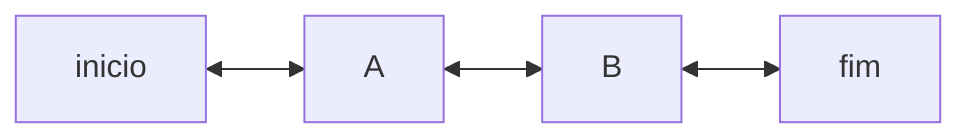
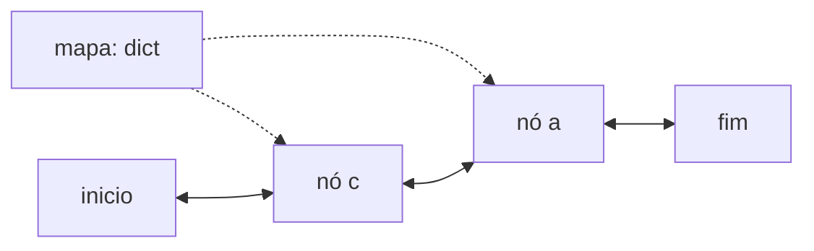

## Passo 1 · Leitura · Nó duplo e sentinelas

Na lista simples da lição anterior, remover um nó que você já tem em mãos ainda custa $O(n)$: quem precisa mudar é a seta do nó **anterior**, e só se chega a ele andando desde a cabeça. A **lista duplamente ligada** resolve isso dando a cada nó duas referências, `anterior` e `proximo`. Com o nó em mãos, os dois vizinhos estão a um passo.

O código ingênuo, porém, se enche de casos especiais: remover a cabeça (não há anterior), a cauda (não há próximo), o único nó (não há nenhum dos dois), inserir na lista vazia. Cada `if` esquecido vira um `AttributeError: 'NoneType' object has no attribute 'proximo'`.

O truque das **sentinelas** elimina todos eles. A lista cria, no `__init__`, dois nós falsos que nunca guardam dados: `inicio` e `fim`. A lista vazia é `inicio <-> fim`, e todo nó de verdade fica **sempre** entre dois nós existentes.



Com isso, inserir entre dois nós e remover um nó viram código sem nenhum `if`, ambos $O(1)$:

```python
def inserir_entre(no, antes, depois):
    no.anterior = antes
    no.proximo = depois
    antes.proximo = no
    depois.anterior = no

def remover_no(no):
    no.anterior.proximo = no.proximo
    no.proximo.anterior = no.anterior
```

Inserir na frente é `inserir_entre(no, inicio, inicio.proximo)`; no fim, `inserir_entre(no, fim.anterior, fim)`.

O que mantém a lista correta é um **invariante** que vale para todo nó `n` entre as sentinelas:

> `n.proximo.anterior is n` e `n.anterior.proximo is n`.

O erro típico quebra esse invariante pela metade: atualizar só as setas `proximo`. Percorrer da frente para trás continua dando o resultado certo, então o defeito passa despercebido; percorrer de trás para a frente mostra um nó "fantasma" que já tinha sido removido. Por isso, teste sempre os dois sentidos.

As sentinelas custam dois nós a mais, e em troca as quatro bordas desaparecem do código. É o mesmo nó sentinela da intercalação da lição anterior, agora fixo nas duas pontas.

## Passo 2 · Exercício · ListaDupla com sentinelas
modo: lacunas

Complete as lacunas (`___`) da `ListaDupla`. Cada inserção devolve o nó criado: quem chama pode guardá-lo e, depois, removê-lo em $O(1)$.

### Instruções
1. `_inserir_entre(no, antes, depois)` liga as quatro setas e conta o nó.
2. `inserir_frente` insere logo depois de `inicio`; `inserir_tras`, logo antes de `fim`.
3. `remover_no(no)` faz os dois vizinhos apontarem um para o outro, desconta o nó e devolve o valor.
4. `para_lista_reversa()` anda pelas setas `anterior`, de trás para a frente, até a sentinela do começo.

### Código inicial
```python
class NoDuplo:
    def __init__(self, valor):
        self.valor = valor
        self.anterior = None
        self.proximo = None


class ListaDupla:
    def __init__(self):
        self.inicio = NoDuplo(None)
        self.fim = NoDuplo(None)
        self.inicio.proximo = self.fim
        self.fim.anterior = self.inicio
        self._tamanho = 0

    def __len__(self):
        return self._tamanho

    def _inserir_entre(self, no, antes, depois):
        no.anterior = antes
        no.proximo = depois
        antes.proximo = no
        ___ = no
        self._tamanho += 1
        return no

    def inserir_frente(self, valor):
        return self._inserir_entre(NoDuplo(valor), self.inicio, ___)

    def inserir_tras(self, valor):
        return self._inserir_entre(NoDuplo(valor), ___, self.fim)

    def remover_no(self, no):
        no.anterior.proximo = ___
        no.proximo.anterior = ___
        self._tamanho -= 1
        return no.valor

    def para_lista(self):
        valores = []
        atual = self.inicio.proximo
        while atual is not self.fim:
            valores.append(atual.valor)
            atual = atual.proximo
        return valores

    def para_lista_reversa(self):
        valores = []
        atual = self.fim.anterior
        while atual is not ___:
            valores.append(atual.valor)
            atual = atual.anterior
        return valores
```

### Solução
```python
class NoDuplo:
    def __init__(self, valor):
        self.valor = valor
        self.anterior = None
        self.proximo = None


class ListaDupla:
    def __init__(self):
        self.inicio = NoDuplo(None)
        self.fim = NoDuplo(None)
        self.inicio.proximo = self.fim
        self.fim.anterior = self.inicio
        self._tamanho = 0

    def __len__(self):
        return self._tamanho

    def _inserir_entre(self, no, antes, depois):
        no.anterior = antes
        no.proximo = depois
        antes.proximo = no
        depois.anterior = no
        self._tamanho += 1
        return no

    def inserir_frente(self, valor):
        return self._inserir_entre(NoDuplo(valor), self.inicio, self.inicio.proximo)

    def inserir_tras(self, valor):
        return self._inserir_entre(NoDuplo(valor), self.fim.anterior, self.fim)

    def remover_no(self, no):
        no.anterior.proximo = no.proximo
        no.proximo.anterior = no.anterior
        self._tamanho -= 1
        return no.valor

    def para_lista(self):
        valores = []
        atual = self.inicio.proximo
        while atual is not self.fim:
            valores.append(atual.valor)
            atual = atual.proximo
        return valores

    def para_lista_reversa(self):
        valores = []
        atual = self.fim.anterior
        while atual is not self.inicio:
            valores.append(atual.valor)
            atual = atual.anterior
        return valores
```

### Dicas
1. Uma inserção mexe em quatro setas: duas do nó novo e uma de cada vizinho.
2. Na frente, o nó novo fica entre `inicio` e quem hoje vem depois de `inicio`.
3. Depois de remover, confira o invariante: o vizinho da esquerda e o da direita precisam apontar um para o outro.

### Verificação
```json
[
  { "id": "tras", "checkpoint": 2, "kind": "expr",
    "setup": "ld = ListaDupla()\nfor v in 'abc':\n    ld.inserir_tras(v)",
    "expr": "[ld.para_lista(), ld.para_lista_reversa(), len(ld)]", "expected": [["a", "b", "c"], ["c", "b", "a"], 3],
    "name": "inserir_tras nos dois sentidos", "hint": "Percorrer de trás para a frente usa as setas anterior." },
  { "id": "frente", "checkpoint": 2, "kind": "expr",
    "setup": "ld = ListaDupla()\nfor v in [1, 2, 3]:\n    ld.inserir_frente(v)",
    "expr": "[ld.para_lista(), ld.para_lista_reversa()]", "expected": [[3, 2, 1], [1, 2, 3]],
    "name": "inserir_frente não perde quem já estava", "hint": "O nó novo vai entre inicio e o atual primeiro." },
  { "id": "devolve-no", "checkpoint": 1, "kind": "expr",
    "setup": "ld = ListaDupla()\nno = ld.inserir_tras('x')",
    "expr": "[no.valor, no.anterior is ld.inicio, no.proximo is ld.fim, ld.fim.anterior is no]", "expected": ["x", true, true, true],
    "name": "As quatro setas de uma inserção", "hint": "O vizinho da direita também precisa apontar de volta para o nó novo." },
  { "id": "remove-meio", "checkpoint": 3, "kind": "expr",
    "setup": "ld = ListaDupla()\nld.inserir_tras('a')\nb = ld.inserir_tras('b')\nld.inserir_tras('c')\nsaiu = ld.remover_no(b)",
    "expr": "[saiu, ld.para_lista(), ld.para_lista_reversa(), len(ld)]", "expected": ["b", ["a", "c"], ["c", "a"], 2],
    "name": "Remove do meio e mantém os dois sentidos", "hint": "Um nó removido não pode continuar aparecendo de trás para a frente." },
  { "id": "remove-pontas", "checkpoint": 3, "kind": "expr",
    "setup": "ld = ListaDupla()\nprimeiro = ld.inserir_tras(1)\nld.inserir_tras(2)\nultimo = ld.inserir_tras(3)\nld.remover_no(primeiro)\nld.remover_no(ultimo)",
    "expr": "[ld.para_lista(), ld.para_lista_reversa(), ld.inicio.proximo.valor, ld.fim.anterior.valor]", "expected": [[2], [2], 2, 2],
    "name": "Remove o primeiro e o último nó real" },
  { "id": "remove-unico", "checkpoint": 3, "kind": "expr",
    "setup": "ld = ListaDupla()\nno = ld.inserir_frente('so')\nld.remover_no(no)",
    "expr": "[ld.inicio.proximo is ld.fim, ld.fim.anterior is ld.inicio, len(ld), ld.para_lista_reversa()]", "expected": [true, true, 0, []],
    "name": "Remover o único nó volta à lista vazia" },
  { "id": "vazia-reversa", "checkpoint": 4, "kind": "expr", "setup": "ld = ListaDupla()", "expr": "ld.para_lista_reversa()", "expected": [],
    "name": "para_lista_reversa() da lista vazia é []" },
  { "id": "invariante", "checkpoint": 3, "kind": "expr",
    "setup": "ld = ListaDupla()\nnos = [ld.inserir_tras(i) for i in range(6)]\nld.inserir_frente(-1)\nld.remover_no(nos[2])\nld.remover_no(nos[5])\nld.inserir_tras(9)\nok = True\nn = ld.inicio.proximo\nvistos = 0\nwhile n is not ld.fim and n is not None and vistos < 50:\n    ok = ok and n.proximo.anterior is n and n.anterior.proximo is n\n    n = n.proximo\n    vistos += 1",
    "expr": "[ok, ld.para_lista(), len(ld)]", "expected": [true, [-1, 0, 1, 3, 4, 9], 6],
    "name": "O invariante vale em todos os nós depois de várias operações" }
]
```

### Soluções erradas
```python name="inserção não atualiza o anterior do vizinho"
class NoDuplo:
    def __init__(self, valor):
        self.valor = valor
        self.anterior = None
        self.proximo = None


class ListaDupla:
    def __init__(self):
        self.inicio = NoDuplo(None)
        self.fim = NoDuplo(None)
        self.inicio.proximo = self.fim
        self.fim.anterior = self.inicio
        self._tamanho = 0

    def __len__(self):
        return self._tamanho

    def _inserir_entre(self, no, antes, depois):
        no.anterior = antes
        no.proximo = depois
        antes.proximo = no
        self._tamanho += 1
        return no

    def inserir_frente(self, valor):
        return self._inserir_entre(NoDuplo(valor), self.inicio, self.inicio.proximo)

    def inserir_tras(self, valor):
        return self._inserir_entre(NoDuplo(valor), self.fim.anterior, self.fim)

    def remover_no(self, no):
        no.anterior.proximo = no.proximo
        no.proximo.anterior = no.anterior
        self._tamanho -= 1
        return no.valor

    def para_lista(self):
        valores = []
        atual = self.inicio.proximo
        while atual is not self.fim:
            valores.append(atual.valor)
            atual = atual.proximo
        return valores

    def para_lista_reversa(self):
        valores = []
        atual = self.fim.anterior
        while atual is not self.inicio:
            valores.append(atual.valor)
            atual = atual.anterior
        return valores
```
```python name="remoção só pela seta proximo"
class NoDuplo:
    def __init__(self, valor):
        self.valor = valor
        self.anterior = None
        self.proximo = None


class ListaDupla:
    def __init__(self):
        self.inicio = NoDuplo(None)
        self.fim = NoDuplo(None)
        self.inicio.proximo = self.fim
        self.fim.anterior = self.inicio
        self._tamanho = 0

    def __len__(self):
        return self._tamanho

    def _inserir_entre(self, no, antes, depois):
        no.anterior = antes
        no.proximo = depois
        antes.proximo = no
        depois.anterior = no
        self._tamanho += 1
        return no

    def inserir_frente(self, valor):
        return self._inserir_entre(NoDuplo(valor), self.inicio, self.inicio.proximo)

    def inserir_tras(self, valor):
        return self._inserir_entre(NoDuplo(valor), self.fim.anterior, self.fim)

    def remover_no(self, no):
        no.anterior.proximo = no.proximo
        self._tamanho -= 1
        return no.valor

    def para_lista(self):
        valores = []
        atual = self.inicio.proximo
        while atual is not self.fim:
            valores.append(atual.valor)
            atual = atual.proximo
        return valores

    def para_lista_reversa(self):
        valores = []
        atual = self.fim.anterior
        while atual is not self.inicio:
            valores.append(atual.valor)
            atual = atual.anterior
        return valores
```
```python name="inserir_frente liga direto ao fim"
class NoDuplo:
    def __init__(self, valor):
        self.valor = valor
        self.anterior = None
        self.proximo = None


class ListaDupla:
    def __init__(self):
        self.inicio = NoDuplo(None)
        self.fim = NoDuplo(None)
        self.inicio.proximo = self.fim
        self.fim.anterior = self.inicio
        self._tamanho = 0

    def __len__(self):
        return self._tamanho

    def _inserir_entre(self, no, antes, depois):
        no.anterior = antes
        no.proximo = depois
        antes.proximo = no
        depois.anterior = no
        self._tamanho += 1
        return no

    def inserir_frente(self, valor):
        return self._inserir_entre(NoDuplo(valor), self.inicio, self.fim)

    def inserir_tras(self, valor):
        return self._inserir_entre(NoDuplo(valor), self.fim.anterior, self.fim)

    def remover_no(self, no):
        no.anterior.proximo = no.proximo
        no.proximo.anterior = no.anterior
        self._tamanho -= 1
        return no.valor

    def para_lista(self):
        valores = []
        atual = self.inicio.proximo
        while atual is not self.fim:
            valores.append(atual.valor)
            atual = atual.proximo
        return valores

    def para_lista_reversa(self):
        valores = []
        atual = self.fim.anterior
        while atual is not self.inicio:
            valores.append(atual.valor)
            atual = atual.anterior
        return valores
```
```python name="percurso reverso para na sentinela errada"
class NoDuplo:
    def __init__(self, valor):
        self.valor = valor
        self.anterior = None
        self.proximo = None


class ListaDupla:
    def __init__(self):
        self.inicio = NoDuplo(None)
        self.fim = NoDuplo(None)
        self.inicio.proximo = self.fim
        self.fim.anterior = self.inicio
        self._tamanho = 0

    def __len__(self):
        return self._tamanho

    def _inserir_entre(self, no, antes, depois):
        no.anterior = antes
        no.proximo = depois
        antes.proximo = no
        depois.anterior = no
        self._tamanho += 1
        return no

    def inserir_frente(self, valor):
        return self._inserir_entre(NoDuplo(valor), self.inicio, self.inicio.proximo)

    def inserir_tras(self, valor):
        return self._inserir_entre(NoDuplo(valor), self.fim.anterior, self.fim)

    def remover_no(self, no):
        no.anterior.proximo = no.proximo
        no.proximo.anterior = no.anterior
        self._tamanho -= 1
        return no.valor

    def para_lista(self):
        valores = []
        atual = self.inicio.proximo
        while atual is not self.fim:
            valores.append(atual.valor)
            atual = atual.proximo
        return valores

    def para_lista_reversa(self):
        valores = []
        atual = self.fim.anterior
        while atual is not None:
            valores.append(atual.valor)
            atual = atual.anterior
        return valores
```
```python name="remover_no não desconta o tamanho"
class NoDuplo:
    def __init__(self, valor):
        self.valor = valor
        self.anterior = None
        self.proximo = None


class ListaDupla:
    def __init__(self):
        self.inicio = NoDuplo(None)
        self.fim = NoDuplo(None)
        self.inicio.proximo = self.fim
        self.fim.anterior = self.inicio
        self._tamanho = 0

    def __len__(self):
        return self._tamanho

    def _inserir_entre(self, no, antes, depois):
        no.anterior = antes
        no.proximo = depois
        antes.proximo = no
        depois.anterior = no
        self._tamanho += 1
        return no

    def inserir_frente(self, valor):
        return self._inserir_entre(NoDuplo(valor), self.inicio, self.inicio.proximo)

    def inserir_tras(self, valor):
        return self._inserir_entre(NoDuplo(valor), self.fim.anterior, self.fim)

    def remover_no(self, no):
        no.anterior.proximo = no.proximo
        no.proximo.anterior = no.anterior
        return no.valor

    def para_lista(self):
        valores = []
        atual = self.inicio.proximo
        while atual is not self.fim:
            valores.append(atual.valor)
            atual = atual.proximo
        return valores

    def para_lista_reversa(self):
        valores = []
        atual = self.fim.anterior
        while atual is not self.inicio:
            valores.append(atual.valor)
            atual = atual.anterior
        return valores
```

## Passo 3 · Exercício · Mover para a frente e remover o último

Continue a `ListaDupla` com as duas operações de que o cache LRU vai precisar. As duas recebem ou acham o nó sem procurar: a verificação conta quantas vezes as setas `proximo` são lidas, e mover o último nó para a frente 200 vezes numa lista de 300 nós pode ler no máximo 2000.

### Instruções
1. `mover_para_frente(no)` tira `no` de onde está e o recoloca logo depois de `inicio`, em $O(1)$. É o **mesmo** objeto nó que muda de lugar (quem guardou a referência continua com ela válida) e o tamanho não muda.
2. `remover_ultimo()` remove o último nó real e devolve o seu valor; com a lista vazia, levanta `IndexError`.

### Solução
```python
class NoDuplo:
    def __init__(self, valor):
        self.valor = valor
        self.anterior = None
        self.proximo = None


class ListaDupla:
    def __init__(self):
        self.inicio = NoDuplo(None)
        self.fim = NoDuplo(None)
        self.inicio.proximo = self.fim
        self.fim.anterior = self.inicio
        self._tamanho = 0

    def __len__(self):
        return self._tamanho

    def _inserir_entre(self, no, antes, depois):
        no.anterior = antes
        no.proximo = depois
        antes.proximo = no
        depois.anterior = no
        self._tamanho += 1
        return no

    def inserir_frente(self, valor):
        return self._inserir_entre(NoDuplo(valor), self.inicio, self.inicio.proximo)

    def inserir_tras(self, valor):
        return self._inserir_entre(NoDuplo(valor), self.fim.anterior, self.fim)

    def remover_no(self, no):
        no.anterior.proximo = no.proximo
        no.proximo.anterior = no.anterior
        self._tamanho -= 1
        return no.valor

    def para_lista(self):
        valores = []
        atual = self.inicio.proximo
        while atual is not self.fim:
            valores.append(atual.valor)
            atual = atual.proximo
        return valores

    def para_lista_reversa(self):
        valores = []
        atual = self.fim.anterior
        while atual is not self.inicio:
            valores.append(atual.valor)
            atual = atual.anterior
        return valores

    def mover_para_frente(self, no):
        self.remover_no(no)
        self._inserir_entre(no, self.inicio, self.inicio.proximo)

    def remover_ultimo(self):
        if self._tamanho == 0:
            raise IndexError("lista vazia")
        return self.remover_no(self.fim.anterior)
```

### Dicas
1. Mover é remover e reinserir o mesmo nó; `remover_no` e `_inserir_entre` já fazem as duas metades.
2. O último nó real é vizinho de uma das sentinelas.
3. Sem conferir o tamanho, `remover_ultimo` numa lista vazia tentaria remover a própria sentinela `inicio`.

### Verificação
```json
[
  { "id": "move-meio", "checkpoint": 1, "kind": "expr",
    "setup": "def frente(ld):\n    r, a = [], ld.inicio.proximo\n    while a is not ld.fim and a is not None and len(r) < 50:\n        r.append(a.valor)\n        a = a.proximo\n    return r\ndef tras(ld):\n    r, a = [], ld.fim.anterior\n    while a is not ld.inicio and a is not None and len(r) < 50:\n        r.append(a.valor)\n        a = a.anterior\n    return r\nld = ListaDupla()\nld.inserir_tras('a')\nb = ld.inserir_tras('b')\nld.inserir_tras('c')\nld.mover_para_frente(b)",
    "expr": "[frente(ld), tras(ld), len(ld), ld.inicio.proximo is b]", "expected": [["b", "a", "c"], ["c", "a", "b"], 3, true],
    "name": "Move um nó do meio para a frente", "hint": "Tire o nó de onde está antes de recolocá-lo." },
  { "id": "move-ultimo", "checkpoint": 1, "kind": "expr",
    "setup": "def frente(ld):\n    r, a = [], ld.inicio.proximo\n    while a is not ld.fim and a is not None and len(r) < 50:\n        r.append(a.valor)\n        a = a.proximo\n    return r\ndef tras(ld):\n    r, a = [], ld.fim.anterior\n    while a is not ld.inicio and a is not None and len(r) < 50:\n        r.append(a.valor)\n        a = a.anterior\n    return r\nld = ListaDupla()\nfor v in [1, 2, 3]:\n    ld.inserir_tras(v)\nld.mover_para_frente(ld.fim.anterior)",
    "expr": "[frente(ld), tras(ld), ld.fim.anterior.valor]", "expected": [[3, 1, 2], [2, 1, 3], 2],
    "name": "Move o último nó para a frente" },
  { "id": "move-primeiro", "checkpoint": 1, "kind": "expr",
    "setup": "def frente(ld):\n    r, a = [], ld.inicio.proximo\n    while a is not ld.fim and a is not None and len(r) < 50:\n        r.append(a.valor)\n        a = a.proximo\n    return r\nld = ListaDupla()\nx = ld.inserir_tras('x')\nld.inserir_tras('y')\nld.mover_para_frente(x)",
    "expr": "[frente(ld), len(ld)]", "expected": [["x", "y"], 2], "name": "Mover quem já está na frente não muda nada" },
  { "id": "move-mesmo-no", "checkpoint": 1, "kind": "expr",
    "setup": "ld = ListaDupla()\nld.inserir_tras(10)\nn = ld.inserir_tras(20)\nld.mover_para_frente(n)\nld.remover_no(n)",
    "expr": "[ld.para_lista(), ld.para_lista_reversa(), len(ld)]", "expected": [[10], [10], 1],
    "name": "A referência guardada continua valendo depois de mover", "hint": "Não crie um nó novo com o mesmo valor: mova o próprio nó." },
  { "id": "move-o1", "checkpoint": 1, "kind": "expr",
    "setup": "ld = ListaDupla()\nfor i in range(300):\n    ld.inserir_tras(i)\nleituras = [0]\ndef _ler(self):\n    leituras[0] += 1\n    return self.__dict__['proximo']\ndef _gravar(self, v):\n    self.__dict__['proximo'] = v\nNoDuplo.proximo = property(_ler, _gravar)\nfor _ in range(200):\n    ld.mover_para_frente(ld.fim.anterior)\nlido = leituras[0]\nprimeiros = []\na = ld.inicio.proximo\nwhile len(primeiros) < 2:\n    primeiros.append(a.valor)\n    a = a.proximo",
    "expr": "[primeiros, ld.fim.anterior.valor, len(ld), lido <= 2000]", "expected": [[100, 101], 99, 300, true],
    "name": "mover_para_frente é O(1): 200 movimentos leem no máximo 2000 setas", "hint": "Com o nó em mãos, os vizinhos estão a um passo; não procure o nó a partir do início." },
  { "id": "remove-ultimo", "checkpoint": 2, "kind": "expr",
    "setup": "ld = ListaDupla()\nfor v in 'abc':\n    ld.inserir_tras(v)\nsaiu = ld.remover_ultimo()",
    "expr": "[saiu, ld.para_lista(), ld.para_lista_reversa(), len(ld)]", "expected": ["c", ["a", "b"], ["b", "a"], 2],
    "name": "remover_ultimo devolve e tira o último" },
  { "id": "remove-ate-esvaziar", "checkpoint": 2, "kind": "expr",
    "setup": "ld = ListaDupla()\nld.inserir_frente(1)\nld.inserir_frente(2)\nsaidas = [ld.remover_ultimo(), ld.remover_ultimo()]\nld.inserir_tras(3)",
    "expr": "[saidas, ld.para_lista(), len(ld)]", "expected": [[1, 2], [3], 1], "name": "Esvazia e volta a usar a lista" },
  { "id": "remove-vazia", "checkpoint": 2, "kind": "expr", "setup": "ld = ListaDupla()", "expr": "ld.remover_ultimo()",
    "raises": "IndexError", "name": "remover_ultimo da lista vazia levanta IndexError", "hint": "Confira o tamanho antes de remover." }
]
```

### Soluções erradas
```python name="reinsere sem tirar do lugar antigo"
class NoDuplo:
    def __init__(self, valor):
        self.valor = valor
        self.anterior = None
        self.proximo = None


class ListaDupla:
    def __init__(self):
        self.inicio = NoDuplo(None)
        self.fim = NoDuplo(None)
        self.inicio.proximo = self.fim
        self.fim.anterior = self.inicio
        self._tamanho = 0

    def __len__(self):
        return self._tamanho

    def _inserir_entre(self, no, antes, depois):
        no.anterior = antes
        no.proximo = depois
        antes.proximo = no
        depois.anterior = no
        self._tamanho += 1
        return no

    def inserir_frente(self, valor):
        return self._inserir_entre(NoDuplo(valor), self.inicio, self.inicio.proximo)

    def inserir_tras(self, valor):
        return self._inserir_entre(NoDuplo(valor), self.fim.anterior, self.fim)

    def remover_no(self, no):
        no.anterior.proximo = no.proximo
        no.proximo.anterior = no.anterior
        self._tamanho -= 1
        return no.valor

    def para_lista(self):
        valores = []
        atual = self.inicio.proximo
        while atual is not self.fim:
            valores.append(atual.valor)
            atual = atual.proximo
        return valores

    def para_lista_reversa(self):
        valores = []
        atual = self.fim.anterior
        while atual is not self.inicio:
            valores.append(atual.valor)
            atual = atual.anterior
        return valores

    def mover_para_frente(self, no):
        self._inserir_entre(no, self.inicio, self.inicio.proximo)

    def remover_ultimo(self):
        if self._tamanho == 0:
            raise IndexError("lista vazia")
        return self.remover_no(self.fim.anterior)
```
```python name="move criando um nó novo com o valor"
class NoDuplo:
    def __init__(self, valor):
        self.valor = valor
        self.anterior = None
        self.proximo = None


class ListaDupla:
    def __init__(self):
        self.inicio = NoDuplo(None)
        self.fim = NoDuplo(None)
        self.inicio.proximo = self.fim
        self.fim.anterior = self.inicio
        self._tamanho = 0

    def __len__(self):
        return self._tamanho

    def _inserir_entre(self, no, antes, depois):
        no.anterior = antes
        no.proximo = depois
        antes.proximo = no
        depois.anterior = no
        self._tamanho += 1
        return no

    def inserir_frente(self, valor):
        return self._inserir_entre(NoDuplo(valor), self.inicio, self.inicio.proximo)

    def inserir_tras(self, valor):
        return self._inserir_entre(NoDuplo(valor), self.fim.anterior, self.fim)

    def remover_no(self, no):
        no.anterior.proximo = no.proximo
        no.proximo.anterior = no.anterior
        self._tamanho -= 1
        return no.valor

    def para_lista(self):
        valores = []
        atual = self.inicio.proximo
        while atual is not self.fim:
            valores.append(atual.valor)
            atual = atual.proximo
        return valores

    def para_lista_reversa(self):
        valores = []
        atual = self.fim.anterior
        while atual is not self.inicio:
            valores.append(atual.valor)
            atual = atual.anterior
        return valores

    def mover_para_frente(self, no):
        valor = self.remover_no(no)
        self.inserir_frente(valor)

    def remover_ultimo(self):
        if self._tamanho == 0:
            raise IndexError("lista vazia")
        return self.remover_no(self.fim.anterior)
```
```python name="procura o nó a partir do início (O(n))"
class NoDuplo:
    def __init__(self, valor):
        self.valor = valor
        self.anterior = None
        self.proximo = None


class ListaDupla:
    def __init__(self):
        self.inicio = NoDuplo(None)
        self.fim = NoDuplo(None)
        self.inicio.proximo = self.fim
        self.fim.anterior = self.inicio
        self._tamanho = 0

    def __len__(self):
        return self._tamanho

    def _inserir_entre(self, no, antes, depois):
        no.anterior = antes
        no.proximo = depois
        antes.proximo = no
        depois.anterior = no
        self._tamanho += 1
        return no

    def inserir_frente(self, valor):
        return self._inserir_entre(NoDuplo(valor), self.inicio, self.inicio.proximo)

    def inserir_tras(self, valor):
        return self._inserir_entre(NoDuplo(valor), self.fim.anterior, self.fim)

    def remover_no(self, no):
        no.anterior.proximo = no.proximo
        no.proximo.anterior = no.anterior
        self._tamanho -= 1
        return no.valor

    def para_lista(self):
        valores = []
        atual = self.inicio.proximo
        while atual is not self.fim:
            valores.append(atual.valor)
            atual = atual.proximo
        return valores

    def para_lista_reversa(self):
        valores = []
        atual = self.fim.anterior
        while atual is not self.inicio:
            valores.append(atual.valor)
            atual = atual.anterior
        return valores

    def mover_para_frente(self, no):
        atual = self.inicio.proximo
        while atual is not no:
            atual = atual.proximo
        self.remover_no(atual)
        self._inserir_entre(atual, self.inicio, self.inicio.proximo)

    def remover_ultimo(self):
        if self._tamanho == 0:
            raise IndexError("lista vazia")
        return self.remover_no(self.fim.anterior)
```
```python name="remover_ultimo tira o primeiro"
class NoDuplo:
    def __init__(self, valor):
        self.valor = valor
        self.anterior = None
        self.proximo = None


class ListaDupla:
    def __init__(self):
        self.inicio = NoDuplo(None)
        self.fim = NoDuplo(None)
        self.inicio.proximo = self.fim
        self.fim.anterior = self.inicio
        self._tamanho = 0

    def __len__(self):
        return self._tamanho

    def _inserir_entre(self, no, antes, depois):
        no.anterior = antes
        no.proximo = depois
        antes.proximo = no
        depois.anterior = no
        self._tamanho += 1
        return no

    def inserir_frente(self, valor):
        return self._inserir_entre(NoDuplo(valor), self.inicio, self.inicio.proximo)

    def inserir_tras(self, valor):
        return self._inserir_entre(NoDuplo(valor), self.fim.anterior, self.fim)

    def remover_no(self, no):
        no.anterior.proximo = no.proximo
        no.proximo.anterior = no.anterior
        self._tamanho -= 1
        return no.valor

    def para_lista(self):
        valores = []
        atual = self.inicio.proximo
        while atual is not self.fim:
            valores.append(atual.valor)
            atual = atual.proximo
        return valores

    def para_lista_reversa(self):
        valores = []
        atual = self.fim.anterior
        while atual is not self.inicio:
            valores.append(atual.valor)
            atual = atual.anterior
        return valores

    def mover_para_frente(self, no):
        self.remover_no(no)
        self._inserir_entre(no, self.inicio, self.inicio.proximo)

    def remover_ultimo(self):
        if self._tamanho == 0:
            raise IndexError("lista vazia")
        return self.remover_no(self.inicio.proximo)
```
```python name="remover_ultimo sem conferir a lista vazia"
class NoDuplo:
    def __init__(self, valor):
        self.valor = valor
        self.anterior = None
        self.proximo = None


class ListaDupla:
    def __init__(self):
        self.inicio = NoDuplo(None)
        self.fim = NoDuplo(None)
        self.inicio.proximo = self.fim
        self.fim.anterior = self.inicio
        self._tamanho = 0

    def __len__(self):
        return self._tamanho

    def _inserir_entre(self, no, antes, depois):
        no.anterior = antes
        no.proximo = depois
        antes.proximo = no
        depois.anterior = no
        self._tamanho += 1
        return no

    def inserir_frente(self, valor):
        return self._inserir_entre(NoDuplo(valor), self.inicio, self.inicio.proximo)

    def inserir_tras(self, valor):
        return self._inserir_entre(NoDuplo(valor), self.fim.anterior, self.fim)

    def remover_no(self, no):
        no.anterior.proximo = no.proximo
        no.proximo.anterior = no.anterior
        self._tamanho -= 1
        return no.valor

    def para_lista(self):
        valores = []
        atual = self.inicio.proximo
        while atual is not self.fim:
            valores.append(atual.valor)
            atual = atual.proximo
        return valores

    def para_lista_reversa(self):
        valores = []
        atual = self.fim.anterior
        while atual is not self.inicio:
            valores.append(atual.valor)
            atual = atual.anterior
        return valores

    def mover_para_frente(self, no):
        self.remover_no(no)
        self._inserir_entre(no, self.inicio, self.inicio.proximo)

    def remover_ultimo(self):
        return self.remover_no(self.fim.anterior)
```

## Passo 4 · Leitura · Cache LRU: dicionário + lista dupla

Um **cache** guarda resultados caros (respostas de um servidor, páginas lidas do disco) para reaproveitá-los. A memória é limitada, então ele tem uma capacidade e uma **política de despejo**: quando chega um item novo e não há espaço, alguém sai. A política **LRU** (*least recently used*) tira o item **usado há mais tempo**, apostando que o passado recente prevê o futuro próximo.

"Usar" é qualquer `get` que encontra a chave ou qualquer `put`. Com capacidade 2:

| operação | resultado | ordem de uso (mais recente primeiro) |
|---|---|---|
| `put(a, 1)` | | `a` |
| `put(b, 2)` | | `b, a` |
| `get(a)` | 1 | `a, b` |
| `put(c, 3)` | sai `b` | `c, a` |
| `get(b)` | ausente | `c, a` |

Repare que `b` saiu, embora tenha entrado depois de `a`: o `get(a)` renovou o `a`. Uma política FIFO teria tirado o `a`. E um `get` que **não** encontra a chave não muda nada.

Cada operação precisa de duas coisas: achar a chave e mexer na ordem de uso. Nenhuma estrutura sozinha faz as duas em $O(1)$. Uma `list` com a ordem de uso precisa de `ordem.remove(chave)` para renovar uma chave, e isso percorre a lista: $O(n)$ por operação. Um `dict` acha a chave em $O(1)$, mas a ordem dele é a de inserção, não a de uso.

A solução combina as duas que você já tem:



- uma **lista dupla com sentinelas**, com o mais recente logo depois de `inicio` e o candidato a sair logo antes de `fim`;
- um **dicionário** `mapa` que leva cada chave ao **nó** dela na lista.

`get` acha o nó pelo `mapa` e o move para a frente (passo 3). `put` de chave nova, com o cache cheio, despeja `fim.anterior`: remove o nó da lista e apaga a chave do `mapa`. É por isso que o nó guarda a **chave** além do valor: na hora do despejo, só o nó está em mãos, e sem a chave seria preciso varrer o dicionário para saber o que apagar.

Cada operação faz um número fixo de consultas ao `dict` e de trocas de setas: $O(1)$ em média, porque o `dict` é $O(1)$ em média, não no pior caso. A biblioteca padrão usa a mesma ideia: `collections.OrderedDict` mantém uma lista duplamente ligada ao lado da tabela hash (`move_to_end` renova, `popitem(last=False)` tira o mais antigo), e `functools.lru_cache` guarda os resultados num `dict` mais uma lista dupla circular.

## Passo 5 · Previsão · lru_cache por dentro

`functools.lru_cache` é um decorador (nível 2) que guarda os resultados de uma função num cache LRU. Com `maxsize=2`, ele guarda os dois argumentos usados mais recentemente; `cache_info()` conta acertos (`hits`) e faltas (`misses`). Leia sem executar e digite exatamente o que o programa imprime.

### Código
```python
from functools import lru_cache


@lru_cache(maxsize=2)
def quadrado(x):
    print("calcula", x)
    return x * x


for x in [1, 2, 1, 3, 2, 1]:
    quadrado(x)
print(quadrado.cache_info())
```

### Dicas
1. Só as faltas executam o corpo da função e imprimem `calcula`.
2. Mantenha uma lista com a ordem de uso; o `quadrado(1)` da terceira chamada renova o 1.
3. Quem sai quando o 3 chega? E quando o 2 volta?

### Saída esperada
```text
calcula 1
calcula 2
calcula 3
calcula 2
calcula 1
CacheInfo(hits=1, misses=5, maxsize=2, currsize=2)
```

## Passo 6 · Exercício · CacheLRU

Escreva a classe `CacheLRU` com `mapa` (dicionário de chave para nó) e uma lista dupla com sentinelas, como no passo 4. A verificação compara seu cache com um de referência em 3000 operações e conta as comparações de chaves: o cache inteiro pode fazer no máximo 3 por operação.

### Instruções
1. `CacheLRU(capacidade)` levanta `ValueError` se a capacidade for menor que 1. `len(cache)` é a quantidade de chaves guardadas.
2. `get(chave)` devolve o valor e renova a chave, ou devolve `None` (sem mudar nada) se ela não está no cache.
3. `put(chave, valor)` grava o valor e renova a chave. Se a chave é nova e o cache está cheio, antes despeja a menos recentemente usada, da lista e do `mapa`. Atualizar uma chave que já existe nunca despeja ninguém.
4. `chaves()` devolve as chaves da mais recente para a menos recente. Não use `OrderedDict` nem `lru_cache`.

### Código inicial
```python
class NoLRU:
    def __init__(self, chave, valor):
        self.chave = chave
        self.valor = valor
        self.anterior = None
        self.proximo = None


class CacheLRU:
    def __init__(self, capacidade):
        self.capacidade = capacidade
        self.mapa = {}
        self.inicio = NoLRU(None, None)
        self.fim = NoLRU(None, None)
        self.inicio.proximo = self.fim
        self.fim.anterior = self.inicio

    def __len__(self):
        pass

    def get(self, chave):
        pass

    def put(self, chave, valor):
        pass

    def chaves(self):
        pass
```

### Solução
```python
class NoLRU:
    def __init__(self, chave, valor):
        self.chave = chave
        self.valor = valor
        self.anterior = None
        self.proximo = None


class CacheLRU:
    def __init__(self, capacidade):
        if capacidade < 1:
            raise ValueError("capacidade precisa ser pelo menos 1")
        self.capacidade = capacidade
        self.mapa = {}
        self.inicio = NoLRU(None, None)
        self.fim = NoLRU(None, None)
        self.inicio.proximo = self.fim
        self.fim.anterior = self.inicio

    def __len__(self):
        return len(self.mapa)

    def _desligar(self, no):
        no.anterior.proximo = no.proximo
        no.proximo.anterior = no.anterior

    def _inserir_frente(self, no):
        no.anterior = self.inicio
        no.proximo = self.inicio.proximo
        self.inicio.proximo.anterior = no
        self.inicio.proximo = no

    def get(self, chave):
        no = self.mapa.get(chave)
        if no is None:
            return None
        self._desligar(no)
        self._inserir_frente(no)
        return no.valor

    def put(self, chave, valor):
        no = self.mapa.get(chave)
        if no is not None:
            no.valor = valor
            self._desligar(no)
            self._inserir_frente(no)
            return
        if len(self.mapa) == self.capacidade:
            velho = self.fim.anterior
            self._desligar(velho)
            del self.mapa[velho.chave]
        novo = NoLRU(chave, valor)
        self._inserir_frente(novo)
        self.mapa[chave] = novo

    def chaves(self):
        resultado = []
        atual = self.inicio.proximo
        while atual is not self.fim:
            resultado.append(atual.chave)
            atual = atual.proximo
        return resultado
```

### Dicas
1. Escreva dois auxiliares, um que desliga um nó e outro que o insere logo depois de `inicio`; `get` e `put` viram combinações deles.
2. Em `put`, decida primeiro se a chave já existe; só uma chave nova pode causar despejo.
3. O nó despejado é vizinho de uma sentinela, e a chave que sai do `mapa` está guardada nele.

### Verificação
```json
[
  { "id": "classica", "checkpoint": 3, "kind": "expr",
    "setup": "c = CacheLRU(2)\nc.put('a', 1)\nc.put('b', 2)\ng1 = c.get('a')\nc.put('c', 3)\ng2 = c.get('b')",
    "expr": "[g1, g2, c.chaves(), len(c)]", "expected": [1, null, ["c", "a"], 2],
    "name": "O get renova: quem sai é o usado há mais tempo", "hint": "Depois do get('a'), quem é o menos recentemente usado?" },
  { "id": "get-ausente", "checkpoint": 2, "kind": "expr",
    "setup": "c = CacheLRU(2)\nc.put('x', 1)\nc.put('y', 2)\ng = c.get('z')\nc.put('w', 3)",
    "expr": "[g, c.chaves(), c.get('x')]", "expected": [null, ["w", "y"], null],
    "name": "get de chave ausente devolve None e não muda a ordem" },
  { "id": "atualiza", "checkpoint": 3, "kind": "expr",
    "setup": "c = CacheLRU(2)\nc.put('a', 1)\nc.put('b', 2)\nc.put('a', 10)\nc.put('c', 3)",
    "expr": "[c.get('a'), c.get('b'), c.chaves(), len(c)]", "expected": [10, null, ["a", "c"], 2],
    "name": "put de chave existente atualiza, renova e não despeja",
    "hint": "Atualizar 'a' com o cache cheio não pode tirar ninguém, e 'a' passa a ser o mais recente." },
  { "id": "atualiza-cheio", "checkpoint": 3, "kind": "expr",
    "setup": "c = CacheLRU(2)\nc.put('a', 1)\nc.put('b', 2)\nc.put('b', 20)",
    "expr": "[c.get('a'), c.get('b'), len(c)]", "expected": [1, 20, 2],
    "name": "Atualizar uma chave com o cache cheio não despeja a mais antiga",
    "hint": "Antes de despejar, veja se a chave já está no cache." },
  { "id": "capacidade-1", "checkpoint": 3, "kind": "expr",
    "setup": "c = CacheLRU(1)\nc.put('a', 1)\nc.put('b', 2)",
    "expr": "[c.get('a'), c.get('b'), len(c), c.chaves()]", "expected": [null, 2, 1, ["b"]], "name": "Capacidade 1" },
  { "id": "nunca-passa", "checkpoint": 3, "kind": "expr",
    "setup": "c = CacheLRU(3)\nfor i in range(10):\n    c.put(i, i * i)",
    "expr": "[len(c), c.chaves(), c.get(9), c.get(6)]", "expected": [3, [9, 8, 7], 81, null],
    "name": "Nunca guarda mais do que a capacidade" },
  { "id": "capacidade-0", "checkpoint": 1, "kind": "expr", "expr": "CacheLRU(0)", "raises": "ValueError",
    "name": "Capacidade 0 levanta ValueError" },
  { "id": "referencia", "checkpoint": 3, "kind": "expr",
    "setup": "from collections import OrderedDict\nclass Ref:\n    def __init__(self, c):\n        self.c = c\n        self.d = OrderedDict()\n    def get(self, k):\n        if k not in self.d:\n            return None\n        self.d.move_to_end(k)\n        return self.d[k]\n    def put(self, k, v):\n        if k in self.d:\n            self.d.move_to_end(k)\n            self.d[k] = v\n            return\n        if len(self.d) == self.c:\n            self.d.popitem(last=False)\n        self.d[k] = v\nc = CacheLRU(40)\nr = Ref(40)\nsc, sr = [], []\nfor i in range(3000):\n    k = (i * 37 + i // 7) % 61\n    if i % 3 == 0:\n        sc.append(c.get(k))\n        sr.append(r.get(k))\n    else:\n        c.put(k, i)\n        r.put(k, i)",
    "expr": "[sc == sr, c.chaves() == list(reversed(r.d)), len(c)]", "expected": [true, true, 40],
    "name": "3000 operações iguais às de um LRU de referência", "hint": "Confira o despejo: sai a chave usada há mais tempo, da lista e do mapa." },
  { "id": "conta-comparacoes", "checkpoint": 2, "kind": "expr",
    "setup": "class Chave:\n    comparacoes = 0\n    def __init__(self, k):\n        self.k = k\n    def __hash__(self):\n        return hash(self.k)\n    def __eq__(self, o):\n        Chave.comparacoes += 1\n        return isinstance(o, Chave) and self.k == o.k\nc = CacheLRU(200)\nfor i in range(3000):\n    k = (i * 7919) % 3001 % 250\n    if i % 2:\n        c.get(Chave(k))\n    else:\n        c.put(Chave(k), i)",
    "expr": "[len(c), Chave.comparacoes <= 9000]", "expected": [200, true],
    "name": "3000 operações com no máximo 3 comparações de chave cada",
    "hint": "Procurar a chave numa lista compara com cada elemento; o dicionário leva direto ao nó." },
  { "id": "sem-ordereddict", "checkpoint": 4, "kind": "source", "rule": { "type": "not_calls", "name": "OrderedDict" },
    "name": "Não usa OrderedDict" },
  { "id": "sem-lru-cache", "checkpoint": 4, "kind": "source", "rule": { "type": "not_calls", "name": "lru_cache" },
    "name": "Não usa lru_cache" }
]
```

### Soluções erradas
```python name="get não renova a chave"
class NoLRU:
    def __init__(self, chave, valor):
        self.chave = chave
        self.valor = valor
        self.anterior = None
        self.proximo = None


class CacheLRU:
    def __init__(self, capacidade):
        if capacidade < 1:
            raise ValueError("capacidade precisa ser pelo menos 1")
        self.capacidade = capacidade
        self.mapa = {}
        self.inicio = NoLRU(None, None)
        self.fim = NoLRU(None, None)
        self.inicio.proximo = self.fim
        self.fim.anterior = self.inicio

    def __len__(self):
        return len(self.mapa)

    def _desligar(self, no):
        no.anterior.proximo = no.proximo
        no.proximo.anterior = no.anterior

    def _inserir_frente(self, no):
        no.anterior = self.inicio
        no.proximo = self.inicio.proximo
        self.inicio.proximo.anterior = no
        self.inicio.proximo = no

    def get(self, chave):
        no = self.mapa.get(chave)
        if no is None:
            return None
        return no.valor

    def put(self, chave, valor):
        no = self.mapa.get(chave)
        if no is not None:
            no.valor = valor
            self._desligar(no)
            self._inserir_frente(no)
            return
        if len(self.mapa) == self.capacidade:
            velho = self.fim.anterior
            self._desligar(velho)
            del self.mapa[velho.chave]
        novo = NoLRU(chave, valor)
        self._inserir_frente(novo)
        self.mapa[chave] = novo

    def chaves(self):
        resultado = []
        atual = self.inicio.proximo
        while atual is not self.fim:
            resultado.append(atual.chave)
            atual = atual.proximo
        return resultado
```
```python name="despeja antes de ver se a chave já existe"
class NoLRU:
    def __init__(self, chave, valor):
        self.chave = chave
        self.valor = valor
        self.anterior = None
        self.proximo = None


class CacheLRU:
    def __init__(self, capacidade):
        if capacidade < 1:
            raise ValueError("capacidade precisa ser pelo menos 1")
        self.capacidade = capacidade
        self.mapa = {}
        self.inicio = NoLRU(None, None)
        self.fim = NoLRU(None, None)
        self.inicio.proximo = self.fim
        self.fim.anterior = self.inicio

    def __len__(self):
        return len(self.mapa)

    def _desligar(self, no):
        no.anterior.proximo = no.proximo
        no.proximo.anterior = no.anterior

    def _inserir_frente(self, no):
        no.anterior = self.inicio
        no.proximo = self.inicio.proximo
        self.inicio.proximo.anterior = no
        self.inicio.proximo = no

    def get(self, chave):
        no = self.mapa.get(chave)
        if no is None:
            return None
        self._desligar(no)
        self._inserir_frente(no)
        return no.valor

    def put(self, chave, valor):
        if len(self.mapa) == self.capacidade:
            velho = self.fim.anterior
            self._desligar(velho)
            del self.mapa[velho.chave]
        no = self.mapa.get(chave)
        if no is not None:
            no.valor = valor
            self._desligar(no)
            self._inserir_frente(no)
            return
        novo = NoLRU(chave, valor)
        self._inserir_frente(novo)
        self.mapa[chave] = novo

    def chaves(self):
        resultado = []
        atual = self.inicio.proximo
        while atual is not self.fim:
            resultado.append(atual.chave)
            atual = atual.proximo
        return resultado
```
```python name="despeja o mais recente"
class NoLRU:
    def __init__(self, chave, valor):
        self.chave = chave
        self.valor = valor
        self.anterior = None
        self.proximo = None


class CacheLRU:
    def __init__(self, capacidade):
        if capacidade < 1:
            raise ValueError("capacidade precisa ser pelo menos 1")
        self.capacidade = capacidade
        self.mapa = {}
        self.inicio = NoLRU(None, None)
        self.fim = NoLRU(None, None)
        self.inicio.proximo = self.fim
        self.fim.anterior = self.inicio

    def __len__(self):
        return len(self.mapa)

    def _desligar(self, no):
        no.anterior.proximo = no.proximo
        no.proximo.anterior = no.anterior

    def _inserir_frente(self, no):
        no.anterior = self.inicio
        no.proximo = self.inicio.proximo
        self.inicio.proximo.anterior = no
        self.inicio.proximo = no

    def get(self, chave):
        no = self.mapa.get(chave)
        if no is None:
            return None
        self._desligar(no)
        self._inserir_frente(no)
        return no.valor

    def put(self, chave, valor):
        no = self.mapa.get(chave)
        if no is not None:
            no.valor = valor
            self._desligar(no)
            self._inserir_frente(no)
            return
        if len(self.mapa) == self.capacidade:
            velho = self.inicio.proximo
            self._desligar(velho)
            del self.mapa[velho.chave]
        novo = NoLRU(chave, valor)
        self._inserir_frente(novo)
        self.mapa[chave] = novo

    def chaves(self):
        resultado = []
        atual = self.inicio.proximo
        while atual is not self.fim:
            resultado.append(atual.chave)
            atual = atual.proximo
        return resultado
```
```python name="ordem de uso numa list com remove (O(n))"
class NoLRU:
    def __init__(self, chave, valor):
        self.chave = chave
        self.valor = valor
        self.anterior = None
        self.proximo = None


class CacheLRU:
    def __init__(self, capacidade):
        if capacidade < 1:
            raise ValueError("capacidade precisa ser pelo menos 1")
        self.capacidade = capacidade
        self.mapa = {}
        self.ordem = []

    def __len__(self):
        return len(self.mapa)

    def get(self, chave):
        if chave not in self.mapa:
            return None
        self.ordem.remove(chave)
        self.ordem.append(chave)
        return self.mapa[chave]

    def put(self, chave, valor):
        if chave in self.mapa:
            self.ordem.remove(chave)
        elif len(self.mapa) == self.capacidade:
            velha = self.ordem.pop(0)
            del self.mapa[velha]
        self.mapa[chave] = valor
        self.ordem.append(chave)

    def chaves(self):
        return list(reversed(self.ordem))
```
```python name="put de chave existente não atualiza o valor"
class NoLRU:
    def __init__(self, chave, valor):
        self.chave = chave
        self.valor = valor
        self.anterior = None
        self.proximo = None


class CacheLRU:
    def __init__(self, capacidade):
        if capacidade < 1:
            raise ValueError("capacidade precisa ser pelo menos 1")
        self.capacidade = capacidade
        self.mapa = {}
        self.inicio = NoLRU(None, None)
        self.fim = NoLRU(None, None)
        self.inicio.proximo = self.fim
        self.fim.anterior = self.inicio

    def __len__(self):
        return len(self.mapa)

    def _desligar(self, no):
        no.anterior.proximo = no.proximo
        no.proximo.anterior = no.anterior

    def _inserir_frente(self, no):
        no.anterior = self.inicio
        no.proximo = self.inicio.proximo
        self.inicio.proximo.anterior = no
        self.inicio.proximo = no

    def get(self, chave):
        no = self.mapa.get(chave)
        if no is None:
            return None
        self._desligar(no)
        self._inserir_frente(no)
        return no.valor

    def put(self, chave, valor):
        no = self.mapa.get(chave)
        if no is not None:
            self._desligar(no)
            self._inserir_frente(no)
            return
        if len(self.mapa) == self.capacidade:
            velho = self.fim.anterior
            self._desligar(velho)
            del self.mapa[velho.chave]
        novo = NoLRU(chave, valor)
        self._inserir_frente(novo)
        self.mapa[chave] = novo

    def chaves(self):
        resultado = []
        atual = self.inicio.proximo
        while atual is not self.fim:
            resultado.append(atual.chave)
            atual = atual.proximo
        return resultado
```
```python name="despeja da lista mas esquece o mapa"
class NoLRU:
    def __init__(self, chave, valor):
        self.chave = chave
        self.valor = valor
        self.anterior = None
        self.proximo = None


class CacheLRU:
    def __init__(self, capacidade):
        if capacidade < 1:
            raise ValueError("capacidade precisa ser pelo menos 1")
        self.capacidade = capacidade
        self.mapa = {}
        self.inicio = NoLRU(None, None)
        self.fim = NoLRU(None, None)
        self.inicio.proximo = self.fim
        self.fim.anterior = self.inicio
        self._tamanho = 0

    def __len__(self):
        return self._tamanho

    def _desligar(self, no):
        no.anterior.proximo = no.proximo
        no.proximo.anterior = no.anterior

    def _inserir_frente(self, no):
        no.anterior = self.inicio
        no.proximo = self.inicio.proximo
        self.inicio.proximo.anterior = no
        self.inicio.proximo = no

    def get(self, chave):
        no = self.mapa.get(chave)
        if no is None:
            return None
        self._desligar(no)
        self._inserir_frente(no)
        return no.valor

    def put(self, chave, valor):
        no = self.mapa.get(chave)
        if no is not None:
            no.valor = valor
            self._desligar(no)
            self._inserir_frente(no)
            return
        if self._tamanho == self.capacidade:
            self._desligar(self.fim.anterior)
            self._tamanho -= 1
        novo = NoLRU(chave, valor)
        self._inserir_frente(novo)
        self.mapa[chave] = novo
        self._tamanho += 1

    def chaves(self):
        resultado = []
        atual = self.inicio.proximo
        while atual is not self.fim:
            resultado.append(atual.chave)
            atual = atual.proximo
        return resultado
```

## Passo 7 · Quiz · Sentinelas e política de despejo

### Pergunta
Numa lista dupla **sem** sentinelas, em que `cabeca.anterior` e `cauda.proximo` são `None`, este método levanta `AttributeError` em qual situação?
```python
def remover_no(self, no):
    no.anterior.proximo = no.proximo
    no.proximo.anterior = no.anterior
```
- [x] Ao remover o primeiro nó (e também o último), porque um dos vizinhos é `None`.
- [ ] Só ao remover um nó do meio, porque ele tem dois vizinhos para atualizar.
- [ ] Nunca: o Python cria os vizinhos que faltam automaticamente.
- [ ] Só quando a lista tem um número par de nós.
> No primeiro nó, `no.anterior` é `None`, e `None.proximo = ...` levanta `AttributeError: 'NoneType' object has no attribute 'proximo'`. Com sentinelas, todo nó real tem dois vizinhos de verdade, e o mesmo código serve para todas as posições.

### Pergunta
Um cache LRU de capacidade 3 recebe, nesta ordem: `put(A)`, `put(B)`, `put(C)`, `get(A)`, `put(D)`, `get(B)`, `put(E)`. Quais chaves ficam no cache no final?
- [x] A, D e E.
- [ ] C, D e E.
- [ ] A, B e E.
- [ ] B, D e E.
> Depois do `get(A)`, a ordem de uso (do mais antigo ao mais recente) é B, C, A; o `put(D)` despeja B. O `get(B)` é uma falta e não muda nada. O `put(E)` despeja C, o usado há mais tempo. "C, D e E" seria o resultado de uma política FIFO, que ignora o `get(A)`.

### Pergunta
Você quer um cache LRU rápido de escrever com `collections.OrderedDict`, em que o fim do dicionário guarda o item mais recente. Quais operações fazem o papel de "renovar a chave" e de "despejar o menos recente"?
- [x] `d.move_to_end(chave)` para renovar e `d.popitem(last=False)` para despejar.
- [ ] `d.move_to_end(chave)` para renovar e `d.popitem()` para despejar.
- [ ] `d.pop(chave)` para renovar e `d.popitem(last=False)` para despejar.
- [ ] `d[chave] = d[chave]` para renovar e `del d[next(iter(d))]` para despejar.
> `move_to_end` leva a chave para o fim (o lado dos recentes) em $O(1)$, porque o `OrderedDict` mantém por dentro uma lista duplamente ligada. `popitem()` sem argumento tira do fim, ou seja, o **mais** recente. E reatribuir uma chave existente num dicionário não muda a posição dela.
