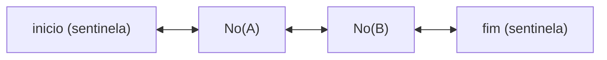
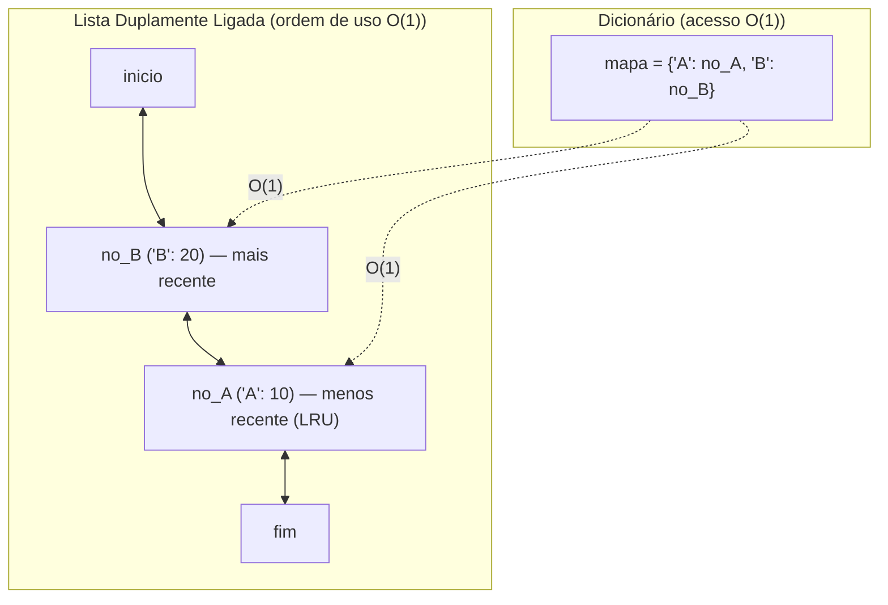

## Passo 1 · Leitura · Nós duplamente ligados e sentinelas

Em uma lista ligada **simples**, mesmo que você já tenha a referência direta para um nó `no` no meio da lista, **não é possível removê-lo em $O(1)$**: para desligá-lo da corrente, você precisa alterar `anterior.proximo`, e encontrar o nó `anterior` exige percorrer a lista desde a cabeça em $O(n)$.

A **lista duplamente ligada** (*doubly linked list*) resolve essa limitação adicionando um segundo ponteiro em cada nó (`NoDuplo`):
- `no.anterior`: aponta para o nó precedente.
- `no.proximo`: aponta para o nó seguinte.

#### O truque dos nós sentinelas (`inicio` e `fim`)

Em vez de lidar com dezenas de `if self.cabeca is None:` ou `if no.anterior is None:`, criamos dois **nós sentinelas fixos** (*dummy nodes*) no `__init__`: `self.inicio` (cabeça fictícia) e `self.fim` (cauda fictícia).
- Na lista vazia, `self.inicio.proximo = self.fim` e `self.fim.anterior = self.inicio`.
- Todo nó real fica **sempre entre dois nós válidos** (`inicio` ... `fim`)! Nunca existe `anterior is None` nem `proximo is None` para um nó de dados.



Com sentinelas, **remover qualquer nó `no`** dado sua referência resume-se a duas linhas em **$O(1)$ puro**, sem nenhum `if`:

```python
def remover_no(self, no: NoDuplo) -> None:
    ant = no.anterior
    prox = no.proximo
    ant.proximo = prox
    prox.anterior = ant
```

E **inserir um nó `no` logo após um nó `ref`** (por exemplo, `ref = self.inicio` para inserir na frente, ou `ref = self.fim.anterior` para inserir no final) também leva apenas 4 atribuições em **$O(1)$**:

```python
def _inserir_apos(self, ref: NoDuplo, no: NoDuplo) -> None:
    prox = ref.proximo
    no.anterior = ref
    no.proximo = prox
    ref.proximo = no
    prox.anterior = no
```

## Passo 2 · Exercício · `ListaDupla` com sentinelas e histórico de navegação

Implemente a classe `ListaDupla` com nós sentinelas (`self.inicio` e `self.fim`) e a classe `HistoricoNavegacao` para simular os botões Voltar e Avançar de um navegador web.

### Instruções

1. Em `ListaDupla`, inicialize as sentinelas `self.inicio = NoDuplo(None)` e `self.fim = NoDuplo(None)` ligadas entre si e `self._tamanho = 0`. Implemente:
   - `inserir_frente(valor) -> NoDuplo`: insere um novo `NoDuplo(valor)` logo após `self.inicio` e devolve o nó criado.
   - `inserir_tras(valor) -> NoDuplo`: insere um novo `NoDuplo(valor)` logo antes de `self.fim` e devolve o nó criado.
   - `remover_no(no: NoDuplo)`: desliga `no` da lista em $O(1)$, decrementa `self._tamanho` e devolve `no.valor`.
   - `para_lista() -> list` (valores da frente para trás) e `para_lista_reversa() -> list` (valores de trás para a frente, caminhando por `.anterior`).
2. Implemente `HistoricoNavegacao(pagina_inicial: str)` usando nós `NoDuplo`:
   - `visitar(url: str) -> None`: cria um novo `NoDuplo(url)` após a página `atual`, descarta qualquer histórico "avançar" (`atual.proximo = novo`, `novo.anterior = atual`, ` novo.proximo = None`) e move `self.atual = novo`.
   - `voltar(passos: int) -> str`: recua até `passos` vezes para `self.atual.anterior` (parando na página inicial se não houver mais anterior) e devolve a URL atual.
   - `avancar(passos: int) -> str`: avança até `passos` vezes para `self.atual.proximo` (parando na última página disponível) e devolve a URL atual.

### Código inicial

```python
class NoDuplo:
    def __init__(self, valor, anterior=None, proximo=None):
        self.valor = valor
        self.anterior = anterior
        self.proximo = proximo


class ListaDupla:
    def __init__(self):
        self.inicio = NoDuplo(None)
        self.fim = NoDuplo(None)
        self.inicio.proximo = self.fim
        self.fim.anterior = self.inicio
        self._tamanho = 0

    def __len__(self) -> int:
        return self._tamanho

    def inserir_frente(self, valor) -> NoDuplo:
        pass

    def inserir_tras(self, valor) -> NoDuplo:
        pass

    def remover_no(self, no: NoDuplo):
        pass

    def para_lista(self) -> list:
        pass

    def para_lista_reversa(self) -> list:
        pass


class HistoricoNavegacao:
    def __init__(self, pagina_inicial: str):
        self.atual = NoDuplo(pagina_inicial)

    def visitar(self, url: str) -> None:
        pass

    def voltar(self, passos: int) -> str:
        pass

    def avancar(self, passos: int) -> str:
        pass
```

### Solução

```python
class NoDuplo:
    def __init__(self, valor, anterior=None, proximo=None):
        self.valor = valor
        self.anterior = anterior
        self.proximo = proximo


class ListaDupla:
    def __init__(self):
        self.inicio = NoDuplo(None)
        self.fim = NoDuplo(None)
        self.inicio.proximo = self.fim
        self.fim.anterior = self.inicio
        self._tamanho = 0

    def __len__(self) -> int:
        return self._tamanho

    def _inserir_entre(self, valor, ant: NoDuplo, prox: NoDuplo) -> NoDuplo:
        novo = NoDuplo(valor, ant, prox)
        ant.proximo = novo
        prox.anterior = novo
        self._tamanho += 1
        return novo

    def inserir_frente(self, valor) -> NoDuplo:
        return self._inserir_entre(valor, self.inicio, self.inicio.proximo)

    def inserir_tras(self, valor) -> NoDuplo:
        return self._inserir_entre(valor, self.fim.anterior, self.fim)

    def remover_no(self, no: NoDuplo):
        ant = no.anterior
        prox = no.proximo
        ant.proximo = prox
        prox.anterior = ant
        self._tamanho -= 1
        return no.valor

    def para_lista(self) -> list:
        res = []
        atual = self.inicio.proximo
        while atual is not self.fim:
            res.append(atual.valor)
            atual = atual.proximo
        return res

    def para_lista_reversa(self) -> list:
        res = []
        atual = self.fim.anterior
        while atual is not self.inicio:
            res.append(atual.valor)
            atual = atual.anterior
        return res


class HistoricoNavegacao:
    def __init__(self, pagina_inicial: str):
        self.atual = NoDuplo(pagina_inicial)

    def visitar(self, url: str) -> None:
        novo = NoDuplo(url, anterior=self.atual, proximo=None)
        self.atual.proximo = novo
        self.atual = novo

    def voltar(self, passos: int) -> str:
        while passos > 0 and self.atual.anterior is not None:
            self.atual = self.atual.anterior
            passos -= 1
        return self.atual.valor

    def avancar(self, passos: int) -> str:
        while passos > 0 and self.atual.proximo is not None:
            self.atual = self.atual.proximo
            passos -= 1
        return self.atual.valor
```

### Dicas

1. Crie um método auxiliar `_inserir_entre(self, valor, ant, prox)` que instancia `novo = NoDuplo(valor, ant, prox)`, ajusta `ant.proximo = novo` e `prox.anterior = novo`, incrementa `self._tamanho` e devolve `novo`.
2. Para `para_lista_reversa()`, comece em `atual = self.fim.anterior` e caminhe com `atual = atual.anterior` enquanto `atual is not self.inicio`.
3. Em `HistoricoNavegacao.visitar(url)`, ligar `self.atual.proximo = novo` descarta automaticamente qualquer cadeia futura que existia a partir de `self.atual`.

### Verificação

```json
[
  {
    "id": "lista-dupla-operacoes-e-reverso",
    "name": "Inserções, remoção O(1) pelo nó e percurso nos dois sentidos",
    "checkpoint": 1,
    "kind": "expr",
    "setup": "ld = ListaDupla()\nn_b = ld.inserir_frente('B')\nn_a = ld.inserir_frente('A')\nn_c = ld.inserir_tras('C')\nn_d = ld.inserir_tras('D')\nrem = ld.remover_no(n_b)",
    "expr": "(rem, len(ld), ld.para_lista(), ld.para_lista_reversa())",
    "expected": ["B", 3, ["A", "C", "D"], ["D", "C", "A"]]
  },
  {
    "id": "historico-navegacao-fluxo",
    "name": "Histórico de navegação com visitar, voltar e avançar",
    "checkpoint": 2,
    "kind": "expr",
    "setup": "h = HistoricoNavegacao('usp.br')\nh.visitar('ime.usp.br')\nh.visitar('icmc.usp.br')\nh.visitar('poli.usp.br')\nv1 = h.voltar(1)\nv2 = h.voltar(1)\na1 = h.avancar(1)\nh.visitar('each.usp.br')\na2 = h.avancar(2)\nv3 = h.voltar(10)",
    "expr": "(v1, v2, a1, a2, v3)",
    "expected": ["icmc.usp.br", "ime.usp.br", "icmc.usp.br", "each.usp.br", "usp.br"]
  }
]
```

### Soluções erradas

```python name="Atualiza apenas o ponteiro proximo e esquece de atualizar anterior"
class NoDuplo:
    def __init__(self, valor, anterior=None, proximo=None):
        self.valor = valor
        self.anterior = anterior
        self.proximo = proximo


class ListaDupla:
    def __init__(self):
        self.inicio = NoDuplo(None)
        self.fim = NoDuplo(None)
        self.inicio.proximo = self.fim
        self.fim.anterior = self.inicio
        self._tamanho = 0

    def __len__(self) -> int:
        return self._tamanho

    def inserir_frente(self, valor) -> NoDuplo:
        prox = self.inicio.proximo
        novo = NoDuplo(valor, self.inicio, prox)
        self.inicio.proximo = novo
        self._tamanho += 1
        return novo

    def inserir_tras(self, valor) -> NoDuplo:
        ant = self.fim.anterior
        novo = NoDuplo(valor, ant, self.fim)
        ant.proximo = novo
        self._tamanho += 1
        return novo

    def remover_no(self, no: NoDuplo):
        no.anterior.proximo = no.proximo
        self._tamanho -= 1
        return no.valor

    def para_lista(self) -> list:
        res = []
        atual = self.inicio.proximo
        while atual is not self.fim:
            res.append(atual.valor)
            atual = atual.proximo
        return res

    def para_lista_reversa(self) -> list:
        res = []
        atual = self.fim.anterior
        while atual is not self.inicio and atual is not None:
            res.append(atual.valor)
            atual = atual.anterior
        return res


class HistoricoNavegacao:
    def __init__(self, pagina_inicial: str):
        self.atual = NoDuplo(pagina_inicial)

    def visitar(self, url: str) -> None:
        novo = NoDuplo(url, anterior=self.atual)
        self.atual.proximo = novo
        self.atual = novo

    def voltar(self, passos: int) -> str:
        while passos > 0 and self.atual.anterior is not None:
            self.atual = self.atual.anterior
            passos -= 1
        return self.atual.valor

    def avancar(self, passos: int) -> str:
        while passos > 0 and self.atual.proximo is not None:
            self.atual = self.atual.proximo
            passos -= 1
        return self.atual.valor
```

```python name="Em visitar(), não descarta o histórico futuro quando cria nova página"
class NoDuplo:
    def __init__(self, valor, anterior=None, proximo=None):
        self.valor = valor
        self.anterior = anterior
        self.proximo = proximo


class ListaDupla:
    def __init__(self):
        self.inicio = NoDuplo(None)
        self.fim = NoDuplo(None)
        self.inicio.proximo = self.fim
        self.fim.anterior = self.inicio
        self._tamanho = 0

    def __len__(self) -> int:
        return self._tamanho

    def _inserir_entre(self, valor, ant: NoDuplo, prox: NoDuplo) -> NoDuplo:
        novo = NoDuplo(valor, ant, prox)
        ant.proximo = novo
        prox.anterior = novo
        self._tamanho += 1
        return novo

    def inserir_frente(self, valor) -> NoDuplo:
        return self._inserir_entre(valor, self.inicio, self.inicio.proximo)

    def inserir_tras(self, valor) -> NoDuplo:
        return self._inserir_entre(valor, self.fim.anterior, self.fim)

    def remover_no(self, no: NoDuplo):
        ant = no.anterior
        prox = no.proximo
        ant.proximo = prox
        prox.anterior = ant
        self._tamanho -= 1
        return no.valor

    def para_lista(self) -> list:
        res = []
        atual = self.inicio.proximo
        while atual is not self.fim:
            res.append(atual.valor)
            atual = atual.proximo
        return res

    def para_lista_reversa(self) -> list:
        res = []
        atual = self.fim.anterior
        while atual is not self.inicio:
            res.append(atual.valor)
            atual = atual.anterior
        return res


class HistoricoNavegacao:
    def __init__(self, pagina_inicial: str):
        self.atual = NoDuplo(pagina_inicial)

    def visitar(self, url: str) -> None:
        antigo_prox = self.atual.proximo
        novo = NoDuplo(url, anterior=self.atual, proximo=antigo_prox)
        self.atual.proximo = novo
        self.atual = novo

    def voltar(self, passos: int) -> str:
        while passos > 0 and self.atual.anterior is not None:
            self.atual = self.atual.anterior
            passos -= 1
        return self.atual.valor

    def avancar(self, passos: int) -> str:
        while passos > 0 and self.atual.proximo is not None:
            self.atual = self.atual.proximo
            passos -= 1
        return self.atual.valor
```

## Passo 3 · Leitura · A arquitetura do Cache LRU (`dict` + lista duplamente ligada)

Um **Cache LRU** (*Least Recently Used* — Menos Recentemente Usado) armazena até `capacidade` pares `(chave, valor)`:
- `get(chave)`: se a chave existir no cache, devolve seu `valor` e marca essa chave como a **mais recentemente usada**; caso contrário, devolve `-1` (ou `None`).
- `put(chave, valor)`: se a chave já existir, atualiza o valor e a marca como a **mais recentemente usada**. Se for uma chave nova e o cache já estiver cheio (`len == capacidade`), **descarta (evicta)** a chave **menos recentemente usada** (aquela que está há mais tempo sem sofrer `get` nem `put`) antes de inserir a nova!

#### Por que uma única estrutura não basta para ter `get` e `put` em $O(1)$?

- Um **`dict` sozinho** busca e insere por chave em $O(1)$, mas não mantém a ordem de recência com promoção em $O(1)$ do meio para a ponta.
- Uma **`list` sozinha** mantém a ordem, mas encontrar e remover um elemento do meio para movê-lo ao topo (`ordem.remove(chave)`) custa **$O(n)$**!

#### A fusão perfeita: Tabela Hash (`dict`) + Lista Duplamente Ligada

Combinamos as duas estruturas:
1. Uma **lista duplamente ligada com sentinelas** (`inicio` $\leftrightarrow \dots \leftrightarrow$ `fim`) onde cada nó guarda `(chave, valor)`. Mantemos os itens **mais recentes na frente** (logo após `inicio`) e os **menos recentes atrás** (logo antes de `fim`).
2. Um **dicionário** `mapa: dict[chave, NoLRU]` que mapeia cada chave diretamente para a **referência do seu objeto nó** na lista dupla!



Assim, todas as operações levam **$O(1)$**:
- **Promover um nó para mais recente**: como o dicionário nos dá o `no` em $O(1)$, fazemos `_remover(no)` em $O(1)$ e `_inserir_frente(no)` em $O(1)$.
- **Evictar o menos recente (LRU)**: o nó a descartar é sempre `lru = self.fim.anterior`. Removemos `lru` da lista dupla em $O(1)$ e apagamos `del self.mapa[lru.chave]` (por isso o nó precisa guardar também a `chave`, e não só o `valor`!).

> **Conexão com a biblioteca padrão do Python**: é exatamente essa combinação de tabela hash + lista duplamente ligada circular que o Python usa por dentro em `collections.OrderedDict` (método `.move_to_end(chave)`) e no decorador `@functools.lru_cache`!

## Passo 4 · Exercício · Implementando `CacheLRU` em $O(1)$

Implemente a classe `CacheLRU(capacidade: int)` combinando um dicionário `self.mapa` e uma lista duplamente ligada com sentinelas para suportar `get`, `put` e `ordem_chaves` em tempo constante por operação.

### Instruções

1. Inicialize `CacheLRU(capacidade: int)` com um dicionário `self.mapa = {}` e sentinelas `self.inicio` e `self.fim` de nós `NoLRU(chave, valor)`.
2. Implemente `get(chave)`: se `chave` não estiver em `self.mapa`, devolva `-1`. Caso contrário, mova o nó correspondente para a frente (logo após `self.inicio`) e devolva `no.valor`.
3. Implemente `put(chave, valor)`:
   - Se `chave` já estiver em `self.mapa`, atualize `no.valor = valor` e mova o nó para a frente.
   - Se for uma chave nova e `len(self.mapa) == self.capacidade`, remova o nó menos recente (`lru = self.fim.anterior`) da lista dupla e de `self.mapa`. Em seguida, crie o novo nó, insira-o na frente e registre-o em `self.mapa`.
4. Implemente `ordem_chaves() -> list` devolvendo a lista de chaves da **mais recente** (após `self.inicio`) até a **menos recente** (antes de `self.fim`).

### Código inicial

```python
class NoLRU:
    def __init__(self, chave, valor):
        self.chave = chave
        self.valor = valor
        self.anterior = None
        self.proximo = None


class CacheLRU:
    def __init__(self, capacidade: int):
        self.capacidade = capacidade
        self.mapa: dict = {}
        self.inicio = NoLRU(None, None)
        self.fim = NoLRU(None, None)
        self.inicio.proximo = self.fim
        self.fim.anterior = self.inicio

    def get(self, chave):
        pass

    def put(self, chave, valor) -> None:
        pass

    def ordem_chaves(self) -> list:
        pass
```

### Solução

```python
class NoLRU:
    def __init__(self, chave, valor):
        self.chave = chave
        self.valor = valor
        self.anterior = None
        self.proximo = None


class CacheLRU:
    def __init__(self, capacidade: int):
        self.capacidade = capacidade
        self.mapa: dict = {}
        self.inicio = NoLRU(None, None)
        self.fim = NoLRU(None, None)
        self.inicio.proximo = self.fim
        self.fim.anterior = self.inicio

    def _remover(self, no: NoLRU) -> None:
        ant = no.anterior
        prox = no.proximo
        ant.proximo = prox
        prox.anterior = ant

    def _inserir_frente(self, no: NoLRU) -> None:
        prox = self.inicio.proximo
        no.anterior = self.inicio
        no.proximo = prox
        self.inicio.proximo = no
        prox.anterior = no

    def get(self, chave):
        if chave not in self.mapa:
            return -1
        no = self.mapa[chave]
        self._remover(no)
        self._inserir_frente(no)
        return no.valor

    def put(self, chave, valor) -> None:
        if chave in self.mapa:
            no = self.mapa[chave]
            no.valor = valor
            self._remover(no)
            self._inserir_frente(no)
            return
        if len(self.mapa) >= self.capacidade:
            lru = self.fim.anterior
            self._remover(lru)
            del self.mapa[lru.chave]
        novo = NoLRU(chave, valor)
        self._inserir_frente(novo)
        self.mapa[chave] = novo

    def ordem_chaves(self) -> list:
        chaves = []
        atual = self.inicio.proximo
        while atual is not self.fim:
            chaves.append(atual.chave)
            atual = atual.proximo
        return chaves
```

### Dicas

1. Crie dois métodos auxiliares privados `_remover(self, no)` e `_inserir_frente(self, no)`: assim, promover um nó existente em `get` ou `put` é simplesmente `self._remover(no)` seguido de `self._inserir_frente(no)`.
2. Em `put(chave, valor)`, verifique **primeiro** se `chave in self.mapa`! Atualizar uma chave que já está no cache não aumenta o número de itens e **não** deve evictar ninguém.
3. Quando precisar evictar, o nó menos recentemente usado é `lru = self.fim.anterior`; remova-o da lista dupla e faça `del self.mapa[lru.chave]`.

### Verificação

```json
[
  {
    "id": "cache-lru-sequencia-classica",
    "name": "Sequência clássica de get, put e descarte LRU",
    "checkpoint": 3,
    "kind": "expr",
    "setup": "c = CacheLRU(2)\nc.put(1, 10)\nc.put(2, 20)\ng1 = c.get(1)\nc.put(3, 30)\ng2 = c.get(2)\nc.put(4, 40)\ng3 = c.get(1)\ng4 = c.get(3)\ng5 = c.get(4)",
    "expr": "(g1, g2, g3, g4, g5, c.ordem_chaves())",
    "expected": [10, -1, -1, 30, 40, [4, 3]]
  },
  {
    "id": "cache-lru-atualizar-existente",
    "name": "Atualizar chave existente em cache cheio move para frente sem evictar outra chave",
    "checkpoint": 3,
    "kind": "expr",
    "setup": "c = CacheLRU(2)\nc.put('a', 1)\nc.put('b', 2)\nc.put('a', 100)\nc.put('c', 3)",
    "expr": "(c.get('a'), c.get('b'), c.get('c'), c.ordem_chaves())",
    "expected": [100, -1, 3, ["c", "a"]]
  },
  {
    "id": "cache-lru-desempenho-o1",
    "name": "Executa 30.000 operações get/put em O(1) por operação",
    "checkpoint": 4,
    "kind": "expr",
    "setup": "c = CacheLRU(2000)\nfor i in range(10000):\n    c.put(i % 2500, i)\n    c.get((i * 7) % 2500)\n    c.put((i * 3) % 2500, i * 2)",
    "expr": "(len(c.mapa), len(c.ordem_chaves()), c.ordem_chaves()[0])",
    "expected": [2000, 2000, 2497]
  }
]
```

### Soluções erradas

```python name="Não move a chave consultada para a frente no método get()"
class NoLRU:
    def __init__(self, chave, valor):
        self.chave = chave
        self.valor = valor
        self.anterior = None
        self.proximo = None


class CacheLRU:
    def __init__(self, capacidade: int):
        self.capacidade = capacidade
        self.mapa: dict = {}
        self.inicio = NoLRU(None, None)
        self.fim = NoLRU(None, None)
        self.inicio.proximo = self.fim
        self.fim.anterior = self.inicio

    def _remover(self, no: NoLRU) -> None:
        no.anterior.proximo = no.proximo
        no.proximo.anterior = no.anterior

    def _inserir_frente(self, no: NoLRU) -> None:
        prox = self.inicio.proximo
        no.anterior = self.inicio
        no.proximo = prox
        self.inicio.proximo = no
        prox.anterior = no

    def get(self, chave):
        if chave not in self.mapa:
            return -1
        return self.mapa[chave].valor

    def put(self, chave, valor) -> None:
        if chave in self.mapa:
            no = self.mapa[chave]
            no.valor = valor
            self._remover(no)
            self._inserir_frente(no)
            return
        if len(self.mapa) >= self.capacidade:
            lru = self.fim.anterior
            self._remover(lru)
            del self.mapa[lru.chave]
        novo = NoLRU(chave, valor)
        self._inserir_frente(novo)
        self.mapa[chave] = novo

    def ordem_chaves(self) -> list:
        chaves = []
        atual = self.inicio.proximo
        while atual is not self.fim:
            chaves.append(atual.chave)
            atual = atual.proximo
        return chaves
```

```python name="Evicta antes de verificar se a chave já existe no cache"
class NoLRU:
    def __init__(self, chave, valor):
        self.chave = chave
        self.valor = valor
        self.anterior = None
        self.proximo = None


class CacheLRU:
    def __init__(self, capacidade: int):
        self.capacidade = capacidade
        self.mapa: dict = {}
        self.inicio = NoLRU(None, None)
        self.fim = NoLRU(None, None)
        self.inicio.proximo = self.fim
        self.fim.anterior = self.inicio

    def _remover(self, no: NoLRU) -> None:
        no.anterior.proximo = no.proximo
        no.proximo.anterior = no.anterior

    def _inserir_frente(self, no: NoLRU) -> None:
        prox = self.inicio.proximo
        no.anterior = self.inicio
        no.proximo = prox
        self.inicio.proximo = no
        prox.anterior = no

    def get(self, chave):
        if chave not in self.mapa:
            return -1
        no = self.mapa[chave]
        self._remover(no)
        self._inserir_frente(no)
        return no.valor

    def put(self, chave, valor) -> None:
        if len(self.mapa) >= self.capacidade:
            lru = self.fim.anterior
            self._remover(lru)
            del self.mapa[lru.chave]
        if chave in self.mapa:
            self._remover(self.mapa[chave])
        novo = NoLRU(chave, valor)
        self._inserir_frente(novo)
        self.mapa[chave] = novo

    def ordem_chaves(self) -> list:
        chaves = []
        atual = self.inicio.proximo
        while atual is not self.fim:
            chaves.append(atual.chave)
            atual = atual.proximo
        return chaves
```

## Passo 5 · Quiz · Listas duplamente ligadas e Cache LRU

### Pergunta

Qual é a principal vantagem de usar **nós sentinelas** (`self.inicio` e `self.fim`) em uma lista duplamente ligada?

- [ ] Reduzir pela metade o consumo de memória de cada nó da lista.
- [x] Garantir que todo nó real possua vizinhos `anterior` e `proximo` diferentes de `None`, eliminando condicionais de borda (`if cabeca is None`) ao inserir ou remover nós.
- [ ] Permitir busca binária em $O(\log n)$ sobre a lista ligada.
- [ ] Evitar o uso da palavra-chave `class` em Python.

> Com sentinelas fixas nas duas pontas, mesmo o primeiro e o último elemento real estão cercados por objetos `NoDuplo` válidos, tornando `remover_no` e `_inserir_entre` uniformes.

### Pergunta

No projeto do `CacheLRU`, por que cada nó `NoLRU` da lista duplamente ligada precisa armazenar **tanto a `chave` quanto o `valor`**, se o dicionário `self.mapa` já armazena as chaves?

- [ ] Apenas para facilitar a impressão da lista no terminal.
- [x] Porque ao evictar o nó menos recente (`lru = self.fim.anterior`) pelo final da lista ligada, precisamos saber qual é a sua `lru.chave` para removê-lo também do dicionário (`del self.mapa[lru.chave]`) em $O(1)$.
- [ ] Porque o Python exige que objetos em dicionários tenham pelo menos dois atributos.
- [ ] Porque `self.mapa` armazena apenas os valores e não as chaves.

> A lista ligada aponta para o nó `lru = self.fim.anterior` em $O(1)$. Se o nó não guardasse `lru.chave`, teríamos que varrer todo o dicionário em $O(n)$ para descobrir qual chave apontava para aquele nó!
