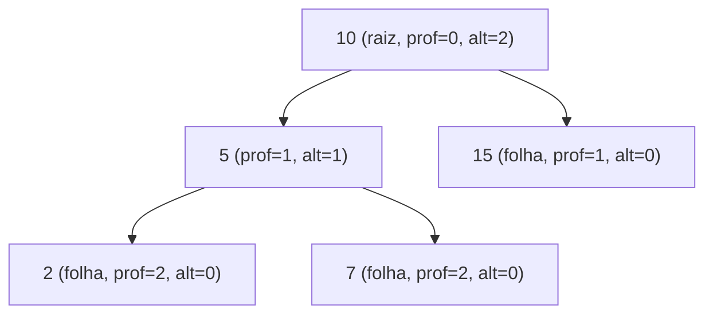

## Passo 1 · Leitura · Árvores binárias: nós, altura, folhas e recursão estrutural

Até agora estudamos estruturas **lineares** (listas, pilhas, filas), em que cada elemento tem no máximo um sucessor. Uma **árvore binária** (*binary tree*) é uma estrutura **hierárquica** definida recursivamente:
- Ou ela é **vazia** (`None`),
- Ou é composta por um nó **raiz** (`No`) que guarda um `valor` e duas referências para subárvores binárias disjuntas: o filho esquerdo (`esq`) e o filho direito (`dir`).



#### Terminologia essencial

- **Folha**: nó sem filhos (`no.esq is None and no.dir is None`).
- **Profundidade de um nó**: número de arestas da **raiz** até esse nó (a raiz tem profundidade $0$).
- **Altura de uma árvore** (por arestas): comprimento do maior caminho da raiz até uma folha.
  - Por convenção matemática padrão, a **árvore vazia** (`None`) tem altura **$-1$**, e uma **folha** isolada tem altura **$0$**:
  $$\text{altura}(\text{nó}) = \begin{cases} -1, & \text{se nó é None} \\ 1 + \max(\text{altura}(\text{nó.esq}),\, \text{altura}(\text{nó.dir})), & \text{caso contrário} \end{cases}$$
- **Árvore binária perfeita de altura $h$**: todos os níveis estão completamente preenchidos; possui $2^i$ nós no nível $i$ e um total de:
  $$n = \sum_{i=0}^{h} 2^i = 2^{h+1} - 1 \implies h = \lfloor \log_2 n \rfloor$$

#### A elegância da recursão em árvores

Como a definição de árvore binária é recursiva, quase toda propriedade estrutural traduz-se em uma função recursiva de 4 a 6 linhas:
- **Tamanho** (total de nós): `0` se `raiz is None`, senão `1 + tamanho(raiz.esq) + tamanho(raiz.dir)`.
- **Contagem de folhas**: `0` se `raiz is None`; `1` se for folha; senão `contar_folhas(raiz.esq) + contar_folhas(raiz.dir)`.
- **Simetria (espelhamento)**: uma árvore é simétrica se suas subárvores esquerda e direita são **espelhos** uma da outra (`a.valor == b.valor`, `espelho(a.esq, b.dir)` e `espelho(a.dir, b.esq)`).

## Passo 2 · Exercício · Altura, tamanho, folhas e simetria

modo: lacunas

Complete as funções recursivas `tamanho(raiz)`, `altura(raiz)`, `contar_folhas(raiz)` e `eh_simetrica(raiz)` sobre nós `No(valor, esq, dir)`.

### Instruções

1. Em `tamanho(raiz)`, devolva `0` para árvore vazia e `1 + tamanho(raiz.esq) + tamanho(raiz.dir)` caso contrário.
2. Em `altura(raiz)`, adote a convenção por arestas: devolva `-1` quando `raiz is None` e `1 + max(altura(raiz.esq), altura(raiz.dir))` caso contrário (assim uma folha tem altura `0`).
3. Em `contar_folhas(raiz)` e `eh_simetrica(raiz)`, complete o caso base de folha e a verificação cruzada de espelhamento (`a.esq` com `b.dir` e `a.dir` com `b.esq`).

### Código inicial

```python
class No:
    def __init__(self, valor, esq=None, dir=None):
        self.valor = valor
        self.esq = esq
        self.dir = dir


def tamanho(raiz) -> int:
    if raiz is None:
        return 0
    return 1 + tamanho(raiz.esq) + ___


def altura(raiz) -> int:
    if raiz is None:
        return ___
    return 1 + max(altura(raiz.esq), altura(raiz.dir))


def contar_folhas(raiz) -> int:
    if raiz is None:
        return 0
    if raiz.esq is None and ___:
        return 1
    return contar_folhas(raiz.esq) + contar_folhas(raiz.dir)


def eh_simetrica(raiz) -> bool:
    def espelho(a, b) -> bool:
        if a is None and b is None:
            return True
        if a is None or b is None or a.valor != b.valor:
            return False
        return espelho(a.esq, ___) and espelho(a.dir, b.esq)

    if raiz is None:
        return True
    return espelho(raiz.esq, raiz.dir)
```

### Solução

```python
class No:
    def __init__(self, valor, esq=None, dir=None):
        self.valor = valor
        self.esq = esq
        self.dir = dir


def tamanho(raiz) -> int:
    if raiz is None:
        return 0
    return 1 + tamanho(raiz.esq) + tamanho(raiz.dir)


def altura(raiz) -> int:
    if raiz is None:
        return -1
    return 1 + max(altura(raiz.esq), altura(raiz.dir))


def contar_folhas(raiz) -> int:
    if raiz is None:
        return 0
    if raiz.esq is None and raiz.dir is None:
        return 1
    return contar_folhas(raiz.esq) + contar_folhas(raiz.dir)


def eh_simetrica(raiz) -> bool:
    def espelho(a, b) -> bool:
        if a is None and b is None:
            return True
        if a is None or b is None or a.valor != b.valor:
            return False
        return espelho(a.esq, b.dir) and espelho(a.dir, b.esq)

    if raiz is None:
        return True
    return espelho(raiz.esq, raiz.dir)
```

### Dicas

1. O tamanho total da árvore soma a raiz (`1`), `tamanho(raiz.esq)` e `tamanho(raiz.dir)`.
2. Para que uma folha (`esq=None`, `dir=None`) tenha altura `1 + max(-1, -1) = 0`, o caso base `raiz is None` em `altura` deve devolver `-1`.
3. Duas subárvores `a` e `b` são espelhos quando o lado externo `a.esq` espelha `b.dir` e o lado interno `a.dir` espelha `b.esq`.

### Verificação

```json
[
  {
    "id": "metricas-arvore",
    "name": "Calcula tamanho, altura (-1 para vazia, 0 para folha) e contagem de folhas",
    "checkpoint": 2,
    "kind": "expr",
    "setup": "r = No(10, No(5, No(2), No(7)), No(15))",
    "expr": "(tamanho(None), tamanho(r), altura(None), altura(No(1)), altura(r), contar_folhas(None), contar_folhas(r))",
    "expected": [0, 5, -1, 0, 2, 0, 3]
  },
  {
    "id": "simetria-arvore",
    "name": "Identifica árvores simétricas e assimétricas",
    "checkpoint": 3,
    "kind": "expr",
    "setup": "sim = No(1, No(2, No(3), No(4)), No(2, No(4), No(3)))\nassim = No(1, No(2, None, No(3)), No(2, None, No(3)))",
    "expr": "(eh_simetrica(None), eh_simetrica(sim), eh_simetrica(assim))",
    "expected": [true, true, false]
  }
]
```

### Soluções erradas

```python name="Devolve 0 para altura de árvore vazia em vez de -1"
class No:
    def __init__(self, valor, esq=None, dir=None):
        self.valor = valor
        self.esq = esq
        self.dir = dir


def tamanho(raiz) -> int:
    if raiz is None:
        return 0
    return 1 + tamanho(raiz.esq) + tamanho(raiz.dir)


def altura(raiz) -> int:
    if raiz is None:
        return 0
    return 1 + max(altura(raiz.esq), altura(raiz.dir))


def contar_folhas(raiz) -> int:
    if raiz is None:
        return 0
    if raiz.esq is None and raiz.dir is None:
        return 1
    return contar_folhas(raiz.esq) + contar_folhas(raiz.dir)


def eh_simetrica(raiz) -> bool:
    def espelho(a, b) -> bool:
        if a is None and b is None:
            return True
        if a is None or b is None or a.valor != b.valor:
            return False
        return espelho(a.esq, b.dir) and espelho(a.dir, b.esq)

    if raiz is None:
        return True
    return espelho(raiz.esq, raiz.dir)
```

```python name="Compara a.esq com b.esq em vez de b.dir na verificação de espelho"
class No:
    def __init__(self, valor, esq=None, dir=None):
        self.valor = valor
        self.esq = esq
        self.dir = dir


def tamanho(raiz) -> int:
    if raiz is None:
        return 0
    return 1 + tamanho(raiz.esq) + tamanho(raiz.dir)


def altura(raiz) -> int:
    if raiz is None:
        return -1
    return 1 + max(altura(raiz.esq), altura(raiz.dir))


def contar_folhas(raiz) -> int:
    if raiz is None:
        return 0
    if raiz.esq is None and raiz.dir is None:
        return 1
    return contar_folhas(raiz.esq) + contar_folhas(raiz.dir)


def eh_simetrica(raiz) -> bool:
    def espelho(a, b) -> bool:
        if a is None and b is None:
            return True
        if a is None or b is None or a.valor != b.valor:
            return False
        return espelho(a.esq, b.esq) and espelho(a.dir, b.dir)

    if raiz is None:
        return True
    return espelho(raiz.esq, raiz.dir)
```

## Passo 3 · Leitura · Os quatro percursos, árvores de expressão e reconstrução

Existem quatro formas canônicas de visitar todos os nós de uma árvore binária em tempo $O(n)$:

#### 1. Três percursos em profundidade (DFS): Pré-ordem, Em-ordem e Pós-ordem

O nome indica **quando a raiz é visitada** em relação às subárvores esquerda (`E`) e direita (`D`):
- **Pré-ordem (`Raiz, E, D`)**: visita a raiz **antes** de descer para `esq` e `dir`. Útil para clonar ou serializar a estrutura.
- **Em-ordem (`E, Raiz, D`)**: visita `esq`, depois a **raiz**, depois `dir`. Em árvores de busca binária (próxima lição), visita os elementos em ordem crescente!
- **Pós-ordem (`E, D, Raiz`)**: visita `esq` e `dir` primeiro, e a **raiz por último**. Indispensável quando o cálculo do pai depende dos resultados já prontos dos filhos (como altura ou avaliação de expressões!).

#### 2. Percurso em largura / por níveis (BFS)

Visita os nós nível por nível (profundidade $0$, depois $1$, depois $2 \dots$), da esquerda para a direita. Em vez de recursão (pilha), usa uma **fila (`collections.deque`)**:
1. Enfileira a `raiz`.
2. Enquanto a fila não estiver vazia, desenfileira `no = fila.popleft()`, registra `no.valor`, e enfileira `no.esq` (se não for `None`) seguido de `no.dir` (se não for `None`).

#### 3. Árvores de expressão aritmética

Na árvore da expressão `(3 + 4) * 2`, as **folhas** são números (`3`, `4`, `2`) e os **nós internos** são operadores (`"+"`, `"*"`):
- Avaliar a árvore (`avaliar_expressao`) é um percurso em **pós-ordem**: se for folha, devolve o número; senão, avalia `esq`, avalia `dir` e aplica o operador da raiz.
- Converter para string infixa completamente parentizada (`para_infixa`) é um percurso **em-ordem** com parênteses: folhas viram `str(raiz.valor)` e nós internos viram `f"({para_infixa(raiz.esq)} {raiz.valor} {para_infixa(raiz.dir)})"`.

#### 4. Reconstruindo a árvore a partir de Pré-ordem + Em-ordem

Dadas as listas `pre` (sem valores duplicados) e `em`:
1. O **primeiro elemento de `pre`** (`pre[0]`) é sempre a **raiz** da árvore!
2. Localizando `idx = em.index(raiz_val)`, sabemos que os `idx` elementos à esquerda em `em[:idx]` formam a subárvore **esquerda**, e os elementos à direita em `em[idx+1:]` formam a subárvore **direita**.
3. Fatiando `pre[1 : 1 + idx]` (pré-ordem da esquerda) e `pre[1 + idx :]` (pré-ordem da direita), reconstruímos recursivamente toda a árvore!

## Passo 4 · Previsão · Pré-ordem, em-ordem e pós-ordem na mesma árvore

Rastreie as chamadas recursivas sobre a árvore abaixo e preveja as três listas impressas.

### Código

```python
class No:
    def __init__(self, valor, esq=None, dir=None):
        self.valor = valor
        self.esq = esq
        self.dir = dir

#        'A'
#       /   \
#     'B'   'C'
#     / \     \
#   'D' 'E'   'F'
raiz = No("A", No("B", No("D"), No("E")), No("C", None, No("F")))

def pre(r):
    return [] if r is None else [r.valor] + pre(r.esq) + pre(r.dir)

def em(r):
    return [] if r is None else em(r.esq) + [r.valor] + em(r.dir)

def pos(r):
    return [] if r is None else pos(r.esq) + pos(r.dir) + [r.valor]

print("Pré:", "".join(pre(raiz)))
print("Em :", "".join(em(raiz)))
print("Pós:", "".join(pos(raiz)))
```

### Dicas

1. Em `pre(raiz)`, a raiz `'A'` vem primeiro, seguida pela pré-ordem da subárvore esquerda (`B, D, E`) e da direita (`C, F`).
2. Em `em(raiz)`, visitamos toda a esquerda de `'A'` (`D, B, E`), depois `'A'`, e depois a direita de `'A'` (`C` não tem filho esquerdo, então visita `'C'` e depois `'F'`).
3. Em `pos(raiz)`, a raiz `'A'` é o último caractere impresso (`D, E, B` na esquerda, `F, C` na direita, e por fim `A`).

### Saída esperada

```text
Pré: ABDECF
Em : DBEACF
Pós: DEBFCA
```

## Passo 5 · Exercício · Os 4 percursos, árvore de expressão e reconstrução

Implemente os quatro percursos (`pre_ordem`, `em_ordem`, `pos_ordem`, `por_niveis`), as funções de árvore de expressão (`avaliar_expressao`, `para_infixa`) e a reconstrução (`reconstruir(pre, em)`).

### Instruções

1. Implemente `pre_ordem(raiz)`, `em_ordem(raiz)`, `pos_ordem(raiz)` e `por_niveis(raiz)` devolvendo listas com os valores dos nós na respectiva ordem (devolva `[]` se `raiz is None`). Use `collections.deque` em `por_niveis`.
2. Implemente `avaliar_expressao(raiz) -> float` (onde folhas guardam números e nós internos guardam `"+"`, `"-"`, `"*"` ou `"/"`) e `para_infixa(raiz) -> str` (folha vira `str(raiz.valor)` e nó interno vira `f"({para_infixa(raiz.esq)} {raiz.valor} {para_infixa(raiz.dir)})"`).
3. Implemente `reconstruir(pre: list, em: list)` que reconstrói e devolve a raiz `No` da árvore binária a partir de seus percursos em pré-ordem e em-ordem (sem elementos repetidos).

### Código inicial

```python
from collections import deque


class No:
    def __init__(self, valor, esq=None, dir=None):
        self.valor = valor
        self.esq = esq
        self.dir = dir


def pre_ordem(raiz) -> list:
    pass


def em_ordem(raiz) -> list:
    pass


def pos_ordem(raiz) -> list:
    pass


def por_niveis(raiz) -> list:
    pass


def avaliar_expressao(raiz) -> float:
    pass


def para_infixa(raiz) -> str:
    pass


def reconstruir(pre: list, em: list):
    pass
```

### Solução

```python
from collections import deque


class No:
    def __init__(self, valor, esq=None, dir=None):
        self.valor = valor
        self.esq = esq
        self.dir = dir


def pre_ordem(raiz) -> list:
    if raiz is None:
        return []
    return [raiz.valor] + pre_ordem(raiz.esq) + pre_ordem(raiz.dir)


def em_ordem(raiz) -> list:
    if raiz is None:
        return []
    return em_ordem(raiz.esq) + [raiz.valor] + em_ordem(raiz.dir)


def pos_ordem(raiz) -> list:
    if raiz is None:
        return []
    return pos_ordem(raiz.esq) + pos_ordem(raiz.dir) + [raiz.valor]


def por_niveis(raiz) -> list:
    if raiz is None:
        return []
    fila = deque([raiz])
    saida = []
    while fila:
        no = fila.popleft()
        saida.append(no.valor)
        if no.esq is not None:
            fila.append(no.esq)
        if no.dir is not None:
            fila.append(no.dir)
    return saida


def avaliar_expressao(raiz) -> float:
    if raiz.esq is None and raiz.dir is None:
        return float(raiz.valor)
    esq = avaliar_expressao(raiz.esq)
    dir_val = avaliar_expressao(raiz.dir)
    if raiz.valor == "+":
        return esq + dir_val
    if raiz.valor == "-":
        return esq - dir_val
    if raiz.valor == "*":
        return esq * dir_val
    if raiz.valor == "/":
        return esq / dir_val
    raise ValueError(f"Operador desconhecido: {raiz.valor}")


def para_infixa(raiz) -> str:
    if raiz is None:
        return ""
    if raiz.esq is None and raiz.dir is None:
        return str(raiz.valor)
    return f"({para_infixa(raiz.esq)} {raiz.valor} {para_infixa(raiz.dir)})"


def reconstruir(pre: list, em: list):
    if not pre or not em:
        return None
    valor_raiz = pre[0]
    idx = em.index(valor_raiz)
    esq = reconstruir(pre[1 : 1 + idx], em[:idx])
    dir_no = reconstruir(pre[1 + idx :], em[idx + 1 :])
    return No(valor_raiz, esq, dir_no)
```

### Dicas

1. Em `por_niveis`, use `fila.popleft()` (FIFO) para retirar o próximo nó e enfileire `no.esq` e `no.dir` quando não forem `None`.
2. Em `para_infixa`, uma folha (`raiz.esq is None and raiz.dir is None`) deve devolver `str(raiz.valor)` **sem** parênteses ao redor; apenas nós operadores recebem parênteses externos.
3. Em `reconstruir(pre, em)`, se `idx = em.index(pre[0])`, a subárvore esquerda tem `idx` elementos, logo corresponde à fatia `pre[1 : 1 + idx]` e `em[:idx]`.

### Verificação

```json
[
  {
    "id": "quatro-percursos",
    "name": "Executa pré-ordem, em-ordem, pós-ordem e por níveis corretamente",
    "checkpoint": 1,
    "kind": "expr",
    "setup": "r = No(1, No(2, No(4), No(5)), No(3, None, No(6)))",
    "expr": "(pre_ordem(r), em_ordem(r), pos_ordem(r), por_niveis(r), por_niveis(None))",
    "expected": [[1, 2, 4, 5, 3, 6], [4, 2, 5, 1, 3, 6], [4, 5, 2, 6, 3, 1], [1, 2, 3, 4, 5, 6], []]
  },
  {
    "id": "arvore-expressao-avaliar-e-infixa",
    "name": "Avalia árvore de expressão e formata notação infixa com parênteses",
    "checkpoint": 2,
    "kind": "expr",
    "setup": "expr_tree = No('*', No('+', No(3), No(4)), No('-', No(10), No(8)))",
    "expr": "(avaliar_expressao(expr_tree), para_infixa(expr_tree))",
    "expected": [14.0, "((3 + 4) * (10 - 8))"]
  },
  {
    "id": "reconstruir-pre-em",
    "name": "Reconstrói árvore binária a partir de pré-ordem e em-ordem",
    "checkpoint": 3,
    "kind": "expr",
    "setup": "arv = reconstruir([10, 5, 2, 7, 15, 20], [2, 5, 7, 10, 15, 20])",
    "expr": "(pos_ordem(arv), por_niveis(arv))",
    "expected": [[2, 7, 5, 20, 15, 10], [10, 5, 15, 2, 7, 20]]
  }
]
```

### Soluções erradas

```python name="Usa pilha (pop()) em vez de fila (popleft()) no percurso por níveis"
from collections import deque


class No:
    def __init__(self, valor, esq=None, dir=None):
        self.valor = valor
        self.esq = esq
        self.dir = dir


def pre_ordem(raiz) -> list:
    return [] if raiz is None else [raiz.valor] + pre_ordem(raiz.esq) + pre_ordem(raiz.dir)


def em_ordem(raiz) -> list:
    return [] if raiz is None else em_ordem(raiz.esq) + [raiz.valor] + em_ordem(raiz.dir)


def pos_ordem(raiz) -> list:
    return [] if raiz is None else pos_ordem(raiz.esq) + pos_ordem(raiz.dir) + [raiz.valor]


def por_niveis(raiz) -> list:
    if raiz is None:
        return []
    pilha = [raiz]
    saida = []
    while pilha:
        no = pilha.pop()
        saida.append(no.valor)
        if no.esq is not None:
            pilha.append(no.esq)
        if no.dir is not None:
            pilha.append(no.dir)
    return saida


def avaliar_expressao(raiz) -> float:
    if raiz.esq is None and raiz.dir is None:
        return float(raiz.valor)
    e = avaliar_expressao(raiz.esq)
    d = avaliar_expressao(raiz.dir)
    return {"+": e + d, "-": e - d, "*": e * d, "/": e / d}[raiz.valor]


def para_infixa(raiz) -> str:
    if raiz.esq is None and raiz.dir is None:
        return str(raiz.valor)
    return f"({para_infixa(raiz.esq)} {raiz.valor} {para_infixa(raiz.dir)})"


def reconstruir(pre: list, em: list):
    if not pre or not em:
        return None
    idx = em.index(pre[0])
    return No(pre[0], reconstruir(pre[1 : 1 + idx], em[:idx]), reconstruir(pre[1 + idx :], em[idx + 1 :]))
```

```python name="Omite os parênteses ao formatar nós internos em para_infixa"
from collections import deque


class No:
    def __init__(self, valor, esq=None, dir=None):
        self.valor = valor
        self.esq = esq
        self.dir = dir


def pre_ordem(raiz) -> list:
    return [] if raiz is None else [raiz.valor] + pre_ordem(raiz.esq) + pre_ordem(raiz.dir)


def em_ordem(raiz) -> list:
    return [] if raiz is None else em_ordem(raiz.esq) + [raiz.valor] + em_ordem(raiz.dir)


def pos_ordem(raiz) -> list:
    return [] if raiz is None else pos_ordem(raiz.esq) + pos_ordem(raiz.dir) + [raiz.valor]


def por_niveis(raiz) -> list:
    if raiz is None:
        return []
    fila = deque([raiz])
    saida = []
    while fila:
        no = fila.popleft()
        saida.append(no.valor)
        if no.esq is not None:
            fila.append(no.esq)
        if no.dir is not None:
            fila.append(no.dir)
    return saida


def avaliar_expressao(raiz) -> float:
    if raiz.esq is None and raiz.dir is None:
        return float(raiz.valor)
    e = avaliar_expressao(raiz.esq)
    d = avaliar_expressao(raiz.dir)
    return {"+": e + d, "-": e - d, "*": e * d, "/": e / d}[raiz.valor]


def para_infixa(raiz) -> str:
    if raiz.esq is None and raiz.dir is None:
        return str(raiz.valor)
    return f"{para_infixa(raiz.esq)} {raiz.valor} {para_infixa(raiz.dir)}"


def reconstruir(pre: list, em: list):
    if not pre or not em:
        return None
    idx = em.index(pre[0])
    return No(pre[0], reconstruir(pre[1 : 1 + idx], em[:idx]), reconstruir(pre[1 + idx :], em[idx + 1 :]))
```

## Passo 6 · Quiz · Percursos e propriedades de árvores binárias

### Pergunta

Qual percurso de uma árvore de expressão aritmética produz diretamente a expressão em **Notação Polonesa Reversa (posfixa / RPN)**?

- [ ] Pré-ordem (`Raiz, E, D`)
- [ ] Em-ordem (`E, Raiz, D`)
- [x] Pós-ordem (`E, D, Raiz`)
- [ ] Por níveis (BFS)

> Na pós-ordem, visitamos primeiro o operando esquerdo, depois o operando direito e por último o operador na raiz — exatamente a definição da notação posfixa (RPN)!

### Pergunta

Por que apenas os percursos **Pré-ordem** e **Pós-ordem** juntos (sem o percurso **Em-ordem**) não bastam, em geral, para reconstruir unicamente uma árvore binária arbitrária?

- [ ] Porque Pré-ordem e Pós-ordem sempre têm comprimentos diferentes.
- [x] Porque quando um nó tem apenas um filho, Pré-ordem (`[pai, filho]`) e Pós-ordem (`[filho, pai]`) não distinguem se esse filho único é esquerdo ou direito — informação que o Em-ordem fornece ao posicionar o filho antes ou depois do pai.
- [ ] Porque o Pós-ordem apaga as folhas da árvore.
- [ ] Porque é impossível encontrar a raiz usando Pré-ordem.

> O percurso Em-ordem separa explicitamente o que está à esquerda da raiz do que está à direita da raiz; sem ele, um filho único pode estar de qualquer lado.
