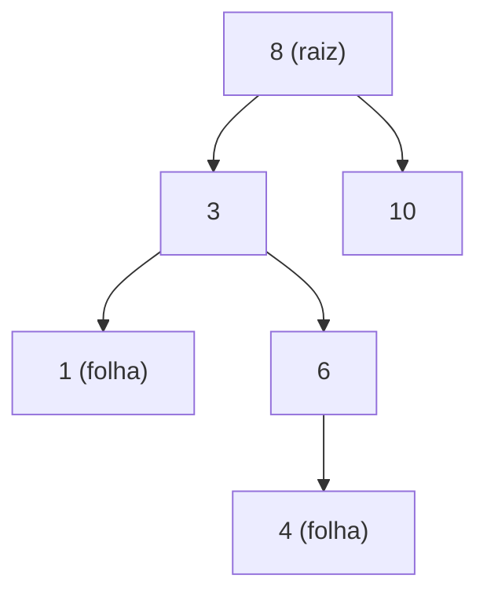
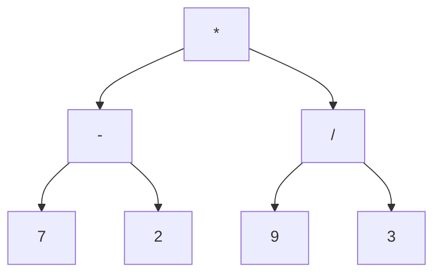

## Passo 1 · Leitura · Uma estrutura definida por ela mesma

Listas, pilhas e filas são lineares: cada elemento tem no máximo um sucessor. Uma **árvore binária** ramifica. A definição é recursiva:

- a árvore vazia é uma árvore binária (em Python, `None`);
- um nó com um `valor` e duas árvores binárias, a **esquerda** (`esq`) e a **direita** (`dir`), também é.



O nó do topo é a **raiz**. Um nó sem filhos é uma **folha**. A **profundidade** de um nó é o número de arestas da raiz até ele. A **altura** de uma árvore é a maior profundidade de uma folha: na árvore acima, o caminho 8 → 3 → 6 → 4 tem 3 arestas, então a altura é 3.

Como a definição é recursiva, as funções sobre árvores também são. O caso base é a árvore vazia; o passo combina a resposta das duas subárvores:

```python
def tamanho(raiz):
    if raiz is None:
        return 0
    return 1 + tamanho(raiz.esq) + tamanho(raiz.dir)


def altura(raiz):
    if raiz is None:
        return -1          # assim uma folha tem 1 + max(-1, -1) = 0
    return 1 + max(altura(raiz.esq), altura(raiz.dir))
```

Por que $-1$ para a vazia? Porque a altura conta **arestas**. Com `return 0` no caso base, a folha passa a ter altura 1 e a função mede **nós** no caminho, um a mais em toda árvore. Os dois jeitos aparecem em livros; o que não pode é misturar.

Cada função visita cada nó uma vez: custo $\Theta(n)$. A altura de uma árvore com $n$ nós fica entre dois extremos. No melhor caso todos os níveis estão cheios, o nível $i$ tem $2^i$ nós e

$$
n \le 2^{h+1} - 1 \quad\Longrightarrow\quad h \ge \lfloor \log_2 n \rfloor .
$$

No pior caso cada nó tem um filho só: a árvore é uma lista disfarçada, com $h = n - 1$. Aí a recursão desce $n$ chamadas, e com alguns milhares de nós o Python para com `RecursionError: maximum recursion depth exceeded`.

Um último cuidado, com folhas: um nó com **um** filho não é folha. O teste é `raiz.esq is None and raiz.dir is None`; com `or`, o nó de um filho só é contado como folha e a subárvore dele some da conta.

## Passo 2 · Exercício · Tamanho, altura, folhas e espelho
modo: lacunas

Complete as lacunas (`___`). A classe `No` está pronta em `arvore.py`. A última função, `eh_simetrica`, diz se a árvore é igual ao próprio reflexo no espelho: a subárvore esquerda da raiz espelha a direita.

### Instruções
1. `tamanho(raiz)` devolve o número de nós (0 para a árvore vazia).
2. `altura(raiz)` conta arestas: $-1$ para a vazia, 0 para uma folha.
3. `contar_folhas(raiz)` conta só os nós sem nenhum filho.
4. `espelhos(a, b)` diz se `a` é o reflexo de `b`: valores iguais, o lado de fora de `a` espelha o de fora de `b` e o de dentro espelha o de dentro.

### Código inicial
```python path=arvore.py
class No:
    def __init__(self, valor, esq=None, dir=None):
        self.valor = valor
        self.esq = esq
        self.dir = dir
```
```python
from arvore import No


def tamanho(raiz):
    if raiz is None:
        return ___
    return 1 + tamanho(raiz.esq) + ___


def altura(raiz):
    if raiz is None:
        return ___
    return 1 + max(altura(raiz.esq), altura(raiz.dir))


def contar_folhas(raiz):
    if raiz is None:
        return 0
    if ___:
        return 1
    return contar_folhas(raiz.esq) + contar_folhas(raiz.dir)


def espelhos(a, b):
    if a is None and b is None:
        return True
    if a is None or b is None or a.valor != b.valor:
        return False
    return espelhos(a.esq, ___) and espelhos(___, b.esq)


def eh_simetrica(raiz):
    return raiz is None or espelhos(raiz.esq, raiz.dir)
```

### Solução
```python path=arvore.py
class No:
    def __init__(self, valor, esq=None, dir=None):
        self.valor = valor
        self.esq = esq
        self.dir = dir
```
```python
from arvore import No


def tamanho(raiz):
    if raiz is None:
        return 0
    return 1 + tamanho(raiz.esq) + tamanho(raiz.dir)


def altura(raiz):
    if raiz is None:
        return -1
    return 1 + max(altura(raiz.esq), altura(raiz.dir))


def contar_folhas(raiz):
    if raiz is None:
        return 0
    if raiz.esq is None and raiz.dir is None:
        return 1
    return contar_folhas(raiz.esq) + contar_folhas(raiz.dir)


def espelhos(a, b):
    if a is None and b is None:
        return True
    if a is None or b is None or a.valor != b.valor:
        return False
    return espelhos(a.esq, b.dir) and espelhos(a.dir, b.esq)


def eh_simetrica(raiz):
    return raiz is None or espelhos(raiz.esq, raiz.dir)
```

### Dicas
1. A raiz conta como um nó; as duas subárvores contam o resto.
2. Escolha o caso base da altura de modo que `1 + max(?, ?)` dê 0 numa folha.
3. Olhe-se no espelho: a sua mão esquerda aparece do lado direito da imagem.

### Verificação
```json
[
  { "id": "tamanho-vazia", "checkpoint": 1, "kind": "call", "function": "tamanho", "args": [null], "expected": 0,
    "name": "tamanho(None) é 0" },
  { "id": "tamanho-t", "checkpoint": 1, "kind": "expr",
    "setup": "t = No(8, No(3, No(1), No(6, No(4), No(7))), No(10, None, No(14, No(13), No(20))))",
    "expr": "tamanho(t)", "expected": 10, "name": "Árvore de 10 nós" },
  { "id": "altura-bordas", "checkpoint": 2, "kind": "expr", "expr": "[altura(None), altura(No(5))]", "expected": [-1, 0],
    "name": "Altura da vazia é -1 e da folha é 0", "hint": "A altura conta arestas, não nós." },
  { "id": "altura-t", "checkpoint": 2, "kind": "expr",
    "setup": "t = No(8, No(3, No(1), No(6, No(4), No(7))), No(10, None, No(14, No(13), No(20))))",
    "expr": "altura(t)", "expected": 3, "name": "Altura de uma árvore com caminhos de tamanhos diferentes" },
  { "id": "altura-corrente", "checkpoint": 2, "kind": "expr",
    "setup": "c = None\nfor v in range(300):\n    c = No(v, None, c)",
    "expr": "altura(c)", "expected": 299, "name": "Corrente de 300 nós tem altura 299" },
  { "id": "folhas-t", "checkpoint": 3, "kind": "expr",
    "setup": "t = No(8, No(3, No(1), No(6, No(4), No(7))), No(10, None, No(14, No(13), No(20))))",
    "expr": "contar_folhas(t)", "expected": 5,
    "name": "Conta as folhas abaixo de um nó com um filho só", "hint": "Um nó com um único filho não é folha." },
  { "id": "folhas-bordas", "checkpoint": 3, "kind": "expr", "expr": "[contar_folhas(None), contar_folhas(No(1)), contar_folhas(No(1, No(2), No(3)))]",
    "expected": [0, 1, 2], "name": "Folhas na vazia, num nó só e numa árvore de 3 nós" },
  { "id": "simetrica-sim", "checkpoint": 4, "kind": "expr",
    "setup": "s = No(1, No(2, No(3), No(4)), No(2, No(4), No(3)))",
    "expr": "eh_simetrica(s)", "expected": true, "name": "Reconhece uma árvore simétrica" },
  { "id": "simetrica-copia", "checkpoint": 4, "kind": "expr",
    "setup": "c = No(1, No(2, No(3), No(4)), No(2, No(3), No(4)))",
    "expr": "eh_simetrica(c)", "expected": false,
    "name": "Duas subárvores iguais (e não espelhadas) não formam uma árvore simétrica",
    "hint": "Compare o lado de fora com o lado de fora." },
  { "id": "simetrica-valores", "checkpoint": 4, "kind": "expr",
    "setup": "v = No(1, No(2, No(3), None), No(5, None, No(3)))",
    "expr": "eh_simetrica(v)", "expected": false,
    "name": "Mesma forma espelhada, mas valores diferentes", "hint": "O reflexo precisa ter os mesmos valores." },
  { "id": "simetrica-bordas", "checkpoint": 4, "kind": "expr", "expr": "[eh_simetrica(None), eh_simetrica(No(7)), eh_simetrica(No(1, No(2), None))]",
    "expected": [true, true, false], "name": "Vazia, um nó e um nó com um filho só" }
]
```

### Soluções erradas
```python name="altura conta nós (caso base 0)"
from arvore import No


def tamanho(raiz):
    if raiz is None:
        return 0
    return 1 + tamanho(raiz.esq) + tamanho(raiz.dir)


def altura(raiz):
    if raiz is None:
        return 0
    return 1 + max(altura(raiz.esq), altura(raiz.dir))


def contar_folhas(raiz):
    if raiz is None:
        return 0
    if raiz.esq is None and raiz.dir is None:
        return 1
    return contar_folhas(raiz.esq) + contar_folhas(raiz.dir)


def espelhos(a, b):
    if a is None and b is None:
        return True
    if a is None or b is None or a.valor != b.valor:
        return False
    return espelhos(a.esq, b.dir) and espelhos(a.dir, b.esq)


def eh_simetrica(raiz):
    return raiz is None or espelhos(raiz.esq, raiz.dir)
```
```python name="folha testada com or"
from arvore import No


def tamanho(raiz):
    if raiz is None:
        return 0
    return 1 + tamanho(raiz.esq) + tamanho(raiz.dir)


def altura(raiz):
    if raiz is None:
        return -1
    return 1 + max(altura(raiz.esq), altura(raiz.dir))


def contar_folhas(raiz):
    if raiz is None:
        return 0
    if raiz.esq is None or raiz.dir is None:
        return 1
    return contar_folhas(raiz.esq) + contar_folhas(raiz.dir)


def espelhos(a, b):
    if a is None and b is None:
        return True
    if a is None or b is None or a.valor != b.valor:
        return False
    return espelhos(a.esq, b.dir) and espelhos(a.dir, b.esq)


def eh_simetrica(raiz):
    return raiz is None or espelhos(raiz.esq, raiz.dir)
```
```python name="espelho compara esquerda com esquerda"
from arvore import No


def tamanho(raiz):
    if raiz is None:
        return 0
    return 1 + tamanho(raiz.esq) + tamanho(raiz.dir)


def altura(raiz):
    if raiz is None:
        return -1
    return 1 + max(altura(raiz.esq), altura(raiz.dir))


def contar_folhas(raiz):
    if raiz is None:
        return 0
    if raiz.esq is None and raiz.dir is None:
        return 1
    return contar_folhas(raiz.esq) + contar_folhas(raiz.dir)


def espelhos(a, b):
    if a is None and b is None:
        return True
    if a is None or b is None or a.valor != b.valor:
        return False
    return espelhos(a.esq, b.esq) and espelhos(a.dir, b.dir)


def eh_simetrica(raiz):
    return raiz is None or espelhos(raiz.esq, raiz.dir)
```
```python name="espelho só compara a forma"
from arvore import No


def tamanho(raiz):
    if raiz is None:
        return 0
    return 1 + tamanho(raiz.esq) + tamanho(raiz.dir)


def altura(raiz):
    if raiz is None:
        return -1
    return 1 + max(altura(raiz.esq), altura(raiz.dir))


def contar_folhas(raiz):
    if raiz is None:
        return 0
    if raiz.esq is None and raiz.dir is None:
        return 1
    return contar_folhas(raiz.esq) + contar_folhas(raiz.dir)


def espelhos(a, b):
    if a is None and b is None:
        return True
    if a is None or b is None:
        return False
    return espelhos(a.esq, b.dir) and espelhos(a.dir, b.esq)


def eh_simetrica(raiz):
    return raiz is None or espelhos(raiz.esq, raiz.dir)
```
```python name="tamanho soma a esquerda duas vezes"
from arvore import No


def tamanho(raiz):
    if raiz is None:
        return 0
    return 1 + tamanho(raiz.esq) + tamanho(raiz.esq)


def altura(raiz):
    if raiz is None:
        return -1
    return 1 + max(altura(raiz.esq), altura(raiz.dir))


def contar_folhas(raiz):
    if raiz is None:
        return 0
    if raiz.esq is None and raiz.dir is None:
        return 1
    return contar_folhas(raiz.esq) + contar_folhas(raiz.dir)


def espelhos(a, b):
    if a is None and b is None:
        return True
    if a is None or b is None or a.valor != b.valor:
        return False
    return espelhos(a.esq, b.dir) and espelhos(a.dir, b.esq)


def eh_simetrica(raiz):
    return raiz is None or espelhos(raiz.esq, raiz.dir)
```

## Passo 3 · Leitura · Percursos: quando a raiz é visitada

Percorrer uma árvore é visitar cada nó exatamente uma vez. Há três percursos em profundidade, que diferem só no **momento** em que a raiz entra na lista:

| Percurso | Ordem | Na árvore do passo 1 |
|---|---|---|
| pré-ordem | raiz, esquerda, direita | 8 3 1 6 4 10 |
| em-ordem | esquerda, raiz, direita | 1 3 4 6 8 10 |
| pós-ordem | esquerda, direita, raiz | 1 4 6 3 10 8 |

A pré-ordem serve para copiar ou salvar a árvore: o pai sai antes dos filhos. A pós-ordem serve quando o pai depende dos filhos prontos, como em `altura`. A em-ordem, numa árvore de busca (próxima lição), sai ordenada.

```python
def pre_ordem(raiz):
    if raiz is None:
        return []
    return [raiz.valor] + pre_ordem(raiz.esq) + pre_ordem(raiz.dir)
```

#### A mesma coisa com uma pilha explícita

A recursão usa a pilha de chamadas do Python, que tem limite: numa árvore com 5 000 nós em fila, a versão acima termina em `RecursionError`. A saída é guardar você mesmo os nós pendentes numa lista usada como pilha. Na em-ordem:

1. desça pela esquerda empilhando cada nó;
2. quando não houver mais esquerda, desempilhe um nó: é a vez dele entrar na resposta;
3. vá para a direita desse nó e volte ao item 1.

O nó entra na resposta ao **sair** da pilha, não ao entrar. Anotar na entrada produz a pré-ordem: é o erro mais comum nessa versão. A pilha guarda no máximo $h + 1$ nós, mas agora é uma lista do Python, sem limite de profundidade.

#### Por níveis, com uma fila

O percurso **por níveis** (em largura) visita a profundidade 0, depois a 1, depois a 2, da esquerda para a direita. Quem chega primeiro sai primeiro: é uma fila, `collections.deque` com `popleft()` em $O(1)$. Trocar por `pop()` vira pilha, e a ordem deixa de ser por níveis.

Para separar os níveis, olhe o tamanho da fila **antes** de começar cada nível. Nesse instante ela contém exatamente os nós daquele nível; os filhos que você enfileirar durante a volta pertencem ao próximo.

```python
fila = deque([raiz])
while fila:
    nivel = []
    for _ in range(len(fila)):      # len avaliado uma vez, antes da volta
        no = fila.popleft()
        nivel.append(no.valor)
        ...                          # enfileira esq e dir, se existirem
```

Os quatro percursos custam $\Theta(n)$: cada nó entra e sai uma vez.

## Passo 4 · Previsão · Três percursos na mesma árvore

O programa monta a árvore desenhada no comentário e imprime os três percursos em profundidade. Leia sem executar e digite a saída exata.

### Código
```python
class No:
    def __init__(self, valor, esq=None, dir=None):
        self.valor = valor
        self.esq = esq
        self.dir = dir

#        A
#       / \
#      B   C
#     / \   \
#    D   E   F
raiz = No("A", No("B", No("D"), No("E")), No("C", None, No("F")))

def pre(r):
    return [] if r is None else [r.valor] + pre(r.esq) + pre(r.dir)

def em(r):
    return [] if r is None else em(r.esq) + [r.valor] + em(r.dir)

def pos(r):
    return [] if r is None else pos(r.esq) + pos(r.dir) + [r.valor]

print("Pré:", "".join(pre(raiz)))
print("Em :", "".join(em(raiz)))
print("Pós:", "".join(pos(raiz)))
```

### Dicas
1. Os três percursos visitam a subárvore esquerda inteira antes de tocar na direita.
2. O nó `C` não tem filho esquerdo: na em-ordem, ele vem antes de `F`.
3. Na pós-ordem, a raiz é sempre a última letra.

### Saída esperada
```text
Pré: ABDECF
Em : DBEACF
Pós: DEBFCA
```

## Passo 5 · Exercício · Pós-ordem, em-ordem com pilha e por níveis

Escreva três percursos. A verificação usa uma árvore com 5 000 nós enfileirados, que uma em-ordem recursiva não consegue percorrer.

- `pos_ordem(raiz)`: lista dos valores em pós-ordem, **recursiva**.
- `em_ordem_iterativa(raiz)`: lista dos valores em em-ordem, **sem recursão**, com uma lista usada como pilha.
- `por_niveis(raiz)`: lista de listas, uma por nível, da raiz para baixo e da esquerda para a direita. Para a árvore do passo 4, `[["A"], ["B", "C"], ["D", "E", "F"]]`.

As três devolvem `[]` para a árvore vazia.

### Instruções
1. Escreva `pos_ordem` recursiva.
2. Escreva `em_ordem_iterativa` com pilha explícita: o nó entra na resposta quando sai da pilha.
3. Escreva `por_niveis` com `deque`, separando os níveis pelo tamanho da fila no começo de cada um.

### Código inicial
```python path=arvore.py
class No:
    def __init__(self, valor, esq=None, dir=None):
        self.valor = valor
        self.esq = esq
        self.dir = dir
```
```python
from collections import deque

from arvore import No


def pos_ordem(raiz):
    pass


def em_ordem_iterativa(raiz):
    pass


def por_niveis(raiz):
    pass
```

### Solução
```python path=arvore.py
class No:
    def __init__(self, valor, esq=None, dir=None):
        self.valor = valor
        self.esq = esq
        self.dir = dir
```
```python
from collections import deque

from arvore import No


def pos_ordem(raiz):
    if raiz is None:
        return []
    return pos_ordem(raiz.esq) + pos_ordem(raiz.dir) + [raiz.valor]


def em_ordem_iterativa(raiz):
    saida = []
    pilha = []
    atual = raiz
    while pilha or atual is not None:
        while atual is not None:
            pilha.append(atual)
            atual = atual.esq
        no = pilha.pop()
        saida.append(no.valor)
        atual = no.dir
    return saida


def por_niveis(raiz):
    if raiz is None:
        return []
    niveis = []
    fila = deque([raiz])
    while fila:
        nivel = []
        for _ in range(len(fila)):
            no = fila.popleft()
            nivel.append(no.valor)
            if no.esq is not None:
                fila.append(no.esq)
            if no.dir is not None:
                fila.append(no.dir)
        niveis.append(nivel)
    return niveis
```

### Dicas
1. Na pós-ordem, as duas subárvores vêm antes do valor da raiz.
2. Na em-ordem iterativa, o laço externo continua enquanto houver nó na pilha **ou** um nó atual por explorar.
3. Em `por_niveis`, `range(len(fila))` é calculado uma vez, antes de a volta começar.

### Verificação
```json
[
  { "id": "pos-recursiva", "checkpoint": 1, "kind": "source", "rule": { "type": "uses", "construct": "recursion", "function": "pos_ordem" },
    "name": "pos_ordem é recursiva" },
  { "id": "pos-t", "checkpoint": 1, "kind": "expr",
    "setup": "t = No(1, No(2, No(4), No(5, No(7), None)), No(3, None, No(6)))",
    "expr": "pos_ordem(t)", "expected": [4, 7, 5, 2, 6, 3, 1], "name": "Pós-ordem de uma árvore de 7 nós" },
  { "id": "pos-vazia", "checkpoint": 1, "kind": "call", "function": "pos_ordem", "args": [null], "expected": [],
    "name": "pos_ordem(None) é []" },
  { "id": "em-t", "checkpoint": 2, "kind": "expr",
    "setup": "t = No(1, No(2, No(4), No(5, No(7), None)), No(3, None, No(6)))",
    "expr": "em_ordem_iterativa(t)", "expected": [4, 2, 7, 5, 1, 3, 6],
    "name": "Em-ordem de uma árvore de 7 nós", "hint": "O valor entra na resposta quando o nó sai da pilha, não quando entra." },
  { "id": "em-vazia-um", "checkpoint": 2, "kind": "expr", "expr": "[em_ordem_iterativa(None), em_ordem_iterativa(No(9))]",
    "expected": [[], [9]], "name": "Em-ordem da vazia e de um nó só" },
  { "id": "em-funda-esq", "checkpoint": 2, "kind": "expr",
    "setup": "c = None\nfor v in range(1, 5001):\n    c = No(v, c, None)",
    "expr": "em_ordem_iterativa(c) == list(range(1, 5001))", "expected": true,
    "name": "5000 nós enfileirados à esquerda, sem RecursionError",
    "hint": "Com recursão, a pilha de chamadas do Python estoura nessa profundidade." },
  { "id": "em-funda-dir", "checkpoint": 2, "kind": "expr",
    "setup": "c = None\nfor v in range(5000, 0, -1):\n    c = No(v, None, c)",
    "expr": "em_ordem_iterativa(c) == list(range(1, 5001))", "expected": true,
    "name": "5000 nós enfileirados à direita" },
  { "id": "niveis-t", "checkpoint": 3, "kind": "expr",
    "setup": "t = No(1, No(2, No(4), No(5, No(7), None)), No(3, None, No(6)))",
    "expr": "por_niveis(t)", "expected": [[1], [2, 3], [4, 5, 6], [7]], "name": "Níveis de uma árvore de 7 nós" },
  { "id": "niveis-bordas", "checkpoint": 3, "kind": "expr", "expr": "[por_niveis(None), por_niveis(No('x'))]",
    "expected": [[], [["x"]]], "name": "Níveis da vazia e de um nó só" },
  { "id": "niveis-buracos", "checkpoint": 3, "kind": "expr",
    "setup": "b = No(10, No(20, None, No(40)), No(30, No(50), None))",
    "expr": "por_niveis(b)", "expected": [[10], [20, 30], [40, 50]],
    "name": "Níveis com filhos faltando dos dois lados", "hint": "Dentro de um nível, a ordem é da esquerda para a direita." }
]
```

### Soluções erradas
```python name="em-ordem recursiva com outro nome"
from collections import deque

from arvore import No


def pos_ordem(raiz):
    if raiz is None:
        return []
    return pos_ordem(raiz.esq) + pos_ordem(raiz.dir) + [raiz.valor]


def em_ordem_iterativa(raiz):
    if raiz is None:
        return []
    return em_ordem_iterativa(raiz.esq) + [raiz.valor] + em_ordem_iterativa(raiz.dir)


def por_niveis(raiz):
    if raiz is None:
        return []
    niveis = []
    fila = deque([raiz])
    while fila:
        nivel = []
        for _ in range(len(fila)):
            no = fila.popleft()
            nivel.append(no.valor)
            if no.esq is not None:
                fila.append(no.esq)
            if no.dir is not None:
                fila.append(no.dir)
        niveis.append(nivel)
    return niveis
```
```python name="anota o nó ao empilhar (sai pré-ordem)"
from collections import deque

from arvore import No


def pos_ordem(raiz):
    if raiz is None:
        return []
    return pos_ordem(raiz.esq) + pos_ordem(raiz.dir) + [raiz.valor]


def em_ordem_iterativa(raiz):
    saida = []
    pilha = []
    atual = raiz
    while pilha or atual is not None:
        while atual is not None:
            saida.append(atual.valor)
            pilha.append(atual)
            atual = atual.esq
        no = pilha.pop()
        atual = no.dir
    return saida


def por_niveis(raiz):
    if raiz is None:
        return []
    niveis = []
    fila = deque([raiz])
    while fila:
        nivel = []
        for _ in range(len(fila)):
            no = fila.popleft()
            nivel.append(no.valor)
            if no.esq is not None:
                fila.append(no.esq)
            if no.dir is not None:
                fila.append(no.dir)
        niveis.append(nivel)
    return niveis
```
```python name="por níveis com pop() em vez de popleft()"
from collections import deque

from arvore import No


def pos_ordem(raiz):
    if raiz is None:
        return []
    return pos_ordem(raiz.esq) + pos_ordem(raiz.dir) + [raiz.valor]


def em_ordem_iterativa(raiz):
    saida = []
    pilha = []
    atual = raiz
    while pilha or atual is not None:
        while atual is not None:
            pilha.append(atual)
            atual = atual.esq
        no = pilha.pop()
        saida.append(no.valor)
        atual = no.dir
    return saida


def por_niveis(raiz):
    if raiz is None:
        return []
    niveis = []
    fila = deque([raiz])
    while fila:
        nivel = []
        for _ in range(len(fila)):
            no = fila.pop()
            nivel.append(no.valor)
            if no.esq is not None:
                fila.append(no.esq)
            if no.dir is not None:
                fila.append(no.dir)
        niveis.append(nivel)
    return niveis
```
```python name="não separa os níveis (fila esvaziada numa volta só)"
from collections import deque

from arvore import No


def pos_ordem(raiz):
    if raiz is None:
        return []
    return pos_ordem(raiz.esq) + pos_ordem(raiz.dir) + [raiz.valor]


def em_ordem_iterativa(raiz):
    saida = []
    pilha = []
    atual = raiz
    while pilha or atual is not None:
        while atual is not None:
            pilha.append(atual)
            atual = atual.esq
        no = pilha.pop()
        saida.append(no.valor)
        atual = no.dir
    return saida


def por_niveis(raiz):
    if raiz is None:
        return []
    niveis = []
    fila = deque([raiz])
    while fila:
        nivel = []
        while fila:
            no = fila.popleft()
            nivel.append(no.valor)
            if no.esq is not None:
                fila.append(no.esq)
            if no.dir is not None:
                fila.append(no.dir)
        niveis.append(nivel)
    return niveis
```
```python name="pós-ordem visita a direita antes da esquerda"
from collections import deque

from arvore import No


def pos_ordem(raiz):
    if raiz is None:
        return []
    return pos_ordem(raiz.dir) + pos_ordem(raiz.esq) + [raiz.valor]


def em_ordem_iterativa(raiz):
    saida = []
    pilha = []
    atual = raiz
    while pilha or atual is not None:
        while atual is not None:
            pilha.append(atual)
            atual = atual.esq
        no = pilha.pop()
        saida.append(no.valor)
        atual = no.dir
    return saida


def por_niveis(raiz):
    if raiz is None:
        return []
    niveis = []
    fila = deque([raiz])
    while fila:
        nivel = []
        for _ in range(len(fila)):
            no = fila.popleft()
            nivel.append(no.valor)
            if no.esq is not None:
                fila.append(no.esq)
            if no.dir is not None:
                fila.append(no.dir)
        niveis.append(nivel)
    return niveis
```
```python name="laço externo só enquanto a pilha tiver nós"
from collections import deque

from arvore import No


def pos_ordem(raiz):
    if raiz is None:
        return []
    return pos_ordem(raiz.esq) + pos_ordem(raiz.dir) + [raiz.valor]


def em_ordem_iterativa(raiz):
    saida = []
    pilha = []
    atual = raiz
    while pilha:
        while atual is not None:
            pilha.append(atual)
            atual = atual.esq
        no = pilha.pop()
        saida.append(no.valor)
        atual = no.dir
    return saida


def por_niveis(raiz):
    if raiz is None:
        return []
    niveis = []
    fila = deque([raiz])
    while fila:
        nivel = []
        for _ in range(len(fila)):
            no = fila.popleft()
            nivel.append(no.valor)
            if no.esq is not None:
                fila.append(no.esq)
            if no.dir is not None:
                fila.append(no.dir)
        niveis.append(nivel)
    return niveis
```

## Passo 6 · Leitura · Árvores de expressão e reconstrução

A expressão `(7 - 2) * (9 / 3)` vira uma árvore: as folhas são números e cada nó interno é um operador aplicado às suas duas subárvores.



**Avaliar** é uma pós-ordem: para aplicar o `*`, os dois lados precisam estar calculados. Numa folha, devolva o número; num operador, avalie a esquerda, avalie a direita e combine. A ordem dos operandos importa em `-` e `/`: o filho esquerdo é o primeiro operando. Escrever `dir - esq` dá `2 - 7 = -5` na subárvore da esquerda e nenhuma mensagem de erro. E o operador de divisão é `/`, não `//`: com `//`, `7 / 2` daria 3.

**Escrever em notação infixa** é uma em-ordem com parênteses: esquerda, operador, direita. Cada operador ganha um par de parênteses em volta da sua subexpressão, e a folha sai sem nenhum:

```python
def para_infixa(raiz):
    if raiz.esq is None and raiz.dir is None:
        return str(raiz.valor)
    return f"({para_infixa(raiz.esq)} {raiz.valor} {para_infixa(raiz.dir)})"
```

A árvore acima produz `((7 - 2) * (9 / 3))`. Sem os parênteses sairia `7 - 2 * 9 / 3`, que vale 1 e não 15: a árvore guardava a precedência, o texto a perdeu. A pós-ordem da mesma árvore, `7 2 - 9 3 / *`, é a notação polonesa reversa que a pilha do módulo anterior avalia.

#### Reconstruir a partir de dois percursos

Com a pré-ordem e a em-ordem de uma árvore sem valores repetidos, dá para reconstruí-la:

1. `pre[0]` é a raiz;
2. na em-ordem, tudo antes da raiz é a subárvore esquerda; seja `k` a posição da raiz em `em`, então a esquerda tem `k` nós;
3. logo, na pré-ordem, a esquerda ocupa `pre[1:k + 1]` e a direita, `pre[k + 1:]`; na em-ordem, `em[:k]` e `em[k + 1:]`.

Aplique a mesma regra a cada metade, recursivamente, até as listas ficarem vazias. O erro clássico é a fatia da pré-ordem: `pre[1:k]` perde um nó da esquerda e o empurra para a direita.

## Passo 7 · Exercício · Avaliar, escrever e reconstruir

Escreva três funções sobre a classe `No` de `arvore.py`.

- `avaliar(raiz)`: valor da árvore de expressão como `float`. Folhas guardam números; nós internos guardam `"+"`, `"-"`, `"*"` ou `"/"`.
- `para_infixa(raiz)`: texto com um par de parênteses em volta de cada operação e um espaço de cada lado do operador. Folha sai como `str(valor)`. Exemplo: `((7 - 2) * (9 / 3))`.
- `reconstruir(pre, em)`: devolve a raiz da árvore cujos percursos em pré-ordem e em-ordem são `pre` e `em` (sem valores repetidos); listas vazias dão `None`.

### Instruções
1. Escreva `avaliar` em pós-ordem, com o filho esquerdo como primeiro operando.
2. Escreva `para_infixa` em em-ordem, com parênteses só em volta das operações.
3. Escreva `reconstruir` recursiva, fatiando as duas listas pelo tamanho da subárvore esquerda.

### Código inicial
```python path=arvore.py
class No:
    def __init__(self, valor, esq=None, dir=None):
        self.valor = valor
        self.esq = esq
        self.dir = dir
```
```python
from arvore import No


def avaliar(raiz):
    pass


def para_infixa(raiz):
    pass


def reconstruir(pre, em):
    pass
```

### Solução
```python path=arvore.py
class No:
    def __init__(self, valor, esq=None, dir=None):
        self.valor = valor
        self.esq = esq
        self.dir = dir
```
```python
from arvore import No


def avaliar(raiz):
    if raiz.esq is None and raiz.dir is None:
        return float(raiz.valor)
    a = avaliar(raiz.esq)
    b = avaliar(raiz.dir)
    if raiz.valor == "+":
        return a + b
    if raiz.valor == "-":
        return a - b
    if raiz.valor == "*":
        return a * b
    return a / b


def para_infixa(raiz):
    if raiz.esq is None and raiz.dir is None:
        return str(raiz.valor)
    return f"({para_infixa(raiz.esq)} {raiz.valor} {para_infixa(raiz.dir)})"


def reconstruir(pre, em):
    if not pre:
        return None
    k = em.index(pre[0])
    esq = reconstruir(pre[1:k + 1], em[:k])
    dir = reconstruir(pre[k + 1:], em[k + 1:])
    return No(pre[0], esq, dir)
```

### Dicas
1. Uma folha é um nó sem os dois filhos; todo o resto é operador.
2. Em `avaliar`, guarde o resultado de cada lado numa variável antes de combinar: fica fácil ver qual é o primeiro operando.
3. Em `reconstruir`, a posição `k` da raiz em `em` é também o número de nós da subárvore esquerda.

### Verificação
```json
[
  { "id": "avaliar-15", "checkpoint": 1, "kind": "expr",
    "setup": "e = No('*', No('-', No(7), No(2)), No('/', No(9), No(3)))",
    "expr": "avaliar(e)", "expected": 15.0, "tolerance": 1e-9, "name": "(7 - 2) * (9 / 3) vale 15.0",
    "hint": "No '-', o filho esquerdo é o primeiro operando." },
  { "id": "avaliar-div", "checkpoint": 1, "kind": "expr",
    "setup": "e = No('+', No('/', No(7), No(2)), No('-', No(1), No(4)))",
    "expr": "avaliar(e)", "expected": 0.5, "tolerance": 1e-9, "name": "7 / 2 + (1 - 4) vale 0.5",
    "hint": "Divisão de verdade, não divisão inteira." },
  { "id": "avaliar-folha", "checkpoint": 1, "kind": "expr", "expr": "avaliar(No(4))", "expected": 4.0, "type": "float",
    "name": "Uma folha vale o próprio número, como float" },
  { "id": "infixa", "checkpoint": 2, "kind": "expr",
    "setup": "e = No('*', No('-', No(7), No(2)), No('/', No(9), No(3)))",
    "expr": "para_infixa(e)", "expected": "((7 - 2) * (9 / 3))", "name": "Infixa com um par de parênteses por operação" },
  { "id": "infixa-folha", "checkpoint": 2, "kind": "expr",
    "setup": "e = No('-', No(10), No('*', No(2), No(3)))",
    "expr": "[para_infixa(No(5)), para_infixa(e)]", "expected": ["5", "(10 - (2 * 3))"],
    "name": "Folha sem parênteses e operação aninhada à direita" },
  { "id": "rec-t", "checkpoint": 3, "kind": "expr",
    "setup": "def _pre(r):\n    return [] if r is None else [r.valor] + _pre(r.esq) + _pre(r.dir)\ndef _pos(r):\n    return [] if r is None else _pos(r.esq) + _pos(r.dir) + [r.valor]\nr = reconstruir([10, 5, 2, 7, 6, 15, 20], [2, 5, 6, 7, 10, 15, 20])",
    "expr": "[_pre(r), _pos(r)]", "expected": [[10, 5, 2, 7, 6, 15, 20], [2, 6, 7, 5, 20, 15, 10]],
    "name": "Reconstrói uma árvore de 7 nós", "hint": "A esquerda tem k nós: na pré-ordem ela ocupa as posições 1 a k." },
  { "id": "rec-corrente", "checkpoint": 3, "kind": "expr",
    "setup": "def _pos(r):\n    return [] if r is None else _pos(r.esq) + _pos(r.dir) + [r.valor]\nr = reconstruir(['a', 'b', 'c', 'd'], ['d', 'c', 'b', 'a'])\ns = reconstruir(['a', 'b', 'c'], ['a', 'b', 'c'])",
    "expr": "[_pos(r), r.dir is None, _pos(s), s.esq is None]", "expected": [["d", "c", "b", "a"], true, ["c", "b", "a"], true],
    "name": "Correntes só à esquerda e só à direita" },
  { "id": "rec-vazia", "checkpoint": 3, "kind": "expr", "expr": "[reconstruir([], []), reconstruir([1], [1]).valor]",
    "expected": [null, 1], "name": "Listas vazias dão None; uma lista de um elemento dá uma folha" }
]
```

### Soluções erradas
```python name="operandos invertidos no - e no /"
from arvore import No


def avaliar(raiz):
    if raiz.esq is None and raiz.dir is None:
        return float(raiz.valor)
    a = avaliar(raiz.esq)
    b = avaliar(raiz.dir)
    if raiz.valor == "+":
        return b + a
    if raiz.valor == "-":
        return b - a
    if raiz.valor == "*":
        return b * a
    return b / a


def para_infixa(raiz):
    if raiz.esq is None and raiz.dir is None:
        return str(raiz.valor)
    return f"({para_infixa(raiz.esq)} {raiz.valor} {para_infixa(raiz.dir)})"


def reconstruir(pre, em):
    if not pre:
        return None
    k = em.index(pre[0])
    esq = reconstruir(pre[1:k + 1], em[:k])
    dir = reconstruir(pre[k + 1:], em[k + 1:])
    return No(pre[0], esq, dir)
```
```python name="divisão inteira com //"
from arvore import No


def avaliar(raiz):
    if raiz.esq is None and raiz.dir is None:
        return float(raiz.valor)
    a = avaliar(raiz.esq)
    b = avaliar(raiz.dir)
    if raiz.valor == "+":
        return a + b
    if raiz.valor == "-":
        return a - b
    if raiz.valor == "*":
        return a * b
    return a // b


def para_infixa(raiz):
    if raiz.esq is None and raiz.dir is None:
        return str(raiz.valor)
    return f"({para_infixa(raiz.esq)} {raiz.valor} {para_infixa(raiz.dir)})"


def reconstruir(pre, em):
    if not pre:
        return None
    k = em.index(pre[0])
    esq = reconstruir(pre[1:k + 1], em[:k])
    dir = reconstruir(pre[k + 1:], em[k + 1:])
    return No(pre[0], esq, dir)
```
```python name="infixa sem parênteses"
from arvore import No


def avaliar(raiz):
    if raiz.esq is None and raiz.dir is None:
        return float(raiz.valor)
    a = avaliar(raiz.esq)
    b = avaliar(raiz.dir)
    if raiz.valor == "+":
        return a + b
    if raiz.valor == "-":
        return a - b
    if raiz.valor == "*":
        return a * b
    return a / b


def para_infixa(raiz):
    if raiz.esq is None and raiz.dir is None:
        return str(raiz.valor)
    return f"{para_infixa(raiz.esq)} {raiz.valor} {para_infixa(raiz.dir)}"


def reconstruir(pre, em):
    if not pre:
        return None
    k = em.index(pre[0])
    esq = reconstruir(pre[1:k + 1], em[:k])
    dir = reconstruir(pre[k + 1:], em[k + 1:])
    return No(pre[0], esq, dir)
```
```python name="fatia da pré-ordem uma posição curta"
from arvore import No


def avaliar(raiz):
    if raiz.esq is None and raiz.dir is None:
        return float(raiz.valor)
    a = avaliar(raiz.esq)
    b = avaliar(raiz.dir)
    if raiz.valor == "+":
        return a + b
    if raiz.valor == "-":
        return a - b
    if raiz.valor == "*":
        return a * b
    return a / b


def para_infixa(raiz):
    if raiz.esq is None and raiz.dir is None:
        return str(raiz.valor)
    return f"({para_infixa(raiz.esq)} {raiz.valor} {para_infixa(raiz.dir)})"


def reconstruir(pre, em):
    if not pre or not em:
        return None
    k = em.index(pre[0])
    esq = reconstruir(pre[1:k], em[:k])
    dir = reconstruir(pre[k:], em[k + 1:])
    return No(pre[0], esq, dir)
```
```python name="caso base só para a lista de um elemento"
from arvore import No


def avaliar(raiz):
    if raiz.esq is None and raiz.dir is None:
        return float(raiz.valor)
    a = avaliar(raiz.esq)
    b = avaliar(raiz.dir)
    if raiz.valor == "+":
        return a + b
    if raiz.valor == "-":
        return a - b
    if raiz.valor == "*":
        return a * b
    return a / b


def para_infixa(raiz):
    if raiz.esq is None and raiz.dir is None:
        return str(raiz.valor)
    return f"({para_infixa(raiz.esq)} {raiz.valor} {para_infixa(raiz.dir)})"


def reconstruir(pre, em):
    if len(pre) == 1:
        return No(pre[0])
    k = em.index(pre[0])
    esq = reconstruir(pre[1:k + 1], em[:k])
    dir = reconstruir(pre[k + 1:], em[k + 1:])
    return No(pre[0], esq, dir)
```

## Passo 8 · Quiz · Percursos e formas

### Pergunta
Qual percurso da árvore de `(7 - 2) * (9 / 3)` produz `7 2 - 9 3 / *`, a forma que uma pilha avalia da esquerda para a direita?
- [ ] Pré-ordem
- [ ] Em-ordem
- [x] Pós-ordem
- [ ] Por níveis
> Na pós-ordem, os dois operandos de cada operador saem antes dele. É exatamente a notação polonesa reversa: ao ler o operador, os dois valores já estão no topo da pilha.

### Pergunta
Uma árvore binária tem 31 nós. Quais são a menor e a maior altura possíveis, contando arestas?
- [ ] 5 e 31
- [x] 4 e 30
- [ ] 5 e 30
- [ ] 4 e 31
> A altura mínima vem da árvore cheia: $2^{h+1} - 1 = 31$ dá $h = 4$. A máxima vem da corrente, com um filho por nó: 31 nós ligados por 30 arestas. Numa corrente dessas a recursão desce 31 chamadas; com milhares de nós, chega ao `RecursionError`.

### Pergunta
As árvores `X` (raiz 1 com filho **esquerdo** 2) e `Y` (raiz 1 com filho **direito** 2) têm a mesma pré-ordem, `[1, 2]`, e a mesma pós-ordem, `[2, 1]`. O que isso mostra?
- [ ] Que a pós-ordem é sempre a pré-ordem invertida
- [x] Que pré-ordem e pós-ordem juntas não bastam para reconstruir uma árvore: falta saber de que lado fica um filho único, e a em-ordem diz isso
- [ ] Que `X` e `Y` são a mesma árvore
- [ ] Que só a em-ordem basta para reconstruir qualquer árvore
> A em-ordem de `X` é `[2, 1]` e a de `Y` é `[1, 2]`: é ela que separa o que fica à esquerda da raiz do que fica à direita. Só a em-ordem também não basta, porque várias árvores têm a mesma em-ordem; por isso a reconstrução usa pré-ordem **e** em-ordem.
