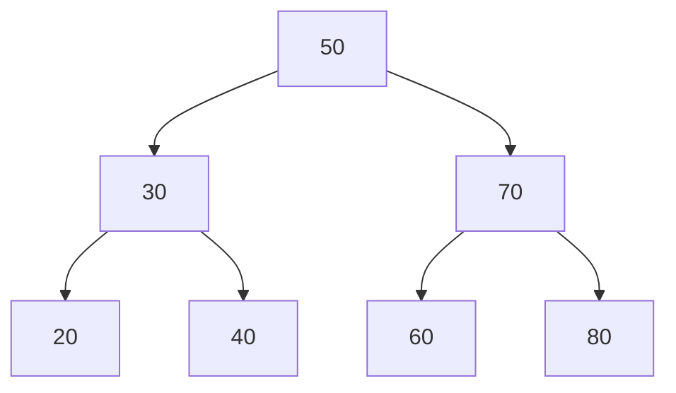
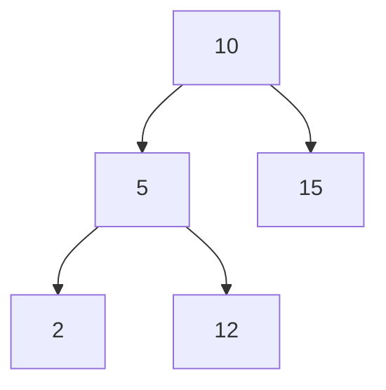
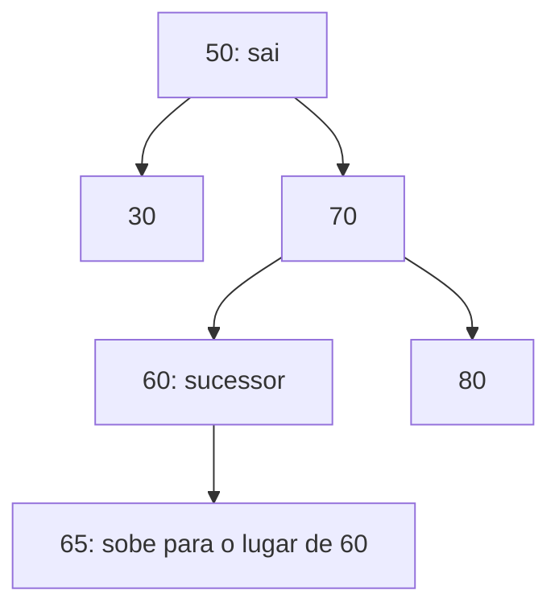

## Passo 1 · Leitura · A propriedade de busca e o caminho de uma consulta

Uma **árvore de busca binária** (BST, de *binary search tree*) é uma árvore binária em que, para **todo** nó `x`:

- todo valor da subárvore esquerda de `x` é menor que `x.valor`;
- todo valor da subárvore direita de `x` é maior que `x.valor`.

Repare no "todo": a regra vale para a subárvore inteira, não só para os filhos. Uma consequência direta é que a em-ordem de uma BST sai **crescente**.



Para **buscar** 60, compare com a raiz: 60 > 50, então ele só pode estar à direita, e a esquerda inteira fica de fora. Em 70, vá para a esquerda; em 60, achou. Foram 3 nós visitados, um por nível. Em geral a busca visita no máximo $h + 1$ nós, em que $h$ é a altura: custo $O(h)$. É a busca binária do módulo 4, agora sobre ponteiros.

**Inserir** é buscar até cair num `None` e pendurar ali o nó novo. O ponto delicado é **pendurar**: o nó novo precisa virar `esq` ou `dir` do último nó visitado. A forma recursiva resolve isso devolvendo a raiz da subárvore e deixando o pai reatribuir:

```python
def inserir(raiz, valor):
    if raiz is None:
        return No(valor)                          # subárvore nova de um nó
    if valor < raiz.valor:
        raiz.esq = inserir(raiz.esq, valor)       # o pai recebe a subárvore de volta
    elif valor > raiz.valor:
        raiz.dir = inserir(raiz.dir, valor)
    return raiz                                   # igual: não insere de novo
```

Dois erros comuns, ambos silenciosos:

- escrever só `inserir(raiz.esq, valor)`, sem o `raiz.esq =`: o nó é criado e jogado fora, e nenhuma mensagem aparece;
- esquecer o `return raiz` do fim: a função devolve `None` e quem chamou troca a árvore inteira por nada.

Quem usa a função também reatribui: `raiz = inserir(raiz, 25)`. É o único jeito de a primeira inserção, numa árvore vazia, ter efeito.

Nesta lição a BST guarda um **conjunto**: valor repetido é ignorado. Com `<=` no lugar de `<`, o repetido desce para a esquerda e passa a existir duas vezes.

## Passo 2 · Exercício · Inserir e buscar
modo: lacunas

Complete as lacunas (`___`) de `inserir` e `buscar`. A classe `No` está em `arvore.py`. `inserir` devolve a raiz da árvore depois da inserção e ignora valores repetidos; `buscar` devolve `True` ou `False` sem recursão.

### Instruções
1. Na árvore vazia, `inserir` devolve um nó novo.
2. Em `inserir`, o filho esquerdo recebe de volta a subárvore em que o valor foi inserido, e a função devolve a raiz recebida.
3. Em `buscar`, desça para o lado em que o valor pode estar.

### Código inicial
```python path=arvore.py
class No:
    def __init__(self, valor, esq=None, dir=None):
        self.valor = valor
        self.esq = esq
        self.dir = dir
```
```python
from arvore import No


def inserir(raiz, valor):
    if raiz is None:
        return ___
    if valor < raiz.valor:
        raiz.esq = ___
    elif valor > raiz.valor:
        raiz.dir = inserir(raiz.dir, valor)
    return ___


def buscar(raiz, valor):
    atual = raiz
    while atual is not None:
        if valor == atual.valor:
            return True
        if valor < atual.valor:
            atual = ___
        else:
            atual = ___
    return False
```

### Solução
```python path=arvore.py
class No:
    def __init__(self, valor, esq=None, dir=None):
        self.valor = valor
        self.esq = esq
        self.dir = dir
```
```python
from arvore import No


def inserir(raiz, valor):
    if raiz is None:
        return No(valor)
    if valor < raiz.valor:
        raiz.esq = inserir(raiz.esq, valor)
    elif valor > raiz.valor:
        raiz.dir = inserir(raiz.dir, valor)
    return raiz


def buscar(raiz, valor):
    atual = raiz
    while atual is not None:
        if valor == atual.valor:
            return True
        if valor < atual.valor:
            atual = atual.esq
        else:
            atual = atual.dir
    return False
```

### Dicas
1. A árvore vazia vira uma árvore de um nó só.
2. A chamada recursiva devolve a subárvore já com o valor dentro: alguém precisa guardá-la.
3. Valores menores ficam à esquerda.

### Verificação
```json
[
  { "id": "vazia", "checkpoint": 1, "kind": "expr", "setup": "r = inserir(None, 42)",
    "expr": "[r.valor, r.esq, r.dir]", "expected": [42, null, null], "name": "Inserir na árvore vazia cria um nó" },
  { "id": "forma", "checkpoint": 2, "kind": "expr",
    "setup": "def _pre(r):\n    return [] if r is None else [r.valor] + _pre(r.esq) + _pre(r.dir)\nr = None\nfor v in [50, 30, 70, 20, 40, 60, 80, 35]:\n    r = inserir(r, v)",
    "expr": "_pre(r)", "expected": [50, 30, 20, 40, 35, 70, 60, 80],
    "name": "8 inserções produzem a forma certa", "hint": "O nó novo precisa ser pendurado no pai, à esquerda ou à direita." },
  { "id": "mesma-raiz", "checkpoint": 2, "kind": "expr",
    "setup": "r = inserir(None, 10)\nr2 = inserir(r, 5)\nr3 = inserir(r2, 15)",
    "expr": "[r2 is r, r3 is r, r.esq.valor, r.dir.valor]", "expected": [true, true, 5, 15],
    "name": "Inserir numa árvore não vazia devolve a mesma raiz", "hint": "A função precisa devolver a raiz no fim." },
  { "id": "repetidos", "checkpoint": 2, "kind": "expr",
    "setup": "def _em(r):\n    return [] if r is None else _em(r.esq) + [r.valor] + _em(r.dir)\nr = None\nfor v in [5, 3, 8, 5, 3, 8, 5]:\n    r = inserir(r, v)",
    "expr": "_em(r)", "expected": [3, 5, 8], "name": "Valores repetidos são ignorados",
    "hint": "Igual não é menor nem maior." },
  { "id": "textos", "checkpoint": 2, "kind": "expr",
    "setup": "def _em(r):\n    return [] if r is None else _em(r.esq) + [r.valor] + _em(r.dir)\nr = None\nfor v in ['Eva', 'Bia', 'Davi', 'Ana', 'Caio']:\n    r = inserir(r, v)",
    "expr": "_em(r)", "expected": ["Ana", "Bia", "Caio", "Davi", "Eva"], "name": "Funciona com textos: em-ordem alfabética" },
  { "id": "busca-acha", "checkpoint": 3, "kind": "expr",
    "setup": "r = None\nfor v in [50, 30, 70, 20, 40, 60, 80, 35]:\n    r = inserir(r, v)",
    "expr": "[buscar(r, v) for v in [50, 35, 80, 20, 60]]", "expected": [true, true, true, true, true],
    "name": "Acha a raiz, folhas e nós do meio" },
  { "id": "busca-falta", "checkpoint": 3, "kind": "expr",
    "setup": "r = None\nfor v in [50, 30, 70, 20, 40, 60, 80, 35]:\n    r = inserir(r, v)",
    "expr": "[buscar(r, v) for v in [45, 10, 99, 55]] + [buscar(None, 1)]", "expected": [false, false, false, false, false],
    "name": "Não acha valores ausentes nem busca na árvore vazia" },
  { "id": "busca-sem-recursao", "checkpoint": 3, "kind": "source", "rule": { "type": "uses", "construct": "while", "function": "buscar" },
    "name": "buscar usa um laço while" }
]
```

### Soluções erradas
```python name="não pendura o nó novo no pai"
from arvore import No


def inserir(raiz, valor):
    if raiz is None:
        return No(valor)
    if valor < raiz.valor:
        inserir(raiz.esq, valor)
    elif valor > raiz.valor:
        inserir(raiz.dir, valor)
    return raiz


def buscar(raiz, valor):
    atual = raiz
    while atual is not None:
        if valor == atual.valor:
            return True
        if valor < atual.valor:
            atual = atual.esq
        else:
            atual = atual.dir
    return False
```
```python name="esquece o return raiz"
from arvore import No


def inserir(raiz, valor):
    if raiz is None:
        return No(valor)
    if valor < raiz.valor:
        raiz.esq = inserir(raiz.esq, valor)
    elif valor > raiz.valor:
        raiz.dir = inserir(raiz.dir, valor)


def buscar(raiz, valor):
    atual = raiz
    while atual is not None:
        if valor == atual.valor:
            return True
        if valor < atual.valor:
            atual = atual.esq
        else:
            atual = atual.dir
    return False
```
```python name="<= manda o repetido para a esquerda"
from arvore import No


def inserir(raiz, valor):
    if raiz is None:
        return No(valor)
    if valor <= raiz.valor:
        raiz.esq = inserir(raiz.esq, valor)
    else:
        raiz.dir = inserir(raiz.dir, valor)
    return raiz


def buscar(raiz, valor):
    atual = raiz
    while atual is not None:
        if valor == atual.valor:
            return True
        if valor < atual.valor:
            atual = atual.esq
        else:
            atual = atual.dir
    return False
```
```python name="busca desce para o lado errado"
from arvore import No


def inserir(raiz, valor):
    if raiz is None:
        return No(valor)
    if valor < raiz.valor:
        raiz.esq = inserir(raiz.esq, valor)
    elif valor > raiz.valor:
        raiz.dir = inserir(raiz.dir, valor)
    return raiz


def buscar(raiz, valor):
    atual = raiz
    while atual is not None:
        if valor == atual.valor:
            return True
        if valor > atual.valor:
            atual = atual.esq
        else:
            atual = atual.dir
    return False
```
```python name="pendura o nó novo direto no filho"
from arvore import No


def inserir(raiz, valor):
    if raiz is None:
        return No(valor)
    if valor < raiz.valor:
        raiz.esq = No(valor)
    elif valor > raiz.valor:
        raiz.dir = inserir(raiz.dir, valor)
    return raiz


def buscar(raiz, valor):
    atual = raiz
    while atual is not None:
        if valor == atual.valor:
            return True
        if valor < atual.valor:
            atual = atual.esq
        else:
            atual = atual.dir
    return False
```

## Passo 3 · Leitura · Validar: olhar os filhos não basta

Você recebe uma árvore pronta e quer saber se ela é uma BST. A tentação é conferir cada nó com os filhos: `esq.valor < valor < dir.valor`. Veja a árvore abaixo.



Todo nó passa no teste local: $5 < 10 < 15$ e $2 < 5 < 12$. Mas 12 está na subárvore **esquerda** de 10 e é maior que 10. Uma busca por 12 compara com 10, desce para a direita, chega a 15 e responde que 12 não está na árvore. A propriedade é sobre subárvores inteiras, e os filhos são só o primeiro andar delas.

A correção é levar, na descida, o **intervalo** em que o valor de cada nó pode estar:

- a raiz pode ter qualquer valor: intervalo $(-\infty, +\infty)$;
- ao descer para a esquerda de um nó com valor $v$, o teto passa a ser $v$: tudo ali precisa ser menor que $v$;
- ao descer para a direita, o piso passa a ser $v$.

Na árvore acima, o 12 chega com o intervalo $(5, 10)$: o teto 10 veio do avô, e o teste falha. Os intervalos são **abertos** porque a BST desta lição não tem repetidos: um 10 abaixo de outro 10 também é inválido.

```python
def validar(no, minimo, maximo):
    if no is None:
        return True
    if not (minimo < no.valor < maximo):
        return False
    return validar(no.esq, minimo, no.valor) and validar(no.dir, no.valor, maximo)
```

A primeira chamada usa `float("-inf")` e `float("inf")`, que se comparam com qualquer número. Cada nó é visitado uma vez: $\Theta(n)$.

Há um caminho equivalente: fazer a em-ordem e conferir se ela é **estritamente** crescente. Funciona porque uma árvore binária é BST exatamente quando sua em-ordem é crescente. Os dois métodos falham do mesmo jeito se você trocar `<` por `<=`: aceitam repetidos.

## Passo 4 · Exercício · Monte eh_bst com intervalos
modo: ordenar

Arraste as linhas para montar `eh_bst(raiz)`, que diz se a árvore é uma BST sem valores repetidos, levando o intervalo permitido na descida. Ajuste a indentação de cada linha. Duas linhas estão sobrando.

### Instruções
1. A árvore vazia é válida.
2. Um nó fora do intervalo `(minimo, maximo)` invalida a árvore.
3. A esquerda herda o teto `no.valor`, a direita herda o piso `no.valor`, e a primeira chamada usa os infinitos.

### Solução
```python
def eh_bst(raiz):
    def validar(no, minimo, maximo):
        if no is None:
            return True
        if not (minimo < no.valor < maximo):
            return False
        return validar(no.esq, minimo, no.valor) and validar(no.dir, no.valor, maximo)
    return validar(raiz, float("-inf"), float("inf"))
```

### Distratores
```python
if not (minimo <= no.valor <= maximo):
return validar(no.esq, no.valor, maximo) and validar(no.dir, minimo, no.valor)
```

### Verificação
```json
[
  { "id": "valida", "checkpoint": 3, "kind": "expr",
    "setup": "class No:\n    def __init__(self, valor, esq=None, dir=None):\n        self.valor = valor\n        self.esq = esq\n        self.dir = dir\nt = No(50, No(30, No(20), No(40, No(35), No(45))), No(70, No(60), No(80)))",
    "expr": "eh_bst(t)", "expected": true, "name": "Reconhece uma BST de 9 nós" },
  { "id": "vazia-um", "checkpoint": 1, "kind": "expr",
    "setup": "class No:\n    def __init__(self, valor, esq=None, dir=None):\n        self.valor = valor\n        self.esq = esq\n        self.dir = dir",
    "expr": "[eh_bst(None), eh_bst(No(7))]", "expected": [true, true], "name": "Vazia e um nó só são BSTs" },
  { "id": "armadilha-esq", "checkpoint": 3, "kind": "expr",
    "setup": "class No:\n    def __init__(self, valor, esq=None, dir=None):\n        self.valor = valor\n        self.esq = esq\n        self.dir = dir\nt = No(10, No(5, No(2), No(12)), No(15))",
    "expr": "eh_bst(t)", "expected": false, "name": "12 na subárvore esquerda de 10",
    "hint": "O teto de um nó vem de um ancestral, não só do pai." },
  { "id": "armadilha-dir", "checkpoint": 3, "kind": "expr",
    "setup": "class No:\n    def __init__(self, valor, esq=None, dir=None):\n        self.valor = valor\n        self.esq = esq\n        self.dir = dir\nt = No(10, No(5), No(15, No(7), No(20)))",
    "expr": "eh_bst(t)", "expected": false, "name": "7 na subárvore direita de 10",
    "hint": "Ao descer para a direita, o piso sobe." },
  { "id": "armadilha-funda", "checkpoint": 3, "kind": "expr",
    "setup": "class No:\n    def __init__(self, valor, esq=None, dir=None):\n        self.valor = valor\n        self.esq = esq\n        self.dir = dir\nt = No(50, No(30, None, No(40, None, No(45, None, No(55)))), No(70))",
    "expr": "eh_bst(t)", "expected": false, "name": "55 três andares abaixo, à esquerda de 50" },
  { "id": "repetido", "checkpoint": 2, "kind": "expr",
    "setup": "class No:\n    def __init__(self, valor, esq=None, dir=None):\n        self.valor = valor\n        self.esq = esq\n        self.dir = dir",
    "expr": "[eh_bst(No(10, No(10), None)), eh_bst(No(10, None, No(10))), eh_bst(No(10, No(5, None, No(10)), None))]",
    "expected": [false, false, false], "name": "Valor repetido invalida a árvore", "hint": "O intervalo é aberto." },
  { "id": "negativos", "checkpoint": 3, "kind": "expr",
    "setup": "class No:\n    def __init__(self, valor, esq=None, dir=None):\n        self.valor = valor\n        self.esq = esq\n        self.dir = dir\nt = No(-5, No(-20, No(-30), No(-10)), No(0, None, No(3)))",
    "expr": "eh_bst(t)", "expected": true, "name": "BST com negativos" },
  { "id": "corrente", "checkpoint": 3, "kind": "expr",
    "setup": "class No:\n    def __init__(self, valor, esq=None, dir=None):\n        self.valor = valor\n        self.esq = esq\n        self.dir = dir\nc = None\nfor v in range(200, 0, -1):\n    c = No(v, None, c)",
    "expr": "eh_bst(c)", "expected": true, "name": "Corrente crescente de 200 nós é BST" }
]
```

### Soluções erradas
```python name="confere só os filhos imediatos"
def eh_bst(raiz):
    if raiz is None:
        return True
    if raiz.esq is not None and raiz.esq.valor >= raiz.valor:
        return False
    if raiz.dir is not None and raiz.dir.valor <= raiz.valor:
        return False
    return eh_bst(raiz.esq) and eh_bst(raiz.dir)
```
```python name="troca os limites ao descer"
def eh_bst(raiz):
    def validar(no, minimo, maximo):
        if no is None:
            return True
        if not (minimo < no.valor < maximo):
            return False
        return validar(no.esq, no.valor, maximo) and validar(no.dir, minimo, no.valor)
    return validar(raiz, float("-inf"), float("inf"))
```
```python name="intervalo fechado aceita repetidos"
def eh_bst(raiz):
    def validar(no, minimo, maximo):
        if no is None:
            return True
        if not (minimo <= no.valor <= maximo):
            return False
        return validar(no.esq, minimo, no.valor) and validar(no.dir, no.valor, maximo)
    return validar(raiz, float("-inf"), float("inf"))
```
```python name="leva só o piso e esquece o teto"
def eh_bst(raiz):
    def validar(no, minimo):
        if no is None:
            return True
        if no.valor <= minimo:
            return False
        if no.esq is not None and no.esq.valor >= no.valor:
            return False
        return validar(no.esq, minimo) and validar(no.dir, no.valor)
    return validar(raiz, float("-inf"))
```
```python name="piso inicial 0 no lugar de menos infinito"
def eh_bst(raiz):
    def validar(no, minimo, maximo):
        if no is None:
            return True
        if not (minimo < no.valor < maximo):
            return False
        return validar(no.esq, minimo, no.valor) and validar(no.dir, no.valor, maximo)
    return validar(raiz, 0, float("inf"))
```

## Passo 5 · Leitura · Remover em três casos

Para remover um valor, primeiro você o encontra, descendo como na busca. Achado o nó, há três casos, decididos pelo número de filhos dele.

1. **Folha**: o pai passa a apontar para `None`.
2. **Um filho**: o filho sobe e ocupa o lugar do nó. A ordem continua certa, porque a subárvore inteira já estava do lado certo do pai.
3. **Dois filhos**: nenhum filho pode simplesmente subir, porque o outro ficaria sem lugar. Use o **sucessor**: o menor valor da subárvore direita, achado descendo pela esquerda a partir de `no.dir`. Copie o valor dele para o nó e remova o sucessor da subárvore direita.

Por que o sucessor serve? Ele veio da direita, então é maior que tudo à esquerda; e é o mínimo da direita, então é menor que todo o resto dela. E ele não tem filho esquerdo (se tivesse, esse filho seria menor), então removê-lo cai no caso 1 ou 2.

Removendo 50 da árvore abaixo, o sucessor é 60. Ele sobe para a raiz, e o filho dele, 65, fica no lugar de 60, à esquerda de 70.



O código segue o padrão de `inserir`: devolve a raiz da subárvore depois da remoção, e **cada pai reatribui** o filho.

```python
if valor < raiz.valor:
    raiz.esq = remover(raiz.esq, valor)    # sem "raiz.esq =", nada muda
elif valor > raiz.valor:
    raiz.dir = remover(raiz.dir, valor)
else:
    if raiz.esq is None:
        return raiz.dir                     # casos 1 e 2: o filho (ou None) sobe
    ...
```

Os erros reais aparecem justamente nas ligações:

- chamar `remover(raiz.esq, valor)` sem atribuir: a subárvore nova volta e ninguém a guarda, e a folha continua lá;
- no caso de um filho, devolver sempre `raiz.esq`: quem só tinha filho direito perde a subárvore inteira;
- copiar o valor do sucessor e esquecer de removê-lo da direita: o valor fica duplicado;
- tomar `raiz.dir` como sucessor: se ele tem filho esquerdo, esse filho é menor e a árvore deixa de ser BST.

Cada remoção desce um caminho e, no caso 3, continua até o sucessor: custo $O(h)$.

## Passo 6 · Exercício · Remover com os três casos

Escreva `remover(raiz, valor)`, que devolve a raiz da árvore depois de remover `valor`. Valor ausente não muda nada. No caso de dois filhos, use o **sucessor** (o menor da subárvore direita). `No` e `inserir` estão prontos em `arvore.py`.

### Instruções
1. Desça até o nó, reatribuindo o filho do lado por onde passou.
2. Folha ou um filho: devolva o filho que existe (ou `None`).
3. Dois filhos: copie o valor do sucessor e remova-o da subárvore direita.

### Código inicial
```python path=arvore.py
class No:
    def __init__(self, valor, esq=None, dir=None):
        self.valor = valor
        self.esq = esq
        self.dir = dir


def inserir(raiz, valor):
    if raiz is None:
        return No(valor)
    if valor < raiz.valor:
        raiz.esq = inserir(raiz.esq, valor)
    elif valor > raiz.valor:
        raiz.dir = inserir(raiz.dir, valor)
    return raiz
```
```python
from arvore import No, inserir


def remover(raiz, valor):
    pass
```

### Solução
```python path=arvore.py
class No:
    def __init__(self, valor, esq=None, dir=None):
        self.valor = valor
        self.esq = esq
        self.dir = dir


def inserir(raiz, valor):
    if raiz is None:
        return No(valor)
    if valor < raiz.valor:
        raiz.esq = inserir(raiz.esq, valor)
    elif valor > raiz.valor:
        raiz.dir = inserir(raiz.dir, valor)
    return raiz
```
```python
from arvore import No, inserir


def remover(raiz, valor):
    if raiz is None:
        return None
    if valor < raiz.valor:
        raiz.esq = remover(raiz.esq, valor)
    elif valor > raiz.valor:
        raiz.dir = remover(raiz.dir, valor)
    else:
        if raiz.esq is None:
            return raiz.dir
        if raiz.dir is None:
            return raiz.esq
        sucessor = raiz.dir
        while sucessor.esq is not None:
            sucessor = sucessor.esq
        raiz.valor = sucessor.valor
        raiz.dir = remover(raiz.dir, sucessor.valor)
    return raiz
```

### Dicas
1. Se `raiz.esq` é `None`, devolver `raiz.dir` já resolve a folha e o caso de um filho à direita.
2. O sucessor é o nó mais à esquerda da subárvore direita.
3. Depois de copiar o valor do sucessor, ele ainda existe lá embaixo: remova-o da subárvore direita, com a própria `remover`.

### Verificação
```json
[
  { "id": "folha", "checkpoint": 2, "kind": "expr",
    "setup": "def _pre(r):\n    return [] if r is None else [r.valor] + _pre(r.esq) + _pre(r.dir)\nt = None\nfor v in [50, 30, 70, 20, 40, 60, 80, 35, 65, 10]:\n    t = inserir(t, v)\nt = remover(t, 10)",
    "expr": "_pre(t)", "expected": [50, 30, 20, 40, 35, 70, 60, 65, 80],
    "name": "Remove a folha 10", "hint": "O pai precisa receber de volta a subárvore sem o nó." },
  { "id": "so-esquerdo", "checkpoint": 2, "kind": "expr",
    "setup": "def _pre(r):\n    return [] if r is None else [r.valor] + _pre(r.esq) + _pre(r.dir)\nt = None\nfor v in [50, 30, 70, 20, 40, 60, 80, 35, 65, 10]:\n    t = inserir(t, v)\nt = remover(t, 20)",
    "expr": "_pre(t)", "expected": [50, 30, 10, 40, 35, 70, 60, 65, 80], "name": "Remove 20, que só tem filho esquerdo" },
  { "id": "so-direito", "checkpoint": 2, "kind": "expr",
    "setup": "def _pre(r):\n    return [] if r is None else [r.valor] + _pre(r.esq) + _pre(r.dir)\nt = None\nfor v in [50, 30, 70, 20, 40, 60, 80, 35, 65, 10]:\n    t = inserir(t, v)\nt = remover(t, 60)",
    "expr": "_pre(t)", "expected": [50, 30, 20, 10, 40, 35, 70, 65, 80],
    "name": "Remove 60, que só tem filho direito", "hint": "Quem tem um filho só é substituído por esse filho, seja ele qual for." },
  { "id": "dois-fundo", "checkpoint": 3, "kind": "expr",
    "setup": "def _pre(r):\n    return [] if r is None else [r.valor] + _pre(r.esq) + _pre(r.dir)\nt = None\nfor v in [50, 30, 70, 20, 40, 60, 80, 35, 65, 10]:\n    t = inserir(t, v)\nt = remover(t, 30)",
    "expr": "_pre(t)", "expected": [50, 35, 20, 10, 40, 70, 60, 65, 80],
    "name": "Remove 30: o sucessor 35 está dois andares abaixo", "hint": "O sucessor é o menor da subárvore direita, não o filho direito." },
  { "id": "raiz", "checkpoint": 3, "kind": "expr",
    "setup": "def _pre(r):\n    return [] if r is None else [r.valor] + _pre(r.esq) + _pre(r.dir)\nt = None\nfor v in [50, 30, 70, 20, 40, 60, 80, 35, 65, 10]:\n    t = inserir(t, v)\nt = remover(t, 50)",
    "expr": "_pre(t)", "expected": [60, 30, 20, 10, 40, 35, 70, 65, 80],
    "name": "Remove a raiz: o sucessor 60 sobe e 65 fica no lugar dele", "hint": "Depois de copiar o sucessor, remova-o da subárvore direita." },
  { "id": "sucessor-filho", "checkpoint": 3, "kind": "expr",
    "setup": "def _pre(r):\n    return [] if r is None else [r.valor] + _pre(r.esq) + _pre(r.dir)\nt = None\nfor v in [50, 30, 70, 20, 40, 60, 80, 35, 65, 10]:\n    t = inserir(t, v)\nt = remover(t, 70)",
    "expr": "_pre(t)", "expected": [50, 30, 20, 10, 40, 35, 80, 60, 65], "name": "Remove 70: o sucessor é o próprio filho direito" },
  { "id": "ausente", "checkpoint": 1, "kind": "expr",
    "setup": "def _pre(r):\n    return [] if r is None else [r.valor] + _pre(r.esq) + _pre(r.dir)\nt = None\nfor v in [50, 30, 70]:\n    t = inserir(t, v)\nr = remover(t, 99)",
    "expr": "[r is t, _pre(r), remover(None, 5)]", "expected": [true, [50, 30, 70], null], "name": "Valor ausente e árvore vazia" },
  { "id": "unico", "checkpoint": 2, "kind": "expr", "expr": "remover(No(5), 5)", "expected": null,
    "name": "Remover o único nó devolve None" },
  { "id": "esvazia", "checkpoint": 3, "kind": "expr",
    "setup": "def _em(r):\n    return [] if r is None else _em(r.esq) + [r.valor] + _em(r.dir)\nt = None\nchaves = [50, 30, 70, 20, 40, 60, 80, 35, 65, 10]\nfor v in chaves:\n    t = inserir(t, v)\nrestantes = sorted(chaves)\nok = True\nfor v in [30, 50, 65, 10, 80, 35, 70, 20, 60, 40]:\n    t = remover(t, v)\n    restantes.remove(v)\n    ok = ok and _em(t) == restantes",
    "expr": "[ok, t]", "expected": [true, null],
    "name": "Remove as 10 chaves uma a uma, com a em-ordem certa a cada passo" }
]
```

### Soluções erradas
```python name="não reatribui o filho do pai"
from arvore import No, inserir


def remover(raiz, valor):
    if raiz is None:
        return None
    if valor < raiz.valor:
        remover(raiz.esq, valor)
    elif valor > raiz.valor:
        remover(raiz.dir, valor)
    else:
        if raiz.esq is None:
            return raiz.dir
        if raiz.dir is None:
            return raiz.esq
        sucessor = raiz.dir
        while sucessor.esq is not None:
            sucessor = sucessor.esq
        raiz.valor = sucessor.valor
        raiz.dir = remover(raiz.dir, sucessor.valor)
    return raiz
```
```python name="um filho: devolve sempre o esquerdo"
from arvore import No, inserir


def remover(raiz, valor):
    if raiz is None:
        return None
    if valor < raiz.valor:
        raiz.esq = remover(raiz.esq, valor)
    elif valor > raiz.valor:
        raiz.dir = remover(raiz.dir, valor)
    else:
        if raiz.esq is None or raiz.dir is None:
            return raiz.esq
        sucessor = raiz.dir
        while sucessor.esq is not None:
            sucessor = sucessor.esq
        raiz.valor = sucessor.valor
        raiz.dir = remover(raiz.dir, sucessor.valor)
    return raiz
```
```python name="copia o sucessor e não o remove"
from arvore import No, inserir


def remover(raiz, valor):
    if raiz is None:
        return None
    if valor < raiz.valor:
        raiz.esq = remover(raiz.esq, valor)
    elif valor > raiz.valor:
        raiz.dir = remover(raiz.dir, valor)
    else:
        if raiz.esq is None:
            return raiz.dir
        if raiz.dir is None:
            return raiz.esq
        sucessor = raiz.dir
        while sucessor.esq is not None:
            sucessor = sucessor.esq
        raiz.valor = sucessor.valor
    return raiz
```
```python name="toma o filho direito como sucessor"
from arvore import No, inserir


def remover(raiz, valor):
    if raiz is None:
        return None
    if valor < raiz.valor:
        raiz.esq = remover(raiz.esq, valor)
    elif valor > raiz.valor:
        raiz.dir = remover(raiz.dir, valor)
    else:
        if raiz.esq is None:
            return raiz.dir
        if raiz.dir is None:
            return raiz.esq
        sucessor = raiz.dir
        raiz.valor = sucessor.valor
        raiz.dir = remover(raiz.dir, sucessor.valor)
    return raiz
```
```python name="dois filhos: sobe o direito e perde a esquerda"
from arvore import No, inserir


def remover(raiz, valor):
    if raiz is None:
        return None
    if valor < raiz.valor:
        raiz.esq = remover(raiz.esq, valor)
    elif valor > raiz.valor:
        raiz.dir = remover(raiz.dir, valor)
    else:
        if raiz.dir is not None:
            return raiz.dir
        return raiz.esq
    return raiz
```

## Passo 7 · Exercício · A BST que virou lista

Insira as chaves $1, 2, \dots, n$ **nessa ordem**. Cada uma é maior que todas as anteriores e desce sempre para a direita: a árvore é uma corrente de altura $n - 1$. Buscar a chave $k$ visita $k$ nós, e buscar todas custa

$$
1 + 2 + \dots + n = \frac{n(n+1)}{2} = \Theta(n^2).
$$

Com $n = 400$, são $80\,200$ nós visitados, contra cerca de $3\,100$ numa árvore com os níveis cheios. As mesmas chaves, em outra **ordem de inserção**, dão uma árvore com todos os níveis cheios: insira primeiro a mediana, que vira a raiz, e depois, recursivamente, a ordem balanceada de cada metade. Numa árvore cheia de altura $h$, o nível $d$ tem $2^d$ nós e cada um custa $d + 1$ visitas.

Inserir em ordem aleatória fica no meio: a profundidade média de um nó é cerca de $2\ln n \approx 1{,}39\log_2 n$, e a altura esperada, cerca de $4{,}3\ln n$. Isso é média, não garantia; dados que chegam já ordenados (matrículas, datas, ids) são comuns, e a última lição do módulo mostra árvores que se rebalanceiam sozinhas.

Escreva três funções; `No` e `inserir` estão em `arvore.py`.

- `nos_visitados(raiz, valor)`: quantos nós a busca por `valor` compara, contando o nó em que acha. Se o valor não está na árvore, conte todos os nós comparados até cair num `None`.
- `ordem_balanceada(chaves)`: recebe uma lista **crescente** e devolve uma lista nova com as mesmas chaves na ordem de inserção balanceada. A mediana é o elemento de índice `len(chaves) // 2`. Exemplo: `ordem_balanceada([1, 2, 3, 4, 5, 6, 7])` é `[4, 2, 1, 3, 6, 5, 7]`.
- `custo_total(ordem)`: insere as chaves de `ordem`, nessa ordem, numa árvore vazia e devolve a soma de `nos_visitados` para buscar cada uma delas.

### Instruções
1. Escreva `nos_visitados` com um laço que conta cada nó comparado.
2. Escreva `ordem_balanceada` recursiva: mediana, depois a ordem da metade esquerda, depois a da direita.
3. Escreva `custo_total` usando `inserir` e `nos_visitados`.

### Código inicial
```python path=arvore.py
class No:
    def __init__(self, valor, esq=None, dir=None):
        self.valor = valor
        self.esq = esq
        self.dir = dir


def inserir(raiz, valor):
    if raiz is None:
        return No(valor)
    if valor < raiz.valor:
        raiz.esq = inserir(raiz.esq, valor)
    elif valor > raiz.valor:
        raiz.dir = inserir(raiz.dir, valor)
    return raiz
```
```python
from arvore import No, inserir


def nos_visitados(raiz, valor):
    pass


def ordem_balanceada(chaves):
    pass


def custo_total(ordem):
    pass
```

### Solução
```python path=arvore.py
class No:
    def __init__(self, valor, esq=None, dir=None):
        self.valor = valor
        self.esq = esq
        self.dir = dir


def inserir(raiz, valor):
    if raiz is None:
        return No(valor)
    if valor < raiz.valor:
        raiz.esq = inserir(raiz.esq, valor)
    elif valor > raiz.valor:
        raiz.dir = inserir(raiz.dir, valor)
    return raiz
```
```python
from arvore import No, inserir


def nos_visitados(raiz, valor):
    contagem = 0
    atual = raiz
    while atual is not None:
        contagem += 1
        if valor == atual.valor:
            break
        atual = atual.esq if valor < atual.valor else atual.dir
    return contagem


def ordem_balanceada(chaves):
    if not chaves:
        return []
    meio = len(chaves) // 2
    return [chaves[meio]] + ordem_balanceada(chaves[:meio]) + ordem_balanceada(chaves[meio + 1:])


def custo_total(ordem):
    raiz = None
    for v in ordem:
        raiz = inserir(raiz, v)
    return sum(nos_visitados(raiz, v) for v in ordem)
```

### Dicas
1. O nó em que a busca acha o valor também foi comparado.
2. A mediana vira a raiz; as chaves antes dela formam a subárvore esquerda, e o mesmo raciocínio vale dentro de cada metade.
3. `custo_total` monta a árvore primeiro e só depois busca.

### Verificação
```json
[
  { "id": "visitados", "checkpoint": 1, "kind": "expr",
    "setup": "t = None\nfor v in [50, 30, 70, 20, 40, 60, 80, 35]:\n    t = inserir(t, v)",
    "expr": "[nos_visitados(t, 50), nos_visitados(t, 70), nos_visitados(t, 35)]", "expected": [1, 2, 4],
    "name": "Conta os nós comparados até achar", "hint": "O nó em que achou também conta." },
  { "id": "visitados-ausente", "checkpoint": 1, "kind": "expr",
    "setup": "t = None\nfor v in [50, 30, 70, 20, 40, 60, 80, 35]:\n    t = inserir(t, v)",
    "expr": "[nos_visitados(t, 37), nos_visitados(t, 99), nos_visitados(None, 1)]", "expected": [4, 3, 0],
    "name": "Valor ausente: conta até cair num None" },
  { "id": "ordem-7", "checkpoint": 2, "kind": "call", "function": "ordem_balanceada", "args": [[10, 20, 30, 40, 50, 60, 70]],
    "expected": [40, 20, 10, 30, 60, 50, 70], "name": "Ordem balanceada de 7 chaves" },
  { "id": "ordem-par", "checkpoint": 2, "kind": "call", "function": "ordem_balanceada", "args": [[1, 2, 3, 4, 5, 6]],
    "expected": [4, 2, 1, 3, 6, 5], "name": "Ordem balanceada de 6 chaves (mediana de índice len // 2)",
    "hint": "Com tamanho par, a mediana é o elemento de índice len(chaves) // 2." },
  { "id": "ordem-bordas", "checkpoint": 2, "kind": "expr",
    "setup": "v = [3, 8]\nr = ordem_balanceada(v)",
    "expr": "[ordem_balanceada([]), ordem_balanceada([5]), r, v]", "expected": [[], [5], [8, 3], [3, 8]],
    "name": "Listas com 0, 1 e 2 chaves, sem alterar a recebida" },
  { "id": "ordem-altura", "checkpoint": 2, "kind": "expr",
    "setup": "def _alt(r):\n    return -1 if r is None else 1 + max(_alt(r.esq), _alt(r.dir))\nt = None\nfor v in ordem_balanceada(list(range(1, 1024))):\n    t = inserir(t, v)",
    "expr": "_alt(t)", "expected": 9, "name": "1023 chaves inseridas na ordem balanceada dão altura 9" },
  { "id": "custo-ordenada", "checkpoint": 3, "kind": "call", "function": "custo_total", "args": [[1, 2, 3, 4, 5]],
    "expected": 15, "name": "custo_total([1, 2, 3, 4, 5]) é 15" },
  { "id": "custo-400", "checkpoint": 3, "kind": "expr", "expr": "custo_total(list(range(1, 401)))", "expected": 80200,
    "name": "400 chaves ordenadas: 80 200 nós visitados" },
  { "id": "custo-balanceada", "checkpoint": 3, "kind": "expr", "expr": "custo_total(ordem_balanceada(list(range(1, 1024))))",
    "expected": 9217, "name": "1023 chaves na ordem balanceada: 9 217 nós visitados",
    "hint": "custo_total insere as chaves na ordem recebida." }
]
```

### Soluções erradas
```python name="não conta o nó em que acha"
from arvore import No, inserir


def nos_visitados(raiz, valor):
    contagem = 0
    atual = raiz
    while atual is not None and atual.valor != valor:
        contagem += 1
        atual = atual.esq if valor < atual.valor else atual.dir
    return contagem


def ordem_balanceada(chaves):
    if not chaves:
        return []
    meio = len(chaves) // 2
    return [chaves[meio]] + ordem_balanceada(chaves[:meio]) + ordem_balanceada(chaves[meio + 1:])


def custo_total(ordem):
    raiz = None
    for v in ordem:
        raiz = inserir(raiz, v)
    return sum(nos_visitados(raiz, v) for v in ordem)
```
```python name="mediana de índice (len - 1) // 2"
from arvore import No, inserir


def nos_visitados(raiz, valor):
    contagem = 0
    atual = raiz
    while atual is not None:
        contagem += 1
        if valor == atual.valor:
            break
        atual = atual.esq if valor < atual.valor else atual.dir
    return contagem


def ordem_balanceada(chaves):
    if not chaves:
        return []
    meio = (len(chaves) - 1) // 2
    return [chaves[meio]] + ordem_balanceada(chaves[:meio]) + ordem_balanceada(chaves[meio + 1:])


def custo_total(ordem):
    raiz = None
    for v in ordem:
        raiz = inserir(raiz, v)
    return sum(nos_visitados(raiz, v) for v in ordem)
```
```python name="só a primeira mediana; as metades ficam em ordem"
from arvore import No, inserir


def nos_visitados(raiz, valor):
    contagem = 0
    atual = raiz
    while atual is not None:
        contagem += 1
        if valor == atual.valor:
            break
        atual = atual.esq if valor < atual.valor else atual.dir
    return contagem


def ordem_balanceada(chaves):
    if not chaves:
        return []
    meio = len(chaves) // 2
    esq = chaves[:meio]
    dir = chaves[meio + 1:]
    return [chaves[meio]] + esq[::-1] + dir
```
```python name="custo_total ordena as chaves antes de inserir"
from arvore import No, inserir


def nos_visitados(raiz, valor):
    contagem = 0
    atual = raiz
    while atual is not None:
        contagem += 1
        if valor == atual.valor:
            break
        atual = atual.esq if valor < atual.valor else atual.dir
    return contagem


def ordem_balanceada(chaves):
    if not chaves:
        return []
    meio = len(chaves) // 2
    return [chaves[meio]] + ordem_balanceada(chaves[:meio]) + ordem_balanceada(chaves[meio + 1:])


def custo_total(ordem):
    raiz = None
    for v in sorted(ordem):
        raiz = inserir(raiz, v)
    return sum(nos_visitados(raiz, v) for v in ordem)
```
```python name="conta o None como nó visitado"
from arvore import No, inserir


def nos_visitados(raiz, valor):
    contagem = 0
    atual = raiz
    while True:
        contagem += 1
        if atual is None or valor == atual.valor:
            break
        atual = atual.esq if valor < atual.valor else atual.dir
    return contagem


def ordem_balanceada(chaves):
    if not chaves:
        return []
    meio = len(chaves) // 2
    return [chaves[meio]] + ordem_balanceada(chaves[:meio]) + ordem_balanceada(chaves[meio + 1:])


def custo_total(ordem):
    raiz = None
    for v in ordem:
        raiz = inserir(raiz, v)
    return sum(nos_visitados(raiz, v) for v in ordem)
```

## Passo 8 · Quiz · Busca, validação e remoção

### Pergunta
A função abaixo confere cada nó só com os filhos. Para qual árvore ela responde `True` errado?
```python
def eh_bst(r):
    if r is None:
        return True
    if r.esq is not None and r.esq.valor >= r.valor:
        return False
    if r.dir is not None and r.dir.valor <= r.valor:
        return False
    return eh_bst(r.esq) and eh_bst(r.dir)
```
- [ ] Raiz 10, filho esquerdo 5, filho direito 15
- [ ] Raiz 10, filho esquerdo 12
- [x] Raiz 10, filho direito 20, e 20 com filho esquerdo 8
- [ ] Raiz 10 sozinha
> Em 20, o filho esquerdo 8 é menor que 20: o teste local passa. Mas 8 está na subárvore direita de 10 e precisaria ser maior que 10. O intervalo de 8 seria $(10, 20)$, e é esse limite herdado do avô que a função não leva.

### Pergunta
Você insere as matrículas 1001, 1002, …, 2000, nessa ordem, numa BST sem rebalanceamento, e depois busca a matrícula 2000. Quantos nós a busca visita?
- [ ] Cerca de 10, porque a busca numa BST é logarítmica
- [ ] 2, a raiz e a folha
- [x] 1000: cada matrícula foi pendurada à direita da anterior, e a árvore virou uma corrente
- [ ] 500, porque a busca começa pelo meio
> Chaves crescentes descem sempre para a direita. A altura fica $n - 1 = 999$ e a última matrícula está no fim da corrente: 1000 nós visitados. O $O(\log n)$ só vale se a altura for logarítmica.

### Pergunta
Ao remover um nó `X` com dois filhos, por que o valor que sobe para `X` é o **menor da subárvore direita** e não simplesmente o filho direito de `X`?
- [ ] Porque o filho direito pode não existir
- [x] Porque o menor da direita é maior que tudo à esquerda de `X` e menor que todo o resto da direita, enquanto o filho direito pode ter um filho esquerdo menor que ele
- [ ] Porque o menor da direita é sempre uma folha
- [ ] Porque assim a altura da árvore diminui
> Se `X.dir` tem filho esquerdo, esse filho é menor que `X.dir`: colocar o valor de `X.dir` em `X` deixaria esse nó à direita de alguém maior que ele. O sucessor não tem filho esquerdo, mas pode ter filho direito, que sobe para o lugar dele; por isso ele não é sempre uma folha.
