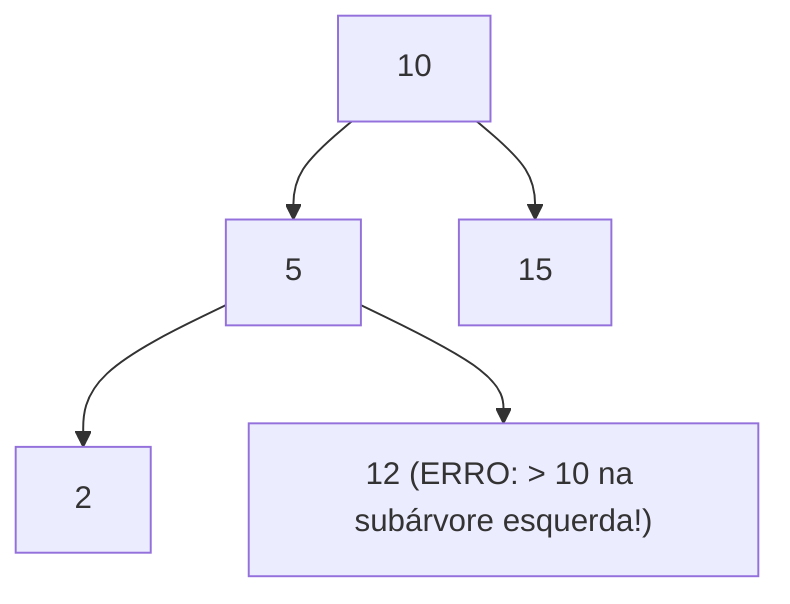

## Passo 1 · Leitura · Propriedade global da BST, remoção nos 3 casos e degeneração

Uma **Árvore de Busca Binária** (*Binary Search Tree* — **BST**) é uma árvore binária que obedece à **invariante global de ordenação**: para **todo** nó `x` da árvore:
- Todos os valores na **subárvore esquerda** de `x` são **estritamente menores** que `x.valor`.
- Todos os valores na **subárvore direita** de `x` são **estritamente maiores** que `x.valor`.

#### A armadilha da validação local!

Um erro clássico é testar apenas se `no.esq.valor < no.valor < no.dir.valor` em cada nó. Veja por que isso falha na árvore abaixo:



No nó `5`, temos `2 < 5 < 12` (localmente válido!), mas `12` está na **subárvore esquerda de `10`**, violando a propriedade global ($12 \not< 10$). Para validar uma BST em $O(n)$, propagamos um **intervalo aberto permitido `(minimo, maximo)`** na recursão:
- A raiz começa com `(-inf, +inf)`.
- Ao descer para a **esquerda** de `no`, o novo limite superior passa a ser `no.valor`: `(minimo, no.valor)`.
- Ao descer para a **direita** de `no`, o novo limite inferior passa a ser `no.valor`: `(no.valor, maximo)`.

#### Busca, Inserção e Remoção (os 3 casos) em $O(h)$

Tanto `buscar` quanto `inserir` descem da raiz até uma folha comparando `valor < atual.valor` (esquerda) ou `valor > atual.valor` (direita), custando **$O(h)$**, onde $h$ é a altura da árvore.

Já **remover** uma chave `valor` possui **três casos** quando encontramos o nó alvo:
1. **Nó folha (0 filhos)**: basta devolver `None` para o pai desligá-lo.
2. **Nó com 1 único filho**: basta devolver o único filho existente (`no.esq` ou `no.dir`) para substituir o nó removido.
3. **Nó com 2 filhos**: não podemos simplesmente apagá-lo sem quebrar a árvore! Encontramos o seu **sucessor em-ordem** — o **menor elemento da subárvore direita** (caminhando `atual = atual.esq` a partir de `no.dir`) —, copiamos o valor do sucessor para `no.valor` e removemos recursivamente o sucessor da subárvore direita (onde ele tem no máximo 1 filho!).

#### Altura média vs pior caso (degeneração)

- Se inserirmos $n$ chaves em **ordem aleatória**, a altura esperada da BST é $\approx 2 \ln n = \Theta(\log n)$, e todas as operações são rápidas.
- Porém, se inserirmos $n$ chaves **já ordenadas** ($1, 2, 3, \dots, n$), cada chave cai sempre à direita da anterior: a BST **degenera em uma lista ligada** de altura $h = n - 1 = \Theta(n)$!

## Passo 2 · Exercício · Validando uma BST com intervalo `(minimo, maximo)`

modo: ordenar

Ordene as linhas abaixo para implementar `eh_bst(raiz)`, verificando se uma árvore binária satisfaz a propriedade global de BST usando limites `(minimo, maximo)`.

### Instruções

1. Defina a classe `No(valor, esq=None, dir=None)`.
2. Em `eh_bst(raiz)`, defina a função auxiliar `validar(no, minimo, maximo)`: se `no is None`, devolva `True`; se `not (minimo < no.valor < maximo)`, devolva `False`.
3. Chame recursivamente `validar(no.esq, minimo, no.valor) and validar(no.dir, no.valor, maximo)` e inicie a partir da raiz com `float("-inf")` e `float("inf")`.

### Solução

```python
class No:
    def __init__(self, valor, esq=None, dir=None):
        self.valor = valor
        self.esq = esq
        self.dir = dir


def eh_bst(raiz) -> bool:
    def validar(no, minimo, maximo) -> bool:
        if no is None:
            return True
        if not (minimo < no.valor < maximo):
            return False
        return validar(no.esq, minimo, no.valor) and validar(no.dir, no.valor, maximo)

    return validar(raiz, float("-inf"), float("inf"))
```

### Dicas

1. A função interna `validar(no, minimo, maximo)` trata primeiro o caso base `if no is None: return True`.
2. Em seguida, verifica se `no.valor` respeita estritamente o intervalo `minimo < no.valor < maximo`.
3. Na chamada recursiva, a esquerda herda `(minimo, no.valor)` e a direita herda `(no.valor, maximo)`.

### Verificação

```json
[
  {
    "id": "bst-valida",
    "name": "Reconhece BST válida e árvore vazia",
    "checkpoint": 1,
    "kind": "expr",
    "setup": "ok = No(10, No(5, No(2), No(7)), No(15, No(12), No(20)))",
    "expr": "[eh_bst(None), eh_bst(ok)]",
    "expected": [true, true]
  },
  {
    "id": "bst-armadilha-global",
    "name": "Rejeita árvore localmente válida que viola o limite de um ancestral",
    "checkpoint": 3,
    "kind": "expr",
    "setup": "falsa = No(10, No(5, No(2), No(12)), No(15))\ndup = No(10, No(10), None)",
    "expr": "[eh_bst(falsa), eh_bst(dup)]",
    "expected": [false, false]
  }
]
```

### Soluções erradas

```python name="Testa apenas os filhos imediatos sem propagar o intervalo dos ancestrais"
class No:
    def __init__(self, valor, esq=None, dir=None):
        self.valor = valor
        self.esq = esq
        self.dir = dir


def eh_bst(raiz) -> bool:
    if raiz is None:
        return True
    if raiz.esq is not None and raiz.esq.valor >= raiz.valor:
        return False
    if raiz.dir is not None and raiz.dir.valor <= raiz.valor:
        return False
    return eh_bst(raiz.esq) and eh_bst(raiz.dir)
```

```python name="Troca os limites ao descer para esquerda e direita"
class No:
    def __init__(self, valor, esq=None, dir=None):
        self.valor = valor
        self.esq = esq
        self.dir = dir


def eh_bst(raiz) -> bool:
    def validar(no, minimo, maximo) -> bool:
        if no is None:
            return True
        if not (minimo < no.valor < maximo):
            return False
        return validar(no.esq, no.valor, maximo) and validar(no.dir, minimo, no.valor)

    return validar(raiz, float("-inf"), float("inf"))
```

## Passo 3 · Exercício · Classe `BST` completa, $k$-ésimo menor e degeneração

Implemente a classe `BST` com `inserir`, `buscar`, `em_ordem`, `remover` (tratando os 3 casos) e `altura`, além das funções `k_esimo_menor(raiz, k)` e `comparar_alturas_bst(n)`.

### Instruções

1. Na classe `BST`:
   - `inserir(valor) -> None`: insere `valor` mantendo a propriedade de BST (se `valor` já existir, **ignore** a duplicata).
   - `buscar(valor) -> bool`: devolve `True` se `valor` estiver na árvore, ou `False` caso contrário.
   - `em_ordem() -> list`: devolve os elementos da BST em ordem crescente.
   - `altura() -> int`: devolve a altura por arestas (`-1` para vazia, `0` para folha).
2. Implemente `remover(valor) -> None` em `BST` tratando os 3 casos (folha, 1 filho e 2 filhos — substituindo pelo **menor valor da subárvore direita**). Se `valor` não existir, não faça nada.
3. Implemente `k_esimo_menor(raiz, k: int)` que recebe a raiz `No` de uma BST e um inteiro `k` ($1 \le k \le n$, indexado a partir de 1) e devolve o $k$-ésimo menor valor da árvore.
4. Implemente `comparar_alturas_bst(valores_embaralhados: list[int]) -> tuple[int, int]` que constrói duas BSTs com os mesmos elementos: a primeira inserindo na ordem de `valores_embaralhados` e a segunda inserindo em ordem crescente `sorted(valores_embaralhados)`, devolvendo `(altura_embaralhada, altura_ordenada)`.

### Código inicial

```python
class No:
    def __init__(self, valor, esq=None, dir=None):
        self.valor = valor
        self.esq = esq
        self.dir = dir


class BST:
    def __init__(self):
        self.raiz = None

    def inserir(self, valor) -> None:
        pass

    def buscar(self, valor) -> bool:
        pass

    def remover(self, valor) -> None:
        pass

    def em_ordem(self) -> list:
        pass

    def altura(self) -> int:
        pass


def k_esimo_menor(raiz, k: int):
    pass


def comparar_alturas_bst(valores_embaralhados: list[int]) -> tuple[int, int]:
    pass
```

### Solução

```python
class No:
    def __init__(self, valor, esq=None, dir=None):
        self.valor = valor
        self.esq = esq
        self.dir = dir


class BST:
    def __init__(self):
        self.raiz = None

    def inserir(self, valor) -> None:
        def _ins(no, v):
            if no is None:
                return No(v)
            if v < no.valor:
                no.esq = _ins(no.esq, v)
            elif v > no.valor:
                no.dir = _ins(no.dir, v)
            return no

        self.raiz = _ins(self.raiz, valor)

    def buscar(self, valor) -> bool:
        atual = self.raiz
        while atual is not None:
            if valor == atual.valor:
                return True
            atual = atual.esq if valor < atual.valor else atual.dir
        return False

    def remover(self, valor) -> None:
        def _minimo(no):
            while no.esq is not None:
                no = no.esq
            return no

        def _rem(no, v):
            if no is None:
                return None
            if v < no.valor:
                no.esq = _rem(no.esq, v)
            elif v > no.valor:
                no.dir = _rem(no.dir, v)
            else:
                if no.esq is None:
                    return no.dir
                if no.dir is None:
                    return no.esq
                sucessor = _minimo(no.dir)
                no.valor = sucessor.valor
                no.dir = _rem(no.dir, sucessor.valor)
            return no

        self.raiz = _rem(self.raiz, valor)

    def em_ordem(self) -> list:
        res = []

        def _em(no):
            if no is not None:
                _em(no.esq)
                res.append(no.valor)
                _em(no.dir)

        _em(self.raiz)
        return res

    def altura(self) -> int:
        def _alt(no) -> int:
            if no is None:
                return -1
            return 1 + max(_alt(no.esq), _alt(no.dir))

        return _alt(self.raiz)


def k_esimo_menor(raiz, k: int):
    pilha = []
    atual = raiz
    contador = 0
    while pilha or atual is not None:
        while atual is not None:
            pilha.append(atual)
            atual = atual.esq
        atual = pilha.pop()
        contador += 1
        if contador == k:
            return atual.valor
        atual = atual.dir
    return None


def comparar_alturas_bst(valores_embaralhados: list[int]) -> tuple[int, int]:
    bst_emb = BST()
    bst_ord = BST()
    for v in valores_embaralhados:
        bst_emb.inserir(v)
    for v in sorted(valores_embaralhados):
        bst_ord.inserir(v)
    return (bst_emb.altura(), bst_ord.altura())
```

### Dicas

1. Na função auxiliar recursiva `_rem(no, v)` de `remover`, se `no.esq is None` devolva `no.dir`, e se `no.dir is None` devolva `no.esq` — isso já resolve tanto o caso de folha quanto o de 1 filho!
2. No caso de 2 filhos, encontre o menor nó de `no.dir` caminhando para a esquerda (`while s.esq is not None: s = s.esq`), copie `no.valor = s.valor` e faça `no.dir = _rem(no.dir, s.valor)`.
3. Como o percurso em-ordem de uma BST visita os elementos em ordem crescente, o `k_esimo_menor(raiz, k)` é o elemento de índice `k - 1` do percurso em-ordem (que pode ser parado assim que o `k`-ésimo elemento for visitado).

### Verificação

```json
[
  {
    "id": "bst-inserir-buscar-duplicatas",
    "name": "Insere ignorando duplicatas, busca chaves e devolve em_ordem ordenado",
    "checkpoint": 1,
    "kind": "expr",
    "setup": "t = BST()\nfor v in [10, 5, 15, 2, 7, 10, 5]:\n    t.inserir(v)",
    "expr": "(t.em_ordem(), t.buscar(7), t.buscar(99), t.altura())",
    "expected": [[2, 5, 7, 10, 15], true, false, 2]
  },
  {
    "id": "bst-remover-tres-casos",
    "name": "Remove folha, nó com 1 filho e nó com 2 filhos (incluindo a raiz) mantendo BST válida",
    "checkpoint": 2,
    "kind": "expr",
    "setup": "t = BST()\nfor v in [50, 30, 70, 20, 40, 60, 80, 35, 65]:\n    t.inserir(v)\nt.remover(20)\ne1 = t.em_ordem()\nt.remover(60)\ne2 = t.em_ordem()\nt.remover(30)\ne3 = t.em_ordem()\nt.remover(50)\ne4 = t.em_ordem()",
    "expr": "(e1, e2, e3, e4, t.raiz.valor)",
    "expected": [
      [30, 35, 40, 50, 60, 65, 70, 80],
      [30, 35, 40, 50, 65, 70, 80],
      [35, 40, 50, 65, 70, 80],
      [35, 40, 65, 70, 80],
      65
    ]
  },
  {
    "id": "bst-k-esimo-e-degeneracao",
    "name": "Encontra k-ésimo menor e compara altura balanceada vs degenerada O(n)",
    "checkpoint": 4,
    "kind": "expr",
    "setup": "t = BST()\nfor v in [40, 20, 60, 10, 30, 50, 70]:\n    t.inserir(v)\na_emb, a_ord = comparar_alturas_bst([40, 20, 60, 10, 30, 50, 70])",
    "expr": "(k_esimo_menor(t.raiz, 1), k_esimo_menor(t.raiz, 4), k_esimo_menor(t.raiz, 7), a_emb, a_ord)",
    "expected": [10, 40, 70, 2, 6]
  }
]
```

### Soluções erradas

```python name="Na remoção com 2 filhos, substitui apenas pelo filho direito perdendo a subárvore esquerda"
class No:
    def __init__(self, valor, esq=None, dir=None):
        self.valor = valor
        self.esq = esq
        self.dir = dir


class BST:
    def __init__(self):
        self.raiz = None

    def inserir(self, valor) -> None:
        def _ins(no, v):
            if no is None:
                return No(v)
            if v < no.valor:
                no.esq = _ins(no.esq, v)
            elif v > no.valor:
                no.dir = _ins(no.dir, v)
            return no

        self.raiz = _ins(self.raiz, valor)

    def buscar(self, valor) -> bool:
        atual = self.raiz
        while atual is not None:
            if valor == atual.valor:
                return True
            atual = atual.esq if valor < atual.valor else atual.dir
        return False

    def remover(self, valor) -> None:
        def _rem(no, v):
            if no is None:
                return None
            if v < no.valor:
                no.esq = _rem(no.esq, v)
            elif v > no.valor:
                no.dir = _rem(no.dir, v)
            else:
                return no.dir if no.dir is not None else no.esq
            return no

        self.raiz = _rem(self.raiz, valor)

    def em_ordem(self) -> list:
        res = []

        def _em(no):
            if no is not None:
                _em(no.esq)
                res.append(no.valor)
                _em(no.dir)

        _em(self.raiz)
        return res

    def altura(self) -> int:
        def _alt(no) -> int:
            return -1 if no is None else 1 + max(_alt(no.esq), _alt(no.dir))

        return _alt(self.raiz)


def k_esimo_menor(raiz, k: int):
    bst = BST()
    bst.raiz = raiz
    return bst.em_ordem()[k - 1]


def comparar_alturas_bst(valores_embaralhados: list[int]) -> tuple[int, int]:
    b1, b2 = BST(), BST()
    for v in valores_embaralhados:
        b1.inserir(v)
    for v in sorted(valores_embaralhados):
        b2.inserir(v)
    return (b1.altura(), b2.altura())
```

```python name="Permite inserir duplicatas na BST violando a unicidade das chaves"
class No:
    def __init__(self, valor, esq=None, dir=None):
        self.valor = valor
        self.esq = esq
        self.dir = dir


class BST:
    def __init__(self):
        self.raiz = None

    def inserir(self, valor) -> None:
        def _ins(no, v):
            if no is None:
                return No(v)
            if v <= no.valor:
                no.esq = _ins(no.esq, v)
            else:
                no.dir = _ins(no.dir, v)
            return no

        self.raiz = _ins(self.raiz, valor)

    def buscar(self, valor) -> bool:
        atual = self.raiz
        while atual is not None:
            if valor == atual.valor:
                return True
            atual = atual.esq if valor < atual.valor else atual.dir
        return False

    def remover(self, valor) -> None:
        pass

    def em_ordem(self) -> list:
        res = []

        def _em(no):
            if no is not None:
                _em(no.esq)
                res.append(no.valor)
                _em(no.dir)

        _em(self.raiz)
        return res

    def altura(self) -> int:
        def _alt(no) -> int:
            return -1 if no is None else 1 + max(_alt(no.esq), _alt(no.dir))

        return _alt(self.raiz)


def k_esimo_menor(raiz, k: int):
    bst = BST()
    bst.raiz = raiz
    return bst.em_ordem()[k - 1]


def comparar_alturas_bst(valores_embaralhados: list[int]) -> tuple[int, int]:
    return (0, 0)
```

## Passo 4 · Quiz · Propriedades e remoção em BST

### Pergunta

Ao remover um nó `X` que possui **dois filhos** em uma Árvore de Busca Binária (BST), por que podemos substituí-lo pelo **menor elemento de sua subárvore direita** (o sucessor em-ordem de `X`) sem violar a invariante da BST?

- [ ] Porque qualquer elemento da subárvore direita pode ocupar o lugar de `X`.
- [x] Porque o sucessor em-ordem é maior que todos os nós da subárvore esquerda de `X` (já que veio da direita) e menor que todos os demais nós da subárvore direita de `X` (já que era o mínimo dela), além de não possuir filho esquerdo, tornando sua remoção trivial.
- [ ] Porque o sucessor em-ordem é sempre a raiz da árvore inteira.
- [ ] Porque o sucessor em-ordem tem dois filhos folhas.

> O menor nó da subárvore direita não tem filho esquerdo (se tivesse, esse filho seria ainda menor!). Assim, após copiar seu valor para `X`, removê-lo de sua posição original recai no Caso 1 (folha) ou Caso 2 (apenas filho direito).

### Pergunta

Qual é a complexidade de tempo para buscar uma chave em uma BST não balanceada com $n$ nós no **caso médio** (inserções em ordem aleatória) e no **pior caso** (inserções em ordem crescente)?

- [ ] $O(1)$ no caso médio e $O(\log n)$ no pior caso.
- [x] $O(\log n)$ no caso médio e $O(n)$ no pior caso (quando a árvore degenera em uma lista ligada).
- [ ] $O(\log n)$ tanto no caso médio quanto no pior caso.
- [ ] $O(n \log n)$ no caso médio e $O(n^2)$ no pior caso.

> Sem rebalanceamento automático (como em árvores AVL ou Rubro-Negras), inserir chaves já ordenadas cria uma cadeia linear de altura $n - 1$, fazendo cada busca percorrer até $n$ nós.
