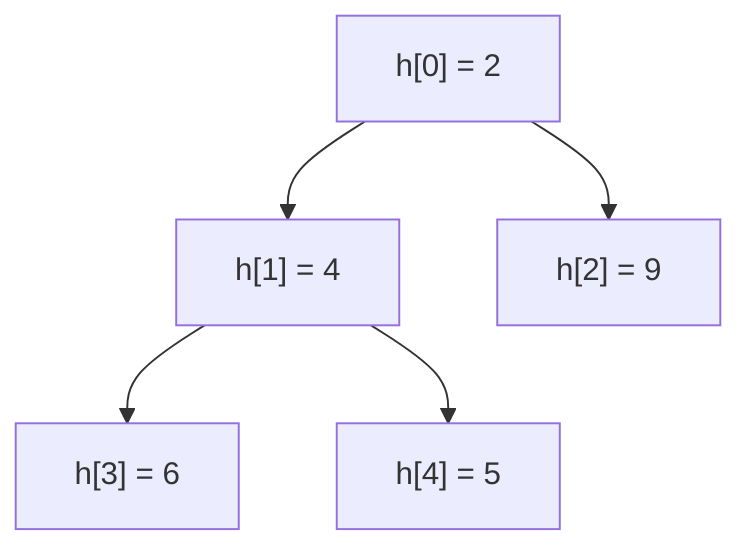

## Passo 1 · Leitura · Um heap cabe numa lista

Uma **fila de prioridade** guarda itens com prioridade e entrega sempre o de menor valor: o próximo paciente da triagem, o próximo evento de uma simulação. Com uma lista comum, inserir é $O(1)$ e achar o mínimo é $O(n)$; com uma lista ordenada, é o contrário. O **heap binário** faz as duas coisas em $O(\log n)$.

Ele é uma árvore binária **quase completa**: todos os níveis cheios, menos talvez o último, preenchido da esquerda para a direita. Essa forma regular dispensa ponteiros. Numere os nós por níveis a partir de 0 e guarde-os numa lista; para o nó de índice $i$:

$$
\text{pai}(i) = \left\lfloor \frac{i-1}{2} \right\rfloor, \qquad \text{esq}(i) = 2i+1, \qquad \text{dir}(i) = 2i+2 .
$$



A lista acima é `[2, 4, 9, 6, 5]`. No **min-heap** vale o invariante: todo pai é menor ou igual aos filhos, `h[pai(i)] <= h[i]`. O mínimo fica em `h[0]`. Atenção: o heap não está ordenado; irmãos não têm ordem entre si (9 está antes de 6).

**Inserir** põe o valor no fim da lista e o faz **subir**: enquanto ele for menor que o pai, troca com o pai. **Extrair o mínimo** guarda `h[0]`, põe o último elemento no lugar dele e o faz **descer**: troca com o **menor dos dois filhos**, enquanto algum filho for menor. Como a altura é $\lfloor \log_2 n \rfloor$, as duas operações são $O(\log n)$.

```python
def descer(h, i, n):          # n: só os índices < n fazem parte do heap
    while True:
        menor = i
        esq, dir = 2 * i + 1, 2 * i + 2
        if esq < n and h[esq] < h[menor]:
            menor = esq
        if dir < n and h[dir] < h[menor]:   # compara com o menor até agora
            menor = dir
        if menor == i:
            return
        h[i], h[menor] = h[menor], h[i]
        i = menor
```

Os erros de quem escreve isso pela primeira vez:

- `pai = i // 2`, a fórmula de quem numera a partir de 1;
- descer trocando com o filho esquerdo sem olhar o direito;
- comparar o filho direito com `h[i]` em vez de `h[menor]`: em `[10, 2, 4]`, os dois filhos são menores que 10, e o 4 sobe por cima do 2.

Nos três casos o programa roda sem erro e entrega o mínimo errado mais tarde. O parâmetro `n` parece sobrar agora, mas o heap sort vai precisar dele.

## Passo 2 · Previsão · Cinco inserções e uma extração

O programa insere cinco valores num heap vazio, imprimindo a lista depois de cada inserção, e depois extrai o mínimo. Leia sem executar e digite a saída exata.

### Código
```python
def subir(h, i):
    while i > 0 and h[i] < h[(i - 1) // 2]:
        pai = (i - 1) // 2
        h[i], h[pai] = h[pai], h[i]
        i = pai


def descer(h, i):
    n = len(h)
    while True:
        menor = i
        for f in (2 * i + 1, 2 * i + 2):
            if f < n and h[f] < h[menor]:
                menor = f
        if menor == i:
            return
        h[i], h[menor] = h[menor], h[i]
        i = menor


h = []
for x in [6, 4, 9, 2, 5]:
    h.append(x)
    subir(h, len(h) - 1)
    print(h)

ultimo = h.pop()
menor = h[0]
h[0] = ultimo
descer(h, 0)
print(menor, h)
```

### Dicas
1. Desenhe a árvore a cada inserção: o novo valor entra na primeira vaga do último nível.
2. O 2 entra no índice 3, cujo pai é o índice 1.
3. Na extração, o 5 vai para a raiz e desce trocando com o menor filho.

### Saída esperada
```text
[6]
[4, 6]
[4, 6, 9]
[2, 4, 9, 6]
[2, 4, 9, 6, 5]
2 [4, 5, 9, 6]
```

## Passo 3 · Exercício · subir e descer
modo: lacunas

Complete as lacunas (`___`). O heap é uma lista comum `h`; `descer(h, i, n)` considera só os índices menores que `n`. `inserir` e `extrair_min` usam as duas funções.

### Instruções
1. Em `subir`, calcule o índice do pai com a numeração a partir de 0.
2. Em `descer`, escolha o menor entre o nó e **os dois** filhos que existem (índices menores que `n`), e continue a partir de onde o valor foi parar.
3. Em `extrair_min`, o último elemento ocupa a raiz antes de descer.

### Código inicial
```python
def subir(h, i):
    while i > 0:
        pai = ___
        if h[i] < h[pai]:
            h[i], h[pai] = h[pai], h[i]
            i = pai
        else:
            break


def descer(h, i, n):
    while True:
        menor = i
        esq = 2 * i + 1
        dir = 2 * i + 2
        if esq < n and h[esq] < h[menor]:
            menor = esq
        if ___ and h[dir] < h[___]:
            menor = dir
        if menor == i:
            break
        h[i], h[menor] = h[menor], h[i]
        i = ___


def inserir(h, x):
    h.append(x)
    subir(h, len(h) - 1)


def extrair_min(h):
    ultimo = h.pop()
    if not h:
        return ultimo
    menor = h[0]
    h[0] = ___
    descer(h, 0, len(h))
    return menor
```

### Solução
```python
def subir(h, i):
    while i > 0:
        pai = (i - 1) // 2
        if h[i] < h[pai]:
            h[i], h[pai] = h[pai], h[i]
            i = pai
        else:
            break


def descer(h, i, n):
    while True:
        menor = i
        esq = 2 * i + 1
        dir = 2 * i + 2
        if esq < n and h[esq] < h[menor]:
            menor = esq
        if dir < n and h[dir] < h[menor]:
            menor = dir
        if menor == i:
            break
        h[i], h[menor] = h[menor], h[i]
        i = menor


def inserir(h, x):
    h.append(x)
    subir(h, len(h) - 1)


def extrair_min(h):
    ultimo = h.pop()
    if not h:
        return ultimo
    menor = h[0]
    h[0] = ultimo
    descer(h, 0, len(h))
    return menor
```

### Dicas
1. Os filhos de `p` são `2p + 1` e `2p + 2`; inverta a conta.
2. O filho direito precisa ganhar do menor encontrado até agora, não só do pai.
3. Depois da troca, o valor que desceu está na posição `menor`.

### Verificação
```json
[
  { "id": "subir", "checkpoint": 1, "kind": "expr", "setup": "h = [2, 5, 4, 9, 7, 8, 1]\nsubir(h, 6)",
    "expr": "h", "expected": [1, 5, 2, 9, 7, 8, 4], "name": "O 1 sobe do índice 6 até a raiz",
    "hint": "O pai do índice 6 é o índice 2." },
  { "id": "descer-dois-niveis", "checkpoint": 2, "kind": "expr", "setup": "h = [10, 4, 2, 7, 8, 5, 3]\ndescer(h, 0, 7)",
    "expr": "h", "expected": [2, 4, 3, 7, 8, 5, 10], "name": "O 10 desce dois níveis pelo lado direito" },
  { "id": "descer-menor-filho", "checkpoint": 2, "kind": "expr", "setup": "h = [10, 2, 4]\ndescer(h, 0, 3)",
    "expr": "h", "expected": [2, 10, 4], "name": "Com os dois filhos menores, sobe o menor deles",
    "hint": "Compare o filho direito com o menor encontrado até agora." },
  { "id": "descer-limite", "checkpoint": 2, "kind": "expr", "setup": "h = [9, 1, 2, 0]\ndescer(h, 0, 3)",
    "expr": "h", "expected": [1, 9, 2, 0], "name": "descer ignora os índices a partir de n",
    "hint": "Um filho só existe se o índice dele for menor que n." },
  { "id": "descer-parado", "checkpoint": 2, "kind": "expr", "setup": "h = [1, 3, 2, 7]\ndescer(h, 0, 4)",
    "expr": "h", "expected": [1, 3, 2, 7], "name": "Heap válido não muda" },
  { "id": "um-elemento", "checkpoint": 3, "kind": "expr", "setup": "h = []\ninserir(h, 7)\nm = extrair_min(h)",
    "expr": "[m, h]", "expected": [7, []], "name": "Inserir e extrair num heap de um elemento" },
  { "id": "invariante", "checkpoint": 3, "kind": "expr",
    "setup": "h = []\nfor x in [(i * 37) % 101 for i in range(60)]:\n    inserir(h, x)",
    "expr": "all(h[(i - 1) // 2] <= h[i] for i in range(1, len(h)))", "expected": true,
    "name": "Depois de 60 inserções, todo pai é menor ou igual aos filhos" },
  { "id": "extrai-ordenado", "checkpoint": 3, "kind": "expr",
    "setup": "dados = [(i * 37) % 101 for i in range(300)]\nh = []\nfor x in dados:\n    inserir(h, x)\nsaida = [extrair_min(h) for _ in range(300)]",
    "expr": "[saida == sorted(dados), h]", "expected": [true, []],
    "name": "300 inserções e 300 extrações saem em ordem crescente" }
]
```

### Soluções erradas
```python name="pai = i // 2"
def subir(h, i):
    while i > 0:
        pai = i // 2
        if h[i] < h[pai]:
            h[i], h[pai] = h[pai], h[i]
            i = pai
        else:
            break


def descer(h, i, n):
    while True:
        menor = i
        esq = 2 * i + 1
        dir = 2 * i + 2
        if esq < n and h[esq] < h[menor]:
            menor = esq
        if dir < n and h[dir] < h[menor]:
            menor = dir
        if menor == i:
            break
        h[i], h[menor] = h[menor], h[i]
        i = menor


def inserir(h, x):
    h.append(x)
    subir(h, len(h) - 1)


def extrair_min(h):
    ultimo = h.pop()
    if not h:
        return ultimo
    menor = h[0]
    h[0] = ultimo
    descer(h, 0, len(h))
    return menor
```
```python name="descer só olha o filho esquerdo"
def subir(h, i):
    while i > 0:
        pai = (i - 1) // 2
        if h[i] < h[pai]:
            h[i], h[pai] = h[pai], h[i]
            i = pai
        else:
            break


def descer(h, i, n):
    while 2 * i + 1 < n and h[2 * i + 1] < h[i]:
        h[i], h[2 * i + 1] = h[2 * i + 1], h[i]
        i = 2 * i + 1


def inserir(h, x):
    h.append(x)
    subir(h, len(h) - 1)


def extrair_min(h):
    ultimo = h.pop()
    if not h:
        return ultimo
    menor = h[0]
    h[0] = ultimo
    descer(h, 0, len(h))
    return menor
```
```python name="filho direito comparado com h[i]"
def subir(h, i):
    while i > 0:
        pai = (i - 1) // 2
        if h[i] < h[pai]:
            h[i], h[pai] = h[pai], h[i]
            i = pai
        else:
            break


def descer(h, i, n):
    while True:
        menor = i
        esq = 2 * i + 1
        dir = 2 * i + 2
        if esq < n and h[esq] < h[i]:
            menor = esq
        if dir < n and h[dir] < h[i]:
            menor = dir
        if menor == i:
            break
        h[i], h[menor] = h[menor], h[i]
        i = menor


def inserir(h, x):
    h.append(x)
    subir(h, len(h) - 1)


def extrair_min(h):
    ultimo = h.pop()
    if not h:
        return ultimo
    menor = h[0]
    h[0] = ultimo
    descer(h, 0, len(h))
    return menor
```
```python name="descer usa len(h) e ignora n"
def subir(h, i):
    while i > 0:
        pai = (i - 1) // 2
        if h[i] < h[pai]:
            h[i], h[pai] = h[pai], h[i]
            i = pai
        else:
            break


def descer(h, i, n):
    while True:
        menor = i
        esq = 2 * i + 1
        dir = 2 * i + 2
        if esq < len(h) and h[esq] < h[menor]:
            menor = esq
        if dir < len(h) and h[dir] < h[menor]:
            menor = dir
        if menor == i:
            break
        h[i], h[menor] = h[menor], h[i]
        i = menor


def inserir(h, x):
    h.append(x)
    subir(h, len(h) - 1)


def extrair_min(h):
    ultimo = h.pop()
    if not h:
        return ultimo
    menor = h[0]
    h[0] = ultimo
    descer(h, 0, len(h))
    return menor
```
```python name="extração quebra com um elemento só"
def subir(h, i):
    while i > 0:
        pai = (i - 1) // 2
        if h[i] < h[pai]:
            h[i], h[pai] = h[pai], h[i]
            i = pai
        else:
            break


def descer(h, i, n):
    while True:
        menor = i
        esq = 2 * i + 1
        dir = 2 * i + 2
        if esq < n and h[esq] < h[menor]:
            menor = esq
        if dir < n and h[dir] < h[menor]:
            menor = dir
        if menor == i:
            break
        h[i], h[menor] = h[menor], h[i]
        i = menor


def inserir(h, x):
    h.append(x)
    subir(h, len(h) - 1)


def extrair_min(h):
    menor = h[0]
    h[0] = h.pop()
    descer(h, 0, len(h))
    return menor
```

## Passo 4 · Leitura · Heapify em O(n) e heap sort no lugar

Para transformar uma lista inteira em heap, inserir um a um custa $O(n \log n)$: com a entrada decrescente, cada valor novo sobe até a raiz. Há um caminho mais barato, o **heapify** de baixo para cima:

```python
def construir_heap(v):
    for i in range(len(v) // 2 - 1, -1, -1):
        descer(v, i, len(v))
```

Os índices a partir de `len(v) // 2` são folhas, que já são heaps de um elemento. O laço vai do último nó interno até a raiz, e mantém este invariante: **quando `descer(v, i, n)` é chamado, as subárvores dos dois filhos de `i` já são heaps.** É exatamente a condição para `descer` funcionar: ele só conserta o topo. Ao chegar em `i = 0`, a árvore inteira é um heap. Na ordem inversa, de 0 para cima, a raiz desce por subárvores ainda bagunçadas e o resultado não é um heap.

Por que $O(n)$? Um nó de altura $k$ desce no máximo $k$ níveis, e há no máximo $n/2^{k+1}$ nós com altura $k$. A maioria dos nós está perto das folhas e quase não desce:

$$
\sum_{k \ge 1} \frac{n}{2^{k+1}} \cdot k \;=\; \frac{n}{2} \sum_{k \ge 1} \frac{k}{2^{k}} \;=\; \frac{n}{2} \cdot 2 \;=\; n .
$$

São no máximo $n$ trocas e, com duas comparações por nível, no máximo $2n$ comparações. Inserir os mesmos $n$ valores um a um, em ordem decrescente, faz cerca de $n \log_2 n$.

#### Heap sort sem lista extra

Com o heap pronto, o mínimo está em `v[0]`. Troque-o com o último elemento do heap: o mínimo vai para o fim, numa parte que não pertence mais ao heap. Desça a nova raiz **só dentro do prefixo** `v[0:fim]`, com `descer(v, 0, fim)`, e repita. Com um min-heap, os menores vão se acumulando no fim e a lista termina **decrescente**; um `v.reverse()` final, que é $O(n)$ e não usa memória extra, deixa crescente.

O custo é $O(n)$ do heapify mais $n - 1$ descidas de $O(\log n)$: $O(n \log n)$ **no pior caso**, com memória extra $O(1)$. O erro típico é chamar `descer(v, 0, len(v))`: a descida invade a parte já ordenada e puxa os mínimos de volta. E o heap sort **não é estável**: a troca da raiz com o fim joga um elemento por cima de outros iguais a ele.

## Passo 5 · Exercício · construir_heap e heap_sort

Escreva duas funções que alteram a lista recebida e devolvem `None`. `subir` e `descer` estão prontos em `heap.py`.

- `construir_heap(v)`: transforma `v` num min-heap com o heapify de baixo para cima. A verificação conta as comparações: com 1023 elementos, no máximo $2n = 2046$.
- `heap_sort(v)`: deixa `v` em ordem crescente usando o heap, no lugar, sem `sorted()` e sem `.sort()`.

### Instruções
1. Em `construir_heap`, chame `descer` do último nó interno até a raiz.
2. Em `heap_sort`, construa o heap e leve o mínimo para o fim do prefixo, descendo a nova raiz só dentro do prefixo.
3. Termine com a lista crescente, sem criar outra lista.

### Código inicial
```python path=heap.py
def subir(h, i):
    while i > 0:
        pai = (i - 1) // 2
        if h[i] < h[pai]:
            h[i], h[pai] = h[pai], h[i]
            i = pai
        else:
            break


def descer(h, i, n):
    while True:
        menor = i
        esq = 2 * i + 1
        dir = 2 * i + 2
        if esq < n and h[esq] < h[menor]:
            menor = esq
        if dir < n and h[dir] < h[menor]:
            menor = dir
        if menor == i:
            break
        h[i], h[menor] = h[menor], h[i]
        i = menor
```
```python
from heap import descer, subir


def construir_heap(v):
    pass


def heap_sort(v):
    pass
```

### Solução
```python path=heap.py
def subir(h, i):
    while i > 0:
        pai = (i - 1) // 2
        if h[i] < h[pai]:
            h[i], h[pai] = h[pai], h[i]
            i = pai
        else:
            break


def descer(h, i, n):
    while True:
        menor = i
        esq = 2 * i + 1
        dir = 2 * i + 2
        if esq < n and h[esq] < h[menor]:
            menor = esq
        if dir < n and h[dir] < h[menor]:
            menor = dir
        if menor == i:
            break
        h[i], h[menor] = h[menor], h[i]
        i = menor
```
```python
from heap import descer, subir


def construir_heap(v):
    for i in range(len(v) // 2 - 1, -1, -1):
        descer(v, i, len(v))


def heap_sort(v):
    construir_heap(v)
    for fim in range(len(v) - 1, 0, -1):
        v[0], v[fim] = v[fim], v[0]
        descer(v, 0, fim)
    v.reverse()
```

### Dicas
1. O último nó interno tem índice `len(v) // 2 - 1`; o laço anda para trás até 0.
2. Depois da troca, o heap ocupa só os índices de 0 a `fim - 1`.
3. Com um min-heap, a lista sai decrescente; `list.reverse()` inverte no lugar.

### Verificação
```json
[
  { "id": "sem-sorted", "checkpoint": 2, "kind": "source", "rule": { "type": "not_calls", "name": "sorted" }, "name": "Não usa sorted()" },
  { "id": "sem-sort", "checkpoint": 2, "kind": "source", "rule": { "type": "not_calls", "name": "sort" }, "name": "Não usa .sort()" },
  { "id": "construir-8", "checkpoint": 1, "kind": "expr", "setup": "v = [9, 5, 7, 1, 3, 8, 2, 6]\nr = construir_heap(v)",
    "expr": "[r, v]", "expected": [null, [1, 3, 2, 5, 9, 8, 7, 6]], "name": "Heapify de 8 elementos, no lugar",
    "hint": "Comece pelo último nó interno e vá até a raiz." },
  { "id": "construir-bordas", "checkpoint": 1, "kind": "expr", "setup": "a = []\nb = [4]\nconstruir_heap(a)\nconstruir_heap(b)",
    "expr": "[a, b]", "expected": [[], [4]], "name": "Listas com 0 e 1 elemento" },
  { "id": "construir-invariante", "checkpoint": 1, "kind": "expr",
    "setup": "v = [(i * 7919) % 1009 for i in range(500)]\nconstruir_heap(v)",
    "expr": "all(v[(i - 1) // 2] <= v[i] for i in range(1, len(v)))", "expected": true,
    "name": "Heapify de 500 elementos respeita o invariante" },
  { "id": "construir-linear", "checkpoint": 1, "kind": "expr",
    "setup": "class K:\n    n = 0\n    def __init__(self, v):\n        self.v = v\n    def __lt__(self, o):\n        K.n += 1\n        return self.v < o.v\n    def __gt__(self, o):\n        K.n += 1\n        return self.v > o.v\n    def __le__(self, o):\n        K.n += 1\n        return self.v <= o.v\n    def __ge__(self, o):\n        K.n += 1\n        return self.v >= o.v\nv = [K(x) for x in range(1023, 0, -1)]\nK.n = 0\nconstruir_heap(v)",
    "expr": "[v[0].v, K.n <= 2046]", "expected": [1, true],
    "name": "1023 elementos decrescentes: no máximo 2n comparações",
    "hint": "Inserir um a um faz cada valor subir até a raiz: cerca de n log n comparações." },
  { "id": "sort-pequeno", "checkpoint": 3, "kind": "expr", "setup": "v = [5, -2, 9, 0, 5, 3]\nr = heap_sort(v)",
    "expr": "[r, v]", "expected": [null, [-2, 0, 3, 5, 5, 9]], "name": "Ordena no lugar, com repetidos e negativos",
    "hint": "A lista recebida é que precisa terminar ordenada." },
  { "id": "sort-bordas", "checkpoint": 3, "kind": "expr", "setup": "a = []\nb = [1]\nc = [2, 1]\nheap_sort(a)\nheap_sort(b)\nheap_sort(c)",
    "expr": "[a, b, c]", "expected": [[], [1], [1, 2]], "name": "Listas com 0, 1 e 2 elementos" },
  { "id": "sort-grande", "checkpoint": 2, "kind": "expr",
    "setup": "class K:\n    n = 0\n    def __init__(self, v):\n        self.v = v\n    def __lt__(self, o):\n        K.n += 1\n        return self.v < o.v\n    def __gt__(self, o):\n        K.n += 1\n        return self.v > o.v\n    def __le__(self, o):\n        K.n += 1\n        return self.v <= o.v\n    def __ge__(self, o):\n        K.n += 1\n        return self.v >= o.v\ndados = [(i * 37) % 101 for i in range(1023)]\nv = [K(x) for x in dados]\nK.n = 0\nheap_sort(v)",
    "expr": "[[x.v for x in v] == sorted(dados), K.n <= 22000]", "expected": [true, true],
    "name": "1023 elementos ordenados com O(n log n) comparações",
    "hint": "Depois de levar o mínimo para o fim, desça a raiz só dentro do prefixo." }
]
```

### Soluções erradas
```python name="heapify de cima para baixo"
from heap import descer, subir


def construir_heap(v):
    for i in range(len(v) // 2):
        descer(v, i, len(v))


def heap_sort(v):
    construir_heap(v)
    for fim in range(len(v) - 1, 0, -1):
        v[0], v[fim] = v[fim], v[0]
        descer(v, 0, fim)
    v.reverse()
```
```python name="constrói inserindo um a um"
from heap import descer, subir


def construir_heap(v):
    for i in range(len(v)):
        subir(v, i)


def heap_sort(v):
    construir_heap(v)
    for fim in range(len(v) - 1, 0, -1):
        v[0], v[fim] = v[fim], v[0]
        descer(v, 0, fim)
    v.reverse()
```
```python name="descida invade a parte já ordenada"
from heap import descer, subir


def construir_heap(v):
    for i in range(len(v) // 2 - 1, -1, -1):
        descer(v, i, len(v))


def heap_sort(v):
    construir_heap(v)
    for fim in range(len(v) - 1, 0, -1):
        v[0], v[fim] = v[fim], v[0]
        descer(v, 0, len(v))
    v.reverse()
```
```python name="esquece de inverter (sai decrescente)"
from heap import descer, subir


def construir_heap(v):
    for i in range(len(v) // 2 - 1, -1, -1):
        descer(v, i, len(v))


def heap_sort(v):
    construir_heap(v)
    for fim in range(len(v) - 1, 0, -1):
        v[0], v[fim] = v[fim], v[0]
        descer(v, 0, fim)
```
```python name="devolve uma lista nova e não ordena a recebida"
from heap import descer, subir


def construir_heap(v):
    for i in range(len(v) // 2 - 1, -1, -1):
        descer(v, i, len(v))


def heap_sort(v):
    h = list(v)
    construir_heap(h)
    saida = []
    while h:
        h[0], h[-1] = h[-1], h[0]
        saida.append(h.pop())
        descer(h, 0, len(h))
    return saida
```

## Passo 6 · Leitura · heapq, desempate e top-k

O módulo `heapq` da biblioteca padrão faz o que você escreveu, sobre uma lista comum: `heappush(h, x)`, `heappop(h)`, `heapify(v)` em $O(n)$ e `heapreplace(h, x)`, que extrai o mínimo e insere `x` numa descida só. É sempre min-heap; para um max-heap de números, guarde `-x`.

Uma fila de prioridade guarda pares. O natural é empilhar `(prioridade, item)`, e funciona até duas prioridades empatarem: aí a tupla compara os itens. Se forem dicionários:

```text
TypeError: '<' not supported between instances of 'dict' and 'dict'
```

Se os itens forem comparáveis, o erro some e fica pior: dois pacientes com a mesma prioridade saem em ordem alfabética, não na ordem de chegada. O heap **não é estável** por natureza. A solução padrão é um **contador de desempate**:

```python
heapq.heappush(h, (prioridade, contador, item))
contador += 1
```

O contador cresce a cada inserção, então nunca há dois iguais: a tupla decide no máximo no segundo campo e nunca compara os itens, e entre prioridades iguais sai primeiro quem entrou primeiro.

#### Top-k e fusão

Para os $k$ maiores de $n$ valores, ordenar tudo custa $O(n \log n)$. Melhor: mantenha um **min-heap com os $k$ maiores vistos até agora**. Para cada valor novo, compare com `h[0]`, o menor dos $k$; se o novo for maior, `heapreplace`. Custo $O(n \log k)$, e a memória fica em $k$ itens, mesmo que os valores cheguem de um arquivo enorme.

Para fundir $k$ sequências ordenadas, ponha no heap o primeiro de cada uma, como `(valor, i)`, em que `i` é o número da sequência. A cada extração, empurre o próximo da sequência `i`. São $O(N \log k)$ para $N$ elementos, e cada sequência é lida **sob demanda**, com `next`: dá para fundir arquivos de log sem carregá-los. O `i` na tupla desempata valores iguais pela ordem das fontes e impede o Python de comparar o que vem depois dele.

#### Heap ou BST?

Os dois servem de fila de prioridade em $O(\log n)$, desde que a BST seja balanceada (assunto da última lição do módulo). O heap é uma lista, sem ponteiros, com mínimo em $O(1)$ e construção em $O(n)$. Mas buscar ou remover um item qualquer num heap custa $O(n)$, e percorrê-lo em ordem exige extrair tudo. Se a aplicação precisa disso, como cancelar um evento agendado ou listar a agenda em ordem, a BST balanceada é a escolha.

## Passo 7 · Exercício · Agenda, top-k e fusão com heapq

Use `heapq` para três tarefas.

- Classe `FilaDePrioridade`: `inserir(prioridade, item)`; `remover()` devolve o item de menor prioridade e, entre prioridades iguais, o que entrou primeiro; fila vazia levanta `IndexError`; `len(fila)` dá o número de itens. Os itens podem ser de qualquer tipo, inclusive dicionários.
- `k_maiores(valores, k)`: os `k` maiores valores em ordem **decrescente**; `[]` se `k <= 0`; todos, se `k` passar do tamanho. A verificação conta as comparações em 5 000 valores com `k = 5`: no máximo 15 000.
- `fundir(fontes, m)`: `fontes` é uma lista de iteráveis, cada um em ordem crescente (podem ser listas ou geradores); devolve a lista com os `m` primeiros valores da fusão. Empates saem na ordem das fontes. Leia as fontes com `iter` e `next`, sob demanda: a verificação conta quantos valores foram lidos, e o limite é $m + k$ para $k$ fontes.

### Instruções
1. Escreva `FilaDePrioridade` com um contador de desempate.
2. Escreva `k_maiores` com um min-heap de no máximo `k` itens.
3. Escreva `fundir` com um heap de pares `(valor, número da fonte)`, empurrando o próximo valor da mesma fonte a cada extração.

### Código inicial
```python
import heapq


class FilaDePrioridade:
    def __init__(self):
        pass

    def __len__(self):
        pass

    def inserir(self, prioridade, item):
        pass

    def remover(self):
        pass


def k_maiores(valores, k):
    pass


def fundir(fontes, m):
    pass
```

### Solução
```python
import heapq

FIM = object()


class FilaDePrioridade:
    def __init__(self):
        self._heap = []
        self._contador = 0

    def __len__(self):
        return len(self._heap)

    def inserir(self, prioridade, item):
        heapq.heappush(self._heap, (prioridade, self._contador, item))
        self._contador += 1

    def remover(self):
        if not self._heap:
            raise IndexError("fila vazia")
        return heapq.heappop(self._heap)[2]


def k_maiores(valores, k):
    if k <= 0:
        return []
    h = []
    for x in valores:
        if len(h) < k:
            heapq.heappush(h, x)
        elif x > h[0]:
            heapq.heapreplace(h, x)
    saida = []
    while h:
        saida.append(heapq.heappop(h))
    saida.reverse()
    return saida


def fundir(fontes, m):
    iteradores = [iter(f) for f in fontes]
    h = []
    for i, it in enumerate(iteradores):
        x = next(it, FIM)
        if x is not FIM:
            h.append((x, i))
    heapq.heapify(h)
    saida = []
    while h and len(saida) < m:
        x, i = heapq.heappop(h)
        saida.append(x)
        prox = next(iteradores[i], FIM)
        if prox is not FIM:
            heapq.heappush(h, (prox, i))
    return saida
```

### Dicas
1. Guarde no heap uma tupla em que o campo depois da prioridade nunca se repete.
2. Em `k_maiores`, `h[0]` é o menor dos `k` maiores até agora: só um valor maior que ele merece entrar.
3. Em `fundir`, `next(it, padrao)` devolve `padrao` quando o iterador acaba, sem levantar `StopIteration`.

### Verificação
```json
[
  { "id": "fila-ordem", "checkpoint": 1, "kind": "expr",
    "setup": "f = FilaDePrioridade()\nfor p, t in [(3, 'lavar'), (1, 'pagar'), (2, 'ler')]:\n    f.inserir(p, t)\nn = len(f)",
    "expr": "[n, f.remover(), f.remover(), f.remover(), len(f)]", "expected": [3, "pagar", "ler", "lavar", 0],
    "name": "Sai a menor prioridade primeiro" },
  { "id": "fila-empate", "checkpoint": 1, "kind": "expr",
    "setup": "f = FilaDePrioridade()\nfor p, nome in [(2, 'Ana'), (1, 'Bia'), (2, 'Caio'), (1, 'Davi'), (2, 'Eva')]:\n    f.inserir(p, {'nome': nome})",
    "expr": "[f.remover()['nome'] for _ in range(5)]", "expected": ["Bia", "Davi", "Ana", "Caio", "Eva"],
    "name": "Empates saem na ordem de chegada, com itens que são dicionários",
    "hint": "Com (prioridade, item), um empate faz o Python comparar os itens." },
  { "id": "fila-intercalada", "checkpoint": 1, "kind": "expr",
    "setup": "f = FilaDePrioridade()\nf.inserir(5, 'x')\nf.inserir(5, 'y')\na = f.remover()\nf.inserir(5, 'z')\nf.inserir(1, 'w')",
    "expr": "[a, f.remover(), f.remover(), f.remover()]", "expected": ["x", "w", "y", "z"],
    "name": "A ordem de chegada vale também depois de remoções" },
  { "id": "fila-vazia", "checkpoint": 1, "kind": "expr", "setup": "f = FilaDePrioridade()", "expr": "f.remover()",
    "raises": "IndexError", "name": "Remover da fila vazia levanta IndexError" },
  { "id": "kmaiores", "checkpoint": 2, "kind": "call", "function": "k_maiores", "args": [[3, 1, 5, 12, 2, 11, 5], 3],
    "expected": [12, 11, 5], "name": "Os 3 maiores em ordem decrescente", "hint": "A ordem pedida é decrescente." },
  { "id": "kmaiores-bordas", "checkpoint": 2, "kind": "expr",
    "expr": "[k_maiores([4, 9], 0), k_maiores([3, 1, 2], 10), k_maiores([5, 1, 5, 3], 2), k_maiores([], 3)]",
    "expected": [[], [3, 2, 1], [5, 5], []], "name": "k = 0, k maior que a lista, repetidos e lista vazia" },
  { "id": "kmaiores-custo", "checkpoint": 2, "kind": "expr",
    "setup": "class K:\n    n = 0\n    def __init__(self, v):\n        self.v = v\n    def __lt__(self, o):\n        K.n += 1\n        return self.v < o.v\n    def __gt__(self, o):\n        K.n += 1\n        return self.v > o.v\n    def __le__(self, o):\n        K.n += 1\n        return self.v <= o.v\n    def __ge__(self, o):\n        K.n += 1\n        return self.v >= o.v\n    def __neg__(self):\n        return K(-self.v)\nvalores = [K((i * 7919) % 5003) for i in range(5000)]\nK.n = 0\nr = k_maiores(valores, 5)",
    "expr": "[[x.v for x in r], K.n <= 15000]", "expected": [[5002, 5001, 5000, 4999, 4998], true],
    "name": "5 maiores de 5 000 valores com no máximo 15 000 comparações",
    "hint": "Ordenar tudo custa cerca de n log n comparações; um heap de k itens, cerca de n." },
  { "id": "fundir-listas", "checkpoint": 3, "kind": "call", "function": "fundir", "args": [[[1, 4, 7], [], [2, 3, 8], [0, 4, 9]], 100],
    "expected": [0, 1, 2, 3, 4, 4, 7, 8, 9], "name": "Funde 4 listas (uma vazia) quando m passa do total" },
  { "id": "fundir-m", "checkpoint": 3, "kind": "call", "function": "fundir", "args": [[[5, 10, 15], [1, 2, 30], [6, 7]], 4],
    "expected": [1, 2, 5, 6], "name": "Para depois de m valores" },
  { "id": "fundir-empates", "checkpoint": 3, "kind": "expr",
    "setup": "class Ev:\n    def __init__(self, hora, quem):\n        self.hora = hora\n        self.quem = quem\n    def __eq__(self, o):\n        return self.hora == o.hora\n    def __lt__(self, o):\n        return self.hora < o.hora\nfontes = [[Ev(1, 'a1'), Ev(3, 'a3')], [Ev(1, 'b1'), Ev(2, 'b2')], [Ev(1, 'c1')]]\nr = fundir(fontes, 5)",
    "expr": "[e.quem for e in r]", "expected": ["a1", "b1", "c1", "b2", "a3"],
    "name": "Empates saem na ordem das fontes", "hint": "Guarde no heap o número da fonte logo depois do valor." },
  { "id": "fundir-sob-demanda", "checkpoint": 3, "kind": "expr",
    "setup": "lidos = [0]\ndef fonte(inicio):\n    for j in range(100000):\n        lidos[0] += 1\n        yield inicio + 7 * j\nr = fundir([fonte(i) for i in range(7)], 20)",
    "expr": "[r, lidos[0] <= 27]", "expected": [[0, 1, 2, 3, 4, 5, 6, 7, 8, 9, 10, 11, 12, 13, 14, 15, 16, 17, 18, 19], true],
    "name": "7 geradores de 100 000 valores: lê no máximo m + k",
    "hint": "Leia o próximo valor de uma fonte só quando o valor dela sair do heap." },
  { "id": "fundir-heapq", "checkpoint": 3, "kind": "source", "rule": { "type": "calls", "name": "heappop" },
    "name": "Usa heapq.heappop" }
]
```

### Soluções erradas
```python name="fila sem contador de desempate"
import heapq

FIM = object()


class FilaDePrioridade:
    def __init__(self):
        self._heap = []

    def __len__(self):
        return len(self._heap)

    def inserir(self, prioridade, item):
        heapq.heappush(self._heap, (prioridade, item))

    def remover(self):
        if not self._heap:
            raise IndexError("fila vazia")
        return heapq.heappop(self._heap)[1]


def k_maiores(valores, k):
    if k <= 0:
        return []
    h = []
    for x in valores:
        if len(h) < k:
            heapq.heappush(h, x)
        elif x > h[0]:
            heapq.heapreplace(h, x)
    saida = []
    while h:
        saida.append(heapq.heappop(h))
    saida.reverse()
    return saida


def fundir(fontes, m):
    iteradores = [iter(f) for f in fontes]
    h = []
    for i, it in enumerate(iteradores):
        x = next(it, FIM)
        if x is not FIM:
            h.append((x, i))
    heapq.heapify(h)
    saida = []
    while h and len(saida) < m:
        x, i = heapq.heappop(h)
        saida.append(x)
        prox = next(iteradores[i], FIM)
        if prox is not FIM:
            heapq.heappush(h, (prox, i))
    return saida
```
```python name="contador negativo: empates saem do último para o primeiro"
import heapq

FIM = object()


class FilaDePrioridade:
    def __init__(self):
        self._heap = []
        self._contador = 0

    def __len__(self):
        return len(self._heap)

    def inserir(self, prioridade, item):
        heapq.heappush(self._heap, (prioridade, -self._contador, item))
        self._contador += 1

    def remover(self):
        if not self._heap:
            raise IndexError("fila vazia")
        return heapq.heappop(self._heap)[2]


def k_maiores(valores, k):
    if k <= 0:
        return []
    h = []
    for x in valores:
        if len(h) < k:
            heapq.heappush(h, x)
        elif x > h[0]:
            heapq.heapreplace(h, x)
    saida = []
    while h:
        saida.append(heapq.heappop(h))
    saida.reverse()
    return saida


def fundir(fontes, m):
    iteradores = [iter(f) for f in fontes]
    h = []
    for i, it in enumerate(iteradores):
        x = next(it, FIM)
        if x is not FIM:
            h.append((x, i))
    heapq.heapify(h)
    saida = []
    while h and len(saida) < m:
        x, i = heapq.heappop(h)
        saida.append(x)
        prox = next(iteradores[i], FIM)
        if prox is not FIM:
            heapq.heappush(h, (prox, i))
    return saida
```
```python name="top-k ordenando tudo"
import heapq

FIM = object()


class FilaDePrioridade:
    def __init__(self):
        self._heap = []
        self._contador = 0

    def __len__(self):
        return len(self._heap)

    def inserir(self, prioridade, item):
        heapq.heappush(self._heap, (prioridade, self._contador, item))
        self._contador += 1

    def remover(self):
        if not self._heap:
            raise IndexError("fila vazia")
        return heapq.heappop(self._heap)[2]


def k_maiores(valores, k):
    if k <= 0:
        return []
    return sorted(valores, reverse=True)[:k]


def fundir(fontes, m):
    iteradores = [iter(f) for f in fontes]
    h = []
    for i, it in enumerate(iteradores):
        x = next(it, FIM)
        if x is not FIM:
            h.append((x, i))
    heapq.heapify(h)
    saida = []
    while h and len(saida) < m:
        x, i = heapq.heappop(h)
        saida.append(x)
        prox = next(iteradores[i], FIM)
        if prox is not FIM:
            heapq.heappush(h, (prox, i))
    return saida
```
```python name="top-k em ordem crescente"
import heapq

FIM = object()


class FilaDePrioridade:
    def __init__(self):
        self._heap = []
        self._contador = 0

    def __len__(self):
        return len(self._heap)

    def inserir(self, prioridade, item):
        heapq.heappush(self._heap, (prioridade, self._contador, item))
        self._contador += 1

    def remover(self):
        if not self._heap:
            raise IndexError("fila vazia")
        return heapq.heappop(self._heap)[2]


def k_maiores(valores, k):
    if k <= 0:
        return []
    h = []
    for x in valores:
        if len(h) < k:
            heapq.heappush(h, x)
        elif x > h[0]:
            heapq.heapreplace(h, x)
    return [heapq.heappop(h) for _ in range(len(h))]


def fundir(fontes, m):
    iteradores = [iter(f) for f in fontes]
    h = []
    for i, it in enumerate(iteradores):
        x = next(it, FIM)
        if x is not FIM:
            h.append((x, i))
    heapq.heapify(h)
    saida = []
    while h and len(saida) < m:
        x, i = heapq.heappop(h)
        saida.append(x)
        prox = next(iteradores[i], FIM)
        if prox is not FIM:
            heapq.heappush(h, (prox, i))
    return saida
```
```python name="fusão que lê tudo e ordena"
import heapq

FIM = object()


class FilaDePrioridade:
    def __init__(self):
        self._heap = []
        self._contador = 0

    def __len__(self):
        return len(self._heap)

    def inserir(self, prioridade, item):
        heapq.heappush(self._heap, (prioridade, self._contador, item))
        self._contador += 1

    def remover(self):
        if not self._heap:
            raise IndexError("fila vazia")
        return heapq.heappop(self._heap)[2]


def k_maiores(valores, k):
    if k <= 0:
        return []
    h = []
    for x in valores:
        if len(h) < k:
            heapq.heappush(h, x)
        elif x > h[0]:
            heapq.heapreplace(h, x)
    saida = []
    while h:
        saida.append(heapq.heappop(h))
    saida.reverse()
    return saida


def fundir(fontes, m):
    todos = []
    for f in fontes:
        todos.extend(f)
    heapq.heapify(todos)
    return [heapq.heappop(todos) for _ in range(min(m, len(todos)))]
```
```python name="fusão guarda o iterador no lugar do número da fonte"
import heapq

FIM = object()


class FilaDePrioridade:
    def __init__(self):
        self._heap = []
        self._contador = 0

    def __len__(self):
        return len(self._heap)

    def inserir(self, prioridade, item):
        heapq.heappush(self._heap, (prioridade, self._contador, item))
        self._contador += 1

    def remover(self):
        if not self._heap:
            raise IndexError("fila vazia")
        return heapq.heappop(self._heap)[2]


def k_maiores(valores, k):
    if k <= 0:
        return []
    h = []
    for x in valores:
        if len(h) < k:
            heapq.heappush(h, x)
        elif x > h[0]:
            heapq.heapreplace(h, x)
    saida = []
    while h:
        saida.append(heapq.heappop(h))
    saida.reverse()
    return saida


def fundir(fontes, m):
    h = []
    for f in fontes:
        it = iter(f)
        x = next(it, FIM)
        if x is not FIM:
            h.append((x, it))
    heapq.heapify(h)
    saida = []
    while h and len(saida) < m:
        x, it = heapq.heappop(h)
        saida.append(x)
        prox = next(it, FIM)
        if prox is not FIM:
            heapq.heappush(h, (prox, it))
    return saida
```

## Passo 8 · Quiz · Escolhas com heaps

### Pergunta
Um colega constrói um heap com 1 000 000 de valores chamando `heappush` um a um, e outro chama `heapify` na lista inteira. Por que o segundo é assintoticamente mais rápido?
- [ ] Porque `heapify` ordena a lista, e lista ordenada é sempre um heap
- [x] Porque no heapify de baixo para cima a maioria dos nós está perto das folhas e desce pouco: a soma das descidas é no máximo $n$, contra até $\log_2 n$ subidas por inserção
- [ ] Porque `heappush` copia a lista inteira a cada chamada
- [ ] Não é: os dois custam $\Theta(n \log n)$
> Metade dos nós são folhas e não descem; um quarto desce no máximo 1 nível; um oitavo, no máximo 2. A soma $\sum_k k\,n/2^{k+1}$ dá $n$. Já inserir um a um pode fazer cada valor subir até a raiz, como acontece com a entrada decrescente: cerca de $n \log_2 n$.

### Pergunta
Uma agenda usa `heappush(h, (prioridade, tarefa))`, em que cada `tarefa` é um dicionário. Funciona nos testes, mas em produção às vezes cai com `TypeError: '<' not supported between instances of 'dict' and 'dict'`. Qual é a causa e a correção?
- [ ] O `heapq` não aceita dicionários; troque por listas
- [x] Quando duas prioridades empatam, a tupla compara as tarefas; inclua um contador crescente entre a prioridade e a tarefa
- [ ] A prioridade precisa ser `float`; converta com `float(prioridade)`
- [ ] O heap ficou cheio; aumente a capacidade
> Tuplas são comparadas campo a campo. Com prioridades diferentes, o segundo campo nunca é olhado, e por isso os testes passavam. No empate, o Python compara os dicionários e falha. Com `(prioridade, contador, tarefa)`, o contador nunca empata: a tarefa não é comparada e os empates saem na ordem de chegada.

### Pergunta
Um sistema de plantão precisa, a cada minuto, atender o caso mais urgente, mas também **cancelar** um caso qualquer pelo número e **listar** todos em ordem de urgência. Qual estrutura atende melhor?
- [ ] Um heap binário, porque o mínimo sai em $O(1)$
- [x] Uma BST balanceada, porque busca e remove um caso qualquer em $O(\log n)$ e lista em ordem com a em-ordem
- [ ] Uma lista ordenada, porque inserir custa $O(1)$
- [ ] Uma pilha, porque o último caso é o mais urgente
> O heap é ótimo para "inserir e tirar o mínimo", mas não sabe onde está um item qualquer: achar o caso para cancelar custa $O(n)$, e listar em ordem exige extrair tudo. A BST balanceada faz as três operações em $O(\log n)$, mais $O(n)$ para listar.
