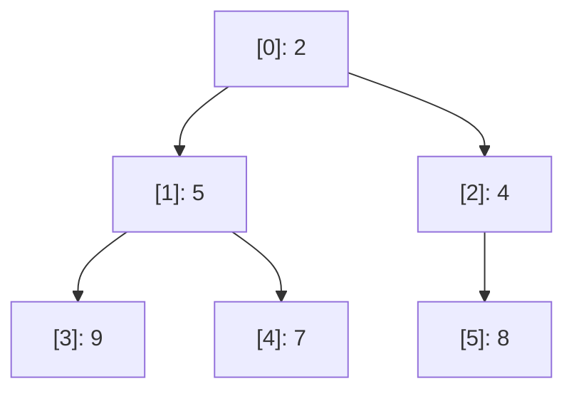

## Passo 1 · Leitura · Heap binário em vetor, `subir`/`descer`, `heapify` em $O(n)$ e `heapq`

Uma **fila de prioridade** (*priority queue*) permite inserir elementos com prioridades arbitrárias e extrair sempre o elemento de **maior prioridade** (ou **menor chave**, em um *min-heap*) em tempo **$O(\log n)$**, consultando o mínimo no topo em **$O(1)$**.

#### 1. Representando uma árvore binária quase completa em uma `list` (sem ponteiros!)

Um **Heap Binário** é uma árvore binária quase completa (todos os níveis cheios, exceto possivelmente o último, preenchido da esquerda para a direita). Graças a essa regularidade geométrica, **não precisamos de objetos `No` com ponteiros `esq` e `dir`**: armazenamos os nós diretamente em uma `list` indexada a partir de `0`!

Para qualquer nó no índice $i$:
$$\text{pai}(i) = \left\lfloor \frac{i - 1}{2} \right\rfloor, \qquad \text{esq}(i) = 2i + 1, \qquad \text{dir}(i) = 2i + 2$$



No **Min-Heap**, vale a **invariante de heap**: todo pai é **menor ou igual** aos seus filhos (`dados[pai] <= dados[filho]`). Consequentemente, o **menor elemento do conjunto está sempre na raiz `dados[0]`**!

#### 2. Operações `subir` (*sift-up*), `descer` (*sift-down*) e `construir` (*heapify*) em $O(n)$

- **`inserir(x)` — $O(\log n)$**: colocamos `x` no fim da lista (`append`) e chamamos `_subir(len - 1)`, trocando `x` com seu pai enquanto `x < dados[pai]`.
- **`extrair_min()` — $O(\log n)$**: salvamos `minimo = dados[0]`, movemos o último elemento da lista para `dados[0]` e chamamos `_descer(0)`, trocando-o repetidamente com o **menor de seus filhos** até restaurar a invariante.
- **`construir(lista)` (*heapify*) — $O(n)$**: em vez de inserir $n$ itens um a um ($O(n \log n)$), copiamos a lista e chamamos `_descer(i)` de baixo para cima para todos os nós internos, de $i = \lfloor n/2 \rfloor - 1$ até $0$. Como metade dos nós são folhas (altura $0$), um quarto tem altura $1$, etc., a soma das alturas é linear:
  $$\sum_{h=0}^{\lfloor \log_2 n \rfloor} \frac{n}{2^{h+1}} \cdot h \le n \sum_{h=1}^{\infty} \frac{h}{2^{h+1}} = O(n)$$

Veja no visualizador como `_subir` e `_descer` mantêm o menor valor no índice `0`:

```python visualizar
def subir(h, i):
    while i > 0:
        pai = (i - 1) // 2
        if h[i] < h[pai]:
            h[i], h[pai] = h[pai], h[i]
            i = pai
        else:
            break

heap = [4, 7, 8, 9]
heap.append(2)
subir(heap, len(heap) - 1)
print("Após inserir 2:", heap)
```

#### 3. O módulo `heapq` do Python e a técnica dos Dois Heaps

Na biblioteca padrão, `import heapq` opera diretamente sobre uma `list` comum como **min-heap**:
- `heapq.heappush(h, x)`, `heapq.heappop(h)` e `heapq.heapify(lista)`.
- **Como simular um Max-Heap?** Basta inserir os números com **sinal trocado** (`-x`) e negar novamente ao remover (`-heappop(h)`)!
- **Top-$k$ maiores de $n$ elementos em $O(n \log k)$**: mantemos um **min-heap de tamanho $k$** com os $k$ maiores vistos até agora. Se um novo número `x` for maior que o mínimo do heap (`h[0]`), trocamos com `heapq.heapreplace(h, x)`.
- **Mediana em fluxo (*streaming median*) com dois heaps**: mantemos um **max-heap `menores`** (com a metade inferior dos números, guardados negados) e um **min-heap `maiores`** (com a metade superior), equilibrados de modo que `len(menores)` seja igual a `len(maiores)` ou `len(maiores) + 1`. A mediana sai em **$O(1)$** a partir dos topos!

## Passo 2 · Exercício · Classe `MinHeap` do zero e `heap_sort`

Implemente a classe `MinHeap` do zero (sem usar `heapq`) com `_subir`, `_descer`, `inserir`, `extrair_min`, `topo` e `construir` em $O(n)$, e use-a para implementar `heap_sort(lista)`.

### Instruções

1. Em `MinHeap`:
   - `inserir(valor) -> None`: adiciona ao fim de `self.dados` e executa `_subir`.
   - `topo()`: devolve `self.dados[0]` (ou lança `IndexError` se vazio).
   - `extrair_min()`: remove e devolve o menor elemento em $O(\log n)$ usando `_descer` (ou lança `IndexError` se vazio). Se restar apenas 1 elemento antes da remoção, basta `self.dados.pop()`.
   - `construir(iteravel) -> None`: copia os elementos para `self.dados` e aplica `_descer(i)` para `i` de `len(self.dados) // 2 - 1` até `0`.
2. Implemente `heap_sort(lista: list[int]) -> list[int]` sem usar `sorted()` nem `.sort()`: construa um `MinHeap` com `construir(lista)` e extraia todos os elementos em ordem crescente.

### Código inicial

```python
class MinHeap:
    def __init__(self):
        self.dados: list = []

    def __len__(self) -> int:
        return len(self.dados)

    def _subir(self, i: int) -> None:
        pass

    def _descer(self, i: int) -> None:
        pass

    def inserir(self, valor) -> None:
        pass

    def topo(self):
        pass

    def extrair_min(self):
        pass

    def construir(self, iteravel) -> None:
        pass


def heap_sort(lista: list[int]) -> list[int]:
    pass
```

### Solução

```python
class MinHeap:
    def __init__(self):
        self.dados: list = []

    def __len__(self) -> int:
        return len(self.dados)

    def _subir(self, i: int) -> None:
        while i > 0:
            pai = (i - 1) // 2
            if self.dados[i] < self.dados[pai]:
                self.dados[i], self.dados[pai] = self.dados[pai], self.dados[i]
                i = pai
            else:
                break

    def _descer(self, i: int) -> None:
        n = len(self.dados)
        while True:
            menor = i
            esq = 2 * i + 1
            dir_idx = 2 * i + 2
            if esq < n and self.dados[esq] < self.dados[menor]:
                menor = esq
            if dir_idx < n and self.dados[dir_idx] < self.dados[menor]:
                menor = dir_idx
            if menor == i:
                break
            self.dados[i], self.dados[menor] = self.dados[menor], self.dados[i]
            i = menor

    def inserir(self, valor) -> None:
        self.dados.append(valor)
        self._subir(len(self.dados) - 1)

    def topo(self):
        if not self.dados:
            raise IndexError("heap vazio")
        return self.dados[0]

    def extrair_min(self):
        if not self.dados:
            raise IndexError("heap vazio")
        if len(self.dados) == 1:
            return self.dados.pop()
        minimo = self.dados[0]
        self.dados[0] = self.dados.pop()
        self._descer(0)
        return minimo

    def construir(self, iteravel) -> None:
        self.dados = list(iteravel)
        for i in range(len(self.dados) // 2 - 1, -1, -1):
            self._descer(i)


def heap_sort(lista: list[int]) -> list[int]:
    h = MinHeap()
    h.construir(lista)
    return [h.extrair_min() for _ in range(len(h))]
```

### Dicas

1. Em `_descer(self, i)`, compare `self.dados[i]` tanto com o filho esquerdo (`2 * i + 1`) quanto com o filho direito (`2 * i + 2`) para descobrir o índice `menor` dentre os três antes de fazer a troca!
2. Em `construir`, o laço deve ir **de baixo para cima**: `for i in range(len(self.dados) // 2 - 1, -1, -1): self._descer(i)`.
3. Não esqueça de lançar `IndexError` em `topo()` e `extrair_min()` quando `self.dados` estiver vazia.

### Verificação

```json
[
  {
    "id": "minheap-invariante-e-operacoes",
    "name": "Inserções, topo, construir O(n) e invariante pai <= filhos em todo o vetor",
    "checkpoint": 1,
    "kind": "expr",
    "setup": "h = MinHeap()\nfor v in [15, 10, 20, 17, 8, 25, 3]:\n    h.inserir(v)\nt1 = h.topo()\nm1 = h.extrair_min()\nm2 = h.extrair_min()\nh2 = MinHeap()\nh2.construir([40, 10, 30, 50, 20, 5, 15])\ninvariante_ok = all(h2.dados[(i - 1) // 2] <= h2.dados[i] for i in range(1, len(h2.dados)))",
    "expr": "(t1, m1, m2, h.topo(), len(h), invariante_ok, h2.topo())",
    "expected": [3, 3, 8, 10, 5, true, 5]
  },
  {
    "id": "minheap-vazio-excecao",
    "name": "extrair_min em MinHeap vazio lança IndexError",
    "checkpoint": 1,
    "kind": "expr",
    "setup": "h = MinHeap()",
    "expr": "h.extrair_min()",
    "raises": "IndexError"
  },
  {
    "id": "heapsort-ordenacao",
    "name": "heap_sort ordena lista com duplicatas e negativos",
    "checkpoint": 2,
    "kind": "call",
    "function": "heap_sort",
    "args": [[9, -3, 5, 0, 9, 2, -10, 4]],
    "expected": [-10, -3, 0, 2, 4, 5, 9, 9]
  },
  {
    "id": "heapsort-sem-sorted",
    "name": "Não usa sorted() na implementação",
    "checkpoint": 2,
    "kind": "source",
    "rule": { "type": "not_calls", "name": "sorted" }
  }
]
```

### Soluções erradas

```python name="Em _descer, troca sempre com o filho esquerdo sem comparar com o filho direito"
class MinHeap:
    def __init__(self):
        self.dados: list = []

    def __len__(self) -> int:
        return len(self.dados)

    def _subir(self, i: int) -> None:
        while i > 0:
            pai = (i - 1) // 2
            if self.dados[i] < self.dados[pai]:
                self.dados[i], self.dados[pai] = self.dados[pai], self.dados[i]
                i = pai
            else:
                break

    def _descer(self, i: int) -> None:
        n = len(self.dados)
        while 2 * i + 1 < n:
            esq = 2 * i + 1
            if self.dados[esq] < self.dados[i]:
                self.dados[i], self.dados[esq] = self.dados[esq], self.dados[i]
                i = esq
            else:
                break

    def inserir(self, valor) -> None:
        self.dados.append(valor)
        self._subir(len(self.dados) - 1)

    def topo(self):
        if not self.dados:
            raise IndexError("heap vazio")
        return self.dados[0]

    def extrair_min(self):
        if not self.dados:
            raise IndexError("heap vazio")
        if len(self.dados) == 1:
            return self.dados.pop()
        m = self.dados[0]
        self.dados[0] = self.dados.pop()
        self._descer(0)
        return m

    def construir(self, iteravel) -> None:
        self.dados = list(iteravel)
        for i in range(len(self.dados) // 2 - 1, -1, -1):
            self._descer(i)


def heap_sort(lista: list[int]) -> list[int]:
    h = MinHeap()
    h.construir(lista)
    return [h.extrair_min() for _ in range(len(h))]
```

```python name="Executa construir de cima para baixo (0 até n//2) deixando a raiz incorreta"
class MinHeap:
    def __init__(self):
        self.dados: list = []

    def __len__(self) -> int:
        return len(self.dados)

    def _subir(self, i: int) -> None:
        while i > 0:
            pai = (i - 1) // 2
            if self.dados[i] < self.dados[pai]:
                self.dados[i], self.dados[pai] = self.dados[pai], self.dados[i]
                i = pai
            else:
                break

    def _descer(self, i: int) -> None:
        n = len(self.dados)
        while True:
            menor = i
            esq = 2 * i + 1
            dir_idx = 2 * i + 2
            if esq < n and self.dados[esq] < self.dados[menor]:
                menor = esq
            if dir_idx < n and self.dados[dir_idx] < self.dados[menor]:
                menor = dir_idx
            if menor == i:
                break
            self.dados[i], self.dados[menor] = self.dados[menor], self.dados[i]
            i = menor

    def inserir(self, valor) -> None:
        self.dados.append(valor)
        self._subir(len(self.dados) - 1)

    def topo(self):
        if not self.dados:
            raise IndexError("heap vazio")
        return self.dados[0]

    def extrair_min(self):
        if not self.dados:
            raise IndexError("heap vazio")
        if len(self.dados) == 1:
            return self.dados.pop()
        m = self.dados[0]
        self.dados[0] = self.dados.pop()
        self._descer(0)
        return m

    def construir(self, iteravel) -> None:
        self.dados = list(iteravel)
        for i in range(len(self.dados) // 2):
            self._descer(i)


def heap_sort(lista: list[int]) -> list[int]:
    h = MinHeap()
    h.construir(lista)
    return [h.extrair_min() for _ in range(len(h))]
```

## Passo 3 · Exercício · Aplicações com `heapq`: Top-$k$, fusão de $k$ listas e mediana em fluxo

Use o módulo `heapq` para resolver três problemas clássicos de entrevistas e sistemas distribuídos: `k_maiores(lista, k)`, `fundir_k_listas(listas)` e `mediana_em_fluxo(valores)`.

### Instruções

1. Implemente `k_maiores(lista: list[int], k: int) -> list[int]` mantendo um min-heap de tamanho no máximo `k` para encontrar os `k` maiores elementos de `lista` e devolvê-los em **ordem decrescente** (se `k <= 0`, devolva `[]`).
2. Implemente `fundir_k_listas(listas: list[list[int]]) -> list[int]` que recebe $k$ listas já ordenadas em ordem crescente e as intercala em uma única lista ordenada em tempo $O(N \log k)$ usando um min-heap de tuplas `(valor, idx_lista, idx_elemento)`.
3. Implemente `mediana_em_fluxo(valores: list[float]) -> list[float]` que, a cada número lido de `valores`, calcula a mediana dos números vistos até aquele instante usando dois heaps (`menores` como max-heap via sinal negativo e `maiores` como min-heap) e devolve a lista de medianas acumuladas.

### Código inicial

```python
import heapq


def k_maiores(lista: list[int], k: int) -> list[int]:
    # Devolva os k maiores elementos em ordem decrescente usando um min-heap de tamanho k
    pass


def fundir_k_listas(listas: list[list[int]]) -> list[int]:
    # Intercale as k listas ordenadas usando heapq
    pass


def mediana_em_fluxo(valores: list[float]) -> list[float]:
    # Devolva a lista com a mediana após cada elemento inserido usando dois heaps
    pass
```

### Solução

```python
import heapq


def k_maiores(lista: list[int], k: int) -> list[int]:
    if k <= 0 or not lista:
        return []
    heap: list[int] = []
    for x in lista:
        if len(heap) < k:
            heapq.heappush(heap, x)
        elif x > heap[0]:
            heapq.heapreplace(heap, x)
    resultado = []
    while heap:
        resultado.append(heapq.heappop(heap))
    resultado.reverse()
    return resultado


def fundir_k_listas(listas: list[list[int]]) -> list[int]:
    heap: list[tuple[int, int, int]] = []
    for i, sublista in enumerate(listas):
        if sublista:
            heapq.heappush(heap, (sublista[0], i, 0))
    saida: list[int] = []
    while heap:
        valor, i_lista, i_elem = heapq.heappop(heap)
        saida.append(valor)
        prox_idx = i_elem + 1
        if prox_idx < len(listas[i_lista]):
            heapq.heappush(heap, (listas[i_lista][prox_idx], i_lista, prox_idx))
    return saida


def mediana_em_fluxo(valores: list[float]) -> list[float]:
    menores: list[float] = []  # max-heap (valores negados)
    maiores: list[float] = []  # min-heap
    medianas: list[float] = []

    for x in valores:
        heapq.heappush(menores, -float(x))
        heapq.heappush(maiores, -heapq.heappop(menores))
        if len(maiores) > len(menores):
            heapq.heappush(menores, -heapq.heappop(maiores))

        if len(menores) > len(maiores):
            medianas.append(float(-menores[0]))
        else:
            medianas.append((-menores[0] + maiores[0]) / 2.0)

    return medianas
```

### Dicas

1. Em `k_maiores`, quando `len(heap) == k` e chega `x > heap[0]`, `heapq.heapreplace(heap, x)` remove o menor dos $k$ atuais e insere `x` em uma única descida $O(\log k)$. Ao final, esvazie o heap e inverta a lista para ficar em ordem decrescente.
2. Em `fundir_k_listas`, cada item do heap é `(valor, i_lista, i_elem)`. Ao retirar o menor, se `i_elem + 1 < len(listas[i_lista])`, insira o próximo elemento daquela mesma lista no heap.
3. Em `mediana_em_fluxo`, o protocolo de 3 linhas a cada novo `x` é infalível: (1) empurra `-x` em `menores`; (2) passa o maior de `menores` para `maiores`; (3) se `len(maiores) > len(menores)`, devolve o menor de `maiores` para `menores`.

### Verificação

```json
[
  {
    "id": "k-maiores-teste",
    "name": "k_maiores devolve os k maiores em ordem decrescente (incluindo escala)",
    "checkpoint": 1,
    "kind": "expr",
    "setup": "grande = [(i * 73 + 19) % 100000 for i in range(50000)]",
    "expr": "(k_maiores([3, 1, 5, 12, 2, 11], 3), k_maiores([5, 2], 0), k_maiores(grande, 4))",
    "expected": [[12, 11, 5], [], [99997, 99996, 99994, 99993]]
  },
  {
    "id": "fundir-k-listas-teste",
    "name": "fundir_k_listas intercala listas ordenadas incluindo listas vazias",
    "checkpoint": 2,
    "kind": "call",
    "function": "fundir_k_listas",
    "args": [[[1, 4, 7], [], [2, 3, 8], [0, 4, 9]]],
    "expected": [0, 1, 2, 3, 4, 4, 7, 8, 9]
  },
  {
    "id": "mediana-em-fluxo-teste",
    "name": "mediana_em_fluxo atualiza a mediana para quantidades ímpares e pares",
    "checkpoint": 3,
    "kind": "call",
    "function": "mediana_em_fluxo",
    "args": [[5, 15, 1, 3, 8, 7]],
    "expected": [5.0, 10.0, 5.0, 4.0, 5.0, 6.0]
  }
]
```

### Soluções erradas

```python name="Devolve k_maiores em ordem crescente em vez de decrescente"
import heapq


def k_maiores(lista: list[int], k: int) -> list[int]:
    if k <= 0 or not lista:
        return []
    heap: list[int] = []
    for x in lista:
        if len(heap) < k:
            heapq.heappush(heap, x)
        elif x > heap[0]:
            heapq.heapreplace(heap, x)
    return [heapq.heappop(heap) for _ in range(len(heap))]


def fundir_k_listas(listas: list[list[int]]) -> list[int]:
    return list(heapq.merge(*listas))


def mediana_em_fluxo(valores: list[float]) -> list[float]:
    menores, maiores, med = [], [], []
    for x in valores:
        heapq.heappush(menores, -float(x))
        heapq.heappush(maiores, -heapq.heappop(menores))
        if len(maiores) > len(menores):
            heapq.heappush(menores, -heapq.heappop(maiores))
        med.append(float(-menores[0]) if len(menores) > len(maiores) else (-menores[0] + maiores[0]) / 2.0)
    return med
```

```python name="Em mediana_em_fluxo, esquece de negar os valores no max-heap menores"
import heapq


def k_maiores(lista: list[int], k: int) -> list[int]:
    if k <= 0 or not lista:
        return []
    return heapq.nlargest(k, lista)


def fundir_k_listas(listas: list[list[int]]) -> list[int]:
    return list(heapq.merge(*listas))


def mediana_em_fluxo(valores: list[float]) -> list[float]:
    menores, maiores, med = [], [], []
    for x in valores:
        heapq.heappush(menores, float(x))
        heapq.heappush(maiores, heapq.heappop(menores))
        if len(maiores) > len(menores):
            heapq.heappush(menores, heapq.heappop(maiores))
        med.append(float(menores[0]) if len(menores) > len(maiores) else (menores[0] + maiores[0]) / 2.0)
    return med
```

## Passo 4 · Quiz · Heaps e filas de prioridade

### Pergunta

Em um heap binário armazenado em uma `list` indexada a partir de `0`, quais são os índices do **pai**, do **filho esquerdo** e do **filho direito** do elemento na posição `i = 4`?

- [ ] Pai `2`, filho esquerdo `8`, filho direito `9`.
- [x] Pai `(4 - 1) // 2 = 1`, filho esquerdo `2*4 + 1 = 9`, filho direito `2*4 + 2 = 10`.
- [ ] Pai `3`, filho esquerdo `5`, filho direito `6`.
- [ ] Pai `0`, filho esquerdo `4`, filho direito `8`.

> Com indexação zero-based, as fórmulas são $\lfloor (i-1)/2 \rfloor$, $2i+1$ e $2i+2$. Para $i=4$, o pai está no índice $1$ e os filhos nos índices $9$ e $10$.

### Pergunta

Qual é a complexidade de construir um heap a partir de uma lista desordenada de $n$ elementos usando `heapq.heapify` (aplicando `_descer` de baixo para cima) versus inserir os $n$ elementos um por um em um heap vazio com `heappush`?

- [ ] Ambos custam $O(n \log n)$.
- [x] `heapify` de baixo para cima custa **$O(n)$**, pois a maioria dos nós está perto das folhas e percorre alturas pequenas, enquanto $n$ chamadas de `heappush` de cima para baixo custam **$O(n \log n)$** no pior caso.
- [ ] `heapify` custa $O(n^2)$ e `heappush` custa $O(n)$.
- [ ] Ambos custam $O(1)$.

> No `heapify` bottom-up, metade dos nós são folhas (0 trocas), um quarto faz no máximo 1 troca, um oitavo no máximo 2 trocas, e a série $\sum_{h \ge 1} h / 2^{h+1}$ converge para uma constante, resultando em $O(n)$.
