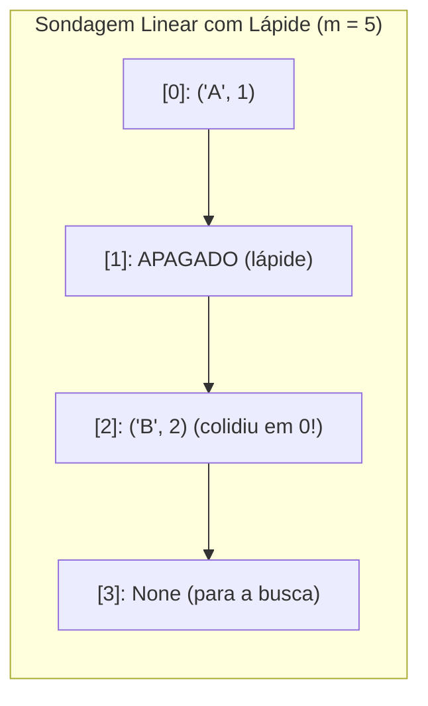

## Passo 1 · Leitura · Funções de hash, colisões, fator de carga $\alpha$ e sondagem linear

Como o `dict` e o `set` do Python conseguem buscar, inserir e remover chaves em **$O(1)$ médio**? A resposta é a **Tabela Hash** (*hash table*): um vetor de $m$ compartimentos (*buckets* ou *slots*) onde a posição de uma `chave` é calculada diretamente por uma **função de hash**:
$$\text{índice} = h(\text{chave}) \bmod m$$

#### 1. O que faz uma boa função de hash? (Hash polinomial)

Se usarmos apenas a soma dos códigos ASCII das letras (`sum(ord(c) for c in texto) % m`), todos os **anagramas** como `"roma"`, `"amor"` e `"mora"` terão exatamente o mesmo hash e sofrerão **colisão**! Para que a **ordem** dos caracteres importe, usamos o **hash polinomial** (*rolling hash* de Horner) com uma base primo $B$ (como $31$ ou $131$):
$$h(s) = \left(\sum_{i=0}^{k-1} \text{ord}(s[i]) \cdot B^{k - 1 - i}\right) \bmod m$$
Calculado iterativamente da esquerda para a direita em $O(k)$: `h = (h * base + ord(ch)) % modulo`.

#### 2. Resolução de colisões: Encadeamento Separado vs Endereçamento Aberto

Como o universo de chaves possíveis é muito maior que $m$ (Princípio da Casa dos Pombos), duas chaves distintas $k_1 \ne k_2$ inevitavelmente cairão no mesmo índice. Existem duas grandes famílias para tratar colisões:

1. **Encadeamento separado (*Separate Chaining*)**: cada um dos $m$ compartimentos é uma pequena lista de pares `[chave, valor]`.
   - Definimos o **fator de carga** como $\alpha = \frac{n}{m}$ ($n$ itens em $m$ buckets).
   - Se mantivermos $\alpha \le 0{,}75$ **dobrando $m$ e reinserindo todas as chaves (*rehashing*)** sempre que $n / m > 0{,}75$, o tamanho médio de cada lista é constante ($\le 0{,}75$), garantindo `get`, `put` e `delete` em **$O(1)$ médio e amortizado**!
   - **Atenção no redimensionamento**: quando $m$ dobra para $2m$, $h(\text{chave}) \bmod (2m)$ muda! É obrigatório **recalcular o índice de cada chave** e redistribuí-las nos novos buckets.

2. **Endereçamento aberto com Sondagem Linear (*Linear Probing*)**: todos os pares ficam diretamente no próprio vetor `tabela` de tamanho $m$. Se a posição $i = h(\text{chave}) \bmod m$ estiver ocupada por outra chave, tentamos $(i + 1) \bmod m$, $(i + 2) \bmod m \dots$ até achar a chave ou uma célula `None`.
   - **O problema da remoção e a Lápide (*Tombstone*)**: se simplesmente colocarmos `None` ao remover uma chave na posição $i$, uma busca futura por outra chave que havia colidido e pulado para $i + 1$ vai parar prematuramente no `None` achando que a chave não existe! A solução é gravar um marcador especial **`APAGADO` (*tombstone*)**: a **busca** continua caminhando sobre `APAGADO`, enquanto a **inserção** pode reutilizar a primeira posição `APAGADO` encontrada.



Veja no visualizador como a lápide evita quebrar a cadeia de busca após uma remoção:

```python visualizar
APAGADO = "<APAGADO>"
tabela = [None] * 5

# 'A' e 'F' têm mesmo índice módulo 5 (ambos caem em 0)
tabela[0] = ("A", 10)
tabela[1] = ("F", 60)

# Removemos 'A' deixando uma lápide em vez de None
tabela[0] = APAGADO

# Buscando 'F' a partir do índice 0:
idx = 0
encontrado = None
while tabela[idx] is not None:
    if tabela[idx] != APAGADO and tabela[idx][0] == "F":
        encontrado = tabela[idx][1]
        break
    idx = (idx + 1) % 5

print("Valor de 'F' encontrado após lápide:", encontrado)
```

#### 3. O contrato `__hash__` e `__eq__` no Python

Para que um objeto possa ser chave de `dict` ou elemento de `set` em Python:
1. **Regra fundamental**: se `a == b`, então **obrigatoriamente** `hash(a) == hash(b)`.
2. Quando você define `__eq__` em uma classe, o Python **desativa `__hash__`** (`__hash__ = None`) por segurança! Para tornar sua classe hasheável, ela deve ser **imutável** e implementar `__hash__(self)` combinando os atributos em uma tupla: `return hash((self.x, self.y))`.

## Passo 2 · Previsão · Como `set` e `dict` usam `__hash__` e `__eq__`

Analise as duas classes abaixo (`PontoSemHash` e `Ponto`) e preveja o que o código imprime.

### Código

```python
class Ponto:
    def __init__(self, x: int, y: int):
        self.x = x
        self.y = y

    def __eq__(self, outro) -> bool:
        return isinstance(outro, Ponto) and (self.x, self.y) == (outro.x, outro.y)

    def __hash__(self) -> int:
        return hash((self.x, self.y))


p1 = Ponto(3, 4)
p2 = Ponto(3, 4)
p3 = Ponto(4, 3)

conjunto = {p1, p2, p3}
print("p1 == p2:", p1 == p2)
print("hash(p1) == hash(p2):", hash(p1) == hash(p2))
print("Tamanho do set:", len(conjunto))
```

### Dicas

1. `p1` e `p2` são instâncias distintas na memória, mas `p1 == p2` devolve `True` porque ambos têm `(x, y) == (3, 4)`.
2. Como `hash((3, 4)) == hash((3, 4))`, `p2` cai no mesmo slot de `p1` no `set`, o Python verifica `p1 == p2` (`True`) e reconhece que é uma duplicata.
3. Já `p3 = Ponto(4, 3)` é diferente de `p1`, portanto o `set` termina com `2` elementos.

### Saída esperada

```text
p1 == p2: True
hash(p1) == hash(p2): True
Tamanho do set: 2
```

## Passo 3 · Exercício · Hash polinomial, colisões e classe `Ponto` hasheável

Implemente `hash_polinomial(texto, base, modulo)`, `contar_colisoes(chaves, base, modulo)` e a classe `Ponto(x, y)` com `__eq__` e `__hash__`.

### Instruções

1. Implemente `hash_polinomial(texto: str, base: int, modulo: int) -> int` acumulando `h = (h * base + ord(ch)) % modulo` para cada caractere `ch` de `texto` (começando com `h = 0`).
2. Implemente `contar_colisoes(chaves: list[str], base: int, modulo: int) -> int` que calcula o hash polinomial de cada string em `chaves` (após remover duplicatas exatas com `set(chaves)`) e devolve quantas chaves distintas colidiram em compartimentos já ocupados (isto é, `len(chaves_unicas) - len(hashes_distintos)`).
3. Implemente a classe `Ponto(x: int, y: int)` com `__eq__` e `__hash__` consistentes para que instâncias com mesmas coordenadas `(x, y)` funcionem como a mesma chave em conjuntos (`set`) e dicionários (`dict`).

### Código inicial

```python
def hash_polinomial(texto: str, base: int = 31, modulo: int = 1009) -> int:
    pass


def contar_colisoes(chaves: list[str], base: int = 31, modulo: int = 1009) -> int:
    pass


class Ponto:
    def __init__(self, x: int, y: int):
        self.x = x
        self.y = y

    def __eq__(self, outro) -> bool:
        pass

    def __hash__(self) -> int:
        pass
```

### Solução

```python
def hash_polinomial(texto: str, base: int = 31, modulo: int = 1009) -> int:
    h = 0
    for ch in texto:
        h = (h * base + ord(ch)) % modulo
    return h


def contar_colisoes(chaves: list[str], base: int = 31, modulo: int = 1009) -> int:
    unicas = set(chaves)
    hashes = {hash_polinomial(c, base, modulo) for c in unicas}
    return len(unicas) - len(hashes)


class Ponto:
    def __init__(self, x: int, y: int):
        self.x = x
        self.y = y

    def __eq__(self, outro) -> bool:
        if not isinstance(outro, Ponto):
            return False
        return (self.x, self.y) == (outro.x, outro.y)

    def __hash__(self) -> int:
        return hash((self.x, self.y))
```

### Dicas

1. Em `hash_polinomial`, se `base = 1`, ela degenera na soma simples de ASCII (e anagramas colidem); quando `base = 31`, `"roma"` e `"amor"` produzem hashes diferentes!
2. Se $U$ chaves distintas produzem $H$ valores de hash distintos, o número de colisões é exatamente $U - H$.
3. Em `Ponto`, implemente `__hash__` devolvendo `hash((self.x, self.y))` (a tupla garante que `Ponto(1, 2)` e `Ponto(2, 1)` tenham hashes diferentes).

### Verificação

```json
[
  {
    "id": "hash-polinomial-anagramas",
    "name": "Hash polinomial distingue anagramas com base 31",
    "checkpoint": 1,
    "kind": "expr",
    "expr": "(hash_polinomial('', 31, 1009), hash_polinomial('roma', 31, 1009), hash_polinomial('amor', 31, 1009), hash_polinomial('roma', 31, 1009) != hash_polinomial('amor', 31, 1009))",
    "expected": [0, 46, 292, true]
  },
  {
    "id": "contar-colisoes-base1-vs-base31",
    "name": "Soma simples (base=1) colide em todos os anagramas, enquanto base=31 não colide",
    "checkpoint": 2,
    "kind": "expr",
    "setup": "anagramas = ['roma', 'amor', 'mora', 'ramo', 'maro']",
    "expr": "(contar_colisoes(anagramas, 1, 1009), contar_colisoes(anagramas, 31, 1009))",
    "expected": [4, 0]
  },
  {
    "id": "ponto-hasheavel-set-dict",
    "name": "Classe Ponto funciona como chave em set e dict distinguindo (x, y) de (y, x)",
    "checkpoint": 3,
    "kind": "expr",
    "setup": "mapa = {Ponto(1, 2): 'A'}\nmapa[Ponto(1, 2)] = 'B'\nmapa[Ponto(2, 1)] = 'C'",
    "expr": "(len(mapa), mapa[Ponto(1, 2)], mapa[Ponto(2, 1)], Ponto(1, 2) == (1, 2))",
    "expected": [2, "B", "C", false]
  }
]
```

### Soluções erradas

```python name="Soma apenas ord(ch) sem multiplicar pela base (colide em anagramas)"
def hash_polinomial(texto: str, base: int = 31, modulo: int = 1009) -> int:
    return sum(ord(ch) for ch in texto) % modulo


def contar_colisoes(chaves: list[str], base: int = 31, modulo: int = 1009) -> int:
    unicas = set(chaves)
    hashes = {hash_polinomial(c, base, modulo) for c in unicas}
    return len(unicas) - len(hashes)


class Ponto:
    def __init__(self, x: int, y: int):
        self.x = x
        self.y = y

    def __eq__(self, outro) -> bool:
        return isinstance(outro, Ponto) and (self.x, self.y) == (outro.x, outro.y)

    def __hash__(self) -> int:
        return hash((self.x, self.y))
```

```python name="Define __eq__ em Ponto mas esquece de definir __hash__"
def hash_polinomial(texto: str, base: int = 31, modulo: int = 1009) -> int:
    h = 0
    for ch in texto:
        h = (h * base + ord(ch)) % modulo
    return h


def contar_colisoes(chaves: list[str], base: int = 31, modulo: int = 1009) -> int:
    unicas = set(chaves)
    hashes = {hash_polinomial(c, base, modulo) for c in unicas}
    return len(unicas) - len(hashes)


class Ponto:
    def __init__(self, x: int, y: int):
        self.x = x
        self.y = y

    def __eq__(self, outro) -> bool:
        return isinstance(outro, Ponto) and (self.x, self.y) == (outro.x, outro.y)
```

## Passo 4 · Exercício · `TabelaHash` com redimensionamento e `TabelaHashAberta` com lápide

Implemente as duas arquiteturas clássicas de tabela hash do zero: `TabelaHash` (encadeamento separado com redimensionamento automático quando $\alpha > 0{,}75$) e `TabelaHashAberta` (sondagem linear com marcador de remoção / lápide).

### Instruções

1. Em `TabelaHash(capacidade_inicial: int = 8)`:
   - Mantenha `self.buckets = [[] for _ in range(capacidade_inicial)]` e `self.tamanho = 0`. Use `_indice(chave)` como `hash(chave) % len(self.buckets)`.
   - Implemente `put(chave, valor)`: se a chave já existir no bucket, atualize seu valor; caso contrário, adicione `[chave, valor]`, incremente `self.tamanho` e, se `self.tamanho / len(self.buckets) > 0.75`, chame `_redimensionar()` dobrando o número de buckets (`2 * len(self.buckets)`) e reinserindo todos os pares nos novos buckets.
   - Implemente `get(chave, padrao=None)` e `delete(chave) -> bool` (devolve `True` se removeu, `False` se não encontrou).
2. Em `TabelaHashAberta(capacidade: int = 16)`:
   - Use sondagem linear sobre `self.chaves = [None] * capacidade` e `self.valores = [None] * capacidade`, reservando um objeto sentinela `self.APAGADO = object()` para remoções.
   - Implemente `put(chave, valor)`, `get(chave, padrao=None)` e `delete(chave) -> bool` (que marca o slot com `self.APAGADO` e decrementa `self.tamanho`).

### Código inicial

```python
class TabelaHash:
    def __init__(self, capacidade_inicial: int = 8):
        self.buckets: list[list] = [[] for _ in range(capacidade_inicial)]
        self.tamanho = 0

    def __len__(self) -> int:
        return self.tamanho

    def _redimensionar(self) -> None:
        pass

    def put(self, chave, valor) -> None:
        pass

    def get(self, chave, padrao=None):
        pass

    def delete(self, chave) -> bool:
        pass


class TabelaHashAberta:
    def __init__(self, capacidade: int = 16):
        self.capacidade = capacidade
        self.APAGADO = object()
        self.chaves = [None] * capacidade
        self.valores = [None] * capacidade
        self.tamanho = 0

    def put(self, chave, valor) -> None:
        pass

    def get(self, chave, padrao=None):
        pass

    def delete(self, chave) -> bool:
        pass
```

### Solução

```python
class TabelaHash:
    def __init__(self, capacidade_inicial: int = 8):
        self.buckets: list[list] = [[] for _ in range(capacidade_inicial)]
        self.tamanho = 0

    def __len__(self) -> int:
        return self.tamanho

    def _indice(self, chave, num_buckets: int | None = None) -> int:
        m = len(self.buckets) if num_buckets is None else num_buckets
        return hash(chave) % m

    def _redimensionar(self) -> None:
        antigos = self.buckets
        novo_m = len(antigos) * 2
        self.buckets = [[] for _ in range(novo_m)]
        for bucket in antigos:
            for par in bucket:
                idx = self._indice(par[0], novo_m)
                self.buckets[idx].append(par)

    def put(self, chave, valor) -> None:
        idx = self._indice(chave)
        bucket = self.buckets[idx]
        for par in bucket:
            if par[0] == chave:
                par[1] = valor
                return
        bucket.append([chave, valor])
        self.tamanho += 1
        if self.tamanho / len(self.buckets) > 0.75:
            self._redimensionar()

    def get(self, chave, padrao=None):
        idx = self._indice(chave)
        for par in self.buckets[idx]:
            if par[0] == chave:
                return par[1]
        return padrao

    def delete(self, chave) -> bool:
        idx = self._indice(chave)
        bucket = self.buckets[idx]
        for i, par in enumerate(bucket):
            if par[0] == chave:
                bucket.pop(i)
                self.tamanho -= 1
                return True
        return False


class TabelaHashAberta:
    def __init__(self, capacidade: int = 16):
        self.capacidade = capacidade
        self.APAGADO = object()
        self.chaves = [None] * capacidade
        self.valores = [None] * capacidade
        self.tamanho = 0

    def put(self, chave, valor) -> None:
        idx = hash(chave) % self.capacidade
        primeiro_apagado = None
        for _ in range(self.capacidade):
            k = self.chaves[idx]
            if k is None:
                alvo = primeiro_apagado if primeiro_apagado is not None else idx
                self.chaves[alvo] = chave
                self.valores[alvo] = valor
                self.tamanho += 1
                return
            if k is self.APAGADO:
                if primeiro_apagado is None:
                    primeiro_apagado = idx
            elif k == chave:
                self.valores[idx] = valor
                return
            idx = (idx + 1) % self.capacidade
        if primeiro_apagado is not None:
            self.chaves[primeiro_apagado] = chave
            self.valores[primeiro_apagado] = valor
            self.tamanho += 1

    def get(self, chave, padrao=None):
        idx = hash(chave) % self.capacidade
        for _ in range(self.capacidade):
            k = self.chaves[idx]
            if k is None:
                return padrao
            if k is not self.APAGADO and k == chave:
                return self.valores[idx]
            idx = (idx + 1) % self.capacidade
        return padrao

    def delete(self, chave) -> bool:
        idx = hash(chave) % self.capacidade
        for _ in range(self.capacidade):
            k = self.chaves[idx]
            if k is None:
                return False
            if k is not self.APAGADO and k == chave:
                self.chaves[idx] = self.APAGADO
                self.valores[idx] = None
                self.tamanho -= 1
                return True
            idx = (idx + 1) % self.capacidade
        return False
```

### Dicas

1. Em `TabelaHash._redimensionar()`, crie `novos_buckets = [[] for _ in range(len(self.buckets) * 2)]` e, para cada `[chave, valor]` dos buckets antigos, recalcule `hash(chave) % len(novos_buckets)` antes de inserir!
2. Em `TabelaHashAberta.get(chave)`, só pare a busca ao encontrar `None` (nunca pare em `self.APAGADO`, pois a chave procurada pode estar mais adiante na sondagem!).
3. Em `TabelaHashAberta.put(chave, valor)`, ao passar por um slot `self.APAGADO`, guarde seu índice em `primeiro_apagado`, mas **continue procurando** até `None` para ter certeza de que `chave` ainda não existe mais adiante!

### Verificação

```json
[
  {
    "id": "tabela-hash-encadeamento-redimensionar",
    "name": "TabelaHash insere, atualiza, remove e redimensiona mantendo O(1) para 10.000 itens",
    "checkpoint": 1,
    "kind": "expr",
    "setup": "t = TabelaHash(4)\nfor i in range(10000):\n    t.put(f'k{i}', i * 10)\nt.put('k50', 999999)\ndel_ok = t.delete('k100')\ndel_inex = t.delete('inexistente')",
    "expr": "(len(t), len(t.buckets) >= 16384, t.get('k50'), t.get('k100', -1), t.get('k9999'), del_ok, del_inex)",
    "expected": [9999, true, 999999, -1, 99990, true, false]
  },
  {
    "id": "tabela-hash-aberta-sondagem-e-lapide",
    "name": "TabelaHashAberta encontra e reutiliza slots após remoção com colisão (lápide)",
    "checkpoint": 2,
    "kind": "expr",
    "setup": "ta = TabelaHashAberta(8)\n# 1, 9 e 17 têm o mesmo hash % 8 == 1\nta.put(1, 'um')\nta.put(9, 'nove')\nta.put(17, 'dezessete')\nr1 = ta.delete(9)\ng17 = ta.get(17)\nta.put(25, 'vinte_e_cinco')\ng25 = ta.get(25)",
    "expr": "(r1, g17, g25, ta.get(9, 'ausente'), ta.tamanho)",
    "expected": [true, "dezessete", "vinte_e_cinco", "ausente", 3]
  }
]
```

### Soluções erradas

```python name="Não redimensiona TabelaHash (degrada para busca linear O(n) e mantém poucos buckets)"
class TabelaHash:
    def __init__(self, capacidade_inicial: int = 8):
        self.buckets: list[list] = [[] for _ in range(capacidade_inicial)]
        self.tamanho = 0

    def __len__(self) -> int:
        return self.tamanho

    def _redimensionar(self) -> None:
        pass

    def put(self, chave, valor) -> None:
        idx = hash(chave) % len(self.buckets)
        for par in self.buckets[idx]:
            if par[0] == chave:
                par[1] = valor
                return
        self.buckets[idx].append([chave, valor])
        self.tamanho += 1

    def get(self, chave, padrao=None):
        idx = hash(chave) % len(self.buckets)
        for par in self.buckets[idx]:
            if par[0] == chave:
                return par[1]
        return padrao

    def delete(self, chave) -> bool:
        idx = hash(chave) % len(self.buckets)
        for i, par in enumerate(self.buckets[idx]):
            if par[0] == chave:
                self.buckets[idx].pop(i)
                self.tamanho -= 1
                return True
        return False


class TabelaHashAberta:
    def __init__(self, capacidade: int = 16):
        self.capacidade = capacidade
        self.APAGADO = object()
        self.chaves = [None] * capacidade
        self.valores = [None] * capacidade
        self.tamanho = 0

    def put(self, chave, valor) -> None:
        idx = hash(chave) % self.capacidade
        for _ in range(self.capacidade):
            if self.chaves[idx] in (None, self.APAGADO) or self.chaves[idx] == chave:
                if self.chaves[idx] != chave:
                    self.tamanho += 1
                self.chaves[idx] = chave
                self.valores[idx] = valor
                return
            idx = (idx + 1) % self.capacidade

    def get(self, chave, padrao=None):
        idx = hash(chave) % self.capacidade
        for _ in range(self.capacidade):
            if self.chaves[idx] is None:
                return padrao
            if self.chaves[idx] is not self.APAGADO and self.chaves[idx] == chave:
                return self.valores[idx]
            idx = (idx + 1) % self.capacidade
        return padrao

    def delete(self, chave) -> bool:
        idx = hash(chave) % self.capacidade
        for _ in range(self.capacidade):
            if self.chaves[idx] is None:
                return False
            if self.chaves[idx] is not self.APAGADO and self.chaves[idx] == chave:
                self.chaves[idx] = self.APAGADO
                self.tamanho -= 1
                return True
            idx = (idx + 1) % self.capacidade
        return False
```

```python name="Em TabelaHashAberta.delete, grava None em vez de APAGADO quebrando a cadeia de sondagem"
class TabelaHash:
    def __init__(self, capacidade_inicial: int = 8):
        self.buckets: list[list] = [[] for _ in range(capacidade_inicial)]
        self.tamanho = 0

    def __len__(self) -> int:
        return self.tamanho

    def _redimensionar(self) -> None:
        antigos = self.buckets
        novo_m = len(antigos) * 2
        self.buckets = [[] for _ in range(novo_m)]
        for bucket in antigos:
            for par in bucket:
                self.buckets[hash(par[0]) % novo_m].append(par)

    def put(self, chave, valor) -> None:
        idx = hash(chave) % len(self.buckets)
        for par in self.buckets[idx]:
            if par[0] == chave:
                par[1] = valor
                return
        self.buckets[idx].append([chave, valor])
        self.tamanho += 1
        if self.tamanho / len(self.buckets) > 0.75:
            self._redimensionar()

    def get(self, chave, padrao=None):
        idx = hash(chave) % len(self.buckets)
        for par in self.buckets[idx]:
            if par[0] == chave:
                return par[1]
        return padrao

    def delete(self, chave) -> bool:
        idx = hash(chave) % len(self.buckets)
        for i, par in enumerate(self.buckets[idx]):
            if par[0] == chave:
                self.buckets[idx].pop(i)
                self.tamanho -= 1
                return True
        return False


class TabelaHashAberta:
    def __init__(self, capacidade: int = 16):
        self.capacidade = capacidade
        self.APAGADO = object()
        self.chaves = [None] * capacidade
        self.valores = [None] * capacidade
        self.tamanho = 0

    def put(self, chave, valor) -> None:
        idx = hash(chave) % self.capacidade
        for _ in range(self.capacidade):
            if self.chaves[idx] is None or self.chaves[idx] == chave:
                if self.chaves[idx] != chave:
                    self.tamanho += 1
                self.chaves[idx] = chave
                self.valores[idx] = valor
                return
            idx = (idx + 1) % self.capacidade

    def get(self, chave, padrao=None):
        idx = hash(chave) % self.capacidade
        for _ in range(self.capacidade):
            if self.chaves[idx] is None:
                return padrao
            if self.chaves[idx] == chave:
                return self.valores[idx]
            idx = (idx + 1) % self.capacidade
        return padrao

    def delete(self, chave) -> bool:
        idx = hash(chave) % self.capacidade
        for _ in range(self.capacidade):
            if self.chaves[idx] is None:
                return False
            if self.chaves[idx] == chave:
                self.chaves[idx] = None
                self.valores[idx] = None
                self.tamanho -= 1
                return True
            idx = (idx + 1) % self.capacidade
        return False
```

## Passo 5 · Quiz · Tabelas hash, colisões e `__hash__`

### Pergunta

Por que uma `list` comum do Python **não** pode ser usada como chave de um `dict` (`TypeError: unhashable type: 'list'`), enquanto uma `tuple` de inteiros pode?

- [ ] Porque tuplas têm no máximo 2 elementos.
- [x] Porque uma `list` é mutável: se seu conteúdo fosse alterado depois de inserida no dicionário, seu valor de hash mudaria e ela ficaria em um bucket diferente daquele onde `dict[chave]` a procuraria, corrompendo a invariante da tabela hash.
- [ ] Porque calcular o hash de uma lista levaria tempo exponencial.
- [ ] Porque listas só podem armazenar strings.

> Se o hash de uma chave mudasse após a inserção, o dicionário jamais a encontraria no novo bucket nem conseguiria manter a unicidade das chaves.

### Pergunta

O que acontece ao redimensionar uma tabela hash de $m$ para $2m$ buckets se simplesmente copiarmos cada bucket inteiro `novos_buckets[i] = antigos_buckets[i]` sem recalcular `hash(chave) % (2 * m)`?

- [ ] A tabela funciona normalmente e fica duas vezes mais rápida.
- [x] A tabela fica corrompida: uma chave cujo `hash(chave) % m` era `i` pode ter `hash(chave) % (2 * m)` igual a `i + m`, fazendo `get(chave)` procurar no bucket `i + m` (vazio) e não encontrar a chave guardada em `i`.
- [ ] Apenas as chaves numéricas param de funcionar.
- [ ] O fator de carga dobra em vez de cair pela metade.

> Como o divisor do módulo mudou de $m$ para $2m$, cerca de metade das chaves mudam de índice (de $i$ para $i + m$). Por isso, o *rehashing* de cada chave individual é indispensável.
