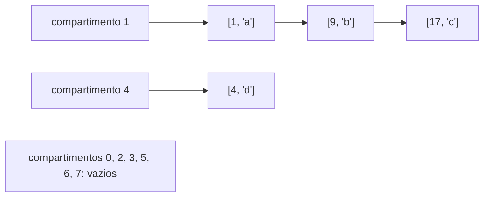

## Passo 1 · Leitura · Do hash ao compartimento

O `dict` acha `estoque["caneta"]` sem olhar as outras chaves. O truque é transformar a chave num número e usar esse número como posição numa lista. Essa lista de $m$ **compartimentos** (*buckets*) é a **tabela hash**, e a chave vai para o compartimento

$$
i = \text{hash}(\text{chave}) \bmod m .
$$

A função embutida `hash()` devolve um inteiro. Para inteiros, é o próprio número (`hash(42) == 42`). Para textos, é um número embaralhado que **muda de uma execução do Python para outra**, de propósito, para dificultar ataques que forçam colisões. Dentro de uma execução ele é estável, e é só isso que a tabela precisa. O `%` do Python nunca dá negativo com $m > 0$: `hash(-3) % 8` é 5, um índice válido.

Há infinitas chaves possíveis e só $m$ compartimentos, então duas chaves diferentes acabam no mesmo lugar: uma **colisão**. Com $m = 8$, as chaves 1, 9 e 17 vão todas para o compartimento 1. No **encadeamento separado**, cada compartimento é uma lista de pares `[chave, valor]`, e as chaves que colidem convivem nela:



Buscar é calcular o índice e percorrer só aquele compartimento, comparando as chaves com `==`. Três erros comuns nesta parte:

- comparar com `is`: `int("123456789012")` duas vezes produz dois objetos iguais, mas não o mesmo objeto;
- calcular o índice com `id(chave)`: duas chaves iguais e distintas vão para compartimentos diferentes;
- criar os compartimentos com `[[]] * m`: são $m$ referências para **a mesma** lista, e tudo cai num compartimento só.

A tabela confia num contrato: **se `a == b`, então `hash(a) == hash(b)`**. O hash escolhe o compartimento e o `==` confirma a chave; se duas chaves iguais tivessem hashes diferentes, a segunda seria procurada no compartimento errado. Uma classe que define `__eq__` sem definir `__hash__` perde o hash herdado de `object`, e usá-la como chave dá

```text
TypeError: cannot use 'Senha' as a dict key (unhashable type: 'Senha')
```

## Passo 2 · Previsão · Chaves que se confundem e chaves que somem

O programa usa três tipos de chave: números iguais de tipos diferentes, uma classe com `__eq__` e sem `__hash__`, e um ponto que muda depois de entrar num `set`. Leia sem executar e digite a saída exata.

### Código
```python
class Senha:
    def __init__(self, texto):
        self.texto = texto

    def __eq__(self, outra):
        return isinstance(outra, Senha) and self.texto == outra.texto


class Ponto:
    def __init__(self, x, y):
        self.x = x
        self.y = y

    def __eq__(self, outro):
        return isinstance(outro, Ponto) and (self.x, self.y) == (outro.x, outro.y)

    def __hash__(self):
        return hash((self.x, self.y))


d = {1: "um"}
d[True] = "verdadeiro"
d[1.0] = "real"
print(d)

try:
    usadas = {Senha("abc")}
except TypeError as erro:
    print(erro)

p = Ponto(1, 2)
visitados = {p}
print(Ponto(1, 2) in visitados)
p.x = 5
print(p in visitados, Ponto(1, 2) in visitados, len(visitados))
```

### Dicas
1. Compare `1 == True`, `1 == 1.0` e os hashes dos três. Quando a chave já existe, o que o `dict` troca?
2. A mensagem de erro de um `set` não é igual à de um `dict`.
3. O `set` guardou o ponto no lugar indicado pelo hash calculado na hora do `add`, e não recalcula nada quando `p.x` muda.

### Saída esperada
```text
{1: 'real'}
cannot use 'Senha' as a set element (unhashable type: 'Senha')
True
False False 1
```

## Passo 3 · Exercício · TabelaHash com encadeamento
modo: lacunas

Complete as lacunas (`___`) da `TabelaHash`. Por enquanto, o número de compartimentos é fixo. `put` grava ou atualiza; `get` devolve o valor ou `padrao`; `delete` devolve `True` se removeu e `False` se a chave não existia.

### Instruções
1. Crie os compartimentos como listas independentes e calcule o índice a partir do hash da chave.
2. Em `put`, reconheça a chave que já existe e troque o valor dela; uma chave nova entra como um par que possa ser alterado depois.
3. Em `delete`, tire do compartimento só o par da chave removida.

### Código inicial
```python
class TabelaHash:
    def __init__(self, capacidade_inicial=8):
        self.buckets = ___
        self.tamanho = 0

    def __len__(self):
        return self.tamanho

    def _indice(self, chave):
        return ___ % len(self.buckets)

    def put(self, chave, valor):
        bucket = self.buckets[self._indice(chave)]
        for par in bucket:
            if par[0] ___ chave:
                par[1] = valor
                return
        bucket.append(___)
        self.tamanho += 1

    def get(self, chave, padrao=None):
        for chave_par, valor in self.buckets[self._indice(chave)]:
            if chave_par == chave:
                return valor
        return padrao

    def delete(self, chave):
        bucket = self.buckets[self._indice(chave)]
        for i, par in enumerate(bucket):
            if par[0] == chave:
                ___
                self.tamanho -= 1
                return True
        return False
```

### Solução
```python
class TabelaHash:
    def __init__(self, capacidade_inicial=8):
        self.buckets = [[] for _ in range(capacidade_inicial)]
        self.tamanho = 0

    def __len__(self):
        return self.tamanho

    def _indice(self, chave):
        return hash(chave) % len(self.buckets)

    def put(self, chave, valor):
        bucket = self.buckets[self._indice(chave)]
        for par in bucket:
            if par[0] == chave:
                par[1] = valor
                return
        bucket.append([chave, valor])
        self.tamanho += 1

    def get(self, chave, padrao=None):
        for chave_par, valor in self.buckets[self._indice(chave)]:
            if chave_par == chave:
                return valor
        return padrao

    def delete(self, chave):
        bucket = self.buckets[self._indice(chave)]
        for i, par in enumerate(bucket):
            if par[0] == chave:
                bucket.pop(i)
                self.tamanho -= 1
                return True
        return False
```

### Dicas
1. Uma compreensão de lista cria uma lista nova a cada volta; a multiplicação repete a mesma.
2. Duas chaves podem ser iguais sem ser o mesmo objeto.
3. `par[1] = valor` só funciona se o par for mutável.

### Verificação
```json
[
  { "id": "vazia", "checkpoint": 1, "kind": "expr", "setup": "t = TabelaHash(4)",
    "expr": "[len(t), len(t.buckets), t.get('x')]", "expected": [0, 4, null], "name": "Tabela nova: vazia, com 4 compartimentos" },
  { "id": "compartimentos", "checkpoint": 1, "kind": "expr", "setup": "t = TabelaHash(8)\nt.put(1, 'a')\nt.put(9, 'b')\nt.put(4, 'c')",
    "expr": "[len(b) for b in t.buckets]", "expected": [0, 2, 0, 0, 1, 0, 0, 0],
    "name": "1 e 9 dividem o compartimento 1; o 4 fica no 4", "hint": "Cada compartimento precisa ser uma lista própria." },
  { "id": "put-get", "checkpoint": 2, "kind": "expr",
    "setup": "t = TabelaHash()\nt.put('caneta', 3)\nt.put('lapis', 5)\nt.put('borracha', 1)",
    "expr": "[len(t), t.get('caneta'), t.get('lapis'), t.get('borracha')]", "expected": [3, 3, 5, 1], "name": "Grava e lê três chaves" },
  { "id": "colisao", "checkpoint": 2, "kind": "expr", "setup": "t = TabelaHash(8)\nfor k, v in [(1, 'a'), (9, 'b'), (17, 'c')]:\n    t.put(k, v)",
    "expr": "[t.get(1), t.get(9), t.get(17), len(t)]", "expected": ["a", "b", "c", 3], "name": "Três chaves no mesmo compartimento" },
  { "id": "atualiza", "checkpoint": 2, "kind": "expr", "setup": "t = TabelaHash()\nt.put('x', 1)\nt.put('x', 2)",
    "expr": "[len(t), t.get('x')]", "expected": [1, 2], "name": "Gravar de novo a mesma chave troca o valor",
    "hint": "A chave que já existe não ganha um segundo par." },
  { "id": "iguais-distintas", "checkpoint": 2, "kind": "expr",
    "setup": "a = int('123456789012')\nb = int('123456789012')\nt = TabelaHash()\nt.put(a, 'x')\nr = t.get(b)\nt.put(b, 'y')",
    "expr": "[a is b, r, len(t), t.get(a)]", "expected": [false, "x", 1, "y"],
    "name": "Chaves iguais que são objetos diferentes são a mesma chave", "hint": "Compare os valores das chaves, não a identidade." },
  { "id": "um-true-real", "checkpoint": 2, "kind": "expr", "setup": "t = TabelaHash()\nt.put(1, 'um')\nt.put(True, 'verdadeiro')",
    "expr": "[len(t), t.get(1.0)]", "expected": [1, "verdadeiro"], "name": "1, True e 1.0 são a mesma chave, como no dict" },
  { "id": "get-padrao", "checkpoint": 3, "kind": "expr", "setup": "t = TabelaHash(8)\nt.put(5, 'cinco')",
    "expr": "[t.get(13), t.get(13, -1), t.get(5, -1)]", "expected": [null, -1, "cinco"],
    "name": "Chave ausente no mesmo compartimento devolve o padrão" },
  { "id": "delete-meio", "checkpoint": 3, "kind": "expr",
    "setup": "t = TabelaHash(8)\nfor k, v in [(1, 'a'), (9, 'b'), (17, 'c')]:\n    t.put(k, v)\nr = t.delete(9)",
    "expr": "[r, t.get(1), t.get(9, '-'), t.get(17), len(t)]", "expected": [true, "a", "-", "c", 2],
    "name": "Remove a chave do meio de um compartimento", "hint": "As outras chaves do compartimento continuam na tabela." },
  { "id": "delete-ausente", "checkpoint": 3, "kind": "expr", "setup": "t = TabelaHash(8)\nt.put(1, 'a')",
    "expr": "[t.delete(9), t.delete(1), t.delete(1), len(t)]", "expected": [false, true, false, 0],
    "name": "Remover chave ausente devolve False e não muda o tamanho" },
  { "id": "delete-reinsere", "checkpoint": 3, "kind": "expr", "setup": "t = TabelaHash(8)\nt.put(1, 'a')\nt.delete(1)\nt.put(1, 'b')",
    "expr": "[len(t), t.get(1)]", "expected": [1, "b"], "name": "Grava de novo uma chave removida" }
]
```

### Soluções erradas
```python name="compartimentos compartilhados"
class TabelaHash:
    def __init__(self, capacidade_inicial=8):
        self.buckets = [[]] * capacidade_inicial
        self.tamanho = 0

    def __len__(self):
        return self.tamanho

    def _indice(self, chave):
        return hash(chave) % len(self.buckets)

    def put(self, chave, valor):
        bucket = self.buckets[self._indice(chave)]
        for par in bucket:
            if par[0] == chave:
                par[1] = valor
                return
        bucket.append([chave, valor])
        self.tamanho += 1

    def get(self, chave, padrao=None):
        for chave_par, valor in self.buckets[self._indice(chave)]:
            if chave_par == chave:
                return valor
        return padrao

    def delete(self, chave):
        bucket = self.buckets[self._indice(chave)]
        for i, par in enumerate(bucket):
            if par[0] == chave:
                bucket.pop(i)
                self.tamanho -= 1
                return True
        return False
```
```python name="índice calculado com id"
class TabelaHash:
    def __init__(self, capacidade_inicial=8):
        self.buckets = [[] for _ in range(capacidade_inicial)]
        self.tamanho = 0

    def __len__(self):
        return self.tamanho

    def _indice(self, chave):
        return id(chave) % len(self.buckets)

    def put(self, chave, valor):
        bucket = self.buckets[self._indice(chave)]
        for par in bucket:
            if par[0] == chave:
                par[1] = valor
                return
        bucket.append([chave, valor])
        self.tamanho += 1

    def get(self, chave, padrao=None):
        for chave_par, valor in self.buckets[self._indice(chave)]:
            if chave_par == chave:
                return valor
        return padrao

    def delete(self, chave):
        bucket = self.buckets[self._indice(chave)]
        for i, par in enumerate(bucket):
            if par[0] == chave:
                bucket.pop(i)
                self.tamanho -= 1
                return True
        return False
```
```python name="compara a chave com is"
class TabelaHash:
    def __init__(self, capacidade_inicial=8):
        self.buckets = [[] for _ in range(capacidade_inicial)]
        self.tamanho = 0

    def __len__(self):
        return self.tamanho

    def _indice(self, chave):
        return hash(chave) % len(self.buckets)

    def put(self, chave, valor):
        bucket = self.buckets[self._indice(chave)]
        for par in bucket:
            if par[0] is chave:
                par[1] = valor
                return
        bucket.append([chave, valor])
        self.tamanho += 1

    def get(self, chave, padrao=None):
        for chave_par, valor in self.buckets[self._indice(chave)]:
            if chave_par == chave:
                return valor
        return padrao

    def delete(self, chave):
        bucket = self.buckets[self._indice(chave)]
        for i, par in enumerate(bucket):
            if par[0] == chave:
                bucket.pop(i)
                self.tamanho -= 1
                return True
        return False
```
```python name="par guardado numa tupla"
class TabelaHash:
    def __init__(self, capacidade_inicial=8):
        self.buckets = [[] for _ in range(capacidade_inicial)]
        self.tamanho = 0

    def __len__(self):
        return self.tamanho

    def _indice(self, chave):
        return hash(chave) % len(self.buckets)

    def put(self, chave, valor):
        bucket = self.buckets[self._indice(chave)]
        for par in bucket:
            if par[0] == chave:
                par[1] = valor
                return
        bucket.append((chave, valor))
        self.tamanho += 1

    def get(self, chave, padrao=None):
        for chave_par, valor in self.buckets[self._indice(chave)]:
            if chave_par == chave:
                return valor
        return padrao

    def delete(self, chave):
        bucket = self.buckets[self._indice(chave)]
        for i, par in enumerate(bucket):
            if par[0] == chave:
                bucket.pop(i)
                self.tamanho -= 1
                return True
        return False
```
```python name="delete esvazia o compartimento inteiro"
class TabelaHash:
    def __init__(self, capacidade_inicial=8):
        self.buckets = [[] for _ in range(capacidade_inicial)]
        self.tamanho = 0

    def __len__(self):
        return self.tamanho

    def _indice(self, chave):
        return hash(chave) % len(self.buckets)

    def put(self, chave, valor):
        bucket = self.buckets[self._indice(chave)]
        for par in bucket:
            if par[0] == chave:
                par[1] = valor
                return
        bucket.append([chave, valor])
        self.tamanho += 1

    def get(self, chave, padrao=None):
        for chave_par, valor in self.buckets[self._indice(chave)]:
            if chave_par == chave:
                return valor
        return padrao

    def delete(self, chave):
        bucket = self.buckets[self._indice(chave)]
        for i, par in enumerate(bucket):
            if par[0] == chave:
                bucket.clear()
                self.tamanho -= 1
                return True
        return False
```

## Passo 4 · Leitura · Fator de carga, redimensionamento e hashes ruins

Com $n$ chaves em $m$ compartimentos, o **fator de carga** é

$$
\alpha = \frac{n}{m} .
$$

Com um hash que espalha bem, cada compartimento tem em média $\alpha$ pares: uma busca sem sucesso faz cerca de $\alpha$ comparações, e uma bem-sucedida, $1 + \alpha/2$. Com $m$ fixo, $\alpha$ cresce com $n$: 8 compartimentos e 80 000 chaves dão listas de 10 000 pares.

A saída é **redimensionar**: quando $\alpha$ passa de um limite (aqui, 0,75), dobre $m$ e recoloque cada par. Recolocar quer dizer **recalcular o índice**, que depende de $m$: a chave 9 fica no compartimento 1 com $m = 8$ e no 9 com $m = 16$. Copiar as listas antigas para o começo da nova deixa o 9 no 1, onde `get(9)` não procura mais. E recolocar chamando `self.put` soma 1 ao tamanho a cada par.

Recolocar custa $O(n)$, mas cada vez mais raramente. Dobrando, os redimensionamentos acontecem com cerca de $n$, $n/2$, $n/4$, … chaves, e o total recolocado é

$$
n + \frac{n}{2} + \frac{n}{4} + \cdots < 2n ,
$$

então cada `put` custa $O(1)$ **amortizado**, como o `append` da lista. Crescer somando uma constante $c$ não serve: há um redimensionamento a cada cerca de $c$ inserções, cada um custando o tamanho atual, e o total vira $\Theta(n^2/c)$.

Redimensionar não salva um hash ruim. Somar os códigos das letras, `sum(ord(ch) for ch in s)`, dá o mesmo valor para `"roma"`, `"amor"` e `"mora"`. Somar as coordenadas de um ponto dá o mesmo valor para (1, 2) e (2, 1), e uma grade de 20 × 20 pontos cai em só 39 valores, seja qual for $m$. O jeito idiomático é delegar para a tupla: `hash((self.x, self.y))` combina as posições, e a ordem importa.

A chave também precisa ser **imutável** no que entra no hash: se `p.x` muda depois de `p` entrar na tabela, o par fica num compartimento para onde o novo hash não aponta. Por isso `list` não tem hash e `tuple` tem. Numa classe sua, exponha as coordenadas só para leitura com `@property`; `p.x = 5` dá `AttributeError: property 'x' of 'Ponto' object has no setter`.

O `dict` do Python redimensiona do mesmo jeito, com carga máxima de 2/3, e seu "$O(1)$" é **em média**: se todas as chaves colidirem, vira $O(n)$.

## Passo 5 · Exercício · Redimensionar e uma chave composta

Continue a sua `TabelaHash` e escreva uma classe de chave.

- `_redimensionar()` dobra o número de compartimentos e recoloca todos os pares. `put` o chama quando, depois de uma chave **nova** entrar, `self.tamanho / len(self.buckets)` passa de 0,75.
- `Ponto(x, y)` serve de chave em `dict`, `set` e na sua tabela: dois pontos com as mesmas coordenadas são iguais, um ponto nunca é igual a outro tipo de objeto, e as coordenadas não podem ser trocadas depois de criado.

A verificação conta chamadas: de `__hash__` ao inserir 2 000 chaves (no máximo 12 000), de `__eq__` ao buscá-las (no máximo 6 000) e de `Ponto.__eq__` ao buscar os 400 pontos de uma grade 20 × 20 na sua tabela (no máximo 1 200).

### Instruções
1. Escreva `_redimensionar`, que dobra o número de compartimentos e põe cada par no compartimento calculado com o novo tamanho.
2. Em `put`, redimensione quando a carga passar de 0,75 depois de acrescentar uma chave nova.
3. Escreva `Ponto` com coordenadas só de leitura, `__eq__` por coordenadas e um `__hash__` coerente com ele que leve em conta a ordem das coordenadas.

### Solução
```python
class TabelaHash:
    def __init__(self, capacidade_inicial=8):
        self.buckets = [[] for _ in range(capacidade_inicial)]
        self.tamanho = 0

    def __len__(self):
        return self.tamanho

    def _indice(self, chave):
        return hash(chave) % len(self.buckets)

    def _redimensionar(self):
        antigos = self.buckets
        self.buckets = [[] for _ in range(2 * len(antigos))]
        for bucket in antigos:
            for par in bucket:
                self.buckets[self._indice(par[0])].append(par)

    def put(self, chave, valor):
        bucket = self.buckets[self._indice(chave)]
        for par in bucket:
            if par[0] == chave:
                par[1] = valor
                return
        bucket.append([chave, valor])
        self.tamanho += 1
        if self.tamanho / len(self.buckets) > 0.75:
            self._redimensionar()

    def get(self, chave, padrao=None):
        for chave_par, valor in self.buckets[self._indice(chave)]:
            if chave_par == chave:
                return valor
        return padrao

    def delete(self, chave):
        bucket = self.buckets[self._indice(chave)]
        for i, par in enumerate(bucket):
            if par[0] == chave:
                bucket.pop(i)
                self.tamanho -= 1
                return True
        return False


class Ponto:
    def __init__(self, x, y):
        self._x = x
        self._y = y

    @property
    def x(self):
        return self._x

    @property
    def y(self):
        return self._y

    def __eq__(self, outro):
        if not isinstance(outro, Ponto):
            return NotImplemented
        return (self._x, self._y) == (outro._x, outro._y)

    def __hash__(self):
        return hash((self._x, self._y))
```

### Dicas
1. Guarde a lista antiga, troque `self.buckets` por uma lista nova e só então percorra a antiga.
2. Recolocar um par não é inserir uma chave nova: o tamanho não muda.
3. Para outros tipos, `__eq__` pode devolver `NotImplemented`, e o Python responde `False`.

### Verificação
```json
[
  { "id": "limiar", "checkpoint": 2, "kind": "expr",
    "setup": "t = TabelaHash(8)\nfor i in range(6):\n    t.put(i, i)\na = len(t.buckets)\nt.put(6, 6)\nb = len(t.buckets)",
    "expr": "[a, b]", "expected": [8, 16], "name": "Com 6 chaves em 8 compartimentos não cresce; a 7.ª dobra",
    "hint": "Compare tamanho / compartimentos com 0,75 depois de acrescentar a chave." },
  { "id": "cem", "checkpoint": 1, "kind": "expr", "setup": "t = TabelaHash(8)\nfor i in range(100):\n    t.put(3 * i, i)",
    "expr": "[len(t), len(t.buckets), all(t.get(3 * i) == i for i in range(100))]", "expected": [100, 256, true],
    "name": "100 chaves: 256 compartimentos e todas encontradas" },
  { "id": "recalcula", "checkpoint": 1, "kind": "expr",
    "setup": "t = TabelaHash(8)\nfor k in [1, 9, 17, 25, 33, 41, 49]:\n    t.put(k, k * 10)",
    "expr": "[len(t.buckets), [t.get(k) for k in [1, 9, 17, 25, 33, 41, 49]], len(t.buckets[1]), len(t.buckets[9])]",
    "expected": [16, [10, 90, 170, 250, 330, 410, 490], 4, 3],
    "name": "Depois de dobrar, as chaves do compartimento 1 se dividem entre o 1 e o 9",
    "hint": "O índice depende do número de compartimentos: recalcule-o para cada par." },
  { "id": "estrutura", "checkpoint": 1, "kind": "expr", "setup": "t = TabelaHash()\nfor i in range(1000):\n    t.put(7 * i, i)",
    "expr": "[len(t), sum(len(b) for b in t.buckets), all(hash(p[0]) % len(t.buckets) == i for i, b in enumerate(t.buckets) for p in b)]",
    "expected": [1000, 1000, true], "name": "1000 chaves: cada par está no compartimento que o seu hash indica",
    "hint": "Recolocar um par não muda o tamanho da tabela." },
  { "id": "atualizar-nao-cresce", "checkpoint": 2, "kind": "expr",
    "setup": "t = TabelaHash(8)\nfor r in range(5):\n    for i in range(6):\n        t.put(i, r)",
    "expr": "[len(t), len(t.buckets), t.get(3)]", "expected": [6, 8, 4], "name": "Atualizar valores não aumenta o tamanho nem redimensiona" },
  { "id": "custo-put", "checkpoint": 2, "kind": "expr",
    "setup": "class K:\n    nh = 0\n    ne = 0\n    def __init__(self, v):\n        self.v = v\n    def __hash__(self):\n        K.nh += 1\n        return self.v\n    def __eq__(self, o):\n        K.ne += 1\n        return isinstance(o, K) and self.v == o.v\nks = [K((i * 7919) % 100003) for i in range(2000)]\nt = TabelaHash(8)\nK.nh = 0\nfor i, k in enumerate(ks):\n    t.put(k, i)",
    "expr": "[len(t), K.nh <= 12000]", "expected": [2000, true], "name": "2000 inserções com no máximo 12 000 cálculos de hash",
    "hint": "Somar uma quantidade fixa ao número de compartimentos faz redimensionar a cada poucas inserções." },
  { "id": "custo-get", "checkpoint": 1, "kind": "expr",
    "setup": "class K:\n    nh = 0\n    ne = 0\n    def __init__(self, v):\n        self.v = v\n    def __hash__(self):\n        K.nh += 1\n        return self.v\n    def __eq__(self, o):\n        K.ne += 1\n        return isinstance(o, K) and self.v == o.v\nks = [K((i * 7919) % 100003) for i in range(2000)]\nt = TabelaHash(8)\nfor i, k in enumerate(ks):\n    t.put(k, i)\nK.ne = 0\nok = all(t.get(K(k.v)) == i for i, k in enumerate(ks))",
    "expr": "[ok, K.ne <= 6000]", "expected": [true, true], "name": "2000 buscas com no máximo 6 000 comparações de chave",
    "hint": "Com a carga baixa, cada compartimento tem poucos pares para comparar." },
  { "id": "ponto-chave", "checkpoint": 3, "kind": "expr",
    "setup": "s = {Ponto(1, 2), Ponto(1, 2), Ponto(2, 1)}\nd = {Ponto(3, 4): 'casa'}",
    "expr": "[len(s), d[Ponto(3, 4)], Ponto(3, 4).x, Ponto(3, 4).y]", "expected": [2, "casa", 3, 4],
    "name": "Pontos iguais são a mesma chave em set e dict" },
  { "id": "ponto-igualdade", "checkpoint": 3, "kind": "expr",
    "expr": "[Ponto(1, 2) == (1, 2), (1, 2) == Ponto(1, 2), Ponto(1, 2) != Ponto(1, 3), Ponto(1, 2) == Ponto(1, 2)]",
    "expected": [false, false, true, true], "name": "Um ponto nunca é igual a uma tupla",
    "hint": "Antes de ler os atributos do outro objeto, confira se ele é um Ponto." },
  { "id": "ponto-imutavel", "checkpoint": 3, "kind": "expr", "setup": "p = Ponto(1, 2)", "expr": "setattr(p, 'x', 5)",
    "raises": "AttributeError", "name": "Trocar a coordenada de um ponto levanta AttributeError",
    "hint": "Uma property sem setter não aceita atribuição." },
  { "id": "ponto-espalha", "checkpoint": 3, "kind": "expr",
    "setup": "n = [0]\n_eq = Ponto.__eq__\ndef _conta(a, b):\n    n[0] += 1\n    return _eq(a, b)\nPonto.__eq__ = _conta\nt = TabelaHash()\nfor x in range(20):\n    for y in range(20):\n        t.put(Ponto(x, y), 100 * x + y)\nn[0] = 0\nok = all(t.get(Ponto(x, y)) == 100 * x + y for x in range(20) for y in range(20))",
    "expr": "[ok, n[0] <= 1200]", "expected": [true, true], "name": "400 pontos na sua tabela: no máximo 1 200 comparações para achar todos",
    "hint": "Se muitos pontos têm o mesmo hash, eles se amontoam no mesmo compartimento." }
]
```

### Soluções erradas
```python name="nunca redimensiona"
class TabelaHash:
    def __init__(self, capacidade_inicial=8):
        self.buckets = [[] for _ in range(capacidade_inicial)]
        self.tamanho = 0

    def __len__(self):
        return self.tamanho

    def _indice(self, chave):
        return hash(chave) % len(self.buckets)

    def put(self, chave, valor):
        bucket = self.buckets[self._indice(chave)]
        for par in bucket:
            if par[0] == chave:
                par[1] = valor
                return
        bucket.append([chave, valor])
        self.tamanho += 1

    def get(self, chave, padrao=None):
        for chave_par, valor in self.buckets[self._indice(chave)]:
            if chave_par == chave:
                return valor
        return padrao

    def delete(self, chave):
        bucket = self.buckets[self._indice(chave)]
        for i, par in enumerate(bucket):
            if par[0] == chave:
                bucket.pop(i)
                self.tamanho -= 1
                return True
        return False


class Ponto:
    def __init__(self, x, y):
        self._x = x
        self._y = y

    @property
    def x(self):
        return self._x

    @property
    def y(self):
        return self._y

    def __eq__(self, outro):
        if not isinstance(outro, Ponto):
            return NotImplemented
        return (self._x, self._y) == (outro._x, outro._y)

    def __hash__(self):
        return hash((self._x, self._y))
```
```python name="cresce somando 8 compartimentos"
class TabelaHash:
    def __init__(self, capacidade_inicial=8):
        self.buckets = [[] for _ in range(capacidade_inicial)]
        self.tamanho = 0

    def __len__(self):
        return self.tamanho

    def _indice(self, chave):
        return hash(chave) % len(self.buckets)

    def _redimensionar(self):
        antigos = self.buckets
        self.buckets = [[] for _ in range(len(antigos) + 8)]
        for bucket in antigos:
            for par in bucket:
                self.buckets[self._indice(par[0])].append(par)

    def put(self, chave, valor):
        bucket = self.buckets[self._indice(chave)]
        for par in bucket:
            if par[0] == chave:
                par[1] = valor
                return
        bucket.append([chave, valor])
        self.tamanho += 1
        if self.tamanho / len(self.buckets) > 0.75:
            self._redimensionar()

    def get(self, chave, padrao=None):
        for chave_par, valor in self.buckets[self._indice(chave)]:
            if chave_par == chave:
                return valor
        return padrao

    def delete(self, chave):
        bucket = self.buckets[self._indice(chave)]
        for i, par in enumerate(bucket):
            if par[0] == chave:
                bucket.pop(i)
                self.tamanho -= 1
                return True
        return False


class Ponto:
    def __init__(self, x, y):
        self._x = x
        self._y = y

    @property
    def x(self):
        return self._x

    @property
    def y(self):
        return self._y

    def __eq__(self, outro):
        if not isinstance(outro, Ponto):
            return NotImplemented
        return (self._x, self._y) == (outro._x, outro._y)

    def __hash__(self):
        return hash((self._x, self._y))
```
```python name="copia os compartimentos sem recalcular o índice"
class TabelaHash:
    def __init__(self, capacidade_inicial=8):
        self.buckets = [[] for _ in range(capacidade_inicial)]
        self.tamanho = 0

    def __len__(self):
        return self.tamanho

    def _indice(self, chave):
        return hash(chave) % len(self.buckets)

    def _redimensionar(self):
        antigos = self.buckets
        self.buckets = antigos + [[] for _ in range(len(antigos))]

    def put(self, chave, valor):
        bucket = self.buckets[self._indice(chave)]
        for par in bucket:
            if par[0] == chave:
                par[1] = valor
                return
        bucket.append([chave, valor])
        self.tamanho += 1
        if self.tamanho / len(self.buckets) > 0.75:
            self._redimensionar()

    def get(self, chave, padrao=None):
        for chave_par, valor in self.buckets[self._indice(chave)]:
            if chave_par == chave:
                return valor
        return padrao

    def delete(self, chave):
        bucket = self.buckets[self._indice(chave)]
        for i, par in enumerate(bucket):
            if par[0] == chave:
                bucket.pop(i)
                self.tamanho -= 1
                return True
        return False


class Ponto:
    def __init__(self, x, y):
        self._x = x
        self._y = y

    @property
    def x(self):
        return self._x

    @property
    def y(self):
        return self._y

    def __eq__(self, outro):
        if not isinstance(outro, Ponto):
            return NotImplemented
        return (self._x, self._y) == (outro._x, outro._y)

    def __hash__(self):
        return hash((self._x, self._y))
```
```python name="recoloca com put e o tamanho conta duas vezes"
class TabelaHash:
    def __init__(self, capacidade_inicial=8):
        self.buckets = [[] for _ in range(capacidade_inicial)]
        self.tamanho = 0

    def __len__(self):
        return self.tamanho

    def _indice(self, chave):
        return hash(chave) % len(self.buckets)

    def _redimensionar(self):
        antigos = self.buckets
        self.buckets = [[] for _ in range(2 * len(antigos))]
        for bucket in antigos:
            for chave, valor in bucket:
                self.put(chave, valor)

    def put(self, chave, valor):
        bucket = self.buckets[self._indice(chave)]
        for par in bucket:
            if par[0] == chave:
                par[1] = valor
                return
        bucket.append([chave, valor])
        self.tamanho += 1
        if self.tamanho / len(self.buckets) > 0.75:
            self._redimensionar()

    def get(self, chave, padrao=None):
        for chave_par, valor in self.buckets[self._indice(chave)]:
            if chave_par == chave:
                return valor
        return padrao

    def delete(self, chave):
        bucket = self.buckets[self._indice(chave)]
        for i, par in enumerate(bucket):
            if par[0] == chave:
                bucket.pop(i)
                self.tamanho -= 1
                return True
        return False


class Ponto:
    def __init__(self, x, y):
        self._x = x
        self._y = y

    @property
    def x(self):
        return self._x

    @property
    def y(self):
        return self._y

    def __eq__(self, outro):
        if not isinstance(outro, Ponto):
            return NotImplemented
        return (self._x, self._y) == (outro._x, outro._y)

    def __hash__(self):
        return hash((self._x, self._y))
```
```python name="índice usa a capacidade inicial guardada"
class TabelaHash:
    def __init__(self, capacidade_inicial=8):
        self.capacidade = capacidade_inicial
        self.buckets = [[] for _ in range(capacidade_inicial)]
        self.tamanho = 0

    def __len__(self):
        return self.tamanho

    def _indice(self, chave):
        return hash(chave) % self.capacidade

    def _redimensionar(self):
        antigos = self.buckets
        self.buckets = [[] for _ in range(2 * len(antigos))]
        for bucket in antigos:
            for par in bucket:
                self.buckets[self._indice(par[0])].append(par)

    def put(self, chave, valor):
        bucket = self.buckets[self._indice(chave)]
        for par in bucket:
            if par[0] == chave:
                par[1] = valor
                return
        bucket.append([chave, valor])
        self.tamanho += 1
        if self.tamanho / len(self.buckets) > 0.75:
            self._redimensionar()

    def get(self, chave, padrao=None):
        for chave_par, valor in self.buckets[self._indice(chave)]:
            if chave_par == chave:
                return valor
        return padrao

    def delete(self, chave):
        bucket = self.buckets[self._indice(chave)]
        for i, par in enumerate(bucket):
            if par[0] == chave:
                bucket.pop(i)
                self.tamanho -= 1
                return True
        return False


class Ponto:
    def __init__(self, x, y):
        self._x = x
        self._y = y

    @property
    def x(self):
        return self._x

    @property
    def y(self):
        return self._y

    def __eq__(self, outro):
        if not isinstance(outro, Ponto):
            return NotImplemented
        return (self._x, self._y) == (outro._x, outro._y)

    def __hash__(self):
        return hash((self._x, self._y))
```
```python name="Ponto com __eq__ e sem __hash__"
class TabelaHash:
    def __init__(self, capacidade_inicial=8):
        self.buckets = [[] for _ in range(capacidade_inicial)]
        self.tamanho = 0

    def __len__(self):
        return self.tamanho

    def _indice(self, chave):
        return hash(chave) % len(self.buckets)

    def _redimensionar(self):
        antigos = self.buckets
        self.buckets = [[] for _ in range(2 * len(antigos))]
        for bucket in antigos:
            for par in bucket:
                self.buckets[self._indice(par[0])].append(par)

    def put(self, chave, valor):
        bucket = self.buckets[self._indice(chave)]
        for par in bucket:
            if par[0] == chave:
                par[1] = valor
                return
        bucket.append([chave, valor])
        self.tamanho += 1
        if self.tamanho / len(self.buckets) > 0.75:
            self._redimensionar()

    def get(self, chave, padrao=None):
        for chave_par, valor in self.buckets[self._indice(chave)]:
            if chave_par == chave:
                return valor
        return padrao

    def delete(self, chave):
        bucket = self.buckets[self._indice(chave)]
        for i, par in enumerate(bucket):
            if par[0] == chave:
                bucket.pop(i)
                self.tamanho -= 1
                return True
        return False


class Ponto:
    def __init__(self, x, y):
        self._x = x
        self._y = y

    @property
    def x(self):
        return self._x

    @property
    def y(self):
        return self._y

    def __eq__(self, outro):
        if not isinstance(outro, Ponto):
            return NotImplemented
        return (self._x, self._y) == (outro._x, outro._y)
```
```python name="hash de Ponto soma as coordenadas"
class TabelaHash:
    def __init__(self, capacidade_inicial=8):
        self.buckets = [[] for _ in range(capacidade_inicial)]
        self.tamanho = 0

    def __len__(self):
        return self.tamanho

    def _indice(self, chave):
        return hash(chave) % len(self.buckets)

    def _redimensionar(self):
        antigos = self.buckets
        self.buckets = [[] for _ in range(2 * len(antigos))]
        for bucket in antigos:
            for par in bucket:
                self.buckets[self._indice(par[0])].append(par)

    def put(self, chave, valor):
        bucket = self.buckets[self._indice(chave)]
        for par in bucket:
            if par[0] == chave:
                par[1] = valor
                return
        bucket.append([chave, valor])
        self.tamanho += 1
        if self.tamanho / len(self.buckets) > 0.75:
            self._redimensionar()

    def get(self, chave, padrao=None):
        for chave_par, valor in self.buckets[self._indice(chave)]:
            if chave_par == chave:
                return valor
        return padrao

    def delete(self, chave):
        bucket = self.buckets[self._indice(chave)]
        for i, par in enumerate(bucket):
            if par[0] == chave:
                bucket.pop(i)
                self.tamanho -= 1
                return True
        return False


class Ponto:
    def __init__(self, x, y):
        self._x = x
        self._y = y

    @property
    def x(self):
        return self._x

    @property
    def y(self):
        return self._y

    def __eq__(self, outro):
        if not isinstance(outro, Ponto):
            return NotImplemented
        return (self._x, self._y) == (outro._x, outro._y)

    def __hash__(self):
        return hash(self._x + self._y)
```
```python name="Ponto com atributos públicos e mutáveis"
class TabelaHash:
    def __init__(self, capacidade_inicial=8):
        self.buckets = [[] for _ in range(capacidade_inicial)]
        self.tamanho = 0

    def __len__(self):
        return self.tamanho

    def _indice(self, chave):
        return hash(chave) % len(self.buckets)

    def _redimensionar(self):
        antigos = self.buckets
        self.buckets = [[] for _ in range(2 * len(antigos))]
        for bucket in antigos:
            for par in bucket:
                self.buckets[self._indice(par[0])].append(par)

    def put(self, chave, valor):
        bucket = self.buckets[self._indice(chave)]
        for par in bucket:
            if par[0] == chave:
                par[1] = valor
                return
        bucket.append([chave, valor])
        self.tamanho += 1
        if self.tamanho / len(self.buckets) > 0.75:
            self._redimensionar()

    def get(self, chave, padrao=None):
        for chave_par, valor in self.buckets[self._indice(chave)]:
            if chave_par == chave:
                return valor
        return padrao

    def delete(self, chave):
        bucket = self.buckets[self._indice(chave)]
        for i, par in enumerate(bucket):
            if par[0] == chave:
                bucket.pop(i)
                self.tamanho -= 1
                return True
        return False


class Ponto:
    def __init__(self, x, y):
        self.x = x
        self.y = y

    def __eq__(self, outro):
        if not isinstance(outro, Ponto):
            return NotImplemented
        return (self.x, self.y) == (outro.x, outro.y)

    def __hash__(self):
        return hash((self.x, self.y))
```
```python name="__eq__ lê os atributos de qualquer objeto"
class TabelaHash:
    def __init__(self, capacidade_inicial=8):
        self.buckets = [[] for _ in range(capacidade_inicial)]
        self.tamanho = 0

    def __len__(self):
        return self.tamanho

    def _indice(self, chave):
        return hash(chave) % len(self.buckets)

    def _redimensionar(self):
        antigos = self.buckets
        self.buckets = [[] for _ in range(2 * len(antigos))]
        for bucket in antigos:
            for par in bucket:
                self.buckets[self._indice(par[0])].append(par)

    def put(self, chave, valor):
        bucket = self.buckets[self._indice(chave)]
        for par in bucket:
            if par[0] == chave:
                par[1] = valor
                return
        bucket.append([chave, valor])
        self.tamanho += 1
        if self.tamanho / len(self.buckets) > 0.75:
            self._redimensionar()

    def get(self, chave, padrao=None):
        for chave_par, valor in self.buckets[self._indice(chave)]:
            if chave_par == chave:
                return valor
        return padrao

    def delete(self, chave):
        bucket = self.buckets[self._indice(chave)]
        for i, par in enumerate(bucket):
            if par[0] == chave:
                bucket.pop(i)
                self.tamanho -= 1
                return True
        return False


class Ponto:
    def __init__(self, x, y):
        self._x = x
        self._y = y

    @property
    def x(self):
        return self._x

    @property
    def y(self):
        return self._y

    def __eq__(self, outro):
        return self.x == outro.x and self.y == outro.y

    def __hash__(self):
        return hash((self._x, self._y))
```

## Passo 6 · Leitura · Endereçamento aberto e a lápide

No **endereçamento aberto** não há listas: os pares ficam na própria tabela, uma chave por posição. Para inserir, comece em $i = \text{hash}(\text{chave}) \bmod m$ e, se a posição estiver ocupada por outra chave, tente $i+1$, $i+2$, …, sempre módulo $m$: é a **sondagem linear**. Para buscar, ande do mesmo jeito até achar a chave ou uma posição **vazia**. A posição vazia prova a ausência: se a chave existisse, teria sido colocada ali ou antes.

Esse "ou antes" é o ponto fraco da remoção. Com $m = 8$, as chaves 1, 9 e 17 ocupam as posições 1, 2 e 3. Apague o 9 gravando `None` na posição 2, e a busca pelo 17 começa em 1, encontra a posição 2 vazia e conclui que o 17 não existe. A saída é a **lápide** (*tombstone*): um marcador `APAGADO` que diz "já houve uma chave aqui". Cada operação trata a lápide de um jeito:

- a busca **passa por cima** dela;
- a inserção pode **reaproveitar** a primeira lápide do caminho, mas só depois de andar até uma posição vazia e confirmar que a chave não está mais adiante; senão a mesma chave fica duas vezes na tabela;
- a remoção grava a lápide.

```python visualizar
APAGADO = "APAGADO"
m = 8
tabela = [None] * m
for chave in [1, 9, 17]:
    i = chave % m
    while tabela[i] is not None:
        i = (i + 1) % m
    tabela[i] = chave
print(tabela)


def buscar(tabela, chave):
    i = chave % m
    for _ in range(m):
        if tabela[i] is None:
            return None
        if tabela[i] == chave:
            return i
        i = (i + 1) % m
    return None


com_none = list(tabela)
com_none[2] = None
print("apagando com None, o 17 está em", buscar(com_none, 17))

com_lapide = list(tabela)
com_lapide[2] = APAGADO
print("apagando com lápide, o 17 está em", buscar(com_lapide, 17))
```

Dois cuidados no laço. O índice anda com `(i + 1) % m`; sem o módulo, uma colisão na última posição dá `IndexError: list index out of range`. E uma tabela pode não ter nenhuma posição vazia, só chaves e lápides: um `while tabela[i] is not None` nunca termina. Limite o laço a $m$ passos.

Com carga $\alpha$, as chaves formam blocos contíguos que crescem e se juntam (**agrupamento primário**), e uma busca sem sucesso examina em média cerca de

$$
\frac{1}{2}\left(1 + \frac{1}{(1-\alpha)^2}\right)
$$

posições: 2,5 com $\alpha = 0{,}5$ e 50,5 com $\alpha = 0{,}9$. Por isso o endereçamento aberto redimensiona bem antes de encher, contando as lápides como ocupadas. O `dict` do Python usa endereçamento aberto com outra sequência de sondagem, que salta pela tabela em vez de andar de 1 em 1, e também marca as remoções com lápides.

## Passo 7 · Exercício · TabelaHashAberta com lápide

Escreva `TabelaHashAberta(capacidade=8)`, com sondagem linear e capacidade fixa. As chaves ficam em `self.chaves` e os valores em `self.valores`, na mesma posição; posição vazia é `None` e posição apagada é o objeto `APAGADO`, já definido.

- `put(chave, valor)` atualiza a chave que já existe; uma chave nova ocupa a primeira lápide do caminho ou, se não houver, a posição vazia. Se não houver nem lápide nem posição vazia, levanta `RuntimeError`.
- `get(chave, padrao=None)` e `delete(chave)`, que grava a lápide e devolve `True`, ou devolve `False` se a chave não existe.
- `len(tabela)` é o número de chaves.

### Instruções
1. Sonde a partir de `hash(chave) % capacidade`, dando a volta no fim da tabela, e atualize a chave que já existe.
2. Na busca e na remoção, passe por cima das lápides e pare numa posição vazia ou depois de olhar todas as posições.
3. Na inserção de uma chave nova, reaproveite a primeira lápide do caminho, só depois de confirmar que a chave não está mais adiante.

### Código inicial
```python
APAGADO = object()


class TabelaHashAberta:
    def __init__(self, capacidade=8):
        self.chaves = [None] * capacidade
        self.valores = [None] * capacidade
        self.tamanho = 0

    def __len__(self):
        return self.tamanho

    def put(self, chave, valor):
        pass

    def get(self, chave, padrao=None):
        pass

    def delete(self, chave):
        pass
```

### Solução
```python
APAGADO = object()


class TabelaHashAberta:
    def __init__(self, capacidade=8):
        self.chaves = [None] * capacidade
        self.valores = [None] * capacidade
        self.tamanho = 0

    def __len__(self):
        return self.tamanho

    def _procurar(self, chave):
        m = len(self.chaves)
        i = hash(chave) % m
        vaga = None
        for _ in range(m):
            k = self.chaves[i]
            if k is None:
                return None, (i if vaga is None else vaga)
            if k is APAGADO:
                if vaga is None:
                    vaga = i
            elif k == chave:
                return i, None
            i = (i + 1) % m
        return None, vaga

    def put(self, chave, valor):
        pos, vaga = self._procurar(chave)
        if pos is not None:
            self.valores[pos] = valor
            return
        if vaga is None:
            raise RuntimeError("tabela cheia")
        self.chaves[vaga] = chave
        self.valores[vaga] = valor
        self.tamanho += 1

    def get(self, chave, padrao=None):
        pos, _ = self._procurar(chave)
        return padrao if pos is None else self.valores[pos]

    def delete(self, chave):
        pos, _ = self._procurar(chave)
        if pos is None:
            return False
        self.chaves[pos] = APAGADO
        self.valores[pos] = None
        self.tamanho -= 1
        return True
```

### Dicas
1. As três operações andam pelo mesmo caminho; uma função auxiliar que devolve a posição da chave e a primeira vaga reaproveitável evita repetir o laço.
2. Um `for _ in range(capacidade)` garante que o laço termina mesmo sem nenhuma posição vazia.
3. A lápide é um objeto único: compare com `is APAGADO`.

### Verificação
```json
[
  { "id": "sondagem", "checkpoint": 1, "kind": "expr",
    "setup": "t = TabelaHashAberta(8)\nfor k, v in [(1, 'a'), (9, 'b'), (17, 'c')]:\n    t.put(k, v)",
    "expr": "[t.chaves, [t.get(1), t.get(9), t.get(17)], len(t)]",
    "expected": [[null, 1, 9, 17, null, null, null, null], ["a", "b", "c"], 3],
    "name": "1, 9 e 17 colidem e ocupam as posições 1, 2 e 3" },
  { "id": "volta", "checkpoint": 1, "kind": "expr", "setup": "t = TabelaHashAberta(8)\nt.put(7, 'x')\nt.put(15, 'y')",
    "expr": "[t.chaves[7], t.chaves[0], t.get(15)]", "expected": [7, 15, "y"],
    "name": "A colisão na última posição continua na posição 0", "hint": "Depois da última posição vem a primeira." },
  { "id": "atualiza", "checkpoint": 1, "kind": "expr", "setup": "t = TabelaHashAberta(8)\nt.put(1, 'a')\nt.put(9, 'b')\nt.put(9, 'B')",
    "expr": "[len(t), t.get(9), t.chaves[:4]]", "expected": [2, "B", [null, 1, 9, null]],
    "name": "Gravar de novo a mesma chave só troca o valor" },
  { "id": "ausente", "checkpoint": 2, "kind": "expr",
    "setup": "t = TabelaHashAberta(8)\nfor k, v in [(1, 'a'), (9, 'b'), (17, 'c')]:\n    t.put(k, v)",
    "expr": "[t.get(25), t.get(25, '-'), t.get(2, '-')]", "expected": [null, "-", "-"], "name": "Chaves ausentes devolvem o padrão" },
  { "id": "lapide", "checkpoint": 2, "kind": "expr",
    "setup": "t = TabelaHashAberta(8)\nfor k, v in [(1, 'a'), (9, 'b'), (17, 'c')]:\n    t.put(k, v)\nr = t.delete(9)",
    "expr": "[r, t.chaves[2] is APAGADO, t.get(17), t.get(9, '-'), len(t)]", "expected": [true, true, "c", "-", 2],
    "name": "Depois de apagar o 9, o 17 continua sendo encontrado",
    "hint": "A busca precisa continuar depois da posição apagada." },
  { "id": "reaproveita", "checkpoint": 3, "kind": "expr",
    "setup": "t = TabelaHashAberta(8)\nfor k, v in [(1, 'a'), (9, 'b'), (17, 'c')]:\n    t.put(k, v)\nt.delete(9)\nt.put(25, 'd')",
    "expr": "[t.chaves[2], t.get(25), len(t)]", "expected": [25, "d", 3], "name": "Uma chave nova ocupa a lápide do caminho" },
  { "id": "sem-duplicar", "checkpoint": 3, "kind": "expr",
    "setup": "t = TabelaHashAberta(8)\nt.put(1, 'a')\nt.put(9, 'b')\nt.delete(1)\nt.put(9, 'B')\nn = len(t)\nt.delete(9)",
    "expr": "[n, t.get(9, '-'), len(t)]", "expected": [1, "-", 0],
    "name": "Atualizar uma chave que está depois de uma lápide não a duplica",
    "hint": "Antes de usar a lápide, confirme que a chave não aparece mais adiante." },
  { "id": "cheia", "checkpoint": 2, "kind": "expr", "setup": "t = TabelaHashAberta(4)\nfor k in range(4):\n    t.put(k, k)",
    "expr": "[t.get(8, '-'), t.delete(8), len(t)]", "expected": ["-", false, 4],
    "name": "Busca numa tabela sem posição vazia termina", "hint": "Limite o laço ao número de posições." },
  { "id": "cheia-put", "checkpoint": 3, "kind": "expr", "setup": "t = TabelaHashAberta(4)\nfor k in range(4):\n    t.put(k, k)",
    "expr": "t.put(8, 'x')", "raises": "RuntimeError", "name": "Chave nova numa tabela cheia levanta RuntimeError" },
  { "id": "so-lapides", "checkpoint": 3, "kind": "expr",
    "setup": "t = TabelaHashAberta(4)\nfor k in range(4):\n    t.put(k, k)\nfor k in range(4):\n    t.delete(k)\na = [len(t), t.get(4, '-')]\nt.put(4, 'x')",
    "expr": "[a, t.get(4), t.chaves[0], len(t)]", "expected": [[0, "-"], "x", 4, 1],
    "name": "Tabela só de lápides: a busca termina e a inserção reaproveita" },
  { "id": "delete-ausente", "checkpoint": 2, "kind": "expr", "setup": "t = TabelaHashAberta(8)\nt.put(1, 'a')",
    "expr": "[t.delete(9), t.delete(1), t.delete(1), len(t)]", "expected": [false, true, false, 0],
    "name": "Remover chave ausente devolve False" }
]
```

### Soluções erradas
```python name="remoção grava None"
APAGADO = object()


class TabelaHashAberta:
    def __init__(self, capacidade=8):
        self.chaves = [None] * capacidade
        self.valores = [None] * capacidade
        self.tamanho = 0

    def __len__(self):
        return self.tamanho

    def _procurar(self, chave):
        m = len(self.chaves)
        i = hash(chave) % m
        vaga = None
        for _ in range(m):
            k = self.chaves[i]
            if k is None:
                return None, (i if vaga is None else vaga)
            if k is APAGADO:
                if vaga is None:
                    vaga = i
            elif k == chave:
                return i, None
            i = (i + 1) % m
        return None, vaga

    def put(self, chave, valor):
        pos, vaga = self._procurar(chave)
        if pos is not None:
            self.valores[pos] = valor
            return
        if vaga is None:
            raise RuntimeError("tabela cheia")
        self.chaves[vaga] = chave
        self.valores[vaga] = valor
        self.tamanho += 1

    def get(self, chave, padrao=None):
        pos, _ = self._procurar(chave)
        return padrao if pos is None else self.valores[pos]

    def delete(self, chave):
        pos, _ = self._procurar(chave)
        if pos is None:
            return False
        self.chaves[pos] = None
        self.valores[pos] = None
        self.tamanho -= 1
        return True
```
```python name="busca para na lápide"
APAGADO = object()


class TabelaHashAberta:
    def __init__(self, capacidade=8):
        self.chaves = [None] * capacidade
        self.valores = [None] * capacidade
        self.tamanho = 0

    def __len__(self):
        return self.tamanho

    def _procurar(self, chave):
        m = len(self.chaves)
        i = hash(chave) % m
        for _ in range(m):
            k = self.chaves[i]
            if k is None or k is APAGADO:
                return None, i
            if k == chave:
                return i, None
            i = (i + 1) % m
        return None, None

    def put(self, chave, valor):
        pos, vaga = self._procurar(chave)
        if pos is not None:
            self.valores[pos] = valor
            return
        if vaga is None:
            raise RuntimeError("tabela cheia")
        self.chaves[vaga] = chave
        self.valores[vaga] = valor
        self.tamanho += 1

    def get(self, chave, padrao=None):
        pos, _ = self._procurar(chave)
        return padrao if pos is None else self.valores[pos]

    def delete(self, chave):
        pos, _ = self._procurar(chave)
        if pos is None:
            return False
        self.chaves[pos] = APAGADO
        self.valores[pos] = None
        self.tamanho -= 1
        return True
```
```python name="ocupa a lápide sem procurar a chave adiante"
APAGADO = object()


class TabelaHashAberta:
    def __init__(self, capacidade=8):
        self.chaves = [None] * capacidade
        self.valores = [None] * capacidade
        self.tamanho = 0

    def __len__(self):
        return self.tamanho

    def put(self, chave, valor):
        m = len(self.chaves)
        i = hash(chave) % m
        for _ in range(m):
            k = self.chaves[i]
            if k is None or k is APAGADO:
                self.chaves[i] = chave
                self.valores[i] = valor
                self.tamanho += 1
                return
            if k == chave:
                self.valores[i] = valor
                return
            i = (i + 1) % m
        raise RuntimeError("tabela cheia")

    def _posicao(self, chave):
        m = len(self.chaves)
        i = hash(chave) % m
        for _ in range(m):
            k = self.chaves[i]
            if k is None:
                return None
            if k is not APAGADO and k == chave:
                return i
            i = (i + 1) % m
        return None

    def get(self, chave, padrao=None):
        pos = self._posicao(chave)
        return padrao if pos is None else self.valores[pos]

    def delete(self, chave):
        pos = self._posicao(chave)
        if pos is None:
            return False
        self.chaves[pos] = APAGADO
        self.valores[pos] = None
        self.tamanho -= 1
        return True
```
```python name="sondagem sem módulo"
APAGADO = object()


class TabelaHashAberta:
    def __init__(self, capacidade=8):
        self.chaves = [None] * capacidade
        self.valores = [None] * capacidade
        self.tamanho = 0

    def __len__(self):
        return self.tamanho

    def _procurar(self, chave):
        m = len(self.chaves)
        i = hash(chave) % m
        vaga = None
        for _ in range(m):
            k = self.chaves[i]
            if k is None:
                return None, (i if vaga is None else vaga)
            if k is APAGADO:
                if vaga is None:
                    vaga = i
            elif k == chave:
                return i, None
            i = i + 1
        return None, vaga

    def put(self, chave, valor):
        pos, vaga = self._procurar(chave)
        if pos is not None:
            self.valores[pos] = valor
            return
        if vaga is None:
            raise RuntimeError("tabela cheia")
        self.chaves[vaga] = chave
        self.valores[vaga] = valor
        self.tamanho += 1

    def get(self, chave, padrao=None):
        pos, _ = self._procurar(chave)
        return padrao if pos is None else self.valores[pos]

    def delete(self, chave):
        pos, _ = self._procurar(chave)
        if pos is None:
            return False
        self.chaves[pos] = APAGADO
        self.valores[pos] = None
        self.tamanho -= 1
        return True
```
```python name="laço até achar None, sem limite"
APAGADO = object()


class TabelaHashAberta:
    def __init__(self, capacidade=8):
        self.chaves = [None] * capacidade
        self.valores = [None] * capacidade
        self.tamanho = 0

    def __len__(self):
        return self.tamanho

    def _procurar(self, chave):
        m = len(self.chaves)
        i = hash(chave) % m
        vaga = None
        while self.chaves[i] is not None:
            k = self.chaves[i]
            if k is APAGADO:
                if vaga is None:
                    vaga = i
            elif k == chave:
                return i, None
            i = (i + 1) % m
        return None, (i if vaga is None else vaga)

    def put(self, chave, valor):
        pos, vaga = self._procurar(chave)
        if pos is not None:
            self.valores[pos] = valor
            return
        self.chaves[vaga] = chave
        self.valores[vaga] = valor
        self.tamanho += 1

    def get(self, chave, padrao=None):
        pos, _ = self._procurar(chave)
        return padrao if pos is None else self.valores[pos]

    def delete(self, chave):
        pos, _ = self._procurar(chave)
        if pos is None:
            return False
        self.chaves[pos] = APAGADO
        self.valores[pos] = None
        self.tamanho -= 1
        return True
```
```python name="atualizar conta como chave nova"
APAGADO = object()


class TabelaHashAberta:
    def __init__(self, capacidade=8):
        self.chaves = [None] * capacidade
        self.valores = [None] * capacidade
        self.tamanho = 0

    def __len__(self):
        return self.tamanho

    def _procurar(self, chave):
        m = len(self.chaves)
        i = hash(chave) % m
        vaga = None
        for _ in range(m):
            k = self.chaves[i]
            if k is None:
                return None, (i if vaga is None else vaga)
            if k is APAGADO:
                if vaga is None:
                    vaga = i
            elif k == chave:
                return i, None
            i = (i + 1) % m
        return None, vaga

    def put(self, chave, valor):
        pos, vaga = self._procurar(chave)
        self.tamanho += 1
        if pos is not None:
            self.valores[pos] = valor
            return
        if vaga is None:
            raise RuntimeError("tabela cheia")
        self.chaves[vaga] = chave
        self.valores[vaga] = valor

    def get(self, chave, padrao=None):
        pos, _ = self._procurar(chave)
        return padrao if pos is None else self.valores[pos]

    def delete(self, chave):
        pos, _ = self._procurar(chave)
        if pos is None:
            return False
        self.chaves[pos] = APAGADO
        self.valores[pos] = None
        self.tamanho -= 1
        return True
```

## Passo 8 · Quiz · Tabelas hash na prática

### Pergunta
Uma tabela com encadeamento foi criada com 1 000 compartimentos e nunca redimensiona. Ela recebe 1 000 000 de chaves bem espalhadas pelo hash. Quantas comparações de chave, em média, faz uma busca por uma chave **ausente**?
- [ ] 1, porque tabela hash é $O(1)$
- [ ] Cerca de 20, porque $\log_2 10^6 \approx 20$
- [x] Cerca de 1 000, o tamanho médio de um compartimento
- [ ] Cerca de 1 000 000, porque percorre a tabela inteira
> O fator de carga é $\alpha = 10^6 / 10^3 = 1000$: cada compartimento tem, em média, 1 000 pares, e uma busca sem sucesso compara com todos os do seu compartimento. O "$O(1)$ em média" só vale se $\alpha$ ficar limitado, e é para isso que se redimensiona.

### Pergunta
Numa tabela com sondagem linear e 8 posições, as chaves 1, 9 e 17 ocupam as posições 1, 2 e 3. Um colega escreveu `delete` gravando `None` na posição apagada. Depois de `delete(9)`, o que `get(17)` faz?
- [ ] Encontra o 17 na posição 3, porque a busca sempre olha a tabela inteira
- [x] Devolve "ausente": a busca começa na posição 1, para na posição 2 vazia e nunca chega à 3
- [ ] Levanta `KeyError`, porque a cadeia de sondagem ficou inválida
- [ ] Encontra o 17 na posição 2, para onde ele foi movido pela remoção
> Na sondagem linear, uma posição vazia significa "a chave não existe". Ao apagar com `None`, o 17 fica inalcançável, embora continue na posição 3. A lápide resolve: a busca passa por cima dela e continua.

### Pergunta
Duas tabelas com encadeamento começam com 1 000 compartimentos e redimensionam quando $\alpha > 0{,}75$. A primeira dobra o número de compartimentos; a segunda soma 1 000. Inserindo 1 000 000 de chaves, quantos pares cada uma recoloca no total?
- [ ] As duas recolocam cerca de 1 000 000, porque cada chave é recolocada uma vez
- [x] A primeira, menos de 2 000 000; a segunda, centenas de milhões
- [ ] A primeira, centenas de milhões; a segunda, menos de 2 000 000, porque cresce devagar
- [ ] Nenhuma recoloca pares: o redimensionamento só aumenta a lista
> Dobrando, os redimensionamentos acontecem com 750, 1 500, 3 000, … chaves, e a soma é menor que $2n$. Somando 1 000, há um redimensionamento a cada 750 inserções, cada um recolocando todas as chaves já presentes: cerca de $n^2 / 1500 \approx 6{,}7 \times 10^8$ recolocações.
