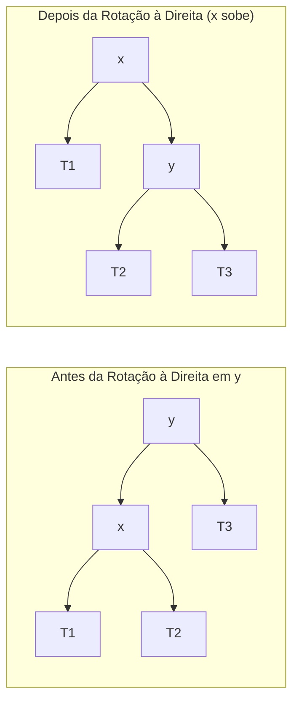

## Passo 1 · Leitura · Árvores AVL, Rubro-Negras, B-Trees e Tries (árvores de prefixos)

Na Lição 2 vimos que uma Árvore de Busca Binária (BST) comum degenera em uma lista ligada de altura $O(n)$ quando recebe chaves ordenadas. As **árvores de busca autobalanceadas** garantem que a altura permaneça **$O(\log n)$ no pior caso**, mantendo busca, inserção e remoção sempre logarítmicas!

#### 1. Árvores AVL: Fator de Balanceamento e Rotações em $O(1)$

Criada por Adelson-Velsky e Landis (1962), uma **árvore AVL** é uma BST em que, para **todo** nó `x`, a diferença entre as alturas das subárvores esquerda e direita — chamada **fator de balanceamento** $\text{fb}(x)$ — está sempre em $\{-1, 0, +1\}$:
$$\text{fb}(x) = \text{altura}(x.\text{esq}) - \text{altura}(x.\text{dir}) \in \{-1, 0, +1\}$$
Essa invariante garante que a altura de uma AVL com $n$ nós nunca ultrapasse $1{,}44 \log_2(n + 2)$.

Quando uma inserção faz $|\text{fb}(z)| = 2$ em algum ancestral $z$, restauramos o equilíbrio em **$O(1)$** usando **rotações locais de ponteiros** que preservam perfeitamente a ordem em-ordem da BST!



Existem **4 casos** de desbalanceamento no nó $z$:
1. **Esquerda-Esquerda (LL)** ($\text{fb}(z) > 1$ e $\text{fb}(z.\text{esq}) \ge 0$): **Rotação simples à direita** em $z$.
2. **Direita-Direita (RR)** ($\text{fb}(z) < -1$ e $\text{fb}(z.\text{dir}) \le 0$): **Rotação simples à esquerda** em $z$.
3. **Esquerda-Direita (LR)** ($\text{fb}(z) > 1$ e $\text{fb}(z.\text{esq}) < 0$): **Rotação dupla** — rotação à esquerda em $z.\text{esq}$, seguida de rotação à direita em $z$.
4. **Direita-Esquerda (RL)** ($\text{fb}(z) < -1$ e $\text{fb}(z.\text{dir}) > 0$): **Rotação dupla** — rotação à direita em $z.\text{dir}$, seguida de rotação à esquerda em $z$.

> **Regra crítica ao rotacionar**: na rotação à direita em `y` (onde `x = y.esq` sobe para o lugar de `y`), o nó `y` passou a ser **filho** de `x`. Portanto, é obrigatório atualizar **primeiro a altura de `y`** e **só depois a altura de `x`**!

#### 2. Onde entram Árvores Rubro-Negras e B-Trees?

- **Árvores Rubro-Negras (*Red-Black Trees*)**: colorem cada nó de vermelho ou preto de modo que nenhum caminho da raiz a uma folha seja mais que o dobro de outro ($h \le 2 \log_2(n+1)$). Fazem no máximo 2 rotações por inserção — usadas em `std::map` do C++ e `TreeMap` do Java.
- **B-Trees e B+Trees**: em vez de 1 chave e 2 filhos por nó, cada nó armazena **centenas de chaves ordenadas** (ex.: fator de ramificação $B = 512$), cabendo exatamente em uma página de disco/SSD de $4\text{ KB}$ ou $16\text{ KB}$. Com apenas $3$ níveis de altura, uma B-Tree indexa **mais de 100 milhões de registros** com apenas 3 leituras de disco! É a estrutura padrão de índices do PostgreSQL, MySQL/InnoDB, SQLite e sistemas de arquivos (NTFS, ext4, APFS).

#### 3. Trie (Árvore de Prefixos)

Quando as chaves são **strings** (palavras, URLs, CEPs) e queremos buscar por **prefixo** ou oferecer **autocompletar**, nem tabelas hash nem BSTs são ideais. Uma **Trie** (*retrieval tree*) representa cada caractere como uma aresta a partir da raiz:
- Cada `NoTrie` possui `filhos: dict[str, NoTrie]` e um booleano `fim_de_palavra: bool`.
- Inserir ou buscar uma palavra de comprimento $L$ custa **$O(L)$**, independentemente de quantas milhões de palavras existam no dicionário!
- Para `autocompletar(prefixo, k)`, caminhamos pelos caracteres de `prefixo` em $O(|\text{prefixo}|)$ até o nó `sub` e fazemos uma busca em profundidade (percorrendo `sorted(no.filhos)` em ordem alfabética) para coletar as primeiras `k` palavras completas!

## Passo 2 · Exercício · Rotações e inserção em árvore `AVL`

Implemente as rotações `rotacao_direita(y)` e `rotacao_esquerda(x)` e a classe `AVL` com inserção autobalanceada, verificando que inserir $2\,000$ chaves em ordem estritamente crescente mantém altura $\le 15$ (em vez de $1\,999$!).

### Instruções

1. Use `NoAVL(valor)` com atributos `valor`, `esq = None`, `dir = None` e `altura = 0` (convenção: `altura_no(None) == -1` e folha tem `altura == 0`). Implemente `altura_no(no)`, `atualizar_altura(no)` e `fator_balanceamento(no)`.
2. Implemente `rotacao_direita(y: NoAVL) -> NoAVL` e `rotacao_esquerda(x: NoAVL) -> NoAVL`, atualizando as alturas dos nós envolvidos na ordem correta (filho primeiro, nova raiz depois) e devolvendo a nova raiz da subárvore.
3. Na classe `AVL`, implemente `inserir(valor) -> None` tratando os 4 casos (LL, RR, LR, RL) após a inserção recursiva (ignore chaves duplicadas) e `em_ordem() -> list`.

### Código inicial

```python
class NoAVL:
    def __init__(self, valor):
        self.valor = valor
        self.esq: NoAVL | None = None
        self.dir: NoAVL | None = None
        self.altura: int = 0


def altura_no(no: NoAVL | None) -> int:
    return -1 if no is None else no.altura


def atualizar_altura(no: NoAVL) -> None:
    no.altura = 1 + max(altura_no(no.esq), altura_no(no.dir))


def fator_balanceamento(no: NoAVL | None) -> int:
    if no is None:
        return 0
    return altura_no(no.esq) - altura_no(no.dir)


def rotacao_direita(y: NoAVL) -> NoAVL:
    pass


def rotacao_esquerda(x: NoAVL) -> NoAVL:
    pass


class AVL:
    def __init__(self):
        self.raiz: NoAVL | None = None

    def inserir(self, valor) -> None:
        pass

    def altura(self) -> int:
        return altura_no(self.raiz)

    def em_ordem(self) -> list:
        pass
```

### Solução

```python
class NoAVL:
    def __init__(self, valor):
        self.valor = valor
        self.esq: NoAVL | None = None
        self.dir: NoAVL | None = None
        self.altura: int = 0


def altura_no(no: NoAVL | None) -> int:
    return -1 if no is None else no.altura


def atualizar_altura(no: NoAVL) -> None:
    no.altura = 1 + max(altura_no(no.esq), altura_no(no.dir))


def fator_balanceamento(no: NoAVL | None) -> int:
    if no is None:
        return 0
    return altura_no(no.esq) - altura_no(no.dir)


def rotacao_direita(y: NoAVL) -> NoAVL:
    x = y.esq
    t2 = x.dir
    x.dir = y
    y.esq = t2
    atualizar_altura(y)
    atualizar_altura(x)
    return x


def rotacao_esquerda(x: NoAVL) -> NoAVL:
    y = x.dir
    t2 = y.esq
    y.esq = x
    x.dir = t2
    atualizar_altura(x)
    atualizar_altura(y)
    return y


class AVL:
    def __init__(self):
        self.raiz: NoAVL | None = None

    def inserir(self, valor) -> None:
        def _ins(no: NoAVL | None, v) -> NoAVL:
            if no is None:
                return NoAVL(v)
            if v < no.valor:
                no.esq = _ins(no.esq, v)
            elif v > no.valor:
                no.dir = _ins(no.dir, v)
            else:
                return no

            atualizar_altura(no)
            fb = fator_balanceamento(no)

            if fb > 1 and v < no.esq.valor:
                return rotacao_direita(no)
            if fb < -1 and v > no.dir.valor:
                return rotacao_esquerda(no)
            if fb > 1 and v > no.esq.valor:
                no.esq = rotacao_esquerda(no.esq)
                return rotacao_direita(no)
            if fb < -1 and v < no.dir.valor:
                no.dir = rotacao_direita(no.dir)
                return rotacao_esquerda(no)

            return no

        self.raiz = _ins(self.raiz, valor)

    def altura(self) -> int:
        return altura_no(self.raiz)

    def em_ordem(self) -> list:
        res = []

        def _em(no: NoAVL | None):
            if no is not None:
                _em(no.esq)
                res.append(no.valor)
                _em(no.dir)

        _em(self.raiz)
        return res
```

### Dicas

1. Em `rotacao_direita(y)`, seja `x = y.esq` e `t2 = x.dir`. Faça `x.dir = y` e `y.esq = t2`, chame `atualizar_altura(y)` **antes** de `atualizar_altura(x)` e devolva `x`.
2. Em `rotacao_esquerda(x)`, seja `y = x.dir` e `t2 = y.esq`. Faça `y.esq = x` e `x.dir = t2`, chame `atualizar_altura(x)` **antes** de `atualizar_altura(y)` e devolva `y`.
3. Nos casos duplos (LR e RL), rotacione primeiro o filho (`no.esq = rotacao_esquerda(no.esq)` no caso LR; `no.dir = rotacao_direita(no.dir)` no caso RL) e depois rotacione `no`.

### Verificação

```json
[
  {
    "id": "avl-quatro-rotacoes",
    "name": "Trata casos LL, RR, LR e RL mantendo faktor de balanceamento em {-1, 0, 1}",
    "checkpoint": 2,
    "kind": "expr",
    "setup": "a = AVL()\nfor v in [30, 10, 20, 40, 50, 45]:\n    a.inserir(v)",
    "expr": "(a.em_ordem(), a.raiz.valor, a.altura(), abs(fator_balanceamento(a.raiz)) <= 1)",
    "expected": [[10, 20, 30, 40, 45, 50], 40, 2, true]
  },
  {
    "id": "avl-insercao-ordenada-log",
    "name": "Inserir 2.000 chaves ordenadas mantém altura logarítmica (<= 14)",
    "checkpoint": 3,
    "kind": "expr",
    "setup": "a = AVL()\nfor i in range(2000):\n    a.inserir(i)",
    "expr": "(a.altura() <= 14, len(a.em_ordem()), a.em_ordem()[:4], a.em_ordem()[-2:])",
    "expected": [true, 2000, [0, 1, 2, 3], [1998, 1999]]
  }
]
```

### Soluções erradas

```python name="Atualiza a altura da nova raiz antes da altura do nó que desceu na rotação"
class NoAVL:
    def __init__(self, valor):
        self.valor = valor
        self.esq: NoAVL | None = None
        self.dir: NoAVL | None = None
        self.altura: int = 0


def altura_no(no: NoAVL | None) -> int:
    return -1 if no is None else no.altura


def atualizar_altura(no: NoAVL) -> None:
    no.altura = 1 + max(altura_no(no.esq), altura_no(no.dir))


def fator_balanceamento(no: NoAVL | None) -> int:
    return 0 if no is None else altura_no(no.esq) - altura_no(no.dir)


def rotacao_direita(y: NoAVL) -> NoAVL:
    x = y.esq
    y.esq = x.dir
    x.dir = y
    atualizar_altura(x)
    return x


def rotacao_esquerda(x: NoAVL) -> NoAVL:
    y = x.dir
    x.dir = y.esq
    y.esq = x
    atualizar_altura(y)
    return y


class AVL:
    def __init__(self):
        self.raiz: NoAVL | None = None

    def inserir(self, valor) -> None:
        def _ins(no: NoAVL | None, v) -> NoAVL:
            if no is None:
                return NoAVL(v)
            if v < no.valor:
                no.esq = _ins(no.esq, v)
            elif v > no.valor:
                no.dir = _ins(no.dir, v)
            return no

        self.raiz = _ins(self.raiz, valor)

    def altura(self) -> int:
        return altura_no(self.raiz)

    def em_ordem(self) -> list:
        res = []

        def _em(no):
            if no:
                _em(no.esq)
                res.append(no.valor)
                _em(no.dir)

        _em(self.raiz)
        return res
```

```python name="Aplica rotação simples nos casos LR e RL sem rotacionar o filho primeiro"
class NoAVL:
    def __init__(self, valor):
        self.valor = valor
        self.esq: NoAVL | None = None
        self.dir: NoAVL | None = None
        self.altura: int = 0


def altura_no(no: NoAVL | None) -> int:
    return -1 if no is None else no.altura


def atualizar_altura(no: NoAVL) -> None:
    no.altura = 1 + max(altura_no(no.esq), altura_no(no.dir))


def fator_balanceamento(no: NoAVL | None) -> int:
    return 0 if no is None else altura_no(no.esq) - altura_no(no.dir)


def rotacao_direita(y: NoAVL) -> NoAVL:
    x = y.esq
    t2 = x.dir
    x.dir = y
    y.esq = t2
    atualizar_altura(y)
    atualizar_altura(x)
    return x


def rotacao_esquerda(x: NoAVL) -> NoAVL:
    y = x.dir
    t2 = y.esq
    y.esq = x
    x.dir = t2
    atualizar_altura(x)
    atualizar_altura(y)
    return y


class AVL:
    def __init__(self):
        self.raiz: NoAVL | None = None

    def inserir(self, valor) -> None:
        def _ins(no: NoAVL | None, v) -> NoAVL:
            if no is None:
                return NoAVL(v)
            if v < no.valor:
                no.esq = _ins(no.esq, v)
            elif v > no.valor:
                no.dir = _ins(no.dir, v)
            else:
                return no
            atualizar_altura(no)
            fb = fator_balanceamento(no)
            if fb > 1:
                return rotacao_direita(no)
            if fb < -1:
                return rotacao_esquerda(no)
            return no

        self.raiz = _ins(self.raiz, valor)

    def altura(self) -> int:
        return altura_no(self.raiz)

    def em_ordem(self) -> list:
        res = []

        def _em(no):
            if no:
                _em(no.esq)
                res.append(no.valor)
                _em(no.dir)

        _em(self.raiz)
        return res
```

## Passo 3 · Exercício · Árvore de prefixos (`Trie`) e sistema de autocompletar

Implemente a classe `Trie` com `inserir`, `contem` e `com_prefixo`, e a função `autocompletar(trie, prefixo, k)` que devolve até `k` palavras em ordem alfabética que começam com `prefixo`.

### Instruções

1. Na classe `Trie`, inicialize `self.raiz = NoTrie()` (onde cada `NoTrie` tem `self.filhos = {}` e `self.fim_de_palavra = False`):
   - `inserir(palavra: str) -> None`: percorre caractere por caractere criando nós filhos se necessário e marca `atual.fim_de_palavra = True` no último nó.
   - `contem(palavra: str) -> bool`: devolve `True` somente se todos os caracteres existirem a partir da raiz **e** o nó final tiver `fim_de_palavra == True`.
   - `com_prefixo(prefixo: str) -> bool`: devolve `True` se o caminho de caracteres de `prefixo` existir na Trie (mesmo que não seja o fim de uma palavra completa).
2. Implemente `autocompletar(trie: Trie, prefixo: str, k: int) -> list[str]` que localiza o nó correspondente a `prefixo` (se não existir ou `k <= 0`, devolve `[]`) e percorre sua subárvore visitando os filhos em ordem alfabética (`sorted(no.filhos.keys())`) para devolver as primeiras até `k` palavras completas que iniciam com `prefixo`.

### Código inicial

```python
class NoTrie:
    def __init__(self):
        self.filhos: dict[str, NoTrie] = {}
        self.fim_de_palavra: bool = False


class Trie:
    def __init__(self):
        self.raiz = NoTrie()

    def inserir(self, palavra: str) -> None:
        pass

    def contem(self, palavra: str) -> bool:
        pass

    def com_prefixo(self, prefixo: str) -> bool:
        pass


def autocompletar(trie: Trie, prefixo: str, k: int) -> list[str]:
    pass
```

### Solução

```python
class NoTrie:
    def __init__(self):
        self.filhos: dict[str, NoTrie] = {}
        self.fim_de_palavra: bool = False


class Trie:
    def __init__(self):
        self.raiz = NoTrie()

    def _buscar_no(self, texto: str) -> NoTrie | None:
        atual = self.raiz
        for ch in texto:
            if ch not in atual.filhos:
                return None
            atual = atual.filhos[ch]
        return atual

    def inserir(self, palavra: str) -> None:
        atual = self.raiz
        for ch in palavra:
            if ch not in atual.filhos:
                atual.filhos[ch] = NoTrie()
            atual = atual.filhos[ch]
        atual.fim_de_palavra = True

    def contem(self, palavra: str) -> bool:
        no = self._buscar_no(palavra)
        return no is not None and no.fim_de_palavra

    def com_prefixo(self, prefixo: str) -> bool:
        return self._buscar_no(prefixo) is not None


def autocompletar(trie: Trie, prefixo: str, k: int) -> list[str]:
    if k <= 0:
        return []
    no_inicial = trie._buscar_no(prefixo) if hasattr(trie, "_buscar_no") else None
    if no_inicial is None:
        atual = trie.raiz
        for ch in prefixo:
            if ch not in atual.filhos:
                return []
            atual = atual.filhos[ch]
        no_inicial = atual

    resultados: list[str] = []

    def dfs(no: NoTrie, caminho: str) -> None:
        if len(resultados) >= k:
            return
        if no.fim_de_palavra:
            resultados.append(caminho)
            if len(resultados) >= k:
                return
        for ch in sorted(no.filhos.keys()):
            dfs(no.filhos[ch], caminho + ch)
            if len(resultados) >= k:
                return

    dfs(no_inicial, prefixo)
    return resultados
```

### Dicas

1. Crie um método auxiliar `_buscar_no(self, texto)` que caminha pelos caracteres de `texto` e devolve o `NoTrie` alcançado (ou `None` se algum caractere faltar). Assim, `com_prefixo` é `_buscar_no(prefixo) is not None`, e `contem` verifica também `no.fim_de_palavra`!
2. Em `autocompletar`, se o próprio `prefixo` já for uma palavra cadastrada (`no_inicial.fim_de_palavra == True`), ele deve ser o primeiro item de `resultados`.
3. Iterar por `for ch in sorted(no.filhos.keys()):` na DFS visita as palavras exatamente em ordem lexicográfica (alfabética), permitindo parar assim que `len(resultados) == k`.

### Verificação

```json
[
  {
    "id": "trie-contem-vs-prefixo",
    "name": "Distingue palavra completa (contem) de prefixo parcial (com_prefixo)",
    "checkpoint": 1,
    "kind": "expr",
    "setup": "t = Trie()\nfor p in ['python', 'pytest', 'py', 'programa', 'projeto']:\n    t.inserir(p)",
    "expr": "(t.contem('python'), t.contem('pyt'), t.com_prefixo('pyt'), t.contem('py'), t.com_prefixo('java'))",
    "expected": [true, false, true, true, false]
  },
  {
    "id": "trie-autocompletar-alfabetico",
    "name": "autocompletar devolve as k primeiras palavras com o prefixo em ordem alfabética",
    "checkpoint": 2,
    "kind": "expr",
    "setup": "t = Trie()\nfor p in ['carro', 'casa', 'casaco', 'casamento', 'carta', 'cachorro', 'banana']:\n    t.inserir(p)",
    "expr": "(autocompletar(t, 'cas', 2), autocompletar(t, 'ca', 4), autocompletar(t, 'xyz', 3))",
    "expected": [["casa", "casaco"], ["cachorro", "carro", "carta", "casa"], []]
  }
]
```

### Soluções erradas

```python name="Devolve True em contem() para qualquer prefixo sem checar fim_de_palavra"
class NoTrie:
    def __init__(self):
        self.filhos: dict[str, NoTrie] = {}
        self.fim_de_palavra: bool = False


class Trie:
    def __init__(self):
        self.raiz = NoTrie()

    def inserir(self, palavra: str) -> None:
        atual = self.raiz
        for ch in palavra:
            if ch not in atual.filhos:
                atual.filhos[ch] = NoTrie()
            atual = atual.filhos[ch]
        atual.fim_de_palavra = True

    def contem(self, palavra: str) -> bool:
        return self.com_prefixo(palavra)

    def com_prefixo(self, prefixo: str) -> bool:
        atual = self.raiz
        for ch in prefixo:
            if ch not in atual.filhos:
                return False
            atual = atual.filhos[ch]
        return True


def autocompletar(trie: Trie, prefixo: str, k: int) -> list[str]:
    return []
```

```python name="Não ordena as chaves dos filhos e ignora o limite k em autocompletar"
class NoTrie:
    def __init__(self):
        self.filhos: dict[str, NoTrie] = {}
        self.fim_de_palavra: bool = False


class Trie:
    def __init__(self):
        self.raiz = NoTrie()

    def inserir(self, palavra: str) -> None:
        atual = self.raiz
        for ch in palavra:
            if ch not in atual.filhos:
                atual.filhos[ch] = NoTrie()
            atual = atual.filhos[ch]
        atual.fim_de_palavra = True

    def contem(self, palavra: str) -> bool:
        atual = self.raiz
        for ch in palavra:
            if ch not in atual.filhos:
                return False
            atual = atual.filhos[ch]
        return atual.fim_de_palavra

    def com_prefixo(self, prefixo: str) -> bool:
        atual = self.raiz
        for ch in prefixo:
            if ch not in atual.filhos:
                return False
            atual = atual.filhos[ch]
        return True


def autocompletar(trie: Trie, prefixo: str, k: int) -> list[str]:
    atual = trie.raiz
    for ch in prefixo:
        if ch not in atual.filhos:
            return []
        atual = atual.filhos[ch]
    res = []

    def dfs(no, cam):
        if no.fim_de_palavra:
            res.append(cam)
        for ch, filho in no.filhos.items():
            dfs(filho, cam + ch)

    dfs(atual, prefixo)
    return res
```

## Passo 4 · Quiz · AVL, B-Trees e Tries

### Pergunta

Por que sistemas gerenciadores de bancos de dados relacionais (como PostgreSQL e SQLite) usam **B-Trees / B+Trees** (com centenas de chaves por nó) para seus índices em disco em vez de árvores binárias autobalanceadas como AVL ou Rubro-Negras?

- [ ] Porque árvores AVL não permitem chaves repetidas nem strings.
- [x] Porque leituras de disco/SSD operam em blocos (páginas de $4\text{ KB}$ a $16\text{ KB}$): um nó de B-Tree preenche um bloco inteiro e tem fator de ramificação alto ($B \approx 500$), reduzindo a altura da árvore para $3$ ou $4$ acessos a disco mesmo para centenas de milhões de registros.
- [ ] Porque a B-Tree tem custo de busca $O(1)$ independente de $n$.
- [ ] Porque árvores binárias não podem ser salvas em arquivos.

> Em memória secundária, o gargalo é o número de leituras de páginas (*I/O operations*). Aumentar a base do logaritmo de $2$ (AVL) para $500$ (B-Tree) reduz $\log_2(10^8) \approx 27$ saltos aleatórios para $\log_{500}(10^8) \approx 3$ leituras de página!

### Pergunta

Se inserirmos as palavras `"casa"` e `"casaco"` em uma `Trie`, quantos nós ao longos do caminho de `"casaco"` terão `fim_de_palavra == True`, e por que esse atributo booleano é necessário?

- [ ] Apenas o último nó (`'o'`), porque `"casa"` é sobrescrita por `"casaco"`.
- [x] Dois nós (o segundo `'a'` de `"casa"` e o `'o'` final de `"casaco"`), pois sem `fim_de_palavra` seria impossível saber se um prefixo intermediário como `"cas"` ou `"casa"` também foi inserido como palavra completa ou é apenas caminho para palavras maiores.
- [ ] Todos os 6 nós terão `fim_de_palavra == True`.
- [ ] Nenhum nó interno pode ter `fim_de_palavra == True`; apenas folhas podem.

> Como `"casa"` é prefixo próprio de `"casaco"`, o nó correspondente ao segundo `'a'` possui o filho `'c'`, não sendo uma folha. A flag `fim_de_palavra = True` é o que distingue `"casa"` (palavra válida) de `"cas"` (apenas prefixo).
