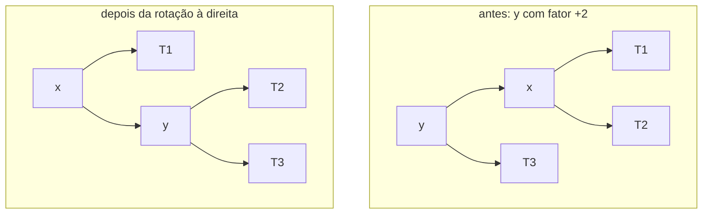
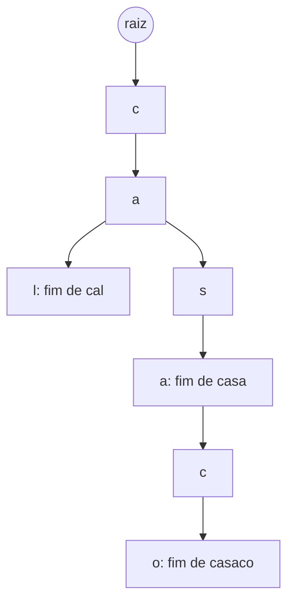

## Passo 1 · Leitura · Fator de balanceamento e rotações

Na lição de BST, chaves inseridas em ordem formaram uma corrente, e cada busca virou uma busca linear. Uma **árvore AVL** (Adelson-Velsky e Landis, 1962) é uma BST que se conserta a cada inserção. Cada nó guarda a própria altura, com a convenção da primeira lição (−1 para a árvore vazia, 0 para a folha), e **todo** nó obedece a

$$
\text{fb}(x) = \text{altura}(x.\text{esq}) - \text{altura}(x.\text{dir}) \in \{-1, 0, +1\} .
$$

Essa regra local garante uma altura global pequena. A AVL mais magra de altura $h$ tem uma subárvore de altura $h-1$ e outra de $h-2$; o número mínimo de nós cresce como a sequência de Fibonacci, e a altura fica abaixo de $1{,}44 \log_2(n+2)$. Com um milhão de chaves inseridas em ordem, a BST comum chega à altura 999 999; a AVL, a no máximo 28.

Quando uma inserção deixa um nó com fator $+2$ ou $-2$, uma **rotação** o conserta em $O(1)$, mudando dois ponteiros. Na rotação à direita em `y`, o filho esquerdo `x` sobe, `y` desce para a direita de `x`, e a subárvore do meio, `T2`, que era `x.dir`, passa a ser `y.esq`:



A em-ordem continua `T1, x, T2, y, T3`: `T2` estava entre `x` e `y` e continua entre eles, por isso a árvore segue sendo uma BST. A rotação à esquerda é o espelho. Só as alturas de `x` e de `y` mudam, porque as subárvores `T1`, `T2` e `T3` não foram mexidas por dentro.

Os erros de quem escreve a rotação pela primeira vez:

- esvaziar `y.esq` em vez de pendurar `T2` nele: a subárvore do meio some da árvore;
- atualizar a altura de `x` antes da de `y`: agora `x` é pai de `y`, e a altura dele depende da altura **nova** de `y`;
- atualizar só a nova raiz: `y` fica com a altura de quando estava em cima;
- devolver `y`: quem chamou continua apontando para `y`, que desceu um nível, e `x` some.

## Passo 2 · Exercício · Rotações
modo: lacunas

Complete as lacunas (`___`). `NoAVL` guarda `valor`, `esq`, `dir` e `altura`; `atualizar_altura` recalcula a altura de um nó a partir das alturas dos filhos.

### Instruções
1. Em `altura_no`, a árvore vazia tem altura −1, para que uma folha tenha altura 0.
2. Em `rotacao_direita`, a subárvore do meio troca de pai, as alturas são atualizadas de baixo para cima e a função devolve a nova raiz.
3. Faça o mesmo, espelhado, em `rotacao_esquerda`.

### Código inicial
```python
class NoAVL:
    def __init__(self, valor):
        self.valor = valor
        self.esq = None
        self.dir = None
        self.altura = 0


def altura_no(no):
    return ___ if no is None else no.altura


def atualizar_altura(no):
    no.altura = 1 + max(altura_no(no.esq), altura_no(no.dir))


def fator_balanceamento(no):
    return altura_no(no.esq) - altura_no(no.dir)


def rotacao_direita(y):
    x = y.esq
    y.esq = ___
    x.dir = y
    atualizar_altura(___)
    atualizar_altura(___)
    return ___


def rotacao_esquerda(x):
    y = x.dir
    x.dir = ___
    y.esq = x
    atualizar_altura(___)
    atualizar_altura(___)
    return ___
```

### Solução
```python
class NoAVL:
    def __init__(self, valor):
        self.valor = valor
        self.esq = None
        self.dir = None
        self.altura = 0


def altura_no(no):
    return -1 if no is None else no.altura


def atualizar_altura(no):
    no.altura = 1 + max(altura_no(no.esq), altura_no(no.dir))


def fator_balanceamento(no):
    return altura_no(no.esq) - altura_no(no.dir)


def rotacao_direita(y):
    x = y.esq
    y.esq = x.dir
    x.dir = y
    atualizar_altura(y)
    atualizar_altura(x)
    return x


def rotacao_esquerda(x):
    y = x.dir
    x.dir = y.esq
    y.esq = x
    atualizar_altura(x)
    atualizar_altura(y)
    return y
```

### Dicas
1. Uma folha tem altura `1 + max(?, ?)`: escolha o valor da vazia para isso dar 0.
2. Antes de `x.dir = y`, o filho direito de `x` ainda está lá: ele é a subárvore do meio.
3. Quem desce vira filho de quem sobe; a altura do pai depende da do filho.

### Verificação
```json
[
  { "id": "alturas", "checkpoint": 1, "kind": "expr",
    "setup": "def _f(v, e=None, d=None):\n    n = NoAVL(v)\n    n.esq = e\n    n.dir = d\n    atualizar_altura(n)\n    return n",
    "expr": "[altura_no(None), altura_no(_f(5)), altura_no(_f(5, _f(3))), fator_balanceamento(_f(5, _f(3, _f(1))))]",
    "expected": [-1, 0, 1, 2], "name": "Vazia, folha, um filho e uma corrente de três nós", "hint": "A altura conta arestas." },
  { "id": "dir-simples", "checkpoint": 2, "kind": "expr",
    "setup": "def _f(v, e=None, d=None):\n    n = NoAVL(v)\n    n.esq = e\n    n.dir = d\n    atualizar_altura(n)\n    return n\ndef _forma(n):\n    return None if n is None else [n.valor, n.altura, _forma(n.esq), _forma(n.dir)]\nr = rotacao_direita(_f(30, _f(20, _f(10))))",
    "expr": "_forma(r)", "expected": [20, 1, [10, 0, null, null], [30, 0, null, null]],
    "name": "Corrente 30-20-10 vira 20 com dois filhos", "hint": "Confira também as alturas: o 30 desceu e virou folha." },
  { "id": "dir-meio", "checkpoint": 2, "kind": "expr",
    "setup": "def _f(v, e=None, d=None):\n    n = NoAVL(v)\n    n.esq = e\n    n.dir = d\n    atualizar_altura(n)\n    return n\ndef _forma(n):\n    return None if n is None else [n.valor, n.altura, _forma(n.esq), _forma(n.dir)]\nr = rotacao_direita(_f(50, _f(30, _f(20, _f(10)), _f(40)), _f(60)))",
    "expr": "_forma(r)", "expected": [30, 2, [20, 1, [10, 0, null, null], null], [50, 1, [40, 0, null, null], [60, 0, null, null]]],
    "name": "A subárvore do meio (40) passa para a esquerda do 50", "hint": "O filho direito de x vira o filho esquerdo de y." },
  { "id": "dir-identidade", "checkpoint": 2, "kind": "expr",
    "setup": "def _f(v, e=None, d=None):\n    n = NoAVL(v)\n    n.esq = e\n    n.dir = d\n    atualizar_altura(n)\n    return n\ny = _f(50, _f(30, _f(20), _f(40)))\nx = y.esq\nr = rotacao_direita(y)",
    "expr": "[r is x, r.dir is y, y.esq.valor, y.altura, x.altura]", "expected": [true, true, 40, 1, 2],
    "name": "Devolve o próprio filho esquerdo, agora pai de y", "hint": "Quem chamou precisa receber a nova raiz da subárvore." },
  { "id": "esq-simples", "checkpoint": 3, "kind": "expr",
    "setup": "def _f(v, e=None, d=None):\n    n = NoAVL(v)\n    n.esq = e\n    n.dir = d\n    atualizar_altura(n)\n    return n\ndef _forma(n):\n    return None if n is None else [n.valor, n.altura, _forma(n.esq), _forma(n.dir)]\nr = rotacao_esquerda(_f(10, None, _f(20, None, _f(30))))",
    "expr": "_forma(r)", "expected": [20, 1, [10, 0, null, null], [30, 0, null, null]], "name": "Corrente 10-20-30 vira 20 com dois filhos" },
  { "id": "esq-meio", "checkpoint": 3, "kind": "expr",
    "setup": "def _f(v, e=None, d=None):\n    n = NoAVL(v)\n    n.esq = e\n    n.dir = d\n    atualizar_altura(n)\n    return n\ndef _forma(n):\n    return None if n is None else [n.valor, n.altura, _forma(n.esq), _forma(n.dir)]\nr = rotacao_esquerda(_f(10, _f(5), _f(30, _f(20), _f(40))))",
    "expr": "_forma(r)", "expected": [30, 2, [10, 1, [5, 0, null, null], [20, 0, null, null]], [40, 0, null, null]],
    "name": "A subárvore do meio (20) passa para a direita do 10" },
  { "id": "ida-e-volta", "checkpoint": 3, "kind": "expr",
    "setup": "def _f(v, e=None, d=None):\n    n = NoAVL(v)\n    n.esq = e\n    n.dir = d\n    atualizar_altura(n)\n    return n\ndef _forma(n):\n    return None if n is None else [n.valor, n.altura, _forma(n.esq), _forma(n.dir)]\ndef _em(n):\n    return [] if n is None else _em(n.esq) + [n.valor] + _em(n.dir)\nt = _f(8, _f(4, _f(2, _f(1), _f(3)), _f(6, _f(5), _f(7))), _f(12, _f(10, _f(9), _f(11)), _f(14, _f(13), _f(15))))\nantes = _forma(t)\nr1 = rotacao_esquerda(t)\nem1 = _em(r1)\nr2 = rotacao_direita(r1)",
    "expr": "[em1 == list(range(1, 16)), r1.valor, _forma(r2) == antes]", "expected": [true, 12, true],
    "name": "Rotação à esquerda e depois à direita: em-ordem preservada e árvore de volta ao original" }
]
```

### Soluções erradas
```python name="vazia com altura 0"
class NoAVL:
    def __init__(self, valor):
        self.valor = valor
        self.esq = None
        self.dir = None
        self.altura = 0


def altura_no(no):
    return 0 if no is None else no.altura


def atualizar_altura(no):
    no.altura = 1 + max(altura_no(no.esq), altura_no(no.dir))


def fator_balanceamento(no):
    return altura_no(no.esq) - altura_no(no.dir)


def rotacao_direita(y):
    x = y.esq
    y.esq = x.dir
    x.dir = y
    atualizar_altura(y)
    atualizar_altura(x)
    return x


def rotacao_esquerda(x):
    y = x.dir
    x.dir = y.esq
    y.esq = x
    atualizar_altura(x)
    atualizar_altura(y)
    return y
```
```python name="esvazia o lado em vez de pendurar a subárvore do meio"
class NoAVL:
    def __init__(self, valor):
        self.valor = valor
        self.esq = None
        self.dir = None
        self.altura = 0


def altura_no(no):
    return -1 if no is None else no.altura


def atualizar_altura(no):
    no.altura = 1 + max(altura_no(no.esq), altura_no(no.dir))


def fator_balanceamento(no):
    return altura_no(no.esq) - altura_no(no.dir)


def rotacao_direita(y):
    x = y.esq
    y.esq = None
    x.dir = y
    atualizar_altura(y)
    atualizar_altura(x)
    return x


def rotacao_esquerda(x):
    y = x.dir
    x.dir = None
    y.esq = x
    atualizar_altura(x)
    atualizar_altura(y)
    return y
```
```python name="atualiza a nova raiz antes do nó que desceu"
class NoAVL:
    def __init__(self, valor):
        self.valor = valor
        self.esq = None
        self.dir = None
        self.altura = 0


def altura_no(no):
    return -1 if no is None else no.altura


def atualizar_altura(no):
    no.altura = 1 + max(altura_no(no.esq), altura_no(no.dir))


def fator_balanceamento(no):
    return altura_no(no.esq) - altura_no(no.dir)


def rotacao_direita(y):
    x = y.esq
    y.esq = x.dir
    x.dir = y
    atualizar_altura(x)
    atualizar_altura(y)
    return x


def rotacao_esquerda(x):
    y = x.dir
    x.dir = y.esq
    y.esq = x
    atualizar_altura(y)
    atualizar_altura(x)
    return y
```
```python name="atualiza só a nova raiz"
class NoAVL:
    def __init__(self, valor):
        self.valor = valor
        self.esq = None
        self.dir = None
        self.altura = 0


def altura_no(no):
    return -1 if no is None else no.altura


def atualizar_altura(no):
    no.altura = 1 + max(altura_no(no.esq), altura_no(no.dir))


def fator_balanceamento(no):
    return altura_no(no.esq) - altura_no(no.dir)


def rotacao_direita(y):
    x = y.esq
    y.esq = x.dir
    x.dir = y
    atualizar_altura(x)
    atualizar_altura(x)
    return x


def rotacao_esquerda(x):
    y = x.dir
    x.dir = y.esq
    y.esq = x
    atualizar_altura(y)
    atualizar_altura(y)
    return y
```
```python name="devolve a raiz antiga"
class NoAVL:
    def __init__(self, valor):
        self.valor = valor
        self.esq = None
        self.dir = None
        self.altura = 0


def altura_no(no):
    return -1 if no is None else no.altura


def atualizar_altura(no):
    no.altura = 1 + max(altura_no(no.esq), altura_no(no.dir))


def fator_balanceamento(no):
    return altura_no(no.esq) - altura_no(no.dir)


def rotacao_direita(y):
    x = y.esq
    y.esq = x.dir
    x.dir = y
    atualizar_altura(y)
    atualizar_altura(x)
    return y


def rotacao_esquerda(x):
    y = x.dir
    x.dir = y.esq
    y.esq = x
    atualizar_altura(x)
    atualizar_altura(y)
    return x
```

## Passo 3 · Leitura · Os quatro casos da inserção

A inserção na AVL é a da BST com um passo a mais na volta da recursão: cada nó do caminho, de baixo para cima, atualiza a altura e confere o fator. O primeiro nó com fator $\pm 2$, chamado aqui de $z$, leva uma ou duas rotações, conforme o caminho até o nó novo:

| caso | o nó novo entrou | correção |
|---|---|---|
| esquerda-esquerda | à esquerda do filho esquerdo de $z$ | rotação à direita em $z$ |
| direita-direita | à direita do filho direito de $z$ | rotação à esquerda em $z$ |
| esquerda-direita | à direita do filho esquerdo de $z$ | à esquerda no filho, depois à direita em $z$ |
| direita-esquerda | à esquerda do filho direito de $z$ | à direita no filho, depois à esquerda em $z$ |

Não é preciso guardar o caminho: basta olhar o fator do filho mais alto de $z$. Se ele pende para o mesmo lado que $z$, ou está equilibrado, uma rotação simples resolve. Se pende para o lado oposto, o caminho faz zigue-zague e a rotação é dupla.

Por que a simples não basta no zigue-zague? Insira 10, 30 e 20: o 10 fica com fator −2 e o 30, seu filho alto, pende para a esquerda. Girar à esquerda no 10 sobe o 30, mas o 20, a subárvore do meio, vai para baixo do 10, e o 30 fica com fator +2. A primeira rotação, no filho, endireita a linha; a segunda equilibra.

```python visualizar
class No:
    def __init__(self, valor, esq=None, dir=None):
        self.valor = valor
        self.esq = esq
        self.dir = dir


def forma(no):
    if no is None:
        return "."
    if no.esq is None and no.dir is None:
        return str(no.valor)
    return f"{no.valor}({forma(no.esq)} {forma(no.dir)})"


def rot_dir(y):
    x = y.esq
    y.esq = x.dir
    x.dir = y
    return x


def rot_esq(x):
    y = x.dir
    x.dir = y.esq
    y.esq = x
    return y


raiz = No(10, None, No(30, No(20)))
print("inseridos 10, 30, 20:", forma(raiz))

so_uma = rot_esq(No(10, None, No(30, No(20))))
print("só à esquerda no 10: ", forma(so_uma))

raiz.dir = rot_dir(raiz.dir)
print("à direita no 30:     ", forma(raiz))
raiz = rot_esq(raiz)
print("à esquerda no 10:    ", forma(raiz))
```

Depois da correção, a subárvore de $z$ volta à altura de antes da inserção, e nenhum ancestral fica desequilibrado: no máximo uma rotação, simples ou dupla, por inserção, e custo total $O(\log n)$.

Três erros comuns:

- chamar `rotacao_esquerda(no.esq)` sem guardar o resultado em `no.esq`: o pai continua apontando para o nó que desceu;
- não atualizar a altura na volta: com as alturas paradas em 0, nenhum fator chega a 2;
- balancear só a raiz: o desequilíbrio aparece num nó do caminho, e é lá que precisa ser consertado.

## Passo 4 · Exercício · balancear e a classe AVL

Continue o seu código. Escreva `balancear(no)` e a classe `AVL`, com a raiz em `self.raiz`.

- `balancear(no)` recebe um nó cuja altura já foi atualizada e devolve a raiz da subárvore, rotacionando quando o fator for $+2$ ou $-2$.
- `AVL.inserir(valor)` insere como numa BST, ignorando valores repetidos, e balanceia cada nó do caminho na volta.
- `AVL.altura()` devolve a altura da árvore ($-1$ se vazia) e `AVL.em_ordem()`, a lista dos valores em ordem crescente.

### Instruções
1. Escreva `balancear`: rotação simples quando o filho alto pende para o mesmo lado do nó ou está equilibrado, e dupla quando pende para o lado oposto.
2. Escreva `AVL.inserir` recursiva: na volta, atualize a altura de cada nó do caminho e guarde o que `balancear` devolver.
3. Escreva `AVL.altura` e `AVL.em_ordem`.

### Solução
```python
class NoAVL:
    def __init__(self, valor):
        self.valor = valor
        self.esq = None
        self.dir = None
        self.altura = 0


def altura_no(no):
    return -1 if no is None else no.altura


def atualizar_altura(no):
    no.altura = 1 + max(altura_no(no.esq), altura_no(no.dir))


def fator_balanceamento(no):
    return altura_no(no.esq) - altura_no(no.dir)


def rotacao_direita(y):
    x = y.esq
    y.esq = x.dir
    x.dir = y
    atualizar_altura(y)
    atualizar_altura(x)
    return x


def rotacao_esquerda(x):
    y = x.dir
    x.dir = y.esq
    y.esq = x
    atualizar_altura(x)
    atualizar_altura(y)
    return y


def balancear(no):
    fb = fator_balanceamento(no)
    if fb > 1:
        if fator_balanceamento(no.esq) < 0:
            no.esq = rotacao_esquerda(no.esq)
        return rotacao_direita(no)
    if fb < -1:
        if fator_balanceamento(no.dir) > 0:
            no.dir = rotacao_direita(no.dir)
        return rotacao_esquerda(no)
    return no


class AVL:
    def __init__(self):
        self.raiz = None

    def inserir(self, valor):
        self.raiz = self._inserir(self.raiz, valor)

    def _inserir(self, no, valor):
        if no is None:
            return NoAVL(valor)
        if valor < no.valor:
            no.esq = self._inserir(no.esq, valor)
        elif valor > no.valor:
            no.dir = self._inserir(no.dir, valor)
        else:
            return no
        atualizar_altura(no)
        return balancear(no)

    def altura(self):
        return altura_no(self.raiz)

    def em_ordem(self):
        saida = []

        def visitar(no):
            if no is not None:
                visitar(no.esq)
                saida.append(no.valor)
                visitar(no.dir)

        visitar(self.raiz)
        return saida
```

### Dicas
1. O sinal do fator do filho alto diz para que lado ele pende; compare com o sinal do fator do nó.
2. Um método auxiliar `_inserir(no, valor)` que devolve a raiz da subárvore deixa a recursão igual à da BST.
3. A ordem na volta é: atualizar a altura, depois balancear.

### Verificação
```json
[
  { "id": "bal-ee", "checkpoint": 1, "kind": "expr",
    "setup": "def _f(v, e=None, d=None):\n    n = NoAVL(v)\n    n.esq = e\n    n.dir = d\n    atualizar_altura(n)\n    return n\ndef _forma(n):\n    return None if n is None else [n.valor, n.altura, _forma(n.esq), _forma(n.dir)]",
    "expr": "_forma(balancear(_f(30, _f(20, _f(10)))))", "expected": [20, 1, [10, 0, null, null], [30, 0, null, null]],
    "name": "Esquerda-esquerda: rotação à direita" },
  { "id": "bal-dd", "checkpoint": 1, "kind": "expr",
    "setup": "def _f(v, e=None, d=None):\n    n = NoAVL(v)\n    n.esq = e\n    n.dir = d\n    atualizar_altura(n)\n    return n\ndef _forma(n):\n    return None if n is None else [n.valor, n.altura, _forma(n.esq), _forma(n.dir)]",
    "expr": "_forma(balancear(_f(10, None, _f(20, None, _f(30)))))", "expected": [20, 1, [10, 0, null, null], [30, 0, null, null]],
    "name": "Direita-direita: rotação à esquerda" },
  { "id": "bal-ed", "checkpoint": 1, "kind": "expr",
    "setup": "def _f(v, e=None, d=None):\n    n = NoAVL(v)\n    n.esq = e\n    n.dir = d\n    atualizar_altura(n)\n    return n\ndef _forma(n):\n    return None if n is None else [n.valor, n.altura, _forma(n.esq), _forma(n.dir)]",
    "expr": "_forma(balancear(_f(30, _f(10, None, _f(20)))))", "expected": [20, 1, [10, 0, null, null], [30, 0, null, null]],
    "name": "Esquerda-direita: rotação dupla", "hint": "Uma rotação simples num zigue-zague só troca o lado do zigue-zague." },
  { "id": "bal-de", "checkpoint": 1, "kind": "expr",
    "setup": "def _f(v, e=None, d=None):\n    n = NoAVL(v)\n    n.esq = e\n    n.dir = d\n    atualizar_altura(n)\n    return n\ndef _forma(n):\n    return None if n is None else [n.valor, n.altura, _forma(n.esq), _forma(n.dir)]",
    "expr": "_forma(balancear(_f(10, None, _f(30, _f(20)))))", "expected": [20, 1, [10, 0, null, null], [30, 0, null, null]],
    "name": "Direita-esquerda: rotação dupla" },
  { "id": "bal-filho-equilibrado", "checkpoint": 1, "kind": "expr",
    "setup": "def _f(v, e=None, d=None):\n    n = NoAVL(v)\n    n.esq = e\n    n.dir = d\n    atualizar_altura(n)\n    return n\ndef _forma(n):\n    return None if n is None else [n.valor, n.altura, _forma(n.esq), _forma(n.dir)]",
    "expr": "_forma(balancear(_f(50, _f(30, _f(20), _f(40)))))", "expected": [30, 2, [20, 0, null, null], [50, 1, [40, 0, null, null], null]],
    "name": "Filho alto equilibrado: rotação simples", "hint": "A rotação dupla é só para o filho que pende para o lado oposto." },
  { "id": "bal-nada", "checkpoint": 1, "kind": "expr",
    "setup": "def _f(v, e=None, d=None):\n    n = NoAVL(v)\n    n.esq = e\n    n.dir = d\n    atualizar_altura(n)\n    return n\nz = _f(20, _f(10))\nr = balancear(z)",
    "expr": "[r is z, r.esq.valor, r.dir]", "expected": [true, 10, null], "name": "Nó com fator 1 volta intacto" },
  { "id": "vazia", "checkpoint": 3, "kind": "expr", "setup": "a = AVL()",
    "expr": "[a.raiz, a.altura(), a.em_ordem()]", "expected": [null, -1, []], "name": "AVL vazia" },
  { "id": "ins-casos", "checkpoint": 2, "kind": "expr",
    "setup": "def _pre(n):\n    return [] if n is None else [n.valor] + _pre(n.esq) + _pre(n.dir)\na = AVL()\nfor v in [30, 10, 20, 40, 50, 45]:\n    a.inserir(v)",
    "expr": "[_pre(a.raiz), a.altura(), a.em_ordem()]", "expected": [[40, 20, 10, 30, 50, 45], 2, [10, 20, 30, 40, 45, 50]],
    "name": "Seis inserções com uma rotação dupla, uma simples e outra dupla" },
  { "id": "ins-repetidos", "checkpoint": 2, "kind": "expr", "setup": "a = AVL()\nfor v in [5, 3, 8, 5, 3, 8, 5]:\n    a.inserir(v)",
    "expr": "[a.em_ordem(), a.altura()]", "expected": [[3, 5, 8], 1], "name": "Valores repetidos são ignorados" },
  { "id": "ins-crescente", "checkpoint": 2, "kind": "expr", "setup": "a = AVL()\nfor v in range(1023):\n    a.inserir(v)",
    "expr": "[a.altura(), a.em_ordem() == list(range(1023))]", "expected": [9, true],
    "name": "1023 chaves crescentes: altura 9", "hint": "O desequilíbrio aparece nos nós do caminho, não só na raiz." },
  { "id": "ins-decrescente", "checkpoint": 2, "kind": "expr", "setup": "a = AVL()\nfor v in range(1023, 0, -1):\n    a.inserir(v)",
    "expr": "[a.altura(), a.em_ordem() == list(range(1, 1024))]", "expected": [9, true], "name": "1023 chaves decrescentes: altura 9" },
  { "id": "ins-invariante", "checkpoint": 2, "kind": "expr",
    "setup": "def _ok(n):\n    if n is None:\n        return True, -1\n    a, ha = _ok(n.esq)\n    b, hb = _ok(n.dir)\n    h = 1 + max(ha, hb)\n    return a and b and abs(ha - hb) <= 1 and n.altura == h, h\na = AVL()\nfor i in range(2000):\n    a.inserir((i * 7919) % 2003)",
    "expr": "[_ok(a.raiz)[0], a.altura() <= 15, len(a.em_ordem())]", "expected": [true, true, 2000],
    "name": "2000 chaves embaralhadas: alturas guardadas corretas e todo fator em {-1, 0, 1}" },
  { "id": "ins-textos", "checkpoint": 3, "kind": "expr",
    "setup": "a = AVL()\nfor v in ['maio', 'abril', 'junho', 'janeiro', 'marco', 'fevereiro']:\n    a.inserir(v)",
    "expr": "[a.em_ordem(), a.altura()]", "expected": [["abril", "fevereiro", "janeiro", "junho", "maio", "marco"], 2],
    "name": "Funciona com textos" }
]
```

### Soluções erradas
```python name="rotação simples também no zigue-zague"
class NoAVL:
    def __init__(self, valor):
        self.valor = valor
        self.esq = None
        self.dir = None
        self.altura = 0


def altura_no(no):
    return -1 if no is None else no.altura


def atualizar_altura(no):
    no.altura = 1 + max(altura_no(no.esq), altura_no(no.dir))


def fator_balanceamento(no):
    return altura_no(no.esq) - altura_no(no.dir)


def rotacao_direita(y):
    x = y.esq
    y.esq = x.dir
    x.dir = y
    atualizar_altura(y)
    atualizar_altura(x)
    return x


def rotacao_esquerda(x):
    y = x.dir
    x.dir = y.esq
    y.esq = x
    atualizar_altura(x)
    atualizar_altura(y)
    return y


def balancear(no):
    fb = fator_balanceamento(no)
    if fb > 1:
        return rotacao_direita(no)
    if fb < -1:
        return rotacao_esquerda(no)
    return no


class AVL:
    def __init__(self):
        self.raiz = None

    def inserir(self, valor):
        self.raiz = self._inserir(self.raiz, valor)

    def _inserir(self, no, valor):
        if no is None:
            return NoAVL(valor)
        if valor < no.valor:
            no.esq = self._inserir(no.esq, valor)
        elif valor > no.valor:
            no.dir = self._inserir(no.dir, valor)
        else:
            return no
        atualizar_altura(no)
        return balancear(no)

    def altura(self):
        return altura_no(self.raiz)

    def em_ordem(self):
        saida = []

        def visitar(no):
            if no is not None:
                visitar(no.esq)
                saida.append(no.valor)
                visitar(no.dir)

        visitar(self.raiz)
        return saida
```
```python name="rotaciona o filho e descarta o resultado"
class NoAVL:
    def __init__(self, valor):
        self.valor = valor
        self.esq = None
        self.dir = None
        self.altura = 0


def altura_no(no):
    return -1 if no is None else no.altura


def atualizar_altura(no):
    no.altura = 1 + max(altura_no(no.esq), altura_no(no.dir))


def fator_balanceamento(no):
    return altura_no(no.esq) - altura_no(no.dir)


def rotacao_direita(y):
    x = y.esq
    y.esq = x.dir
    x.dir = y
    atualizar_altura(y)
    atualizar_altura(x)
    return x


def rotacao_esquerda(x):
    y = x.dir
    x.dir = y.esq
    y.esq = x
    atualizar_altura(x)
    atualizar_altura(y)
    return y


def balancear(no):
    fb = fator_balanceamento(no)
    if fb > 1:
        if fator_balanceamento(no.esq) < 0:
            rotacao_esquerda(no.esq)
        return rotacao_direita(no)
    if fb < -1:
        if fator_balanceamento(no.dir) > 0:
            rotacao_direita(no.dir)
        return rotacao_esquerda(no)
    return no


class AVL:
    def __init__(self):
        self.raiz = None

    def inserir(self, valor):
        self.raiz = self._inserir(self.raiz, valor)

    def _inserir(self, no, valor):
        if no is None:
            return NoAVL(valor)
        if valor < no.valor:
            no.esq = self._inserir(no.esq, valor)
        elif valor > no.valor:
            no.dir = self._inserir(no.dir, valor)
        else:
            return no
        atualizar_altura(no)
        return balancear(no)

    def altura(self):
        return altura_no(self.raiz)

    def em_ordem(self):
        saida = []

        def visitar(no):
            if no is not None:
                visitar(no.esq)
                saida.append(no.valor)
                visitar(no.dir)

        visitar(self.raiz)
        return saida
```
```python name="rotação dupla com o filho equilibrado"
class NoAVL:
    def __init__(self, valor):
        self.valor = valor
        self.esq = None
        self.dir = None
        self.altura = 0


def altura_no(no):
    return -1 if no is None else no.altura


def atualizar_altura(no):
    no.altura = 1 + max(altura_no(no.esq), altura_no(no.dir))


def fator_balanceamento(no):
    return altura_no(no.esq) - altura_no(no.dir)


def rotacao_direita(y):
    x = y.esq
    y.esq = x.dir
    x.dir = y
    atualizar_altura(y)
    atualizar_altura(x)
    return x


def rotacao_esquerda(x):
    y = x.dir
    x.dir = y.esq
    y.esq = x
    atualizar_altura(x)
    atualizar_altura(y)
    return y


def balancear(no):
    fb = fator_balanceamento(no)
    if fb > 1:
        if fator_balanceamento(no.esq) <= 0:
            no.esq = rotacao_esquerda(no.esq)
        return rotacao_direita(no)
    if fb < -1:
        if fator_balanceamento(no.dir) >= 0:
            no.dir = rotacao_direita(no.dir)
        return rotacao_esquerda(no)
    return no


class AVL:
    def __init__(self):
        self.raiz = None

    def inserir(self, valor):
        self.raiz = self._inserir(self.raiz, valor)

    def _inserir(self, no, valor):
        if no is None:
            return NoAVL(valor)
        if valor < no.valor:
            no.esq = self._inserir(no.esq, valor)
        elif valor > no.valor:
            no.dir = self._inserir(no.dir, valor)
        else:
            return no
        atualizar_altura(no)
        return balancear(no)

    def altura(self):
        return altura_no(self.raiz)

    def em_ordem(self):
        saida = []

        def visitar(no):
            if no is not None:
                visitar(no.esq)
                saida.append(no.valor)
                visitar(no.dir)

        visitar(self.raiz)
        return saida
```
```python name="não atualiza a altura na volta"
class NoAVL:
    def __init__(self, valor):
        self.valor = valor
        self.esq = None
        self.dir = None
        self.altura = 0


def altura_no(no):
    return -1 if no is None else no.altura


def atualizar_altura(no):
    no.altura = 1 + max(altura_no(no.esq), altura_no(no.dir))


def fator_balanceamento(no):
    return altura_no(no.esq) - altura_no(no.dir)


def rotacao_direita(y):
    x = y.esq
    y.esq = x.dir
    x.dir = y
    atualizar_altura(y)
    atualizar_altura(x)
    return x


def rotacao_esquerda(x):
    y = x.dir
    x.dir = y.esq
    y.esq = x
    atualizar_altura(x)
    atualizar_altura(y)
    return y


def balancear(no):
    fb = fator_balanceamento(no)
    if fb > 1:
        if fator_balanceamento(no.esq) < 0:
            no.esq = rotacao_esquerda(no.esq)
        return rotacao_direita(no)
    if fb < -1:
        if fator_balanceamento(no.dir) > 0:
            no.dir = rotacao_direita(no.dir)
        return rotacao_esquerda(no)
    return no


class AVL:
    def __init__(self):
        self.raiz = None

    def inserir(self, valor):
        self.raiz = self._inserir(self.raiz, valor)

    def _inserir(self, no, valor):
        if no is None:
            return NoAVL(valor)
        if valor < no.valor:
            no.esq = self._inserir(no.esq, valor)
        elif valor > no.valor:
            no.dir = self._inserir(no.dir, valor)
        else:
            return no
        return balancear(no)

    def altura(self):
        return altura_no(self.raiz)

    def em_ordem(self):
        saida = []

        def visitar(no):
            if no is not None:
                visitar(no.esq)
                saida.append(no.valor)
                visitar(no.dir)

        visitar(self.raiz)
        return saida
```
```python name="balanceia só a raiz"
class NoAVL:
    def __init__(self, valor):
        self.valor = valor
        self.esq = None
        self.dir = None
        self.altura = 0


def altura_no(no):
    return -1 if no is None else no.altura


def atualizar_altura(no):
    no.altura = 1 + max(altura_no(no.esq), altura_no(no.dir))


def fator_balanceamento(no):
    return altura_no(no.esq) - altura_no(no.dir)


def rotacao_direita(y):
    x = y.esq
    y.esq = x.dir
    x.dir = y
    atualizar_altura(y)
    atualizar_altura(x)
    return x


def rotacao_esquerda(x):
    y = x.dir
    x.dir = y.esq
    y.esq = x
    atualizar_altura(x)
    atualizar_altura(y)
    return y


def balancear(no):
    fb = fator_balanceamento(no)
    if fb > 1:
        if fator_balanceamento(no.esq) < 0:
            no.esq = rotacao_esquerda(no.esq)
        return rotacao_direita(no)
    if fb < -1:
        if fator_balanceamento(no.dir) > 0:
            no.dir = rotacao_direita(no.dir)
        return rotacao_esquerda(no)
    return no


class AVL:
    def __init__(self):
        self.raiz = None

    def inserir(self, valor):
        self.raiz = balancear(self._inserir(self.raiz, valor))

    def _inserir(self, no, valor):
        if no is None:
            return NoAVL(valor)
        if valor < no.valor:
            no.esq = self._inserir(no.esq, valor)
        elif valor > no.valor:
            no.dir = self._inserir(no.dir, valor)
        else:
            return no
        atualizar_altura(no)
        return no

    def altura(self):
        return altura_no(self.raiz)

    def em_ordem(self):
        saida = []

        def visitar(no):
            if no is not None:
                visitar(no.esq)
                saida.append(no.valor)
                visitar(no.dir)

        visitar(self.raiz)
        return saida
```
```python name="repetido vai para a direita"
class NoAVL:
    def __init__(self, valor):
        self.valor = valor
        self.esq = None
        self.dir = None
        self.altura = 0


def altura_no(no):
    return -1 if no is None else no.altura


def atualizar_altura(no):
    no.altura = 1 + max(altura_no(no.esq), altura_no(no.dir))


def fator_balanceamento(no):
    return altura_no(no.esq) - altura_no(no.dir)


def rotacao_direita(y):
    x = y.esq
    y.esq = x.dir
    x.dir = y
    atualizar_altura(y)
    atualizar_altura(x)
    return x


def rotacao_esquerda(x):
    y = x.dir
    x.dir = y.esq
    y.esq = x
    atualizar_altura(x)
    atualizar_altura(y)
    return y


def balancear(no):
    fb = fator_balanceamento(no)
    if fb > 1:
        if fator_balanceamento(no.esq) < 0:
            no.esq = rotacao_esquerda(no.esq)
        return rotacao_direita(no)
    if fb < -1:
        if fator_balanceamento(no.dir) > 0:
            no.dir = rotacao_direita(no.dir)
        return rotacao_esquerda(no)
    return no


class AVL:
    def __init__(self):
        self.raiz = None

    def inserir(self, valor):
        self.raiz = self._inserir(self.raiz, valor)

    def _inserir(self, no, valor):
        if no is None:
            return NoAVL(valor)
        if valor < no.valor:
            no.esq = self._inserir(no.esq, valor)
        else:
            no.dir = self._inserir(no.dir, valor)
        atualizar_altura(no)
        return balancear(no)

    def altura(self):
        return altura_no(self.raiz)

    def em_ordem(self):
        saida = []

        def visitar(no):
            if no is not None:
                visitar(no.esq)
                saida.append(no.valor)
                visitar(no.dir)

        visitar(self.raiz)
        return saida
```

## Passo 5 · Previsão · Sete inserções numa AVL

O programa insere sete valores numa AVL, com a mesma lógica que você escreveu, e imprime a pré-ordem depois de cada inserção. Leia sem executar e digite a saída exata.

### Código
```python
class No:
    def __init__(self, valor):
        self.valor = valor
        self.esq = None
        self.dir = None
        self.altura = 0

def alt(no):
    return -1 if no is None else no.altura

def atualizar(no):
    no.altura = 1 + max(alt(no.esq), alt(no.dir))

def rot_dir(y):
    x = y.esq
    y.esq = x.dir
    x.dir = y
    atualizar(y)
    atualizar(x)
    return x

def rot_esq(x):
    y = x.dir
    x.dir = y.esq
    y.esq = x
    atualizar(x)
    atualizar(y)
    return y

def inserir(no, v):
    if no is None:
        return No(v)
    if v < no.valor:
        no.esq = inserir(no.esq, v)
    else:
        no.dir = inserir(no.dir, v)
    atualizar(no)
    fb = alt(no.esq) - alt(no.dir)
    if fb > 1:
        if alt(no.esq.esq) < alt(no.esq.dir):
            no.esq = rot_esq(no.esq)
        return rot_dir(no)
    if fb < -1:
        if alt(no.dir.dir) < alt(no.dir.esq):
            no.dir = rot_dir(no.dir)
        return rot_esq(no)
    return no

def pre(no):
    return [] if no is None else [no.valor] + pre(no.esq) + pre(no.dir)

raiz = None
for v in [10, 20, 30, 25, 28, 5, 4]:
    raiz = inserir(raiz, v)
    print(v, pre(raiz))
```

### Dicas
1. Desenhe a árvore depois de cada inserção e anote a altura de cada nó; a pré-ordem é raiz, esquerda, direita.
2. Quando um nó passa a ter fator ±2, ele pode estar no meio da árvore, não só na raiz.
3. Para decidir entre rotação simples e dupla, veja para que lado pende o filho mais alto.

### Saída esperada
```text
10 [10]
20 [10, 20]
30 [20, 10, 30]
25 [20, 10, 30, 25]
28 [20, 10, 28, 25, 30]
5 [20, 10, 5, 28, 25, 30]
4 [20, 5, 4, 10, 28, 25, 30]
```

## Passo 6 · Leitura · Rubro-negras, B-trees e tries

A AVL não é a única forma de garantir altura $O(\log n)$. A **árvore rubro-negra** pinta cada nó de vermelho ou preto e exige que a raiz seja preta, que nenhum nó vermelho tenha filho vermelho e que todo caminho da raiz até um `None` passe pelo mesmo número de nós pretos. O caminho mais longo alterna vermelhos e pretos e tem no máximo o dobro do mais curto, então $h \le 2\log_2(n+1)$. É menos rígida que a AVL: a busca pode descer um pouco mais, mas a inserção faz no máximo duas rotações e o resto é trocar cores. Está no `TreeMap` do Java, no `std::map` das implementações comuns de C++ e no escalonador do Linux; a biblioteca padrão do Python não tem árvore balanceada.

Em disco, o que custa é **ler uma página** de 4 a 16 KB. Uma árvore binária com $10^8$ chaves tem altura de cerca de 27: até 27 leituras por busca. A **B-tree** põe centenas de chaves ordenadas em cada nó, do tamanho de uma página, com um filho entre cada par de chaves. Com 500 filhos por nó, três níveis alcançam $500^3 = 1{,}25 \times 10^8$ chaves. Todas as folhas ficam na mesma profundidade: quando um nó enche, ele se divide em dois e a chave do meio sobe para o pai. É a estrutura dos índices do PostgreSQL, do MySQL (InnoDB) e do SQLite, e de sistemas de arquivos como NTFS, Btrfs e APFS.

Quando as chaves são textos e a pergunta é "quais começam com `cas`?", hash e BST não ajudam: o hash espalha `casa` e `casaco` por compartimentos sem relação. A **trie** (árvore de prefixos) guarda um caractere por aresta. Cada nó tem um dicionário `filhos` e uma marca `fim_de_palavra`:



Inserir, buscar e achar o nó de um prefixo custam $O(L)$ para um texto de $L$ caracteres, quantas palavras houver. A marca é indispensável: com só `casaco` inserida, o caminho `c-a-s-a` existe, mas `casa` só é palavra se o nó do segundo `a` estiver marcado, inclusive quando `casa` entra depois de `casaco`. Para autocompletar, ande até o nó do prefixo e faça uma busca em profundidade com os filhos em ordem alfabética: as palavras saem em ordem, e dá para parar ao juntar $k$.

## Passo 7 · Exercício · Trie e autocompletar

Escreva a `Trie` com `NoTrie` (já pronto) e a função `autocompletar`.

- `inserir(palavra)`, `contem(palavra)` (só palavras inseridas) e `com_prefixo(prefixo)` (`True` se o caminho do prefixo existe na trie).
- `autocompletar(trie, prefixo, k)` devolve até `k` palavras que começam com `prefixo`, em ordem alfabética, incluindo o próprio prefixo se ele for uma palavra. Devolve `[]` se `k <= 0` ou se nenhuma palavra começar com o prefixo.

A verificação conta quantas vezes o atributo `filhos` é lido: numa trie de 1 000 palavras, autocompletar 3 palavras com o prefixo `j` pode ler no máximo 40 vezes.

### Instruções
1. Escreva `inserir`, criando só os nós que faltam e marcando o fim da palavra, mesmo que o caminho já existisse.
2. Escreva `contem` e `com_prefixo`, que andam pelos caracteres a partir da raiz.
3. Escreva `autocompletar`: ande até o nó do prefixo e visite a subárvore em ordem alfabética, parando assim que juntar `k` palavras.

### Código inicial
```python
class NoTrie:
    def __init__(self):
        self.filhos = {}
        self.fim_de_palavra = False


class Trie:
    def __init__(self):
        self.raiz = NoTrie()

    def inserir(self, palavra):
        pass

    def contem(self, palavra):
        pass

    def com_prefixo(self, prefixo):
        pass


def autocompletar(trie, prefixo, k):
    pass
```

### Solução
```python
class NoTrie:
    def __init__(self):
        self.filhos = {}
        self.fim_de_palavra = False


class Trie:
    def __init__(self):
        self.raiz = NoTrie()

    def _no(self, texto):
        atual = self.raiz
        for ch in texto:
            atual = atual.filhos.get(ch)
            if atual is None:
                return None
        return atual

    def inserir(self, palavra):
        atual = self.raiz
        for ch in palavra:
            if ch not in atual.filhos:
                atual.filhos[ch] = NoTrie()
            atual = atual.filhos[ch]
        atual.fim_de_palavra = True

    def contem(self, palavra):
        no = self._no(palavra)
        return no is not None and no.fim_de_palavra

    def com_prefixo(self, prefixo):
        return self._no(prefixo) is not None


def autocompletar(trie, prefixo, k):
    no = trie._no(prefixo)
    saida = []
    if no is None or k <= 0:
        return saida

    def visitar(no, palavra):
        if no.fim_de_palavra:
            saida.append(palavra)
        for ch in sorted(no.filhos):
            if len(saida) == k:
                return
            visitar(no.filhos[ch], palavra + ch)

    visitar(no, prefixo)
    return saida
```

### Dicas
1. Um método auxiliar que devolve o nó alcançado por um texto (ou `None`) serve a `contem`, `com_prefixo` e `autocompletar`.
2. O nó do prefixo pode ter `fim_de_palavra` ligado: confira antes de descer para os filhos.
3. Na busca em profundidade, confira se já juntou `k` palavras antes de visitar o próximo filho.

### Verificação
```json
[
  { "id": "estrutura", "checkpoint": 1, "kind": "expr", "setup": "t = Trie()\nfor p in ['ab', 'ac', 'abd']:\n    t.inserir(p)\na = t.raiz.filhos['a']",
    "expr": "[sorted(t.raiz.filhos), sorted(a.filhos), a.fim_de_palavra, a.filhos['b'].fim_de_palavra, a.filhos['b'].filhos['d'].fim_de_palavra]",
    "expected": [["a"], ["b", "c"], false, true, true], "name": "Um nó por caractere, marca só no fim de cada palavra",
    "hint": "O nó de um caractere do meio só é fim se uma palavra termina nele." },
  { "id": "palavra-dentro", "checkpoint": 1, "kind": "expr", "setup": "t = Trie()\nt.inserir('casaco')\nt.inserir('casa')",
    "expr": "[t.contem('casa'), t.contem('casaco'), t.contem('cas')]", "expected": [true, true, false],
    "name": "casa inserida depois de casaco", "hint": "Marcar o fim vale também quando o caminho já existia." },
  { "id": "contem", "checkpoint": 2, "kind": "expr",
    "setup": "t = Trie()\nfor p in ['python', 'pytest', 'py', 'programa', 'projeto']:\n    t.inserir(p)",
    "expr": "[t.contem('python'), t.contem('pyt'), t.contem('py'), t.contem('p'), t.contem('pythonista'), t.contem('')]",
    "expected": [true, false, true, false, false, false], "name": "contem aceita só palavras inseridas" },
  { "id": "prefixo", "checkpoint": 2, "kind": "expr",
    "setup": "t = Trie()\nfor p in ['python', 'pytest', 'py', 'programa', 'projeto']:\n    t.inserir(p)",
    "expr": "[t.com_prefixo('pyt'), t.com_prefixo('pro'), t.com_prefixo('python'), t.com_prefixo('java'), t.com_prefixo('pythonx'), t.com_prefixo('')]",
    "expected": [true, true, true, false, false, true], "name": "com_prefixo aceita qualquer começo de palavra" },
  { "id": "auto-k", "checkpoint": 3, "kind": "expr",
    "setup": "t = Trie()\nfor p in ['carro', 'casa', 'casaco', 'casamento', 'carta', 'cachorro', 'banana']:\n    t.inserir(p)",
    "expr": "[autocompletar(t, 'cas', 2), autocompletar(t, 'ca', 4)]", "expected": [["casa", "casaco"], ["cachorro", "carro", "carta", "casa"]],
    "name": "As k primeiras em ordem alfabética" },
  { "id": "auto-proprio", "checkpoint": 3, "kind": "expr",
    "setup": "t = Trie()\nfor p in ['carro', 'casa', 'casaco', 'casamento', 'carta', 'cachorro', 'banana']:\n    t.inserir(p)",
    "expr": "autocompletar(t, 'casa', 3)", "expected": ["casa", "casaco", "casamento"],
    "name": "O próprio prefixo entra quando é uma palavra", "hint": "O nó do prefixo também pode ser fim de palavra." },
  { "id": "auto-bordas", "checkpoint": 3, "kind": "expr",
    "setup": "t = Trie()\nfor p in ['carro', 'casa', 'casaco', 'casamento', 'carta', 'cachorro', 'banana']:\n    t.inserir(p)",
    "expr": "[autocompletar(t, 'xyz', 3), autocompletar(t, 'ca', 0), autocompletar(t, 'ca', -1), autocompletar(t, 'ba', 5), autocompletar(t, '', 3)]",
    "expected": [[], [], [], ["banana"], ["banana", "cachorro", "carro"]],
    "name": "Prefixo ausente, k zero ou negativo, k maior que o total e prefixo vazio" },
  { "id": "auto-ordem", "checkpoint": 3, "kind": "expr",
    "setup": "t = Trie()\nfor p in ['zebra', 'casa', 'abelha', 'cabo', 'abacate']:\n    t.inserir(p)",
    "expr": "[autocompletar(t, '', 5), autocompletar(t, 'ab', 1)]", "expected": [["abacate", "abelha", "cabo", "casa", "zebra"], ["abacate"]],
    "name": "A ordem alfabética não depende da ordem de inserção", "hint": "Um dict lembra a ordem em que as chaves entraram." },
  { "id": "auto-custo", "checkpoint": 3, "kind": "expr",
    "setup": "t = Trie()\nfor x in 'abcdefghij':\n    for y in 'abcdefghij':\n        for z in 'abcdefghij':\n            t.inserir(x + y + z)\nleituras = [0]\ndef _ler(self):\n    leituras[0] += 1\n    return self.__dict__['filhos']\ndef _gravar(self, v):\n    self.__dict__['filhos'] = v\nNoTrie.filhos = property(_ler, _gravar)\nleituras[0] = 0\nr = autocompletar(t, 'j', 3)",
    "expr": "[r, leituras[0] <= 40]", "expected": [["jaa", "jab", "jac"], true],
    "name": "3 sugestões numa trie de 1 000 palavras com no máximo 40 leituras de filhos",
    "hint": "Visite só a subárvore do prefixo e pare assim que juntar k palavras." }
]
```

### Soluções erradas
```python name="contem não confere o fim de palavra"
class NoTrie:
    def __init__(self):
        self.filhos = {}
        self.fim_de_palavra = False


class Trie:
    def __init__(self):
        self.raiz = NoTrie()

    def _no(self, texto):
        atual = self.raiz
        for ch in texto:
            atual = atual.filhos.get(ch)
            if atual is None:
                return None
        return atual

    def inserir(self, palavra):
        atual = self.raiz
        for ch in palavra:
            if ch not in atual.filhos:
                atual.filhos[ch] = NoTrie()
            atual = atual.filhos[ch]
        atual.fim_de_palavra = True

    def contem(self, palavra):
        return self._no(palavra) is not None

    def com_prefixo(self, prefixo):
        return self._no(prefixo) is not None


def autocompletar(trie, prefixo, k):
    no = trie._no(prefixo)
    saida = []
    if no is None or k <= 0:
        return saida

    def visitar(no, palavra):
        if no.fim_de_palavra:
            saida.append(palavra)
        for ch in sorted(no.filhos):
            if len(saida) == k:
                return
            visitar(no.filhos[ch], palavra + ch)

    visitar(no, prefixo)
    return saida
```
```python name="marca o fim só quando cria o nó"
class NoTrie:
    def __init__(self):
        self.filhos = {}
        self.fim_de_palavra = False


class Trie:
    def __init__(self):
        self.raiz = NoTrie()

    def _no(self, texto):
        atual = self.raiz
        for ch in texto:
            atual = atual.filhos.get(ch)
            if atual is None:
                return None
        return atual

    def inserir(self, palavra):
        atual = self.raiz
        criou = False
        for ch in palavra:
            if ch not in atual.filhos:
                atual.filhos[ch] = NoTrie()
                criou = True
            atual = atual.filhos[ch]
        if criou:
            atual.fim_de_palavra = True

    def contem(self, palavra):
        no = self._no(palavra)
        return no is not None and no.fim_de_palavra

    def com_prefixo(self, prefixo):
        return self._no(prefixo) is not None


def autocompletar(trie, prefixo, k):
    no = trie._no(prefixo)
    saida = []
    if no is None or k <= 0:
        return saida

    def visitar(no, palavra):
        if no.fim_de_palavra:
            saida.append(palavra)
        for ch in sorted(no.filhos):
            if len(saida) == k:
                return
            visitar(no.filhos[ch], palavra + ch)

    visitar(no, prefixo)
    return saida
```
```python name="marca fim de palavra em todo o caminho"
class NoTrie:
    def __init__(self):
        self.filhos = {}
        self.fim_de_palavra = False


class Trie:
    def __init__(self):
        self.raiz = NoTrie()

    def _no(self, texto):
        atual = self.raiz
        for ch in texto:
            atual = atual.filhos.get(ch)
            if atual is None:
                return None
        return atual

    def inserir(self, palavra):
        atual = self.raiz
        for ch in palavra:
            if ch not in atual.filhos:
                atual.filhos[ch] = NoTrie()
            atual = atual.filhos[ch]
            atual.fim_de_palavra = True

    def contem(self, palavra):
        no = self._no(palavra)
        return no is not None and no.fim_de_palavra

    def com_prefixo(self, prefixo):
        return self._no(prefixo) is not None


def autocompletar(trie, prefixo, k):
    no = trie._no(prefixo)
    saida = []
    if no is None or k <= 0:
        return saida

    def visitar(no, palavra):
        if no.fim_de_palavra:
            saida.append(palavra)
        for ch in sorted(no.filhos):
            if len(saida) == k:
                return
            visitar(no.filhos[ch], palavra + ch)

    visitar(no, prefixo)
    return saida
```
```python name="visita os filhos na ordem de inserção"
class NoTrie:
    def __init__(self):
        self.filhos = {}
        self.fim_de_palavra = False


class Trie:
    def __init__(self):
        self.raiz = NoTrie()

    def _no(self, texto):
        atual = self.raiz
        for ch in texto:
            atual = atual.filhos.get(ch)
            if atual is None:
                return None
        return atual

    def inserir(self, palavra):
        atual = self.raiz
        for ch in palavra:
            if ch not in atual.filhos:
                atual.filhos[ch] = NoTrie()
            atual = atual.filhos[ch]
        atual.fim_de_palavra = True

    def contem(self, palavra):
        no = self._no(palavra)
        return no is not None and no.fim_de_palavra

    def com_prefixo(self, prefixo):
        return self._no(prefixo) is not None


def autocompletar(trie, prefixo, k):
    no = trie._no(prefixo)
    saida = []
    if no is None or k <= 0:
        return saida

    def visitar(no, palavra):
        if no.fim_de_palavra:
            saida.append(palavra)
        for ch, filho in no.filhos.items():
            if len(saida) == k:
                return
            visitar(filho, palavra + ch)

    visitar(no, prefixo)
    return saida
```
```python name="junta todas e corta no fim"
class NoTrie:
    def __init__(self):
        self.filhos = {}
        self.fim_de_palavra = False


class Trie:
    def __init__(self):
        self.raiz = NoTrie()

    def _no(self, texto):
        atual = self.raiz
        for ch in texto:
            atual = atual.filhos.get(ch)
            if atual is None:
                return None
        return atual

    def inserir(self, palavra):
        atual = self.raiz
        for ch in palavra:
            if ch not in atual.filhos:
                atual.filhos[ch] = NoTrie()
            atual = atual.filhos[ch]
        atual.fim_de_palavra = True

    def contem(self, palavra):
        no = self._no(palavra)
        return no is not None and no.fim_de_palavra

    def com_prefixo(self, prefixo):
        return self._no(prefixo) is not None


def autocompletar(trie, prefixo, k):
    no = trie._no(prefixo)
    if no is None or k <= 0:
        return []
    todas = []

    def visitar(no, palavra):
        if no.fim_de_palavra:
            todas.append(palavra)
        for ch in no.filhos:
            visitar(no.filhos[ch], palavra + ch)

    visitar(no, prefixo)
    return sorted(todas)[:k]
```
```python name="varre a trie inteira e filtra com startswith"
class NoTrie:
    def __init__(self):
        self.filhos = {}
        self.fim_de_palavra = False


class Trie:
    def __init__(self):
        self.raiz = NoTrie()

    def _no(self, texto):
        atual = self.raiz
        for ch in texto:
            atual = atual.filhos.get(ch)
            if atual is None:
                return None
        return atual

    def inserir(self, palavra):
        atual = self.raiz
        for ch in palavra:
            if ch not in atual.filhos:
                atual.filhos[ch] = NoTrie()
            atual = atual.filhos[ch]
        atual.fim_de_palavra = True

    def contem(self, palavra):
        no = self._no(palavra)
        return no is not None and no.fim_de_palavra

    def com_prefixo(self, prefixo):
        return self._no(prefixo) is not None


def autocompletar(trie, prefixo, k):
    if k <= 0:
        return []
    saida = []

    def visitar(no, palavra):
        if no.fim_de_palavra and palavra.startswith(prefixo):
            saida.append(palavra)
        for ch in sorted(no.filhos):
            if len(saida) == k:
                return
            visitar(no.filhos[ch], palavra + ch)

    visitar(trie.raiz, "")
    return saida
```
```python name="esquece o próprio prefixo"
class NoTrie:
    def __init__(self):
        self.filhos = {}
        self.fim_de_palavra = False


class Trie:
    def __init__(self):
        self.raiz = NoTrie()

    def _no(self, texto):
        atual = self.raiz
        for ch in texto:
            atual = atual.filhos.get(ch)
            if atual is None:
                return None
        return atual

    def inserir(self, palavra):
        atual = self.raiz
        for ch in palavra:
            if ch not in atual.filhos:
                atual.filhos[ch] = NoTrie()
            atual = atual.filhos[ch]
        atual.fim_de_palavra = True

    def contem(self, palavra):
        no = self._no(palavra)
        return no is not None and no.fim_de_palavra

    def com_prefixo(self, prefixo):
        return self._no(prefixo) is not None


def autocompletar(trie, prefixo, k):
    no = trie._no(prefixo)
    saida = []
    if no is None or k <= 0:
        return saida

    def visitar(no, palavra):
        for ch in sorted(no.filhos):
            if len(saida) == k:
                return
            filho = no.filhos[ch]
            if filho.fim_de_palavra:
                saida.append(palavra + ch)
            visitar(filho, palavra + ch)

    visitar(no, prefixo)
    return saida
```

## Passo 8 · Quiz · Balancear, paginar e completar

### Pergunta
Uma AVL vazia recebe 10, 30 e 20, nessa ordem. Depois do 20, o nó 10 fica com fator −2. Um colega aplica só uma rotação à esquerda no 10. O que acontece?
- [ ] A árvore fica balanceada com raiz 30, porque a rotação à esquerda corrige qualquer fator −2
- [x] O 30 sobe com o 10 à esquerda e o 20 como filho direito do 10: o 30 fica com fator +2, e o zigue-zague só mudou de lado
- [ ] A árvore deixa de ser BST, porque o 20 vai parar à direita do 30
- [ ] A árvore fica com altura 2, que a AVL ainda aceita para 3 nós
> É o caso direita-esquerda: o filho alto do 10 (o 30) pende para a esquerda. Uma rotação simples move o 20, que era a subárvore do meio, para baixo do 10, e o desequilíbrio só troca de lado. Primeiro gira-se à direita no 30, o que endireita a linha 10-20-30; depois, à esquerda no 10. A raiz final é o 20.

### Pergunta
O índice de uma tabela com $10^8$ linhas fica em disco. Por que os bancos de dados usam B-trees, com centenas de chaves por nó, em vez de uma AVL?
- [ ] Porque a AVL não aceita chaves repetidas, que são comuns em índices
- [x] Porque cada nó visitado custa uma leitura de página; com centenas de filhos por nó, a altura cai de cerca de 27 para 3 ou 4, e é o número de leituras que domina
- [ ] Porque a B-tree busca em $O(1)$, como uma tabela hash
- [ ] Porque um índice hash seria melhor ainda, mas não cabe em disco
> Em memória, uma comparação a mais quase não custa; em disco, cada nível é uma leitura de página. A B-tree troca muitas comparações dentro de um nó (que está numa página só) por poucos níveis. E, como guarda as chaves em ordem, responde também consultas por intervalo, como `WHERE preco BETWEEN 10 AND 20`, que um índice hash não responde.

### Pergunta
Um sistema guarda 1 000 000 de nomes num `set` e precisa sugerir os 5 primeiros, em ordem alfabética, que começam com o que a pessoa digitou. Por que trocar o `set` por uma trie?
- [ ] Porque o `set` não guarda textos com acento
- [ ] Porque a trie ocupa sempre menos memória que o `set`
- [x] Porque o `set` só responde se um texto exato existe; para achar quem começa com o prefixo, é preciso testar todos os nomes, enquanto a trie desce um nó por caractere e visita só a subárvore do prefixo até juntar 5
- [ ] Porque a busca exata no `set` é $O(\log n)$, e na trie é $O(1)$
> O hash de `"ana"` não diz nada sobre o hash de `"anabela"`, então o `set` não tem como achar os nomes que começam com `"ana"` sem olhar todos. A trie organiza os nomes pelo começo. Ela não economiza memória (cada nó tem um dicionário), mas responde ao prefixo em tempo proporcional ao tamanho dele mais o que é visitado.
