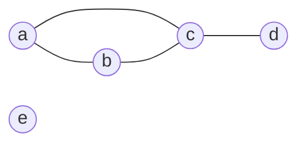

## Passo 1 · Leitura · Vértices, arestas e o que eles modelam

Um **grafo** $G = (V, E)$ é um conjunto de **vértices** ligados por **arestas**. A mesma ideia descreve problemas que parecem não ter nada em comum:

- numa rede de amizades, pessoas são vértices e cada amizade é uma aresta **não direcionada** (se Ana é amiga de Bia, Bia é amiga de Ana);
- num mapa de voos, a aresta `A → B` é **direcionada**: existir o voo de ida não garante o de volta;
- em tarefas com dependências, `compilar → testar` diz que uma vem antes da outra;
- num tabuleiro, cada casa livre é um vértice e as arestas ligam casas vizinhas.

Quando a aresta carrega um número (distância, tempo, preço), o grafo é **ponderado**. Uma aresta de um vértice para ele mesmo é um **laço**; duas arestas entre o mesmo par são **arestas paralelas**.



Em Python, a forma mais comum é a **lista de adjacência**: um dicionário em que cada vértice aponta para a lista dos seus vizinhos. O grafo acima fica `{"a": ["b", "c"], "b": ["a", "c"], "c": ["a", "b", "d"], "d": ["c"], "e": []}`. Duas regras: no grafo não direcionado, cada aresta aparece **nas duas listas**; e todo vértice é chave, inclusive o isolado `e`.

O **grau** de um vértice é o tamanho da sua lista. Como cada aresta não direcionada entra em duas listas, vale a **soma dos graus**:

$$
\sum_{v \in V} \text{grau}(v) = 2\,|E| .
$$

O laço `("a", "a")` entra duas vezes na lista de `a` e soma 2 ao grau, o que mantém a fórmula. No grafo direcionado, a lista de `u` guarda só as arestas que **saem** de `u`; as que **chegam** formam o grau de entrada, que precisa ser contado percorrendo todas as listas.

Os erros que aparecem primeiro:

- guardar a aresta não direcionada num sentido só: `b` "não conhece" `a`, e uma busca a partir de `b` não chega lá;
- montar o dicionário só a partir das arestas: o vértice isolado some, e `grafo["e"]` levanta `KeyError: 'e'`;
- criar as listas com `dict.fromkeys(vertices, [])`: todos os vértices passam a compartilhar **a mesma lista**, e uma aresta aparece como vizinha de todo mundo.

## Passo 2 · Exercício · construir_grafo e graus
modo: lacunas

Complete as lacunas (`___`). `construir_grafo(vertices, arestas, direcionado=False)` recebe todos os vértices e a lista de pares `(a, b)` e devolve a lista de adjacência, com os vizinhos na ordem das arestas. Laços e arestas paralelas são mantidos: no grafo não direcionado, o laço `(a, a)` entra duas vezes na lista de `a`. `graus(grafo)` devolve o tamanho da lista de cada vértice; `graus_de_entrada(grafo)` conta quantas arestas chegam em cada vértice, com 0 para quem não recebe nenhuma.

### Instruções
1. Dê a cada vértice uma lista própria, vazia, e acrescente o sentido de volta só no grafo não direcionado.
2. Em `graus`, o grau é o tamanho da lista do vértice.
3. Em `graus_de_entrada`, cada vizinho `v` na lista de `u` recebe uma aresta.

### Código inicial
```python
def construir_grafo(vertices, arestas, direcionado=False):
    grafo = {v: ___ for v in vertices}
    for a, b in arestas:
        grafo[a].append(b)
        if ___:
            grafo[b].append(a)
    return grafo


def graus(grafo):
    return {v: ___ for v in grafo}


def graus_de_entrada(grafo):
    entrada = {v: 0 for v in grafo}
    for u in grafo:
        for v in grafo[u]:
            entrada[___] += 1
    return entrada
```

### Solução
```python
def construir_grafo(vertices, arestas, direcionado=False):
    grafo = {v: [] for v in vertices}
    for a, b in arestas:
        grafo[a].append(b)
        if not direcionado:
            grafo[b].append(a)
    return grafo


def graus(grafo):
    return {v: len(grafo[v]) for v in grafo}


def graus_de_entrada(grafo):
    entrada = {v: 0 for v in grafo}
    for u in grafo:
        for v in grafo[u]:
            entrada[v] += 1
    return entrada
```

### Dicas
1. A compreensão de dicionário avalia o valor de novo para cada chave; é isso que dá uma lista diferente a cada vértice.
2. No grafo direcionado, a aresta `(a, b)` não diz nada sobre ir de `b` para `a`.
3. O grau de entrada de `v` é o número de listas em que `v` aparece, contando repetições.

### Verificação
```json
[
  { "id": "nao-direcionado", "checkpoint": 1, "kind": "call", "function": "construir_grafo",
    "args": [["a", "b", "c", "d"], [["a", "b"], ["b", "c"], ["c", "a"]]],
    "expected": { "a": ["b", "c"], "b": ["a", "c"], "c": ["b", "a"], "d": [] },
    "name": "Não direcionado: cada aresta nas duas listas, d isolado",
    "hint": "Cada amizade aparece na lista dos dois amigos." },
  { "id": "direcionado", "checkpoint": 1, "kind": "call", "function": "construir_grafo",
    "args": [["a", "b", "c", "d"], [["a", "b"], ["b", "c"], ["c", "a"]]], "kwargs": { "direcionado": true },
    "expected": { "a": ["b"], "b": ["c"], "c": ["a"], "d": [] },
    "name": "Direcionado: só o sentido da aresta" },
  { "id": "vazio", "checkpoint": 1, "kind": "expr",
    "expr": "[construir_grafo([], []), construir_grafo(['x', 'y'], [])]",
    "expected": [{}, { "x": [], "y": [] }], "name": "Grafo vazio e grafo só com vértices isolados",
    "hint": "Todo vértice recebido vira chave, mesmo sem arestas." },
  { "id": "listas-independentes", "checkpoint": 1, "kind": "expr",
    "setup": "g = construir_grafo(['x', 'y', 'z'], [('x', 'y')])",
    "expr": "[g['z'], g['x'] is g['y']]", "expected": [[], false],
    "name": "Cada vértice tem a sua própria lista",
    "hint": "Se uma aresta aparece na lista de um vértice que não participa dela, as listas são a mesma." },
  { "id": "laco", "checkpoint": 1, "kind": "expr",
    "expr": "[construir_grafo(['a', 'b'], [('a', 'a')]), construir_grafo(['a', 'b'], [('a', 'a')], direcionado=True)]",
    "expected": [{ "a": ["a", "a"], "b": [] }, { "a": ["a"], "b": [] }],
    "name": "Laço entra duas vezes no não direcionado e uma no direcionado" },
  { "id": "paralelas", "checkpoint": 1, "kind": "call", "function": "construir_grafo",
    "args": [["a", "b"], [["a", "b"], ["b", "a"]]],
    "expected": { "a": ["b", "b"], "b": ["a", "a"] }, "name": "Arestas paralelas são mantidas" },
  { "id": "graus", "checkpoint": 2, "kind": "expr",
    "setup": "g = construir_grafo(['a', 'b', 'c', 'd', 'e'], [('a', 'b'), ('a', 'c'), ('b', 'c'), ('c', 'd')])",
    "expr": "graus(g)", "expected": { "a": 2, "b": 2, "c": 3, "d": 1, "e": 0 },
    "name": "Graus do grafo do Passo 1" },
  { "id": "soma-dos-graus", "checkpoint": 2, "kind": "expr",
    "setup": "arestas = [('a', 'b'), ('a', 'b'), ('c', 'c'), ('b', 'c'), ('d', 'a')]\ng = construir_grafo(['a', 'b', 'c', 'd', 'e'], arestas)\nr = graus(g)",
    "expr": "[r, sum(r.values()) == 2 * len(arestas)]", "expected": [{ "a": 3, "b": 3, "c": 3, "d": 1, "e": 0 }, true],
    "name": "Com laço e paralelas, a soma dos graus é 2|E|",
    "hint": "Arestas repetidas contam cada uma; o grau não é o número de vizinhos distintos." },
  { "id": "graus-direcionado", "checkpoint": 2, "kind": "expr",
    "setup": "g = construir_grafo(['a', 'b', 'c'], [('a', 'b'), ('a', 'c'), ('b', 'c')], direcionado=True)",
    "expr": "graus(g)", "expected": { "a": 2, "b": 1, "c": 0 }, "name": "No direcionado, graus conta as arestas que saem" },
  { "id": "entrada", "checkpoint": 3, "kind": "expr",
    "setup": "g = construir_grafo(['a', 'b', 'c', 'd'], [('a', 'b'), ('a', 'c'), ('b', 'c'), ('d', 'c'), ('c', 'c')], direcionado=True)",
    "expr": "graus_de_entrada(g)", "expected": { "a": 0, "b": 1, "c": 4, "d": 0 },
    "name": "Graus de entrada, com zeros e um laço",
    "hint": "Quem não recebe nenhuma aresta também aparece, com 0." },
  { "id": "entrada-nao-direcionado", "checkpoint": 3, "kind": "expr",
    "setup": "g = construir_grafo(['a', 'b', 'c', 'd'], [('a', 'b'), ('b', 'c'), ('c', 'c')])",
    "expr": "graus_de_entrada(g) == graus(g)", "expected": true,
    "name": "No não direcionado, grau de entrada é igual ao grau" }
]
```

### Soluções erradas
```python name="dict.fromkeys: todos compartilham a mesma lista"
def construir_grafo(vertices, arestas, direcionado=False):
    grafo = dict.fromkeys(vertices, [])
    for a, b in arestas:
        grafo[a].append(b)
        if not direcionado:
            grafo[b].append(a)
    return grafo


def graus(grafo):
    return {v: len(grafo[v]) for v in grafo}


def graus_de_entrada(grafo):
    entrada = {v: 0 for v in grafo}
    for u in grafo:
        for v in grafo[u]:
            entrada[v] += 1
    return entrada
```
```python name="não direcionado guarda um sentido só"
def construir_grafo(vertices, arestas, direcionado=False):
    grafo = {v: [] for v in vertices}
    for a, b in arestas:
        grafo[a].append(b)
    return grafo


def graus(grafo):
    return {v: len(grafo[v]) for v in grafo}


def graus_de_entrada(grafo):
    entrada = {v: 0 for v in grafo}
    for u in grafo:
        for v in grafo[u]:
            entrada[v] += 1
    return entrada
```
```python name="dicionário montado só a partir das arestas"
def construir_grafo(vertices, arestas, direcionado=False):
    grafo = {}
    for a, b in arestas:
        grafo.setdefault(a, []).append(b)
        if not direcionado:
            grafo.setdefault(b, []).append(a)
    return grafo


def graus(grafo):
    return {v: len(grafo[v]) for v in grafo}


def graus_de_entrada(grafo):
    entrada = {v: 0 for v in grafo}
    for u in grafo:
        for v in grafo[u]:
            entrada[v] += 1
    return entrada
```
```python name="grau conta só vizinhos distintos"
def construir_grafo(vertices, arestas, direcionado=False):
    grafo = {v: [] for v in vertices}
    for a, b in arestas:
        grafo[a].append(b)
        if not direcionado:
            grafo[b].append(a)
    return grafo


def graus(grafo):
    return {v: len(set(grafo[v])) for v in grafo}


def graus_de_entrada(grafo):
    entrada = {v: 0 for v in grafo}
    for u in grafo:
        for v in grafo[u]:
            entrada[v] += 1
    return entrada
```
```python name="grau de entrada soma em quem a aresta sai"
def construir_grafo(vertices, arestas, direcionado=False):
    grafo = {v: [] for v in vertices}
    for a, b in arestas:
        grafo[a].append(b)
        if not direcionado:
            grafo[b].append(a)
    return grafo


def graus(grafo):
    return {v: len(grafo[v]) for v in grafo}


def graus_de_entrada(grafo):
    entrada = {v: 0 for v in grafo}
    for u in grafo:
        for v in grafo[u]:
            entrada[u] += 1
    return entrada
```
```python name="grau de entrada esquece quem não recebe arestas"
def construir_grafo(vertices, arestas, direcionado=False):
    grafo = {v: [] for v in vertices}
    for a, b in arestas:
        grafo[a].append(b)
        if not direcionado:
            grafo[b].append(a)
    return grafo


def graus(grafo):
    return {v: len(grafo[v]) for v in grafo}


def graus_de_entrada(grafo):
    entrada = {}
    for u in grafo:
        for v in grafo[u]:
            entrada[v] = entrada.get(v, 0) + 1
    return entrada
```

## Passo 3 · Leitura · Lista, matriz e grafo implícito

A outra representação clássica é a **matriz de adjacência**: numere os vértices de 0 a $n-1$ e guarde uma tabela $n \times n$ em que `m[i][j]` é o número de arestas de `i` para `j`. No grafo não direcionado, a matriz é **simétrica**: `m[i][j] == m[j][i]`. Para ir do nome ao número, monte um dicionário uma vez: `indice = {v: i for i, v in enumerate(vertices)}`.

| Operação | Lista de adjacência | Matriz de adjacência |
|---|---|---|
| memória | $O(V + E)$ | $O(V^2)$ |
| existe aresta `u → v`? | $O(\text{grau}(u))$ | $O(1)$ |
| percorrer os vizinhos de `u` | $O(\text{grau}(u))$ | $O(V)$ |

Um grafo simples não direcionado tem no máximo $V(V-1)/2$ arestas. Ele é **denso** quando $E$ chega perto disso, e **esparso** quando $E$ é da ordem de $V$. Grafos reais costumam ser esparsos: numa rede de um milhão de pessoas com 200 amigos cada, a lista guarda $2 \times 10^8$ entradas, e a matriz teria $10^{12}$ casas, quase todas zero. A matriz compensa em grafos pequenos e densos, ou quando a pergunta "existe aresta?" domina.

Três erros comuns ao montar a matriz:

- `[[0] * n] * n` repete **a mesma linha** $n$ vezes; escrever `m[0][1] = 1` muda a coluna 1 de todas as linhas. Use `[[0] * n for _ in range(n)]`.
- `vertices.index(v)` dentro do laço das arestas percorre a lista de vértices a cada aresta: $O(V \cdot E)$ só para achar índices.
- Converter de volta com `if m[i][j]: append(...)` perde as arestas paralelas, que valem `m[i][j] > 1`.

#### Grafos implícitos

Às vezes nem vale a pena construir o grafo. Num tabuleiro `grade` de textos, com `#` nas paredes, os vizinhos da casa `(i, j)` são calculados na hora: cima, baixo, esquerda e direita, desde que estejam dentro da grade e não sejam parede. O cuidado está nos limites. `grade[i][j + 1]` na última coluna levanta `IndexError: string index out of range`, mas `grade[i - 1]` com `i = 0` **não** dá erro: o índice $-1$ é a última linha, e a casa do topo passa a ter um vizinho do outro lado do tabuleiro. Confira `0 <= a < len(grade)` e `0 <= b < len(grade[a])` antes de ler.

## Passo 4 · Previsão · A matriz que mudou sozinha

O programa monta duas matrizes $3 \times 3$ de jeitos diferentes e depois usa um `defaultdict` como lista de adjacência. Leia sem executar e digite a saída exata.

### Código
```python
from collections import defaultdict

n = 3
m = [[0] * n] * n
m[0][1] = 1
print(m)

m = [[0] * n for _ in range(n)]
m[0][1] = 1
print(m)

g = defaultdict(list)
for a, b in [("a", "b"), ("b", "c")]:
    g[a].append(b)
print(len(g), "c" in g)
print(g["c"])
print(len(g), "c" in g)
```

### Dicas
1. Multiplicar uma lista de listas copia as referências, não as listas de dentro.
2. A compreensão executa `[0] * n` uma vez para cada linha.
3. Um `defaultdict` cria a chave quando ela é **lida** com colchetes e não existe; o operador `in` não cria nada.

### Saída esperada
```text
[[0, 1, 0], [0, 1, 0], [0, 1, 0]]
[[0, 1, 0], [0, 0, 0], [0, 0, 0]]
2 False
[]
3 True
```

## Passo 5 · Exercício · Converter e consultar

Escreva três funções.

- `lista_para_matriz(grafo, vertices)`: devolve a matriz de adjacência na ordem de `vertices`, em que `m[i][j]` conta quantas vezes `vertices[j]` aparece na lista de `vertices[i]`. A verificação usa vértices que contam as comparações com `==`: com 400 vértices e 1 200 arestas, no máximo 1 000.
- `matriz_para_lista(matriz, vertices)`: faz o caminho de volta. Todo vértice vira chave; os vizinhos aparecem na ordem dos índices, repetidos `m[i][j]` vezes.
- `vizinhos_na_grade(grade, i, j)`: `grade` é uma lista de textos do mesmo tamanho, com `#` nas paredes. Devolve a lista de pares `(linha, coluna)` das casas vizinhas que existem e não são parede, na ordem cima, baixo, esquerda, direita.

### Instruções
1. Escreva `lista_para_matriz` com uma matriz de linhas independentes e um dicionário de índices.
2. Escreva `matriz_para_lista` mantendo as arestas paralelas e os vértices isolados.
3. Escreva `vizinhos_na_grade` conferindo os quatro limites da grade antes de ler a casa.

### Código inicial
```python
def lista_para_matriz(grafo, vertices):
    pass


def matriz_para_lista(matriz, vertices):
    pass


def vizinhos_na_grade(grade, i, j):
    pass
```

### Solução
```python
def lista_para_matriz(grafo, vertices):
    indice = {v: i for i, v in enumerate(vertices)}
    n = len(vertices)
    matriz = [[0] * n for _ in range(n)]
    for u in vertices:
        i = indice[u]
        for v in grafo[u]:
            matriz[i][indice[v]] += 1
    return matriz


def matriz_para_lista(matriz, vertices):
    grafo = {}
    for i, u in enumerate(vertices):
        grafo[u] = []
        for j, v in enumerate(vertices):
            grafo[u].extend([v] * matriz[i][j])
    return grafo


def vizinhos_na_grade(grade, i, j):
    vizinhos = []
    for di, dj in ((-1, 0), (1, 0), (0, -1), (0, 1)):
        a, b = i + di, j + dj
        if 0 <= a < len(grade) and 0 <= b < len(grade[a]) and grade[a][b] != "#":
            vizinhos.append((a, b))
    return vizinhos
```

### Dicas
1. Um dicionário `vértice → índice`, montado uma vez, troca uma busca linear por uma consulta $O(1)$.
2. Um valor 2 na matriz são duas arestas.
3. No Python, `grade[-1]` é a última linha, e não um erro: teste os limites antes de indexar.

### Verificação
```json
[
  { "id": "matriz-direcionado", "checkpoint": 1, "kind": "call", "function": "lista_para_matriz",
    "args": [{ "a": ["b", "c"], "b": ["c"], "c": [] }, ["a", "b", "c"]],
    "expected": [[0, 1, 1], [0, 0, 1], [0, 0, 0]], "name": "Matriz de um grafo direcionado",
    "hint": "Mudar uma casa não pode mudar as outras linhas." },
  { "id": "matriz-simetrica", "checkpoint": 1, "kind": "expr",
    "setup": "g = {'x': ['y', 'y', 'z'], 'y': ['x', 'x'], 'z': ['x', 'z', 'z'], 'w': []}\nm = lista_para_matriz(g, ['w', 'x', 'y', 'z'])",
    "expr": "[m, all(m[i][j] == m[j][i] for i in range(4) for j in range(4))]",
    "expected": [[[0, 0, 0, 0], [0, 0, 2, 1], [0, 2, 0, 0], [0, 1, 0, 2]], true],
    "name": "Não direcionado com paralelas e laço: matriz simétrica, na ordem pedida" },
  { "id": "matriz-vazia", "checkpoint": 1, "kind": "call", "function": "lista_para_matriz", "args": [{}, []],
    "expected": [], "name": "Grafo vazio vira matriz vazia" },
  { "id": "matriz-custo", "checkpoint": 1, "kind": "expr",
    "setup": "class V:\n    eq = 0\n    def __init__(self, n):\n        self.n = n\n    def __eq__(self, o):\n        V.eq += 1\n        return isinstance(o, V) and self.n == o.n\n    def __hash__(self):\n        return hash(self.n)\nvs = [V(i) for i in range(400)]\ng = {v: [vs[(i * 7 + 1) % 400], vs[(i * 13 + 5) % 400], vs[(i + 200) % 400]] for i, v in enumerate(vs)}\nV.eq = 0\nm = lista_para_matriz(g, vs)",
    "expr": "[sum(map(sum, m)), m[0][1] + m[0][5] + m[0][200], V.eq <= 1000]", "expected": [1200, 3, true],
    "name": "400 vértices: no máximo 1 000 comparações para achar os índices",
    "hint": "Procurar cada vértice na lista custa uma comparação por vértice percorrido." },
  { "id": "volta", "checkpoint": 2, "kind": "call", "function": "matriz_para_lista",
    "args": [[[0, 1, 1], [1, 0, 0], [1, 0, 0]], ["a", "b", "c"]],
    "expected": { "a": ["b", "c"], "b": ["a"], "c": ["a"] }, "name": "Matriz simples de volta para lista" },
  { "id": "volta-paralelas", "checkpoint": 2, "kind": "call", "function": "matriz_para_lista",
    "args": [[[2, 0, 1], [0, 0, 0], [3, 0, 0]], ["p", "q", "r"]],
    "expected": { "p": ["p", "p", "r"], "q": [], "r": ["p", "p", "p"] },
    "name": "Paralelas repetidas, laço e vértice isolado",
    "hint": "O valor da casa diz quantas arestas há, não só se há alguma." },
  { "id": "ida-e-volta", "checkpoint": 2, "kind": "expr",
    "setup": "g = {'a': ['b', 'b', 'd'], 'b': ['a', 'a'], 'c': [], 'd': ['a', 'd', 'd']}\nvs = ['a', 'b', 'c', 'd']",
    "expr": "matriz_para_lista(lista_para_matriz(g, vs), vs) == g", "expected": true,
    "name": "Lista → matriz → lista devolve o mesmo grafo" },
  { "id": "grade-centro", "checkpoint": 3, "kind": "expr",
    "setup": "grade = ['...', '.#.', '...']",
    "expr": "[vizinhos_na_grade(grade, 0, 1) == [(0, 0), (0, 2)], vizinhos_na_grade(grade, 1, 0) == [(0, 0), (2, 0)]]",
    "expected": [true, true], "name": "Paredes não são vizinhas; a ordem é cima, baixo, esquerda, direita" },
  { "id": "grade-cantos", "checkpoint": 3, "kind": "expr",
    "setup": "grade = ['....', '....', '....']",
    "expr": "[vizinhos_na_grade(grade, 0, 0) == [(1, 0), (0, 1)], vizinhos_na_grade(grade, 2, 3) == [(1, 3), (2, 2)]]",
    "expected": [true, true], "name": "Nos cantos sobram dois vizinhos, sem dar a volta no tabuleiro",
    "hint": "Linha -1 não existe no tabuleiro, embora exista na lista." },
  { "id": "grade-retangular", "checkpoint": 3, "kind": "expr",
    "setup": "grade = ['......']",
    "expr": "[vizinhos_na_grade(grade, 0, 5) == [(0, 4)], vizinhos_na_grade(grade, 0, 2) == [(0, 1), (0, 3)]]",
    "expected": [true, true], "name": "Grade de uma linha e seis colunas" },
  { "id": "grade-um", "checkpoint": 3, "kind": "expr", "expr": "vizinhos_na_grade(['.'], 0, 0)",
    "expected": [], "name": "Grade de uma casa: nenhum vizinho" }
]
```

### Soluções erradas
```python name="[[0] * n] * n repete a mesma linha"
def lista_para_matriz(grafo, vertices):
    indice = {v: i for i, v in enumerate(vertices)}
    n = len(vertices)
    matriz = [[0] * n] * n
    for u in vertices:
        i = indice[u]
        for v in grafo[u]:
            matriz[i][indice[v]] += 1
    return matriz


def matriz_para_lista(matriz, vertices):
    grafo = {}
    for i, u in enumerate(vertices):
        grafo[u] = []
        for j, v in enumerate(vertices):
            grafo[u].extend([v] * matriz[i][j])
    return grafo


def vizinhos_na_grade(grade, i, j):
    vizinhos = []
    for di, dj in ((-1, 0), (1, 0), (0, -1), (0, 1)):
        a, b = i + di, j + dj
        if 0 <= a < len(grade) and 0 <= b < len(grade[a]) and grade[a][b] != "#":
            vizinhos.append((a, b))
    return vizinhos
```
```python name="vertices.index dentro do laço das arestas"
def lista_para_matriz(grafo, vertices):
    n = len(vertices)
    matriz = [[0] * n for _ in range(n)]
    for i, u in enumerate(vertices):
        for v in grafo[u]:
            matriz[i][vertices.index(v)] += 1
    return matriz


def matriz_para_lista(matriz, vertices):
    grafo = {}
    for i, u in enumerate(vertices):
        grafo[u] = []
        for j, v in enumerate(vertices):
            grafo[u].extend([v] * matriz[i][j])
    return grafo


def vizinhos_na_grade(grade, i, j):
    vizinhos = []
    for di, dj in ((-1, 0), (1, 0), (0, -1), (0, 1)):
        a, b = i + di, j + dj
        if 0 <= a < len(grade) and 0 <= b < len(grade[a]) and grade[a][b] != "#":
            vizinhos.append((a, b))
    return vizinhos
```
```python name="volta com if m[i][j]: perde as paralelas"
def lista_para_matriz(grafo, vertices):
    indice = {v: i for i, v in enumerate(vertices)}
    n = len(vertices)
    matriz = [[0] * n for _ in range(n)]
    for u in vertices:
        i = indice[u]
        for v in grafo[u]:
            matriz[i][indice[v]] += 1
    return matriz


def matriz_para_lista(matriz, vertices):
    grafo = {}
    for i, u in enumerate(vertices):
        grafo[u] = []
        for j, v in enumerate(vertices):
            if matriz[i][j]:
                grafo[u].append(v)
    return grafo


def vizinhos_na_grade(grade, i, j):
    vizinhos = []
    for di, dj in ((-1, 0), (1, 0), (0, -1), (0, 1)):
        a, b = i + di, j + dj
        if 0 <= a < len(grade) and 0 <= b < len(grade[a]) and grade[a][b] != "#":
            vizinhos.append((a, b))
    return vizinhos
```
```python name="volta esquece os vértices sem vizinhos"
def lista_para_matriz(grafo, vertices):
    indice = {v: i for i, v in enumerate(vertices)}
    n = len(vertices)
    matriz = [[0] * n for _ in range(n)]
    for u in vertices:
        i = indice[u]
        for v in grafo[u]:
            matriz[i][indice[v]] += 1
    return matriz


def matriz_para_lista(matriz, vertices):
    grafo = {}
    for i, u in enumerate(vertices):
        for j, v in enumerate(vertices):
            if matriz[i][j]:
                grafo.setdefault(u, []).extend([v] * matriz[i][j])
    return grafo


def vizinhos_na_grade(grade, i, j):
    vizinhos = []
    for di, dj in ((-1, 0), (1, 0), (0, -1), (0, 1)):
        a, b = i + di, j + dj
        if 0 <= a < len(grade) and 0 <= b < len(grade[a]) and grade[a][b] != "#":
            vizinhos.append((a, b))
    return vizinhos
```
```python name="grade sem testar o limite de baixo (índice -1)"
def lista_para_matriz(grafo, vertices):
    indice = {v: i for i, v in enumerate(vertices)}
    n = len(vertices)
    matriz = [[0] * n for _ in range(n)]
    for u in vertices:
        i = indice[u]
        for v in grafo[u]:
            matriz[i][indice[v]] += 1
    return matriz


def matriz_para_lista(matriz, vertices):
    grafo = {}
    for i, u in enumerate(vertices):
        grafo[u] = []
        for j, v in enumerate(vertices):
            grafo[u].extend([v] * matriz[i][j])
    return grafo


def vizinhos_na_grade(grade, i, j):
    vizinhos = []
    for di, dj in ((-1, 0), (1, 0), (0, -1), (0, 1)):
        a, b = i + di, j + dj
        if a < len(grade) and b < len(grade[a]) and grade[a][b] != "#":
            vizinhos.append((a, b))
    return vizinhos
```
```python name="grade com linhas e colunas trocadas no limite"
def lista_para_matriz(grafo, vertices):
    indice = {v: i for i, v in enumerate(vertices)}
    n = len(vertices)
    matriz = [[0] * n for _ in range(n)]
    for u in vertices:
        i = indice[u]
        for v in grafo[u]:
            matriz[i][indice[v]] += 1
    return matriz


def matriz_para_lista(matriz, vertices):
    grafo = {}
    for i, u in enumerate(vertices):
        grafo[u] = []
        for j, v in enumerate(vertices):
            grafo[u].extend([v] * matriz[i][j])
    return grafo


def vizinhos_na_grade(grade, i, j):
    linhas, colunas = len(grade), len(grade[0])
    vizinhos = []
    for di, dj in ((-1, 0), (1, 0), (0, -1), (0, 1)):
        a, b = i + di, j + dj
        if 0 <= a < colunas and 0 <= b < linhas and grade[a][b] != "#":
            vizinhos.append((a, b))
    return vizinhos
```

## Passo 6 · Leitura · Do texto ao grafo

Grafos chegam em arquivos de texto, quase sempre como uma **lista de arestas**, uma por linha. Um formato comum para grafo ponderado:

```text
# rede de entregas: origem destino minutos
centro  porto 12
centro feira 7.5
porto feira 4
deposito
```

Cada linha com três campos é uma aresta; uma linha com um nome só declara um vértice isolado; linhas vazias e comentários com `#` são ignorados. A leitura tem quatro etapas: separar as linhas com `splitlines()`, limpar com `strip()`, pular o que não é aresta e separar os campos.

O erro mais comum está em separar os campos. `linha.split(" ")` corta em **cada** espaço, e dois espaços seguidos produzem um campo vazio:

```text
>>> origem, destino, peso = "centro  porto 12".split(" ")
ValueError: too many values to unpack (expected 3, got 4)
```

`linha.split()`, sem argumento, corta em qualquer sequência de espaços e tabulações e descarta as pontas. Outro tropeço é o peso: `int("7.5")` levanta `ValueError: invalid literal for int() with base 10: '7.5'`, e um peso escrito com vírgula decimal falha também em `float`, com `ValueError: could not convert string to float: '3,5'`. Converter com `float` cobre inteiros e decimais com ponto.

Ao montar o dicionário, use `grafo.setdefault(v, [])` para criar a lista do vértice na primeira vez que ele aparecer, em qualquer posição da aresta: o destino de uma aresta direcionada também é vértice, mesmo sem nenhuma aresta saindo dele. No grafo ponderado, cada vizinho vira um par `(vizinho, peso)`; a lista de `centro` acima fica `[("porto", 12.0), ("feira", 7.5)]`.

Lido o grafo, os graus respondem perguntas de modelagem: quem tem mais conexões numa rede, qual cruzamento recebe mais ruas, qual tarefa é pré-requisito de mais tarefas. Um empate é a regra, não a exceção, e uma função que devolve "o" vértice de grau máximo esconde os outros; devolva todos, numa ordem definida.

## Passo 7 · Exercício · Ler o grafo de um texto

Escreva duas funções.

- `ler_grafo(texto, direcionado=False)`: lê o formato do passo anterior e devolve um dicionário `vértice → lista de (vizinho, peso)`, com o peso em `float`. As chaves aparecem na ordem em que cada vértice surge pela primeira vez no texto; os vizinhos, na ordem das linhas. Os campos podem estar separados por vários espaços ou tabulações. No grafo não direcionado, cada aresta entra nas duas listas (o laço `a a 2`, duas vezes na lista de `a`).
- `mais_conectados(grafo)`: a lista, em ordem alfabética, dos vértices de maior grau (tamanho da lista); `[]` para o grafo vazio.

### Instruções
1. Separe as linhas, ignore as vazias e os comentários e separe os campos sem depender do número de espaços.
2. Crie a lista de todo vértice que aparecer, inclusive o isolado e o destino de uma aresta direcionada, e guarde o peso como `float`.
3. Escreva `mais_conectados` devolvendo todos os empatados no grau máximo.

### Código inicial
```python
def ler_grafo(texto, direcionado=False):
    pass


def mais_conectados(grafo):
    pass
```

### Solução
```python
def ler_grafo(texto, direcionado=False):
    grafo = {}
    for linha in texto.splitlines():
        linha = linha.strip()
        if not linha or linha.startswith("#"):
            continue
        campos = linha.split()
        if len(campos) == 1:
            grafo.setdefault(campos[0], [])
            continue
        origem, destino, peso = campos
        peso = float(peso)
        grafo.setdefault(origem, [])
        grafo.setdefault(destino, [])
        grafo[origem].append((destino, peso))
        if not direcionado:
            grafo[destino].append((origem, peso))
    return grafo


def mais_conectados(grafo):
    if not grafo:
        return []
    maior = max(len(vizinhos) for vizinhos in grafo.values())
    return sorted(v for v in grafo if len(grafo[v]) == maior)
```

### Dicas
1. `str.split()` sem argumento já trata espaços repetidos e tabulações.
2. Crie a lista do vértice antes de usá-la, nas duas pontas da aresta.
3. Calcule o grau máximo primeiro; depois junte quem o atinge.

### Verificação
```json
[
  { "id": "basico", "checkpoint": 1, "kind": "expr",
    "setup": "g = ler_grafo('a b 3\\nb c 4\\n')",
    "expr": "g == {'a': [('b', 3.0)], 'b': [('a', 3.0), ('c', 4.0)], 'c': [('b', 4.0)]}", "expected": true,
    "name": "Duas arestas não direcionadas" },
  { "id": "espacos", "checkpoint": 1, "kind": "expr",
    "setup": "g = ler_grafo('  centro   porto\\t12  \\ncentro feira 7.5\\n')",
    "expr": "g == {'centro': [('porto', 12.0), ('feira', 7.5)], 'porto': [('centro', 12.0)], 'feira': [('centro', 7.5)]}",
    "expected": true, "name": "Espaços repetidos, tabulação e peso decimal",
    "hint": "Separar por um espaço só cria campos vazios." },
  { "id": "comentarios", "checkpoint": 1, "kind": "expr",
    "setup": "g = ler_grafo('# cabeçalho\\n\\na b 1\\n   \\n# fim\\n')",
    "expr": "g == {'a': [('b', 1.0)], 'b': [('a', 1.0)]}", "expected": true,
    "name": "Ignora linhas vazias, só com espaços e comentários" },
  { "id": "texto-vazio", "checkpoint": 1, "kind": "call", "function": "ler_grafo", "args": [""], "expected": {},
    "name": "Texto vazio é o grafo vazio" },
  { "id": "isolado-e-ordem", "checkpoint": 2, "kind": "expr",
    "setup": "g = ler_grafo('deposito\\nporto centro 2\\nfeira\\ncentro feira 1\\n')",
    "expr": "[list(g), g['deposito'], g['feira']]", "expected": [["deposito", "porto", "centro", "feira"], [], [["centro", 1.0]]],
    "name": "Vértices isolados aparecem, na ordem do texto" },
  { "id": "direcionado", "checkpoint": 2, "kind": "expr",
    "setup": "g = ler_grafo('a b 2\\nb c 5\\nc a 1\\nd b 3\\n', direcionado=True)",
    "expr": "g == {'a': [('b', 2.0)], 'b': [('c', 5.0)], 'c': [('a', 1.0)], 'd': [('b', 3.0)]}", "expected": true,
    "name": "Direcionado: só o sentido da linha" },
  { "id": "destino-sem-saida", "checkpoint": 2, "kind": "expr",
    "setup": "g = ler_grafo('a b 2\\n', direcionado=True)", "expr": "g", "expected": { "a": [["b", 2.0]], "b": [] },
    "name": "No direcionado, o destino também é vértice" },
  { "id": "peso-float", "checkpoint": 2, "kind": "expr",
    "setup": "g = ler_grafo('a b 7\\n')", "expr": "type(g['a'][0][1]).__name__", "expected": "float",
    "name": "O peso é guardado como float" },
  { "id": "laco-paralelas", "checkpoint": 2, "kind": "expr",
    "setup": "g = ler_grafo('a a 2\\na b 1\\nb a 4\\n')",
    "expr": "g == {'a': [('a', 2.0), ('a', 2.0), ('b', 1.0), ('b', 4.0)], 'b': [('a', 1.0), ('a', 4.0)]}", "expected": true,
    "name": "Laço e arestas paralelas, com pesos diferentes" },
  { "id": "mais-conectados", "checkpoint": 3, "kind": "expr",
    "setup": "g = ler_grafo('x a 1\\nx b 1\\nx c 1\\nb c 1\\nb d 1\\n')",
    "expr": "mais_conectados(g)", "expected": ["b", "x"],
    "name": "Empate no grau máximo devolve os dois, em ordem alfabética",
    "hint": "Mais de um vértice pode ter o grau máximo." },
  { "id": "mais-conectados-bordas", "checkpoint": 3, "kind": "expr",
    "expr": "[mais_conectados({}), mais_conectados({'b': [], 'a': []}), mais_conectados(ler_grafo('m n 1\\n'))]",
    "expected": [[], ["a", "b"], ["m", "n"]], "name": "Grafo vazio, só isolados e uma aresta" }
]
```

### Soluções erradas
```python name="split(' ') quebra com espaços repetidos"
def ler_grafo(texto, direcionado=False):
    grafo = {}
    for linha in texto.splitlines():
        linha = linha.strip()
        if not linha or linha.startswith("#"):
            continue
        campos = linha.split(" ")
        if len(campos) == 1:
            grafo.setdefault(campos[0], [])
            continue
        origem, destino, peso = campos
        peso = float(peso)
        grafo.setdefault(origem, [])
        grafo.setdefault(destino, [])
        grafo[origem].append((destino, peso))
        if not direcionado:
            grafo[destino].append((origem, peso))
    return grafo


def mais_conectados(grafo):
    if not grafo:
        return []
    maior = max(len(vizinhos) for vizinhos in grafo.values())
    return sorted(v for v in grafo if len(grafo[v]) == maior)
```
```python name="não pula os comentários"
def ler_grafo(texto, direcionado=False):
    grafo = {}
    for linha in texto.splitlines():
        linha = linha.strip()
        if not linha:
            continue
        campos = linha.split()
        if len(campos) == 1:
            grafo.setdefault(campos[0], [])
            continue
        origem, destino, peso = campos
        peso = float(peso)
        grafo.setdefault(origem, [])
        grafo.setdefault(destino, [])
        grafo[origem].append((destino, peso))
        if not direcionado:
            grafo[destino].append((origem, peso))
    return grafo


def mais_conectados(grafo):
    if not grafo:
        return []
    maior = max(len(vizinhos) for vizinhos in grafo.values())
    return sorted(v for v in grafo if len(grafo[v]) == maior)
```
```python name="peso convertido com int"
def ler_grafo(texto, direcionado=False):
    grafo = {}
    for linha in texto.splitlines():
        linha = linha.strip()
        if not linha or linha.startswith("#"):
            continue
        campos = linha.split()
        if len(campos) == 1:
            grafo.setdefault(campos[0], [])
            continue
        origem, destino, peso = campos
        peso = int(peso)
        grafo.setdefault(origem, [])
        grafo.setdefault(destino, [])
        grafo[origem].append((destino, peso))
        if not direcionado:
            grafo[destino].append((origem, peso))
    return grafo


def mais_conectados(grafo):
    if not grafo:
        return []
    maior = max(len(vizinhos) for vizinhos in grafo.values())
    return sorted(v for v in grafo if len(grafo[v]) == maior)
```
```python name="só a origem ganha lista"
def ler_grafo(texto, direcionado=False):
    grafo = {}
    for linha in texto.splitlines():
        linha = linha.strip()
        if not linha or linha.startswith("#"):
            continue
        campos = linha.split()
        if len(campos) == 1:
            grafo.setdefault(campos[0], [])
            continue
        origem, destino, peso = campos
        peso = float(peso)
        grafo.setdefault(origem, []).append((destino, peso))
        if not direcionado:
            grafo.setdefault(destino, []).append((origem, peso))
    return grafo


def mais_conectados(grafo):
    if not grafo:
        return []
    maior = max(len(vizinhos) for vizinhos in grafo.values())
    return sorted(v for v in grafo if len(grafo[v]) == maior)
```
```python name="ignora a linha do vértice isolado"
def ler_grafo(texto, direcionado=False):
    grafo = {}
    for linha in texto.splitlines():
        linha = linha.strip()
        if not linha or linha.startswith("#"):
            continue
        campos = linha.split()
        if len(campos) != 3:
            continue
        origem, destino, peso = campos
        peso = float(peso)
        grafo.setdefault(origem, [])
        grafo.setdefault(destino, [])
        grafo[origem].append((destino, peso))
        if not direcionado:
            grafo[destino].append((origem, peso))
    return grafo


def mais_conectados(grafo):
    if not grafo:
        return []
    maior = max(len(vizinhos) for vizinhos in grafo.values())
    return sorted(v for v in grafo if len(grafo[v]) == maior)
```
```python name="mais_conectados devolve um vértice só"
def ler_grafo(texto, direcionado=False):
    grafo = {}
    for linha in texto.splitlines():
        linha = linha.strip()
        if not linha or linha.startswith("#"):
            continue
        campos = linha.split()
        if len(campos) == 1:
            grafo.setdefault(campos[0], [])
            continue
        origem, destino, peso = campos
        peso = float(peso)
        grafo.setdefault(origem, [])
        grafo.setdefault(destino, [])
        grafo[origem].append((destino, peso))
        if not direcionado:
            grafo[destino].append((origem, peso))
    return grafo


def mais_conectados(grafo):
    if not grafo:
        return []
    return [max(grafo, key=lambda v: len(grafo[v]))]
```

## Passo 8 · Quiz · Escolhas de representação

### Pergunta
Uma rede social tem 2 milhões de usuários, com 150 amizades em média por pessoa. A equipe precisa listar os amigos de um usuário e, de vez em quando, saber se duas pessoas são amigas. Qual representação faz mais sentido?
- [ ] Matriz de adjacência, porque "são amigas?" sai em $O(1)$
- [x] Lista de adjacência, porque a matriz teria $4 \times 10^{12}$ casas para cerca de $3 \times 10^8$ entradas úteis
- [ ] Matriz de adjacência, porque listar os amigos custa $O(1)$
- [ ] Uma lista com todas as arestas, sem índice por vértice, porque ocupa menos memória
> O grafo é esparso: $V = 2 \times 10^6$ e cerca de $V \cdot 150 = 3 \times 10^8$ entradas na lista. A matriz teria $V^2 = 4 \times 10^{12}$ casas, quase todas zero, e listar amigos nela custa $O(V)$. Na lista, "são amigas?" custa $O(\text{grau})$, cerca de 150 comparações, e um `set` por vértice deixa isso em $O(1)$ médio. A lista de arestas sem índice obriga a varrer tudo para achar os amigos de alguém.

### Pergunta
Um colega lê um grafo não direcionado de um arquivo e imprime os graus: a soma dá 15. O que dá para concluir?
- [ ] O grafo tem 15 arestas
- [ ] O grafo tem 7,5 arestas, porque há um laço
- [x] Há um defeito na leitura: num grafo não direcionado, a soma dos graus é sempre par
- [ ] O grafo tem um vértice isolado, que não entra na soma
> Cada aresta não direcionada entra em duas listas (o laço, duas vezes na mesma), então a soma dos graus é $2|E|$, sempre par. Uma soma ímpar indica, por exemplo, uma aresta guardada num sentido só. Vértices isolados somam 0 e não mudam a paridade.

### Pergunta
Um jogo tem um mapa de $2000 \times 2000$ casas, com paredes, e precisa encontrar caminhos entre casas. O mapa muda a cada fase. Como representar o grafo?
- [ ] Matriz de adjacência com uma linha por casa
- [ ] Dicionário com a lista de vizinhos de cada casa, reconstruído no começo de cada fase
- [x] Grafo implícito: calcular os vizinhos de `(i, j)` na hora, conferindo os limites e as paredes
- [ ] Lista de todas as arestas, ordenada pela linha da casa
> São $4 \times 10^6$ casas: a matriz de adjacência teria $1{,}6 \times 10^{13}$ casas. O dicionário funciona, mas gasta memória e tempo para guardar algo que o próprio mapa já diz. Com o grafo implícito, os vizinhos de uma casa são no máximo quatro e saem de uma conta, com o cuidado de não deixar `i - 1 = -1` dar a volta no tabuleiro.
