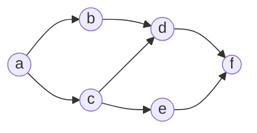

## Passo 1 · Leitura · Camadas a partir da origem

A **busca em largura** (BFS, *breadth-first search*) explora um grafo em **camadas**: primeiro a origem, depois todos os vizinhos dela (distância 1), depois os vizinhos desses que ainda não apareceram (distância 2), e assim por diante.



Partindo de `a`: camada 0 = `{a}`, camada 1 = `{b, c}`, camada 2 = `{d, e}`, camada 3 = `{f}`. A distância aqui é o **número de arestas** do caminho mais curto.

Quem garante a ordem das camadas é uma **fila** (FIFO): os vértices saem na ordem em que entraram, então toda a camada $k$ sai antes de qualquer vértice da camada $k+1$. O esqueleto:

```python
from collections import deque

dist = {origem: 0}
fila = deque([origem])
while fila:
    u = fila.popleft()
    for v in grafo[u]:
        if v not in dist:          # ainda não descoberto
            dist[v] = dist[u] + 1
            fila.append(v)
```

O dicionário `dist` faz dois papéis: guarda as distâncias e serve de conjunto de **visitados**. O detalhe que mais importa é **quando** marcar: no momento de **enfileirar**. Assim cada vértice entra na fila uma vez só, e o custo total é $O(V + E)$: cada vértice sai uma vez e cada lista de adjacência é lida uma vez.

Os três erros clássicos:

- **Marcar ao desenfileirar.** Entre ser descoberto e sair da fila, o vértice pode ser descoberto de novo por outro vizinho e entrar várias vezes. Num grafo completo, a fila chega a $V^2$ entradas. E se a distância for gravada a cada descoberta, a última sobrescreve a primeira, que era a menor.
- **Usar `pop()` no lugar de `popleft()`.** A fila vira pilha, a ordem deixa de ser por camadas e um vértice pode ser descoberto primeiro por um caminho longo.
- **Usar `list` com `pop(0)`.** O resultado está certo, mas cada `pop(0)` move a lista inteira: a BFS vira $O(V^2)$. A `deque` tira da frente em $O(1)$.

## Passo 2 · Previsão · A ordem da fila

O programa roda a BFS no grafo do passo anterior, imprimindo o vértice que saiu e a fila depois de cada rodada. Em seguida, roda uma versão que marca o visitado ao **desenfileirar** e conta quantas vezes algum vértice saiu da fila. Leia sem executar e digite a saída exata.

### Código
```python
from collections import deque

grafo = {"a": ["b", "c"], "b": ["d"], "c": ["d", "e"], "d": ["f"], "e": ["f"], "f": []}

dist = {"a": 0}
fila = deque(["a"])
while fila:
    u = fila.popleft()
    for v in grafo[u]:
        if v not in dist:
            dist[v] = dist[u] + 1
            fila.append(v)
    print(u, list(fila))
print(dist)

saidas = 0
visitados = set()
fila = deque(["a"])
while fila:
    u = fila.popleft()
    saidas += 1
    if u in visitados:
        continue
    visitados.add(u)
    for v in grafo[u]:
        if v not in visitados:
            fila.append(v)
print(saidas)
```

### Dicas
1. Quando `c` sai da fila, `d` já foi descoberto por `b`.
2. A ordem das chaves de um dicionário é a ordem de inserção.
3. Na segunda versão, `d` e `f` são alcançados por dois caminhos cada, e nenhum dos dois estava visitado quando foi enfileirado pela segunda vez.

### Saída esperada
```text
a ['b', 'c']
b ['c', 'd']
c ['d', 'e']
d ['e', 'f']
e ['f']
f []
{'a': 0, 'b': 1, 'c': 1, 'd': 2, 'e': 2, 'f': 3}
8
```

## Passo 3 · Exercício · BFS com distâncias e predecessores
modo: lacunas

Complete as lacunas (`___`). `bfs(grafo, origem)` devolve o par `(dist, pred)`: `dist[v]` é o número de arestas do menor caminho da origem até `v`, e `pred[v]` é o vértice de onde `v` foi descoberto (`None` para a origem). Só os vértices alcançáveis aparecem. Os vizinhos são lidos na ordem da lista; quando dois vértices da mesma camada levam a `v`, vale o primeiro a descobri-lo.

### Instruções
1. Tire da frente da fila com a operação $O(1)$ da `deque`.
2. Marque o vértice ao enfileirar: só um vértice ainda sem distância entra na fila.
3. Grave a distância e o predecessor no momento da descoberta.

### Código inicial
```python
from collections import deque


def bfs(grafo, origem):
    dist = {origem: 0}
    pred = {origem: None}
    fila = deque([origem])
    while fila:
        u = fila.___()
        for v in grafo[u]:
            if v not in ___:
                dist[v] = ___
                pred[v] = ___
                fila.append(v)
    return dist, pred
```

### Solução
```python
from collections import deque


def bfs(grafo, origem):
    dist = {origem: 0}
    pred = {origem: None}
    fila = deque([origem])
    while fila:
        u = fila.popleft()
        for v in grafo[u]:
            if v not in dist:
                dist[v] = dist[u] + 1
                pred[v] = u
                fila.append(v)
    return dist, pred
```

### Dicas
1. `append` põe no fim; a outra ponta é a frente.
2. O dicionário de distâncias já diz quem foi descoberto.
3. Quem descobre `v` é o vértice que acabou de sair da fila.

### Verificação
```json
[
  { "id": "usa-popleft", "checkpoint": 1, "kind": "source", "rule": { "type": "calls", "name": "popleft" },
    "name": "Tira da frente com popleft" },
  { "id": "distancias", "checkpoint": 1, "kind": "expr",
    "setup": "g = {'a': ['b', 'c'], 'b': ['d'], 'c': ['d', 'e'], 'd': ['f'], 'e': ['f'], 'f': []}",
    "expr": "bfs(g, 'a')[0]", "expected": { "a": 0, "b": 1, "c": 1, "d": 2, "e": 2, "f": 3 },
    "name": "Distâncias por camadas no grafo do Passo 1" },
  { "id": "predecessores", "checkpoint": 3, "kind": "expr",
    "setup": "g = {'a': ['b', 'c'], 'b': ['d'], 'c': ['d', 'e'], 'd': ['f'], 'e': ['f'], 'f': []}",
    "expr": "bfs(g, 'a')[1]", "expected": { "a": null, "b": "a", "c": "a", "d": "b", "e": "c", "f": "d" },
    "name": "Predecessor é quem descobriu primeiro",
    "hint": "Depois de descoberto, o vértice não muda mais de predecessor." },
  { "id": "mesma-camada", "checkpoint": 2, "kind": "expr",
    "setup": "g = {'s': ['a', 'b'], 'a': ['b'], 'b': []}",
    "expr": "bfs(g, 's')", "expected": [{ "s": 0, "a": 1, "b": 1 }, { "s": null, "a": "s", "b": "s" }],
    "name": "Aresta entre dois vértices da mesma camada não muda a distância",
    "hint": "Se b já foi descoberto, a aresta a → b não diz nada novo." },
  { "id": "fila-nao-pilha", "checkpoint": 1, "kind": "expr",
    "setup": "g = {'s': ['a', 'x'], 'a': ['z'], 'x': ['y'], 'y': ['z'], 'z': []}",
    "expr": "bfs(g, 's')[0]['z']", "expected": 2,
    "name": "O caminho curto pelo primeiro vizinho vence o longo pelo segundo",
    "hint": "Os vértices precisam sair na ordem em que entraram." },
  { "id": "isolado", "checkpoint": 2, "kind": "expr", "expr": "bfs({'x': [], 'y': []}, 'x')",
    "expected": [{ "x": 0 }, { "x": null }], "name": "Origem isolada: só ela aparece" },
  { "id": "desconexo", "checkpoint": 2, "kind": "expr",
    "setup": "g = {'a': ['b'], 'b': ['a'], 'c': ['d'], 'd': ['c']}",
    "expr": "bfs(g, 'c')[0]", "expected": { "c": 0, "d": 1 }, "name": "Outro componente não aparece" },
  { "id": "direcionado", "checkpoint": 2, "kind": "expr",
    "setup": "g = {'a': ['b'], 'b': ['c'], 'c': [], 'd': ['a']}",
    "expr": "[bfs(g, 'a')[0], bfs(g, 'c')[0]]", "expected": [{ "a": 0, "b": 1, "c": 2 }, { "c": 0 }],
    "name": "Em grafo direcionado, só no sentido das arestas" },
  { "id": "laco-paralelas", "checkpoint": 2, "kind": "expr",
    "setup": "g = {'a': ['a', 'b', 'b'], 'b': ['a', 'a', 'b']}",
    "expr": "bfs(g, 'a')", "expected": [{ "a": 0, "b": 1 }, { "a": null, "b": "a" }],
    "name": "Laço e arestas paralelas não mudam nada" },
  { "id": "custo", "checkpoint": 2, "kind": "expr",
    "setup": "class L(list):\n    lidos = 0\n    def __iter__(self):\n        for x in list.__iter__(self):\n            L.lidos += 1\n            yield x\nn = 40\ng = {i: L(j for j in range(n) if j != i) for i in range(n)}\nL.lidos = 0\nd, p = bfs(g, 0)",
    "expr": "[len(d), max(d.values()), L.lidos <= n * (n - 1)]", "expected": [40, 1, true],
    "name": "Grafo completo de 40 vértices: cada lista é lida uma vez só",
    "hint": "Um vértice que entra na fila duas vezes tem a lista lida duas vezes." }
]
```

### Soluções erradas
```python name="marca ao desenfileirar e sobrescreve a distância"
from collections import deque


def bfs(grafo, origem):
    dist = {origem: 0}
    pred = {origem: None}
    visitados = set()
    fila = deque([origem])
    while fila:
        u = fila.popleft()
        if u in visitados:
            continue
        visitados.add(u)
        for v in grafo[u]:
            if v not in visitados:
                dist[v] = dist[u] + 1
                pred[v] = u
                fila.append(v)
    return dist, pred
```
```python name="marca ao desenfileirar e não pula os repetidos"
from collections import deque


def bfs(grafo, origem):
    dist = {origem: 0}
    pred = {origem: None}
    visitados = set()
    fila = deque([origem])
    while fila:
        u = fila.popleft()
        visitados.add(u)
        for v in grafo[u]:
            if v not in visitados:
                if v not in dist:
                    dist[v] = dist[u] + 1
                    pred[v] = u
                fila.append(v)
    return dist, pred
```
```python name="pop() transforma a fila em pilha"
from collections import deque


def bfs(grafo, origem):
    dist = {origem: 0}
    pred = {origem: None}
    fila = deque([origem])
    while fila:
        u = fila.pop()
        for v in grafo[u]:
            if v not in dist:
                dist[v] = dist[u] + 1
                pred[v] = u
                fila.append(v)
    return dist, pred
```
```python name="lista com pop(0)"
def bfs(grafo, origem):
    dist = {origem: 0}
    pred = {origem: None}
    fila = [origem]
    while fila:
        u = fila.pop(0)
        for v in grafo[u]:
            if v not in dist:
                dist[v] = dist[u] + 1
                pred[v] = u
                fila.append(v)
    return dist, pred
```
```python name="predecessor gravado fora do if"
from collections import deque


def bfs(grafo, origem):
    dist = {origem: 0}
    pred = {origem: None}
    fila = deque([origem])
    while fila:
        u = fila.popleft()
        for v in grafo[u]:
            if v not in dist:
                dist[v] = dist[u] + 1
                fila.append(v)
            pred[v] = u
    return dist, pred
```

## Passo 4 · Leitura · Por que a BFS acha o menor caminho

A fila da BFS tem uma propriedade que se mantém do começo ao fim: **ela guarda vértices de no máximo duas camadas vizinhas, $k$ e $k+1$, com todos os de $k$ na frente.** No início só há a origem, na camada 0. Quando um vértice da camada $k$ sai, os que ele descobre entram no fim com distância $k+1$. Então os vértices saem em ordem **não decrescente** de distância.

Daí vem a correção, por um argumento informal. Suponha que `v` tenha distância real $d$, por um caminho `origem → … → w → v` em que `w` tem distância $d-1$. Todos os vértices da camada $d-1$ saem da fila antes de qualquer um da camada $d$; quando `w` sai, `v` é descoberto com $d$, a menos que já tenha sido descoberto antes, e "antes" só pode ser por alguém com distância no máximo $d-1$. Ninguém descobre `v` com um valor menor que $d$, porque isso daria um caminho mais curto que o real. Por isso a **primeira** descoberta é a definitiva, e não há o que atualizar depois.

Para cada vértice descoberto vale

$$
\text{dist}(v) = \text{dist}(\text{pred}(v)) + 1 ,
$$

então seguir `pred` a partir do destino percorre um menor caminho **de trás para a frente**, até chegar à origem, cujo predecessor é `None`:

```python
caminho = []
v = destino
while v is not None:
    caminho.append(v)
    v = pred[v]
caminho.reverse()
```

Os tropeços na reconstrução:

- esquecer o `reverse()` e devolver o caminho do destino para a origem;
- não testar se o destino foi alcançado: `pred[destino]` levanta `KeyError: 'z'`;
- reconstruir com recursão (`caminho(pred[v]) + [v]`): num caminho de alguns milhares de vértices, `RecursionError: maximum recursion depth exceeded`.

A BFS só resolve o menor caminho quando **toda aresta vale o mesmo**. Se as arestas têm pesos diferentes (minutos, quilômetros), o caminho com menos arestas pode ser o mais demorado; esse é o problema do Dijkstra, mais adiante no módulo.

## Passo 5 · Exercício · Reconstruir o menor caminho

Continue no mesmo código e acrescente `menor_caminho(grafo, origem, destino)`: a lista de vértices de um menor caminho, da origem ao destino, ou `None` se o destino não for alcançável (inclusive quando nem está no grafo). Com `origem == destino`, o caminho é `[origem]`. Entre caminhos de mesmo tamanho, vale o que a sua `bfs` encontra: cada vértice fica com o primeiro que o descobriu.

### Instruções
1. Rode a BFS a partir da origem e devolva `None` se o destino não tiver sido descoberto.
2. Siga os predecessores a partir do destino até a origem, sem recursão.
3. Devolva o caminho no sentido da origem para o destino.

### Solução
```python
from collections import deque


def bfs(grafo, origem):
    dist = {origem: 0}
    pred = {origem: None}
    fila = deque([origem])
    while fila:
        u = fila.popleft()
        for v in grafo[u]:
            if v not in dist:
                dist[v] = dist[u] + 1
                pred[v] = u
                fila.append(v)
    return dist, pred


def menor_caminho(grafo, origem, destino):
    dist, pred = bfs(grafo, origem)
    if destino not in dist:
        return None
    caminho = []
    v = destino
    while v is not None:
        caminho.append(v)
        v = pred[v]
    caminho.reverse()
    return caminho
```

### Dicas
1. O dicionário de distâncias já diz se o destino foi alcançado.
2. O laço para quando chega ao predecessor da origem.
3. O caminho sai de trás para a frente.

### Verificação
```json
[
  { "id": "basico", "checkpoint": 3, "kind": "expr",
    "setup": "g = {'a': ['b', 'c'], 'b': ['d'], 'c': ['d', 'e'], 'd': ['f'], 'e': ['f'], 'f': []}",
    "expr": "menor_caminho(g, 'a', 'f')", "expected": ["a", "b", "d", "f"],
    "name": "De a até f, desempatando pelo primeiro a descobrir",
    "hint": "O caminho começa na origem." },
  { "id": "nao-direcionado", "checkpoint": 3, "kind": "expr",
    "setup": "g = {1: [2, 5], 2: [1, 3], 3: [2, 4], 4: [3, 5], 5: [1, 4, 6], 6: [5]}",
    "expr": "[menor_caminho(g, 1, 4), menor_caminho(g, 6, 3)]", "expected": [[1, 5, 4], [6, 5, 4, 3]],
    "name": "Num ciclo, o lado mais curto" },
  { "id": "mesmo-vertice", "checkpoint": 2, "kind": "expr", "expr": "menor_caminho({'x': ['y'], 'y': []}, 'x', 'x')",
    "expected": ["x"], "name": "Origem igual ao destino" },
  { "id": "inalcancavel", "checkpoint": 1, "kind": "expr",
    "setup": "g = {'a': ['b'], 'b': [], 'c': ['a']}",
    "expr": "[menor_caminho(g, 'a', 'c'), menor_caminho(g, 'b', 'a')]", "expected": [null, null],
    "name": "Destino que não é alcançável dá None",
    "hint": "Confira se o destino foi descoberto antes de seguir os predecessores." },
  { "id": "fora-do-grafo", "checkpoint": 1, "kind": "expr", "expr": "menor_caminho({'a': []}, 'a', 'zz')",
    "expected": null, "name": "Destino que nem está no grafo dá None" },
  { "id": "atalho", "checkpoint": 3, "kind": "expr",
    "setup": "g = {'s': ['x', 'a'], 'x': ['y'], 'y': ['z'], 'a': ['z'], 'z': []}",
    "expr": "menor_caminho(g, 's', 'z')", "expected": ["s", "a", "z"],
    "name": "O caminho com menos arestas, mesmo que comece pelo segundo vizinho" },
  { "id": "corrente-longa", "checkpoint": 2, "kind": "expr",
    "setup": "n = 3000\ng = {i: [i + 1] for i in range(n)}\ng[n] = []\nc = menor_caminho(g, 0, n)",
    "expr": "[len(c), c[0], c[-1], c == list(range(n + 1))]", "expected": [3001, 0, 3000, true],
    "name": "Corrente de 3 001 vértices, sem recursão",
    "hint": "Recursão com milhares de chamadas estoura o limite do Python." }
]
```

### Soluções erradas
```python name="esquece de inverter o caminho"
from collections import deque


def bfs(grafo, origem):
    dist = {origem: 0}
    pred = {origem: None}
    fila = deque([origem])
    while fila:
        u = fila.popleft()
        for v in grafo[u]:
            if v not in dist:
                dist[v] = dist[u] + 1
                pred[v] = u
                fila.append(v)
    return dist, pred


def menor_caminho(grafo, origem, destino):
    dist, pred = bfs(grafo, origem)
    if destino not in dist:
        return None
    caminho = []
    v = destino
    while v is not None:
        caminho.append(v)
        v = pred[v]
    return caminho
```
```python name="não testa se o destino foi alcançado"
from collections import deque


def bfs(grafo, origem):
    dist = {origem: 0}
    pred = {origem: None}
    fila = deque([origem])
    while fila:
        u = fila.popleft()
        for v in grafo[u]:
            if v not in dist:
                dist[v] = dist[u] + 1
                pred[v] = u
                fila.append(v)
    return dist, pred


def menor_caminho(grafo, origem, destino):
    dist, pred = bfs(grafo, origem)
    caminho = []
    v = destino
    while v is not None:
        caminho.append(v)
        v = pred[v]
    caminho.reverse()
    return caminho
```
```python name="reconstrói com recursão"
from collections import deque


def bfs(grafo, origem):
    dist = {origem: 0}
    pred = {origem: None}
    fila = deque([origem])
    while fila:
        u = fila.popleft()
        for v in grafo[u]:
            if v not in dist:
                dist[v] = dist[u] + 1
                pred[v] = u
                fila.append(v)
    return dist, pred


def menor_caminho(grafo, origem, destino):
    dist, pred = bfs(grafo, origem)
    if destino not in dist:
        return None

    def montar(v):
        if v is None:
            return []
        return montar(pred[v]) + [v]

    return montar(destino)
```
```python name="começa do predecessor e perde o destino"
from collections import deque


def bfs(grafo, origem):
    dist = {origem: 0}
    pred = {origem: None}
    fila = deque([origem])
    while fila:
        u = fila.popleft()
        for v in grafo[u]:
            if v not in dist:
                dist[v] = dist[u] + 1
                pred[v] = u
                fila.append(v)
    return dist, pred


def menor_caminho(grafo, origem, destino):
    dist, pred = bfs(grafo, origem)
    if destino not in dist:
        return None
    caminho = []
    v = pred[destino]
    while v is not None:
        caminho.append(v)
        v = pred[v]
    caminho.reverse()
    return caminho
```
```python name="acha um caminho com pilha, não o menor"
from collections import deque


def bfs(grafo, origem):
    dist = {origem: 0}
    pred = {origem: None}
    fila = deque([origem])
    while fila:
        u = fila.popleft()
        for v in grafo[u]:
            if v not in dist:
                dist[v] = dist[u] + 1
                pred[v] = u
                fila.append(v)
    return dist, pred


def menor_caminho(grafo, origem, destino):
    pred = {origem: None}
    pilha = [origem]
    while pilha:
        u = pilha.pop()
        for v in grafo[u]:
            if v not in pred:
                pred[v] = u
                pilha.append(v)
    if destino not in pred:
        return None
    caminho = []
    v = destino
    while v is not None:
        caminho.append(v)
        v = pred[v]
    caminho.reverse()
    return caminho
```

## Passo 6 · Leitura · Grades, estados e várias fontes

A BFS não precisa de um dicionário de adjacência pronto: basta saber **gerar os vizinhos** de um vértice. Num labirinto em grade, o vértice é o par `(i, j)` e os vizinhos são as casas livres acima, abaixo, à esquerda e à direita, conferindo os limites como na lição anterior. As distâncias ficam num dicionário com pares como chave, ou numa matriz do tamanho da grade, com `-1` para "ainda não visto".

O mesmo vale para **espaços de estados**: o vértice é uma configuração de um quebra-cabeça, e as arestas são os movimentos permitidos. No problema dos jarros, com um de 3 litros e outro de 5, o estado é o par `(a, b)` de litros em cada um, e os movimentos são encher, esvaziar ou passar água de um para o outro. A BFS a partir de `(0, 0)` acha a sequência mais curta de movimentos até ter 4 litros em algum jarro:

```python visualizar
from collections import deque

A, B = 3, 5
alvo = 4


def proximos(estado):
    a, b = estado
    passa_ab = min(a, B - b)
    passa_ba = min(b, A - a)
    return [(A, b), (a, B), (0, b), (a, 0),
            (a - passa_ab, b + passa_ab), (a + passa_ba, b - passa_ba)]


pred = {(0, 0): None}
fila = deque([(0, 0)])
while fila:
    estado = fila.popleft()
    if alvo in estado:
        break
    for prox in proximos(estado):
        if prox not in pred:
            pred[prox] = estado
            fila.append(prox)

caminho = []
while estado is not None:
    caminho.append(estado)
    estado = pred[estado]
print(caminho[::-1])
```

Num jogo de palavras em que cada passo troca uma letra, o estado é a palavra. Os vizinhos de `casa` são as palavras do dicionário que diferem dela em uma posição; gerar as $26 \cdot L$ variações e testar cada uma num `set` custa $O(L)$ por teste, contra comparar com o dicionário inteiro.

#### Várias origens de uma vez

Para saber a distância de cada casa até o posto de saúde **mais próximo**, rodar uma BFS por posto e tirar o mínimo custa $k$ vezes mais. A **BFS de múltiplas fontes** põe todos os postos na fila no começo, com distância 0. As camadas crescem a partir de todos ao mesmo tempo, e a primeira descoberta de cada casa vem do posto mais próximo, pelo mesmo argumento do passo 4: é como se houvesse uma origem fictícia ligada a todos os postos.

## Passo 7 · Exercício · Labirinto, palavras e várias fontes

Escreva três funções com BFS. Nas grades, `#` é parede e os movimentos são cima, baixo, esquerda e direita.

- `passos_no_labirinto(grade)`: número mínimo de movimentos da casa `S` até a casa `E`, ou `-1` se não houver caminho (ou se faltar `S` ou `E`).
- `escada_de_palavras(inicio, fim, palavras)`: número mínimo de trocas para ir de `inicio` a `fim`, trocando uma letra por vez; toda palavra depois da primeira, inclusive `fim`, precisa estar em `palavras`. Devolve `0` se `inicio == fim` e `-1` se for impossível. As palavras usam as letras de `a` a `z`, sem acento.
- `distancia_ao_mais_proximo(grade)`: matriz do tamanho da grade com a distância de cada casa ao `P` mais próximo; `-1` nas paredes e nas casas que nenhum `P` alcança. A verificação conta as leituras de linhas da grade: com 60 × 60 casas, no máximo $6 \cdot 3600$.

### Instruções
1. Escreva `passos_no_labirinto` com uma BFS sobre os pares `(linha, coluna)`, conferindo os quatro limites.
2. Escreva `escada_de_palavras` gerando os vizinhos de cada palavra e consultando um `set`.
3. Escreva `distancia_ao_mais_proximo` com todos os `P` na fila desde o começo.

### Código inicial
```python
from collections import deque


def passos_no_labirinto(grade):
    pass


def escada_de_palavras(inicio, fim, palavras):
    pass


def distancia_ao_mais_proximo(grade):
    pass
```

### Solução
```python
from collections import deque

MOVIMENTOS = ((-1, 0), (1, 0), (0, -1), (0, 1))


def passos_no_labirinto(grade):
    linhas = len(grade)
    colunas = len(grade[0]) if grade else 0
    inicio = fim = None
    for i, linha in enumerate(grade):
        for j, casa in enumerate(linha):
            if casa == "S":
                inicio = (i, j)
            elif casa == "E":
                fim = (i, j)
    if inicio is None or fim is None:
        return -1
    dist = {inicio: 0}
    fila = deque([inicio])
    while fila:
        i, j = fila.popleft()
        if (i, j) == fim:
            return dist[(i, j)]
        for di, dj in MOVIMENTOS:
            a, b = i + di, j + dj
            if 0 <= a < linhas and 0 <= b < colunas and grade[a][b] != "#" and (a, b) not in dist:
                dist[(a, b)] = dist[(i, j)] + 1
                fila.append((a, b))
    return -1


def escada_de_palavras(inicio, fim, palavras):
    dicionario = set(palavras)
    if inicio == fim:
        return 0
    if fim not in dicionario:
        return -1
    dist = {inicio: 0}
    fila = deque([inicio])
    while fila:
        p = fila.popleft()
        for k in range(len(p)):
            for letra in "abcdefghijklmnopqrstuvwxyz":
                q = p[:k] + letra + p[k + 1:]
                if q in dicionario and q not in dist:
                    dist[q] = dist[p] + 1
                    if q == fim:
                        return dist[q]
                    fila.append(q)
    return -1


def distancia_ao_mais_proximo(grade):
    linhas = len(grade)
    colunas = len(grade[0]) if grade else 0
    dist = [[-1] * colunas for _ in range(linhas)]
    fila = deque()
    for i, linha in enumerate(grade):
        for j, casa in enumerate(linha):
            if casa == "P":
                dist[i][j] = 0
                fila.append((i, j))
    while fila:
        i, j = fila.popleft()
        for di, dj in MOVIMENTOS:
            a, b = i + di, j + dj
            if 0 <= a < linhas and 0 <= b < colunas and grade[a][b] != "#" and dist[a][b] == -1:
                dist[a][b] = dist[i][j] + 1
                fila.append((a, b))
    return dist
```

### Dicas
1. Ache `S` e `E` antes da busca; a distância de `S` é 0.
2. Os vizinhos de uma palavra são as variações com uma posição trocada que existem no dicionário.
3. Uma fila que começa com várias casas a distância 0 continua saindo em ordem de distância.

### Verificação
```json
[
  { "id": "labirinto", "checkpoint": 1, "kind": "call", "function": "passos_no_labirinto",
    "args": [["S.#.....", ".##.###.", "....#E..", ".##...#."]], "expected": 9,
    "name": "Labirinto com desvio: 9 movimentos" },
  { "id": "labirinto-bordas", "checkpoint": 1, "kind": "expr",
    "expr": "[passos_no_labirinto(['SE']), passos_no_labirinto(['S#E']), passos_no_labirinto(['S']), passos_no_labirinto(['S', '.', 'E'])]",
    "expected": [1, -1, -1, 2], "name": "Vizinhos diretos, parede no meio, sem E e uma coluna só",
    "hint": "A distância é o número de movimentos, não de casas." },
  { "id": "labirinto-sem-volta", "checkpoint": 1, "kind": "call", "function": "passos_no_labirinto",
    "args": [["S..", "###", "..E"]], "expected": -1,
    "name": "Uma fileira de paredes separa S de E",
    "hint": "No Python, a linha -1 existe: é a última. No tabuleiro, não." },
  { "id": "labirinto-grande", "checkpoint": 1, "kind": "expr",
    "setup": "n = 150\ngrade = ['S' + '.' * (n - 1)] + ['.' * n for _ in range(n - 2)] + ['.' * (n - 1) + 'E']",
    "expr": "passos_no_labirinto(grade)", "expected": 298, "name": "Grade aberta de 150 × 150" },
  { "id": "escada", "checkpoint": 2, "kind": "expr",
    "setup": "P = ['cama', 'lama', 'lata', 'cata', 'casa', 'mala', 'mata', 'gata']",
    "expr": "[escada_de_palavras('casa', 'lata', P), escada_de_palavras('casa', 'mala', P)]", "expected": [2, 3],
    "name": "Escadas de 2 e 3 trocas" },
  { "id": "escada-bordas", "checkpoint": 2, "kind": "expr",
    "setup": "P = ['cama', 'lama', 'lata', 'cata', 'casa', 'mala', 'mata', 'gata']",
    "expr": "[escada_de_palavras('bota', 'bota', []), escada_de_palavras('sapo', 'mala', P), escada_de_palavras('pata', 'gata', P)]",
    "expected": [0, -1, 1], "name": "Mesma palavra, sem ligação e início fora da lista" },
  { "id": "escada-fim-fora", "checkpoint": 2, "kind": "expr",
    "expr": "escada_de_palavras('casa', 'cata', ['casa', 'cama'])", "expected": -1,
    "name": "O fim precisa estar na lista de palavras" },
  { "id": "multi-fonte", "checkpoint": 3, "kind": "call", "function": "distancia_ao_mais_proximo",
    "args": [["P..#", ".#..", "...P", "##.#"]],
    "expected": [[0, 1, 2, -1], [1, -1, 2, 1], [2, 2, 1, 0], [-1, -1, 2, -1]],
    "name": "Distância ao P mais próximo, com -1 nas paredes" },
  { "id": "multi-fonte-isolada", "checkpoint": 3, "kind": "call", "function": "distancia_ao_mais_proximo",
    "args": [["P.#.", "..#."]], "expected": [[0, 1, -1, -1], [1, 2, -1, -1]],
    "name": "Casas que nenhum P alcança ficam com -1" },
  { "id": "multi-fonte-sem-p", "checkpoint": 3, "kind": "call", "function": "distancia_ao_mais_proximo",
    "args": [["..", ".#"]], "expected": [[-1, -1], [-1, -1]], "name": "Sem nenhum P, tudo -1" },
  { "id": "multi-fonte-custo", "checkpoint": 3, "kind": "expr",
    "setup": "class Grade(list):\n    leituras = 0\n    def __getitem__(self, i):\n        Grade.leituras += 1\n        return list.__getitem__(self, i)\nlinhas = []\nfor i in range(60):\n    linhas.append(''.join('P' if (i * 60 + j) % 457 == 0 else ('#' if (i * 7 + j * 3) % 11 == 0 else '.') for j in range(60)))\ng = Grade(linhas)\nGrade.leituras = 0\nd = distancia_ao_mais_proximo(g)",
    "expr": "[max(map(max, d)), sum(map(sum, d)), Grade.leituras <= 6 * 3600]", "expected": [31, 37511, true],
    "name": "8 postos em 60 × 60: uma BFS só",
    "hint": "Uma BFS por posto lê a grade inteira uma vez para cada posto." }
]
```

### Soluções erradas
```python name="vizinho na linha -1 dá a volta no tabuleiro"
from collections import deque

MOVIMENTOS = ((-1, 0), (1, 0), (0, -1), (0, 1))


def passos_no_labirinto(grade):
    linhas = len(grade)
    colunas = len(grade[0]) if grade else 0
    inicio = fim = None
    for i, linha in enumerate(grade):
        for j, casa in enumerate(linha):
            if casa == "S":
                inicio = (i, j)
            elif casa == "E":
                fim = (i, j)
    if inicio is None or fim is None:
        return -1
    dist = {inicio: 0}
    fila = deque([inicio])
    while fila:
        i, j = fila.popleft()
        if (i, j) == fim:
            return dist[(i, j)]
        for di, dj in MOVIMENTOS:
            a, b = i + di, j + dj
            if a < linhas and b < colunas and grade[a][b] != "#" and (a, b) not in dist:
                dist[(a, b)] = dist[(i, j)] + 1
                fila.append((a, b))
    return -1


def escada_de_palavras(inicio, fim, palavras):
    dicionario = set(palavras)
    if inicio == fim:
        return 0
    if fim not in dicionario:
        return -1
    dist = {inicio: 0}
    fila = deque([inicio])
    while fila:
        p = fila.popleft()
        for k in range(len(p)):
            for letra in "abcdefghijklmnopqrstuvwxyz":
                q = p[:k] + letra + p[k + 1:]
                if q in dicionario and q not in dist:
                    dist[q] = dist[p] + 1
                    if q == fim:
                        return dist[q]
                    fila.append(q)
    return -1


def distancia_ao_mais_proximo(grade):
    linhas = len(grade)
    colunas = len(grade[0]) if grade else 0
    dist = [[-1] * colunas for _ in range(linhas)]
    fila = deque()
    for i, linha in enumerate(grade):
        for j, casa in enumerate(linha):
            if casa == "P":
                dist[i][j] = 0
                fila.append((i, j))
    while fila:
        i, j = fila.popleft()
        for di, dj in MOVIMENTOS:
            a, b = i + di, j + dj
            if 0 <= a < linhas and 0 <= b < colunas and grade[a][b] != "#" and dist[a][b] == -1:
                dist[a][b] = dist[i][j] + 1
                fila.append((a, b))
    return dist
```
```python name="conta casas em vez de movimentos"
from collections import deque

MOVIMENTOS = ((-1, 0), (1, 0), (0, -1), (0, 1))


def passos_no_labirinto(grade):
    linhas = len(grade)
    colunas = len(grade[0]) if grade else 0
    inicio = fim = None
    for i, linha in enumerate(grade):
        for j, casa in enumerate(linha):
            if casa == "S":
                inicio = (i, j)
            elif casa == "E":
                fim = (i, j)
    if inicio is None or fim is None:
        return -1
    dist = {inicio: 1}
    fila = deque([inicio])
    while fila:
        i, j = fila.popleft()
        if (i, j) == fim:
            return dist[(i, j)]
        for di, dj in MOVIMENTOS:
            a, b = i + di, j + dj
            if 0 <= a < linhas and 0 <= b < colunas and grade[a][b] != "#" and (a, b) not in dist:
                dist[(a, b)] = dist[(i, j)] + 1
                fila.append((a, b))
    return -1


def escada_de_palavras(inicio, fim, palavras):
    dicionario = set(palavras)
    if inicio == fim:
        return 0
    if fim not in dicionario:
        return -1
    dist = {inicio: 0}
    fila = deque([inicio])
    while fila:
        p = fila.popleft()
        for k in range(len(p)):
            for letra in "abcdefghijklmnopqrstuvwxyz":
                q = p[:k] + letra + p[k + 1:]
                if q in dicionario and q not in dist:
                    dist[q] = dist[p] + 1
                    if q == fim:
                        return dist[q]
                    fila.append(q)
    return -1


def distancia_ao_mais_proximo(grade):
    linhas = len(grade)
    colunas = len(grade[0]) if grade else 0
    dist = [[-1] * colunas for _ in range(linhas)]
    fila = deque()
    for i, linha in enumerate(grade):
        for j, casa in enumerate(linha):
            if casa == "P":
                dist[i][j] = 0
                fila.append((i, j))
    while fila:
        i, j = fila.popleft()
        for di, dj in MOVIMENTOS:
            a, b = i + di, j + dj
            if 0 <= a < linhas and 0 <= b < colunas and grade[a][b] != "#" and dist[a][b] == -1:
                dist[a][b] = dist[i][j] + 1
                fila.append((a, b))
    return dist
```
```python name="escada aceita um fim fora da lista"
from collections import deque

MOVIMENTOS = ((-1, 0), (1, 0), (0, -1), (0, 1))


def passos_no_labirinto(grade):
    linhas = len(grade)
    colunas = len(grade[0]) if grade else 0
    inicio = fim = None
    for i, linha in enumerate(grade):
        for j, casa in enumerate(linha):
            if casa == "S":
                inicio = (i, j)
            elif casa == "E":
                fim = (i, j)
    if inicio is None or fim is None:
        return -1
    dist = {inicio: 0}
    fila = deque([inicio])
    while fila:
        i, j = fila.popleft()
        if (i, j) == fim:
            return dist[(i, j)]
        for di, dj in MOVIMENTOS:
            a, b = i + di, j + dj
            if 0 <= a < linhas and 0 <= b < colunas and grade[a][b] != "#" and (a, b) not in dist:
                dist[(a, b)] = dist[(i, j)] + 1
                fila.append((a, b))
    return -1


def escada_de_palavras(inicio, fim, palavras):
    dicionario = set(palavras)
    dicionario.add(fim)
    if inicio == fim:
        return 0
    dist = {inicio: 0}
    fila = deque([inicio])
    while fila:
        p = fila.popleft()
        for k in range(len(p)):
            for letra in "abcdefghijklmnopqrstuvwxyz":
                q = p[:k] + letra + p[k + 1:]
                if q in dicionario and q not in dist:
                    dist[q] = dist[p] + 1
                    if q == fim:
                        return dist[q]
                    fila.append(q)
    return -1


def distancia_ao_mais_proximo(grade):
    linhas = len(grade)
    colunas = len(grade[0]) if grade else 0
    dist = [[-1] * colunas for _ in range(linhas)]
    fila = deque()
    for i, linha in enumerate(grade):
        for j, casa in enumerate(linha):
            if casa == "P":
                dist[i][j] = 0
                fila.append((i, j))
    while fila:
        i, j = fila.popleft()
        for di, dj in MOVIMENTOS:
            a, b = i + di, j + dj
            if 0 <= a < linhas and 0 <= b < colunas and grade[a][b] != "#" and dist[a][b] == -1:
                dist[a][b] = dist[i][j] + 1
                fila.append((a, b))
    return dist
```
```python name="uma BFS por posto e o mínimo"
from collections import deque

MOVIMENTOS = ((-1, 0), (1, 0), (0, -1), (0, 1))


def passos_no_labirinto(grade):
    linhas = len(grade)
    colunas = len(grade[0]) if grade else 0
    inicio = fim = None
    for i, linha in enumerate(grade):
        for j, casa in enumerate(linha):
            if casa == "S":
                inicio = (i, j)
            elif casa == "E":
                fim = (i, j)
    if inicio is None or fim is None:
        return -1
    dist = {inicio: 0}
    fila = deque([inicio])
    while fila:
        i, j = fila.popleft()
        if (i, j) == fim:
            return dist[(i, j)]
        for di, dj in MOVIMENTOS:
            a, b = i + di, j + dj
            if 0 <= a < linhas and 0 <= b < colunas and grade[a][b] != "#" and (a, b) not in dist:
                dist[(a, b)] = dist[(i, j)] + 1
                fila.append((a, b))
    return -1


def escada_de_palavras(inicio, fim, palavras):
    dicionario = set(palavras)
    if inicio == fim:
        return 0
    if fim not in dicionario:
        return -1
    dist = {inicio: 0}
    fila = deque([inicio])
    while fila:
        p = fila.popleft()
        for k in range(len(p)):
            for letra in "abcdefghijklmnopqrstuvwxyz":
                q = p[:k] + letra + p[k + 1:]
                if q in dicionario and q not in dist:
                    dist[q] = dist[p] + 1
                    if q == fim:
                        return dist[q]
                    fila.append(q)
    return -1


def distancia_ao_mais_proximo(grade):
    linhas = len(grade)
    colunas = len(grade[0]) if grade else 0
    melhor = [[-1] * colunas for _ in range(linhas)]
    postos = [(i, j) for i, linha in enumerate(grade) for j, casa in enumerate(linha) if casa == "P"]
    for origem in postos:
        dist = [[-1] * colunas for _ in range(linhas)]
        dist[origem[0]][origem[1]] = 0
        fila = deque([origem])
        while fila:
            i, j = fila.popleft()
            for di, dj in MOVIMENTOS:
                a, b = i + di, j + dj
                if 0 <= a < linhas and 0 <= b < colunas and grade[a][b] != "#" and dist[a][b] == -1:
                    dist[a][b] = dist[i][j] + 1
                    fila.append((a, b))
        for i in range(linhas):
            for j in range(colunas):
                if dist[i][j] != -1 and (melhor[i][j] == -1 or dist[i][j] < melhor[i][j]):
                    melhor[i][j] = dist[i][j]
    return melhor
```
```python name="várias fontes, mas só o primeiro P entra na fila"
from collections import deque

MOVIMENTOS = ((-1, 0), (1, 0), (0, -1), (0, 1))


def passos_no_labirinto(grade):
    linhas = len(grade)
    colunas = len(grade[0]) if grade else 0
    inicio = fim = None
    for i, linha in enumerate(grade):
        for j, casa in enumerate(linha):
            if casa == "S":
                inicio = (i, j)
            elif casa == "E":
                fim = (i, j)
    if inicio is None or fim is None:
        return -1
    dist = {inicio: 0}
    fila = deque([inicio])
    while fila:
        i, j = fila.popleft()
        if (i, j) == fim:
            return dist[(i, j)]
        for di, dj in MOVIMENTOS:
            a, b = i + di, j + dj
            if 0 <= a < linhas and 0 <= b < colunas and grade[a][b] != "#" and (a, b) not in dist:
                dist[(a, b)] = dist[(i, j)] + 1
                fila.append((a, b))
    return -1


def escada_de_palavras(inicio, fim, palavras):
    dicionario = set(palavras)
    if inicio == fim:
        return 0
    if fim not in dicionario:
        return -1
    dist = {inicio: 0}
    fila = deque([inicio])
    while fila:
        p = fila.popleft()
        for k in range(len(p)):
            for letra in "abcdefghijklmnopqrstuvwxyz":
                q = p[:k] + letra + p[k + 1:]
                if q in dicionario and q not in dist:
                    dist[q] = dist[p] + 1
                    if q == fim:
                        return dist[q]
                    fila.append(q)
    return -1


def distancia_ao_mais_proximo(grade):
    linhas = len(grade)
    colunas = len(grade[0]) if grade else 0
    dist = [[-1] * colunas for _ in range(linhas)]
    fila = deque()
    for i, linha in enumerate(grade):
        for j, casa in enumerate(linha):
            if casa == "P" and not fila:
                dist[i][j] = 0
                fila.append((i, j))
    while fila:
        i, j = fila.popleft()
        for di, dj in MOVIMENTOS:
            a, b = i + di, j + dj
            if 0 <= a < linhas and 0 <= b < colunas and grade[a][b] != "#" and dist[a][b] == -1:
                dist[a][b] = dist[i][j] + 1
                fila.append((a, b))
    return dist
```
```python name="casas não alcançadas ficam com 0"
from collections import deque

MOVIMENTOS = ((-1, 0), (1, 0), (0, -1), (0, 1))


def passos_no_labirinto(grade):
    linhas = len(grade)
    colunas = len(grade[0]) if grade else 0
    inicio = fim = None
    for i, linha in enumerate(grade):
        for j, casa in enumerate(linha):
            if casa == "S":
                inicio = (i, j)
            elif casa == "E":
                fim = (i, j)
    if inicio is None or fim is None:
        return -1
    dist = {inicio: 0}
    fila = deque([inicio])
    while fila:
        i, j = fila.popleft()
        if (i, j) == fim:
            return dist[(i, j)]
        for di, dj in MOVIMENTOS:
            a, b = i + di, j + dj
            if 0 <= a < linhas and 0 <= b < colunas and grade[a][b] != "#" and (a, b) not in dist:
                dist[(a, b)] = dist[(i, j)] + 1
                fila.append((a, b))
    return -1


def escada_de_palavras(inicio, fim, palavras):
    dicionario = set(palavras)
    if inicio == fim:
        return 0
    if fim not in dicionario:
        return -1
    dist = {inicio: 0}
    fila = deque([inicio])
    while fila:
        p = fila.popleft()
        for k in range(len(p)):
            for letra in "abcdefghijklmnopqrstuvwxyz":
                q = p[:k] + letra + p[k + 1:]
                if q in dicionario and q not in dist:
                    dist[q] = dist[p] + 1
                    if q == fim:
                        return dist[q]
                    fila.append(q)
    return -1


def distancia_ao_mais_proximo(grade):
    linhas = len(grade)
    colunas = len(grade[0]) if grade else 0
    dist = [[0] * colunas for _ in range(linhas)]
    vistos = set()
    fila = deque()
    for i, linha in enumerate(grade):
        for j, casa in enumerate(linha):
            if casa == "P":
                vistos.add((i, j))
                fila.append((i, j))
    while fila:
        i, j = fila.popleft()
        for di, dj in MOVIMENTOS:
            a, b = i + di, j + dj
            if 0 <= a < linhas and 0 <= b < colunas and grade[a][b] != "#" and (a, b) not in vistos:
                vistos.add((a, b))
                dist[a][b] = dist[i][j] + 1
                fila.append((a, b))
    for i, linha in enumerate(grade):
        for j, casa in enumerate(linha):
            if casa == "#":
                dist[i][j] = -1
    return dist
```

## Passo 8 · Quiz · Camadas, filas e caminhos

### Pergunta
Uma BFS marca o vértice como visitado só quando ele **sai** da fila, e não pula os repetidos. Num grafo completo de 1 000 vértices, o que acontece?
- [ ] As distâncias saem erradas, porque a fila perde a ordem das camadas
- [x] As distâncias podem até sair certas, mas a fila recebe cerca de $V^2/2 = 5 \times 10^5$ entradas, e cada uma relê uma lista de 999 vizinhos
- [ ] O programa entra em laço infinito, porque o grafo tem ciclos
- [ ] Nada muda: marcar ao enfileirar ou ao desenfileirar dá o mesmo custo
> Entre ser descoberto e sair da fila, o vértice continua "não visitado" e é enfileirado de novo por cada vizinho que sai antes dele. No grafo completo, o $k$-ésimo vértice a sair enfileira de novo todos os que ainda não saíram: $999 + 998 + \cdots$, perto de $V^2/2$ entradas, e cada repetição, ao sair, lê a lista inteira outra vez. Não há laço infinito: depois que todos saíram uma vez, ninguém mais é enfileirado.

### Pergunta
Um aplicativo de rotas usa BFS num mapa em que cada rua tem o tempo de travessia em minutos, e devolve uma rota de 3 ruas que leva 40 minutos, embora exista uma de 5 ruas que leva 15. Qual é o diagnóstico?
- [ ] A BFS tem um defeito: ela sempre acha o caminho mais rápido
- [ ] Faltou marcar os visitados ao enfileirar
- [x] A BFS minimiza o número de arestas, não a soma dos pesos; com tempos diferentes, é preciso um algoritmo como o Dijkstra
- [ ] Basta rodar a BFS a partir do destino em vez da origem
> O argumento de correção da BFS conta arestas: cada camada está a uma aresta a mais da origem. Quando as arestas têm custos diferentes, menos arestas não significa menor custo. O Dijkstra, assunto da lição 5, troca a fila por uma fila de prioridade ordenada pela distância acumulada.

### Pergunta
Uma cidade em grade tem 20 postos de bombeiros e quer, para cada quarteirão, o tempo até o posto mais próximo. Qual abordagem é a mais eficiente, mantendo o resultado correto?
- [ ] Uma BFS a partir de cada posto, guardando o mínimo em cada quarteirão
- [x] Uma única BFS com os 20 postos na fila desde o início, todos com distância 0
- [ ] Uma BFS a partir de cada quarteirão até achar o primeiro posto
- [ ] Uma BFS a partir do posto mais central, somando a distância entre postos
> Com todos os postos na fila no início, as camadas avançam a partir de todos ao mesmo tempo, e a primeira descoberta de cada quarteirão vem do posto mais próximo: custo $O(V + E)$, uma vez. Vinte BFS custam 20 vezes isso; uma BFS por quarteirão custa ainda mais. A quarta opção dá distâncias erradas.
