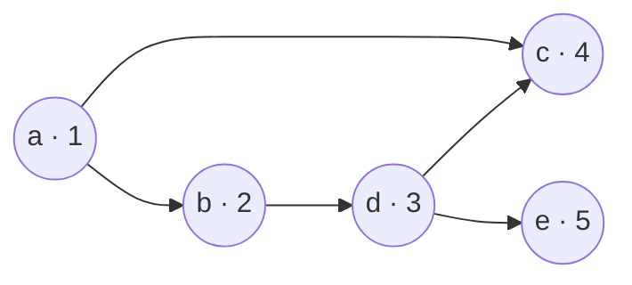
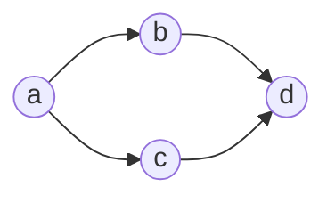
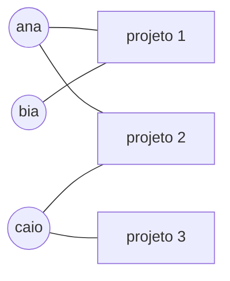

## Passo 1 · Leitura · Descer até não dar mais

A **busca em profundidade** (DFS, *depth-first search*) segue um caminho enquanto houver vértice novo e só volta quando esgota as saídas. A forma recursiva é a mais curta:

```python
def visitar(grafo, u, visitados, ordem):
    visitados.add(u)
    ordem.append(u)
    for v in grafo[u]:
        if v not in visitados:
            visitar(grafo, v, visitados, ordem)
```



Com `{"a": ["b", "c"], "b": ["d"], "c": [], "d": ["c", "e"], "e": []}`, a ordem de visita é `a, b, d, c, e` (o número em cada vértice): de `a` desce para `b`, de `b` para `d`, de `d` para `c`; `c` não tem saída, a busca volta a `d` e segue para `e`. Quando a recursão volta a `a`, `c` já foi visitado. A DFS também custa $O(V + E)$.

O limite está na recursão: cada vértice do caminho atual ocupa um quadro na pilha de chamadas, e o Python para em cerca de 1 000. Numa corrente de 5 000 vértices:

```text
RecursionError: maximum recursion depth exceeded
```

Aumentar o limite com `sys.setrecursionlimit` só troca o erro por um estouro da pilha do processo. A saída é a **DFS iterativa**, com uma pilha explícita. Para visitar na **mesma ordem** da recursiva, duas regras:

- empilhe os vizinhos **de trás para a frente** (`reversed(grafo[u])`), para que o primeiro vizinho fique no topo;
- marque o vértice como visitado quando ele **sai** da pilha, e pule quem sair já visitado.

Ao contrário da BFS, aqui um vértice pode entrar na pilha mais de uma vez; é o preço de manter a ordem. Marcar ao empilhar parece mais econômico, mas muda a ordem: no grafo acima, `c` seria marcado já ao empilhar os vizinhos de `a`, e a ordem viraria `a, b, d, e, c`. O vértice `c` deixa de ser visitado "a partir de `d`", e qualquer algoritmo que dependa da árvore da DFS (como a detecção de ciclos, logo adiante) passa a ver outra árvore.

## Passo 2 · Exercício · DFS iterativa na ordem da recursiva
modo: lacunas

Complete as lacunas (`___`). `dfs_ordem(grafo, origem)` devolve a lista dos vértices alcançáveis na ordem em que a DFS **recursiva** os visitaria, lendo os vizinhos na ordem da lista, mas sem recursão.

### Instruções
1. Tire do topo da pilha.
2. Pule o vértice que já foi visitado antes de sair da pilha.
3. Empilhe os vizinhos de modo que o primeiro da lista saia primeiro.

### Código inicial
```python
def dfs_ordem(grafo, origem):
    visitados = set()
    ordem = []
    pilha = [origem]
    while pilha:
        u = pilha.___()
        if u in ___:
            continue
        visitados.add(u)
        ordem.append(u)
        for v in ___(grafo[u]):
            if v not in visitados:
                pilha.append(v)
    return ordem
```

### Solução
```python
def dfs_ordem(grafo, origem):
    visitados = set()
    ordem = []
    pilha = [origem]
    while pilha:
        u = pilha.pop()
        if u in visitados:
            continue
        visitados.add(u)
        ordem.append(u)
        for v in reversed(grafo[u]):
            if v not in visitados:
                pilha.append(v)
    return ordem
```

### Dicas
1. Pilha: entra e sai pelo mesmo lado.
2. Um vértice pode ter sido empilhado por dois vizinhos diferentes.
3. O último a entrar é o primeiro a sair.

### Verificação
```json
[
  { "id": "ordem-leitura", "checkpoint": 3, "kind": "call", "function": "dfs_ordem",
    "args": [{ "a": ["b", "c"], "b": ["d"], "c": [], "d": ["c", "e"], "e": [] }, "a"],
    "expected": ["a", "b", "d", "c", "e"], "name": "Ordem do grafo da leitura: c é visitado a partir de d",
    "hint": "Marcar ao empilhar muda a ordem." },
  { "id": "ordem-numeros", "checkpoint": 3, "kind": "expr",
    "setup": "g = {1: [2, 3, 4], 2: [5], 3: [5, 6], 4: [], 5: [1, 6], 6: []}",
    "expr": "dfs_ordem(g, 1)", "expected": [1, 2, 5, 6, 3, 4], "name": "Com ciclo de volta à origem" },
  { "id": "nao-direcionado", "checkpoint": 2, "kind": "expr",
    "setup": "g = {'a': ['b', 'c'], 'b': ['a', 'c'], 'c': ['a', 'b', 'd'], 'd': ['c']}",
    "expr": "dfs_ordem(g, 'd')", "expected": ["d", "c", "a", "b"],
    "name": "Não direcionado, cada vértice uma vez só",
    "hint": "Um vértice empilhado duas vezes não pode entrar duas vezes na ordem." },
  { "id": "isolado", "checkpoint": 2, "kind": "expr", "expr": "dfs_ordem({'x': [], 'y': ['x']}, 'x')",
    "expected": ["x"], "name": "Origem sem saída" },
  { "id": "desconexo", "checkpoint": 2, "kind": "expr",
    "setup": "g = {'a': ['b'], 'b': ['a'], 'c': ['d'], 'd': ['c']}",
    "expr": "dfs_ordem(g, 'a')", "expected": ["a", "b"], "name": "Só o componente da origem" },
  { "id": "laco-paralelas", "checkpoint": 2, "kind": "expr",
    "setup": "g = {'a': ['a', 'b', 'b'], 'b': ['a', 'a', 'c'], 'c': []}",
    "expr": "dfs_ordem(g, 'a')", "expected": ["a", "b", "c"], "name": "Laço e arestas paralelas" },
  { "id": "largura-nao", "checkpoint": 1, "kind": "expr",
    "setup": "g = {'r': ['x', 'y'], 'x': ['x1', 'x2'], 'y': ['y1'], 'x1': [], 'x2': [], 'y1': []}",
    "expr": "dfs_ordem(g, 'r')", "expected": ["r", "x", "x1", "x2", "y", "y1"],
    "name": "Termina o ramo de x antes de ir para y" },
  { "id": "corrente-longa", "checkpoint": 1, "kind": "expr",
    "setup": "n = 5000\ng = {i: [i + 1] for i in range(n)}\ng[n] = []\nr = dfs_ordem(g, 0)",
    "expr": "[len(r), r[-1], r == list(range(n + 1))]", "expected": [5001, 5000, true],
    "name": "Corrente de 5 001 vértices, sem recursão",
    "hint": "A recursão para em cerca de 1 000 chamadas." }
]
```

### Soluções erradas
```python name="DFS recursiva"
def dfs_ordem(grafo, origem):
    visitados = set()
    ordem = []

    def visitar(u):
        visitados.add(u)
        ordem.append(u)
        for v in grafo[u]:
            if v not in visitados:
                visitar(v)

    visitar(origem)
    return ordem
```
```python name="empilha os vizinhos na ordem da lista"
def dfs_ordem(grafo, origem):
    visitados = set()
    ordem = []
    pilha = [origem]
    while pilha:
        u = pilha.pop()
        if u in visitados:
            continue
        visitados.add(u)
        ordem.append(u)
        for v in grafo[u]:
            if v not in visitados:
                pilha.append(v)
    return ordem
```
```python name="marca ao empilhar"
def dfs_ordem(grafo, origem):
    visitados = {origem}
    ordem = []
    pilha = [origem]
    while pilha:
        u = pilha.pop()
        ordem.append(u)
        for v in reversed(grafo[u]):
            if v not in visitados:
                visitados.add(v)
                pilha.append(v)
    return ordem
```
```python name="tira da frente (vira BFS)"
def dfs_ordem(grafo, origem):
    visitados = set()
    ordem = []
    pilha = [origem]
    while pilha:
        u = pilha.pop(0)
        if u in visitados:
            continue
        visitados.add(u)
        ordem.append(u)
        for v in grafo[u]:
            if v not in visitados:
                pilha.append(v)
    return ordem
```
```python name="não pula quem já foi visitado"
def dfs_ordem(grafo, origem):
    visitados = set()
    ordem = []
    pilha = [origem]
    while pilha:
        u = pilha.pop()
        visitados.add(u)
        ordem.append(u)
        for v in reversed(grafo[u]):
            if v not in visitados:
                pilha.append(v)
    return ordem
```

## Passo 3 · Leitura · Componentes e ciclos

Num grafo não direcionado, um **componente conexo** é um grupo de vértices em que todos se alcançam. Para achar todos, percorra os vértices e, a cada um ainda não visitado, comece uma busca nova: tudo o que ela alcançar forma um componente. O erro comum é rodar a busca só a partir do primeiro vértice e esquecer os outros pedaços.

#### Ciclo em grafo não direcionado

Toda aresta não direcionada aparece nas duas listas, então, ao descer de `u` para `v`, a lista de `v` contém `u` de volta. Isso não é um ciclo: é a mesma aresta. A regra é: **um vizinho já visitado indica ciclo, a menos que seja o pai, de onde você veio.** Arestas paralelas `a — b` formam um ciclo de duas arestas, e o laço `a — a`, um ciclo de uma; os dois continuam aparecendo, porque `a` encontra `b` duas vezes na própria lista, ou encontra a si mesmo. Há também um teste de contagem: uma floresta com $V$ vértices e $C$ componentes tem exatamente

$$
E = V - C
$$

arestas; qualquer aresta a mais fecha um ciclo.

#### Ciclo em grafo direcionado

Aqui "vizinho já visitado" não basta. No losango abaixo, `d` é visitado por `b` e depois encontrado de novo por `c`, e não há ciclo:



A DFS com **três cores** separa os casos. **Branco**: ainda não visitado. **Cinza**: entrou na recursão e ainda não saiu, ou seja, está no caminho atual. **Preto**: terminou, com tudo o que ele alcança já explorado. Uma aresta para um vértice **cinza** volta para um ancestral no caminho atual: é um ciclo. Uma aresta para um vértice **preto**, como `c → d` no losango, chega a algo já resolvido e não fecha ciclo. Com um `set` de visitados só, as duas situações ficam iguais e o losango vira um falso ciclo.

## Passo 4 · Previsão · Branco, cinza e preto

O programa roda a DFS com três cores num grafo direcionado e imprime cada entrada, cada saída e o tipo de cada aresta que chega a um vértice que não é branco. Leia sem executar e digite a saída exata.

### Código
```python
grafo = {"a": ["b", "c"], "b": ["d"], "c": ["d"], "d": ["e"], "e": ["b"]}
cor = {v: "branco" for v in grafo}


def visitar(u):
    cor[u] = "cinza"
    print("entra", u)
    for v in grafo[u]:
        if cor[v] == "cinza":
            print("ciclo", u, "->", v)
        elif cor[v] == "preto":
            print("resolvido", u, "->", v)
        else:
            visitar(v)
    cor[u] = "preto"
    print("sai", u)


visitar("a")
```

### Dicas
1. Um vértice só fica preto quando a chamada dele termina.
2. Quando `e` olha para `b`, a chamada de `b` ainda não terminou.
3. Quando `c` olha para `d`, a chamada de `d` já terminou.

### Saída esperada
```text
entra a
entra b
entra d
entra e
ciclo e -> b
sai e
sai d
sai b
entra c
resolvido c -> d
sai c
sai a
```

## Passo 5 · Exercício · Componentes e ciclos

Escreva três funções. Nos grafos não direcionados, cada aresta aparece nas duas listas e o laço `(a, a)` aparece duas vezes na lista de `a`.

- `componentes(grafo)`: grafo não direcionado; devolve a lista dos componentes, cada um em ordem crescente, e a lista ordenada pelo menor vértice de cada componente. Use uma pilha ou fila: a verificação tem um componente em corrente de 3 000 vértices.
- `tem_ciclo_nao_direcionado(grafo)`: `True` se houver ciclo; laços e arestas paralelas contam como ciclo.
- `tem_ciclo_direcionado(grafo)`: `True` se houver ciclo dirigido; o laço `a → a` conta.

### Instruções
1. Escreva `componentes` começando uma busca nova a cada vértice ainda não visitado.
2. Escreva `tem_ciclo_nao_direcionado` ignorando a aresta de volta até o pai.
3. Escreva `tem_ciclo_direcionado` com as três cores, a partir de todo vértice ainda branco.

### Código inicial
```python
def componentes(grafo):
    pass


def tem_ciclo_nao_direcionado(grafo):
    pass


def tem_ciclo_direcionado(grafo):
    pass
```

### Solução
```python
def componentes(grafo):
    visitados = set()
    resultado = []
    for inicio in grafo:
        if inicio in visitados:
            continue
        visitados.add(inicio)
        atual = []
        pilha = [inicio]
        while pilha:
            u = pilha.pop()
            atual.append(u)
            for v in grafo[u]:
                if v not in visitados:
                    visitados.add(v)
                    pilha.append(v)
        resultado.append(sorted(atual))
    resultado.sort()
    return resultado


def tem_ciclo_nao_direcionado(grafo):
    visitados = set()
    for inicio in grafo:
        if inicio in visitados:
            continue
        visitados.add(inicio)
        pilha = [(inicio, None)]
        while pilha:
            u, pai = pilha.pop()
            for v in grafo[u]:
                if v == pai:
                    continue
                if v in visitados:
                    return True
                visitados.add(v)
                pilha.append((v, u))
    return False


def tem_ciclo_direcionado(grafo):
    BRANCO, CINZA, PRETO = 0, 1, 2
    cor = {v: BRANCO for v in grafo}

    def visitar(u):
        cor[u] = CINZA
        for v in grafo[u]:
            if cor[v] == CINZA:
                return True
            if cor[v] == BRANCO and visitar(v):
                return True
        cor[u] = PRETO
        return False

    for v in grafo:
        if cor[v] == BRANCO and visitar(v):
            return True
    return False
```

### Dicas
1. Em `componentes`, ordene cada componente e, no fim, a lista de componentes.
2. Guarde na pilha o par `(vértice, pai)`.
3. Só a aresta que chega a um vértice no caminho atual fecha um ciclo dirigido.

### Verificação
```json
[
  { "id": "componentes", "checkpoint": 1, "kind": "expr",
    "setup": "g = {'f': ['e'], 'e': ['f'], 'c': ['a'], 'a': ['c', 'b'], 'b': ['a'], 'd': []}",
    "expr": "componentes(g)", "expected": [["a", "b", "c"], ["d"], ["e", "f"]],
    "name": "Três componentes, um deles isolado, em ordem",
    "hint": "A ordem do dicionário não é a ordem pedida." },
  { "id": "componentes-bordas", "checkpoint": 1, "kind": "expr",
    "expr": "[componentes({}), componentes({'x': ['x', 'x']}), componentes({1: [2, 2], 2: [1, 1]})]",
    "expected": [[], [["x"]], [[1, 2]]], "name": "Grafo vazio, laço e arestas paralelas" },
  { "id": "componentes-corrente", "checkpoint": 1, "kind": "expr",
    "setup": "n = 3000\ng = {i: [] for i in range(n + 2)}\nfor i in range(n - 1):\n    g[i].append(i + 1)\n    g[i + 1].append(i)\nr = componentes(g)",
    "expr": "[len(r), len(r[0]), r[1], r[2]]", "expected": [3, 3000, [3000], [3001]],
    "name": "Corrente de 3 000 vértices e dois isolados",
    "hint": "A recursão para em cerca de 1 000 chamadas." },
  { "id": "nd-arvore", "checkpoint": 2, "kind": "expr",
    "setup": "g = {1: [2, 3], 2: [1, 4, 5], 3: [1], 4: [2], 5: [2], 6: []}",
    "expr": "tem_ciclo_nao_direcionado(g)", "expected": false,
    "name": "Árvore com vértice isolado não tem ciclo",
    "hint": "Voltar pela mesma aresta até o pai não é ciclo." },
  { "id": "nd-triangulo", "checkpoint": 2, "kind": "expr",
    "setup": "g = {'a': ['b', 'c'], 'b': ['a', 'c'], 'c': ['a', 'b']}",
    "expr": "tem_ciclo_nao_direcionado(g)", "expected": true, "name": "Triângulo tem ciclo" },
  { "id": "nd-paralela-e-laco", "checkpoint": 2, "kind": "expr",
    "expr": "[tem_ciclo_nao_direcionado({'a': ['b', 'b'], 'b': ['a', 'a']}), tem_ciclo_nao_direcionado({'a': ['a', 'a', 'b'], 'b': ['a']})]",
    "expected": [true, true], "name": "Aresta paralela e laço são ciclos",
    "hint": "Uma aresta paralela aparece duas vezes na lista do mesmo vértice." },
  { "id": "nd-segundo-componente", "checkpoint": 2, "kind": "expr",
    "setup": "g = {'a': ['b'], 'b': ['a'], 'x': ['y', 'z'], 'y': ['x', 'z'], 'z': ['x', 'y']}",
    "expr": "tem_ciclo_nao_direcionado(g)", "expected": true, "name": "O ciclo está no segundo componente" },
  { "id": "nd-vazio", "checkpoint": 2, "kind": "expr",
    "expr": "[tem_ciclo_nao_direcionado({}), tem_ciclo_nao_direcionado({'a': []})]", "expected": [false, false],
    "name": "Grafo vazio e vértice isolado" },
  { "id": "d-losango", "checkpoint": 3, "kind": "expr",
    "setup": "g = {'a': ['b', 'c'], 'b': ['d'], 'c': ['d'], 'd': []}",
    "expr": "tem_ciclo_direcionado(g)", "expected": false, "name": "Losango não tem ciclo dirigido",
    "hint": "Chegar de novo a um vértice já terminado não fecha ciclo." },
  { "id": "d-ciclo", "checkpoint": 3, "kind": "expr",
    "setup": "g = {'a': ['b', 'c'], 'b': ['d'], 'c': ['d'], 'd': ['e'], 'e': ['b']}",
    "expr": "tem_ciclo_direcionado(g)", "expected": true, "name": "Ciclo b → d → e → b" },
  { "id": "d-laco", "checkpoint": 3, "kind": "expr", "expr": "[tem_ciclo_direcionado({'a': ['a']}), tem_ciclo_direcionado({})]",
    "expected": [true, false], "name": "Laço é ciclo; grafo vazio não tem" },
  { "id": "d-inalcancavel", "checkpoint": 3, "kind": "expr",
    "setup": "g = {'a': ['b'], 'b': [], 'c': ['d'], 'd': ['c']}",
    "expr": "tem_ciclo_direcionado(g)", "expected": true,
    "name": "O ciclo não é alcançável a partir do primeiro vértice" },
  { "id": "d-ida-e-volta", "checkpoint": 3, "kind": "expr",
    "expr": "[tem_ciclo_direcionado({'a': ['b'], 'b': ['a']}), tem_ciclo_direcionado({'a': ['b', 'b'], 'b': []})]",
    "expected": [true, false], "name": "a → b → a é ciclo; duas arestas a → b não são" }
]
```

### Soluções erradas
```python name="componentes com DFS recursiva"
def componentes(grafo):
    visitados = set()
    resultado = []

    def visitar(u, atual):
        visitados.add(u)
        atual.append(u)
        for v in grafo[u]:
            if v not in visitados:
                visitar(v, atual)

    for inicio in grafo:
        if inicio not in visitados:
            atual = []
            visitar(inicio, atual)
            resultado.append(sorted(atual))
    resultado.sort()
    return resultado


def tem_ciclo_nao_direcionado(grafo):
    visitados = set()
    for inicio in grafo:
        if inicio in visitados:
            continue
        visitados.add(inicio)
        pilha = [(inicio, None)]
        while pilha:
            u, pai = pilha.pop()
            for v in grafo[u]:
                if v == pai:
                    continue
                if v in visitados:
                    return True
                visitados.add(v)
                pilha.append((v, u))
    return False


def tem_ciclo_direcionado(grafo):
    BRANCO, CINZA, PRETO = 0, 1, 2
    cor = {v: BRANCO for v in grafo}

    def visitar(u):
        cor[u] = CINZA
        for v in grafo[u]:
            if cor[v] == CINZA:
                return True
            if cor[v] == BRANCO and visitar(v):
                return True
        cor[u] = PRETO
        return False

    for v in grafo:
        if cor[v] == BRANCO and visitar(v):
            return True
    return False
```
```python name="não ordena a lista de componentes"
def componentes(grafo):
    visitados = set()
    resultado = []
    for inicio in grafo:
        if inicio in visitados:
            continue
        visitados.add(inicio)
        atual = []
        pilha = [inicio]
        while pilha:
            u = pilha.pop()
            atual.append(u)
            for v in grafo[u]:
                if v not in visitados:
                    visitados.add(v)
                    pilha.append(v)
        resultado.append(sorted(atual))
    return resultado


def tem_ciclo_nao_direcionado(grafo):
    visitados = set()
    for inicio in grafo:
        if inicio in visitados:
            continue
        visitados.add(inicio)
        pilha = [(inicio, None)]
        while pilha:
            u, pai = pilha.pop()
            for v in grafo[u]:
                if v == pai:
                    continue
                if v in visitados:
                    return True
                visitados.add(v)
                pilha.append((v, u))
    return False


def tem_ciclo_direcionado(grafo):
    BRANCO, CINZA, PRETO = 0, 1, 2
    cor = {v: BRANCO for v in grafo}

    def visitar(u):
        cor[u] = CINZA
        for v in grafo[u]:
            if cor[v] == CINZA:
                return True
            if cor[v] == BRANCO and visitar(v):
                return True
        cor[u] = PRETO
        return False

    for v in grafo:
        if cor[v] == BRANCO and visitar(v):
            return True
    return False
```
```python name="não ignora o pai: toda aresta vira ciclo"
def componentes(grafo):
    visitados = set()
    resultado = []
    for inicio in grafo:
        if inicio in visitados:
            continue
        visitados.add(inicio)
        atual = []
        pilha = [inicio]
        while pilha:
            u = pilha.pop()
            atual.append(u)
            for v in grafo[u]:
                if v not in visitados:
                    visitados.add(v)
                    pilha.append(v)
        resultado.append(sorted(atual))
    resultado.sort()
    return resultado


def tem_ciclo_nao_direcionado(grafo):
    visitados = set()
    for inicio in grafo:
        if inicio in visitados:
            continue
        visitados.add(inicio)
        pilha = [inicio]
        while pilha:
            u = pilha.pop()
            for v in grafo[u]:
                if v in visitados:
                    return True
                visitados.add(v)
                pilha.append(v)
    return False


def tem_ciclo_direcionado(grafo):
    BRANCO, CINZA, PRETO = 0, 1, 2
    cor = {v: BRANCO for v in grafo}

    def visitar(u):
        cor[u] = CINZA
        for v in grafo[u]:
            if cor[v] == CINZA:
                return True
            if cor[v] == BRANCO and visitar(v):
                return True
        cor[u] = PRETO
        return False

    for v in grafo:
        if cor[v] == BRANCO and visitar(v):
            return True
    return False
```
```python name="conta arestas como se o grafo fosse conexo"
def componentes(grafo):
    visitados = set()
    resultado = []
    for inicio in grafo:
        if inicio in visitados:
            continue
        visitados.add(inicio)
        atual = []
        pilha = [inicio]
        while pilha:
            u = pilha.pop()
            atual.append(u)
            for v in grafo[u]:
                if v not in visitados:
                    visitados.add(v)
                    pilha.append(v)
        resultado.append(sorted(atual))
    resultado.sort()
    return resultado


def tem_ciclo_nao_direcionado(grafo):
    arestas = sum(len(vizinhos) for vizinhos in grafo.values()) // 2
    return arestas > len(grafo) - 1


def tem_ciclo_direcionado(grafo):
    BRANCO, CINZA, PRETO = 0, 1, 2
    cor = {v: BRANCO for v in grafo}

    def visitar(u):
        cor[u] = CINZA
        for v in grafo[u]:
            if cor[v] == CINZA:
                return True
            if cor[v] == BRANCO and visitar(v):
                return True
        cor[u] = PRETO
        return False

    for v in grafo:
        if cor[v] == BRANCO and visitar(v):
            return True
    return False
```
```python name="ciclo dirigido com um set de visitados"
def componentes(grafo):
    visitados = set()
    resultado = []
    for inicio in grafo:
        if inicio in visitados:
            continue
        visitados.add(inicio)
        atual = []
        pilha = [inicio]
        while pilha:
            u = pilha.pop()
            atual.append(u)
            for v in grafo[u]:
                if v not in visitados:
                    visitados.add(v)
                    pilha.append(v)
        resultado.append(sorted(atual))
    resultado.sort()
    return resultado


def tem_ciclo_nao_direcionado(grafo):
    visitados = set()
    for inicio in grafo:
        if inicio in visitados:
            continue
        visitados.add(inicio)
        pilha = [(inicio, None)]
        while pilha:
            u, pai = pilha.pop()
            for v in grafo[u]:
                if v == pai:
                    continue
                if v in visitados:
                    return True
                visitados.add(v)
                pilha.append((v, u))
    return False


def tem_ciclo_direcionado(grafo):
    visitados = set()

    def visitar(u):
        visitados.add(u)
        for v in grafo[u]:
            if v in visitados:
                return True
            if visitar(v):
                return True
        return False

    for v in grafo:
        if v not in visitados and visitar(v):
            return True
    return False
```
```python name="ciclo dirigido só a partir do primeiro vértice"
def componentes(grafo):
    visitados = set()
    resultado = []
    for inicio in grafo:
        if inicio in visitados:
            continue
        visitados.add(inicio)
        atual = []
        pilha = [inicio]
        while pilha:
            u = pilha.pop()
            atual.append(u)
            for v in grafo[u]:
                if v not in visitados:
                    visitados.add(v)
                    pilha.append(v)
        resultado.append(sorted(atual))
    resultado.sort()
    return resultado


def tem_ciclo_nao_direcionado(grafo):
    visitados = set()
    for inicio in grafo:
        if inicio in visitados:
            continue
        visitados.add(inicio)
        pilha = [(inicio, None)]
        while pilha:
            u, pai = pilha.pop()
            for v in grafo[u]:
                if v == pai:
                    continue
                if v in visitados:
                    return True
                visitados.add(v)
                pilha.append((v, u))
    return False


def tem_ciclo_direcionado(grafo):
    if not grafo:
        return False
    BRANCO, CINZA, PRETO = 0, 1, 2
    cor = {v: BRANCO for v in grafo}

    def visitar(u):
        cor[u] = CINZA
        for v in grafo[u]:
            if cor[v] == CINZA:
                return True
            if cor[v] == BRANCO and visitar(v):
                return True
        cor[u] = PRETO
        return False

    return visitar(next(iter(grafo)))
```

## Passo 6 · Leitura · Duas cores e regiões

Um grafo é **bipartido** quando dá para pintar os vértices com duas cores de modo que toda aresta ligue cores diferentes. Exemplos: provas que não podem cair no mesmo dia, distribuídas em dois dias; pessoas e projetos, em que as arestas só ligam uma pessoa a um projeto.



O teste é uma busca que **pinta enquanto anda**: a origem recebe a cor 0; cada vizinho ainda sem cor recebe a cor oposta, `1 - cor[u]`; e um vizinho que **já tem a mesma cor** de `u` prova que não há pintura possível. Isso acontece exatamente quando o grafo tem um **ciclo de tamanho ímpar**: num triângulo, o terceiro vértice é vizinho de dois que já têm cores diferentes. O laço `a — a` liga `a` a ele mesmo e já impede a bipartição.

Três cuidados:

- o grafo pode ter vários componentes, e **cada um** precisa ser pintado: comece uma busca nova em todo vértice ainda sem cor;
- a busca precisa **comparar** a cor dos vizinhos já pintados, e não só pintar os novos; quem só pinta sempre responde "bipartido";
- a recursão estoura em componentes longos; BFS ou pilha explícita resolvem.

#### Regiões numa grade

Contar **ilhas** num mapa é contar componentes de um grafo implícito: cada casa de terra é um vértice ligado às casas de terra acima, abaixo, à esquerda e à direita. Percorra a grade; a cada terra ainda não vista, conte uma ilha e marque toda a região com uma busca (o preenchimento por inundação, *flood fill*, do balde de tinta dos editores de imagem). Duas armadilhas: contar a diagonal como vizinha junta ilhas que se tocam só pela ponta, e marcar a terra trocando `grade[i][j] = "."` falha quando as linhas são textos, que são imutáveis: `TypeError: 'str' object does not support item assignment`. Guarde as casas vistas num `set` de pares. Numa ilha em forma de serpente numa grade de 100 × 100, a busca recursiva desce milhares de níveis e estoura.

## Passo 7 · Exercício · Bipartição e ilhas

Escreva duas funções, sem recursão.

- `eh_bipartido(grafo)`: grafo não direcionado (cada aresta nas duas listas); `True` se der para pintar com duas cores. Grafo vazio e vértices isolados são bipartidos; um laço não é.
- `contar_ilhas(grade)`: `grade` é uma lista de textos do mesmo tamanho, com `#` para terra e `.` para água. Devolve o número de ilhas, ligando terra só por cima, baixo, esquerda e direita.

### Instruções
1. Em `eh_bipartido`, pinte cada componente com uma busca, dando a cor oposta a cada vizinho novo.
2. Recuse o grafo quando um vizinho já pintado tiver a mesma cor.
3. Em `contar_ilhas`, conte uma ilha a cada terra ainda não vista e marque a região inteira com uma pilha ou fila, conferindo os limites.

### Código inicial
```python
from collections import deque


def eh_bipartido(grafo):
    pass


def contar_ilhas(grade):
    pass
```

### Solução
```python
from collections import deque


def eh_bipartido(grafo):
    cor = {}
    for inicio in grafo:
        if inicio in cor:
            continue
        cor[inicio] = 0
        fila = deque([inicio])
        while fila:
            u = fila.popleft()
            for v in grafo[u]:
                if v not in cor:
                    cor[v] = 1 - cor[u]
                    fila.append(v)
                elif cor[v] == cor[u]:
                    return False
    return True


def contar_ilhas(grade):
    linhas = len(grade)
    colunas = len(grade[0]) if grade else 0
    vistos = set()
    ilhas = 0
    for i in range(linhas):
        for j in range(colunas):
            if grade[i][j] != "#" or (i, j) in vistos:
                continue
            ilhas += 1
            vistos.add((i, j))
            pilha = [(i, j)]
            while pilha:
                a, b = pilha.pop()
                for da, db in ((-1, 0), (1, 0), (0, -1), (0, 1)):
                    x, y = a + da, b + db
                    if 0 <= x < linhas and 0 <= y < colunas and grade[x][y] == "#" and (x, y) not in vistos:
                        vistos.add((x, y))
                        pilha.append((x, y))
    return ilhas
```

### Dicas
1. Com as cores 0 e 1, a cor oposta é uma conta.
2. Um vizinho pode já estar pintado; olhe a cor dele.
3. Marque a terra como vista quando ela entra na pilha; a região inteira vale uma ilha só.

### Verificação
```json
[
  { "id": "quadrado", "checkpoint": 1, "kind": "expr",
    "setup": "g = {1: [2, 4], 2: [1, 3], 3: [2, 4], 4: [3, 1]}",
    "expr": "eh_bipartido(g)", "expected": true, "name": "Ciclo de 4 é bipartido" },
  { "id": "triangulo", "checkpoint": 2, "kind": "expr",
    "setup": "g = {'a': ['b', 'c'], 'b': ['a', 'c'], 'c': ['a', 'b']}",
    "expr": "eh_bipartido(g)", "expected": false, "name": "Triângulo não é bipartido",
    "hint": "Pintar os vizinhos novos não basta: confira os que já têm cor." },
  { "id": "pentagono", "checkpoint": 2, "kind": "expr",
    "setup": "g = {i: [(i + 1) % 5, (i - 1) % 5] for i in range(5)}",
    "expr": "eh_bipartido(g)", "expected": false, "name": "Ciclo ímpar de 5 não é bipartido" },
  { "id": "bordas", "checkpoint": 1, "kind": "expr",
    "expr": "[eh_bipartido({}), eh_bipartido({'x': [], 'y': []}), eh_bipartido({'a': ['a', 'a']}), eh_bipartido({'a': ['b', 'b'], 'b': ['a', 'a']})]",
    "expected": [true, true, false, true], "name": "Vazio, isolados, laço e arestas paralelas" },
  { "id": "segundo-componente", "checkpoint": 1, "kind": "expr",
    "setup": "g = {'a': ['b'], 'b': ['a'], 'x': ['y', 'z'], 'y': ['x', 'z'], 'z': ['x', 'y']}",
    "expr": "eh_bipartido(g)", "expected": false, "name": "O triângulo está no segundo componente",
    "hint": "Cada componente precisa ser pintado." },
  { "id": "corrente-bipartida", "checkpoint": 1, "kind": "expr",
    "setup": "n = 3000\ng = {i: [] for i in range(n)}\nfor i in range(n - 1):\n    g[i].append(i + 1)\n    g[i + 1].append(i)",
    "expr": "[eh_bipartido(g), eh_bipartido({**g, 0: g[0] + [2], 2: g[2] + [0]})]", "expected": [true, false],
    "name": "Corrente de 3 000 vértices, com e sem um atalho ímpar" },
  { "id": "ilhas", "checkpoint": 3, "kind": "call", "function": "contar_ilhas",
    "args": [["##..#", "#...#", "..#..", "....#"]], "expected": 4, "name": "Quatro ilhas" },
  { "id": "ilhas-diagonal", "checkpoint": 3, "kind": "call", "function": "contar_ilhas",
    "args": [["#.#", ".#.", "#.#"]], "expected": 5, "name": "Encostar pela diagonal não junta ilhas",
    "hint": "Só cima, baixo, esquerda e direita." },
  { "id": "ilhas-bordas", "checkpoint": 3, "kind": "expr",
    "expr": "[contar_ilhas([]), contar_ilhas(['...']), contar_ilhas(['###']), contar_ilhas(['#'])]",
    "expected": [0, 0, 1, 1], "name": "Grade vazia, só água, só terra e uma casa" },
  { "id": "ilhas-topo-e-fundo", "checkpoint": 3, "kind": "call", "function": "contar_ilhas",
    "args": [["#..", "...", "#.."]], "expected": 2, "name": "A primeira e a última linha não se tocam",
    "hint": "Confira os limites antes de olhar a casa vizinha." },
  { "id": "ilhas-serpente", "checkpoint": 3, "kind": "expr",
    "setup": "n = 100\ngrade = []\nfor i in range(n):\n    if i % 2 == 0:\n        grade.append('#' * n)\n    elif i % 4 == 1:\n        grade.append('.' * (n - 1) + '#')\n    else:\n        grade.append('#' + '.' * (n - 1))\ngrade.append('.' * n)\ngrade.append('#.' * (n // 2))",
    "expr": "contar_ilhas(grade)", "expected": 51, "name": "Serpente de 5 000 casas e 50 ilhotas, sem recursão",
    "hint": "Uma busca recursiva desce uma chamada por casa da serpente." }
]
```

### Soluções erradas
```python name="pinta os novos e não compara os já pintados"
from collections import deque


def eh_bipartido(grafo):
    cor = {}
    for inicio in grafo:
        if inicio in cor:
            continue
        cor[inicio] = 0
        fila = deque([inicio])
        while fila:
            u = fila.popleft()
            for v in grafo[u]:
                if v not in cor:
                    cor[v] = 1 - cor[u]
                    fila.append(v)
    return True


def contar_ilhas(grade):
    linhas = len(grade)
    colunas = len(grade[0]) if grade else 0
    vistos = set()
    ilhas = 0
    for i in range(linhas):
        for j in range(colunas):
            if grade[i][j] != "#" or (i, j) in vistos:
                continue
            ilhas += 1
            vistos.add((i, j))
            pilha = [(i, j)]
            while pilha:
                a, b = pilha.pop()
                for da, db in ((-1, 0), (1, 0), (0, -1), (0, 1)):
                    x, y = a + da, b + db
                    if 0 <= x < linhas and 0 <= y < colunas and grade[x][y] == "#" and (x, y) not in vistos:
                        vistos.add((x, y))
                        pilha.append((x, y))
    return ilhas
```
```python name="pinta só o componente do primeiro vértice"
from collections import deque


def eh_bipartido(grafo):
    if not grafo:
        return True
    inicio = next(iter(grafo))
    cor = {inicio: 0}
    fila = deque([inicio])
    while fila:
        u = fila.popleft()
        for v in grafo[u]:
            if v not in cor:
                cor[v] = 1 - cor[u]
                fila.append(v)
            elif cor[v] == cor[u]:
                return False
    return True


def contar_ilhas(grade):
    linhas = len(grade)
    colunas = len(grade[0]) if grade else 0
    vistos = set()
    ilhas = 0
    for i in range(linhas):
        for j in range(colunas):
            if grade[i][j] != "#" or (i, j) in vistos:
                continue
            ilhas += 1
            vistos.add((i, j))
            pilha = [(i, j)]
            while pilha:
                a, b = pilha.pop()
                for da, db in ((-1, 0), (1, 0), (0, -1), (0, 1)):
                    x, y = a + da, b + db
                    if 0 <= x < linhas and 0 <= y < colunas and grade[x][y] == "#" and (x, y) not in vistos:
                        vistos.add((x, y))
                        pilha.append((x, y))
    return ilhas
```
```python name="bipartição com DFS recursiva"
from collections import deque


def eh_bipartido(grafo):
    cor = {}

    def pintar(u, c):
        cor[u] = c
        for v in grafo[u]:
            if v not in cor:
                if not pintar(v, 1 - c):
                    return False
            elif cor[v] == c:
                return False
        return True

    for inicio in grafo:
        if inicio not in cor and not pintar(inicio, 0):
            return False
    return True


def contar_ilhas(grade):
    linhas = len(grade)
    colunas = len(grade[0]) if grade else 0
    vistos = set()
    ilhas = 0
    for i in range(linhas):
        for j in range(colunas):
            if grade[i][j] != "#" or (i, j) in vistos:
                continue
            ilhas += 1
            vistos.add((i, j))
            pilha = [(i, j)]
            while pilha:
                a, b = pilha.pop()
                for da, db in ((-1, 0), (1, 0), (0, -1), (0, 1)):
                    x, y = a + da, b + db
                    if 0 <= x < linhas and 0 <= y < colunas and grade[x][y] == "#" and (x, y) not in vistos:
                        vistos.add((x, y))
                        pilha.append((x, y))
    return ilhas
```
```python name="ilhas com inundação recursiva"
from collections import deque


def eh_bipartido(grafo):
    cor = {}
    for inicio in grafo:
        if inicio in cor:
            continue
        cor[inicio] = 0
        fila = deque([inicio])
        while fila:
            u = fila.popleft()
            for v in grafo[u]:
                if v not in cor:
                    cor[v] = 1 - cor[u]
                    fila.append(v)
                elif cor[v] == cor[u]:
                    return False
    return True


def contar_ilhas(grade):
    linhas = len(grade)
    colunas = len(grade[0]) if grade else 0
    vistos = set()

    def inundar(a, b):
        vistos.add((a, b))
        for da, db in ((-1, 0), (1, 0), (0, -1), (0, 1)):
            x, y = a + da, b + db
            if 0 <= x < linhas and 0 <= y < colunas and grade[x][y] == "#" and (x, y) not in vistos:
                inundar(x, y)

    ilhas = 0
    for i in range(linhas):
        for j in range(colunas):
            if grade[i][j] == "#" and (i, j) not in vistos:
                ilhas += 1
                inundar(i, j)
    return ilhas
```
```python name="diagonais contam como vizinhas"
from collections import deque


def eh_bipartido(grafo):
    cor = {}
    for inicio in grafo:
        if inicio in cor:
            continue
        cor[inicio] = 0
        fila = deque([inicio])
        while fila:
            u = fila.popleft()
            for v in grafo[u]:
                if v not in cor:
                    cor[v] = 1 - cor[u]
                    fila.append(v)
                elif cor[v] == cor[u]:
                    return False
    return True


def contar_ilhas(grade):
    linhas = len(grade)
    colunas = len(grade[0]) if grade else 0
    vistos = set()
    ilhas = 0
    for i in range(linhas):
        for j in range(colunas):
            if grade[i][j] != "#" or (i, j) in vistos:
                continue
            ilhas += 1
            vistos.add((i, j))
            pilha = [(i, j)]
            while pilha:
                a, b = pilha.pop()
                for da in (-1, 0, 1):
                    for db in (-1, 0, 1):
                        x, y = a + da, b + db
                        if 0 <= x < linhas and 0 <= y < colunas and grade[x][y] == "#" and (x, y) not in vistos:
                            vistos.add((x, y))
                            pilha.append((x, y))
    return ilhas
```
```python name="marca a terra trocando a casa da grade"
from collections import deque


def eh_bipartido(grafo):
    cor = {}
    for inicio in grafo:
        if inicio in cor:
            continue
        cor[inicio] = 0
        fila = deque([inicio])
        while fila:
            u = fila.popleft()
            for v in grafo[u]:
                if v not in cor:
                    cor[v] = 1 - cor[u]
                    fila.append(v)
                elif cor[v] == cor[u]:
                    return False
    return True


def contar_ilhas(grade):
    linhas = len(grade)
    colunas = len(grade[0]) if grade else 0
    ilhas = 0
    for i in range(linhas):
        for j in range(colunas):
            if grade[i][j] != "#":
                continue
            ilhas += 1
            grade[i][j] = "."
            pilha = [(i, j)]
            while pilha:
                a, b = pilha.pop()
                for da, db in ((-1, 0), (1, 0), (0, -1), (0, 1)):
                    x, y = a + da, b + db
                    if 0 <= x < linhas and 0 <= y < colunas and grade[x][y] == "#":
                        grade[x][y] = "."
                        pilha.append((x, y))
    return ilhas
```

## Passo 8 · Quiz · Profundidade, ciclos e duas cores

### Pergunta
Um sistema de build monta um grafo `alvo → dependência` e acusa "dependência circular" no projeto com `app → ui`, `app → api`, `ui → util` e `api → util`, que não tem ciclo. O detector faz uma DFS e responde `True` quando encontra um vizinho já visitado. Qual é o defeito?
- [ ] A DFS deveria começar pelo vértice `util`
- [x] Ele não distingue um vértice no caminho atual (cinza) de um já terminado (preto): `util` foi terminado pelo ramo de `ui` e reencontrado pelo ramo de `api`
- [ ] Grafos direcionados exigem BFS para detectar ciclos
- [ ] Faltou ignorar o pai, como no grafo não direcionado
> No losango, `util` é alcançado por dois caminhos, e o segundo encontro acontece quando `util` já está preto. Só uma aresta para um vértice cinza, ainda no caminho atual, volta a um ancestral e fecha um ciclo. Ignorar o pai é a regra do grafo **não** direcionado; aqui não resolveria.

### Pergunta
Um colega detecta ciclo num grafo **não direcionado** com uma DFS que responde `True` ao ver qualquer vizinho já visitado. Ele testa numa árvore com três vértices, `a — b — c`, e recebe `True`. Por quê?
- [ ] Porque árvores com três vértices sempre têm ciclo
- [x] Porque a lista de `b` contém `a` de volta: a mesma aresta que levou de `a` a `b` aparece como "vizinho visitado"
- [ ] Porque a DFS deveria usar três cores, como no grafo direcionado
- [ ] Porque o vértice `c` é uma folha
> No grafo não direcionado, cada aresta está nas duas listas. Ao chegar a `b` vindo de `a`, o primeiro vizinho de `b` é o próprio `a`, já visitado. A correção é ignorar o pai: guardar de onde cada vértice veio e não contar essa aresta de volta. As três cores resolvem outro problema, o dos grafos direcionados.

### Pergunta
Uma escola quer marcar 30 provas em **dois** dias, sem que duas provas com alunos em comum caiam no mesmo dia. O grafo de conflitos tem as provas como vértices. Em que situação é impossível?
- [ ] Quando alguma prova tem conflito com mais de duas outras
- [ ] Quando o grafo de conflitos tem mais de um componente
- [x] Quando o grafo de conflitos tem um ciclo de tamanho ímpar, como três provas que conflitam duas a duas
- [ ] Quando o grafo de conflitos tem qualquer ciclo
> Dividir em dois dias é pintar com duas cores. Um vértice pode ter muitos vizinhos, desde que todos fiquem no outro dia; ciclos pares, como um quadrado, também são pintáveis; e componentes diferentes são pintados separadamente. O que impede é um ciclo ímpar: andando por ele, as cores alternam e o último vértice volta com a mesma cor do primeiro.
