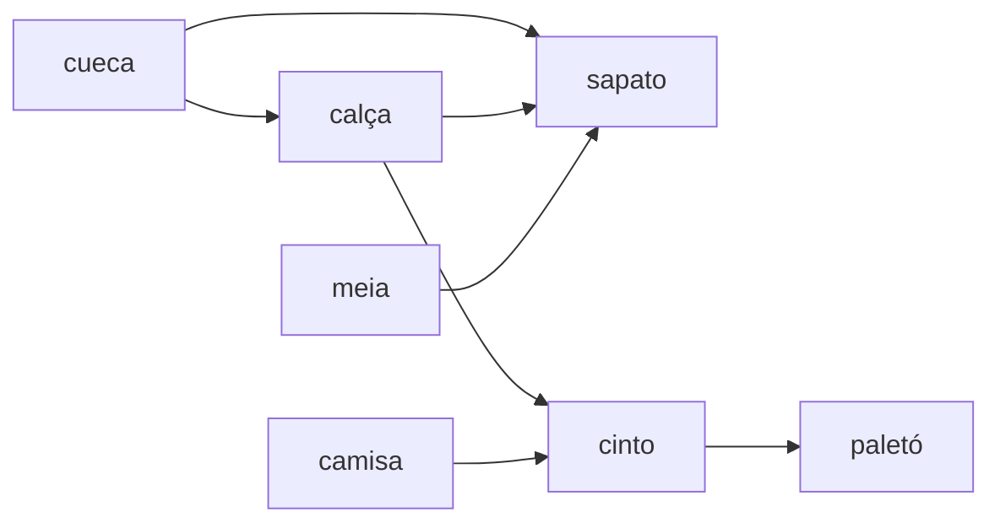

## Passo 1 · Leitura · Tarefas com dependências

Uma aresta `u → v` pode significar "`u` precisa vir antes de `v`": compilar antes de testar, vestir a meia antes do sapato, cursar a disciplina básica antes da avançada. Uma **ordenação topológica** é uma lista de todos os vértices em que, para toda aresta `u → v`, `u` aparece antes de `v`.



Ela existe **se e somente se** o grafo é um **DAG** (grafo direcionado acíclico). Com um ciclo `a → b → a`, `a` teria de vir antes de `b` e `b` antes de `a`. E costuma haver várias ordens válidas: `meia` pode vir em qualquer posição antes de `sapato`.

O **algoritmo de Kahn** constrói a ordem pelas pontas. O **grau de entrada** de um vértice é o número de dependências que ainda faltam para ele:

1. calcule o grau de entrada de todos os vértices e ponha numa fila os que têm grau 0;
2. tire um vértice da fila e acrescente-o à ordem; para cada aresta que sai dele, diminua o grau do destino e, se chegar a 0, enfileire o destino;
3. repita até a fila esvaziar.

Se a ordem terminar com **menos vértices que o grafo**, sobrou um ciclo: os vértices do ciclo esperam uns pelos outros e nenhum chega a grau 0. Cada vértice e cada aresta é processado uma vez: $O(V + E)$.

Os erros que aparecem nas primeiras versões:

- devolver a ordem parcial quando há ciclo, como se estivesse tudo certo; quem usa a lista executa as tarefas e nunca chega às que ficaram de fora;
- enfileirar o destino a cada aresta, sem esperar o grau chegar a 0: ele entra antes de todas as suas dependências e pode até entrar duas vezes;
- calcular o grau de **saída** (`grau[u] += 1`) em vez do de entrada;
- montar a fila inicial só com os vértices que aparecem em arestas, esquecendo os isolados.

Arestas paralelas não atrapalham: `u → v` duas vezes soma 2 ao grau de `v` e é descontada duas vezes.

## Passo 2 · Exercício · Monte o algoritmo de Kahn
modo: ordenar

Arraste as linhas para montar `ordem_topologica(grafo)`, que devolve uma ordenação topológica pelo algoritmo de Kahn, ou `None` se o grafo tiver ciclo. A fila começa com os vértices de grau 0 na ordem do dicionário, e cada destino entra no fim da fila quando o grau dele chega a 0. Ajuste a indentação de cada linha. Duas linhas estão sobrando.

### Instruções
1. Calcule o grau de entrada de todos os vértices, com 0 para quem não recebe arestas.
2. Comece a fila com os vértices de grau 0 e, a cada vértice retirado, desconte as arestas que saem dele.
3. Devolva `None` quando sobrar vértice fora da ordem.

### Solução
```python
from collections import deque


def ordem_topologica(grafo):
    grau = {v: 0 for v in grafo}
    for u in grafo:
        for v in grafo[u]:
            grau[v] += 1
    fila = deque(v for v in grafo if grau[v] == 0)
    ordem = []
    while fila:
        u = fila.popleft()
        ordem.append(u)
        for v in grafo[u]:
            grau[v] -= 1
            if grau[v] == 0:
                fila.append(v)
    if len(ordem) < len(grafo):
        return None
    return ordem
```

### Distratores
```python
grau[u] += 1
fila = deque(grafo)
```

### Verificação
```json
[
  { "id": "roupas", "checkpoint": 2, "kind": "expr",
    "setup": "g = {'cueca': ['calca', 'sapato'], 'calca': ['cinto', 'sapato'], 'meia': ['sapato'], 'camisa': ['gravata', 'cinto'], 'gravata': ['paleto'], 'cinto': ['paleto'], 'sapato': [], 'paleto': []}",
    "expr": "ordem_topologica(g)", "expected": ["cueca", "meia", "camisa", "calca", "gravata", "cinto", "sapato", "paleto"],
    "name": "Vestir-se: a ordem de Kahn com fila",
    "hint": "Um vértice só entra na fila quando todas as suas dependências já saíram." },
  { "id": "valida", "checkpoint": 2, "kind": "expr",
    "setup": "g = {i: [j for j in range(i + 1, 30) if (i * j) % 7 == 1] for i in range(30)}\nr = ordem_topologica(g)\npos = {v: k for k, v in enumerate(r)}",
    "expr": "[len(r), len(pos), all(pos[u] < pos[v] for u in g for v in g[u])]", "expected": [30, 30, true],
    "name": "30 vértices: toda aresta respeitada" },
  { "id": "grau-de-entrada", "checkpoint": 1, "kind": "expr",
    "expr": "ordem_topologica({'c': ['a'], 'b': ['a'], 'd': [], 'a': []})", "expected": ["c", "b", "d", "a"],
    "name": "Dois vértices apontam para o mesmo destino",
    "hint": "O grau que importa é o de entrada." },
  { "id": "isolados-e-vazio", "checkpoint": 1, "kind": "expr",
    "expr": "[ordem_topologica({}), ordem_topologica({'x': [], 'y': []})]", "expected": [[], ["x", "y"]],
    "name": "Grafo vazio e só vértices isolados" },
  { "id": "paralelas", "checkpoint": 2, "kind": "expr",
    "expr": "ordem_topologica({'b': [], 'a': ['b', 'b']})", "expected": ["a", "b"],
    "name": "Arestas paralelas são descontadas uma a uma" },
  { "id": "ciclo", "checkpoint": 3, "kind": "expr",
    "expr": "[ordem_topologica({'a': ['b'], 'b': ['c'], 'c': ['a']}), ordem_topologica({'a': ['a']})]", "expected": [null, null],
    "name": "Ciclo e laço: não existe ordem" },
  { "id": "ciclo-parcial", "checkpoint": 3, "kind": "expr",
    "expr": "ordem_topologica({'x': ['a'], 'a': ['b'], 'b': ['a'], 'y': []})", "expected": null,
    "name": "Parte do grafo ordena, mas há um ciclo no resto",
    "hint": "Compare o tamanho da ordem com o número de vértices." }
]
```

### Soluções erradas
```python name="devolve a ordem parcial quando há ciclo"
from collections import deque


def ordem_topologica(grafo):
    grau = {v: 0 for v in grafo}
    for u in grafo:
        for v in grafo[u]:
            grau[v] += 1
    fila = deque(v for v in grafo if grau[v] == 0)
    ordem = []
    while fila:
        u = fila.popleft()
        ordem.append(u)
        for v in grafo[u]:
            grau[v] -= 1
            if grau[v] == 0:
                fila.append(v)
    return ordem
```
```python name="enfileira o destino sem esperar o grau zerar"
from collections import deque


def ordem_topologica(grafo):
    grau = {v: 0 for v in grafo}
    for u in grafo:
        for v in grafo[u]:
            grau[v] += 1
    fila = deque(v for v in grafo if grau[v] == 0)
    ordem = []
    while fila:
        u = fila.popleft()
        if u in ordem:
            continue
        ordem.append(u)
        for v in grafo[u]:
            grau[v] -= 1
            fila.append(v)
    if len(ordem) < len(grafo):
        return None
    return ordem
```
```python name="calcula o grau de saída"
from collections import deque


def ordem_topologica(grafo):
    grau = {v: 0 for v in grafo}
    for u in grafo:
        for v in grafo[u]:
            grau[u] += 1
    fila = deque(v for v in grafo if grau[v] == 0)
    ordem = []
    while fila:
        u = fila.popleft()
        ordem.append(u)
        for v in grafo[u]:
            grau[v] -= 1
            if grau[v] == 0:
                fila.append(v)
    if len(ordem) < len(grafo):
        return None
    return ordem
```
```python name="fila inicial só com quem tem arestas"
from collections import deque


def ordem_topologica(grafo):
    grau = {v: 0 for v in grafo}
    for u in grafo:
        for v in grafo[u]:
            grau[v] += 1
    fila = deque(v for v in grafo if grau[v] == 0 and grafo[v])
    ordem = []
    while fila:
        u = fila.popleft()
        ordem.append(u)
        for v in grafo[u]:
            grau[v] -= 1
            if grau[v] == 0:
                fila.append(v)
    if len(ordem) < len(grafo):
        return None
    return ordem
```
```python name="desconta as arestas paralelas uma vez só"
from collections import deque


def ordem_topologica(grafo):
    grau = {v: 0 for v in grafo}
    for u in grafo:
        for v in grafo[u]:
            grau[v] += 1
    fila = deque(v for v in grafo if grau[v] == 0)
    ordem = []
    while fila:
        u = fila.popleft()
        ordem.append(u)
        for v in set(grafo[u]):
            grau[v] -= 1
            if grau[v] == 0:
                fila.append(v)
    if len(ordem) < len(grafo):
        return None
    return ordem
```

## Passo 3 · Previsão · A pós-ordem ao contrário

Outra forma de ordenar usa a DFS. O programa percorre o grafo das roupas, imprime cada vértice no momento em que a sua chamada **termina** e, no fim, a lista dos términos de trás para a frente. Leia sem executar e digite a saída exata.

### Código
```python
grafo = {
    "cueca": ["calca", "sapato"],
    "calca": ["cinto", "sapato"],
    "meia": ["sapato"],
    "camisa": ["gravata", "cinto"],
    "gravata": ["paleto"],
    "cinto": ["paleto"],
    "sapato": [],
    "paleto": [],
}
visitados = set()
pos_ordem = []


def visitar(u):
    visitados.add(u)
    for v in grafo[u]:
        if v not in visitados:
            visitar(v)
    pos_ordem.append(u)
    print("termina", u)


for v in grafo:
    if v not in visitados:
        visitar(v)
print(pos_ordem[::-1])
```

### Dicas
1. Uma chamada só termina depois que todas as chamadas que ela fez terminaram.
2. A primeira busca começa em `cueca` e desce por `calca` até `cinto` e `paleto`.
3. Quando a busca chega a `camisa`, `cinto` e `paleto` já terminaram.

### Saída esperada
```text
termina paleto
termina cinto
termina sapato
termina calca
termina cueca
termina meia
termina gravata
termina camisa
['camisa', 'gravata', 'meia', 'cueca', 'calca', 'sapato', 'cinto', 'paleto']
```

## Passo 4 · Leitura · Pós-ordem invertida e desempate pelo menor

Na DFS, um vértice termina só depois de tudo o que ele alcança. Então, numa aresta `u → v` de um DAG, `v` **termina antes** de `u`: ou a busca desce de `u` até `v` e `v` termina primeiro, ou `v` já tinha terminado quando `u` olhou para ele. (Num DAG, `v` nunca está "no meio", cinza, porque isso seria um ciclo.) Por isso a lista de términos, **invertida**, é uma ordenação topológica. Na Previsão, `cinto` termina antes de `calca` e de `camisa`, e aparece depois dos dois na lista invertida.

O cuidado é o mesmo da lição anterior: para detectar ciclo, a DFS precisa das **três cores**. Uma aresta para um vértice cinza é um ciclo, e a função deve avisar em vez de devolver uma "ordem". Com um `set` de visitados só, o ciclo passa despercebido, e a lista devolvida tem arestas apontando para trás. E esquecer de inverter devolve exatamente a ordem errada: os sapatos antes das meias.

#### Desempate pelo menor

Quando há várias ordens válidas, um sistema de build ou um gabarito podem exigir uma ordem **única**: entre os vértices liberados, sempre o **menor** (em ordem alfabética, ou o de menor número). Basta trocar a fila de Kahn por um **heap**: `heapq.heappop` devolve o menor dos liberados em $O(\log V)$, e o custo total fica

$$
O\big((V + E)\log V\big) .
$$

O erro comum é guardar os liberados numa lista e, a cada passo, tirar `min(livres)` ou ordenar a lista inteira. A resposta sai certa, mas cada escolha custa $O(V)$ comparações, e o total vira $O(V^2)$: com 1 000 tarefas independentes, cerca de 500 mil comparações, contra pouco mais de 10 mil do heap.

## Passo 5 · Exercício · Pós-ordem invertida e ordem pelo menor

Escreva duas funções que devolvem `None` quando o grafo tem ciclo (o laço `a → a` inclusive).

- `ordem_topologica_dfs(grafo)`: devolve uma ordenação topológica com a pós-ordem invertida de uma DFS de três cores, começando uma busca em cada vértice ainda branco. Qualquer ordem válida é aceita.
- `ordem_lexicografica(grafo)`: a ordem de Kahn em que, entre os vértices liberados, sai sempre o menor. A verificação usa vértices que contam as comparações: com 1 000 vértices, no máximo 30 000.

### Instruções
1. Escreva `ordem_topologica_dfs`: anote cada vértice quando ele termina e inverta a lista no fim.
2. Devolva `None` em `ordem_topologica_dfs` ao encontrar uma aresta para um vértice cinza.
3. Escreva `ordem_lexicografica` com um heap de vértices liberados, devolvendo `None` se sobrar vértice.

### Código inicial
```python
import heapq


def ordem_topologica_dfs(grafo):
    pass


def ordem_lexicografica(grafo):
    pass
```

### Solução
```python
import heapq


def ordem_topologica_dfs(grafo):
    BRANCO, CINZA, PRETO = 0, 1, 2
    cor = {v: BRANCO for v in grafo}
    pos_ordem = []

    def visitar(u):
        cor[u] = CINZA
        for v in grafo[u]:
            if cor[v] == CINZA:
                return False
            if cor[v] == BRANCO and not visitar(v):
                return False
        cor[u] = PRETO
        pos_ordem.append(u)
        return True

    for v in grafo:
        if cor[v] == BRANCO and not visitar(v):
            return None
    pos_ordem.reverse()
    return pos_ordem


def ordem_lexicografica(grafo):
    grau = {v: 0 for v in grafo}
    for u in grafo:
        for v in grafo[u]:
            grau[v] += 1
    livres = [v for v in grafo if grau[v] == 0]
    heapq.heapify(livres)
    ordem = []
    while livres:
        u = heapq.heappop(livres)
        ordem.append(u)
        for v in grafo[u]:
            grau[v] -= 1
            if grau[v] == 0:
                heapq.heappush(livres, v)
    if len(ordem) < len(grafo):
        return None
    return ordem
```

### Dicas
1. Um vértice entra na lista no fim da chamada dele, depois do laço dos vizinhos.
2. A recursão precisa avisar quem a chamou que achou um ciclo.
3. `heapq.heapify` transforma a lista inicial em heap em $O(V)$.

### Verificação
```json
[
  { "id": "dfs-roupas", "checkpoint": 1, "kind": "expr",
    "setup": "g = {'cueca': ['calca', 'sapato'], 'calca': ['cinto', 'sapato'], 'meia': ['sapato'], 'camisa': ['gravata', 'cinto'], 'gravata': ['paleto'], 'cinto': ['paleto'], 'sapato': [], 'paleto': []}\nr = ordem_topologica_dfs(g)\npos = {v: k for k, v in enumerate(r)}",
    "expr": "[sorted(r) == sorted(g), all(pos[u] < pos[v] for u in g for v in g[u])]", "expected": [true, true],
    "name": "Roupas: todos os vértices, toda aresta respeitada",
    "hint": "A lista de términos sai de trás para a frente." },
  { "id": "dfs-maior", "checkpoint": 1, "kind": "expr",
    "setup": "g = {i: [j for j in range(40) if j > i and (i + 2 * j) % 9 == 0] for i in range(39, -1, -1)}\nr = ordem_topologica_dfs(g)\npos = {v: k for k, v in enumerate(r)}",
    "expr": "[len(r), sorted(r) == list(range(40)), all(pos[u] < pos[v] for u in g for v in g[u])]", "expected": [40, true, true],
    "name": "40 vértices em ordem inversa no dicionário" },
  { "id": "dfs-bordas", "checkpoint": 1, "kind": "expr",
    "expr": "[ordem_topologica_dfs({}), ordem_topologica_dfs({'x': []}), ordem_topologica_dfs({'b': [], 'a': ['b', 'b']})]",
    "expected": [[], ["x"], ["a", "b"]], "name": "Vazio, isolado e arestas paralelas" },
  { "id": "dfs-desconexo", "checkpoint": 1, "kind": "expr",
    "setup": "g = {'p': ['q'], 'q': [], 'x': ['y'], 'y': ['z'], 'z': [], 'w': []}\nr = ordem_topologica_dfs(g)\npos = {v: k for k, v in enumerate(r)}",
    "expr": "[sorted(r), all(pos[u] < pos[v] for u in g for v in g[u])]", "expected": [["p", "q", "w", "x", "y", "z"], true],
    "name": "Três componentes, com um vértice isolado",
    "hint": "Comece uma busca em todo vértice que ainda não foi visitado." },
  { "id": "dfs-ciclo", "checkpoint": 2, "kind": "expr",
    "expr": "[ordem_topologica_dfs({'a': ['b'], 'b': ['c'], 'c': ['a']}), ordem_topologica_dfs({'a': ['a']}), ordem_topologica_dfs({'x': [], 'a': ['b'], 'b': ['a']})]",
    "expected": [null, null, null], "name": "Ciclo, laço e ciclo fora do primeiro componente",
    "hint": "Um vértice já visitado e ainda não terminado está no caminho atual." },
  { "id": "dfs-losango", "checkpoint": 2, "kind": "expr",
    "setup": "g = {'a': ['b', 'c'], 'b': ['d'], 'c': ['d'], 'd': []}\nr = ordem_topologica_dfs(g)",
    "expr": "[r is not None and sorted(r) == ['a', 'b', 'c', 'd'], r is not None and r[0] == 'a' and r[-1] == 'd']",
    "expected": [true, true], "name": "Losango não é ciclo" },
  { "id": "lex", "checkpoint": 3, "kind": "expr",
    "expr": "ordem_lexicografica({'c': ['a'], 'b': ['a'], 'd': [], 'a': []})", "expected": ["b", "c", "a", "d"],
    "name": "Entre os liberados, sai o menor",
    "hint": "A fila comum respeita a ordem de chegada, não a ordem alfabética." },
  { "id": "lex-numeros", "checkpoint": 3, "kind": "expr",
    "expr": "ordem_lexicografica({5: [11], 7: [11, 8], 3: [8, 10], 11: [2, 9, 10], 8: [9], 2: [], 9: [], 10: []})",
    "expected": [3, 5, 7, 8, 11, 2, 9, 10], "name": "Vértices numerados" },
  { "id": "lex-bordas", "checkpoint": 3, "kind": "expr",
    "expr": "[ordem_lexicografica({}), ordem_lexicografica({'b': [], 'a': []}), ordem_lexicografica({'z': ['a', 'a'], 'a': []})]",
    "expected": [[], ["a", "b"], ["z", "a"]], "name": "Vazio, isolados e arestas paralelas" },
  { "id": "lex-ciclo", "checkpoint": 3, "kind": "expr",
    "expr": "[ordem_lexicografica({'a': ['b'], 'b': ['a'], 'c': []}), ordem_lexicografica({'a': ['a']})]",
    "expected": [null, null], "name": "Com ciclo, None" },
  { "id": "lex-custo", "checkpoint": 3, "kind": "expr",
    "setup": "class S(str):\n    n = 0\n    def __lt__(self, o):\n        S.n += 1\n        return str.__lt__(self, o)\n    def __gt__(self, o):\n        S.n += 1\n        return str.__gt__(self, o)\n    def __le__(self, o):\n        S.n += 1\n        return str.__le__(self, o)\n    def __ge__(self, o):\n        S.n += 1\n        return str.__ge__(self, o)\n    __hash__ = str.__hash__\nnomes = [S('t%04d' % ((i * 7919) % 1000)) for i in range(1000)]\ng = {v: [] for v in nomes}\nfor i in range(0, 999, 3):\n    g[nomes[i]].append(nomes[i + 1])\nS.n = 0\nr = ordem_lexicografica(g)",
    "expr": "[len(r), r[:3], S.n <= 30000]", "expected": [1000, ["t0000", "t0004", "t0005"], true],
    "name": "1 000 vértices: no máximo 30 000 comparações",
    "hint": "Procurar o menor numa lista a cada passo custa uma comparação por liberado." }
]
```

### Soluções erradas
```python name="pós-ordem sem inverter"
import heapq


def ordem_topologica_dfs(grafo):
    BRANCO, CINZA, PRETO = 0, 1, 2
    cor = {v: BRANCO for v in grafo}
    pos_ordem = []

    def visitar(u):
        cor[u] = CINZA
        for v in grafo[u]:
            if cor[v] == CINZA:
                return False
            if cor[v] == BRANCO and not visitar(v):
                return False
        cor[u] = PRETO
        pos_ordem.append(u)
        return True

    for v in grafo:
        if cor[v] == BRANCO and not visitar(v):
            return None
    return pos_ordem


def ordem_lexicografica(grafo):
    grau = {v: 0 for v in grafo}
    for u in grafo:
        for v in grafo[u]:
            grau[v] += 1
    livres = [v for v in grafo if grau[v] == 0]
    heapq.heapify(livres)
    ordem = []
    while livres:
        u = heapq.heappop(livres)
        ordem.append(u)
        for v in grafo[u]:
            grau[v] -= 1
            if grau[v] == 0:
                heapq.heappush(livres, v)
    if len(ordem) < len(grafo):
        return None
    return ordem
```
```python name="DFS com set de visitados não vê o ciclo"
import heapq


def ordem_topologica_dfs(grafo):
    visitados = set()
    pos_ordem = []

    def visitar(u):
        visitados.add(u)
        for v in grafo[u]:
            if v not in visitados:
                visitar(v)
        pos_ordem.append(u)

    for v in grafo:
        if v not in visitados:
            visitar(v)
    pos_ordem.reverse()
    return pos_ordem


def ordem_lexicografica(grafo):
    grau = {v: 0 for v in grafo}
    for u in grafo:
        for v in grafo[u]:
            grau[v] += 1
    livres = [v for v in grafo if grau[v] == 0]
    heapq.heapify(livres)
    ordem = []
    while livres:
        u = heapq.heappop(livres)
        ordem.append(u)
        for v in grafo[u]:
            grau[v] -= 1
            if grau[v] == 0:
                heapq.heappush(livres, v)
    if len(ordem) < len(grafo):
        return None
    return ordem
```
```python name="DFS só a partir do primeiro vértice"
import heapq


def ordem_topologica_dfs(grafo):
    BRANCO, CINZA, PRETO = 0, 1, 2
    cor = {v: BRANCO for v in grafo}
    pos_ordem = []

    def visitar(u):
        cor[u] = CINZA
        for v in grafo[u]:
            if cor[v] == CINZA:
                return False
            if cor[v] == BRANCO and not visitar(v):
                return False
        cor[u] = PRETO
        pos_ordem.append(u)
        return True

    if grafo and not visitar(next(iter(grafo))):
        return None
    pos_ordem.reverse()
    return pos_ordem


def ordem_lexicografica(grafo):
    grau = {v: 0 for v in grafo}
    for u in grafo:
        for v in grafo[u]:
            grau[v] += 1
    livres = [v for v in grafo if grau[v] == 0]
    heapq.heapify(livres)
    ordem = []
    while livres:
        u = heapq.heappop(livres)
        ordem.append(u)
        for v in grafo[u]:
            grau[v] -= 1
            if grau[v] == 0:
                heapq.heappush(livres, v)
    if len(ordem) < len(grafo):
        return None
    return ordem
```
```python name="ordem pelo menor com fila comum"
from collections import deque


def ordem_topologica_dfs(grafo):
    BRANCO, CINZA, PRETO = 0, 1, 2
    cor = {v: BRANCO for v in grafo}
    pos_ordem = []

    def visitar(u):
        cor[u] = CINZA
        for v in grafo[u]:
            if cor[v] == CINZA:
                return False
            if cor[v] == BRANCO and not visitar(v):
                return False
        cor[u] = PRETO
        pos_ordem.append(u)
        return True

    for v in grafo:
        if cor[v] == BRANCO and not visitar(v):
            return None
    pos_ordem.reverse()
    return pos_ordem


def ordem_lexicografica(grafo):
    grau = {v: 0 for v in grafo}
    for u in grafo:
        for v in grafo[u]:
            grau[v] += 1
    livres = deque(v for v in grafo if grau[v] == 0)
    ordem = []
    while livres:
        u = livres.popleft()
        ordem.append(u)
        for v in grafo[u]:
            grau[v] -= 1
            if grau[v] == 0:
                livres.append(v)
    if len(ordem) < len(grafo):
        return None
    return ordem
```
```python name="ordem pelo menor com min() numa lista"
import heapq


def ordem_topologica_dfs(grafo):
    BRANCO, CINZA, PRETO = 0, 1, 2
    cor = {v: BRANCO for v in grafo}
    pos_ordem = []

    def visitar(u):
        cor[u] = CINZA
        for v in grafo[u]:
            if cor[v] == CINZA:
                return False
            if cor[v] == BRANCO and not visitar(v):
                return False
        cor[u] = PRETO
        pos_ordem.append(u)
        return True

    for v in grafo:
        if cor[v] == BRANCO and not visitar(v):
            return None
    pos_ordem.reverse()
    return pos_ordem


def ordem_lexicografica(grafo):
    grau = {v: 0 for v in grafo}
    for u in grafo:
        for v in grafo[u]:
            grau[v] += 1
    livres = [v for v in grafo if grau[v] == 0]
    ordem = []
    while livres:
        u = min(livres)
        livres.remove(u)
        ordem.append(u)
        for v in grafo[u]:
            grau[v] -= 1
            if grau[v] == 0:
                livres.append(v)
    if len(ordem) < len(grafo):
        return None
    return ordem
```
```python name="ordem pelo menor devolve a parte sem ciclo"
import heapq


def ordem_topologica_dfs(grafo):
    BRANCO, CINZA, PRETO = 0, 1, 2
    cor = {v: BRANCO for v in grafo}
    pos_ordem = []

    def visitar(u):
        cor[u] = CINZA
        for v in grafo[u]:
            if cor[v] == CINZA:
                return False
            if cor[v] == BRANCO and not visitar(v):
                return False
        cor[u] = PRETO
        pos_ordem.append(u)
        return True

    for v in grafo:
        if cor[v] == BRANCO and not visitar(v):
            return None
    pos_ordem.reverse()
    return pos_ordem


def ordem_lexicografica(grafo):
    grau = {v: 0 for v in grafo}
    for u in grafo:
        for v in grafo[u]:
            grau[v] += 1
    livres = [v for v in grafo if grau[v] == 0]
    heapq.heapify(livres)
    ordem = []
    while livres:
        u = heapq.heappop(livres)
        ordem.append(u)
        for v in grafo[u]:
            grau[v] -= 1
            if grau[v] == 0:
                heapq.heappush(livres, v)
    return ordem
```

## Passo 6 · Leitura · Semestres, planilhas e o ciclo como resposta

Numa grade curricular, cada disciplina lista os seus **pré-requisitos**: `{"fisica2": ["fisica1", "calculo2"], ...}`. Repare na direção: o dicionário diz "de quem eu dependo", o contrário das listas de adjacência `u → v` usadas até aqui. Para rodar Kahn, monte primeiro a lista de **dependentes** de cada disciplina; o grau de entrada é o tamanho da lista de pré-requisitos.

Sem limite de disciplinas por semestre, o **mínimo de semestres** é o tamanho, em disciplinas, da **cadeia de pré-requisitos mais longa**. Cada disciplina vai para o primeiro semestre depois de todos os seus pré-requisitos:

$$
\text{sem}(d) = 1 + \max_{p \,\in\, \text{pre}(d)} \text{sem}(p), \qquad \text{sem}(d) = 1 \text{ se não há pré-requisitos.}
$$

O máximo é essencial. Uma BFS a partir das disciplinas sem pré-requisito, que dá a cada disciplina o semestre da **primeira** vez que ela é alcançada, calcula o caminho **mais curto** e coloca uma disciplina antes de um dos seus pré-requisitos. Com Kahn, a conta fica natural: ao descontar a aresta `p → d`, atualize `sem[d]` com o máximo entre o valor atual e `sem[p] + 1`; quando `d` é liberada, todos os pré-requisitos já passaram por ela.

O mesmo cálculo aparece em outros lugares. Uma planilha guarda, para cada célula, as células que a fórmula usa; ao mudar um valor, recalcula as dependentes em ordem topológica, e uma fórmula que depende de si mesma, direta ou indiretamente, recebe o aviso de **referência circular**. Gerenciadores de pacotes e ferramentas de build instalam e compilam em ordem topológica e param com erro diante de um ciclo.

#### Mostrar o ciclo

"Não dá" é pouco para quem precisa consertar o arquivo. A DFS de três cores consegue devolver o próprio ciclo: guarde numa lista o **caminho atual**, empilhando ao entrar num vértice e desempilhando ao sair. Quando aparecer uma aresta `u → v` com `v` cinza, `v` está nesse caminho, e o trecho de `v` até `u`, fechado com `v` de novo, é um ciclo: `["b", "c", "d", "b"]`. O erro típico é devolver o caminho **inteiro**, desde a raiz da busca: o começo dele não faz parte do ciclo.

## Passo 7 · Exercício · Mínimo de semestres e o ciclo

Escreva duas funções.

- `minimo_de_semestres(prerequisitos)`: `prerequisitos` é um dicionário `disciplina → lista de pré-requisitos`, em que toda disciplina citada é chave. Devolve o número mínimo de semestres, sem limite de disciplinas por semestre; `0` sem disciplinas; `-1` se houver dependência circular.
- `encontrar_ciclo(grafo)`: para um grafo `u → lista de v`, devolve um ciclo como lista de vértices que começa e termina no mesmo vértice, sem repetir os do meio (o laço `a → a` vira `["a", "a"]`), ou `None` se o grafo for um DAG.

### Instruções
1. Em `minimo_de_semestres`, monte a lista de dependentes e rode Kahn, guardando para cada disciplina o maior semestre de um pré-requisito mais um.
2. Devolva `-1` em `minimo_de_semestres` quando sobrar disciplina.
3. Em `encontrar_ciclo`, use as três cores e o caminho atual, devolvendo só o trecho que forma o ciclo.

### Código inicial
```python
from collections import deque


def minimo_de_semestres(prerequisitos):
    pass


def encontrar_ciclo(grafo):
    pass
```

### Solução
```python
from collections import deque


def minimo_de_semestres(prerequisitos):
    dependentes = {d: [] for d in prerequisitos}
    faltam = {d: len(prerequisitos[d]) for d in prerequisitos}
    for d in prerequisitos:
        for p in prerequisitos[d]:
            dependentes[p].append(d)
    semestre = {d: 1 for d in prerequisitos}
    fila = deque(d for d in prerequisitos if faltam[d] == 0)
    cursadas = 0
    while fila:
        p = fila.popleft()
        cursadas += 1
        for d in dependentes[p]:
            semestre[d] = max(semestre[d], semestre[p] + 1)
            faltam[d] -= 1
            if faltam[d] == 0:
                fila.append(d)
    if cursadas < len(prerequisitos):
        return -1
    return max(semestre.values(), default=0)


def encontrar_ciclo(grafo):
    BRANCO, CINZA, PRETO = 0, 1, 2
    cor = {v: BRANCO for v in grafo}
    caminho = []

    def visitar(u):
        cor[u] = CINZA
        caminho.append(u)
        for v in grafo[u]:
            if cor[v] == CINZA:
                return caminho[caminho.index(v):] + [v]
            if cor[v] == BRANCO:
                ciclo = visitar(v)
                if ciclo is not None:
                    return ciclo
        caminho.pop()
        cor[u] = PRETO
        return None

    for v in grafo:
        if cor[v] == BRANCO:
            ciclo = visitar(v)
            if ciclo is not None:
                return ciclo
    return None
```

### Dicas
1. A aresta da conta vai do pré-requisito para a disciplina que depende dele.
2. Uma disciplina com dois pré-requisitos depende do que termina mais tarde.
3. O vértice cinza que fecha o ciclo está em algum ponto do caminho atual, não necessariamente no começo.

### Verificação
```json
[
  { "id": "grade", "checkpoint": 1, "kind": "expr",
    "setup": "pre = {'calculo1': [], 'calculo2': ['calculo1'], 'fisica1': ['calculo1'], 'fisica2': ['fisica1', 'calculo2'], 'algebra': [], 'edo': ['calculo2', 'algebra'], 'fisica3': ['fisica2', 'edo']}",
    "expr": "minimo_de_semestres(pre)", "expected": 4, "name": "Grade com sete disciplinas: 4 semestres" },
  { "id": "caminhos-desiguais", "checkpoint": 1, "kind": "expr",
    "setup": "pre = {'a': [], 'b': ['a'], 'c': ['b'], 'd': ['c'], 'final': ['a', 'd']}",
    "expr": "minimo_de_semestres(pre)", "expected": 5,
    "name": "Um pré-requisito curto e outro longo: vale o mais longo",
    "hint": "A disciplina espera o último dos seus pré-requisitos, não o primeiro." },
  { "id": "semestres-bordas", "checkpoint": 1, "kind": "expr",
    "expr": "[minimo_de_semestres({}), minimo_de_semestres({'x': [], 'y': []}), minimo_de_semestres({'b': ['a', 'a'], 'a': []})]",
    "expected": [0, 1, 2], "name": "Sem disciplinas, todas livres e pré-requisito repetido" },
  { "id": "semestres-ciclo", "checkpoint": 2, "kind": "expr",
    "expr": "[minimo_de_semestres({'a': ['b'], 'b': ['a'], 'c': []}), minimo_de_semestres({'a': ['a']})]",
    "expected": [-1, -1], "name": "Dependência circular dá -1" },
  { "id": "ciclo-meio", "checkpoint": 3, "kind": "expr",
    "setup": "g = {'a': ['b'], 'b': ['c'], 'c': ['d'], 'd': ['b']}\nc = encontrar_ciclo(g)",
    "expr": "c", "expected": ["b", "c", "d", "b"], "name": "O ciclo b → c → d → b, sem o a do começo",
    "hint": "O começo do caminho atual pode não fazer parte do ciclo." },
  { "id": "ciclo-valido", "checkpoint": 3, "kind": "expr",
    "setup": "def eh_ciclo(g, c):\n    return isinstance(c, list) and len(c) >= 2 and c[0] == c[-1] and len(set(c[:-1])) == len(c) - 1 and all(c[i + 1] in g[c[i]] for i in range(len(c) - 1))\ng = {i: [(i * 3 + 1) % 50, (i + 7) % 50] if i % 10 else [] for i in range(50)}\ng[49] = [12]\nc = encontrar_ciclo(g)",
    "expr": "eh_ciclo(g, c)", "expected": true, "name": "Num grafo de 50 vértices, o ciclo devolvido existe" },
  { "id": "ciclo-laco", "checkpoint": 3, "kind": "expr", "expr": "encontrar_ciclo({'x': [], 'a': ['a']})",
    "expected": ["a", "a"], "name": "Laço é um ciclo de um vértice" },
  { "id": "ciclo-dag", "checkpoint": 3, "kind": "expr",
    "expr": "[encontrar_ciclo({'a': ['b', 'c'], 'b': ['d'], 'c': ['d'], 'd': []}), encontrar_ciclo({}), encontrar_ciclo({'a': ['b', 'b'], 'b': []})]",
    "expected": [null, null, null], "name": "Losango, vazio e arestas paralelas não têm ciclo",
    "hint": "Chegar a um vértice já terminado não fecha ciclo." },
  { "id": "ciclo-outro-componente", "checkpoint": 3, "kind": "expr",
    "expr": "encontrar_ciclo({'p': ['q'], 'q': [], 'x': ['y'], 'y': ['x']})", "expected": ["x", "y", "x"],
    "name": "O ciclo está fora do componente do primeiro vértice" }
]
```

### Soluções erradas
```python name="semestres sem detectar dependência circular"
from collections import deque


def minimo_de_semestres(prerequisitos):
    dependentes = {d: [] for d in prerequisitos}
    faltam = {d: len(prerequisitos[d]) for d in prerequisitos}
    for d in prerequisitos:
        for p in prerequisitos[d]:
            dependentes[p].append(d)
    semestre = {d: 1 for d in prerequisitos}
    fila = deque(d for d in prerequisitos if faltam[d] == 0)
    while fila:
        p = fila.popleft()
        for d in dependentes[p]:
            semestre[d] = max(semestre[d], semestre[p] + 1)
            faltam[d] -= 1
            if faltam[d] == 0:
                fila.append(d)
    return max(semestre.values(), default=0)


def encontrar_ciclo(grafo):
    BRANCO, CINZA, PRETO = 0, 1, 2
    cor = {v: BRANCO for v in grafo}
    caminho = []

    def visitar(u):
        cor[u] = CINZA
        caminho.append(u)
        for v in grafo[u]:
            if cor[v] == CINZA:
                return caminho[caminho.index(v):] + [v]
            if cor[v] == BRANCO:
                ciclo = visitar(v)
                if ciclo is not None:
                    return ciclo
        caminho.pop()
        cor[u] = PRETO
        return None

    for v in grafo:
        if cor[v] == BRANCO:
            ciclo = visitar(v)
            if ciclo is not None:
                return ciclo
    return None
```
```python name="semestre pela BFS: a primeira vez que alcança"
from collections import deque


def minimo_de_semestres(prerequisitos):
    dependentes = {d: [] for d in prerequisitos}
    for d in prerequisitos:
        for p in prerequisitos[d]:
            dependentes[p].append(d)
    semestre = {d: 1 for d in prerequisitos if not prerequisitos[d]}
    fila = deque(semestre)
    while fila:
        p = fila.popleft()
        for d in dependentes[p]:
            if d not in semestre:
                semestre[d] = semestre[p] + 1
                fila.append(d)
    if len(semestre) < len(prerequisitos):
        return -1
    return max(semestre.values(), default=0)


def encontrar_ciclo(grafo):
    BRANCO, CINZA, PRETO = 0, 1, 2
    cor = {v: BRANCO for v in grafo}
    caminho = []

    def visitar(u):
        cor[u] = CINZA
        caminho.append(u)
        for v in grafo[u]:
            if cor[v] == CINZA:
                return caminho[caminho.index(v):] + [v]
            if cor[v] == BRANCO:
                ciclo = visitar(v)
                if ciclo is not None:
                    return ciclo
        caminho.pop()
        cor[u] = PRETO
        return None

    for v in grafo:
        if cor[v] == BRANCO:
            ciclo = visitar(v)
            if ciclo is not None:
                return ciclo
    return None
```
```python name="conta arestas em vez de semestres"
from collections import deque


def minimo_de_semestres(prerequisitos):
    dependentes = {d: [] for d in prerequisitos}
    faltam = {d: len(prerequisitos[d]) for d in prerequisitos}
    for d in prerequisitos:
        for p in prerequisitos[d]:
            dependentes[p].append(d)
    semestre = {d: 0 for d in prerequisitos}
    fila = deque(d for d in prerequisitos if faltam[d] == 0)
    cursadas = 0
    while fila:
        p = fila.popleft()
        cursadas += 1
        for d in dependentes[p]:
            semestre[d] = max(semestre[d], semestre[p] + 1)
            faltam[d] -= 1
            if faltam[d] == 0:
                fila.append(d)
    if cursadas < len(prerequisitos):
        return -1
    return max(semestre.values(), default=0)


def encontrar_ciclo(grafo):
    BRANCO, CINZA, PRETO = 0, 1, 2
    cor = {v: BRANCO for v in grafo}
    caminho = []

    def visitar(u):
        cor[u] = CINZA
        caminho.append(u)
        for v in grafo[u]:
            if cor[v] == CINZA:
                return caminho[caminho.index(v):] + [v]
            if cor[v] == BRANCO:
                ciclo = visitar(v)
                if ciclo is not None:
                    return ciclo
        caminho.pop()
        cor[u] = PRETO
        return None

    for v in grafo:
        if cor[v] == BRANCO:
            ciclo = visitar(v)
            if ciclo is not None:
                return ciclo
    return None
```
```python name="devolve o caminho inteiro desde a raiz"
from collections import deque


def minimo_de_semestres(prerequisitos):
    dependentes = {d: [] for d in prerequisitos}
    faltam = {d: len(prerequisitos[d]) for d in prerequisitos}
    for d in prerequisitos:
        for p in prerequisitos[d]:
            dependentes[p].append(d)
    semestre = {d: 1 for d in prerequisitos}
    fila = deque(d for d in prerequisitos if faltam[d] == 0)
    cursadas = 0
    while fila:
        p = fila.popleft()
        cursadas += 1
        for d in dependentes[p]:
            semestre[d] = max(semestre[d], semestre[p] + 1)
            faltam[d] -= 1
            if faltam[d] == 0:
                fila.append(d)
    if cursadas < len(prerequisitos):
        return -1
    return max(semestre.values(), default=0)


def encontrar_ciclo(grafo):
    BRANCO, CINZA, PRETO = 0, 1, 2
    cor = {v: BRANCO for v in grafo}
    caminho = []

    def visitar(u):
        cor[u] = CINZA
        caminho.append(u)
        for v in grafo[u]:
            if cor[v] == CINZA:
                return caminho + [v]
            if cor[v] == BRANCO:
                ciclo = visitar(v)
                if ciclo is not None:
                    return ciclo
        caminho.pop()
        cor[u] = PRETO
        return None

    for v in grafo:
        if cor[v] == BRANCO:
            ciclo = visitar(v)
            if ciclo is not None:
                return ciclo
    return None
```
```python name="não fecha o ciclo com o primeiro vértice"
from collections import deque


def minimo_de_semestres(prerequisitos):
    dependentes = {d: [] for d in prerequisitos}
    faltam = {d: len(prerequisitos[d]) for d in prerequisitos}
    for d in prerequisitos:
        for p in prerequisitos[d]:
            dependentes[p].append(d)
    semestre = {d: 1 for d in prerequisitos}
    fila = deque(d for d in prerequisitos if faltam[d] == 0)
    cursadas = 0
    while fila:
        p = fila.popleft()
        cursadas += 1
        for d in dependentes[p]:
            semestre[d] = max(semestre[d], semestre[p] + 1)
            faltam[d] -= 1
            if faltam[d] == 0:
                fila.append(d)
    if cursadas < len(prerequisitos):
        return -1
    return max(semestre.values(), default=0)


def encontrar_ciclo(grafo):
    BRANCO, CINZA, PRETO = 0, 1, 2
    cor = {v: BRANCO for v in grafo}
    caminho = []

    def visitar(u):
        cor[u] = CINZA
        caminho.append(u)
        for v in grafo[u]:
            if cor[v] == CINZA:
                return caminho[caminho.index(v):]
            if cor[v] == BRANCO:
                ciclo = visitar(v)
                if ciclo is not None:
                    return ciclo
        caminho.pop()
        cor[u] = PRETO
        return None

    for v in grafo:
        if cor[v] == BRANCO:
            ciclo = visitar(v)
            if ciclo is not None:
                return ciclo
    return None
```
```python name="ciclo com set de visitados acusa o losango"
from collections import deque


def minimo_de_semestres(prerequisitos):
    dependentes = {d: [] for d in prerequisitos}
    faltam = {d: len(prerequisitos[d]) for d in prerequisitos}
    for d in prerequisitos:
        for p in prerequisitos[d]:
            dependentes[p].append(d)
    semestre = {d: 1 for d in prerequisitos}
    fila = deque(d for d in prerequisitos if faltam[d] == 0)
    cursadas = 0
    while fila:
        p = fila.popleft()
        cursadas += 1
        for d in dependentes[p]:
            semestre[d] = max(semestre[d], semestre[p] + 1)
            faltam[d] -= 1
            if faltam[d] == 0:
                fila.append(d)
    if cursadas < len(prerequisitos):
        return -1
    return max(semestre.values(), default=0)


def encontrar_ciclo(grafo):
    visitados = set()
    caminho = []

    def visitar(u):
        visitados.add(u)
        caminho.append(u)
        for v in grafo[u]:
            if v in visitados:
                return caminho[caminho.index(v):] + [v]
            ciclo = visitar(v)
            if ciclo is not None:
                return ciclo
        caminho.pop()
        return None

    for v in grafo:
        if v not in visitados:
            ciclo = visitar(v)
            if ciclo is not None:
                return ciclo
    return None
```

## Passo 8 · Quiz · Ordens, ciclos e aplicações

### Pergunta
Um instalador de pacotes roda o algoritmo de Kahn sobre 200 pacotes e termina com a fila vazia depois de colocar 187 na ordem. O que isso diz?
- [ ] Os 13 restantes não têm dependências e podem ser instalados no fim, em qualquer ordem
- [x] Há pelo menos um ciclo de dependências entre os 13 restantes (ou que os bloqueia), e nenhuma ordem completa existe
- [ ] O algoritmo tem um defeito: Kahn sempre ordena todos os vértices
- [ ] Os 13 pacotes estão duplicados na lista de entrada
> Um vértice sem dependências tem grau 0 e entra na fila logo no início. Se sobraram vértices com grau positivo, cada um espera por outro que também ficou de fora; seguindo essas esperas, os vértices se repetem, e isso é um ciclo. Por isso Kahn detecta ciclos de graça: basta comparar o tamanho da ordem com o número de vértices.

### Pergunta
Uma planilha tem `A1 = B1 + 1`, `B1 = C1 * 2` e `C1 = A1 - 3`. O que um recálculo baseado em ordem topológica deve fazer?
- [ ] Calcular A1, depois B1, depois C1, na ordem das colunas
- [ ] Calcular as três células com o valor 0 e repetir até estabilizar
- [x] Avisar uma referência circular, mostrando o ciclo A1 → B1 → C1 → A1, porque não existe ordem em que cada célula venha depois das que ela usa
- [ ] Ignorar a fórmula de C1, que foi a última a ser escrita
> As dependências formam um ciclo: A1 precisa de B1, que precisa de C1, que precisa de A1. Num grafo com ciclo não há ordenação topológica. Devolver o próprio ciclo, como a DFS de três cores faz, diz ao usuário exatamente quais células consertar.

### Pergunta
Um curso tem 12 disciplinas. A cadeia de pré-requisitos mais longa tem 5 disciplinas, e não há limite de disciplinas por semestre. Qual é o mínimo de semestres?
- [ ] 12, uma disciplina por semestre
- [ ] 4, o número de arestas da cadeia mais longa
- [x] 5, porque cada disciplina da cadeia precisa de um semestre depois da anterior, e as outras cabem nesses semestres
- [ ] Depende da ordem em que as disciplinas aparecem no arquivo
> Sem limite de carga, cada disciplina vai para o primeiro semestre depois de todos os seus pré-requisitos, $\text{sem}(d) = 1 + \max \text{sem}(p)$. O resultado é o tamanho, em disciplinas, da cadeia mais longa: as 5 disciplinas dela precisam de 5 semestres distintos, e nenhuma outra disciplina obriga a mais. Contar arestas daria 4, um a menos.
