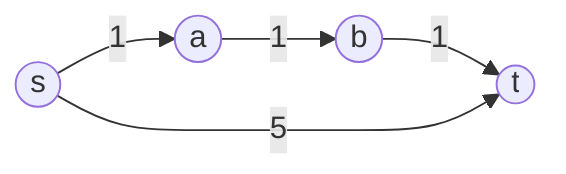

## Passo 1 · Leitura · Relaxar arestas

Quando cada aresta tem um custo (minutos, quilômetros, reais), o menor caminho é o de **menor soma de pesos**, e ele pode ter mais arestas que outro:



A BFS chegaria a `t` pela aresta direta, de custo 5; o caminho `s → a → b → t` custa 3. O grafo ponderado fica como na primeira lição do módulo, com pares `(vizinho, peso)`: `{"s": [("a", 1), ("t", 5)], ...}`.

O algoritmo de **Dijkstra** mantém uma distância **provisória** para cada vértice já alcançado e a melhora com o **relaxamento**: ao olhar a aresta `u → v` de peso $w$,

$$
\text{se } \text{dist}(u) + w < \text{dist}(v), \text{ então } \text{dist}(v) \leftarrow \text{dist}(u) + w .
$$

A cada rodada, ele escolhe o vértice ainda não processado com a **menor** distância provisória e relaxa as arestas que saem dele. A escolha usa um heap de pares `(distância, vértice)`:

```python
dist = {origem: 0}
heap = [(0, origem)]
while heap:
    d, u = heapq.heappop(heap)
    if d > dist[u]:
        continue                     # entrada obsoleta
    for v, peso in grafo[u]:
        if v not in dist or d + peso < dist[v]:
            dist[v] = d + peso
            heapq.heappush(heap, (dist[v], v))
```

O `heapq` não sabe diminuir a prioridade de um item que já está lá dentro. Quando `dist[v]` melhora, o código empurra um par **novo**, e o antigo fica no heap com uma distância maior. Ao sair, esse par é uma **entrada obsoleta**: `d > dist[u]`, e o `continue` o descarta sem reprocessar o vértice.

Três erros comuns:

- **Não pular as obsoletas.** As distâncias saem certas, mas o mesmo vértice tem a lista de vizinhos relida a cada cópia que sai do heap.
- **Dar o vértice por resolvido ao empurrá-lo.** O primeiro caminho encontrado até `v` vira definitivo, mesmo que um caminho mais barato apareça depois.
- **Empurrar `(vértice, distância)`.** O heap passa a ordenar pelo nome do vértice, e a escolha do "mais próximo" se perde.

## Passo 2 · Exercício · Dijkstra com heapq
modo: lacunas

Complete as lacunas (`___`). `dijkstra(grafo, origem)` recebe um grafo `vértice → lista de (vizinho, peso)`, com pesos não negativos, e devolve o dicionário das menores distâncias da origem a cada vértice **alcançável**. Arestas paralelas podem ter pesos diferentes.

### Instruções
1. Descarte a entrada obsoleta: a distância que saiu do heap é maior que a melhor conhecida.
2. Calcule a distância por `u` até o vizinho.
3. Atualize e empurre quando o vizinho for novo ou a distância nova for **estritamente** menor.

### Código inicial
```python
import heapq


def dijkstra(grafo, origem):
    dist = {origem: 0}
    heap = [(0, origem)]
    while heap:
        d, u = heapq.heappop(heap)
        if d > ___:
            continue
        for v, peso in grafo[u]:
            nova = ___
            if v not in dist or nova < ___:
                dist[v] = nova
                heapq.heappush(heap, (___, v))
    return dist
```

### Solução
```python
import heapq


def dijkstra(grafo, origem):
    dist = {origem: 0}
    heap = [(0, origem)]
    while heap:
        d, u = heapq.heappop(heap)
        if d > dist[u]:
            continue
        for v, peso in grafo[u]:
            nova = d + peso
            if v not in dist or nova < dist[v]:
                dist[v] = nova
                heapq.heappush(heap, (nova, v))
    return dist
```

### Dicas
1. Compare com a melhor distância já registrada para `u`.
2. O heap ordena tuplas pelo primeiro campo.
3. Um vizinho ainda sem distância sempre entra.

### Verificação
```json
[
  { "id": "basico", "checkpoint": 3, "kind": "expr",
    "setup": "g = {'s': [('a', 1), ('t', 5)], 'a': [('b', 1)], 'b': [('t', 1)], 't': []}",
    "expr": "dijkstra(g, 's')", "expected": { "s": 0, "a": 1, "b": 2, "t": 3 },
    "name": "O caminho com mais arestas é o mais barato",
    "hint": "O primeiro caminho encontrado até t não é o definitivo." },
  { "id": "mapa", "checkpoint": 2, "kind": "expr",
    "setup": "g = {'casa': [('praca', 4), ('mercado', 9)], 'praca': [('mercado', 3), ('escola', 8)], 'mercado': [('escola', 2), ('praca', 1)], 'escola': [('casa', 6)]}",
    "expr": "[dijkstra(g, 'casa'), dijkstra(g, 'escola')]",
    "expected": [{ "casa": 0, "praca": 4, "mercado": 7, "escola": 9 }, { "escola": 0, "casa": 6, "praca": 10, "mercado": 13 }],
    "name": "Mapa com mão única e ciclos" },
  { "id": "ordem-do-heap", "checkpoint": 3, "kind": "expr",
    "setup": "g = {'a': [('z', 1), ('b', 10)], 'z': [('y', 1)], 'y': [('b', 1)], 'b': []}",
    "expr": "dijkstra(g, 'a')['b']", "expected": 3,
    "name": "O mais próximo sai primeiro, qualquer que seja o nome",
    "hint": "O primeiro campo da tupla decide a ordem do heap." },
  { "id": "inalcancavel", "checkpoint": 3, "kind": "expr",
    "setup": "g = {'a': [('b', 2)], 'b': [], 'c': [('a', 1)], 'd': []}",
    "expr": "[dijkstra(g, 'a'), dijkstra(g, 'd')]", "expected": [{ "a": 0, "b": 2 }, { "d": 0 }],
    "name": "Só os alcançáveis aparecem; origem isolada" },
  { "id": "paralelas-laco", "checkpoint": 3, "kind": "expr",
    "setup": "g = {'a': [('a', 1), ('b', 7), ('b', 2), ('b', 5)], 'b': [('b', 0)]}",
    "expr": "dijkstra(g, 'a')", "expected": { "a": 0, "b": 2 },
    "name": "Entre arestas paralelas, vale a mais barata; laços não mudam nada",
    "hint": "Cada aresta paralela é uma opção diferente." },
  { "id": "zero-e-decimal", "checkpoint": 2, "kind": "expr",
    "setup": "g = {'a': [('b', 0), ('c', 2.5)], 'b': [('c', 0.75)], 'c': []}",
    "expr": "dijkstra(g, 'a')", "expected": { "a": 0, "b": 0, "c": 0.75 }, "tolerance": 1e-9,
    "name": "Pesos zero e decimais" },
  { "id": "numeros", "checkpoint": 2, "kind": "expr",
    "setup": "n = 300\ng = {i: [((i * 37 + 11) % n, (i * 13) % 50 + 1), ((i * 61 + 5) % n, (i * 7) % 40 + 1), ((i + 1) % n, 45), ((i * 17 + 3) % n, (i * 29) % 60 + 1)] for i in range(n)}\nr = dijkstra(g, 0)",
    "expr": "[len(r), sum(r.values()), max(r.values())]", "expected": [300, 24738, 138],
    "name": "300 vértices e 1 200 arestas" },
  { "id": "obsoletas", "checkpoint": 1, "kind": "expr",
    "setup": "class L(list):\n    lidos = 0\n    def __iter__(self):\n        for x in list.__iter__(self):\n            L.lidos += 1\n            yield x\nm = 200\ng = {'s': L((i, 1000 - i) for i in range(m))}\nfor i in range(m):\n    g[i] = L((j, 1) for j in range(max(0, i - 3), i))\narestas = sum(len(lista) for lista in g.values())\nL.lidos = 0\nr = dijkstra(g, 's')",
    "expr": "[r[0], r[199], L.lidos <= arestas]", "expected": [868, 801, true],
    "name": "Com muitas entradas obsoletas, cada lista de vizinhos é lida uma vez",
    "hint": "Um vértice que já saiu com a distância certa não precisa ser processado de novo." }
]
```

### Soluções erradas
```python name="não pula as entradas obsoletas"
import heapq


def dijkstra(grafo, origem):
    dist = {origem: 0}
    heap = [(0, origem)]
    while heap:
        d, u = heapq.heappop(heap)
        for v, peso in grafo[u]:
            nova = d + peso
            if v not in dist or nova < dist[v]:
                dist[v] = nova
                heapq.heappush(heap, (nova, v))
    return dist
```
```python name="dá o vértice por resolvido ao empurrar"
import heapq


def dijkstra(grafo, origem):
    dist = {origem: 0}
    heap = [(0, origem)]
    while heap:
        d, u = heapq.heappop(heap)
        for v, peso in grafo[u]:
            if v not in dist:
                dist[v] = d + peso
                heapq.heappush(heap, (dist[v], v))
    return dist
```
```python name="heap de (vértice, distância)"
import heapq


def dijkstra(grafo, origem):
    dist = {origem: 0}
    heap = [(origem, 0)]
    while heap:
        u, d = heapq.heappop(heap)
        if d > dist[u]:
            continue
        for v, peso in grafo[u]:
            nova = d + peso
            if v not in dist or nova < dist[v]:
                dist[v] = nova
                heapq.heappush(heap, (v, nova))
    return dist
```
```python name="fila comum no lugar do heap"
from collections import deque


def dijkstra(grafo, origem):
    dist = {origem: 0}
    fila = deque([origem])
    while fila:
        u = fila.popleft()
        for v, peso in grafo[u]:
            nova = dist[u] + peso
            if v not in dist or nova < dist[v]:
                dist[v] = nova
                fila.append(v)
    return dist
```
```python name="converte os vizinhos em dicionário e perde paralelas"
import heapq


def dijkstra(grafo, origem):
    dist = {origem: 0}
    heap = [(0, origem)]
    while heap:
        d, u = heapq.heappop(heap)
        if d > dist[u]:
            continue
        for v, peso in dict(grafo[u]).items():
            nova = d + peso
            if v not in dist or nova < dist[v]:
                dist[v] = nova
                heapq.heappush(heap, (nova, v))
    return dist
```

## Passo 3 · Previsão · Entradas obsoletas no heap

O programa roda o Dijkstra num grafo pequeno, imprimindo cada par que sai do heap e marcando as entradas obsoletas. Leia sem executar e digite a saída exata.

### Código
```python
import heapq

grafo = {"s": [("a", 4), ("b", 1)], "b": [("a", 2), ("c", 5)], "a": [("c", 1)], "c": []}
dist = {"s": 0}
heap = [(0, "s")]
while heap:
    d, u = heapq.heappop(heap)
    if d > dist[u]:
        print("tira", d, u, "obsoleta")
        continue
    print("tira", d, u)
    for v, peso in grafo[u]:
        if v not in dist or d + peso < dist[v]:
            dist[v] = d + peso
            heapq.heappush(heap, (dist[v], v))
print(dist)
```

### Dicas
1. Depois de processar `s`, o heap tem `(4, 'a')` e `(1, 'b')`.
2. Processar `b` melhora `a` para 3 e empurra um par novo; o par `(4, 'a')` continua lá.
3. Quando dois pares têm a mesma distância, o heap compara os nomes.

### Saída esperada
```text
tira 0 s
tira 1 b
tira 3 a
tira 4 a obsoleta
tira 4 c
tira 6 c obsoleta
{'s': 0, 'a': 3, 'b': 1, 'c': 4}
```

## Passo 4 · Leitura · Por que funciona e o caminho

Com pesos **não negativos**, vale o invariante: **quando um vértice sai do heap com uma entrada não obsoleta, a distância dele é definitiva.** O argumento: seja `u` esse vértice, com distância provisória $d$. Qualquer outro caminho até `u` precisa sair, em algum ponto, da região dos vértices já processados por um vértice `x` que ainda está no heap, com distância provisória $d_x \ge d$, porque `u` foi o menor. Daí até `u` o caminho só soma pesos $\ge 0$, então custa pelo menos $d_x \ge d$. Nenhum caminho alternativo fica mais barato.

Cada aresta é relaxada uma vez (quando a origem dela é processada) e pode empurrar uma entrada no heap; com $E$ entradas e cada operação em $O(\log E) = O(\log V)$,

$$
O\big((V + E) \log V\big) .
$$

As entradas obsoletas não mudam essa conta, desde que sejam descartadas com $O(1)$ de trabalho. Se cada uma relesse a lista de vizinhos, um vértice de grau alto poderia ser reprocessado muitas vezes.

#### Reconstruir o caminho

Como na BFS, guarde `pred[v] = u` **toda vez que o relaxamento melhora** `dist[v]`: o último predecessor gravado é o do caminho definitivo. Depois, siga `pred` do destino até a origem e inverta. Se só interessa um destino, dá para parar quando ele sai do heap: pelo invariante, a distância dele já é final.

Os tropeços são os da BFS (esquecer de inverter, `KeyError` no destino inalcançável) e mais um próprio daqui: trazer da BFS a regra "o primeiro a descobrir é o predecessor". No Dijkstra, a primeira descoberta não é definitiva; se `pred[v]` não muda quando `dist[v]` melhora, o caminho reconstruído deixa de ter o custo de `dist[v]`. O contrário também erra: gravar `pred[v] = u` **fora** do `if`, a cada aresta olhada, faz o predecessor ser o último vizinho que olhou para `v`, e pode até criar um laço de predecessores que nunca chega à origem. Também não use `len(caminho)` como custo: o número de arestas não é a soma dos pesos.

## Passo 5 · Exercício · Caminho mínimo com pesos

Continue no mesmo código e acrescente `caminho_minimo(grafo, origem, destino)`: devolve o par `(custo, caminho)`, com o caminho como lista de vértices da origem ao destino, ou `None` se o destino não for alcançável. Com `origem == destino`, o resultado é `(0, [origem])`. Se houver mais de um caminho com o menor custo, qualquer um deles é aceito.

### Instruções
1. Rode o Dijkstra guardando o predecessor de cada vértice sempre que a distância dele melhorar.
2. Devolva `None` quando o destino não tiver distância.
3. Reconstrua o caminho sem recursão e devolva o custo pela distância, não pelo número de arestas.

### Solução
```python
import heapq


def dijkstra(grafo, origem):
    dist = {origem: 0}
    heap = [(0, origem)]
    while heap:
        d, u = heapq.heappop(heap)
        if d > dist[u]:
            continue
        for v, peso in grafo[u]:
            nova = d + peso
            if v not in dist or nova < dist[v]:
                dist[v] = nova
                heapq.heappush(heap, (nova, v))
    return dist


def caminho_minimo(grafo, origem, destino):
    dist = {origem: 0}
    pred = {origem: None}
    heap = [(0, origem)]
    while heap:
        d, u = heapq.heappop(heap)
        if d > dist[u]:
            continue
        if u == destino:
            break
        for v, peso in grafo[u]:
            nova = d + peso
            if v not in dist or nova < dist[v]:
                dist[v] = nova
                pred[v] = u
                heapq.heappush(heap, (nova, v))
    if destino not in dist:
        return None
    caminho = []
    v = destino
    while v is not None:
        caminho.append(v)
        v = pred[v]
    caminho.reverse()
    return dist[destino], caminho
```

### Dicas
1. O predecessor muda junto com a distância, no mesmo `if`.
2. A origem tem predecessor `None`, que encerra a reconstrução.
3. O custo já está no dicionário de distâncias.

### Verificação
```json
[
  { "id": "basico", "checkpoint": 1, "kind": "expr",
    "setup": "g = {'s': [('a', 7), ('b', 2)], 'a': [('t', 1)], 'b': [('c', 3), ('a', 4)], 'c': [('t', 4)], 't': []}",
    "expr": "caminho_minimo(g, 's', 't')", "expected": [7, ["s", "b", "a", "t"]],
    "name": "O predecessor de a muda quando aparece um caminho melhor",
    "hint": "O predecessor só muda quando a distância melhora." },
  { "id": "mapa", "checkpoint": 3, "kind": "expr",
    "setup": "g = {'casa': [('praca', 4), ('mercado', 9)], 'praca': [('mercado', 3), ('escola', 8)], 'mercado': [('escola', 2), ('praca', 1)], 'escola': [('casa', 6)]}",
    "expr": "[caminho_minimo(g, 'casa', 'escola'), caminho_minimo(g, 'escola', 'mercado')]",
    "expected": [[9, ["casa", "praca", "mercado", "escola"]], [13, ["escola", "casa", "praca", "mercado"]]],
    "name": "Ida e volta num mapa de mão única" },
  { "id": "custo-nao-e-tamanho", "checkpoint": 3, "kind": "expr",
    "setup": "g = {'s': [('a', 1), ('t', 5)], 'a': [('b', 1)], 'b': [('t', 1)], 't': []}",
    "expr": "caminho_minimo(g, 's', 't')", "expected": [3, ["s", "a", "b", "t"]],
    "name": "O custo é a soma dos pesos" },
  { "id": "mesmo-vertice", "checkpoint": 3, "kind": "expr", "expr": "caminho_minimo({'x': [('y', 2)], 'y': []}, 'x', 'x')",
    "expected": [0, ["x"]], "name": "Origem igual ao destino" },
  { "id": "inalcancavel", "checkpoint": 2, "kind": "expr",
    "setup": "g = {'a': [('b', 1)], 'b': [], 'c': [('a', 1)]}",
    "expr": "[caminho_minimo(g, 'a', 'c'), caminho_minimo(g, 'a', 'zz')]", "expected": [null, null],
    "name": "Destino inalcançável ou fora do grafo dá None",
    "hint": "Confira a distância do destino antes de seguir os predecessores." },
  { "id": "empate", "checkpoint": 1, "kind": "expr",
    "setup": "g = {'s': [('a', 2), ('b', 1)], 'a': [('t', 3)], 'b': [('c', 1)], 'c': [('t', 3)], 't': []}\nr = caminho_minimo(g, 's', 't')\npesos = {(u, v): p for u in g for v, p in g[u]}",
    "expr": "[r[0], r[1][0], r[1][-1], sum(pesos[(r[1][i], r[1][i + 1])] for i in range(len(r[1]) - 1))]",
    "expected": [5, "s", "t", 5], "name": "Dois caminhos de custo 5: qualquer um serve, com o custo certo" },
  { "id": "paralelas", "checkpoint": 1, "kind": "expr",
    "expr": "caminho_minimo({'a': [('b', 9), ('b', 4)], 'b': [('c', 1)], 'c': []}, 'a', 'c')",
    "expected": [5, ["a", "b", "c"]], "name": "Arestas paralelas: usa a mais barata" },
  { "id": "corrente", "checkpoint": 3, "kind": "expr",
    "setup": "n = 3000\ng = {i: [(i + 1, 2)] for i in range(n)}\ng[n] = []\nr = caminho_minimo(g, 0, n)",
    "expr": "[r[0], len(r[1]), r[1] == list(range(n + 1))]", "expected": [6000, 3001, true],
    "name": "Corrente de 3 001 vértices, sem recursão" }
]
```

### Soluções erradas
```python name="esquece de inverter o caminho"
import heapq


def dijkstra(grafo, origem):
    dist = {origem: 0}
    heap = [(0, origem)]
    while heap:
        d, u = heapq.heappop(heap)
        if d > dist[u]:
            continue
        for v, peso in grafo[u]:
            nova = d + peso
            if v not in dist or nova < dist[v]:
                dist[v] = nova
                heapq.heappush(heap, (nova, v))
    return dist


def caminho_minimo(grafo, origem, destino):
    dist = {origem: 0}
    pred = {origem: None}
    heap = [(0, origem)]
    while heap:
        d, u = heapq.heappop(heap)
        if d > dist[u]:
            continue
        if u == destino:
            break
        for v, peso in grafo[u]:
            nova = d + peso
            if v not in dist or nova < dist[v]:
                dist[v] = nova
                pred[v] = u
                heapq.heappush(heap, (nova, v))
    if destino not in dist:
        return None
    caminho = []
    v = destino
    while v is not None:
        caminho.append(v)
        v = pred[v]
    return dist[destino], caminho
```
```python name="predecessor só na primeira descoberta, como na BFS"
import heapq


def dijkstra(grafo, origem):
    dist = {origem: 0}
    heap = [(0, origem)]
    while heap:
        d, u = heapq.heappop(heap)
        if d > dist[u]:
            continue
        for v, peso in grafo[u]:
            nova = d + peso
            if v not in dist or nova < dist[v]:
                dist[v] = nova
                heapq.heappush(heap, (nova, v))
    return dist


def caminho_minimo(grafo, origem, destino):
    dist = {origem: 0}
    pred = {origem: None}
    heap = [(0, origem)]
    while heap:
        d, u = heapq.heappop(heap)
        if d > dist[u]:
            continue
        if u == destino:
            break
        for v, peso in grafo[u]:
            nova = d + peso
            if v not in dist or nova < dist[v]:
                dist[v] = nova
                if v not in pred:
                    pred[v] = u
                heapq.heappush(heap, (nova, v))
    if destino not in dist:
        return None
    caminho = []
    v = destino
    while v is not None:
        caminho.append(v)
        v = pred[v]
    caminho.reverse()
    return dist[destino], caminho
```
```python name="não testa se o destino foi alcançado"
import heapq


def dijkstra(grafo, origem):
    dist = {origem: 0}
    heap = [(0, origem)]
    while heap:
        d, u = heapq.heappop(heap)
        if d > dist[u]:
            continue
        for v, peso in grafo[u]:
            nova = d + peso
            if v not in dist or nova < dist[v]:
                dist[v] = nova
                heapq.heappush(heap, (nova, v))
    return dist


def caminho_minimo(grafo, origem, destino):
    dist = {origem: 0}
    pred = {origem: None}
    heap = [(0, origem)]
    while heap:
        d, u = heapq.heappop(heap)
        if d > dist[u]:
            continue
        if u == destino:
            break
        for v, peso in grafo[u]:
            nova = d + peso
            if v not in dist or nova < dist[v]:
                dist[v] = nova
                pred[v] = u
                heapq.heappush(heap, (nova, v))
    caminho = []
    v = destino
    while v is not None:
        caminho.append(v)
        v = pred[v]
    caminho.reverse()
    return dist[destino], caminho
```
```python name="custo pelo número de arestas"
import heapq


def dijkstra(grafo, origem):
    dist = {origem: 0}
    heap = [(0, origem)]
    while heap:
        d, u = heapq.heappop(heap)
        if d > dist[u]:
            continue
        for v, peso in grafo[u]:
            nova = d + peso
            if v not in dist or nova < dist[v]:
                dist[v] = nova
                heapq.heappush(heap, (nova, v))
    return dist


def caminho_minimo(grafo, origem, destino):
    dist = {origem: 0}
    pred = {origem: None}
    heap = [(0, origem)]
    while heap:
        d, u = heapq.heappop(heap)
        if d > dist[u]:
            continue
        if u == destino:
            break
        for v, peso in grafo[u]:
            nova = d + peso
            if v not in dist or nova < dist[v]:
                dist[v] = nova
                pred[v] = u
                heapq.heappush(heap, (nova, v))
    if destino not in dist:
        return None
    caminho = []
    v = destino
    while v is not None:
        caminho.append(v)
        v = pred[v]
    caminho.reverse()
    return len(caminho) - 1, caminho
```
```python name="reconstrói com recursão"
import heapq


def dijkstra(grafo, origem):
    dist = {origem: 0}
    heap = [(0, origem)]
    while heap:
        d, u = heapq.heappop(heap)
        if d > dist[u]:
            continue
        for v, peso in grafo[u]:
            nova = d + peso
            if v not in dist or nova < dist[v]:
                dist[v] = nova
                heapq.heappush(heap, (nova, v))
    return dist


def caminho_minimo(grafo, origem, destino):
    dist = {origem: 0}
    pred = {origem: None}
    heap = [(0, origem)]
    while heap:
        d, u = heapq.heappop(heap)
        if d > dist[u]:
            continue
        if u == destino:
            break
        for v, peso in grafo[u]:
            nova = d + peso
            if v not in dist or nova < dist[v]:
                dist[v] = nova
                pred[v] = u
                heapq.heappush(heap, (nova, v))
    if destino not in dist:
        return None

    def montar(v):
        if v is None:
            return []
        return montar(pred[v]) + [v]

    return dist[destino], montar(destino)
```

## Passo 6 · Leitura · Pesos negativos, Bellman-Ford e A*

O invariante do passo 4 depende de **pesos não negativos**: "daqui até `u` o caminho só soma". Com uma aresta negativa, um caminho que passa por um vértice mais distante pode terminar mais barato. A versão clássica do Dijkstra, que dá um vértice por resolvido ao extraí-lo e nunca mais o atualiza, erra:

```python visualizar
import heapq

grafo = {"s": [("a", 2), ("b", 5)], "a": [("c", 2)], "b": [("a", -4)], "c": []}

dist = {"s": 0}
feitos = set()
heap = [(0, "s")]
while heap:
    d, u = heapq.heappop(heap)
    if u in feitos:
        continue
    feitos.add(u)
    for v, peso in grafo[u]:
        if v not in feitos and (v not in dist or d + peso < dist[v]):
            dist[v] = d + peso
            heapq.heappush(heap, (dist[v], v))
print("Dijkstra:", dist)


def custos(u, destino, visitados):
    if u == destino:
        yield 0
        return
    for v, peso in grafo[u]:
        if v not in visitados:
            for resto in custos(v, destino, visitados | {v}):
                yield peso + resto


for alvo in "abc":
    print(alvo, min(custos("s", alvo, {"s"})))
```

O Dijkstra fecha `a` com 2 antes de ver que `s → b → a` custa 1, e `c` herda o erro. A versão "preguiçosa" deste módulo, que reprocessa um vértice quando a distância dele melhora, chega a acertar exemplos assim, mas perde a garantia de custo (pode reprocessar vértices um número exponencial de vezes) e, com um **ciclo negativo**, melhora as distâncias para sempre. Somar uma constante a todos os pesos para torná-los positivos também não resolve: favorece caminhos com menos arestas.

O **Bellman-Ford** aceita pesos negativos. Ele relaxa **todas** as arestas, em rodadas. Um menor caminho sem ciclo tem no máximo $V - 1$ arestas, e depois da rodada $k$ todo caminho mínimo de até $k$ arestas já foi encontrado; então $V - 1$ rodadas bastam. Se uma rodada a mais ainda melhorar alguma distância, existe um **ciclo negativo** alcançável a partir da origem, e "menor caminho" deixa de fazer sentido: dá para ficar dando voltas e baixar o custo sem limite. O custo é

$$
O(V \cdot E) ,
$$

bem mais caro que o Dijkstra; ele só vale a pena quando há pesos negativos, como em créditos, descontos ou diferenças de câmbio.

O **A\*** vai no sentido oposto: é um Dijkstra que chega mais rápido a **um** destino. Ele ordena o heap por $g(v) + h(v)$, a distância já percorrida mais uma **estimativa** $h(v)$ do que falta, como a distância em linha reta num mapa. Se a estimativa nunca passa do custo real (heurística **admissível**), o caminho encontrado continua sendo o menor, e a busca deixa de se espalhar em todas as direções.

## Passo 7 · Exercício · Bellman-Ford e um mapa em texto

Escreva duas funções. O arquivo `rotas.py` já tem o `dijkstra` do passo 2.

- `bellman_ford(vertices, arestas, origem)`: `vertices` é a lista de vértices e `arestas`, a lista de triplas `(u, v, peso)` dirigidas, com pesos que podem ser negativos. Devolve o dicionário das menores distâncias aos vértices alcançáveis, ou `None` se houver um ciclo negativo **alcançável a partir da origem**. Um ciclo negativo em outra parte do grafo não atrapalha.
- `menor_tempo_de_viagem(texto, origem, destino)`: cada linha não vazia do texto é uma rua de mão única no formato `origem;destino;minutos`, com espaços opcionais em volta dos campos e minutos possivelmente decimais. Devolve o menor tempo de `origem` a `destino` com o `dijkstra`, `0` se `origem == destino` e `None` se não houver caminho. Um tempo negativo levanta `ValueError`, porque o Dijkstra não vale nesse caso.

### Instruções
1. Em `bellman_ford`, comece com infinito em todos menos a origem e faça $V - 1$ rodadas de relaxamento sobre todas as arestas.
2. Faça mais uma rodada: se algo ainda melhorar, devolva `None`; senão, devolva só as distâncias finitas.
3. Em `menor_tempo_de_viagem`, monte o grafo dirigido limpando os campos, recuse tempo negativo e use o `dijkstra`.

### Código inicial
```python path=rotas.py
import heapq


def dijkstra(grafo, origem):
    dist = {origem: 0}
    heap = [(0, origem)]
    while heap:
        d, u = heapq.heappop(heap)
        if d > dist[u]:
            continue
        for v, peso in grafo[u]:
            nova = d + peso
            if v not in dist or nova < dist[v]:
                dist[v] = nova
                heapq.heappush(heap, (nova, v))
    return dist
```
```python
from rotas import dijkstra


def bellman_ford(vertices, arestas, origem):
    pass


def menor_tempo_de_viagem(texto, origem, destino):
    pass
```

### Solução
```python path=rotas.py
import heapq


def dijkstra(grafo, origem):
    dist = {origem: 0}
    heap = [(0, origem)]
    while heap:
        d, u = heapq.heappop(heap)
        if d > dist[u]:
            continue
        for v, peso in grafo[u]:
            nova = d + peso
            if v not in dist or nova < dist[v]:
                dist[v] = nova
                heapq.heappush(heap, (nova, v))
    return dist
```
```python
from rotas import dijkstra


def bellman_ford(vertices, arestas, origem):
    infinito = float("inf")
    dist = {v: infinito for v in vertices}
    dist[origem] = 0
    for _ in range(len(vertices) - 1):
        for u, v, peso in arestas:
            if dist[u] + peso < dist[v]:
                dist[v] = dist[u] + peso
    for u, v, peso in arestas:
        if dist[u] + peso < dist[v]:
            return None
    return {v: d for v, d in dist.items() if d != infinito}


def menor_tempo_de_viagem(texto, origem, destino):
    grafo = {}
    for linha in texto.splitlines():
        if not linha.strip():
            continue
        a, b, minutos = (campo.strip() for campo in linha.split(";"))
        minutos = float(minutos)
        if minutos < 0:
            raise ValueError("tempo negativo: o Dijkstra exige pesos não negativos")
        grafo.setdefault(a, []).append((b, minutos))
        grafo.setdefault(b, [])
    if origem == destino:
        return 0
    if origem not in grafo:
        return None
    return dijkstra(grafo, origem).get(destino)
```

### Dicas
1. `infinito + peso` continua infinito, mesmo com peso negativo, e não melhora ninguém.
2. Depois de $V - 1$ rodadas, só um ciclo negativo ainda melhora alguma distância.
3. `" centro ".strip()` é `"centro"`; sem isso, os nomes não batem.

### Verificação
```json
[
  { "id": "bf-negativo", "checkpoint": 1, "kind": "expr",
    "setup": "v = ['s', 'a', 'b', 'c']\na = [('s', 'a', 2), ('s', 'b', 5), ('a', 'c', 2), ('b', 'a', -4)]",
    "expr": "bellman_ford(v, a, 's')", "expected": { "s": 0, "a": 1, "b": 5, "c": 3 },
    "name": "Aresta negativa sem ciclo: o exemplo em que o Dijkstra erra",
    "hint": "Um vértice pode melhorar depois de parecer resolvido." },
  { "id": "bf-rodadas", "checkpoint": 1, "kind": "expr",
    "setup": "v = list(range(6))\na = [(i, i + 1, 1) for i in range(4, -1, -1)]",
    "expr": "bellman_ford(v, a, 0) == {i: i for i in range(6)}", "expected": true,
    "name": "Corrente com as arestas em ordem inversa: precisa de V - 1 rodadas",
    "hint": "Com as arestas de trás para a frente, cada rodada avança uma aresta." },
  { "id": "bf-inalcancavel", "checkpoint": 2, "kind": "expr",
    "setup": "v = ['s', 'a', 'x']\na = [('s', 'a', 3), ('x', 's', -10)]",
    "expr": "bellman_ford(v, a, 's')", "expected": { "s": 0, "a": 3 },
    "name": "Vértice inalcançável fica de fora" },
  { "id": "bf-ciclo", "checkpoint": 2, "kind": "expr",
    "setup": "v = ['s', 'a', 'b', 'c']\na = [('s', 'a', 1), ('a', 'b', 1), ('b', 'c', -3), ('c', 'a', 1)]",
    "expr": "bellman_ford(v, a, 's')", "expected": null, "name": "Ciclo negativo alcançável dá None" },
  { "id": "bf-ciclo-longe", "checkpoint": 2, "kind": "expr",
    "setup": "v = ['s', 'a', 'x', 'y']\na = [('s', 'a', 4), ('x', 'y', -2), ('y', 'x', 1)]",
    "expr": "bellman_ford(v, a, 's')", "expected": { "s": 0, "a": 4 },
    "name": "Ciclo negativo que a origem não alcança não atrapalha",
    "hint": "Só os vértices alcançáveis começam com distância finita." },
  { "id": "bf-bordas", "checkpoint": 2, "kind": "expr",
    "expr": "[bellman_ford(['s'], [], 's'), bellman_ford(['s', 't'], [('s', 't', 4), ('s', 't', -1), ('t', 't', 0)], 's'), bellman_ford(['s'], [('s', 's', -1)], 's')]",
    "expected": [{ "s": 0 }, { "s": 0, "t": -1 }, null],
    "name": "Vértice único, arestas paralelas com laço de peso 0 e laço negativo" },
  { "id": "bf-dijkstra", "checkpoint": 1, "kind": "expr",
    "setup": "n = 60\nv = list(range(n))\na = [(i, (i * 7 + 3) % n, (i * 11) % 13 + 1) for i in range(n)] + [(i, (i + 1) % n, 20) for i in range(n)]\nesperado = dijkstra({i: [(y, p) for x, y, p in a if x == i] for i in v}, 0)",
    "expr": "bellman_ford(v, a, 0) == esperado", "expected": true,
    "name": "Com pesos positivos, coincide com o Dijkstra" },
  { "id": "viagem", "checkpoint": 3, "kind": "expr",
    "setup": "t = 'casa;praca;4\\ncasa;mercado;9\\npraca;mercado;3\\nmercado;escola;2\\npraca;escola;8\\n'",
    "expr": "[menor_tempo_de_viagem(t, 'casa', 'escola'), menor_tempo_de_viagem(t, 'escola', 'casa')]", "expected": [9, null],
    "name": "Ruas de mão única: ida em 9 minutos, sem volta" },
  { "id": "viagem-formato", "checkpoint": 3, "kind": "expr",
    "setup": "t = ' centro ; porto ; 2.5 \\n\\n porto;feira;1\\ncentro ; feira ; 4\\n'",
    "expr": "[menor_tempo_de_viagem(t, 'centro', 'feira'), menor_tempo_de_viagem(t, 'centro', 'centro'), menor_tempo_de_viagem(t, 'lago', 'feira')]",
    "expected": [3.5, 0, null], "tolerance": 1e-9,
    "name": "Espaços nos campos, linha vazia, minutos decimais, mesmo lugar e lugar desconhecido",
    "hint": "Limpe cada campo antes de usar o nome." },
  { "id": "viagem-paralelas", "checkpoint": 3, "kind": "expr",
    "expr": "menor_tempo_de_viagem('a;b;10\\na;b;3\\nb;c;0\\n', 'a', 'c')", "expected": 3,
    "name": "Duas ruas entre os mesmos lugares e uma de 0 minuto" },
  { "id": "viagem-negativo", "checkpoint": 3, "kind": "expr",
    "expr": "menor_tempo_de_viagem('a;b;5\\nb;c;-2\\n', 'a', 'c')", "raises": "ValueError",
    "name": "Tempo negativo é recusado", "hint": "O Dijkstra só vale com pesos não negativos." }
]
```

### Soluções erradas
```python name="uma rodada a menos"
from rotas import dijkstra


def bellman_ford(vertices, arestas, origem):
    infinito = float("inf")
    dist = {v: infinito for v in vertices}
    dist[origem] = 0
    for _ in range(len(vertices) - 2):
        for u, v, peso in arestas:
            if dist[u] + peso < dist[v]:
                dist[v] = dist[u] + peso
    for u, v, peso in arestas:
        if dist[u] + peso < dist[v]:
            return None
    return {v: d for v, d in dist.items() if d != infinito}


def menor_tempo_de_viagem(texto, origem, destino):
    grafo = {}
    for linha in texto.splitlines():
        if not linha.strip():
            continue
        a, b, minutos = (campo.strip() for campo in linha.split(";"))
        minutos = float(minutos)
        if minutos < 0:
            raise ValueError("tempo negativo: o Dijkstra exige pesos não negativos")
        grafo.setdefault(a, []).append((b, minutos))
        grafo.setdefault(b, [])
    if origem == destino:
        return 0
    if origem not in grafo:
        return None
    return dijkstra(grafo, origem).get(destino)
```
```python name="sem a rodada extra que acusa o ciclo"
from rotas import dijkstra


def bellman_ford(vertices, arestas, origem):
    infinito = float("inf")
    dist = {v: infinito for v in vertices}
    dist[origem] = 0
    for _ in range(len(vertices) - 1):
        for u, v, peso in arestas:
            if dist[u] + peso < dist[v]:
                dist[v] = dist[u] + peso
    return {v: d for v, d in dist.items() if d != infinito}


def menor_tempo_de_viagem(texto, origem, destino):
    grafo = {}
    for linha in texto.splitlines():
        if not linha.strip():
            continue
        a, b, minutos = (campo.strip() for campo in linha.split(";"))
        minutos = float(minutos)
        if minutos < 0:
            raise ValueError("tempo negativo: o Dijkstra exige pesos não negativos")
        grafo.setdefault(a, []).append((b, minutos))
        grafo.setdefault(b, [])
    if origem == destino:
        return 0
    if origem not in grafo:
        return None
    return dijkstra(grafo, origem).get(destino)
```
```python name="todos começam com 0"
from rotas import dijkstra


def bellman_ford(vertices, arestas, origem):
    dist = {v: 0 for v in vertices}
    for _ in range(len(vertices) - 1):
        for u, v, peso in arestas:
            if dist[u] + peso < dist[v]:
                dist[v] = dist[u] + peso
    for u, v, peso in arestas:
        if dist[u] + peso < dist[v]:
            return None
    return dist


def menor_tempo_de_viagem(texto, origem, destino):
    grafo = {}
    for linha in texto.splitlines():
        if not linha.strip():
            continue
        a, b, minutos = (campo.strip() for campo in linha.split(";"))
        minutos = float(minutos)
        if minutos < 0:
            raise ValueError("tempo negativo: o Dijkstra exige pesos não negativos")
        grafo.setdefault(a, []).append((b, minutos))
        grafo.setdefault(b, [])
    if origem == destino:
        return 0
    if origem not in grafo:
        return None
    return dijkstra(grafo, origem).get(destino)
```
```python name="Dijkstra no lugar do Bellman-Ford"
import heapq

from rotas import dijkstra


def bellman_ford(vertices, arestas, origem):
    grafo = {v: [] for v in vertices}
    for u, v, peso in arestas:
        grafo[u].append((v, peso))
    dist = {origem: 0}
    feitos = set()
    heap = [(0, origem)]
    while heap:
        d, u = heapq.heappop(heap)
        if u in feitos:
            continue
        feitos.add(u)
        for v, peso in grafo[u]:
            if v not in feitos and (v not in dist or d + peso < dist[v]):
                dist[v] = d + peso
                heapq.heappush(heap, (dist[v], v))
    return dist


def menor_tempo_de_viagem(texto, origem, destino):
    grafo = {}
    for linha in texto.splitlines():
        if not linha.strip():
            continue
        a, b, minutos = (campo.strip() for campo in linha.split(";"))
        minutos = float(minutos)
        if minutos < 0:
            raise ValueError("tempo negativo: o Dijkstra exige pesos não negativos")
        grafo.setdefault(a, []).append((b, minutos))
        grafo.setdefault(b, [])
    if origem == destino:
        return 0
    if origem not in grafo:
        return None
    return dijkstra(grafo, origem).get(destino)
```
```python name="aceita tempo negativo"
from rotas import dijkstra


def bellman_ford(vertices, arestas, origem):
    infinito = float("inf")
    dist = {v: infinito for v in vertices}
    dist[origem] = 0
    for _ in range(len(vertices) - 1):
        for u, v, peso in arestas:
            if dist[u] + peso < dist[v]:
                dist[v] = dist[u] + peso
    for u, v, peso in arestas:
        if dist[u] + peso < dist[v]:
            return None
    return {v: d for v, d in dist.items() if d != infinito}


def menor_tempo_de_viagem(texto, origem, destino):
    grafo = {}
    for linha in texto.splitlines():
        if not linha.strip():
            continue
        a, b, minutos = (campo.strip() for campo in linha.split(";"))
        minutos = float(minutos)
        grafo.setdefault(a, []).append((b, minutos))
        grafo.setdefault(b, [])
    if origem == destino:
        return 0
    if origem not in grafo:
        return None
    return dijkstra(grafo, origem).get(destino)
```
```python name="não limpa os espaços dos campos"
from rotas import dijkstra


def bellman_ford(vertices, arestas, origem):
    infinito = float("inf")
    dist = {v: infinito for v in vertices}
    dist[origem] = 0
    for _ in range(len(vertices) - 1):
        for u, v, peso in arestas:
            if dist[u] + peso < dist[v]:
                dist[v] = dist[u] + peso
    for u, v, peso in arestas:
        if dist[u] + peso < dist[v]:
            return None
    return {v: d for v, d in dist.items() if d != infinito}


def menor_tempo_de_viagem(texto, origem, destino):
    grafo = {}
    for linha in texto.splitlines():
        if not linha.strip():
            continue
        a, b, minutos = linha.split(";")
        minutos = float(minutos)
        if minutos < 0:
            raise ValueError("tempo negativo: o Dijkstra exige pesos não negativos")
        grafo.setdefault(a, []).append((b, minutos))
        grafo.setdefault(b, [])
    if origem == destino:
        return 0
    if origem not in grafo:
        return None
    return dijkstra(grafo, origem).get(destino)
```
```python name="ruas lidas como mão dupla"
from rotas import dijkstra


def bellman_ford(vertices, arestas, origem):
    infinito = float("inf")
    dist = {v: infinito for v in vertices}
    dist[origem] = 0
    for _ in range(len(vertices) - 1):
        for u, v, peso in arestas:
            if dist[u] + peso < dist[v]:
                dist[v] = dist[u] + peso
    for u, v, peso in arestas:
        if dist[u] + peso < dist[v]:
            return None
    return {v: d for v, d in dist.items() if d != infinito}


def menor_tempo_de_viagem(texto, origem, destino):
    grafo = {}
    for linha in texto.splitlines():
        if not linha.strip():
            continue
        a, b, minutos = (campo.strip() for campo in linha.split(";"))
        minutos = float(minutos)
        if minutos < 0:
            raise ValueError("tempo negativo: o Dijkstra exige pesos não negativos")
        grafo.setdefault(a, []).append((b, minutos))
        grafo.setdefault(b, []).append((a, minutos))
    if origem == destino:
        return 0
    if origem not in grafo:
        return None
    return dijkstra(grafo, origem).get(destino)
```

## Passo 8 · Quiz · Pesos, heaps e garantias

### Pergunta
Durante o Dijkstra com pesos não negativos, o vértice `x` sai do heap com a entrada `(12, "x")`, que não é obsoleta. Por que dá para afirmar que 12 é a menor distância até `x`?
- [ ] Porque `x` foi o último vértice inserido no heap
- [x] Porque qualquer outro caminho até `x` sai da região já processada por algum vértice com distância provisória de pelo menos 12, e daí em diante só soma pesos não negativos
- [ ] Porque o heap guarda os vértices em ordem alfabética
- [ ] Porque o caminho até `x` tem o menor número de arestas
> O heap entrega a menor distância provisória entre os vértices ainda não processados. Um caminho alternativo precisaria passar por algum desses vértices, que já custam pelo menos 12, e os pesos seguintes não podem diminuir a soma. Com um peso negativo, esse argumento cai, e é por isso que o Dijkstra exige pesos não negativos.

### Pergunta
No meio do Dijkstra, o heap contém `(9, "c")`, `(14, "c")` e `(11, "d")`, e `dist["c"]` vale 9. O que deve acontecer quando `(14, "c")` sair do heap?
- [ ] Atualizar `dist["c"]` para 14, que é o valor mais recente
- [ ] Relaxar de novo as arestas que saem de `c`, por segurança
- [x] Descartar a entrada, porque 14 é maior que `dist["c"]`: é uma entrada obsoleta de um caminho pior
- [ ] Levantar um erro, porque um vértice não pode aparecer duas vezes no heap
> Como o `heapq` não diminui prioridades, cada melhora empurra um par novo e deixa o antigo no heap. Ao sair, a entrada com distância maior que a registrada é descartada com `continue`. Reprocessá-la não muda as distâncias, mas relê a lista de vizinhos de `c` à toa.

### Pergunta
Um aplicativo de entregas quer dar desconto em certos trechos, que passam a ter custo negativo, sem que exista um percurso em círculo que gere desconto infinito. Qual algoritmo usar para o menor custo a partir do depósito?
- [ ] Dijkstra, somando uma constante a todos os custos para eliminar os negativos
- [ ] Dijkstra sem alterações, porque não há ciclo negativo
- [x] Bellman-Ford, que aceita pesos negativos e ainda acusa um ciclo negativo se um aparecer
- [ ] BFS, porque desconto é igual a peso zero
> Somar uma constante favorece caminhos com menos trechos e muda a resposta. O Dijkstra clássico pode fechar um vértice antes de descobrir um trecho com desconto que o barateia. O Bellman-Ford faz $V - 1$ rodadas de relaxamento em $O(V \cdot E)$ e usa uma rodada extra para detectar ciclo negativo.
