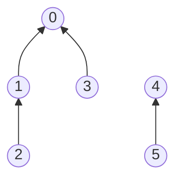
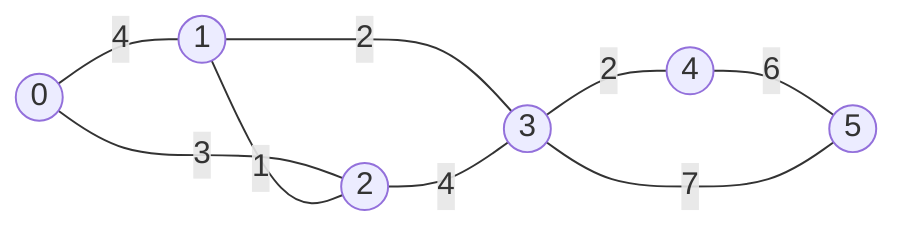

## Passo 1 · Leitura · Conjuntos que se fundem

Muitos problemas de grafos perguntam, enquanto arestas vão chegando: "`a` e `b` já estão ligados?". Rodar uma BFS a cada pergunta custa $O(V + E)$ por consulta. O **union-find** (conjuntos disjuntos) responde quase em tempo constante, com duas operações:

- `encontrar(x)`: devolve o **representante** do conjunto de `x`;
- `unir(a, b)`: junta os conjuntos de `a` e de `b`.

Cada conjunto é uma árvore guardada numa lista `pai`, em que `pai[x]` aponta para o pai de `x`, e a **raiz** (com `pai[r] == r`) é o representante. Dois elementos estão no mesmo conjunto quando têm a mesma raiz.



Acima, `pai = [0, 0, 1, 0, 4, 4]`: os conjuntos são `{0, 1, 2, 3}` e `{4, 5}`. Para unir, liga-se uma **raiz** à outra. Duas técnicas mantêm as árvores baixas:

- **União por tamanho**: a raiz do conjunto menor passa a apontar para a do maior. Um elemento só desce um nível quando o seu conjunto pelo menos dobra, então a altura fica em $\lfloor \log_2 n \rfloor$.
- **Compressão de caminho**: depois de achar a raiz de `x`, faça todos os elementos do caminho apontarem direto para ela. A próxima busca por qualquer um deles custa um passo.

Com as duas, uma sequência de $m$ operações custa $O(m \, \alpha(n))$, em que $\alpha$ é a inversa da função de Ackermann: $\alpha(n) \le 4$ para qualquer $n$ que caiba num computador. Na prática, constante.

Os erros mais comuns:

- ligar os **elementos** em vez das raízes (`pai[b] = a`): o resto da árvore de `b` fica para trás, e conjuntos que deveriam estar juntos continuam separados;
- unir sempre `pai[ra] = rb`, sem olhar os tamanhos: unir `0–1`, `1–2`, `2–3`… em ordem forma uma corrente, e `encontrar(0)` percorre $n$ elementos;
- não testar `ra == rb` antes de unir: o contador de conjuntos e os tamanhos ficam errados;
- escrever a compressão com recursão sem a união por tamanho: numa corrente de alguns milhares de elementos, `RecursionError: maximum recursion depth exceeded`.

## Passo 2 · Exercício · UnionFind com compressão e tamanho
modo: lacunas

Complete as lacunas (`___`). A classe `UnionFind(n)` guarda os elementos de `0` a `n - 1`, cada um sozinho no começo. `encontrar(x)` devolve a raiz e comprime o caminho; `unir(a, b)` devolve `True` se juntou dois conjuntos diferentes e `False` se já estavam juntos; `conectados(a, b)` diz se estão no mesmo conjunto. O atributo `conjuntos` conta os conjuntos, e `tamanho[r]` é o tamanho do conjunto cuja raiz é `r`.

### Instruções
1. Em `encontrar`, suba até a raiz e, num segundo laço, faça cada elemento do caminho apontar para ela.
2. Em `unir`, não junte o que já está junto.
3. Pendure a raiz do conjunto menor na do maior e atualize o tamanho e a contagem.

### Código inicial
```python
class UnionFind:
    def __init__(self, n):
        self.pai = list(range(n))
        self.tamanho = [1] * n
        self.conjuntos = n

    def encontrar(self, x):
        raiz = x
        while self.pai[raiz] != raiz:
            raiz = ___
        while self.pai[x] != raiz:
            self.pai[x], x = raiz, ___
        return raiz

    def unir(self, a, b):
        ra, rb = self.encontrar(a), self.encontrar(b)
        if ra == rb:
            return ___
        if self.tamanho[ra] < self.tamanho[rb]:
            ra, rb = rb, ra
        self.pai[rb] = ___
        self.tamanho[ra] += self.tamanho[rb]
        self.conjuntos -= 1
        return True

    def conectados(self, a, b):
        return self.encontrar(a) == self.encontrar(b)
```

### Solução
```python
class UnionFind:
    def __init__(self, n):
        self.pai = list(range(n))
        self.tamanho = [1] * n
        self.conjuntos = n

    def encontrar(self, x):
        raiz = x
        while self.pai[raiz] != raiz:
            raiz = self.pai[raiz]
        while self.pai[x] != raiz:
            self.pai[x], x = raiz, self.pai[x]
        return raiz

    def unir(self, a, b):
        ra, rb = self.encontrar(a), self.encontrar(b)
        if ra == rb:
            return False
        if self.tamanho[ra] < self.tamanho[rb]:
            ra, rb = rb, ra
        self.pai[rb] = ra
        self.tamanho[ra] += self.tamanho[rb]
        self.conjuntos -= 1
        return True

    def conectados(self, a, b):
        return self.encontrar(a) == self.encontrar(b)
```

### Dicas
1. Na atribuição dupla, o lado direito é calculado antes: `x` passa a ser o pai antigo.
2. `unir` informa se alguma coisa mudou.
3. Depois da troca, `ra` é a raiz do conjunto maior.

### Verificação
```json
[
  { "id": "conectados", "checkpoint": 3, "kind": "expr",
    "setup": "uf = UnionFind(5)\nuf.unir(0, 1)\nuf.unir(2, 3)\nantes = [uf.conectados(0, 1), uf.conectados(1, 2), uf.conectados(4, 4)]\nuf.unir(1, 3)",
    "expr": "[antes, uf.conectados(0, 2), uf.conectados(0, 4), uf.conjuntos]",
    "expected": [[true, false, true], true, false, 2], "name": "Unir em etapas e consultar" },
  { "id": "unir-devolve", "checkpoint": 2, "kind": "expr",
    "setup": "uf = UnionFind(4)\nr = [uf.unir(0, 1), uf.unir(1, 0), uf.unir(2, 2), uf.unir(1, 2), uf.unir(0, 2)]",
    "expr": "[r, uf.conjuntos, uf.tamanho[uf.encontrar(0)]]", "expected": [[true, false, false, true, false], 2, 3],
    "name": "unir devolve False quando já estão juntos, sem mexer nas contas",
    "hint": "Elementos com a mesma raiz já estão no mesmo conjunto." },
  { "id": "liga-raizes", "checkpoint": 3, "kind": "expr",
    "setup": "uf = UnionFind(6)\nuf.unir(0, 1)\nuf.unir(0, 2)\nuf.unir(3, 4)\nuf.unir(3, 5)\nuf.unir(2, 5)",
    "expr": "[all(uf.conectados(0, x) for x in range(6)), uf.conjuntos, uf.tamanho[uf.encontrar(4)]]",
    "expected": [true, 1, 6], "name": "Unir dois elementos que não são raízes junta os conjuntos inteiros",
    "hint": "Quem muda de pai é a raiz, não o elemento." },
  { "id": "vazio-e-um", "checkpoint": 1, "kind": "expr",
    "expr": "[UnionFind(0).conjuntos, UnionFind(1).encontrar(0), UnionFind(3).tamanho]", "expected": [0, 0, [1, 1, 1]],
    "name": "Estruturas com 0, 1 e 3 elementos" },
  { "id": "altura-corrente", "checkpoint": 3, "kind": "expr",
    "setup": "def profundidade(uf, x):\n    d = 0\n    while uf.pai[x] != x and d <= len(uf.pai):\n        x = uf.pai[x]\n        d += 1\n    return d\nuf = UnionFind(1024)\nfor i in range(1023):\n    uf.unir(i, i + 1)\nv = UnionFind(1024)\nfor i in range(1023, 0, -1):\n    v.unir(i, i - 1)",
    "expr": "[max(profundidade(uf, x) for x in range(1024)) <= 10, max(profundidade(v, x) for x in range(1024)) <= 10, uf.conjuntos]",
    "expected": [true, true, 1], "name": "Unir em corrente, nos dois sentidos, não forma árvore alta",
    "hint": "Pendure o conjunto menor no maior." },
  { "id": "compressao", "checkpoint": 1, "kind": "expr",
    "setup": "uf = UnionFind(1024)\npasso = 1\nwhile passo < 1024:\n    for i in range(0, 1024, 2 * passo):\n        uf.unir(i, i + passo)\n    passo *= 2\ncaminho = [1023]\nwhile uf.pai[caminho[-1]] != caminho[-1] and len(caminho) <= 1024:\n    caminho.append(uf.pai[caminho[-1]])\nraiz = uf.encontrar(1023)",
    "expr": "[len(caminho) - 1, all(uf.pai[x] == raiz for x in caminho)]", "expected": [10, true],
    "name": "Depois de encontrar, todo o caminho aponta para a raiz",
    "hint": "Guarde a raiz e percorra o caminho de novo." },
  { "id": "custo", "checkpoint": 1, "kind": "expr",
    "setup": "class Contador(list):\n    n = 0\n    def __getitem__(self, i):\n        Contador.n += 1\n        return list.__getitem__(self, i)\nuf = UnionFind(16384)\npasso = 1\nwhile passo < 16384:\n    for i in range(0, 16384, 2 * passo):\n        uf.unir(i, i + passo)\n    passo *= 2\nuf.pai = Contador(uf.pai)\nfolhas = [x for x in range(16384) if x % 2 == 1]\nContador.n = 0\nfor _ in range(10):\n    for x in folhas:\n        uf.encontrar(x)",
    "expr": "[uf.encontrar(16383), Contador.n <= 700000]", "expected": [0, true],
    "name": "81 920 buscas numa árvore de altura 14: a compressão mantém o custo baixo",
    "hint": "Sem compressão, cada busca sobe a árvore inteira de novo." }
]
```

### Soluções erradas
```python name="sem compressão de caminho"
class UnionFind:
    def __init__(self, n):
        self.pai = list(range(n))
        self.tamanho = [1] * n
        self.conjuntos = n

    def encontrar(self, x):
        while self.pai[x] != x:
            x = self.pai[x]
        return x

    def unir(self, a, b):
        ra, rb = self.encontrar(a), self.encontrar(b)
        if ra == rb:
            return False
        if self.tamanho[ra] < self.tamanho[rb]:
            ra, rb = rb, ra
        self.pai[rb] = ra
        self.tamanho[ra] += self.tamanho[rb]
        self.conjuntos -= 1
        return True

    def conectados(self, a, b):
        return self.encontrar(a) == self.encontrar(b)
```
```python name="sem união por tamanho"
class UnionFind:
    def __init__(self, n):
        self.pai = list(range(n))
        self.tamanho = [1] * n
        self.conjuntos = n

    def encontrar(self, x):
        raiz = x
        while self.pai[raiz] != raiz:
            raiz = self.pai[raiz]
        while self.pai[x] != raiz:
            self.pai[x], x = raiz, self.pai[x]
        return raiz

    def unir(self, a, b):
        ra, rb = self.encontrar(a), self.encontrar(b)
        if ra == rb:
            return False
        self.pai[ra] = rb
        self.tamanho[rb] += self.tamanho[ra]
        self.conjuntos -= 1
        return True

    def conectados(self, a, b):
        return self.encontrar(a) == self.encontrar(b)
```
```python name="pendura o maior no menor"
class UnionFind:
    def __init__(self, n):
        self.pai = list(range(n))
        self.tamanho = [1] * n
        self.conjuntos = n

    def encontrar(self, x):
        raiz = x
        while self.pai[raiz] != raiz:
            raiz = self.pai[raiz]
        while self.pai[x] != raiz:
            self.pai[x], x = raiz, self.pai[x]
        return raiz

    def unir(self, a, b):
        ra, rb = self.encontrar(a), self.encontrar(b)
        if ra == rb:
            return False
        if self.tamanho[ra] > self.tamanho[rb]:
            ra, rb = rb, ra
        self.pai[rb] = ra
        self.tamanho[ra] += self.tamanho[rb]
        self.conjuntos -= 1
        return True

    def conectados(self, a, b):
        return self.encontrar(a) == self.encontrar(b)
```
```python name="une sem testar se já estão juntos"
class UnionFind:
    def __init__(self, n):
        self.pai = list(range(n))
        self.tamanho = [1] * n
        self.conjuntos = n

    def encontrar(self, x):
        raiz = x
        while self.pai[raiz] != raiz:
            raiz = self.pai[raiz]
        while self.pai[x] != raiz:
            self.pai[x], x = raiz, self.pai[x]
        return raiz

    def unir(self, a, b):
        ra, rb = self.encontrar(a), self.encontrar(b)
        if self.tamanho[ra] < self.tamanho[rb]:
            ra, rb = rb, ra
        self.pai[rb] = ra
        self.tamanho[ra] += self.tamanho[rb]
        self.conjuntos -= 1
        return True

    def conectados(self, a, b):
        return self.encontrar(a) == self.encontrar(b)
```
```python name="liga os elementos em vez das raízes"
class UnionFind:
    def __init__(self, n):
        self.pai = list(range(n))
        self.tamanho = [1] * n
        self.conjuntos = n

    def encontrar(self, x):
        raiz = x
        while self.pai[raiz] != raiz:
            raiz = self.pai[raiz]
        while self.pai[x] != raiz:
            self.pai[x], x = raiz, self.pai[x]
        return raiz

    def unir(self, a, b):
        ra, rb = self.encontrar(a), self.encontrar(b)
        if ra == rb:
            return False
        if self.tamanho[ra] < self.tamanho[rb]:
            a, b, ra, rb = b, a, rb, ra
        self.pai[b] = a
        self.tamanho[ra] += self.tamanho[rb]
        self.conjuntos -= 1
        return True

    def conectados(self, a, b):
        return self.encontrar(a) == self.encontrar(b)
```

## Passo 3 · Previsão · Compressão e união por tamanho

O programa parte de uma lista `pai` já montada, com uma corrente `4 → 3 → 2 → 1 → 0` e um conjunto `{5, 6}`, faz uma busca e duas uniões. Leia sem executar e digite a saída exata.

### Código
```python
pai = [0, 0, 1, 2, 3, 5, 5]
tamanho = [5, 1, 1, 1, 1, 2, 1]


def encontrar(x):
    raiz = x
    while pai[raiz] != raiz:
        raiz = pai[raiz]
    while pai[x] != raiz:
        pai[x], x = raiz, pai[x]
    return raiz


def unir(a, b):
    ra, rb = encontrar(a), encontrar(b)
    if ra == rb:
        return False
    if tamanho[ra] < tamanho[rb]:
        ra, rb = rb, ra
    pai[rb] = ra
    tamanho[ra] += tamanho[rb]
    return True


print(encontrar(4))
print(pai)
print(unir(6, 3), pai)
print(unir(4, 6))
print(tamanho[0])
```

### Dicas
1. O segundo laço de `encontrar` para quando chega a um elemento que já aponta para a raiz.
2. Em `unir(6, 3)`, as raízes são 5 e 0, e o conjunto de 0 é o maior.
3. Na última união, `encontrar(6)` passa por 5 antes de chegar a 0.

### Saída esperada
```text
0
[0, 0, 0, 0, 0, 5, 5]
True [0, 0, 0, 0, 0, 0, 5]
False
7
```

## Passo 4 · Leitura · Kruskal e a propriedade do corte

Uma **árvore geradora** de um grafo conexo e não direcionado liga todos os $V$ vértices com $V - 1$ arestas, sem ciclo. Com pesos, a **árvore geradora mínima** (MST, *minimum spanning tree*) é a de menor soma: o cabeamento mais barato que liga todos os prédios, a rede de canos de menor custo.



O **algoritmo de Kruskal** ordena as arestas por peso e as percorre da mais leve para a mais pesada; cada uma entra na árvore se ligar dois pedaços **diferentes**, e é descartada se fechar um ciclo. Quem responde "são pedaços diferentes?" é o union-find: `unir(u, v)` devolve `False` exatamente quando a aresta fecharia um ciclo. No grafo acima entram `1–2` (1), `1–3` (2), `3–4` (2), `0–2` (3) e `4–5` (6); `0–1` e `2–3`, de peso 4, fechariam ciclos. Custo: 14. Ordenar domina: $O(E \log E)$.

Por que o guloso acerta? Pela **propriedade do corte**: divida os vértices em dois lados quaisquer; a aresta **mais leve** que atravessa a divisão pertence a alguma MST. Se uma árvore não a usasse, trocar a aresta da árvore que atravessa o corte por essa daria uma árvore de custo menor ou igual. Quando Kruskal aceita `u–v`, ela é a mais leve entre as que ligam o pedaço de `u` ao resto, então é segura.

Os erros que aparecem:

- esquecer de ordenar, ou ordenar com `sorted(arestas)`: as tuplas `(u, v, peso)` são ordenadas pelo **primeiro** campo, `u`, e não pelo peso;
- somar toda aresta processada, sem testar se `unir` juntou algo: o ciclo entra na conta;
- não perceber que o grafo é **desconexo**: nunca se chega a $V - 1$ arestas, e o que sai é uma floresta, não uma árvore.

A mesma ideia detecta ciclos num grafo não direcionado: a aresta que `unir` recusa é **redundante**, porque liga dois vértices já ligados. Marcar só os vértices "já vistos" não basta: as arestas `0–1`, `2–3` e `1–2` têm todos os vértices vistos na terceira, e ela não fecha ciclo nenhum.

## Passo 5 · Exercício · Kruskal e arestas redundantes

Escreva duas funções. O arquivo `uf.py` já tem a classe `UnionFind` do passo 2.

- `kruskal(n, arestas)`: vértices de `0` a `n - 1`, arestas `(u, v, peso)` não direcionadas. Devolve o par `(custo, escolhidas)`, com as arestas da MST na ordem em que entraram, ou `None` se o grafo for desconexo. Empates de peso seguem a ordem da lista; laços e paralelas podem aparecer.
- `arestas_redundantes(n, arestas)`: `arestas` é uma lista de pares `(u, v)` que chegam em ordem; devolve a lista das que, ao chegar, ligam dois vértices já ligados (inclusive laços).

### Instruções
1. Em `kruskal`, ordene as arestas pelo peso, mantendo a ordem da lista nos empates.
2. Aceite só as arestas que juntam conjuntos diferentes e devolva `None` se não chegar a $n - 1$ arestas.
3. Em `arestas_redundantes`, use o resultado de `unir` para saber se a aresta fechou um ciclo.

### Código inicial
```python path=uf.py
class UnionFind:
    def __init__(self, n):
        self.pai = list(range(n))
        self.tamanho = [1] * n
        self.conjuntos = n

    def encontrar(self, x):
        raiz = x
        while self.pai[raiz] != raiz:
            raiz = self.pai[raiz]
        while self.pai[x] != raiz:
            self.pai[x], x = raiz, self.pai[x]
        return raiz

    def unir(self, a, b):
        ra, rb = self.encontrar(a), self.encontrar(b)
        if ra == rb:
            return False
        if self.tamanho[ra] < self.tamanho[rb]:
            ra, rb = rb, ra
        self.pai[rb] = ra
        self.tamanho[ra] += self.tamanho[rb]
        self.conjuntos -= 1
        return True

    def conectados(self, a, b):
        return self.encontrar(a) == self.encontrar(b)
```
```python
from uf import UnionFind


def kruskal(n, arestas):
    pass


def arestas_redundantes(n, arestas):
    pass
```

### Solução
```python path=uf.py
class UnionFind:
    def __init__(self, n):
        self.pai = list(range(n))
        self.tamanho = [1] * n
        self.conjuntos = n

    def encontrar(self, x):
        raiz = x
        while self.pai[raiz] != raiz:
            raiz = self.pai[raiz]
        while self.pai[x] != raiz:
            self.pai[x], x = raiz, self.pai[x]
        return raiz

    def unir(self, a, b):
        ra, rb = self.encontrar(a), self.encontrar(b)
        if ra == rb:
            return False
        if self.tamanho[ra] < self.tamanho[rb]:
            ra, rb = rb, ra
        self.pai[rb] = ra
        self.tamanho[ra] += self.tamanho[rb]
        self.conjuntos -= 1
        return True

    def conectados(self, a, b):
        return self.encontrar(a) == self.encontrar(b)
```
```python
from uf import UnionFind


def kruskal(n, arestas):
    uf = UnionFind(n)
    custo = 0
    escolhidas = []
    for u, v, peso in sorted(arestas, key=lambda aresta: aresta[2]):
        if uf.unir(u, v):
            custo += peso
            escolhidas.append((u, v, peso))
            if len(escolhidas) == n - 1:
                break
    if len(escolhidas) < n - 1:
        return None
    return custo, escolhidas


def arestas_redundantes(n, arestas):
    uf = UnionFind(n)
    return [(u, v) for u, v in arestas if not uf.unir(u, v)]
```

### Dicas
1. `sorted` com `key` ordena pelo campo escolhido e é estável.
2. Uma árvore com $n$ vértices tem $n - 1$ arestas.
3. `unir` já devolve se juntou dois conjuntos.

### Verificação
```json
[
  { "id": "kruskal", "checkpoint": 1, "kind": "expr",
    "setup": "a = [(0, 1, 4), (0, 2, 3), (1, 2, 1), (1, 3, 2), (2, 3, 4), (3, 4, 2), (4, 5, 6), (3, 5, 7)]",
    "expr": "kruskal(6, a)", "expected": [14, [[1, 2, 1], [1, 3, 2], [3, 4, 2], [0, 2, 3], [4, 5, 6]]],
    "name": "O grafo da leitura: custo 14, empates na ordem da lista",
    "hint": "Tuplas são ordenadas pelo primeiro campo; o peso é o terceiro." },
  { "id": "ordem-por-peso", "checkpoint": 1, "kind": "expr",
    "expr": "kruskal(3, [(0, 1, 10), (0, 2, 1), (1, 2, 2)])", "expected": [3, [[0, 2, 1], [1, 2, 2]]],
    "name": "A aresta do vértice 0 é a mais pesada" },
  { "id": "ciclo-nao-entra", "checkpoint": 2, "kind": "expr",
    "expr": "kruskal(4, [(0, 1, 1), (1, 2, 1), (0, 2, 1), (2, 3, 5)])", "expected": [7, [[0, 1, 1], [1, 2, 1], [2, 3, 5]]],
    "name": "A aresta que fecha o triângulo fica de fora",
    "hint": "Some só as arestas que juntaram dois pedaços." },
  { "id": "paralelas-laco", "checkpoint": 2, "kind": "expr",
    "expr": "kruskal(2, [(0, 0, 0), (0, 1, 9), (1, 0, 4)])", "expected": [4, [[1, 0, 4]]],
    "name": "Laço é ignorado; entre paralelas, a mais barata" },
  { "id": "desconexo", "checkpoint": 2, "kind": "expr",
    "expr": "[kruskal(4, [(0, 1, 1), (2, 3, 1)]), kruskal(3, [])]", "expected": [null, null],
    "name": "Grafo desconexo não tem árvore geradora" },
  { "id": "um-vertice", "checkpoint": 2, "kind": "expr", "expr": "kruskal(1, [])", "expected": [0, []],
    "name": "Um vértice só: custo 0, nenhuma aresta" },
  { "id": "maior", "checkpoint": 2, "kind": "expr",
    "setup": "n = 200\na = [(i, (i * 37 + 11) % n, (i * 13) % 50 + 1) for i in range(n)] + [(i, (i + 1) % n, 45) for i in range(n)] + [(i, (i * 17 + 3) % n, (i * 29) % 60 + 1) for i in range(n)]\nr = kruskal(n, a)",
    "expr": "[r[0], len(r[1])]", "expected": [2976, 199], "name": "200 vértices e 600 arestas" },
  { "id": "redundantes", "checkpoint": 3, "kind": "call", "function": "arestas_redundantes",
    "args": [5, [[0, 1], [2, 3], [1, 2], [3, 0], [4, 4], [1, 4], [4, 1]]], "expected": [[3, 0], [4, 4], [4, 1]],
    "name": "Redundantes: ciclo, laço e paralela",
    "hint": "Ter os dois vértices já vistos não quer dizer que eles estejam ligados entre si." },
  { "id": "redundantes-nenhuma", "checkpoint": 3, "kind": "expr",
    "expr": "[arestas_redundantes(4, [(0, 1), (2, 3), (1, 2)]), arestas_redundantes(3, [])]", "expected": [[], []],
    "name": "Pedaços separados que depois se ligam não formam ciclo" }
]
```

### Soluções erradas
```python name="sorted(arestas) ordena pelo primeiro vértice"
from uf import UnionFind


def kruskal(n, arestas):
    uf = UnionFind(n)
    custo = 0
    escolhidas = []
    for u, v, peso in sorted(arestas):
        if uf.unir(u, v):
            custo += peso
            escolhidas.append((u, v, peso))
            if len(escolhidas) == n - 1:
                break
    if len(escolhidas) < n - 1:
        return None
    return custo, escolhidas


def arestas_redundantes(n, arestas):
    uf = UnionFind(n)
    return [(u, v) for u, v in arestas if not uf.unir(u, v)]
```
```python name="não ordena as arestas"
from uf import UnionFind


def kruskal(n, arestas):
    uf = UnionFind(n)
    custo = 0
    escolhidas = []
    for u, v, peso in arestas:
        if uf.unir(u, v):
            custo += peso
            escolhidas.append((u, v, peso))
            if len(escolhidas) == n - 1:
                break
    if len(escolhidas) < n - 1:
        return None
    return custo, escolhidas


def arestas_redundantes(n, arestas):
    uf = UnionFind(n)
    return [(u, v) for u, v in arestas if not uf.unir(u, v)]
```
```python name="soma a aresta mesmo quando fecha ciclo"
from uf import UnionFind


def kruskal(n, arestas):
    uf = UnionFind(n)
    custo = 0
    escolhidas = []
    for u, v, peso in sorted(arestas, key=lambda aresta: aresta[2]):
        uf.unir(u, v)
        custo += peso
        escolhidas.append((u, v, peso))
        if uf.conjuntos == 1:
            break
    if uf.conjuntos > 1:
        return None
    return custo, escolhidas


def arestas_redundantes(n, arestas):
    uf = UnionFind(n)
    return [(u, v) for u, v in arestas if not uf.unir(u, v)]
```
```python name="devolve a floresta quando o grafo é desconexo"
from uf import UnionFind


def kruskal(n, arestas):
    uf = UnionFind(n)
    custo = 0
    escolhidas = []
    for u, v, peso in sorted(arestas, key=lambda aresta: aresta[2]):
        if uf.unir(u, v):
            custo += peso
            escolhidas.append((u, v, peso))
            if len(escolhidas) == n - 1:
                break
    return custo, escolhidas


def arestas_redundantes(n, arestas):
    uf = UnionFind(n)
    return [(u, v) for u, v in arestas if not uf.unir(u, v)]
```
```python name="ordena do mais pesado para o mais leve"
from uf import UnionFind


def kruskal(n, arestas):
    uf = UnionFind(n)
    custo = 0
    escolhidas = []
    for u, v, peso in sorted(arestas, key=lambda aresta: aresta[2], reverse=True):
        if uf.unir(u, v):
            custo += peso
            escolhidas.append((u, v, peso))
            if len(escolhidas) == n - 1:
                break
    if len(escolhidas) < n - 1:
        return None
    return custo, escolhidas


def arestas_redundantes(n, arestas):
    uf = UnionFind(n)
    return [(u, v) for u, v in arestas if not uf.unir(u, v)]
```
```python name="redundante quando os dois vértices já foram vistos"
from uf import UnionFind


def kruskal(n, arestas):
    uf = UnionFind(n)
    custo = 0
    escolhidas = []
    for u, v, peso in sorted(arestas, key=lambda aresta: aresta[2]):
        if uf.unir(u, v):
            custo += peso
            escolhidas.append((u, v, peso))
            if len(escolhidas) == n - 1:
                break
    if len(escolhidas) < n - 1:
        return None
    return custo, escolhidas


def arestas_redundantes(n, arestas):
    vistos = set()
    redundantes = []
    for u, v in arestas:
        if u in vistos and v in vistos:
            redundantes.append((u, v))
        vistos.add(u)
        vistos.add(v)
    return redundantes
```

## Passo 6 · Leitura · Prim e agrupamento

O **algoritmo de Prim** cresce **uma** árvore a partir de um vértice. A cada passo, escolhe a aresta mais leve que sai da árvore para um vértice de fora, e esse vértice entra. É a propriedade do corte de novo, com o corte "árvore de um lado, resto do outro". A implementação com heap lembra o Dijkstra:

```python
na_arvore = {inicio}
heap = [(peso, v) for v, peso in grafo[inicio]]
heapq.heapify(heap)
while heap:
    peso, v = heapq.heappop(heap)
    if v in na_arvore:
        continue                 # a aresta leva a quem já entrou
    na_arvore.add(v)
    custo += peso
    for w, p in grafo[v]:
        if w not in na_arvore:
            heapq.heappush(heap, (p, w))
```

A diferença para o Dijkstra está na prioridade: no Prim, é o **peso da aresta**, não a distância acumulada desde o início. Trocar uma pela outra produz a árvore dos menores caminhos, que liga todos os vértices mas pode custar bem mais. Num triângulo com `a–b` = 2, `a–c` = 2 e `b–c` = 1, a MST custa 3 (`a–b` e `b–c`), e a árvore de menores caminhos a partir de `a` custa 4. Os outros erros são os de sempre: marcar o vértice como "na árvore" ao **empurrar** (a primeira aresta encontrada vira definitiva) e não pular as entradas que levam a quem já entrou (a aresta que fecha um ciclo é somada). Custo: $O(E \log V)$. Kruskal costuma ser mais simples quando as arestas já vêm numa lista; Prim, quando o grafo está em listas de adjacência e é denso.

#### Agrupamento por ligação simples

Para dividir $n$ pontos em $k$ grupos de vizinhos próximos, rode Kruskal sobre todos os pares, com o peso igual à distância, e **pare quando restarem $k$ conjuntos**. É o mesmo que montar a MST e cortar as $k - 1$ arestas mais pesadas. Cada união junta os dois grupos mais próximos naquele momento, e a distância entre grupos é a do par de pontos mais próximo entre eles (*single-linkage*). Para não lidar com raízes, compare a distância ao quadrado,

$$
d^2 = (x_1 - x_2)^2 + (y_1 - y_2)^2 ,
$$

que preserva a ordem e é exata com inteiros. O erro clássico é contar as **arestas olhadas** em vez das **uniões feitas**: um par de pontos que já estão no mesmo grupo não reduz o número de grupos.

## Passo 7 · Exercício · Prim e agrupamento

Escreva duas funções. O arquivo `uf.py` tem a mesma `UnionFind`.

- `prim(grafo, inicio)`: `grafo` é não direcionado, no formato `vértice → lista de (vizinho, peso)`, com cada aresta nas duas listas. Devolve o custo da árvore geradora mínima do componente de `inicio` (`0` se ele for isolado).
- `agrupar(pontos, k)`: `pontos` é uma lista de pares `(x, y)` de inteiros e `1 <= k`. Une os pares em ordem crescente de $d^2$ (empates pela ordem dos índices `(i, j)`, com `i < j`) até restarem `k` grupos, ou menos pontos que isso. Devolve a lista de grupos, cada um com os índices em ordem crescente, e a lista ordenada pelo primeiro índice.

### Instruções
1. Em `prim`, use um heap de pares `(peso, vértice)` e pule quem já está na árvore ao sair do heap.
2. Some o peso da aresta, e não a distância desde `inicio`.
3. Em `agrupar`, ordene os pares pela distância ao quadrado e pare quando o número de conjuntos chegar a `k`.

### Código inicial
```python path=uf.py
class UnionFind:
    def __init__(self, n):
        self.pai = list(range(n))
        self.tamanho = [1] * n
        self.conjuntos = n

    def encontrar(self, x):
        raiz = x
        while self.pai[raiz] != raiz:
            raiz = self.pai[raiz]
        while self.pai[x] != raiz:
            self.pai[x], x = raiz, self.pai[x]
        return raiz

    def unir(self, a, b):
        ra, rb = self.encontrar(a), self.encontrar(b)
        if ra == rb:
            return False
        if self.tamanho[ra] < self.tamanho[rb]:
            ra, rb = rb, ra
        self.pai[rb] = ra
        self.tamanho[ra] += self.tamanho[rb]
        self.conjuntos -= 1
        return True

    def conectados(self, a, b):
        return self.encontrar(a) == self.encontrar(b)
```
```python
import heapq

from uf import UnionFind


def prim(grafo, inicio):
    pass


def agrupar(pontos, k):
    pass
```

### Solução
```python path=uf.py
class UnionFind:
    def __init__(self, n):
        self.pai = list(range(n))
        self.tamanho = [1] * n
        self.conjuntos = n

    def encontrar(self, x):
        raiz = x
        while self.pai[raiz] != raiz:
            raiz = self.pai[raiz]
        while self.pai[x] != raiz:
            self.pai[x], x = raiz, self.pai[x]
        return raiz

    def unir(self, a, b):
        ra, rb = self.encontrar(a), self.encontrar(b)
        if ra == rb:
            return False
        if self.tamanho[ra] < self.tamanho[rb]:
            ra, rb = rb, ra
        self.pai[rb] = ra
        self.tamanho[ra] += self.tamanho[rb]
        self.conjuntos -= 1
        return True

    def conectados(self, a, b):
        return self.encontrar(a) == self.encontrar(b)
```
```python
import heapq

from uf import UnionFind


def prim(grafo, inicio):
    na_arvore = {inicio}
    heap = [(peso, v) for v, peso in grafo[inicio]]
    heapq.heapify(heap)
    custo = 0
    while heap:
        peso, v = heapq.heappop(heap)
        if v in na_arvore:
            continue
        na_arvore.add(v)
        custo += peso
        for w, p in grafo[v]:
            if w not in na_arvore:
                heapq.heappush(heap, (p, w))
    return custo


def agrupar(pontos, k):
    n = len(pontos)
    pares = []
    for i in range(n):
        for j in range(i + 1, n):
            (x1, y1), (x2, y2) = pontos[i], pontos[j]
            pares.append(((x1 - x2) ** 2 + (y1 - y2) ** 2, i, j))
    pares.sort()
    uf = UnionFind(n)
    for _, i, j in pares:
        if uf.conjuntos <= k:
            break
        uf.unir(i, j)
    grupos = {}
    for i in range(n):
        grupos.setdefault(uf.encontrar(i), []).append(i)
    return sorted(grupos.values())
```

### Dicas
1. Uma entrada que leva a um vértice já na árvore é como uma entrada obsoleta do Dijkstra.
2. Guardar `(distância, i, j)` faz a ordenação desempatar pelos índices sozinha.
3. O número de grupos cai só quando `unir` junta dois conjuntos diferentes.

### Verificação
```json
[
  { "id": "prim", "checkpoint": 1, "kind": "expr",
    "setup": "a = [(0, 1, 4), (0, 2, 3), (1, 2, 1), (1, 3, 2), (2, 3, 4), (3, 4, 2), (4, 5, 6), (3, 5, 7)]\ng = {i: [] for i in range(6)}\nfor u, v, p in a:\n    g[u].append((v, p))\n    g[v].append((u, p))",
    "expr": "[prim(g, 0), prim(g, 5)]", "expected": [14, 14], "name": "O grafo da leitura, a partir de dois vértices" },
  { "id": "prim-nao-e-dijkstra", "checkpoint": 2, "kind": "expr",
    "setup": "g = {'a': [('b', 2), ('c', 2)], 'b': [('a', 2), ('c', 1)], 'c': [('a', 2), ('b', 1)]}",
    "expr": "prim(g, 'a')", "expected": 3, "name": "Árvore mínima, não a dos menores caminhos",
    "hint": "A prioridade é o peso da aresta, não a distância desde o início." },
  { "id": "prim-primeira-aresta", "checkpoint": 1, "kind": "expr",
    "setup": "g = {'a': [('b', 10), ('c', 1)], 'b': [('a', 10), ('c', 2)], 'c': [('a', 1), ('b', 2)]}",
    "expr": "prim(g, 'a')", "expected": 3, "name": "A primeira aresta até b não é a definitiva",
    "hint": "Só marque um vértice quando ele sair do heap." },
  { "id": "prim-bordas", "checkpoint": 1, "kind": "expr",
    "expr": "[prim({'x': []}, 'x'), prim({'a': [('a', 5), ('b', 7), ('b', 3)], 'b': [('a', 7), ('a', 3)]}, 'a'), prim({'a': [('b', 1)], 'b': [('a', 1)], 'c': [('d', 9)], 'd': [('c', 9)]}, 'c')]",
    "expected": [0, 3, 9], "name": "Isolado, laço com paralelas e só o componente de inicio" },
  { "id": "prim-maior", "checkpoint": 1, "kind": "expr",
    "setup": "n = 200\na = [(i, (i * 37 + 11) % n, (i * 13) % 50 + 1) for i in range(n)] + [(i, (i + 1) % n, 45) for i in range(n)] + [(i, (i * 17 + 3) % n, (i * 29) % 60 + 1) for i in range(n)]\ng = {i: [] for i in range(n)}\nfor u, v, p in a:\n    g[u].append((v, p))\n    g[v].append((u, p))",
    "expr": "[prim(g, 0), prim(g, 57)]", "expected": [2976, 2976], "name": "200 vértices: o mesmo custo do Kruskal" },
  { "id": "agrupar", "checkpoint": 3, "kind": "expr",
    "setup": "p = [(0, 0), (1, 0), (0, 1), (10, 10), (11, 10), (30, 0), (31, 1)]",
    "expr": "[agrupar(p, 3), agrupar(p, 2)]", "expected": [[[0, 1, 2], [3, 4], [5, 6]], [[0, 1, 2, 3, 4], [5, 6]]],
    "name": "Três e dois grupos",
    "hint": "Pare quando o número de conjuntos chegar a k." },
  { "id": "agrupar-bordas", "checkpoint": 3, "kind": "expr",
    "setup": "p = [(0, 0), (1, 0), (0, 1), (10, 10), (11, 10), (30, 0), (31, 1)]",
    "expr": "[agrupar(p, 1), agrupar(p, 7), agrupar(p, 10), agrupar([], 1), agrupar([(5, 5)], 1)]",
    "expected": [[[0, 1, 2, 3, 4, 5, 6]], [[0], [1], [2], [3], [4], [5], [6]], [[0], [1], [2], [3], [4], [5], [6]], [], [[0]]],
    "name": "k = 1, k = n, k maior que n, nenhum ponto e um ponto" },
  { "id": "agrupar-ciclo", "checkpoint": 3, "kind": "expr",
    "setup": "p = [(0, 0), (2, 0), (1, 2), (30, 0), (31, 0), (60, 0)]",
    "expr": "agrupar(p, 2)", "expected": [[0, 1, 2, 3, 4], [5]],
    "name": "Um par já no mesmo grupo não reduz o número de grupos",
    "hint": "Conte as uniões que deram certo, não os pares olhados." },
  { "id": "agrupar-distancia", "checkpoint": 3, "kind": "expr",
    "setup": "p = [(0, 0), (100, 0), (0, 3), (100, 4), (50, 50)]",
    "expr": "agrupar(p, 3)", "expected": [[0, 2], [1, 3], [4]],
    "name": "Os pares se juntam pela distância, não pelos índices" }
]
```

### Soluções erradas
```python name="não pula quem já está na árvore"
import heapq

from uf import UnionFind


def prim(grafo, inicio):
    na_arvore = {inicio}
    heap = [(peso, v) for v, peso in grafo[inicio]]
    heapq.heapify(heap)
    custo = 0
    while heap:
        peso, v = heapq.heappop(heap)
        na_arvore.add(v)
        custo += peso
        for w, p in grafo[v]:
            if w not in na_arvore:
                heapq.heappush(heap, (p, w))
    return custo


def agrupar(pontos, k):
    n = len(pontos)
    pares = []
    for i in range(n):
        for j in range(i + 1, n):
            (x1, y1), (x2, y2) = pontos[i], pontos[j]
            pares.append(((x1 - x2) ** 2 + (y1 - y2) ** 2, i, j))
    pares.sort()
    uf = UnionFind(n)
    for _, i, j in pares:
        if uf.conjuntos <= k:
            break
        uf.unir(i, j)
    grupos = {}
    for i in range(n):
        grupos.setdefault(uf.encontrar(i), []).append(i)
    return sorted(grupos.values())
```
```python name="marca na árvore ao empurrar"
import heapq

from uf import UnionFind


def prim(grafo, inicio):
    na_arvore = {inicio}
    custo = 0
    heap = []
    for v, peso in grafo[inicio]:
        if v not in na_arvore:
            na_arvore.add(v)
            heapq.heappush(heap, (peso, v))
    while heap:
        peso, v = heapq.heappop(heap)
        custo += peso
        for w, p in grafo[v]:
            if w not in na_arvore:
                na_arvore.add(w)
                heapq.heappush(heap, (p, w))
    return custo


def agrupar(pontos, k):
    n = len(pontos)
    pares = []
    for i in range(n):
        for j in range(i + 1, n):
            (x1, y1), (x2, y2) = pontos[i], pontos[j]
            pares.append(((x1 - x2) ** 2 + (y1 - y2) ** 2, i, j))
    pares.sort()
    uf = UnionFind(n)
    for _, i, j in pares:
        if uf.conjuntos <= k:
            break
        uf.unir(i, j)
    grupos = {}
    for i in range(n):
        grupos.setdefault(uf.encontrar(i), []).append(i)
    return sorted(grupos.values())
```
```python name="prioridade pela distância desde o início, como no Dijkstra"
import heapq

from uf import UnionFind


def prim(grafo, inicio):
    na_arvore = {inicio}
    heap = [(peso, peso, v) for v, peso in grafo[inicio]]
    heapq.heapify(heap)
    custo = 0
    while heap:
        dist, peso, v = heapq.heappop(heap)
        if v in na_arvore:
            continue
        na_arvore.add(v)
        custo += peso
        for w, p in grafo[v]:
            if w not in na_arvore:
                heapq.heappush(heap, (dist + p, p, w))
    return custo


def agrupar(pontos, k):
    n = len(pontos)
    pares = []
    for i in range(n):
        for j in range(i + 1, n):
            (x1, y1), (x2, y2) = pontos[i], pontos[j]
            pares.append(((x1 - x2) ** 2 + (y1 - y2) ** 2, i, j))
    pares.sort()
    uf = UnionFind(n)
    for _, i, j in pares:
        if uf.conjuntos <= k:
            break
        uf.unir(i, j)
    grupos = {}
    for i in range(n):
        grupos.setdefault(uf.encontrar(i), []).append(i)
    return sorted(grupos.values())
```
```python name="conta os pares olhados, não as uniões"
import heapq

from uf import UnionFind


def prim(grafo, inicio):
    na_arvore = {inicio}
    heap = [(peso, v) for v, peso in grafo[inicio]]
    heapq.heapify(heap)
    custo = 0
    while heap:
        peso, v = heapq.heappop(heap)
        if v in na_arvore:
            continue
        na_arvore.add(v)
        custo += peso
        for w, p in grafo[v]:
            if w not in na_arvore:
                heapq.heappush(heap, (p, w))
    return custo


def agrupar(pontos, k):
    n = len(pontos)
    pares = []
    for i in range(n):
        for j in range(i + 1, n):
            (x1, y1), (x2, y2) = pontos[i], pontos[j]
            pares.append(((x1 - x2) ** 2 + (y1 - y2) ** 2, i, j))
    pares.sort()
    uf = UnionFind(n)
    for _, i, j in pares[:max(0, n - k)]:
        uf.unir(i, j)
    grupos = {}
    for i in range(n):
        grupos.setdefault(uf.encontrar(i), []).append(i)
    return sorted(grupos.values())
```
```python name="une uma vez a mais e fica com k - 1 grupos"
import heapq

from uf import UnionFind


def prim(grafo, inicio):
    na_arvore = {inicio}
    heap = [(peso, v) for v, peso in grafo[inicio]]
    heapq.heapify(heap)
    custo = 0
    while heap:
        peso, v = heapq.heappop(heap)
        if v in na_arvore:
            continue
        na_arvore.add(v)
        custo += peso
        for w, p in grafo[v]:
            if w not in na_arvore:
                heapq.heappush(heap, (p, w))
    return custo


def agrupar(pontos, k):
    n = len(pontos)
    pares = []
    for i in range(n):
        for j in range(i + 1, n):
            (x1, y1), (x2, y2) = pontos[i], pontos[j]
            pares.append(((x1 - x2) ** 2 + (y1 - y2) ** 2, i, j))
    pares.sort()
    uf = UnionFind(n)
    for _, i, j in pares:
        if uf.conjuntos < k:
            break
        uf.unir(i, j)
    grupos = {}
    for i in range(n):
        grupos.setdefault(uf.encontrar(i), []).append(i)
    return sorted(grupos.values())
```
```python name="pares guardados como (i, j, distância)"
import heapq

from uf import UnionFind


def prim(grafo, inicio):
    na_arvore = {inicio}
    heap = [(peso, v) for v, peso in grafo[inicio]]
    heapq.heapify(heap)
    custo = 0
    while heap:
        peso, v = heapq.heappop(heap)
        if v in na_arvore:
            continue
        na_arvore.add(v)
        custo += peso
        for w, p in grafo[v]:
            if w not in na_arvore:
                heapq.heappush(heap, (p, w))
    return custo


def agrupar(pontos, k):
    n = len(pontos)
    pares = []
    for i in range(n):
        for j in range(i + 1, n):
            (x1, y1), (x2, y2) = pontos[i], pontos[j]
            pares.append((i, j, (x1 - x2) ** 2 + (y1 - y2) ** 2))
    pares.sort()
    uf = UnionFind(n)
    for i, j, _ in pares:
        if uf.conjuntos <= k:
            break
        uf.unir(i, j)
    grupos = {}
    for i in range(n):
        grupos.setdefault(uf.encontrar(i), []).append(i)
    return sorted(grupos.values())
```

## Passo 8 · Quiz · Conectar barato e agrupar

### Pergunta
Um sistema processa um milhão de pedidos "ligar a rede `a` à rede `b`" e "`a` e `b` já se comunicam?", intercalados. Uma versão usa union-find só com compressão de caminho; outra, só com união por tamanho; uma terceira, com as duas. O que se pode dizer?
- [ ] Só a versão com as duas técnicas dá respostas certas
- [x] As três dão as mesmas respostas; o que muda é o custo, e com as duas técnicas cada operação custa, na prática, tempo constante
- [ ] Sem compressão de caminho, `encontrar` pode devolver a raiz errada
- [ ] A união por tamanho só serve para economizar memória
> As duas técnicas não mudam quais elementos estão juntos, só a forma das árvores. A união por tamanho limita a altura a $\log_2 n$; a compressão achata os caminhos percorridos; juntas, dão $O(\alpha(n))$ amortizado por operação, com $\alpha(n) \le 4$ em qualquer caso prático.

### Pergunta
Uma prefeitura vai ligar 40 bairros com fibra óptica e tem o custo de cada trecho possível. Um técnico propõe: "a partir da central, ligue cada bairro pelo caminho mais barato até a central", usando o Dijkstra. Por que isso não dá o menor custo total de cabo?
- [ ] Porque o Dijkstra não funciona em grafos não direcionados
- [x] Porque a árvore de menores caminhos minimiza a distância de cada bairro até a central, não a soma dos trechos instalados; a MST de Kruskal ou Prim minimiza essa soma
- [ ] Porque o Dijkstra exige que todos os trechos tenham o mesmo custo
- [ ] Dá o mesmo resultado: as duas árvores sempre coincidem
> As duas são árvores geradoras, mas com objetivos diferentes. No triângulo com `a–b` = 2, `a–c` = 2 e `b–c` = 1, a árvore de menores caminhos a partir de `a` usa `a–b` e `a–c` (custo 4), e a MST usa `a–b` e `b–c` (custo 3). Cabo se paga por trecho instalado, então o problema é de MST.

### Pergunta
Para agrupar 500 lojas em 6 regiões de entrega com ligação simples, uma analista monta a MST das distâncias. O que ela faz em seguida?
- [ ] Remove as 6 arestas mais leves da MST
- [ ] Remove 6 arestas quaisquer da MST, uma por região
- [x] Remove as 5 arestas mais pesadas da MST; os 6 pedaços que sobram são as regiões
- [ ] Roda o Prim 6 vezes, a partir de 6 lojas sorteadas
> Uma árvore sem $k - 1$ arestas vira $k$ pedaços. Cortar as mais pesadas separa os grupos mais distantes entre si, e o resultado é o mesmo de parar o Kruskal quando restam 6 conjuntos. Remover as mais leves separaria justamente lojas vizinhas.
