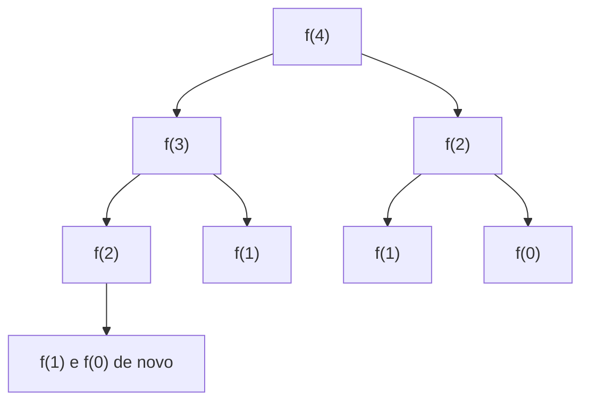

## Passo 1 · Leitura · O mesmo subproblema, muitas vezes

Uma escada tem $n$ degraus e você sobe 1 ou 2 de cada vez. De quantas formas dá para chegar ao topo? O primeiro passo é de 1 ou de 2 degraus, e depois dele sobra uma escada menor:

$$
f(n) = f(n-1) + f(n-2), \qquad f(0) = f(1) = 1 .
$$

A recursão direta é correta e lenta. A árvore de $f(4)$ já mostra o problema:



$f(2)$ é resolvido duas vezes, $f(1)$ três. Com $n = 40$ são mais de 300 milhões de chamadas, mas só **41 perguntas diferentes**: $f(0)$ a $f(40)$. Isso são **subproblemas sobrepostos**. No merge sort é diferente: as metades são disjuntas, nenhum pedaço é ordenado duas vezes, e guardar resultados não economiza nada.

No nível 2 você escreveu o decorador `memoizar` e viu o Fibonacci ficar rápido. Aqui a pergunta que importa vem antes do código: **qual é o estado?** O estado é o conjunto de parâmetros que determina a resposta. Na escada é só o número de degraus que falta; com passos de tamanhos variados, a lista de tamanhos é fixa durante a conta e não entra no estado. O custo da memoização é

$$
\text{custo} \approx (\text{número de estados}) \times (\text{trabalho de um estado, sem contar as chamadas}),
$$

aqui $(n + 1) \times k$ para $k$ tamanhos de passo.

Quando o problema pede o **melhor** valor, entra a segunda propriedade, a **subestrutura ótima**: a melhor solução contém melhores soluções de subproblemas. No troco com o menor número de moedas, se a melhor forma de pagar $v$ começa com a moeda $m$, o resto dela é a melhor forma de pagar $v - m$:

$$
t(0) = 0, \qquad t(v) = 1 + \min_{m \le v} t(v - m) .
$$

O mínimo percorre **todas** as moedas. Escolher sempre a maior é outra coisa: com moedas 1, 3 e 4 e valor 6, a maior dá $4 + 1 + 1$, três moedas, e a recorrência acha $3 + 3$.

## Passo 2 · Previsão · O que o dicionário lembra

O programa conta as chamadas de `formas` e avisa quando calcula um valor pela primeira vez. Leia sem executar e digite a saída exata.

### Código
```python
memo = {}
chamadas = 0


def formas(n):
    global chamadas
    chamadas += 1
    if n in memo:
        return memo[n]
    print("calcula", n)
    if n <= 1:
        r = 1
    else:
        r = formas(n - 1) + formas(n - 2)
    memo[n] = r
    return r


print(formas(5), chamadas)
print(formas(6), chamadas)
print(len(memo))
```

### Dicas
1. `formas(n - 1)` termina por inteiro, com tudo o que ela chama, antes de `formas(n - 2)` começar.
2. Quando `formas(n - 2)` roda, o valor dela já está no dicionário? Conte essas consultas como chamadas também.
3. O dicionário fica fora da função: a segunda linha do `print` aproveita o que a primeira guardou.

### Saída esperada
```text
calcula 5
calcula 4
calcula 3
calcula 2
calcula 1
calcula 0
8 9
calcula 6
13 12
7
```

## Passo 3 · Exercício · formas_de_subir com um dicionário
modo: lacunas

Complete as lacunas (`___`) de `formas_de_subir(n, passos)`: quantas sequências de passos, com tamanhos tirados de `passos` (inteiros positivos distintos), somam exatamente `n` degraus. A ordem importa: com `[1, 2]`, subir 3 degraus como 1 + 2 ou como 2 + 1 são formas diferentes.

A função auxiliar `contar(resta)` recebe só o que muda de uma chamada para outra; `passos` e o dicionário `memo` vêm da função de fora. A verificação conta as chamadas: com 200 degraus e passos `[1, 2, 3]`, no máximo 1 000.

### Instruções
1. Complete os casos base: faltar exatamente 0 degrau é uma forma de terminar; passar do topo não é.
2. Consulte o dicionário antes de calcular e grave nele o total de cada estado novo.
   Dica: a chave é o estado, o número de degraus que falta.
3. Some as formas que começam com cada tamanho de passo.

### Código inicial
```python
def formas_de_subir(n, passos):
    memo = {}

    def contar(resta):
        if resta == 0:
            return ___
        if resta < 0:
            return 0
        if ___ in memo:
            return memo[resta]
        total = 0
        for p in passos:
            total += contar(___)
        memo[resta] = ___
        return total

    return contar(n)
```

### Solução
```python
def formas_de_subir(n, passos):
    memo = {}

    def contar(resta):
        if resta == 0:
            return 1
        if resta < 0:
            return 0
        if resta in memo:
            return memo[resta]
        total = 0
        for p in passos:
            total += contar(resta - p)
        memo[resta] = total
        return total

    return contar(n)
```

### Dicas
1. Se faltar 0 degrau, a sequência de passos já está completa: ela conta.
2. Cada chamada de `contar` tem um `resta` diferente; é isso que identifica o subproblema.
3. Depois de dar um passo de tamanho `p`, quantos degraus faltam?

### Verificação
```json
[
  {"id": "escada-4", "checkpoint": 1, "kind": "call", "function": "formas_de_subir", "args": [4, [1, 2]], "expected": 5, "name": "4 degraus com passos de 1 ou 2: 5 formas"},
  {"id": "zero-degraus", "checkpoint": 1, "kind": "call", "function": "formas_de_subir", "args": [0, [1, 2]], "expected": 1, "name": "0 degrau: uma forma (não dar passo nenhum)", "hint": "Faltar 0 degrau é uma subida completa."},
  {"id": "impossivel", "checkpoint": 1, "kind": "call", "function": "formas_de_subir", "args": [3, [2]], "expected": 0, "name": "3 degraus só com passos de 2: nenhuma forma"},
  {"id": "passo-unico", "checkpoint": 1, "kind": "call", "function": "formas_de_subir", "args": [5, [5]], "expected": 1, "name": "5 degraus com um passo de 5: uma forma"},
  {"id": "tres-tamanhos", "checkpoint": 3, "kind": "call", "function": "formas_de_subir", "args": [10, [1, 3, 5]], "expected": 47, "name": "10 degraus com passos de 1, 3 ou 5: 47 formas"},
  {"id": "sem-passo-1", "checkpoint": 3, "kind": "call", "function": "formas_de_subir", "args": [7, [2, 3]], "expected": 3, "name": "7 degraus com passos de 2 ou 3: 3 formas (2+2+3 em três ordens)"},
  {"id": "ordem-dos-passos", "checkpoint": 3, "kind": "call", "function": "formas_de_subir", "args": [12, [3, 1]], "expected": 60, "name": "A ordem da lista de passos não muda a resposta"},
  {"id": "duas-chamadas", "checkpoint": 2, "kind": "expr", "setup": "a = formas_de_subir(6, [1, 2])\nb = formas_de_subir(6, [2, 3])", "expr": "b", "expected": 2, "name": "Depois de 6 degraus com [1, 2], 6 degraus com [2, 3] dá 2 formas", "hint": "Cada chamada de formas_de_subir precisa começar com um dicionário vazio."},
  {"id": "noventa", "checkpoint": 2, "kind": "expr", "setup": "import sys\nclass _Limite(BaseException):\n    pass\n_n = [0]\ndef _p(quadro, evento, arg):\n    if evento == 'call':\n        _n[0] += 1\n        if _n[0] > 1000:\n            raise _Limite()\nsys.setprofile(_p)\ntry:\n    r = formas_de_subir(90, [1, 2])\nexcept _Limite:\n    r = None\nfinally:\n    sys.setprofile(None)", "expr": "r == 4660046610375530309", "expected": true, "name": "90 degraus com passos de 1 ou 2, com no máximo 1 000 chamadas", "hint": "Sem consultar e gravar o dicionário, o número de chamadas cresce como o próprio resultado."},
  {"id": "conta-chamadas", "checkpoint": 2, "kind": "expr", "setup": "import sys\nclass _Limite(BaseException):\n    pass\n_n = [0]\ndef _p(quadro, evento, arg):\n    if evento == 'call':\n        _n[0] += 1\n        if _n[0] > 1000:\n            raise _Limite()\nsys.setprofile(_p)\ntry:\n    r = formas_de_subir(200, [1, 2, 3])\nexcept _Limite:\n    r = None\nfinally:\n    sys.setprofile(None)", "expr": "r is not None and _n[0] <= 1000", "expected": true, "name": "200 degraus com passos de 1, 2 ou 3: no máximo 1 000 chamadas", "hint": "Cada valor de resta deve ser calculado uma vez só."}
]
```

### Soluções erradas
```python name="caso base devolve 0"
def formas_de_subir(n, passos):
    memo = {}

    def contar(resta):
        if resta == 0:
            return 0
        if resta < 0:
            return 0
        if resta in memo:
            return memo[resta]
        total = 0
        for p in passos:
            total += contar(resta - p)
        memo[resta] = total
        return total

    return contar(n)
```
```python name="consulta o dicionário com n em vez de resta"
def formas_de_subir(n, passos):
    memo = {}

    def contar(resta):
        if resta == 0:
            return 1
        if resta < 0:
            return 0
        if n in memo:
            return memo[resta]
        total = 0
        for p in passos:
            total += contar(resta - p)
        memo[resta] = total
        return total

    return contar(n)
```
```python name="desce sempre um degrau"
def formas_de_subir(n, passos):
    memo = {}

    def contar(resta):
        if resta == 0:
            return 1
        if resta < 0:
            return 0
        if resta in memo:
            return memo[resta]
        total = 0
        for p in passos:
            total += contar(resta - 1)
        memo[resta] = total
        return total

    return contar(n)
```
```python name="dicionário fora da função, compartilhado entre chamadas"
memo = {}


def formas_de_subir(n, passos):
    def contar(resta):
        if resta == 0:
            return 1
        if resta < 0:
            return 0
        if resta in memo:
            return memo[resta]
        total = 0
        for p in passos:
            total += contar(resta - p)
        memo[resta] = total
        return total

    return contar(n)
```
```python name="consulta, mas nunca grava"
def formas_de_subir(n, passos):
    memo = {}

    def contar(resta):
        if resta == 0:
            return 1
        if resta < 0:
            return 0
        if resta in memo:
            return memo[resta]
        total = 0
        for p in passos:
            total += contar(resta - p)
        return total

    return contar(n)
```

## Passo 4 · Leitura · Estados com dois parâmetros e lru_cache

Numa grade com obstáculos, contamos os caminhos do canto superior esquerdo ao inferior direito andando só para a direita ou para baixo. De $(l, c)$ saem dois caminhos menores, por $(l + 1, c)$ e por $(l, c + 1)$, e o estado é o **par** $(l, c)$. Uma grade $L \times C$ tem $L \cdot C$ estados, cada um com trabalho constante.

O erro mais traiçoeiro é a **chave incompleta**: guardar o resultado só por `l`, como se a coluna não importasse.

```python
cache = {}


def caminhos(l, c):          # grade livre, chegando a (0, 0)
    if l == 0 or c == 0:
        return 1
    if l in cache:           # deveria ser (l, c)
        return cache[l]
    r = caminhos(l - 1, c) + caminhos(l, c - 1)
    cache[l] = r
    return r
```

`caminhos(2, 2)` devolve 7, e a resposta certa é 6: o valor guardado para `(1, 2)` é devolvido quando se pede `(1, 1)`. Não há erro nem aviso, só um número errado. A chave precisa conter **todos** os parâmetros que mudam a resposta.

`functools.lru_cache(maxsize=None)` monta a chave com todos os argumentos, e por isso não esquece nenhum. Em troca, exige argumentos que possam ser chave de dicionário. Passar a grade, que é uma lista de listas, para a função decorada dá

```
TypeError: unhashable type: 'list'
```

e a mesma lista como chave de um `dict` dá `TypeError: cannot use 'list' as a dict key (unhashable type: 'list')`. Há duas saídas: converter para tupla, o que custa uma cópia a cada chamada, ou decorar uma função **interna** que recebe só `(l, c)` e lê a grade da função de fora. A segunda é a usual.

Ela tem outra vantagem: a função interna é criada de novo a cada chamada da externa, com cache vazio. Um `@lru_cache` no nível do módulo que lê uma grade global devolve, para a segunda grade, as respostas da primeira.

`contar.cache_info()` mostra `misses`, quantas vezes o corpo rodou, que é o número de estados visitados, e `hits`, quantas vezes a resposta veio pronta.

## Passo 5 · Exercício · Caminhos na grade com lru_cache

`grade` é uma lista de listas com 0 (livre) e 1 (obstáculo). Escreva `caminhos_na_grade(grade)`, que devolve quantos caminhos vão de `(0, 0)` até o canto inferior direito andando só para a direita ou para baixo, sem pisar em obstáculos. Se um dos cantos tem obstáculo, a resposta é 0.

As grades da verificação têm no máximo 40 linhas e 40 colunas. A contagem de chamadas exige memoização: numa grade livre de 18 × 18 são mais de 2 bilhões de caminhos.

### Instruções
1. Use `functools.lru_cache` numa função interna cujo estado é a posição na grade.
   Dica: só posições vão para o cache; a grade fica de fora.
2. Fora da grade e sobre um obstáculo não há caminho; no destino livre, há exatamente um.
3. Os caminhos a partir de uma posição são os que seguem para baixo mais os que seguem para a direita.

### Código inicial
```python
from functools import lru_cache


def caminhos_na_grade(grade):
    pass
```

### Solução
```python
from functools import lru_cache


def caminhos_na_grade(grade):
    linhas, colunas = len(grade), len(grade[0])

    @lru_cache(maxsize=None)
    def contar(l, c):
        if l >= linhas or c >= colunas or grade[l][c] == 1:
            return 0
        if l == linhas - 1 and c == colunas - 1:
            return 1
        return contar(l + 1, c) + contar(l, c + 1)

    return contar(0, 0)
```

### Dicas
1. A função interna enxerga `grade`, `linhas` e `colunas` da função de fora sem recebê-las.
2. Teste o obstáculo antes de testar se chegou ao destino.
3. Sair pela borda de baixo ou da direita não é erro: é uma posição sem caminho.

### Verificação
```json
[
  {"id": "usa-lru-cache", "checkpoint": 1, "kind": "source", "rule": {"type": "decorator", "name": "lru_cache"}, "name": "Usa @lru_cache"},
  {"id": "livre-2x2", "checkpoint": 3, "kind": "call", "function": "caminhos_na_grade", "args": [[[0, 0], [0, 0]]], "expected": 2, "name": "Grade livre 2 × 2: 2 caminhos"},
  {"id": "livre-3x3", "checkpoint": 3, "kind": "call", "function": "caminhos_na_grade", "args": [[[0, 0, 0], [0, 0, 0], [0, 0, 0]]], "expected": 6, "name": "Grade livre 3 × 3: 6 caminhos"},
  {"id": "centro-bloqueado", "checkpoint": 2, "kind": "call", "function": "caminhos_na_grade", "args": [[[0, 0, 0], [0, 1, 0], [0, 0, 0]]], "expected": 2, "name": "3 × 3 com o centro bloqueado: só pelas bordas"},
  {"id": "inicio-bloqueado", "checkpoint": 2, "kind": "call", "function": "caminhos_na_grade", "args": [[[1, 0], [0, 0]]], "expected": 0, "name": "Obstáculo na partida: 0 caminho"},
  {"id": "destino-bloqueado", "checkpoint": 2, "kind": "call", "function": "caminhos_na_grade", "args": [[[0, 0, 0], [0, 0, 0], [0, 0, 1]]], "expected": 0, "name": "Obstáculo no destino: 0 caminho", "hint": "O destino também pode ser um obstáculo."},
  {"id": "uma-celula", "checkpoint": 2, "kind": "call", "function": "caminhos_na_grade", "args": [[[0]]], "expected": 1, "name": "Grade 1 × 1 livre: 1 caminho (já está no destino)"},
  {"id": "uma-linha", "checkpoint": 2, "kind": "call", "function": "caminhos_na_grade", "args": [[[0, 0, 0, 0]]], "expected": 1, "name": "Uma linha livre: 1 caminho", "hint": "Andar para baixo a partir da última linha sai da grade."},
  {"id": "linha-cortada", "checkpoint": 2, "kind": "call", "function": "caminhos_na_grade", "args": [[[0, 0, 1, 0]]], "expected": 0, "name": "Uma linha com obstáculo no meio: 0 caminho"},
  {"id": "grade-4x5", "checkpoint": 3, "kind": "call", "function": "caminhos_na_grade", "args": [[[0, 0, 0, 0, 0], [0, 1, 0, 0, 1], [0, 0, 0, 1, 0], [1, 0, 0, 0, 0]]], "expected": 3, "name": "Grade 4 × 5 com quatro obstáculos: 3 caminhos"},
  {"id": "duas-grades", "checkpoint": 1, "kind": "expr", "setup": "a = caminhos_na_grade([[0, 0, 0], [0, 0, 0], [0, 0, 0]])\nb = caminhos_na_grade([[0, 0, 0], [0, 1, 0], [0, 0, 0]])", "expr": "b", "expected": 2, "name": "Uma grade calculada depois de outra não herda as respostas da primeira", "hint": "O cache precisa ser novo a cada grade."},
  {"id": "livre-18", "checkpoint": 1, "kind": "expr", "setup": "import sys\nclass _Limite(BaseException):\n    pass\n_n = [0]\ndef _p(quadro, evento, arg):\n    if evento == 'call':\n        _n[0] += 1\n        if _n[0] > 2000:\n            raise _Limite()\nsys.setprofile(_p)\ntry:\n    r = caminhos_na_grade([[0] * 18 for _ in range(18)])\nexcept _Limite:\n    r = None\nfinally:\n    sys.setprofile(None)", "expr": "r", "expected": 2333606220, "name": "Grade livre 18 × 18 com no máximo 2 000 chamadas", "hint": "São 324 posições; cada uma deve ser calculada uma vez."},
  {"id": "grade-40", "checkpoint": 3, "kind": "expr", "setup": "import sys\nclass _Limite(BaseException):\n    pass\n_n = [0]\ndef _p(quadro, evento, arg):\n    if evento == 'call':\n        _n[0] += 1\n        if _n[0] > 8000:\n            raise _Limite()\nsys.setprofile(_p)\ntry:\n    r = caminhos_na_grade([[1 if (l * 7 + c * 3) % 11 == 0 and 0 < l + c < 78 else 0 for c in range(40)] for l in range(40)])\nexcept _Limite:\n    r = None\nfinally:\n    sys.setprofile(None)", "expr": "str(r)", "expected": "357987807448515500", "name": "Grade 40 × 40 com 144 obstáculos"}
]
```

### Soluções erradas
```python name="passa a grade para a função com cache"
from functools import lru_cache


@lru_cache(maxsize=None)
def contar(grade, l, c):
    if l >= len(grade) or c >= len(grade[0]) or grade[l][c] == 1:
        return 0
    if l == len(grade) - 1 and c == len(grade[0]) - 1:
        return 1
    return contar(grade, l + 1, c) + contar(grade, l, c + 1)


def caminhos_na_grade(grade):
    return contar(grade, 0, 0)
```
```python name="cache no módulo lendo uma grade global"
from functools import lru_cache

GRADE = []


@lru_cache(maxsize=None)
def contar(l, c):
    if l >= len(GRADE) or c >= len(GRADE[0]) or GRADE[l][c] == 1:
        return 0
    if l == len(GRADE) - 1 and c == len(GRADE[0]) - 1:
        return 1
    return contar(l + 1, c) + contar(l, c + 1)


def caminhos_na_grade(grade):
    GRADE[:] = grade
    return contar(0, 0)
```
```python name="chega ao destino antes de olhar o obstáculo"
from functools import lru_cache


def caminhos_na_grade(grade):
    linhas, colunas = len(grade), len(grade[0])

    @lru_cache(maxsize=None)
    def contar(l, c):
        if l == linhas - 1 and c == colunas - 1:
            return 1
        if l >= linhas or c >= colunas or grade[l][c] == 1:
            return 0
        return contar(l + 1, c) + contar(l, c + 1)

    return contar(0, 0)
```
```python name="não trata a saída pela borda"
from functools import lru_cache


def caminhos_na_grade(grade):
    linhas, colunas = len(grade), len(grade[0])

    @lru_cache(maxsize=None)
    def contar(l, c):
        if grade[l][c] == 1:
            return 0
        if l == linhas - 1 and c == colunas - 1:
            return 1
        return contar(l + 1, c) + contar(l, c + 1)

    return contar(0, 0)
```
```python name="destino vale 0 em vez de 1"
from functools import lru_cache


def caminhos_na_grade(grade):
    linhas, colunas = len(grade), len(grade[0])

    @lru_cache(maxsize=None)
    def contar(l, c):
        if l >= linhas or c >= colunas or grade[l][c] == 1:
            return 0
        if l == linhas - 1 and c == colunas - 1:
            return 0
        return contar(l + 1, c) + contar(l, c + 1)

    return contar(0, 0)
```
```python name="lru_cache importado, mas não aplicado"
from functools import lru_cache


def caminhos_na_grade(grade):
    linhas, colunas = len(grade), len(grade[0])

    def contar(l, c):
        if l >= linhas or c >= colunas or grade[l][c] == 1:
            return 0
        if l == linhas - 1 and c == colunas - 1:
            return 1
        return contar(l + 1, c) + contar(l, c + 1)

    return contar(0, 0)
```

## Passo 6 · Leitura · Troco mínimo: o valor e as moedas

A recorrência do passo 1 dá o **número** de moedas. Quem paga quer saber **quais**. Para isso, cada estado guarda também a escolha que deu o mínimo: a moeda $m$ que abriu a melhor solução de $v$. Para listar as moedas, parta de $v$, anote a moeda guardada, vá para $v - m$ e repita até chegar a 0.

Um valor pode ser impossível: com moedas 2 e 5 não se paga 3. A recursão precisa distinguir "impossível" de "zero moedas", que é a resposta certa para $v = 0$. Representar o impossível por `None` e pular esses ramos no mínimo resolve:

```python
def melhor(v):                      # devolve (quantidade, primeira moeda) ou None
    if v == 0:
        return (0, None)
    if v in memo:
        return memo[v]
    resposta = None
    for m in moedas:
        if m <= v:
            sub = melhor(v - m)
            if sub is not None and (resposta is None or sub[0] + 1 < resposta[0]):
                resposta = (sub[0] + 1, m)
    memo[v] = resposta
    return resposta
```

Três erros comuns, todos silenciosos:

- **devolver 0 para o impossível**: o 0 vence todos os mínimos, e um valor impagável passa a parecer de graça;
- **reconstruir com qualquer moeda viável**: ao descer de $v$, escolher a primeira moeda $m$ com $v - m$ pagável, e não a guardada, dá um troco válido e às vezes maior que o mínimo;
- **o guloso**: tirar sempre a maior moeda que cabe, que erra com 1, 3 e 4.

A memoização tem um limite que não depende da velocidade. Com a moeda 1, `melhor(5000)` chama `melhor(4999)`, que chama `melhor(4998)`… São 5 000 chamadas pendentes ao mesmo tempo, e o Python para em

```
RecursionError: maximum recursion depth exceeded
```

Aumentar o limite com `sys.setrecursionlimit` só adia o problema e pode derrubar o interpretador, e o `lru_cache` não ajuda: cada nível ainda passa por uma camada em C, que gasta pilha extra. A saída é inverter a ordem: calcular de $t(0)$ para cima numa tabela, sem pilha nenhuma. É a próxima lição.

## Passo 7 · Exercício · troco_minimo com as moedas escolhidas

Escreva `troco_minimo(moedas, valor)`: a lista com o menor número de moedas que somam `valor`, em ordem **decrescente**, usando cada valor de moeda quantas vezes quiser. Se não houver como pagar, devolva `None`; para `valor` 0, a lista vazia.

`moedas` tem inteiros positivos distintos, em qualquer ordem. Use memoização (dicionário ou `lru_cache`); os valores da verificação vão até 200. A verificação conta as chamadas: com 4 tipos de moeda e valor 180, no máximo 1 500.

### Instruções
1. Calcule, para cada valor, o menor número de moedas, distinguindo o valor impossível de zero moedas.
   Dica: um valor impossível não pode ganhar nenhum mínimo.
2. Guarde, para cada valor, a moeda que abriu a melhor solução, e reconstrua a lista a partir dela.
3. Devolva a lista em ordem decrescente, `None` se não houver troco e `[]` para o valor 0.

### Código inicial
```python
def troco_minimo(moedas, valor):
    pass
```

### Solução
```python
def troco_minimo(moedas, valor):
    memo = {}

    def melhor(v):
        if v == 0:
            return (0, None)
        if v in memo:
            return memo[v]
        resposta = None
        for m in moedas:
            if m <= v:
                sub = melhor(v - m)
                if sub is not None and (resposta is None or sub[0] + 1 < resposta[0]):
                    resposta = (sub[0] + 1, m)
        memo[v] = resposta
        return resposta

    if melhor(valor) is None:
        return None
    escolhidas = []
    v = valor
    while v > 0:
        m = melhor(v)[1]
        escolhidas.append(m)
        v -= m
    return sorted(escolhidas, reverse=True)
```

### Dicas
1. Cada estado pode guardar um par: quantas moedas e qual foi a primeira.
2. Para listar as moedas, ande de `valor` até 0 subtraindo a moeda guardada em cada estado.
3. Teste o caso das moedas 1, 3 e 4 com valor 6: a resposta tem duas moedas.

### Verificação
```json
[
  {"id": "nao-guloso", "checkpoint": 1, "kind": "call", "function": "troco_minimo", "args": [[1, 3, 4], 6], "expected": [3, 3], "name": "Moedas 1, 3 e 4, valor 6: [3, 3]", "hint": "A maior moeda primeiro dá três moedas aqui."},
  {"id": "canonico", "checkpoint": 3, "kind": "call", "function": "troco_minimo", "args": [[1, 5, 10, 25], 30], "expected": [25, 5], "name": "Moedas 1, 5, 10 e 25, valor 30: [25, 5]"},
  {"id": "impossivel", "checkpoint": 1, "kind": "call", "function": "troco_minimo", "args": [[2], 3], "expected": null, "name": "Só moedas de 2 não pagam 3: None"},
  {"id": "impossivel-dois-tipos", "checkpoint": 1, "kind": "call", "function": "troco_minimo", "args": [[3, 7], 11], "expected": null, "name": "Moedas 3 e 7 não pagam 11: None", "hint": "Um valor impossível no meio do caminho não pode contar como zero moedas."},
  {"id": "zero", "checkpoint": 3, "kind": "call", "function": "troco_minimo", "args": [[5, 7], 0], "expected": [], "type": "list", "name": "Valor 0: lista vazia"},
  {"id": "tres-e-sete", "checkpoint": 2, "kind": "call", "function": "troco_minimo", "args": [[3, 7], 13], "expected": [7, 3, 3], "name": "Moedas 3 e 7, valor 13: [7, 3, 3]"},
  {"id": "sete-sete", "checkpoint": 2, "kind": "call", "function": "troco_minimo", "args": [[1, 7, 10], 14], "expected": [7, 7], "name": "Moedas 1, 7 e 10, valor 14: [7, 7]"},
  {"id": "fora-de-ordem", "checkpoint": 3, "kind": "call", "function": "troco_minimo", "args": [[9, 1, 6, 5], 11], "expected": [6, 5], "name": "Moedas fora de ordem, valor 11: [6, 5]", "hint": "A resposta sai em ordem decrescente, qualquer que seja a ordem das moedas."},
  {"id": "primeira-viavel", "checkpoint": 2, "kind": "call", "function": "troco_minimo", "args": [[1, 4, 6], 8], "expected": [4, 4], "name": "Moedas 1, 4 e 6, valor 8: [4, 4]", "hint": "Para listar as moedas, siga a escolha que deu o mínimo, não qualquer moeda que caiba."},
  {"id": "duas-chamadas", "checkpoint": 1, "kind": "expr", "setup": "a = troco_minimo([1, 3, 4], 6)\nb = troco_minimo([2, 5], 6)", "expr": "b", "expected": [2, 2, 2], "name": "Uma chamada com outras moedas não reaproveita respostas da anterior"},
  {"id": "grande-quantidade", "checkpoint": 1, "kind": "expr", "setup": "import sys\nclass _Limite(BaseException):\n    pass\n_n = [0]\ndef _p(quadro, evento, arg):\n    if evento == 'call':\n        _n[0] += 1\n        if _n[0] > 1500:\n            raise _Limite()\nsys.setprofile(_p)\ntry:\n    r = troco_minimo([1, 5, 12, 19], 180)\nexcept _Limite:\n    r = None\nfinally:\n    sys.setprofile(None)", "expr": "None if r is None else len(r)", "expected": 13, "name": "Moedas 1, 5, 12 e 19, valor 180: 13 moedas, com no máximo 1 500 chamadas", "hint": "Cada valor de 0 a 180 deve ser calculado uma vez."},
  {"id": "grande-valido", "checkpoint": 2, "kind": "expr", "setup": "import sys\nclass _Limite(BaseException):\n    pass\n_n = [0]\ndef _p(quadro, evento, arg):\n    if evento == 'call':\n        _n[0] += 1\n        if _n[0] > 1500:\n            raise _Limite()\nsys.setprofile(_p)\ntry:\n    r = troco_minimo([1, 5, 12, 19], 180)\nexcept _Limite:\n    r = None\nfinally:\n    sys.setprofile(None)", "expr": "r is not None and sum(r) == 180 and all(m in (1, 5, 12, 19) for m in r) and r == sorted(r, reverse=True)", "expected": true, "name": "As moedas devolvidas para 180 existem, somam 180 e estão em ordem decrescente"}
]
```

### Soluções erradas
```python name="guloso: sempre a maior moeda que cabe"
def troco_minimo(moedas, valor):
    escolhidas = []
    v = valor
    for m in sorted(moedas, reverse=True):
        while m <= v:
            escolhidas.append(m)
            v -= m
    if v != 0:
        return None
    return escolhidas
```
```python name="impossível vale 0 moedas"
def troco_minimo(moedas, valor):
    memo = {}

    def melhor(v):
        if v == 0:
            return (0, None)
        if v in memo:
            return memo[v]
        resposta = (0, None)
        for m in moedas:
            if m <= v:
                sub = melhor(v - m)
                if resposta[1] is None or sub[0] + 1 < resposta[0]:
                    resposta = (sub[0] + 1, m)
        memo[v] = resposta
        return resposta

    if melhor(valor) is None:
        return None
    escolhidas = []
    v = valor
    while v > 0:
        m = melhor(v)[1]
        if m is None:
            break
        escolhidas.append(m)
        v -= m
    return sorted(escolhidas, reverse=True)
```
```python name="reconstrói com a primeira moeda viável"
def troco_minimo(moedas, valor):
    memo = {}

    def melhor(v):
        if v == 0:
            return 0
        if v in memo:
            return memo[v]
        resposta = None
        for m in moedas:
            if m <= v:
                sub = melhor(v - m)
                if sub is not None and (resposta is None or sub + 1 < resposta):
                    resposta = sub + 1
        memo[v] = resposta
        return resposta

    if melhor(valor) is None:
        return None
    escolhidas = []
    v = valor
    while v > 0:
        for m in moedas:
            if m <= v and melhor(v - m) is not None:
                escolhidas.append(m)
                v -= m
                break
    return sorted(escolhidas, reverse=True)
```
```python name="sem memoização"
def troco_minimo(moedas, valor):
    def melhor(v):
        if v == 0:
            return (0, None)
        resposta = None
        for m in moedas:
            if m <= v:
                sub = melhor(v - m)
                if sub is not None and (resposta is None or sub[0] + 1 < resposta[0]):
                    resposta = (sub[0] + 1, m)
        return resposta

    if melhor(valor) is None:
        return None
    escolhidas = []
    v = valor
    while v > 0:
        m = melhor(v)[1]
        escolhidas.append(m)
        v -= m
    return sorted(escolhidas, reverse=True)
```
```python name="dicionário compartilhado entre chamadas"
memo = {}


def troco_minimo(moedas, valor):
    def melhor(v):
        if v == 0:
            return (0, None)
        if v in memo:
            return memo[v]
        resposta = None
        for m in moedas:
            if m <= v:
                sub = melhor(v - m)
                if sub is not None and (resposta is None or sub[0] + 1 < resposta[0]):
                    resposta = (sub[0] + 1, m)
        memo[v] = resposta
        return resposta

    if melhor(valor) is None:
        return None
    escolhidas = []
    v = valor
    while v > 0:
        m = melhor(v)[1]
        escolhidas.append(m)
        v -= m
    return sorted(escolhidas, reverse=True)
```
```python name="devolve na ordem da reconstrução"
def troco_minimo(moedas, valor):
    memo = {}

    def melhor(v):
        if v == 0:
            return (0, None)
        if v in memo:
            return memo[v]
        resposta = None
        for m in moedas:
            if m <= v:
                sub = melhor(v - m)
                if sub is not None and (resposta is None or sub[0] + 1 < resposta[0]):
                    resposta = (sub[0] + 1, m)
        memo[v] = resposta
        return resposta

    if melhor(valor) is None:
        return None
    escolhidas = []
    v = valor
    while v > 0:
        m = melhor(v)[1]
        escolhidas.append(m)
        v -= m
    return escolhidas
```

## Passo 8 · Quiz · Quando e como memoizar

### Pergunta
Em qual destas funções recursivas a memoização reduz o número de chamadas de forma significativa?
- [ ] Busca binária recursiva numa lista ordenada
- [ ] Merge sort, que ordena as duas metades e as intercala
- [x] Contar os caminhos numa grade, somando os caminhos que descem e os que vão para a direita
- [ ] Soma recursiva de uma lista, `v[0] + soma(v[1:])`
> Na grade, a posição $(1, 1)$ é alcançada por $(0, 1)$ e por $(1, 0)$, e o mesmo par aparece em muitos ramos: os subproblemas se sobrepõem. A busca binária e a soma fazem uma única chamada por nível, e o merge sort divide em metades disjuntas; nenhum subproblema se repete, e o cache só gastaria memória.

### Pergunta
Uma colega decorou `def melhor_rota(mapa, origem)` com `@lru_cache(maxsize=None)`, em que `mapa` é uma lista de listas. A primeira chamada já falha com `TypeError: unhashable type: 'list'`. Qual correção mantém o cache funcionando?
- [ ] Trocar `maxsize=None` por `maxsize=128`, para o cache não guardar listas grandes
- [ ] Envolver a chamada em `try`/`except TypeError` e, no erro, calcular sem cache
- [x] Decorar uma função interna que recebe só a origem e lê o mapa da função de fora
- [ ] Converter o mapa para `str` dentro da função decorada
> O `lru_cache` monta a chave com todos os argumentos, e uma lista não pode ser chave. Tirar o mapa dos argumentos resolve: a função interna é recriada a cada chamada da externa, com cache próprio. Converter dentro da função não adianta, porque a chave é montada antes de o corpo rodar; e o `try`/`except` jogaria fora justamente a memoização.

### Pergunta
`troco_minimo(moedas, 20000)` com memoização por recursão termina com `RecursionError: maximum recursion depth exceeded`, embora `troco_minimo(moedas, 200)` seja instantâneo. O que explica e o que resolve?
- [ ] O dicionário ficou grande demais; usar `lru_cache` no lugar dele resolve
- [x] A cadeia `t(20000) → t(19999) → …` deixa milhares de chamadas pendentes ao mesmo tempo; calcular de 0 até o valor numa tabela, sem recursão, resolve
- [ ] O número total de chamadas passou de 1 000; contar menos chamadas resolve
- [ ] Algum estado se repete; tirar a memoização resolve
> O limite é sobre a profundidade, as chamadas abertas ao mesmo tempo, e não sobre o total. Com a moeda 1, cada valor espera o valor anterior. O `lru_cache` não muda a profundidade (e gasta mais pilha por nível). Preencher $t(0), t(1), \dots$ em ordem crescente usa só um laço, e é o assunto da próxima lição.
