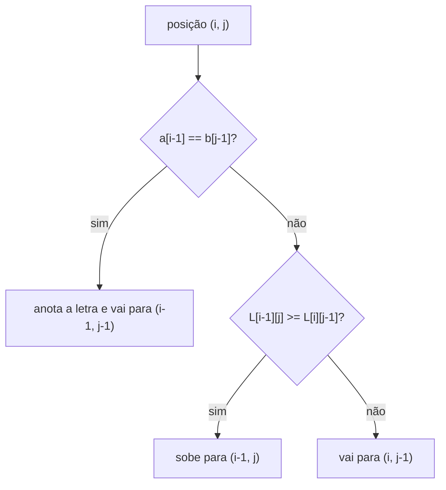

## Passo 1 · Leitura · A subsequência comum mais longa

Uma **subsequência** de um texto é o que sobra quando você apaga algumas letras sem mudar a ordem das outras: `ato` é subsequência de `gato` e de `prato`. A **subsequência comum mais longa** (LCS) de `a` e `b` é a maior que aparece nas duas. Ela mede o quanto dois textos têm em comum e é a base do `diff`.

O estado é um par de **prefixos**: $L[i][j]$ é o tamanho da LCS entre os $i$ primeiros caracteres de `a` e os $j$ primeiros de `b`. Olhe o último caractere de cada prefixo:

$$
L[i][j] =
\begin{cases}
0 & \text{se } i = 0 \text{ ou } j = 0 \\
L[i-1][j-1] + 1 & \text{se } a_{i} = b_{j} \\
\max(L[i-1][j],\; L[i][j-1]) & \text{caso contrário}
\end{cases}
$$

Se os dois últimos são iguais, vale a pena casá-los; se não, pelo menos um deles fica fora da LCS, e testamos as duas possibilidades.

A linha 0 e a coluna 0 representam o **prefixo vazio**, por isso a tabela tem $(n + 1) \times (m + 1)$ posições e o caractere $a_i$ da fórmula é `a[i - 1]` no Python. Escrever `a[i] == b[j]` com `i` indo até `n` termina em `IndexError: string index out of range`; com `i` começando em 0, não dá erro nenhum, e a tabela fica deslocada uma posição, comparando cada caractere com o vizinho do que deveria.

Outro erro comum é somar 1 no caso de caracteres iguais sobre o **máximo** dos vizinhos, e não sobre a diagonal: o mesmo caractere de `b` passa a casar com vários de `a`, e `lcs("aa", "a")` sai com tamanho 2.

Para recuperar o texto, volte de $(n, m)$:



Cada passo segue para o vizinho que **guarda o valor atual**: ir para o menor perde letras. As letras saem da última para a primeira, e é preciso inverter no fim. Quando os dois vizinhos empatam, os dois caminhos levam a uma LCS válida, só que talvez diferentes: `abcd` e `acbd` têm duas, `abd` e `acd`.

O custo é o tamanho da tabela, $O(nm)$ em tempo e em memória.

## Passo 2 · Exercício · lcs com reconstrução
modo: lacunas

Complete as lacunas (`___`) de `lcs(a, b)`, que devolve uma subsequência comum mais longa de `a` e `b` como string. Quando houver mais de uma, qualquer uma vale.

### Instruções
1. No preenchimento, compare os caracteres certos (a tabela tem a linha e a coluna do prefixo vazio) e aplique as duas regras da recorrência.
2. Na volta, quando os caracteres diferem, siga para o vizinho de maior valor.
3. Devolva as letras na ordem em que aparecem nos textos.

### Código inicial
```python
def lcs(a, b):
    n, m = len(a), len(b)
    L = [[0] * (m + 1) for _ in range(n + 1)]
    for i in range(1, n + 1):
        for j in range(1, m + 1):
            if a[___] == b[___]:
                L[i][j] = ___ + 1
            else:
                L[i][j] = max(L[i - 1][j], L[i][j - 1])
    letras = []
    i, j = n, m
    while i > 0 and j > 0:
        if a[i - 1] == b[j - 1]:
            letras.append(a[i - 1])
            i -= 1
            j -= 1
        elif L[i - 1][j] >= ___:
            i -= 1
        else:
            j -= 1
    return "".join(___)
```

### Solução
```python
def lcs(a, b):
    n, m = len(a), len(b)
    L = [[0] * (m + 1) for _ in range(n + 1)]
    for i in range(1, n + 1):
        for j in range(1, m + 1):
            if a[i - 1] == b[j - 1]:
                L[i][j] = L[i - 1][j - 1] + 1
            else:
                L[i][j] = max(L[i - 1][j], L[i][j - 1])
    letras = []
    i, j = n, m
    while i > 0 and j > 0:
        if a[i - 1] == b[j - 1]:
            letras.append(a[i - 1])
            i -= 1
            j -= 1
        elif L[i - 1][j] >= L[i][j - 1]:
            i -= 1
        else:
            j -= 1
    return "".join(reversed(letras))
```

### Dicas
1. A posição `i` da tabela corresponde ao caractere de índice `i - 1` da string.
2. Com caracteres iguais, o 1 é somado à diagonal, que não usa nenhum dos dois.
3. As letras foram anotadas de trás para a frente.

### Verificação
```json
[
  {"id": "classico-tamanho", "checkpoint": 1, "kind": "expr", "expr": "len(lcs('ABCBDAB', 'BDCABA'))", "expected": 4, "name": "LCS de ABCBDAB e BDCABA tem 4 letras"},
  {"id": "classico-valida", "checkpoint": 2, "kind": "expr", "setup": "def _valida(r, a, b, tamanho):\n    ia, ib = iter(a), iter(b)\n    return len(r) == tamanho and all(c in ia for c in r) and all(c in ib for c in r)\n", "expr": "_valida(lcs('ABCBDAB', 'BDCABA'), 'ABCBDAB', 'BDCABA', 4)", "expected": true, "name": "A LCS de ABCBDAB e BDCABA é subsequência das duas, com 4 letras", "hint": "Na volta, quando os caracteres diferem, vá para o vizinho que guarda o valor atual."},
  {"id": "gato-rato", "checkpoint": 1, "kind": "call", "function": "lcs", "args": ["gato", "rato"], "expected": "ato", "name": "lcs('gato', 'rato') é 'ato'"},
  {"id": "vazia", "checkpoint": 1, "kind": "call", "function": "lcs", "args": ["", "abc"], "expected": "", "name": "Com um texto vazio: ''"},
  {"id": "nada-em-comum", "checkpoint": 1, "kind": "call", "function": "lcs", "args": ["abc", "def"], "expected": "", "name": "Nenhuma letra em comum: ''"},
  {"id": "repetida", "checkpoint": 1, "kind": "call", "function": "lcs", "args": ["aa", "a"], "expected": "a", "name": "lcs('aa', 'a') é 'a'", "hint": "Um caractere de b não pode casar com dois de a."},
  {"id": "iguais", "checkpoint": 3, "kind": "call", "function": "lcs", "args": ["abc", "abc"], "expected": "abc", "name": "Textos iguais: o próprio texto, na ordem"},
  {"id": "duas-respostas", "checkpoint": 2, "kind": "expr", "setup": "def _valida(r, a, b, tamanho):\n    ia, ib = iter(a), iter(b)\n    return len(r) == tamanho and all(c in ia for c in r) and all(c in ib for c in r)\n", "expr": "_valida(lcs('abcd', 'acbd'), 'abcd', 'acbd', 3)", "expected": true, "name": "abcd e acbd: uma LCS de 3 letras (abd ou acd)"},
  {"id": "longos-tamanho", "checkpoint": 1, "kind": "expr", "expr": "len(lcs(''.join('abcde'[(i * 7 + i // 5) % 5] for i in range(120)), ''.join('abcde'[(i * 3 + i // 4) % 5] for i in range(110))))", "expected": 64, "name": "Textos de 120 e 110 letras: LCS de 64"},
  {"id": "longos-valida", "checkpoint": 3, "kind": "expr", "setup": "def _valida(r, a, b, tamanho):\n    ia, ib = iter(a), iter(b)\n    return len(r) == tamanho and all(c in ia for c in r) and all(c in ib for c in r)\na, b = ''.join('abcde'[(i * 7 + i // 5) % 5] for i in range(120)), ''.join('abcde'[(i * 3 + i // 4) % 5] for i in range(110))", "expr": "_valida(lcs(a, b), a, b, 64)", "expected": true, "name": "Textos de 120 e 110 letras: a resposta é subsequência dos dois"}
]
```

### Soluções erradas
```python name="compara a[i] com b[j]"
def lcs(a, b):
    n, m = len(a), len(b)
    L = [[0] * (m + 1) for _ in range(n + 1)]
    for i in range(1, n + 1):
        for j in range(1, m + 1):
            if a[i] == b[j]:
                L[i][j] = L[i - 1][j - 1] + 1
            else:
                L[i][j] = max(L[i - 1][j], L[i][j - 1])
    letras = []
    i, j = n, m
    while i > 0 and j > 0:
        if a[i - 1] == b[j - 1]:
            letras.append(a[i - 1])
            i -= 1
            j -= 1
        elif L[i - 1][j] >= L[i][j - 1]:
            i -= 1
        else:
            j -= 1
    return "".join(reversed(letras))
```
```python name="soma 1 sobre o máximo dos vizinhos"
def lcs(a, b):
    n, m = len(a), len(b)
    L = [[0] * (m + 1) for _ in range(n + 1)]
    for i in range(1, n + 1):
        for j in range(1, m + 1):
            if a[i - 1] == b[j - 1]:
                L[i][j] = max(L[i - 1][j], L[i][j - 1]) + 1
            else:
                L[i][j] = max(L[i - 1][j], L[i][j - 1])
    letras = []
    i, j = n, m
    while i > 0 and j > 0:
        if a[i - 1] == b[j - 1]:
            letras.append(a[i - 1])
            i -= 1
            j -= 1
        elif L[i - 1][j] >= L[i][j - 1]:
            i -= 1
        else:
            j -= 1
    return "".join(reversed(letras))
```
```python name="caracteres diferentes copiam a diagonal"
def lcs(a, b):
    n, m = len(a), len(b)
    L = [[0] * (m + 1) for _ in range(n + 1)]
    for i in range(1, n + 1):
        for j in range(1, m + 1):
            if a[i - 1] == b[j - 1]:
                L[i][j] = L[i - 1][j - 1] + 1
            else:
                L[i][j] = L[i - 1][j - 1]
    letras = []
    i, j = n, m
    while i > 0 and j > 0:
        if a[i - 1] == b[j - 1]:
            letras.append(a[i - 1])
            i -= 1
            j -= 1
        elif L[i - 1][j] >= L[i][j - 1]:
            i -= 1
        else:
            j -= 1
    return "".join(reversed(letras))
```
```python name="na volta, segue para o vizinho menor"
def lcs(a, b):
    n, m = len(a), len(b)
    L = [[0] * (m + 1) for _ in range(n + 1)]
    for i in range(1, n + 1):
        for j in range(1, m + 1):
            if a[i - 1] == b[j - 1]:
                L[i][j] = L[i - 1][j - 1] + 1
            else:
                L[i][j] = max(L[i - 1][j], L[i][j - 1])
    letras = []
    i, j = n, m
    while i > 0 and j > 0:
        if a[i - 1] == b[j - 1]:
            letras.append(a[i - 1])
            i -= 1
            j -= 1
        elif L[i - 1][j] < L[i][j - 1]:
            i -= 1
        else:
            j -= 1
    return "".join(reversed(letras))
```
```python name="na volta, anda na diagonal quando difere"
def lcs(a, b):
    n, m = len(a), len(b)
    L = [[0] * (m + 1) for _ in range(n + 1)]
    for i in range(1, n + 1):
        for j in range(1, m + 1):
            if a[i - 1] == b[j - 1]:
                L[i][j] = L[i - 1][j - 1] + 1
            else:
                L[i][j] = max(L[i - 1][j], L[i][j - 1])
    letras = []
    i, j = n, m
    while i > 0 and j > 0:
        if a[i - 1] == b[j - 1]:
            letras.append(a[i - 1])
        i -= 1
        j -= 1
    return "".join(reversed(letras))
```
```python name="esquece de inverter"
def lcs(a, b):
    n, m = len(a), len(b)
    L = [[0] * (m + 1) for _ in range(n + 1)]
    for i in range(1, n + 1):
        for j in range(1, m + 1):
            if a[i - 1] == b[j - 1]:
                L[i][j] = L[i - 1][j - 1] + 1
            else:
                L[i][j] = max(L[i - 1][j], L[i][j - 1])
    letras = []
    i, j = n, m
    while i > 0 and j > 0:
        if a[i - 1] == b[j - 1]:
            letras.append(a[i - 1])
            i -= 1
            j -= 1
        elif L[i - 1][j] >= L[i][j - 1]:
            i -= 1
        else:
            j -= 1
    return "".join(letras)
```

## Passo 3 · Leitura · Distância de edição

A **distância de edição** (de Levenshtein) entre `a` e `b` é o menor número de operações de um caractere que transformam `a` em `b`: **inserir**, **remover** ou **trocar**. De `gato` para `pato` é 1 (trocar `g` por `p`); de `sal` para `asa` é 2.

O estado é de novo um par de prefixos. $D[i][j]$ é a distância entre os $i$ primeiros caracteres de `a` e os $j$ primeiros de `b`. Se os últimos são iguais, nada a fazer com eles; se não, a última operação foi uma das três:

$$
D[i][j] =
\begin{cases}
D[i-1][j-1] & \text{se } a_i = b_j \\
1 + \min\big(\underbrace{D[i-1][j]}_{\text{remover } a_i},\; \underbrace{D[i][j-1]}_{\text{inserir } b_j},\; \underbrace{D[i-1][j-1]}_{\text{trocar}}\big) & \text{caso contrário}
\end{cases}
$$

Os casos base são o que mais se erra. Transformar um prefixo de $i$ caracteres no texto vazio exige $i$ remoções, e o vazio num prefixo de $j$ caracteres, $j$ inserções: $D[i][0] = i$ e $D[0][j] = j$. Copiar o zero da LCS para a primeira linha e a primeira coluna faz `distancia_edicao("", "abc")` dar 0.

Esquecer a troca é outro erro, e ele tem um nome: só com inserções e remoções, a distância passa a ser $n + m - 2\,\text{LCS}$. De `kitten` para `sitting` dá 5, e com a troca dá 3.

**Duas linhas bastam para o número.** Cada linha só lê a anterior e a própria posição à esquerda. Com `anterior` e `atual`, a memória cai de $O(nm)$ para $O(m)$: duas strings de 600 caracteres usam duas listas de 601 posições, e não 361 mil. O cuidado é recomeçar `atual[0]` em $i$ a cada linha: uma linha nova cheia de zeros copia o erro dos casos base para a coluna 0.

**A tabela inteira é necessária para as operações.** Para listar as edições, volte de $(n, m)$ e pergunte qual das opções produziu o valor: se os caracteres são iguais e $D[i][j] = D[i-1][j-1]$, mantenha; se $D[i][j] = D[i-1][j-1] + 1$, troque; se $D[i][j] = D[i-1][j] + 1$, remova $a_i$; senão, insira $b_j$. Subir é **remover** de `a`, andar para a esquerda é **inserir** de `b`; trocar os dois produz uma lista que não transforma `a` em `b`.

## Passo 4 · Previsão · A tabela de sal para asa

O programa imprime as linhas da tabela de distância de edição de `sal` para `asa`. Leia sem executar e digite a saída exata.

### Código
```python
a, b = "sal", "asa"
D = [[0] * (len(b) + 1) for _ in range(len(a) + 1)]
for i in range(len(a) + 1):
    D[i][0] = i
for j in range(len(b) + 1):
    D[0][j] = j
for i in range(1, len(a) + 1):
    for j in range(1, len(b) + 1):
        if a[i - 1] == b[j - 1]:
            D[i][j] = D[i - 1][j - 1]
        else:
            D[i][j] = 1 + min(D[i - 1][j], D[i][j - 1], D[i - 1][j - 1])
for linha in D:
    print(linha)
print("distância:", D[len(a)][len(b)])
```

### Dicas
1. A primeira linha e a primeira coluna não dependem dos textos.
2. Na linha do `s`, o `s` de `asa` está na coluna 2: lá o valor vem da diagonal.
3. Preencha da esquerda para a direita; cada posição só usa a de cima, a da esquerda e a diagonal.

### Saída esperada
```text
[0, 1, 2, 3]
[1, 1, 1, 2]
[2, 1, 2, 1]
[3, 2, 2, 2]
distância: 2
```

## Passo 5 · Exercício · Distância com duas linhas e a lista de edições

Escreva duas funções.

- `distancia_edicao(a, b)` devolve a distância de edição usando só duas linhas da tabela. A verificação mede a memória: com dois textos de 600 caracteres, menos de 500 000 bytes.
- `edicoes(a, b)` devolve a lista de operações que transforma `a` em `b`, da esquerda para a direita, com o menor número possível de operações que não sejam `manter`. Cada operação é uma tupla: `("manter", c)`, `("trocar", c_de_a, c_de_b)`, `("remover", c)` ou `("inserir", c)`.

```
edicoes("gato", "pato")
devolve [("trocar", "g", "p"), ("manter", "a"), ("manter", "t"), ("manter", "o")]
```

Quando houver mais de uma lista mínima, qualquer uma vale: a verificação aplica as operações a `a` e confere que o resultado é `b`.

### Instruções
1. Em `distancia_edicao`, mantenha a linha anterior e a atual, com a coluna 0 de cada linha valendo o número da linha.
   Dica: a primeira linha é a distância do texto vazio a cada prefixo de `b`.
2. Em `edicoes`, preencha a tabela inteira com os casos base corretos.
3. Volte de `(len(a), len(b))` escolhendo a operação que explica cada valor e devolva a lista na ordem do texto.

### Código inicial
```python
def distancia_edicao(a, b):
    pass


def edicoes(a, b):
    pass
```

### Solução
```python
def distancia_edicao(a, b):
    anterior = list(range(len(b) + 1))
    for i in range(1, len(a) + 1):
        atual = [i] + [0] * len(b)
        for j in range(1, len(b) + 1):
            if a[i - 1] == b[j - 1]:
                atual[j] = anterior[j - 1]
            else:
                atual[j] = 1 + min(anterior[j], atual[j - 1], anterior[j - 1])
        anterior = atual
    return anterior[len(b)]


def edicoes(a, b):
    n, m = len(a), len(b)
    D = [[0] * (m + 1) for _ in range(n + 1)]
    for i in range(n + 1):
        D[i][0] = i
    for j in range(m + 1):
        D[0][j] = j
    for i in range(1, n + 1):
        for j in range(1, m + 1):
            if a[i - 1] == b[j - 1]:
                D[i][j] = D[i - 1][j - 1]
            else:
                D[i][j] = 1 + min(D[i - 1][j], D[i][j - 1], D[i - 1][j - 1])
    ops = []
    i, j = n, m
    while i > 0 or j > 0:
        if i > 0 and j > 0 and a[i - 1] == b[j - 1] and D[i][j] == D[i - 1][j - 1]:
            ops.append(("manter", a[i - 1]))
            i, j = i - 1, j - 1
        elif i > 0 and j > 0 and D[i][j] == D[i - 1][j - 1] + 1:
            ops.append(("trocar", a[i - 1], b[j - 1]))
            i, j = i - 1, j - 1
        elif i > 0 and D[i][j] == D[i - 1][j] + 1:
            ops.append(("remover", a[i - 1]))
            i -= 1
        else:
            ops.append(("inserir", b[j - 1]))
            j -= 1
    ops.reverse()
    return ops
```

### Dicas
1. Confira as suas funções com a tabela da previsão: `sal` para `asa` dá 2.
2. Na volta, a ordem dos testes importa pouco, desde que cada teste confira que o valor de onde você vem explica o valor atual.
3. Quando `i` chega a 0, só restam inserções; quando `j` chega a 0, só remoções.

### Verificação
```json
[
  {"id": "gato-pato", "checkpoint": 1, "kind": "call", "function": "distancia_edicao", "args": ["gato", "pato"], "expected": 1, "name": "gato para pato: 1"},
  {"id": "vazio-para-texto", "checkpoint": 1, "kind": "call", "function": "distancia_edicao", "args": ["", "abc"], "expected": 3, "name": "Do texto vazio para abc: 3 inserções", "hint": "A primeira linha é a distância do vazio a cada prefixo."},
  {"id": "texto-para-vazio", "checkpoint": 1, "kind": "call", "function": "distancia_edicao", "args": ["abc", ""], "expected": 3, "name": "De abc para o texto vazio: 3 remoções", "hint": "A coluna 0 de cada linha vale o número da linha."},
  {"id": "sal-asa", "checkpoint": 1, "kind": "call", "function": "distancia_edicao", "args": ["sal", "asa"], "expected": 2, "name": "sal para asa: 2"},
  {"id": "kitten", "checkpoint": 1, "kind": "call", "function": "distancia_edicao", "args": ["kitten", "sitting"], "expected": 3, "name": "kitten para sitting: 3", "hint": "Trocar um caractere custa 1, e não 2."},
  {"id": "intencao", "checkpoint": 1, "kind": "call", "function": "distancia_edicao", "args": ["intencao", "execucao"], "expected": 5, "name": "intencao para execucao: 5"},
  {"id": "longos-valor", "checkpoint": 1, "kind": "expr", "expr": "distancia_edicao(''.join('acgt'[(i * 7 + i // 3) % 4] for i in range(600)), ''.join('acgt'[(i * 5 + i // 7) % 4] for i in range(600)))", "expected": 385, "name": "Dois textos de 600 caracteres: 385"},
  {"id": "longos-memoria", "checkpoint": 1, "kind": "expr", "setup": "a, b = ''.join('acgt'[(i * 7 + i // 3) % 4] for i in range(600)), ''.join('acgt'[(i * 5 + i // 7) % 4] for i in range(600))\nimport tracemalloc\ntracemalloc.start()\nr = distancia_edicao(a, b)\n_pico = tracemalloc.get_traced_memory()[1]\ntracemalloc.stop()", "expr": "_pico < 500000", "expected": true, "name": "Dois textos de 600 caracteres com menos de 500 000 bytes de memória", "hint": "Duas linhas de 601 posições bastam; a tabela inteira tem 361 mil."},
  {"id": "edicoes-gato", "checkpoint": 3, "kind": "call", "function": "edicoes", "args": ["gato", "pato"], "expected": [["trocar", "g", "p"], ["manter", "a"], ["manter", "t"], ["manter", "o"]], "name": "edicoes('gato', 'pato'): troca o g e mantém o resto"},
  {"id": "edicoes-inserir", "checkpoint": 2, "kind": "call", "function": "edicoes", "args": ["", "ab"], "expected": [["inserir", "a"], ["inserir", "b"]], "name": "Do vazio para ab: duas inserções, na ordem"},
  {"id": "edicoes-remover", "checkpoint": 2, "kind": "call", "function": "edicoes", "args": ["ab", ""], "expected": [["remover", "a"], ["remover", "b"]], "name": "De ab para o vazio: duas remoções, na ordem"},
  {"id": "edicoes-kitten", "checkpoint": 3, "kind": "expr", "setup": "def _aplica(a, ops):\n    saida, k = [], 0\n    for op in ops:\n        tipo = op[0]\n        if tipo in ('manter', 'trocar', 'remover'):\n            if k >= len(a) or a[k] != op[1]:\n                return None\n            k += 1\n        if tipo == 'manter':\n            saida.append(op[1])\n        elif tipo == 'trocar':\n            saida.append(op[2])\n        elif tipo == 'inserir':\n            saida.append(op[1])\n        elif tipo != 'remover':\n            return None\n    return ''.join(saida) if k == len(a) else None\ndef _edita(a, b):\n    r = edicoes(a, b)\n    return [_aplica(a, r) == b, sum(op[0] != 'manter' for op in r)]\n", "expr": "_edita('kitten', 'sitting')", "expected": [true, 3], "name": "As edições de kitten para sitting transformam um no outro com 3 operações", "hint": "Subir na tabela remove um caractere de a; ir para a esquerda insere um de b."},
  {"id": "edicoes-sal", "checkpoint": 3, "kind": "expr", "setup": "def _aplica(a, ops):\n    saida, k = [], 0\n    for op in ops:\n        tipo = op[0]\n        if tipo in ('manter', 'trocar', 'remover'):\n            if k >= len(a) or a[k] != op[1]:\n                return None\n            k += 1\n        if tipo == 'manter':\n            saida.append(op[1])\n        elif tipo == 'trocar':\n            saida.append(op[2])\n        elif tipo == 'inserir':\n            saida.append(op[1])\n        elif tipo != 'remover':\n            return None\n    return ''.join(saida) if k == len(a) else None\ndef _edita(a, b):\n    r = edicoes(a, b)\n    return [_aplica(a, r) == b, sum(op[0] != 'manter' for op in r)]\n", "expr": "_edita('sal', 'asa')", "expected": [true, 2], "name": "As edições de sal para asa transformam um no outro com 2 operações"},
  {"id": "edicoes-programacao", "checkpoint": 3, "kind": "expr", "setup": "def _aplica(a, ops):\n    saida, k = [], 0\n    for op in ops:\n        tipo = op[0]\n        if tipo in ('manter', 'trocar', 'remover'):\n            if k >= len(a) or a[k] != op[1]:\n                return None\n            k += 1\n        if tipo == 'manter':\n            saida.append(op[1])\n        elif tipo == 'trocar':\n            saida.append(op[2])\n        elif tipo == 'inserir':\n            saida.append(op[1])\n        elif tipo != 'remover':\n            return None\n    return ''.join(saida) if k == len(a) else None\ndef _edita(a, b):\n    r = edicoes(a, b)\n    return [_aplica(a, r) == b, sum(op[0] != 'manter' for op in r)]\n", "expr": "_edita('programacao', 'progressao')", "expected": [true, 4], "name": "As edições de programacao para progressao transformam um no outro com 4 operações"}
]
```

### Soluções erradas
```python name="casos base em zero"
def distancia_edicao(a, b):
    anterior = [0] * (len(b) + 1)
    for i in range(1, len(a) + 1):
        atual = [0] * (len(b) + 1)
        for j in range(1, len(b) + 1):
            if a[i - 1] == b[j - 1]:
                atual[j] = anterior[j - 1]
            else:
                atual[j] = 1 + min(anterior[j], atual[j - 1], anterior[j - 1])
        anterior = atual
    return anterior[len(b)]


def edicoes(a, b):
    n, m = len(a), len(b)
    D = [[0] * (m + 1) for _ in range(n + 1)]
    for i in range(n + 1):
        D[i][0] = i
    for j in range(m + 1):
        D[0][j] = j
    for i in range(1, n + 1):
        for j in range(1, m + 1):
            if a[i - 1] == b[j - 1]:
                D[i][j] = D[i - 1][j - 1]
            else:
                D[i][j] = 1 + min(D[i - 1][j], D[i][j - 1], D[i - 1][j - 1])
    ops = []
    i, j = n, m
    while i > 0 or j > 0:
        if i > 0 and j > 0 and a[i - 1] == b[j - 1] and D[i][j] == D[i - 1][j - 1]:
            ops.append(("manter", a[i - 1]))
            i, j = i - 1, j - 1
        elif i > 0 and j > 0 and D[i][j] == D[i - 1][j - 1] + 1:
            ops.append(("trocar", a[i - 1], b[j - 1]))
            i, j = i - 1, j - 1
        elif i > 0 and D[i][j] == D[i - 1][j] + 1:
            ops.append(("remover", a[i - 1]))
            i -= 1
        else:
            ops.append(("inserir", b[j - 1]))
            j -= 1
    ops.reverse()
    return ops
```
```python name="linha nova sem recomeçar a coluna 0"
def distancia_edicao(a, b):
    anterior = list(range(len(b) + 1))
    for i in range(1, len(a) + 1):
        atual = [0] * (len(b) + 1)
        for j in range(1, len(b) + 1):
            if a[i - 1] == b[j - 1]:
                atual[j] = anterior[j - 1]
            else:
                atual[j] = 1 + min(anterior[j], atual[j - 1], anterior[j - 1])
        anterior = atual
    return anterior[len(b)]


def edicoes(a, b):
    n, m = len(a), len(b)
    D = [[0] * (m + 1) for _ in range(n + 1)]
    for i in range(n + 1):
        D[i][0] = i
    for j in range(m + 1):
        D[0][j] = j
    for i in range(1, n + 1):
        for j in range(1, m + 1):
            if a[i - 1] == b[j - 1]:
                D[i][j] = D[i - 1][j - 1]
            else:
                D[i][j] = 1 + min(D[i - 1][j], D[i][j - 1], D[i - 1][j - 1])
    ops = []
    i, j = n, m
    while i > 0 or j > 0:
        if i > 0 and j > 0 and a[i - 1] == b[j - 1] and D[i][j] == D[i - 1][j - 1]:
            ops.append(("manter", a[i - 1]))
            i, j = i - 1, j - 1
        elif i > 0 and j > 0 and D[i][j] == D[i - 1][j - 1] + 1:
            ops.append(("trocar", a[i - 1], b[j - 1]))
            i, j = i - 1, j - 1
        elif i > 0 and D[i][j] == D[i - 1][j] + 1:
            ops.append(("remover", a[i - 1]))
            i -= 1
        else:
            ops.append(("inserir", b[j - 1]))
            j -= 1
    ops.reverse()
    return ops
```
```python name="sem a troca: só insere e remove"
def distancia_edicao(a, b):
    anterior = list(range(len(b) + 1))
    for i in range(1, len(a) + 1):
        atual = [i] + [0] * len(b)
        for j in range(1, len(b) + 1):
            if a[i - 1] == b[j - 1]:
                atual[j] = anterior[j - 1]
            else:
                atual[j] = 1 + min(anterior[j], atual[j - 1])
        anterior = atual
    return anterior[len(b)]


def edicoes(a, b):
    n, m = len(a), len(b)
    D = [[0] * (m + 1) for _ in range(n + 1)]
    for i in range(n + 1):
        D[i][0] = i
    for j in range(m + 1):
        D[0][j] = j
    for i in range(1, n + 1):
        for j in range(1, m + 1):
            if a[i - 1] == b[j - 1]:
                D[i][j] = D[i - 1][j - 1]
            else:
                D[i][j] = 1 + min(D[i - 1][j], D[i][j - 1], D[i - 1][j - 1])
    ops = []
    i, j = n, m
    while i > 0 or j > 0:
        if i > 0 and j > 0 and a[i - 1] == b[j - 1] and D[i][j] == D[i - 1][j - 1]:
            ops.append(("manter", a[i - 1]))
            i, j = i - 1, j - 1
        elif i > 0 and j > 0 and D[i][j] == D[i - 1][j - 1] + 1:
            ops.append(("trocar", a[i - 1], b[j - 1]))
            i, j = i - 1, j - 1
        elif i > 0 and D[i][j] == D[i - 1][j] + 1:
            ops.append(("remover", a[i - 1]))
            i -= 1
        else:
            ops.append(("inserir", b[j - 1]))
            j -= 1
    ops.reverse()
    return ops
```
```python name="distância com a tabela inteira"
def distancia_edicao(a, b):
    n, m = len(a), len(b)
    D = [[0] * (m + 1) for _ in range(n + 1)]
    for i in range(n + 1):
        D[i][0] = i
    for j in range(m + 1):
        D[0][j] = j
    for i in range(1, n + 1):
        for j in range(1, m + 1):
            if a[i - 1] == b[j - 1]:
                D[i][j] = D[i - 1][j - 1]
            else:
                D[i][j] = 1 + min(D[i - 1][j], D[i][j - 1], D[i - 1][j - 1])
    return D[n][m]


def edicoes(a, b):
    n, m = len(a), len(b)
    D = [[0] * (m + 1) for _ in range(n + 1)]
    for i in range(n + 1):
        D[i][0] = i
    for j in range(m + 1):
        D[0][j] = j
    for i in range(1, n + 1):
        for j in range(1, m + 1):
            if a[i - 1] == b[j - 1]:
                D[i][j] = D[i - 1][j - 1]
            else:
                D[i][j] = 1 + min(D[i - 1][j], D[i][j - 1], D[i - 1][j - 1])
    ops = []
    i, j = n, m
    while i > 0 or j > 0:
        if i > 0 and j > 0 and a[i - 1] == b[j - 1] and D[i][j] == D[i - 1][j - 1]:
            ops.append(("manter", a[i - 1]))
            i, j = i - 1, j - 1
        elif i > 0 and j > 0 and D[i][j] == D[i - 1][j - 1] + 1:
            ops.append(("trocar", a[i - 1], b[j - 1]))
            i, j = i - 1, j - 1
        elif i > 0 and D[i][j] == D[i - 1][j] + 1:
            ops.append(("remover", a[i - 1]))
            i -= 1
        else:
            ops.append(("inserir", b[j - 1]))
            j -= 1
    ops.reverse()
    return ops
```
```python name="subir vira inserir e esquerda vira remover"
def distancia_edicao(a, b):
    anterior = list(range(len(b) + 1))
    for i in range(1, len(a) + 1):
        atual = [i] + [0] * len(b)
        for j in range(1, len(b) + 1):
            if a[i - 1] == b[j - 1]:
                atual[j] = anterior[j - 1]
            else:
                atual[j] = 1 + min(anterior[j], atual[j - 1], anterior[j - 1])
        anterior = atual
    return anterior[len(b)]


def edicoes(a, b):
    n, m = len(a), len(b)
    D = [[0] * (m + 1) for _ in range(n + 1)]
    for i in range(n + 1):
        D[i][0] = i
    for j in range(m + 1):
        D[0][j] = j
    for i in range(1, n + 1):
        for j in range(1, m + 1):
            if a[i - 1] == b[j - 1]:
                D[i][j] = D[i - 1][j - 1]
            else:
                D[i][j] = 1 + min(D[i - 1][j], D[i][j - 1], D[i - 1][j - 1])
    ops = []
    i, j = n, m
    while i > 0 or j > 0:
        if i > 0 and j > 0 and a[i - 1] == b[j - 1] and D[i][j] == D[i - 1][j - 1]:
            ops.append(("manter", a[i - 1]))
            i, j = i - 1, j - 1
        elif i > 0 and j > 0 and D[i][j] == D[i - 1][j - 1] + 1:
            ops.append(("trocar", a[i - 1], b[j - 1]))
            i, j = i - 1, j - 1
        elif i > 0 and D[i][j] == D[i - 1][j] + 1:
            ops.append(("inserir", a[i - 1]))
            i -= 1
        else:
            ops.append(("remover", b[j - 1]))
            j -= 1
    ops.reverse()
    return ops
```
```python name="operações na ordem da volta"
def distancia_edicao(a, b):
    anterior = list(range(len(b) + 1))
    for i in range(1, len(a) + 1):
        atual = [i] + [0] * len(b)
        for j in range(1, len(b) + 1):
            if a[i - 1] == b[j - 1]:
                atual[j] = anterior[j - 1]
            else:
                atual[j] = 1 + min(anterior[j], atual[j - 1], anterior[j - 1])
        anterior = atual
    return anterior[len(b)]


def edicoes(a, b):
    n, m = len(a), len(b)
    D = [[0] * (m + 1) for _ in range(n + 1)]
    for i in range(n + 1):
        D[i][0] = i
    for j in range(m + 1):
        D[0][j] = j
    for i in range(1, n + 1):
        for j in range(1, m + 1):
            if a[i - 1] == b[j - 1]:
                D[i][j] = D[i - 1][j - 1]
            else:
                D[i][j] = 1 + min(D[i - 1][j], D[i][j - 1], D[i - 1][j - 1])
    ops = []
    i, j = n, m
    while i > 0 or j > 0:
        if i > 0 and j > 0 and a[i - 1] == b[j - 1] and D[i][j] == D[i - 1][j - 1]:
            ops.append(("manter", a[i - 1]))
            i, j = i - 1, j - 1
        elif i > 0 and j > 0 and D[i][j] == D[i - 1][j - 1] + 1:
            ops.append(("trocar", a[i - 1], b[j - 1]))
            i, j = i - 1, j - 1
        elif i > 0 and D[i][j] == D[i - 1][j] + 1:
            ops.append(("remover", a[i - 1]))
            i -= 1
        else:
            ops.append(("inserir", b[j - 1]))
            j -= 1
    return ops
```
```python name="edições com os casos base em zero"
def distancia_edicao(a, b):
    anterior = list(range(len(b) + 1))
    for i in range(1, len(a) + 1):
        atual = [i] + [0] * len(b)
        for j in range(1, len(b) + 1):
            if a[i - 1] == b[j - 1]:
                atual[j] = anterior[j - 1]
            else:
                atual[j] = 1 + min(anterior[j], atual[j - 1], anterior[j - 1])
        anterior = atual
    return anterior[len(b)]


def edicoes(a, b):
    n, m = len(a), len(b)
    D = [[0] * (m + 1) for _ in range(n + 1)]
    for i in range(1, n + 1):
        for j in range(1, m + 1):
            if a[i - 1] == b[j - 1]:
                D[i][j] = D[i - 1][j - 1]
            else:
                D[i][j] = 1 + min(D[i - 1][j], D[i][j - 1], D[i - 1][j - 1])
    ops = []
    i, j = n, m
    while i > 0 and j > 0:
        if a[i - 1] == b[j - 1] and D[i][j] == D[i - 1][j - 1]:
            ops.append(("manter", a[i - 1]))
            i, j = i - 1, j - 1
        elif D[i][j] == D[i - 1][j - 1] + 1:
            ops.append(("trocar", a[i - 1], b[j - 1]))
            i, j = i - 1, j - 1
        elif D[i][j] == D[i - 1][j] + 1:
            ops.append(("remover", a[i - 1]))
            i -= 1
        else:
            ops.append(("inserir", b[j - 1]))
            j -= 1
    ops.reverse()
    return ops
```

## Passo 6 · Leitura · Corretor e diff

**Sugestão de correção.** Um corretor guarda um dicionário de palavras e, para uma palavra digitada, sugere a mais próxima pela distância de edição. Dois detalhes de projeto fazem diferença. Um **limite**: se a palavra mais próxima está a 5 edições, sugerir é chutar, e a resposta melhor é "nenhuma sugestão". E um **desempate determinístico**: `cala` está a 1 edição de `casa` e de `cama`, e a resposta não pode depender da ordem em que as palavras foram guardadas; a regra usual é a ordem alfabética. Correção real ainda pesa a frequência das palavras e a distância entre as teclas, mas a estrutura é esta.

**Diff de linhas.** Para comparar duas versões de um arquivo, trate cada **linha** como um caractere e calcule a LCS das listas de linhas. As linhas da LCS ficam (`"  linha"`); as de `antes` fora dela foram removidas (`"- linha"`); as de `depois` fora dela foram acrescentadas (`"+ linha"`).

Para listar na ordem do arquivo, é mais fácil preencher a tabela pelos **sufixos**: $S[i][j]$ é a LCS de `antes[i:]` e `depois[j:]`, de trás para a frente, com $S[n][\cdot] = S[\cdot][m] = 0$. Depois ande para a frente a partir de $(0, 0)$:

- linhas iguais: `"  "` e avance nas duas listas;
- senão, se $S[i+1][j] \ge S[i][j+1]$: `"- "` com `antes[i]` e avance em `antes`;
- senão: `"+ "` com `depois[j]` e avance em `depois`;
- quando uma lista acaba, o resto da outra sai inteiro como removido ou acrescentado.

O `>=` decide o empate: quando uma linha muda, a versão antiga sai antes da nova, como nas ferramentas de versionamento. Com `>`, as linhas acrescentadas vêm antes das removidas e o diff fica com uma cara estranha.

A biblioteca padrão tem o `difflib`. O `difflib.ndiff` usa os mesmos prefixos, mas acrescenta linhas `"? "` marcando os caracteres que mudaram entre linhas parecidas, e o `SequenceMatcher` não procura a LCS exata: ele junta blocos contíguos, uma heurística mais rápida. A mesma tabela, com pontuações para casar, trocar e abrir buracos, alinha sequências de DNA em bioinformática.

## Passo 7 · Exercício · sugerir_correcao e diff_linhas

`distancia_edicao(a, b)` já está pronta em `edicao.py`. Escreva, em `main.py`:

- `sugerir_correcao(palavra, dicionario, limite=2)`: a palavra do dicionário mais próxima de `palavra`, se a distância for no máximo `limite`; em empate, a primeira em ordem alfabética; `None` se nenhuma estiver dentro do limite. Uma palavra que está no dicionário sugere ela mesma.
- `diff_linhas(antes, depois)`: recebe duas listas de linhas e devolve a lista do diff com os prefixos `"  "`, `"- "` e `"+ "`, seguindo a regra de desempate da leitura.

```
diff_linhas(["a", "b", "c"], ["a", "x", "c"])
devolve ["  a", "- b", "+ x", "  c"]
```

### Instruções
1. Em `sugerir_correcao`, escolha a menor distância e, no empate, a palavra que vem antes em ordem alfabética.
2. Respeite o limite: acima dele, a resposta é `None`.
3. Em `diff_linhas`, preencha a tabela da LCS pelos sufixos e ande para a frente, removendo antes de acrescentar no empate.
   Dica: não esqueça o que sobra de uma lista quando a outra acaba.

### Código inicial
```python
from edicao import distancia_edicao


def sugerir_correcao(palavra, dicionario, limite=2):
    pass


def diff_linhas(antes, depois):
    pass
```
```python path=edicao.py
def distancia_edicao(a, b):
    anterior = list(range(len(b) + 1))
    for i in range(1, len(a) + 1):
        atual = [i] + [0] * len(b)
        for j in range(1, len(b) + 1):
            if a[i - 1] == b[j - 1]:
                atual[j] = anterior[j - 1]
            else:
                atual[j] = 1 + min(anterior[j], atual[j - 1], anterior[j - 1])
        anterior = atual
    return anterior[len(b)]
```

### Solução
```python
from edicao import distancia_edicao


def sugerir_correcao(palavra, dicionario, limite=2):
    melhor = None
    melhor_dist = limite + 1
    for candidata in sorted(dicionario):
        d = distancia_edicao(palavra, candidata)
        if d < melhor_dist:
            melhor, melhor_dist = candidata, d
    return melhor


def diff_linhas(antes, depois):
    n, m = len(antes), len(depois)
    S = [[0] * (m + 1) for _ in range(n + 1)]
    for i in range(n - 1, -1, -1):
        for j in range(m - 1, -1, -1):
            if antes[i] == depois[j]:
                S[i][j] = S[i + 1][j + 1] + 1
            else:
                S[i][j] = max(S[i + 1][j], S[i][j + 1])
    saida = []
    i = j = 0
    while i < n and j < m:
        if antes[i] == depois[j]:
            saida.append("  " + antes[i])
            i += 1
            j += 1
        elif S[i + 1][j] >= S[i][j + 1]:
            saida.append("- " + antes[i])
            i += 1
        else:
            saida.append("+ " + depois[j])
            j += 1
    saida.extend("- " + linha for linha in antes[i:])
    saida.extend("+ " + linha for linha in depois[j:])
    return saida
```
```python path=edicao.py
def distancia_edicao(a, b):
    anterior = list(range(len(b) + 1))
    for i in range(1, len(a) + 1):
        atual = [i] + [0] * len(b)
        for j in range(1, len(b) + 1):
            if a[i - 1] == b[j - 1]:
                atual[j] = anterior[j - 1]
            else:
                atual[j] = 1 + min(anterior[j], atual[j - 1], anterior[j - 1])
        anterior = atual
    return anterior[len(b)]
```

### Dicas
1. Percorrer o dicionário já em ordem alfabética e trocar de candidata só quando a distância for **menor** resolve o desempate.
2. Comece a melhor distância acima do limite: assim, uma palavra longe demais nunca é escolhida.
3. Na tabela de sufixos, a linha `n` e a coluna `m` são o sufixo vazio e ficam em 0; preencha de baixo para cima.

### Verificação
```json
[
  {"id": "empate-alfabetico", "checkpoint": 1, "kind": "call", "function": "sugerir_correcao", "args": ["cala", ["casa", "cama"]], "expected": "cama", "name": "cala com casa e cama no dicionário: cama (ordem alfabética)", "hint": "As duas estão a 1 edição; a ordem do dicionário não pode decidir."},
  {"id": "palavra-certa", "checkpoint": 1, "kind": "call", "function": "sugerir_correcao", "args": ["casa", ["cama", "casa"]], "expected": "casa", "name": "Uma palavra do dicionário sugere ela mesma"},
  {"id": "menor-distancia", "checkpoint": 1, "kind": "call", "function": "sugerir_correcao", "args": ["sala", ["salada", "bala"]], "expected": "bala", "name": "sala com salada e bala: bala, a 1 edição", "hint": "salada tem mais letras em comum, mas está a 2 edições."},
  {"id": "fora-do-limite", "checkpoint": 2, "kind": "call", "function": "sugerir_correcao", "args": ["xyzw", ["casa", "cama"]], "expected": null, "name": "Nenhuma palavra a 2 edições ou menos: None"},
  {"id": "limite-1", "checkpoint": 2, "kind": "call", "function": "sugerir_correcao", "args": ["caza", ["brasa", "casa"]], "kwargs": {"limite": 1}, "expected": "casa", "name": "Com limite 1: caza sugere casa"},
  {"id": "limite-0", "checkpoint": 2, "kind": "call", "function": "sugerir_correcao", "args": ["caza", ["casa"]], "kwargs": {"limite": 0}, "expected": null, "name": "Com limite 0, só a própria palavra serve"},
  {"id": "dicionario-vazio", "checkpoint": 2, "kind": "call", "function": "sugerir_correcao", "args": ["casa", []], "expected": null, "name": "Dicionário vazio: None"},
  {"id": "diff-troca", "checkpoint": 3, "kind": "call", "function": "diff_linhas", "args": [["a", "b", "c"], ["a", "x", "c"]], "expected": ["  a", "- b", "+ x", "  c"], "name": "Uma linha trocada: remove a antiga e acrescenta a nova"},
  {"id": "diff-remove", "checkpoint": 3, "kind": "call", "function": "diff_linhas", "args": [["a", "b", "c"], ["a", "c"]], "expected": ["  a", "- b", "  c"], "name": "Uma linha removida no meio"},
  {"id": "diff-insere", "checkpoint": 3, "kind": "call", "function": "diff_linhas", "args": [["a", "b", "c", "d"], ["a", "novo", "b", "c", "d"]], "expected": ["  a", "+ novo", "  b", "  c", "  d"], "name": "Uma linha inserida no meio não faz as seguintes parecerem diferentes"},
  {"id": "diff-empate", "checkpoint": 3, "kind": "call", "function": "diff_linhas", "args": [["x", "y"], ["y", "x"]], "expected": ["- x", "  y", "+ x"], "name": "Duas linhas que trocam de lugar: [\"- x\", \"  y\", \"+ x\"]", "hint": "No empate, remova antes de acrescentar."},
  {"id": "diff-parecidas", "checkpoint": 3, "kind": "call", "function": "diff_linhas", "args": [["casa", "rua"], ["cama", "rua"]], "expected": ["- casa", "+ cama", "  rua"], "name": "Linhas parecidas: só os três prefixos, sem linhas de marcação"},
  {"id": "diff-sobra", "checkpoint": 3, "kind": "call", "function": "diff_linhas", "args": [["a", "b", "c"], ["a"]], "expected": ["  a", "- b", "- c"], "name": "O que sobra de antes sai como removido", "hint": "Quando uma lista acaba, o resto da outra ainda entra no diff."},
  {"id": "diff-antes-vazio", "checkpoint": 3, "kind": "call", "function": "diff_linhas", "args": [[], ["a", "b"]], "expected": ["+ a", "+ b"], "name": "Sem linhas antes: tudo acrescentado"},
  {"id": "diff-dois-vazios", "checkpoint": 3, "kind": "call", "function": "diff_linhas", "args": [[], []], "expected": [], "type": "list", "name": "Duas listas vazias: diff vazio"},
  {"id": "diff-arquivo", "checkpoint": 3, "kind": "call", "function": "diff_linhas", "args": [["[servidor]", "porta = 8080", "modo = teste", "", "[banco]", "nome = loja"], ["[servidor]", "porta = 9090", "modo = teste", "", "[banco]", "nome = loja", "senha = ***"]], "expected": ["  [servidor]", "- porta = 8080", "+ porta = 9090", "  modo = teste", "  ", "  [banco]", "  nome = loja", "+ senha = ***"], "name": "Diff de um arquivo de configuração"}
]
```

### Soluções erradas
```python name="empate fica com a primeira do dicionário"
from edicao import distancia_edicao


def sugerir_correcao(palavra, dicionario, limite=2):
    melhor = None
    melhor_dist = limite + 1
    for candidata in dicionario:
        d = distancia_edicao(palavra, candidata)
        if d < melhor_dist:
            melhor, melhor_dist = candidata, d
    return melhor


def diff_linhas(antes, depois):
    n, m = len(antes), len(depois)
    S = [[0] * (m + 1) for _ in range(n + 1)]
    for i in range(n - 1, -1, -1):
        for j in range(m - 1, -1, -1):
            if antes[i] == depois[j]:
                S[i][j] = S[i + 1][j + 1] + 1
            else:
                S[i][j] = max(S[i + 1][j], S[i][j + 1])
    saida = []
    i = j = 0
    while i < n and j < m:
        if antes[i] == depois[j]:
            saida.append("  " + antes[i])
            i += 1
            j += 1
        elif S[i + 1][j] >= S[i][j + 1]:
            saida.append("- " + antes[i])
            i += 1
        else:
            saida.append("+ " + depois[j])
            j += 1
    saida.extend("- " + linha for linha in antes[i:])
    saida.extend("+ " + linha for linha in depois[j:])
    return saida
```
```python name="ignora o limite"
from edicao import distancia_edicao


def sugerir_correcao(palavra, dicionario, limite=2):
    melhor = None
    melhor_dist = None
    for candidata in sorted(dicionario):
        d = distancia_edicao(palavra, candidata)
        if melhor_dist is None or d < melhor_dist:
            melhor, melhor_dist = candidata, d
    return melhor


def diff_linhas(antes, depois):
    n, m = len(antes), len(depois)
    S = [[0] * (m + 1) for _ in range(n + 1)]
    for i in range(n - 1, -1, -1):
        for j in range(m - 1, -1, -1):
            if antes[i] == depois[j]:
                S[i][j] = S[i + 1][j + 1] + 1
            else:
                S[i][j] = max(S[i + 1][j], S[i][j + 1])
    saida = []
    i = j = 0
    while i < n and j < m:
        if antes[i] == depois[j]:
            saida.append("  " + antes[i])
            i += 1
            j += 1
        elif S[i + 1][j] >= S[i][j + 1]:
            saida.append("- " + antes[i])
            i += 1
        else:
            saida.append("+ " + depois[j])
            j += 1
    saida.extend("- " + linha for linha in antes[i:])
    saida.extend("+ " + linha for linha in depois[j:])
    return saida
```
```python name="escolhe pela maior subsequência comum"
from edicao import distancia_edicao


def _lcs(a, b):
    L = [[0] * (len(b) + 1) for _ in range(len(a) + 1)]
    for i in range(1, len(a) + 1):
        for j in range(1, len(b) + 1):
            if a[i - 1] == b[j - 1]:
                L[i][j] = L[i - 1][j - 1] + 1
            else:
                L[i][j] = max(L[i - 1][j], L[i][j - 1])
    return L[len(a)][len(b)]


def sugerir_correcao(palavra, dicionario, limite=2):
    melhor = None
    melhor_lcs = -1
    for candidata in sorted(dicionario):
        c = _lcs(palavra, candidata)
        if c > melhor_lcs and distancia_edicao(palavra, candidata) <= limite:
            melhor, melhor_lcs = candidata, c
    return melhor


def diff_linhas(antes, depois):
    n, m = len(antes), len(depois)
    S = [[0] * (m + 1) for _ in range(n + 1)]
    for i in range(n - 1, -1, -1):
        for j in range(m - 1, -1, -1):
            if antes[i] == depois[j]:
                S[i][j] = S[i + 1][j + 1] + 1
            else:
                S[i][j] = max(S[i + 1][j], S[i][j + 1])
    saida = []
    i = j = 0
    while i < n and j < m:
        if antes[i] == depois[j]:
            saida.append("  " + antes[i])
            i += 1
            j += 1
        elif S[i + 1][j] >= S[i][j + 1]:
            saida.append("- " + antes[i])
            i += 1
        else:
            saida.append("+ " + depois[j])
            j += 1
    saida.extend("- " + linha for linha in antes[i:])
    saida.extend("+ " + linha for linha in depois[j:])
    return saida
```
```python name="diff acrescenta antes de remover"
from edicao import distancia_edicao


def sugerir_correcao(palavra, dicionario, limite=2):
    melhor = None
    melhor_dist = limite + 1
    for candidata in sorted(dicionario):
        d = distancia_edicao(palavra, candidata)
        if d < melhor_dist:
            melhor, melhor_dist = candidata, d
    return melhor


def diff_linhas(antes, depois):
    n, m = len(antes), len(depois)
    S = [[0] * (m + 1) for _ in range(n + 1)]
    for i in range(n - 1, -1, -1):
        for j in range(m - 1, -1, -1):
            if antes[i] == depois[j]:
                S[i][j] = S[i + 1][j + 1] + 1
            else:
                S[i][j] = max(S[i + 1][j], S[i][j + 1])
    saida = []
    i = j = 0
    while i < n and j < m:
        if antes[i] == depois[j]:
            saida.append("  " + antes[i])
            i += 1
            j += 1
        elif S[i + 1][j] > S[i][j + 1]:
            saida.append("- " + antes[i])
            i += 1
        else:
            saida.append("+ " + depois[j])
            j += 1
    saida.extend("- " + linha for linha in antes[i:])
    saida.extend("+ " + linha for linha in depois[j:])
    return saida
```
```python name="diff esquece o que sobra"
from edicao import distancia_edicao


def sugerir_correcao(palavra, dicionario, limite=2):
    melhor = None
    melhor_dist = limite + 1
    for candidata in sorted(dicionario):
        d = distancia_edicao(palavra, candidata)
        if d < melhor_dist:
            melhor, melhor_dist = candidata, d
    return melhor


def diff_linhas(antes, depois):
    n, m = len(antes), len(depois)
    S = [[0] * (m + 1) for _ in range(n + 1)]
    for i in range(n - 1, -1, -1):
        for j in range(m - 1, -1, -1):
            if antes[i] == depois[j]:
                S[i][j] = S[i + 1][j + 1] + 1
            else:
                S[i][j] = max(S[i + 1][j], S[i][j + 1])
    saida = []
    i = j = 0
    while i < n and j < m:
        if antes[i] == depois[j]:
            saida.append("  " + antes[i])
            i += 1
            j += 1
        elif S[i + 1][j] >= S[i][j + 1]:
            saida.append("- " + antes[i])
            i += 1
        else:
            saida.append("+ " + depois[j])
            j += 1
    return saida
```
```python name="diff com difflib.ndiff"
import difflib

from edicao import distancia_edicao


def sugerir_correcao(palavra, dicionario, limite=2):
    melhor = None
    melhor_dist = limite + 1
    for candidata in sorted(dicionario):
        d = distancia_edicao(palavra, candidata)
        if d < melhor_dist:
            melhor, melhor_dist = candidata, d
    return melhor


def diff_linhas(antes, depois):
    return [linha for linha in difflib.ndiff(antes, depois)]
```
```python name="diff compara só o começo das listas, posição a posição"
from edicao import distancia_edicao


def sugerir_correcao(palavra, dicionario, limite=2):
    melhor = None
    melhor_dist = limite + 1
    for candidata in sorted(dicionario):
        d = distancia_edicao(palavra, candidata)
        if d < melhor_dist:
            melhor, melhor_dist = candidata, d
    return melhor


def diff_linhas(antes, depois):
    saida = []
    for k in range(max(len(antes), len(depois))):
        if k < len(antes) and k < len(depois) and antes[k] == depois[k]:
            saida.append("  " + antes[k])
        else:
            if k < len(antes):
                saida.append("- " + antes[k])
            if k < len(depois):
                saida.append("+ " + depois[k])
    return saida
```

## Passo 8 · Quiz · Strings e tabelas

### Pergunta
Um colega implementou a distância de edição e testou com `("gato", "pato")`, que deu 1. Mas `distancia_edicao("", "casa")` devolve 0. Qual é a correção?
- [ ] Tratar o texto vazio num `if` antes da tabela, devolvendo `len(b)`
- [x] Preencher a coluna 0 com $D[i][0] = i$ e a linha 0 com $D[0][j] = j$
- [ ] Trocar o `min` por `max` na recorrência
- [ ] Começar os laços em 0 em vez de 1
> O `if` resolve só o exemplo: com zeros na borda, `distancia_edicao("x", "casa")` também sai errada, porque toda a tabela é construída sobre a linha e a coluna 0. Elas dizem quanto custa transformar um prefixo no texto vazio ($i$ remoções) e o vazio num prefixo ($j$ inserções).

### Pergunta
Um serviço precisa comparar dois arquivos de 50 000 linhas e mostrar o diff. A tabela da LCS teria 2,5 bilhões de posições. Qual afirmação está correta?
- [ ] Guardar só duas linhas resolve: o diff sai da última linha da tabela
- [x] Duas linhas dão o **tamanho** da LCS em memória $O(m)$, mas o diff precisa saber o caminho; por isso ferramentas reais usam algoritmos que dividem o problema ou aproveitam que as diferenças costumam ser poucas
- [ ] A LCS de linhas é $O(n + m)$, então o tamanho dos arquivos não importa
- [ ] Basta comparar as linhas posição a posição, que é exato quando os arquivos são longos
> Com duas linhas você sabe quantas linhas ficam, mas não quais. Existem técnicas que recuperam o caminho em memória linear (dividindo a tabela ao meio e recursando) e algoritmos cujo custo depende do número de diferenças, que é o que as ferramentas de versionamento usam. Comparar posição a posição quebra na primeira linha inserida: todas as seguintes parecem diferentes.

### Pergunta
Num corretor, `sugerir_correcao("cala", ["cama", "casa"])` às vezes devolve `cama` e às vezes `casa`, dependendo de como o dicionário foi carregado. As duas estão a 1 edição. O que resolve?
- [ ] Usar a LCS no lugar da distância de edição, que nunca empata
- [ ] Aumentar o limite para 3, para ter mais candidatas
- [x] Definir uma regra de desempate, como a ordem alfabética, e aplicá-la sempre
- [ ] Remover do dicionário as palavras que diferem em uma letra
> Empates são comuns em distâncias pequenas. A LCS também empata (as duas têm `ca_a` com 3 letras em comum), e aumentar o limite só traz mais candidatas. Com uma regra fixa, a mesma entrada dá a mesma sugestão; corretores reais desempatam pela frequência da palavra, que é outra regra fixa.
