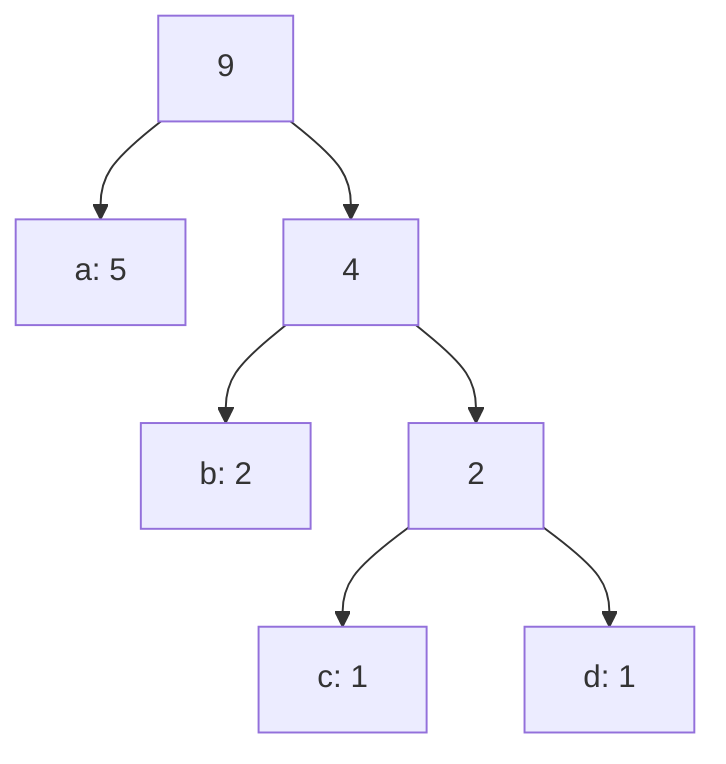

## Passo 1 · Leitura · Escolher o que termina primeiro

Um algoritmo **guloso** constrói a solução com uma decisão por vez, a que parece melhor agora, e nunca volta atrás: em geral, uma ordenação e um laço, $O(n \log n)$. O risco é a decisão local estragar o futuro, e por isso cada guloso precisa de uma prova.

**Seleção de atividades.** Há uma sala e vários pedidos de uso, cada um um intervalo $[\text{início}, \text{fim})$; dois pedidos são compatíveis se não se sobrepõem (um que termina às 10 e outro que começa às 10 são compatíveis). Queremos atender o **maior número** de pedidos. Critérios que parecem bons e falham:

- **o que começa primeiro**: com $[0, 10)$, $[1, 2)$ e $[3, 4)$, ele pega $[0, 10)$ e para; os dois curtos cabem juntos;
- **o mais curto**: com $[0, 5)$, $[4, 7)$ e $[6, 11)$, o mais curto, $[4, 7)$, conflita com os outros dois, que eram compatíveis entre si.

O critério certo é **o que termina primeiro**. Ordene pelo fim e percorra, aceitando cada pedido que começa depois do fim do último aceito.

**Por que funciona: o argumento de troca.** Seja $g$ o pedido que termina primeiro, e $O$ uma solução ótima qualquer. Troque o primeiro pedido de $O$ por $g$. Como $g$ termina antes ou junto, ele não conflita com nada que vinha depois em $O$: a solução continua válida e com o mesmo tamanho. Então existe uma solução ótima que começa com $g$, e o mesmo raciocínio vale para o que sobra depois dele. É o molde de toda prova de guloso: **mostrar que trocar a escolha de uma solução ótima pela escolha gulosa não piora nada.**

**Mochila fracionária.** Se os itens podem ser **divididos** (grãos, horas de trabalho), o guloso pela razão valor/peso é ótimo: encha com o item de maior razão, depois o próximo, e corte uma fração do último que não cabe. Qualquer grama de razão menor pode ser trocado por um de razão maior sem perder valor. Na mochila 0/1 o item não pode ser cortado, essa troca não existe, e o mesmo guloso erra.

No teste de compatibilidade, use `inicio >= fim_do_ultimo`: com `>`, pedidos que se encostam viram conflito.

## Passo 2 · Previsão · Começo ou fim

O programa aplica a mesma seleção com duas ordens diferentes. Leia sem executar e digite a saída exata.

### Código
```python
def selecionar(pedidos, chave):
    escolhidos = []
    fim_do_ultimo = 0
    for inicio, fim in sorted(pedidos, key=chave):
        if inicio >= fim_do_ultimo:
            escolhidos.append((inicio, fim))
            fim_do_ultimo = fim
    return escolhidos


pedidos = [(0, 7), (1, 3), (3, 5), (6, 8), (5, 6)]
pelo_inicio = selecionar(pedidos, lambda p: p[0])
pelo_fim = selecionar(pedidos, lambda p: p[1])
print(pelo_inicio, len(pelo_inicio))
print(pelo_fim, len(pelo_fim))
```

### Dicas
1. Ordene a lista nas duas ordens antes de simular.
2. Na ordem pelo início, o primeiro pedido ocupa a sala até 7.
3. Na ordem pelo fim, `(3, 5)` começa exatamente quando `(1, 3)` termina.

### Saída esperada
```text
[(0, 7)] 1
[(1, 3), (3, 5), (5, 6), (6, 8)] 4
```

## Passo 3 · Exercício · Atividades e mochila fracionária

Escreva duas funções.

- `maximo_de_atividades(pedidos)` recebe uma lista de tuplas `(inicio, fim)`, com `inicio < fim`, e devolve uma lista com o maior número possível de pedidos compatíveis, em ordem de fim. Em empate, qualquer escolha máxima vale.
- `mochila_fracionaria(itens, capacidade)` recebe uma lista de tuplas `(peso, valor)`, com pesos positivos, e devolve `(valor_total, fracoes)`: o maior valor possível e, **na ordem dos itens recebidos**, a fração de cada item que foi levada, entre 0.0 e 1.0.

```
mochila_fracionaria([(10, 60), (20, 100), (30, 120)], 50)
devolve (240.0, [1.0, 1.0, 0.6666666666666666])
```

### Instruções
1. Em `maximo_de_atividades`, ordene pelo fim e aceite cada pedido que começa no fim do último aceito ou depois.
2. Em `mochila_fracionaria`, visite os itens da maior razão valor/peso para a menor, levando inteiro o que cabe e uma fração do primeiro que não cabe.
   Dica: ordene os **índices** dos itens, para poder guardar as frações na ordem original.
3. Devolva as frações na ordem em que os itens chegaram.

### Código inicial
```python
def maximo_de_atividades(pedidos):
    pass


def mochila_fracionaria(itens, capacidade):
    pass
```

### Solução
```python
def maximo_de_atividades(pedidos):
    escolhidos = []
    fim_do_ultimo = None
    for inicio, fim in sorted(pedidos, key=lambda p: p[1]):
        if fim_do_ultimo is None or inicio >= fim_do_ultimo:
            escolhidos.append((inicio, fim))
            fim_do_ultimo = fim
    return escolhidos


def mochila_fracionaria(itens, capacidade):
    fracoes = [0.0] * len(itens)
    ordem = sorted(range(len(itens)), key=lambda i: itens[i][1] / itens[i][0], reverse=True)
    livre = capacidade
    total = 0.0
    for i in ordem:
        if livre <= 0:
            break
        peso, valor = itens[i]
        parte = min(1.0, livre / peso)
        fracoes[i] = parte
        total += valor * parte
        livre -= peso * parte
    return total, fracoes
```

### Dicas
1. `sorted(pedidos, key=lambda p: p[1])` ordena pelo fim.
2. Guarde só o fim do último pedido aceito: é tudo de que o próximo teste precisa.
3. A fração do item que não cabe inteiro é o espaço livre dividido pelo peso dele.

### Verificação
```json
[
  {"id": "inicio-engana", "checkpoint": 1, "kind": "call", "function": "maximo_de_atividades", "args": [[[0, 10], [1, 2], [3, 4]]], "expected": [[1, 2], [3, 4]], "name": "[0, 10), [1, 2), [3, 4): os dois curtos", "hint": "O pedido que começa primeiro ocupa a sala até 10."},
  {"id": "duracao-engana", "checkpoint": 1, "kind": "call", "function": "maximo_de_atividades", "args": [[[0, 5], [4, 7], [6, 11]]], "expected": [[0, 5], [6, 11]], "name": "[0, 5), [4, 7), [6, 11): o mais curto fica de fora", "hint": "O pedido mais curto conflita com os outros dois."},
  {"id": "encostados", "checkpoint": 1, "kind": "call", "function": "maximo_de_atividades", "args": [[[3, 5], [1, 3], [5, 7]]], "expected": [[1, 3], [3, 5], [5, 7]], "name": "Pedidos que se encostam são compatíveis", "hint": "Um pedido pode começar exatamente quando o anterior termina."},
  {"id": "vazia", "checkpoint": 1, "kind": "call", "function": "maximo_de_atividades", "args": [[]], "expected": [], "type": "list", "name": "Sem pedidos: lista vazia"},
  {"id": "previsao", "checkpoint": 1, "kind": "expr", "expr": "len(maximo_de_atividades([(0, 7), (1, 3), (3, 5), (6, 8), (5, 6)]))", "expected": 4, "name": "Os pedidos da previsão: 4 atendidos"},
  {"id": "negativos-quantidade", "checkpoint": 1, "kind": "expr", "expr": "len(maximo_de_atividades([(-5, -2), (-3, 0), (0, 1)]))", "expected": 2, "name": "Horários negativos (antes da abertura): 2 pedidos", "hint": "Nada garante que os horários comecem em 0."},
  {"id": "duzentos-quantidade", "checkpoint": 1, "kind": "expr", "expr": "len(maximo_de_atividades([((i * 37) % 500, (i * 37) % 500 + (i * 13) % 40 + 1) for i in range(200)]))", "expected": 38, "name": "200 pedidos: 38 atendidos"},
  {"id": "duzentos-validos", "checkpoint": 1, "kind": "expr", "setup": "def _valida(r, pedidos):\n    r = [tuple(p) for p in r]\n    return all(p in pedidos for p in r) and all(r[k][1] <= r[k + 1][0] for k in range(len(r) - 1))\np = [((i * 37) % 500, (i * 37) % 500 + (i * 13) % 40 + 1) for i in range(200)]", "expr": "_valida(maximo_de_atividades(p), p)", "expected": true, "name": "200 pedidos: os escolhidos existem, estão em ordem de fim e não se sobrepõem"},
  {"id": "frac-exemplo", "checkpoint": 2, "kind": "call", "function": "mochila_fracionaria", "args": [[[10, 60], [20, 100], [30, 120]], 50], "expected": [240.0, [1.0, 1.0, 0.6666666666666666]], "tolerance": 1e-09, "name": "Exemplo do enunciado: (240.0, [1.0, 1.0, 0.666…])"},
  {"id": "frac-razao", "checkpoint": 2, "kind": "call", "function": "mochila_fracionaria", "args": [[[10, 30], [40, 40]], 20], "expected": [40.0, [1.0, 0.25]], "tolerance": 1e-09, "name": "Itens (10, 30) e (40, 40), capacidade 20: (40.0, [1.0, 0.25])", "hint": "O item de maior valor não é o de maior valor por peso."},
  {"id": "frac-corta", "checkpoint": 2, "kind": "call", "function": "mochila_fracionaria", "args": [[[5, 10], [5, 10]], 7], "expected": [14.0, [1.0, 0.4]], "tolerance": 1e-09, "name": "Dois itens (5, 10) e capacidade 7: o segundo entra com 0.4", "hint": "O item que não cabe inteiro entra pela fração que cabe."},
  {"id": "frac-cabe-tudo", "checkpoint": 2, "kind": "call", "function": "mochila_fracionaria", "args": [[[1, 1], [2, 2]], 10], "expected": [3.0, [1.0, 1.0]], "tolerance": 1e-09, "name": "Tudo cabe: frações 1.0"},
  {"id": "frac-zero", "checkpoint": 2, "kind": "call", "function": "mochila_fracionaria", "args": [[[3, 9], [2, 2]], 0], "expected": [0.0, [0.0, 0.0]], "tolerance": 1e-09, "name": "Capacidade 0: nada entra"},
  {"id": "frac-ordem", "checkpoint": 3, "kind": "call", "function": "mochila_fracionaria", "args": [[[30, 120], [10, 60], [20, 100]], 50], "expected": [240.0, [0.6666666666666666, 1.0, 1.0]], "tolerance": 1e-09, "name": "Frações na ordem dos itens recebidos", "hint": "A lista de frações segue a ordem de itens, não a ordem da razão."},
  {"id": "frac-quarenta", "checkpoint": 2, "kind": "expr", "expr": "mochila_fracionaria([((i * 7) % 13 + 1, (i * 11) % 17 + 2) for i in range(40)], 60)[0]", "expected": 187.57142857142858, "tolerance": 1e-09, "name": "40 itens e capacidade 60: valor 187.571"},
  {"id": "frac-quarenta-valida", "checkpoint": 3, "kind": "expr", "setup": "def _valida(itens, capacidade, r):\n    total, fracoes = r\n    return (len(fracoes) == len(itens) and all(0 <= f <= 1 for f in fracoes)\n            and sum(p * f for (p, _), f in zip(itens, fracoes)) <= capacidade + 1e-9\n            and abs(sum(v * f for (_, v), f in zip(itens, fracoes)) - total) < 1e-9)\nitens = [((i * 7) % 13 + 1, (i * 11) % 17 + 2) for i in range(40)]", "expr": "_valida(itens, 60, mochila_fracionaria(itens, 60))", "expected": true, "name": "40 itens: as frações cabem na capacidade e somam o valor devolvido"}
]
```

### Soluções erradas
```python name="atividades pelo início"
def maximo_de_atividades(pedidos):
    escolhidos = []
    fim_do_ultimo = None
    for inicio, fim in sorted(pedidos):
        if fim_do_ultimo is None or inicio >= fim_do_ultimo:
            escolhidos.append((inicio, fim))
            fim_do_ultimo = fim
    return escolhidos


def mochila_fracionaria(itens, capacidade):
    fracoes = [0.0] * len(itens)
    ordem = sorted(range(len(itens)), key=lambda i: itens[i][1] / itens[i][0], reverse=True)
    livre = capacidade
    total = 0.0
    for i in ordem:
        if livre <= 0:
            break
        peso, valor = itens[i]
        parte = min(1.0, livre / peso)
        fracoes[i] = parte
        total += valor * parte
        livre -= peso * parte
    return total, fracoes
```
```python name="atividades pela duração"
def maximo_de_atividades(pedidos):
    escolhidos = []
    for inicio, fim in sorted(pedidos, key=lambda p: p[1] - p[0]):
        if all(inicio >= f or fim <= i for i, f in escolhidos):
            escolhidos.append((inicio, fim))
    return sorted(escolhidos, key=lambda p: p[1])


def mochila_fracionaria(itens, capacidade):
    fracoes = [0.0] * len(itens)
    ordem = sorted(range(len(itens)), key=lambda i: itens[i][1] / itens[i][0], reverse=True)
    livre = capacidade
    total = 0.0
    for i in ordem:
        if livre <= 0:
            break
        peso, valor = itens[i]
        parte = min(1.0, livre / peso)
        fracoes[i] = parte
        total += valor * parte
        livre -= peso * parte
    return total, fracoes
```
```python name="pedidos que se encostam viram conflito"
def maximo_de_atividades(pedidos):
    escolhidos = []
    fim_do_ultimo = None
    for inicio, fim in sorted(pedidos, key=lambda p: p[1]):
        if fim_do_ultimo is None or inicio > fim_do_ultimo:
            escolhidos.append((inicio, fim))
            fim_do_ultimo = fim
    return escolhidos


def mochila_fracionaria(itens, capacidade):
    fracoes = [0.0] * len(itens)
    ordem = sorted(range(len(itens)), key=lambda i: itens[i][1] / itens[i][0], reverse=True)
    livre = capacidade
    total = 0.0
    for i in ordem:
        if livre <= 0:
            break
        peso, valor = itens[i]
        parte = min(1.0, livre / peso)
        fracoes[i] = parte
        total += valor * parte
        livre -= peso * parte
    return total, fracoes
```
```python name="fim do último começa em 0"
def maximo_de_atividades(pedidos):
    escolhidos = []
    fim_do_ultimo = 0
    for inicio, fim in sorted(pedidos, key=lambda p: p[1]):
        if inicio >= fim_do_ultimo:
            escolhidos.append((inicio, fim))
            fim_do_ultimo = fim
    return escolhidos


def mochila_fracionaria(itens, capacidade):
    fracoes = [0.0] * len(itens)
    ordem = sorted(range(len(itens)), key=lambda i: itens[i][1] / itens[i][0], reverse=True)
    livre = capacidade
    total = 0.0
    for i in ordem:
        if livre <= 0:
            break
        peso, valor = itens[i]
        parte = min(1.0, livre / peso)
        fracoes[i] = parte
        total += valor * parte
        livre -= peso * parte
    return total, fracoes
```
```python name="mochila pelo maior valor"
def maximo_de_atividades(pedidos):
    escolhidos = []
    fim_do_ultimo = None
    for inicio, fim in sorted(pedidos, key=lambda p: p[1]):
        if fim_do_ultimo is None or inicio >= fim_do_ultimo:
            escolhidos.append((inicio, fim))
            fim_do_ultimo = fim
    return escolhidos


def mochila_fracionaria(itens, capacidade):
    fracoes = [0.0] * len(itens)
    ordem = sorted(range(len(itens)), key=lambda i: itens[i][1], reverse=True)
    livre = capacidade
    total = 0.0
    for i in ordem:
        if livre <= 0:
            break
        peso, valor = itens[i]
        parte = min(1.0, livre / peso)
        fracoes[i] = parte
        total += valor * parte
        livre -= peso * parte
    return total, fracoes
```
```python name="mochila só com itens inteiros"
def maximo_de_atividades(pedidos):
    escolhidos = []
    fim_do_ultimo = None
    for inicio, fim in sorted(pedidos, key=lambda p: p[1]):
        if fim_do_ultimo is None or inicio >= fim_do_ultimo:
            escolhidos.append((inicio, fim))
            fim_do_ultimo = fim
    return escolhidos


def mochila_fracionaria(itens, capacidade):
    fracoes = [0.0] * len(itens)
    ordem = sorted(range(len(itens)), key=lambda i: itens[i][1] / itens[i][0], reverse=True)
    livre = capacidade
    total = 0.0
    for i in ordem:
        peso, valor = itens[i]
        if peso <= livre:
            fracoes[i] = 1.0
            total += valor
            livre -= peso
    return total, fracoes
```
```python name="frações na ordem da razão"
def maximo_de_atividades(pedidos):
    escolhidos = []
    fim_do_ultimo = None
    for inicio, fim in sorted(pedidos, key=lambda p: p[1]):
        if fim_do_ultimo is None or inicio >= fim_do_ultimo:
            escolhidos.append((inicio, fim))
            fim_do_ultimo = fim
    return escolhidos


def mochila_fracionaria(itens, capacidade):
    fracoes = []
    livre = capacidade
    total = 0.0
    for peso, valor in sorted(itens, key=lambda item: item[1] / item[0], reverse=True):
        parte = max(0.0, min(1.0, livre / peso))
        fracoes.append(parte)
        total += valor * parte
        livre -= peso * parte
    return total, fracoes
```

## Passo 4 · Leitura · Códigos de Huffman

Um texto com `a` (5 vezes), `b` (2), `c` (1) e `d` (1) gasta 18 bits com 2 bits por letra. Com códigos de tamanhos diferentes, letras frequentes ganham códigos curtos. Para decodificar sem separadores, o código precisa ser **livre de prefixo**: nenhum código é o começo de outro. Com `a = 0`, `b = 10`, `c = 110` e `d = 111`, `0110100` só pode ser `a c b a`, e o custo $\sum_s f_s \cdot |\text{código}(s)|$ é $5 + 4 + 3 + 3 = 15$ bits.

Um código livre de prefixo é uma árvore binária: cada símbolo é uma folha, e o código é o caminho até ela (0 à esquerda, 1 à direita). **Huffman** constrói a árvore de baixo para cima: ponha os símbolos num heap pela frequência; tire os dois de **menor** frequência, junte-os sob um nó novo com a soma delas e devolva esse nó ao heap; repita até sobrar um nó.



O argumento de troca, de novo: numa árvore ótima, os dois símbolos menos frequentes podem ficar como irmãos no nível mais fundo, porque trocar um símbolo frequente que está lá embaixo por um raro que está mais acima só diminui o custo. Juntá-los primeiro, como Huffman faz, não perde nada.

Três tropeços comuns:

- **O empate no heap.** Com `(freq, no)`, frequências iguais fazem o Python comparar os nós; se um é uma letra e o outro um par de subárvores, sai `TypeError: '<' not supported between instances of 'tuple' and 'str'`. A correção é a do módulo 6: `(freq, contador, no)`.
- **Ordenar uma vez só** e juntar em sequência ignora que o nó novo pode ser maior que os próximos; ele precisa voltar ao heap.
- **Montar o código ao contrário.** Descendo da raiz, o bit vai no **fim** do código. No começo, `0`, `10`, `11` vira `0`, `01`, `11`, e `0` é prefixo de `01`.

Com um símbolo só, o caminho é vazio, e a convenção é dar `0` a ele. Há vários códigos ótimos (trocar 0 e 1 num nó não muda o custo); por isso se verifica o custo, não os bits.

## Passo 5 · Exercício · huffman

Escreva `huffman(frequencias)`, que recebe um dicionário de símbolo para frequência (inteiros positivos) e devolve um dicionário de símbolo para código, uma string de `0` e `1`. O código precisa ser livre de prefixo e ter o menor custo possível. Com um símbolo só, o código dele é `"0"`; com o dicionário vazio, a resposta é `{}`.

Qualquer código ótimo vale: a verificação confere os símbolos, a ausência de prefixos e o custo.

### Instruções
1. Monte um heap de tuplas `(frequência, desempate, nó)`, com um desempate que nunca se repete.
2. Junte os dois nós de menor frequência até sobrar um, devolvendo cada nó novo ao heap.
3. Percorra a árvore da raiz até as folhas, acrescentando `0` à esquerda e `1` à direita no fim do código; trate os casos de zero e de um símbolo.

### Código inicial
```python
import heapq


def huffman(frequencias):
    pass
```

### Solução
```python
import heapq


def huffman(frequencias):
    if not frequencias:
        return {}
    if len(frequencias) == 1:
        return {simbolo: "0" for simbolo in frequencias}
    heap = [(f, k, s) for k, (s, f) in enumerate(frequencias.items())]
    heapq.heapify(heap)
    contador = len(heap)
    while len(heap) > 1:
        f1, _, esquerda = heapq.heappop(heap)
        f2, _, direita = heapq.heappop(heap)
        heapq.heappush(heap, (f1 + f2, contador, (esquerda, direita)))
        contador += 1
    codigos = {}
    pilha = [(heap[0][2], "")]
    while pilha:
        no, codigo = pilha.pop()
        if isinstance(no, tuple):
            pilha.append((no[0], codigo + "0"))
            pilha.append((no[1], codigo + "1"))
        else:
            codigos[no] = codigo
    return codigos
```

### Dicas
1. Um nó interno pode ser uma tupla `(esquerda, direita)`; uma folha é o próprio símbolo.
2. O desempate pode ser um número que cresce a cada nó criado.
3. Para percorrer, uma pilha de pares `(nó, código até aqui)` evita recursão.

### Verificação
```json
[
  {"id": "leitura", "checkpoint": 2, "kind": "expr", "setup": "def _custo(freq, cod):\n    if set(cod) != set(freq):\n        return 'símbolos diferentes'\n    cs = list(cod.values())\n    if any(not c or set(c) - {'0', '1'} for c in cs):\n        return 'código vazio ou com outro caractere'\n    if any(i != j and cs[j].startswith(cs[i]) for i in range(len(cs)) for j in range(len(cs))):\n        return 'um código é prefixo de outro'\n    return sum(freq[s] * len(cod[s]) for s in freq)\nf = {'a': 5, 'b': 2, 'c': 1, 'd': 1}", "expr": "_custo(f, huffman(f))", "expected": 15, "name": "a 5, b 2, c 1, d 1: código livre de prefixo com custo 15"},
  {"id": "classico", "checkpoint": 2, "kind": "expr", "setup": "def _custo(freq, cod):\n    if set(cod) != set(freq):\n        return 'símbolos diferentes'\n    cs = list(cod.values())\n    if any(not c or set(c) - {'0', '1'} for c in cs):\n        return 'código vazio ou com outro caractere'\n    if any(i != j and cs[j].startswith(cs[i]) for i in range(len(cs)) for j in range(len(cs))):\n        return 'um código é prefixo de outro'\n    return sum(freq[s] * len(cod[s]) for s in freq)\nf = {'a': 45, 'b': 13, 'c': 12, 'd': 16, 'e': 9, 'f': 5}", "expr": "_custo(f, huffman(f))", "expected": 224, "name": "Seis símbolos: custo 224"},
  {"id": "empate-folha-no", "checkpoint": 1, "kind": "expr", "setup": "def _custo(freq, cod):\n    if set(cod) != set(freq):\n        return 'símbolos diferentes'\n    cs = list(cod.values())\n    if any(not c or set(c) - {'0', '1'} for c in cs):\n        return 'código vazio ou com outro caractere'\n    if any(i != j and cs[j].startswith(cs[i]) for i in range(len(cs)) for j in range(len(cs))):\n        return 'um código é prefixo de outro'\n    return sum(freq[s] * len(cod[s]) for s in freq)\nf = {'a': 2, 'b': 1, 'c': 1}", "expr": "_custo(f, huffman(f))", "expected": 6, "name": "a 2, b 1, c 1: o nó novo empata com a folha a; custo 6", "hint": "No empate de frequências, o heap compara o próximo campo da tupla."},
  {"id": "iguais", "checkpoint": 2, "kind": "expr", "setup": "def _custo(freq, cod):\n    if set(cod) != set(freq):\n        return 'símbolos diferentes'\n    cs = list(cod.values())\n    if any(not c or set(c) - {'0', '1'} for c in cs):\n        return 'código vazio ou com outro caractere'\n    if any(i != j and cs[j].startswith(cs[i]) for i in range(len(cs)) for j in range(len(cs))):\n        return 'um código é prefixo de outro'\n    return sum(freq[s] * len(cod[s]) for s in freq)\nf = {'w': 1, 'x': 1, 'y': 1, 'z': 1}", "expr": "_custo(f, huffman(f))", "expected": 8, "name": "Quatro frequências iguais: 2 bits cada, custo 8", "hint": "O nó novo volta ao heap e compete com os que ainda não foram usados."},
  {"id": "vinte", "checkpoint": 3, "kind": "expr", "setup": "def _custo(freq, cod):\n    if set(cod) != set(freq):\n        return 'símbolos diferentes'\n    cs = list(cod.values())\n    if any(not c or set(c) - {'0', '1'} for c in cs):\n        return 'código vazio ou com outro caractere'\n    if any(i != j and cs[j].startswith(cs[i]) for i in range(len(cs)) for j in range(len(cs))):\n        return 'um código é prefixo de outro'\n    return sum(freq[s] * len(cod[s]) for s in freq)\nf = {chr(97 + i): (i * 7) % 13 + 1 for i in range(20)}", "expr": "_custo(f, huffman(f))", "expected": 523, "name": "20 símbolos: custo 523"},
  {"id": "trezentos", "checkpoint": 3, "kind": "expr", "setup": "def _custo(freq, cod):\n    if set(cod) != set(freq):\n        return 'símbolos diferentes'\n    cs = list(cod.values())\n    if any(not c or set(c) - {'0', '1'} for c in cs):\n        return 'código vazio ou com outro caractere'\n    if any(i != j and cs[j].startswith(cs[i]) for i in range(len(cs)) for j in range(len(cs))):\n        return 'um código é prefixo de outro'\n    return sum(freq[s] * len(cod[s]) for s in freq)\nf = {'s' + str(i): (i * 37) % 101 + 1 for i in range(300)}", "expr": "_custo(f, huffman(f))", "expected": 122022, "name": "300 símbolos: custo 122 022"},
  {"id": "prefixo", "checkpoint": 3, "kind": "expr", "setup": "def _custo(freq, cod):\n    if set(cod) != set(freq):\n        return 'símbolos diferentes'\n    cs = list(cod.values())\n    if any(not c or set(c) - {'0', '1'} for c in cs):\n        return 'código vazio ou com outro caractere'\n    if any(i != j and cs[j].startswith(cs[i]) for i in range(len(cs)) for j in range(len(cs))):\n        return 'um código é prefixo de outro'\n    return sum(freq[s] * len(cod[s]) for s in freq)\nf = {'a': 1, 'b': 2, 'c': 4, 'd': 8, 'e': 16}", "expr": "_custo(f, huffman(f))", "expected": 56, "name": "Frequências 1, 2, 4, 8, 16: árvore em escada, custo 56", "hint": "Descendo da raiz, o bit da aresta vai no fim do código."},
  {"id": "um-simbolo", "checkpoint": 3, "kind": "call", "function": "huffman", "args": [{"x": 7}], "expected": {"x": "0"}, "name": "Um símbolo só: código '0'"},
  {"id": "vazio", "checkpoint": 3, "kind": "call", "function": "huffman", "args": [{}], "expected": {}, "type": "dict", "name": "Dicionário vazio: {}"},
  {"id": "dois-simbolos", "checkpoint": 3, "kind": "expr", "expr": "sorted(huffman({'p': 3, 'q': 9}).values())", "expected": ["0", "1"], "name": "Dois símbolos: um bit cada"}
]
```

### Soluções erradas
```python name="sem desempate no heap"
import heapq


def huffman(frequencias):
    if not frequencias:
        return {}
    if len(frequencias) == 1:
        return {simbolo: "0" for simbolo in frequencias}
    heap = [(f, s) for s, f in frequencias.items()]
    heapq.heapify(heap)
    while len(heap) > 1:
        f1, esquerda = heapq.heappop(heap)
        f2, direita = heapq.heappop(heap)
        heapq.heappush(heap, (f1 + f2, (esquerda, direita)))
    codigos = {}
    pilha = [(heap[0][1], "")]
    while pilha:
        no, codigo = pilha.pop()
        if isinstance(no, tuple):
            pilha.append((no[0], codigo + "0"))
            pilha.append((no[1], codigo + "1"))
        else:
            codigos[no] = codigo
    return codigos
```
```python name="ordena uma vez e junta em sequência"
def huffman(frequencias):
    if not frequencias:
        return {}
    if len(frequencias) == 1:
        return {simbolo: "0" for simbolo in frequencias}
    ordem = sorted(frequencias, key=lambda s: frequencias[s])
    arvore = ordem[0]
    for simbolo in ordem[1:]:
        arvore = (arvore, simbolo)
    codigos = {}
    pilha = [(arvore, "")]
    while pilha:
        no, codigo = pilha.pop()
        if isinstance(no, tuple):
            pilha.append((no[0], codigo + "0"))
            pilha.append((no[1], codigo + "1"))
        else:
            codigos[no] = codigo
    return codigos
```
```python name="junta os dois mais frequentes"
import heapq


def huffman(frequencias):
    if not frequencias:
        return {}
    if len(frequencias) == 1:
        return {simbolo: "0" for simbolo in frequencias}
    heap = [(-f, k, s) for k, (s, f) in enumerate(frequencias.items())]
    heapq.heapify(heap)
    contador = len(heap)
    while len(heap) > 1:
        f1, _, esquerda = heapq.heappop(heap)
        f2, _, direita = heapq.heappop(heap)
        heapq.heappush(heap, (f1 + f2, contador, (esquerda, direita)))
        contador += 1
    codigos = {}
    pilha = [(heap[0][2], "")]
    while pilha:
        no, codigo = pilha.pop()
        if isinstance(no, tuple):
            pilha.append((no[0], codigo + "0"))
            pilha.append((no[1], codigo + "1"))
        else:
            codigos[no] = codigo
    return codigos
```
```python name="bit no começo do código"
import heapq


def huffman(frequencias):
    if not frequencias:
        return {}
    if len(frequencias) == 1:
        return {simbolo: "0" for simbolo in frequencias}
    heap = [(f, k, s) for k, (s, f) in enumerate(frequencias.items())]
    heapq.heapify(heap)
    contador = len(heap)
    while len(heap) > 1:
        f1, _, esquerda = heapq.heappop(heap)
        f2, _, direita = heapq.heappop(heap)
        heapq.heappush(heap, (f1 + f2, contador, (esquerda, direita)))
        contador += 1
    codigos = {}
    pilha = [(heap[0][2], "")]
    while pilha:
        no, codigo = pilha.pop()
        if isinstance(no, tuple):
            pilha.append((no[0], "0" + codigo))
            pilha.append((no[1], "1" + codigo))
        else:
            codigos[no] = codigo
    return codigos
```
```python name="símbolo único com código vazio"
import heapq


def huffman(frequencias):
    if not frequencias:
        return {}
    heap = [(f, k, s) for k, (s, f) in enumerate(frequencias.items())]
    heapq.heapify(heap)
    contador = len(heap)
    while len(heap) > 1:
        f1, _, esquerda = heapq.heappop(heap)
        f2, _, direita = heapq.heappop(heap)
        heapq.heappush(heap, (f1 + f2, contador, (esquerda, direita)))
        contador += 1
    codigos = {}
    pilha = [(heap[0][2], "")]
    while pilha:
        no, codigo = pilha.pop()
        if isinstance(no, tuple):
            pilha.append((no[0], codigo + "0"))
            pilha.append((no[1], codigo + "1"))
        else:
            codigos[no] = codigo
    return codigos
```
```python name="código de tamanho fixo"
def huffman(frequencias):
    if not frequencias:
        return {}
    bits = max(1, (len(frequencias) - 1).bit_length())
    return {s: format(k, "0" + str(bits) + "b") for k, s in enumerate(sorted(frequencias))}
```

## Passo 6 · Leitura · Quando o guloso falha, e como escolher

No troco, o guloso pega a maior moeda que cabe. Com 1, 5, 10, 25 e 50 ele sempre acerta: o sistema é **canônico**. Com 1, 3 e 4 ele erra em 6. Para saber se o guloso serve num sistema de moedas ou fichas, compare com a DP: para cada valor $v$, calcule o mínimo pela tabela e veja se o guloso usa mais.

Até onde procurar? Para moedas que incluem 1, um resultado de Kozen e Zaks garante: se existe um valor em que o guloso erra, o **menor** deles é menor que a soma das duas maiores moedas. Com 1, 5, 10, 20 e 25, basta testar até 44, e o primeiro erro aparece em 40: o guloso faz $25 + 10 + 5$, três moedas, e o ótimo é $20 + 20$. Procurar só até a maior moeda, 25, não acha nada e conclui errado que o sistema é canônico.

Comparar as **listas** de moedas também engana: com 1, 2 e 3, o valor 4 sai do guloso como $3 + 1$ e da DP, conforme a ordem das moedas, como $2 + 2$. São diferentes, mas têm o mesmo tamanho, e o guloso não errou. O que se compara é a quantidade.

#### Como escolher a técnica

Diante de um problema novo de otimização:

1. **Há uma escolha local que um argumento de troca justifica?** Atividades pelo fim, Huffman, mochila fracionária, Dijkstra. Então o guloso é a resposta. Sem a prova, procure um contraexemplo comparando com a força bruta em entradas pequenas.
2. **Os subproblemas se repetem e o ótimo se compõe de ótimos?** E o número de estados é pequeno (polinomial)? Então DP: troco arbitrário, mochila 0/1, LCS, edição.
3. **Nenhum dos dois?** Sobra explorar as possibilidades com **backtracking**, cortando ramos que não podem vencer a melhor solução já achada (*branch-and-bound*). Para instâncias grandes de problemas assim, como roteirizar entregas por muitas cidades, usam-se **heurísticas** e algoritmos de **aproximação**, que dão uma solução boa sem garantia de ótima; é o território da otimização e de parte do aprendizado de máquina.

## Passo 7 · Exercício · O guloso do troco e o contraexemplo

Escreva duas funções. As moedas são inteiros positivos distintos, em qualquer ordem, e **sempre incluem 1**.

- `troco_guloso(moedas, valor)` devolve a lista de moedas que o guloso escolhe, em ordem decrescente.
- `contraexemplo_troco(moedas)` devolve o **menor** valor em que o guloso usa mais moedas que o mínimo possível, ou `None` se o sistema é canônico. Use o limite da leitura: teste os valores menores que a soma das duas maiores moedas.

### Instruções
1. Em `troco_guloso`, percorra as moedas da maior para a menor, usando cada uma enquanto couber.
2. Em `contraexemplo_troco`, calcule o mínimo de moedas de cada valor com uma tabela, de 0 até o limite.
   Dica: com uma moeda só, não há duas maiores para somar, e o sistema é canônico.
3. Compare a **quantidade** de moedas do guloso com o mínimo, valor a valor, e devolva o primeiro em que o guloso perde.

### Código inicial
```python
def troco_guloso(moedas, valor):
    pass


def contraexemplo_troco(moedas):
    pass
```

### Solução
```python
def troco_guloso(moedas, valor):
    escolhidas = []
    for m in sorted(moedas, reverse=True):
        while m <= valor:
            escolhidas.append(m)
            valor -= m
    return escolhidas


def contraexemplo_troco(moedas):
    ordem = sorted(moedas)
    if len(ordem) < 2:
        return None
    limite = ordem[-1] + ordem[-2]
    minimo = [0] * limite
    for v in range(1, limite):
        minimo[v] = 1 + min(minimo[v - m] for m in ordem if m <= v)
        if len(troco_guloso(ordem, v)) > minimo[v]:
            return v
    return None
```

### Dicas
1. Como 1 está entre as moedas, todo valor tem troco: o mínimo existe para todos.
2. O mínimo de `v` é 1 mais o menor mínimo entre os valores `v - m`.
3. Teste com 1, 5, 10, 20 e 25: o primeiro erro passa da maior moeda.

### Verificação
```json
[
  {"id": "guloso-63", "checkpoint": 1, "kind": "call", "function": "troco_guloso", "args": [[1, 5, 10, 25], 63], "expected": [25, 25, 10, 1, 1, 1], "name": "Guloso de 63 com 1, 5, 10 e 25"},
  {"id": "guloso-ordem", "checkpoint": 1, "kind": "call", "function": "troco_guloso", "args": [[1, 3, 4], 6], "expected": [4, 1, 1], "name": "Guloso de 6 com moedas 1, 3, 4: [4, 1, 1]", "hint": "O guloso começa pela maior moeda, qualquer que seja a ordem da lista."},
  {"id": "guloso-zero", "checkpoint": 1, "kind": "call", "function": "troco_guloso", "args": [[1, 5], 0], "expected": [], "type": "list", "name": "Valor 0: lista vazia"},
  {"id": "c-134", "checkpoint": 3, "kind": "call", "function": "contraexemplo_troco", "args": [[1, 3, 4]], "expected": 6, "name": "Moedas 1, 3, 4: o guloso erra primeiro em 6"},
  {"id": "c-canonico", "checkpoint": 3, "kind": "call", "function": "contraexemplo_troco", "args": [[1, 5, 10, 25]], "expected": null, "name": "Moedas 1, 5, 10, 25: canônico, None"},
  {"id": "c-alem-da-maior", "checkpoint": 2, "kind": "call", "function": "contraexemplo_troco", "args": [[1, 5, 10, 20, 25]], "expected": 40, "name": "Moedas 1, 5, 10, 20, 25: o primeiro erro é 40", "hint": "O contraexemplo pode passar da maior moeda."},
  {"id": "c-primeiro", "checkpoint": 3, "kind": "call", "function": "contraexemplo_troco", "args": [[1, 7, 10]], "expected": 14, "name": "Moedas 1, 7, 10: o primeiro erro é 14", "hint": "Depois de 14 há outros valores em que o guloso erra; a resposta é o menor."},
  {"id": "c-uma-moeda", "checkpoint": 2, "kind": "call", "function": "contraexemplo_troco", "args": [[1]], "expected": null, "name": "Só a moeda 1: None"},
  {"id": "c-duas", "checkpoint": 3, "kind": "call", "function": "contraexemplo_troco", "args": [[1, 2]], "expected": null, "name": "Moedas 1 e 2: None"},
  {"id": "c-fora-de-ordem", "checkpoint": 3, "kind": "call", "function": "contraexemplo_troco", "args": [[4, 3, 1]], "expected": 6, "name": "Moedas fora de ordem (4, 3, 1): 6"},
  {"id": "c-169", "checkpoint": 3, "kind": "call", "function": "contraexemplo_troco", "args": [[1, 6, 9]], "expected": 12, "name": "Moedas 1, 6, 9: o primeiro erro é 12"},
  {"id": "c-grandes", "checkpoint": 2, "kind": "call", "function": "contraexemplo_troco", "args": [[1, 15, 23, 29]], "expected": 38, "name": "Moedas 1, 15, 23, 29: o primeiro erro é 38"}
]
```

### Soluções erradas
```python name="guloso na ordem recebida"
def troco_guloso(moedas, valor):
    escolhidas = []
    for m in moedas:
        while m <= valor:
            escolhidas.append(m)
            valor -= m
    return escolhidas


def contraexemplo_troco(moedas):
    ordem = sorted(moedas)
    if len(ordem) < 2:
        return None
    limite = ordem[-1] + ordem[-2]
    minimo = [0] * limite
    for v in range(1, limite):
        minimo[v] = 1 + min(minimo[v - m] for m in ordem if m <= v)
        if len(troco_guloso(ordem, v)) > minimo[v]:
            return v
    return None
```
```python name="procura só até a maior moeda"
def troco_guloso(moedas, valor):
    escolhidas = []
    for m in sorted(moedas, reverse=True):
        while m <= valor:
            escolhidas.append(m)
            valor -= m
    return escolhidas


def contraexemplo_troco(moedas):
    ordem = sorted(moedas)
    limite = ordem[-1] + 1
    minimo = [0] * limite
    for v in range(1, limite):
        minimo[v] = 1 + min(minimo[v - m] for m in ordem if m <= v)
        if len(troco_guloso(ordem, v)) > minimo[v]:
            return v
    return None
```
```python name="não para no primeiro erro"
def troco_guloso(moedas, valor):
    escolhidas = []
    for m in sorted(moedas, reverse=True):
        while m <= valor:
            escolhidas.append(m)
            valor -= m
    return escolhidas


def contraexemplo_troco(moedas):
    ordem = sorted(moedas)
    if len(ordem) < 2:
        return None
    limite = ordem[-1] + ordem[-2]
    minimo = [0] * limite
    resposta = None
    for v in range(1, limite):
        minimo[v] = 1 + min(minimo[v - m] for m in ordem if m <= v)
        if len(troco_guloso(ordem, v)) > minimo[v]:
            resposta = v
    return resposta
```
```python name="mínimo começa em 1 no valor 0"
def troco_guloso(moedas, valor):
    escolhidas = []
    for m in sorted(moedas, reverse=True):
        while m <= valor:
            escolhidas.append(m)
            valor -= m
    return escolhidas


def contraexemplo_troco(moedas):
    ordem = sorted(moedas)
    if len(ordem) < 2:
        return None
    limite = ordem[-1] + ordem[-2]
    minimo = [1] * limite
    for v in range(1, limite):
        minimo[v] = 1 + min(minimo[v - m] for m in ordem if m <= v)
        if len(troco_guloso(ordem, v)) > minimo[v]:
            return v
    return None
```
```python name="sistema de uma moeda quebra"
def troco_guloso(moedas, valor):
    escolhidas = []
    for m in sorted(moedas, reverse=True):
        while m <= valor:
            escolhidas.append(m)
            valor -= m
    return escolhidas


def contraexemplo_troco(moedas):
    ordem = sorted(moedas)
    limite = ordem[-1] + ordem[-2]
    minimo = [0] * limite
    for v in range(1, limite):
        minimo[v] = 1 + min(minimo[v - m] for m in ordem if m <= v)
        if len(troco_guloso(ordem, v)) > minimo[v]:
            return v
    return None
```

## Passo 8 · Quiz · Guloso, DP ou busca

### Pergunta
Uma clínica quer atender o maior número de consultas numa sala, e cada consulta tem horário fixo de início e fim. Um estagiário propõe aceitar primeiro as consultas mais curtas, "porque ocupam menos a sala". O que você responde?
- [ ] Está certo: consultas curtas sempre deixam mais espaço
- [x] Está errado: uma consulta curta pode conflitar com duas compatíveis entre si; o certo é ordenar pelo fim, e o argumento de troca prova que funciona
- [ ] É preciso DP, porque o problema tem subproblemas sobrepostos e nenhum guloso funciona
- [ ] É preciso testar todos os subconjuntos, porque com horários fixos não há atalho
> Com $[0, 5)$, $[4, 7)$ e $[6, 11)$, a mais curta, $[4, 7)$, bloqueia as outras duas. Pelo fim, a primeira escolhida termina o mais cedo possível, e trocar a primeira consulta de qualquer solução ótima por ela não cria conflito: o guloso é ótimo, em $O(n \log n)$.

### Pergunta
Uma fundação tem R\$ 1 000 000 para financiar projetos; cada projeto tem um custo e um impacto estimado, e é financiado inteiro ou não. Qual abordagem dá a melhor carteira?
- [ ] Guloso pelo impacto por real, porque é ótimo na mochila fracionária
- [ ] Guloso pelo maior impacto, porque projetos grandes concentram o resultado
- [x] Programação dinâmica da mochila 0/1, se o orçamento puder ser medido em unidades que deixem a tabela pequena (milhares de reais, por exemplo); senão, branch-and-bound
- [ ] Huffman, juntando os projetos de menor custo
> Projeto inteiro ou nada é a mochila 0/1, onde o guloso pela razão falha (o exemplo (6, 30), (5, 20), (5, 20)). A DP custa $O(nW)$: com o orçamento em milhares de reais, $W = 1\,000$ e a tabela é pequena; em centavos, $W = 10^8$ e ela não cabe. Aí a saída é uma busca que corta ramos sem chance.

### Pergunta
Um jogo tem fichas de 1, 4 e 6 pontos, e o caixa automático entrega sempre a maior ficha que cabe. Um jogador reclama que recebeu fichas demais. Como confirmar se o caixa erra, e onde?
- [ ] Testar o caixa com valores aleatórios até achar um erro
- [x] Para cada valor menor que $6 + 4 = 10$, comparar a quantidade de fichas do guloso com o mínimo calculado por DP; o primeiro valor em que o guloso usa mais é o contraexemplo
- [ ] Verificar se cada ficha é múltipla da anterior; como 6 não é múltiplo de 4, o caixa erra em 6
- [ ] Comparar as listas de fichas do guloso e da DP; qualquer diferença é um erro
> Pelo resultado de Kozen e Zaks, se há erro, o menor está abaixo da soma das duas maiores fichas. Em 8, o guloso dá $6 + 1 + 1$ (3 fichas) e o mínimo é $4 + 4$ (2). Em 6, não há erro: uma ficha de 6. Ser múltipla da anterior é suficiente para o guloso funcionar, mas não necessário (1, 5, 10, 25 é canônico); e listas diferentes com o mesmo tamanho não são erro.
