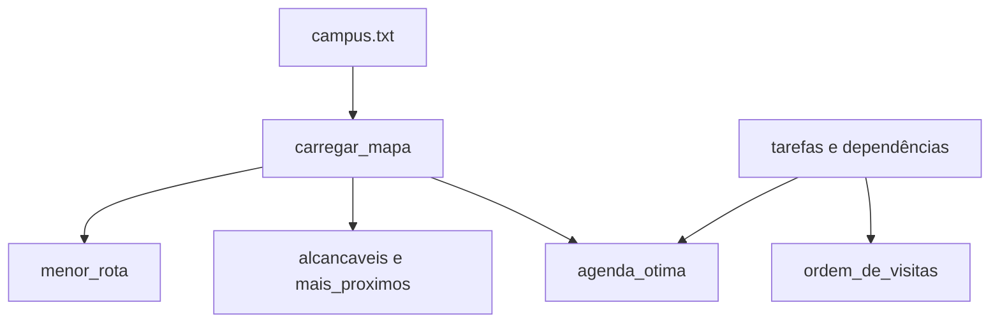

## Passo 1 · Leitura · O que você vai construir

Neste projeto você escreve o motor de um **planejador de rotas** para um campus fictício: ele lê o mapa de um arquivo de texto, calcula a rota mais rápida entre dois prédios (inclusive só por caminhos acessíveis), lista o que dá para alcançar em poucos minutos, ordena as visitas de um dia respeitando dependências e escolhe a melhor agenda para um orçamento de tempo. Cada parte usa uma ferramenta do nível: grafos, heaps, ordenação topológica e programação dinâmica.



#### O mapa

Cada linha do arquivo é um local ou um caminho; linhas em branco e linhas que começam com `#` são ignoradas.

```
local Portaria | entrada
local Biblioteca | estudo
caminho Portaria | Biblioteca | 8 | sim
```

Um local tem nome e tipo. Um caminho liga dois locais já declarados, leva um número inteiro e positivo de minutos e diz se é acessível (`sim` ou `não`: rampa, piso regular, elevador). Os caminhos valem nos dois sentidos. O arquivo `campus.txt`, que acompanha os passos, tem 12 locais e 14 caminhos.

#### As funções

| Passo | Função | Ferramenta |
|---|---|---|
| 3 | `carregar_mapa(texto)` | dicionários e validação |
| 4 | `menor_rota(mapa, origem, destino, apenas_acessivel=False)` | Dijkstra com heap |
| 5 | `alcancaveis(mapa, origem, limite)` e `mais_proximos(mapa, origem, k, tipo)` | Dijkstra que para cedo |
| 6 | `ordem_de_visitas(tarefas, dependencias)` | ordenação topológica com heap |
| 7 | `agenda_otima(mapa, origem, tarefas, orcamento)` | mochila 0/1 |

Cada passo traz, em arquivos à parte, as funções dos passos anteriores já prontas (`mapa.py`, `rotas.py`). Assim um erro antigo não derruba o passo novo, e você pode comparar a sua versão com a de referência.

#### Critérios

As assinaturas e os formatos de retorno são fixos e estão no enunciado de cada passo. Além dos casos funcionais, há casos de **desempenho**. Nenhum deles mede tempo: a verificação conta as **linhas executadas** pelo seu código numa grade de 3 600 locais e recusa o que passa do limite. Uma busca do mínimo com laço, em vez de heap, faz milhões de passos nesse mapa; explorar o campus inteiro quando a pergunta é "os 3 mais próximos" também. Há ainda uma corrente de 20 000 locais, para conferir que nada no seu código depende de recursão profunda.

Quando há mais de uma resposta ótima (dois caminhos com os mesmos minutos, duas agendas com a mesma prioridade), qualquer uma vale, e a verificação confere se a sua é válida. Quando a ordem importa, o enunciado diz como desempatar, sempre por um critério fixo: minutos e depois nome, ou ordem alfabética.

Antes de escrever cada função, faça o exemplo do enunciado à mão no mapa do campus. É o jeito mais rápido de descobrir o que está faltando.

## Passo 2 · Previsão · O heap do Dijkstra

O Dijkstra deste projeto guarda no heap pares `(minutos, local)` e, em vez de apagar uma entrada que ficou velha, ignora-a quando ela sai do heap. O programa mostra cada saída. Leia sem executar e digite a saída exata.

### Código
```python
import heapq

vizinhos = {
    "Portaria": [("Biblioteca", 4), ("Quadra", 1)],
    "Quadra": [("Biblioteca", 2), ("Lanchonete", 6)],
    "Biblioteca": [("Lanchonete", 3)],
    "Lanchonete": [],
}
dist = {"Portaria": 0}
heap = [(0, "Portaria")]
while heap:
    d, local = heapq.heappop(heap)
    if d > dist[local]:
        print("ignora", d, local)
        continue
    print("fecha", d, local)
    for vizinho, minutos in vizinhos[local]:
        nova = d + minutos
        if vizinho not in dist or nova < dist[vizinho]:
            dist[vizinho] = nova
            heapq.heappush(heap, (nova, vizinho))
```

### Dicas
1. Anote o conteúdo do heap depois de cada `heappush`; sai sempre o par de menor minuto.
2. A Biblioteca entra no heap duas vezes, com 4 e com 3 minutos.
3. Uma entrada é ignorada quando o minuto dela é maior que o melhor já registrado em `dist`.

### Saída esperada
```text
fecha 0 Portaria
fecha 1 Quadra
fecha 3 Biblioteca
ignora 4 Biblioteca
fecha 6 Lanchonete
ignora 7 Lanchonete
```

## Passo 3 · Exercício · carregar_mapa

Escreva `carregar_mapa(texto)`, que recebe o conteúdo do arquivo e devolve um dicionário com duas chaves:

- `"tipos"`: de nome do local para o tipo dele;
- `"vizinhos"`: de nome do local para a lista dos caminhos que saem dele, cada um uma tupla `(vizinho, minutos, acessivel)`, com `minutos` inteiro e `acessivel` booleano, na ordem em que aparecem no arquivo. Todo local tem uma entrada, mesmo sem caminhos.

```
carregar_mapa("local A | sala\nlocal B | quadra\ncaminho A | B | 3 | não")
devolve {"tipos": {"A": "sala", "B": "quadra"},
         "vizinhos": {"A": [("B", 3, False)], "B": [("A", 3, False)]}}
```

Os campos são separados por `|`, com espaços opcionais em volta. Qualquer problema levanta `ValueError` com a mensagem começando por `linha N:`, em que N é o número da linha no texto, a partir de 1, contando comentários e linhas em branco. São problemas: comando que não é `local` nem `caminho`; número errado de campos; local declarado duas vezes; caminho com local não declarado antes; minutos que não são um inteiro positivo; acessível diferente de `sim` e `não`.

### Instruções
1. Ignore linhas em branco e comentários, separe o comando dos campos e registre cada local com uma lista vazia de vizinhos.
2. Para cada caminho, acrescente a tupla nos dois locais, com os minutos como inteiro e a acessibilidade como booleano.
3. Valide cada linha antes de usá-la e levante `ValueError` com o número da linha.
   Dica: confira o texto dos minutos antes de chamar `int()`.

### Código inicial
```python
def carregar_mapa(texto):
    pass
```
```text path=campus.txt
# Campus fictício: locais e caminhos
local Portaria | entrada
local Estacionamento | entrada
local Biblioteca | estudo
local Bloco A | aula
local Bloco B | aula
local Laboratório | aula
local Restaurante | alimentação
local Lanchonete | alimentação
local Ginásio | esporte
local Enfermaria | saúde
local Observatório | estudo
local Mirante | convivência

caminho Portaria | Estacionamento | 2 | sim
caminho Portaria | Biblioteca | 8 | sim
caminho Portaria | Bloco A | 4 | sim
caminho Bloco A | Biblioteca | 3 | não
caminho Bloco A | Bloco B | 2 | sim
caminho Bloco B | Laboratório | 5 | não
caminho Biblioteca | Restaurante | 4 | sim
caminho Bloco B | Restaurante | 6 | sim
caminho Restaurante | Lanchonete | 1 | sim
caminho Laboratório | Lanchonete | 2 | sim
caminho Estacionamento | Ginásio | 12 | sim
caminho Ginásio | Enfermaria | 3 | não
caminho Lanchonete | Enfermaria | 4 | sim
caminho Ginásio | Mirante | 5 | não
```

### Solução
```python
def carregar_mapa(texto):
    tipos = {}
    vizinhos = {}
    for numero, linha in enumerate(texto.splitlines(), start=1):
        linha = linha.strip()
        if not linha or linha.startswith("#"):
            continue
        comando, _, resto = linha.partition(" ")
        campos = [campo.strip() for campo in resto.split("|")]
        if comando == "local":
            if len(campos) != 2 or not campos[0] or not campos[1]:
                raise ValueError(f"linha {numero}: local precisa de nome e tipo")
            nome, tipo = campos
            if nome in tipos:
                raise ValueError(f"linha {numero}: local repetido: {nome}")
            tipos[nome] = tipo
            vizinhos[nome] = []
        elif comando == "caminho":
            if len(campos) != 4:
                raise ValueError(f"linha {numero}: caminho precisa de 4 campos")
            a, b, minutos, acessivel = campos
            for nome in (a, b):
                if nome not in tipos:
                    raise ValueError(f"linha {numero}: local desconhecido: {nome}")
            if not minutos.isdigit() or int(minutos) == 0:
                raise ValueError(f"linha {numero}: minutos inválidos: {minutos}")
            if acessivel not in ("sim", "não"):
                raise ValueError(f"linha {numero}: acessível deve ser sim ou não")
            vizinhos[a].append((b, int(minutos), acessivel == "sim"))
            vizinhos[b].append((a, int(minutos), acessivel == "sim"))
        else:
            raise ValueError(f"linha {numero}: comando desconhecido: {comando}")
    return {"tipos": tipos, "vizinhos": vizinhos}
```
```text path=campus.txt
# Campus fictício: locais e caminhos
local Portaria | entrada
local Estacionamento | entrada
local Biblioteca | estudo
local Bloco A | aula
local Bloco B | aula
local Laboratório | aula
local Restaurante | alimentação
local Lanchonete | alimentação
local Ginásio | esporte
local Enfermaria | saúde
local Observatório | estudo
local Mirante | convivência

caminho Portaria | Estacionamento | 2 | sim
caminho Portaria | Biblioteca | 8 | sim
caminho Portaria | Bloco A | 4 | sim
caminho Bloco A | Biblioteca | 3 | não
caminho Bloco A | Bloco B | 2 | sim
caminho Bloco B | Laboratório | 5 | não
caminho Biblioteca | Restaurante | 4 | sim
caminho Bloco B | Restaurante | 6 | sim
caminho Restaurante | Lanchonete | 1 | sim
caminho Laboratório | Lanchonete | 2 | sim
caminho Estacionamento | Ginásio | 12 | sim
caminho Ginásio | Enfermaria | 3 | não
caminho Lanchonete | Enfermaria | 4 | sim
caminho Ginásio | Mirante | 5 | não
```

### Dicas
1. `enumerate(texto.splitlines(), start=1)` dá o número de cada linha.
2. `linha.partition(" ")` separa a primeira palavra do resto; o resto se divide com `split("|")`.
3. `"12".isdigit()` é `True`; `"-4".isdigit()` e `"dez".isdigit()` são `False`.

### Verificação
```json
[
  {"id": "tipos", "checkpoint": 1, "kind": "expr", "setup": "m = carregar_mapa(open('campus.txt', encoding='utf-8').read())", "expr": "m['tipos']", "expected": {"Portaria": "entrada", "Estacionamento": "entrada", "Biblioteca": "estudo", "Bloco A": "aula", "Bloco B": "aula", "Laboratório": "aula", "Restaurante": "alimentação", "Lanchonete": "alimentação", "Ginásio": "esporte", "Enfermaria": "saúde", "Observatório": "estudo", "Mirante": "convivência"}, "name": "O campus de exemplo tem 12 locais com os tipos certos"},
  {"id": "vizinhos-portaria", "checkpoint": 2, "kind": "expr", "setup": "m = carregar_mapa(open('campus.txt', encoding='utf-8').read())", "expr": "m['vizinhos']['Portaria']", "expected": [["Estacionamento", 2, true], ["Biblioteca", 8, true], ["Bloco A", 4, true]], "name": "Vizinhos da Portaria, na ordem do arquivo"},
  {"id": "volta", "checkpoint": 2, "kind": "expr", "setup": "m = carregar_mapa(open('campus.txt', encoding='utf-8').read())", "expr": "m['vizinhos']['Biblioteca']", "expected": [["Portaria", 8, true], ["Bloco A", 3, false], ["Restaurante", 4, true]], "name": "Os caminhos valem nos dois sentidos: vizinhos da Biblioteca", "hint": "Cada linha de caminho entra na lista dos dois locais."},
  {"id": "isolado", "checkpoint": 1, "kind": "expr", "setup": "m = carregar_mapa(open('campus.txt', encoding='utf-8').read())", "expr": "m['vizinhos']['Observatório']", "expected": [], "type": "list", "name": "Local sem caminhos tem lista vazia de vizinhos"},
  {"id": "acessivel-bool", "checkpoint": 2, "kind": "expr", "setup": "m = carregar_mapa(open('campus.txt', encoding='utf-8').read())", "expr": "m['vizinhos']['Bloco A'][1][2]", "expected": false, "type": "bool", "name": "Acessível é um booleano (False para não)", "hint": "Converta o texto sim/não em True/False."},
  {"id": "minutos-int", "checkpoint": 2, "kind": "expr", "setup": "m = carregar_mapa(open('campus.txt', encoding='utf-8').read())", "expr": "m['vizinhos']['Ginásio'][0][1]", "expected": 12, "type": "int", "name": "Minutos são inteiros"},
  {"id": "total-caminhos", "checkpoint": 2, "kind": "expr", "setup": "m = carregar_mapa(open('campus.txt', encoding='utf-8').read())", "expr": "sum(len(v) for v in m['vizinhos'].values())", "expected": 28, "name": "14 caminhos no arquivo viram 28 entradas de vizinhos"},
  {"id": "espacos", "checkpoint": 1, "kind": "call", "function": "carregar_mapa", "args": ["  local   Sala 1 |  aula  \nlocal Pátio|convivência\ncaminho Sala 1|  Pátio |3|sim"], "expected": {"tipos": {"Sala 1": "aula", "Pátio": "convivência"}, "vizinhos": {"Sala 1": [["Pátio", 3, true]], "Pátio": [["Sala 1", 3, true]]}}, "name": "Espaços em volta dos campos são ignorados", "hint": "Tire os espaços de cada campo separado por |."},
  {"id": "comentarios", "checkpoint": 1, "kind": "call", "function": "carregar_mapa", "args": ["# mapa de teste\n\n   \nlocal A | sala\n# fim"], "expected": {"tipos": {"A": "sala"}, "vizinhos": {"A": []}}, "name": "Comentários e linhas em branco são ignorados"},
  {"id": "vazio", "checkpoint": 1, "kind": "call", "function": "carregar_mapa", "args": [""], "expected": {"tipos": {}, "vizinhos": {}}, "name": "Texto vazio: mapa vazio"},
  {"id": "erro-comando", "checkpoint": 3, "kind": "expr", "expr": "carregar_mapa('local A | sala\\nponte A | A | 1 | sim')", "raises": "ValueError", "message_contains": "linha 2:", "name": "Comando desconhecido na linha 2"},
  {"id": "erro-desconhecido", "checkpoint": 3, "kind": "expr", "expr": "carregar_mapa('local A | sala\\ncaminho A | B | 3 | sim')", "raises": "ValueError", "message_contains": "linha 2:", "name": "Caminho para um local não declarado", "hint": "Um caminho só pode ligar locais declarados antes dele."},
  {"id": "erro-repetido", "checkpoint": 3, "kind": "expr", "expr": "carregar_mapa('local A | sala\\nlocal A | quadra')", "raises": "ValueError", "message_contains": "linha 2:", "name": "Local declarado duas vezes"},
  {"id": "erro-zero", "checkpoint": 3, "kind": "expr", "expr": "carregar_mapa('local A | sala\\nlocal B | sala\\ncaminho A | B | 0 | sim')", "raises": "ValueError", "message_contains": "linha 3:", "name": "Caminho de 0 minuto é recusado"},
  {"id": "erro-minutos-texto", "checkpoint": 3, "kind": "expr", "expr": "carregar_mapa('local A | sala\\nlocal B | sala\\ncaminho A | B | dez | sim')", "raises": "ValueError", "message_contains": "linha 3:", "name": "Minutos que não são número: a mensagem diz a linha", "hint": "Teste o texto antes de converter com int()."},
  {"id": "erro-negativo", "checkpoint": 3, "kind": "expr", "expr": "carregar_mapa('local A | sala\\nlocal B | sala\\ncaminho A | B | -4 | sim')", "raises": "ValueError", "message_contains": "linha 3:", "name": "Minutos negativos são recusados"},
  {"id": "erro-acessivel", "checkpoint": 3, "kind": "expr", "expr": "carregar_mapa('local A | sala\\nlocal B | sala\\ncaminho A | B | 3 | talvez')", "raises": "ValueError", "message_contains": "linha 3:", "name": "Acessível diferente de sim ou não"},
  {"id": "erro-campos", "checkpoint": 3, "kind": "expr", "expr": "carregar_mapa('local A | sala\\nlocal B | sala\\ncaminho A | B | 3')", "raises": "ValueError", "message_contains": "linha 3:", "name": "Caminho com campo faltando"},
  {"id": "erro-numeracao", "checkpoint": 3, "kind": "expr", "expr": "carregar_mapa('# mapa\\n\\nlocal A | sala\\ncaminho A | Z | 1 | sim')", "raises": "ValueError", "message_contains": "linha 4:", "name": "A linha do erro conta comentários e linhas em branco", "hint": "A primeira linha do texto é a linha 1."}
]
```

### Soluções erradas
```python name="caminho só num sentido"
def carregar_mapa(texto):
    tipos = {}
    vizinhos = {}
    for numero, linha in enumerate(texto.splitlines(), start=1):
        linha = linha.strip()
        if not linha or linha.startswith("#"):
            continue
        comando, _, resto = linha.partition(" ")
        campos = [campo.strip() for campo in resto.split("|")]
        if comando == "local":
            if len(campos) != 2 or not campos[0] or not campos[1]:
                raise ValueError(f"linha {numero}: local precisa de nome e tipo")
            nome, tipo = campos
            if nome in tipos:
                raise ValueError(f"linha {numero}: local repetido: {nome}")
            tipos[nome] = tipo
            vizinhos[nome] = []
        elif comando == "caminho":
            if len(campos) != 4:
                raise ValueError(f"linha {numero}: caminho precisa de 4 campos")
            a, b, minutos, acessivel = campos
            for nome in (a, b):
                if nome not in tipos:
                    raise ValueError(f"linha {numero}: local desconhecido: {nome}")
            if not minutos.isdigit() or int(minutos) == 0:
                raise ValueError(f"linha {numero}: minutos inválidos: {minutos}")
            if acessivel not in ("sim", "não"):
                raise ValueError(f"linha {numero}: acessível deve ser sim ou não")
            vizinhos[a].append((b, int(minutos), acessivel == "sim"))
        else:
            raise ValueError(f"linha {numero}: comando desconhecido: {comando}")
    return {"tipos": tipos, "vizinhos": vizinhos}
```
```python name="não tira os espaços dos campos"
def carregar_mapa(texto):
    tipos = {}
    vizinhos = {}
    for numero, linha in enumerate(texto.splitlines(), start=1):
        linha = linha.strip()
        if not linha or linha.startswith("#"):
            continue
        comando, _, resto = linha.partition(" ")
        campos = resto.split("|")
        if comando == "local":
            if len(campos) != 2 or not campos[0] or not campos[1]:
                raise ValueError(f"linha {numero}: local precisa de nome e tipo")
            nome, tipo = campos
            if nome in tipos:
                raise ValueError(f"linha {numero}: local repetido: {nome}")
            tipos[nome] = tipo
            vizinhos[nome] = []
        elif comando == "caminho":
            if len(campos) != 4:
                raise ValueError(f"linha {numero}: caminho precisa de 4 campos")
            a, b, minutos, acessivel = campos
            for nome in (a, b):
                if nome not in tipos:
                    raise ValueError(f"linha {numero}: local desconhecido: {nome}")
            if not minutos.isdigit() or int(minutos) == 0:
                raise ValueError(f"linha {numero}: minutos inválidos: {minutos}")
            if acessivel not in ("sim", "não"):
                raise ValueError(f"linha {numero}: acessível deve ser sim ou não")
            vizinhos[a].append((b, int(minutos), acessivel == "sim"))
            vizinhos[b].append((a, int(minutos), acessivel == "sim"))
        else:
            raise ValueError(f"linha {numero}: comando desconhecido: {comando}")
    return {"tipos": tipos, "vizinhos": vizinhos}
```
```python name="acessível guardado como texto"
def carregar_mapa(texto):
    tipos = {}
    vizinhos = {}
    for numero, linha in enumerate(texto.splitlines(), start=1):
        linha = linha.strip()
        if not linha or linha.startswith("#"):
            continue
        comando, _, resto = linha.partition(" ")
        campos = [campo.strip() for campo in resto.split("|")]
        if comando == "local":
            if len(campos) != 2 or not campos[0] or not campos[1]:
                raise ValueError(f"linha {numero}: local precisa de nome e tipo")
            nome, tipo = campos
            if nome in tipos:
                raise ValueError(f"linha {numero}: local repetido: {nome}")
            tipos[nome] = tipo
            vizinhos[nome] = []
        elif comando == "caminho":
            if len(campos) != 4:
                raise ValueError(f"linha {numero}: caminho precisa de 4 campos")
            a, b, minutos, acessivel = campos
            for nome in (a, b):
                if nome not in tipos:
                    raise ValueError(f"linha {numero}: local desconhecido: {nome}")
            if not minutos.isdigit() or int(minutos) == 0:
                raise ValueError(f"linha {numero}: minutos inválidos: {minutos}")
            if acessivel not in ("sim", "não"):
                raise ValueError(f"linha {numero}: acessível deve ser sim ou não")
            vizinhos[a].append((b, int(minutos), acessivel))
            vizinhos[b].append((a, int(minutos), acessivel))
        else:
            raise ValueError(f"linha {numero}: comando desconhecido: {comando}")
    return {"tipos": tipos, "vizinhos": vizinhos}
```
```python name="aceita caminho de 0 minuto"
def carregar_mapa(texto):
    tipos = {}
    vizinhos = {}
    for numero, linha in enumerate(texto.splitlines(), start=1):
        linha = linha.strip()
        if not linha or linha.startswith("#"):
            continue
        comando, _, resto = linha.partition(" ")
        campos = [campo.strip() for campo in resto.split("|")]
        if comando == "local":
            if len(campos) != 2 or not campos[0] or not campos[1]:
                raise ValueError(f"linha {numero}: local precisa de nome e tipo")
            nome, tipo = campos
            if nome in tipos:
                raise ValueError(f"linha {numero}: local repetido: {nome}")
            tipos[nome] = tipo
            vizinhos[nome] = []
        elif comando == "caminho":
            if len(campos) != 4:
                raise ValueError(f"linha {numero}: caminho precisa de 4 campos")
            a, b, minutos, acessivel = campos
            for nome in (a, b):
                if nome not in tipos:
                    raise ValueError(f"linha {numero}: local desconhecido: {nome}")
            if not minutos.isdigit():
                raise ValueError(f"linha {numero}: minutos inválidos: {minutos}")
            if acessivel not in ("sim", "não"):
                raise ValueError(f"linha {numero}: acessível deve ser sim ou não")
            vizinhos[a].append((b, int(minutos), acessivel == "sim"))
            vizinhos[b].append((a, int(minutos), acessivel == "sim"))
        else:
            raise ValueError(f"linha {numero}: comando desconhecido: {comando}")
    return {"tipos": tipos, "vizinhos": vizinhos}
```
```python name="deixa o int() reclamar sozinho"
def carregar_mapa(texto):
    tipos = {}
    vizinhos = {}
    for numero, linha in enumerate(texto.splitlines(), start=1):
        linha = linha.strip()
        if not linha or linha.startswith("#"):
            continue
        comando, _, resto = linha.partition(" ")
        campos = [campo.strip() for campo in resto.split("|")]
        if comando == "local":
            if len(campos) != 2 or not campos[0] or not campos[1]:
                raise ValueError(f"linha {numero}: local precisa de nome e tipo")
            nome, tipo = campos
            if nome in tipos:
                raise ValueError(f"linha {numero}: local repetido: {nome}")
            tipos[nome] = tipo
            vizinhos[nome] = []
        elif comando == "caminho":
            if len(campos) != 4:
                raise ValueError(f"linha {numero}: caminho precisa de 4 campos")
            a, b, minutos, acessivel = campos
            for nome in (a, b):
                if nome not in tipos:
                    raise ValueError(f"linha {numero}: local desconhecido: {nome}")
            if int(minutos) <= 0:
                raise ValueError(f"linha {numero}: minutos inválidos: {minutos}")
            if acessivel not in ("sim", "não"):
                raise ValueError(f"linha {numero}: acessível deve ser sim ou não")
            vizinhos[a].append((b, int(minutos), acessivel == "sim"))
            vizinhos[b].append((a, int(minutos), acessivel == "sim"))
        else:
            raise ValueError(f"linha {numero}: comando desconhecido: {comando}")
    return {"tipos": tipos, "vizinhos": vizinhos}
```
```python name="conta as linhas a partir de 0"
def carregar_mapa(texto):
    tipos = {}
    vizinhos = {}
    for numero, linha in enumerate(texto.splitlines()):
        linha = linha.strip()
        if not linha or linha.startswith("#"):
            continue
        comando, _, resto = linha.partition(" ")
        campos = [campo.strip() for campo in resto.split("|")]
        if comando == "local":
            if len(campos) != 2 or not campos[0] or not campos[1]:
                raise ValueError(f"linha {numero}: local precisa de nome e tipo")
            nome, tipo = campos
            if nome in tipos:
                raise ValueError(f"linha {numero}: local repetido: {nome}")
            tipos[nome] = tipo
            vizinhos[nome] = []
        elif comando == "caminho":
            if len(campos) != 4:
                raise ValueError(f"linha {numero}: caminho precisa de 4 campos")
            a, b, minutos, acessivel = campos
            for nome in (a, b):
                if nome not in tipos:
                    raise ValueError(f"linha {numero}: local desconhecido: {nome}")
            if not minutos.isdigit() or int(minutos) == 0:
                raise ValueError(f"linha {numero}: minutos inválidos: {minutos}")
            if acessivel not in ("sim", "não"):
                raise ValueError(f"linha {numero}: acessível deve ser sim ou não")
            vizinhos[a].append((b, int(minutos), acessivel == "sim"))
            vizinhos[b].append((a, int(minutos), acessivel == "sim"))
        else:
            raise ValueError(f"linha {numero}: comando desconhecido: {comando}")
    return {"tipos": tipos, "vizinhos": vizinhos}
```
```python name="cria o local que não foi declarado"
def carregar_mapa(texto):
    tipos = {}
    vizinhos = {}
    for numero, linha in enumerate(texto.splitlines(), start=1):
        linha = linha.strip()
        if not linha or linha.startswith("#"):
            continue
        comando, _, resto = linha.partition(" ")
        campos = [campo.strip() for campo in resto.split("|")]
        if comando == "local":
            if len(campos) != 2 or not campos[0] or not campos[1]:
                raise ValueError(f"linha {numero}: local precisa de nome e tipo")
            nome, tipo = campos
            if nome in tipos:
                raise ValueError(f"linha {numero}: local repetido: {nome}")
            tipos[nome] = tipo
            vizinhos[nome] = []
        elif comando == "caminho":
            if len(campos) != 4:
                raise ValueError(f"linha {numero}: caminho precisa de 4 campos")
            a, b, minutos, acessivel = campos
            for nome in (a, b):
                vizinhos.setdefault(nome, [])
            if not minutos.isdigit() or int(minutos) == 0:
                raise ValueError(f"linha {numero}: minutos inválidos: {minutos}")
            if acessivel not in ("sim", "não"):
                raise ValueError(f"linha {numero}: acessível deve ser sim ou não")
            vizinhos[a].append((b, int(minutos), acessivel == "sim"))
            vizinhos[b].append((a, int(minutos), acessivel == "sim"))
        else:
            raise ValueError(f"linha {numero}: comando desconhecido: {comando}")
    return {"tipos": tipos, "vizinhos": vizinhos}
```
```python name="local repetido sobrescreve o primeiro"
def carregar_mapa(texto):
    tipos = {}
    vizinhos = {}
    for numero, linha in enumerate(texto.splitlines(), start=1):
        linha = linha.strip()
        if not linha or linha.startswith("#"):
            continue
        comando, _, resto = linha.partition(" ")
        campos = [campo.strip() for campo in resto.split("|")]
        if comando == "local":
            if len(campos) != 2 or not campos[0] or not campos[1]:
                raise ValueError(f"linha {numero}: local precisa de nome e tipo")
            nome, tipo = campos
            tipos[nome] = tipo
            vizinhos[nome] = []
        elif comando == "caminho":
            if len(campos) != 4:
                raise ValueError(f"linha {numero}: caminho precisa de 4 campos")
            a, b, minutos, acessivel = campos
            for nome in (a, b):
                if nome not in tipos:
                    raise ValueError(f"linha {numero}: local desconhecido: {nome}")
            if not minutos.isdigit() or int(minutos) == 0:
                raise ValueError(f"linha {numero}: minutos inválidos: {minutos}")
            if acessivel not in ("sim", "não"):
                raise ValueError(f"linha {numero}: acessível deve ser sim ou não")
            vizinhos[a].append((b, int(minutos), acessivel == "sim"))
            vizinhos[b].append((a, int(minutos), acessivel == "sim"))
        else:
            raise ValueError(f"linha {numero}: comando desconhecido: {comando}")
    return {"tipos": tipos, "vizinhos": vizinhos}
```
```python name="comentário vira comando"
def carregar_mapa(texto):
    tipos = {}
    vizinhos = {}
    for numero, linha in enumerate(texto.splitlines(), start=1):
        linha = linha.strip()
        if not linha:
            continue
        comando, _, resto = linha.partition(" ")
        campos = [campo.strip() for campo in resto.split("|")]
        if comando == "local":
            if len(campos) != 2 or not campos[0] or not campos[1]:
                raise ValueError(f"linha {numero}: local precisa de nome e tipo")
            nome, tipo = campos
            if nome in tipos:
                raise ValueError(f"linha {numero}: local repetido: {nome}")
            tipos[nome] = tipo
            vizinhos[nome] = []
        elif comando == "caminho":
            if len(campos) != 4:
                raise ValueError(f"linha {numero}: caminho precisa de 4 campos")
            a, b, minutos, acessivel = campos
            for nome in (a, b):
                if nome not in tipos:
                    raise ValueError(f"linha {numero}: local desconhecido: {nome}")
            if not minutos.isdigit() or int(minutos) == 0:
                raise ValueError(f"linha {numero}: minutos inválidos: {minutos}")
            if acessivel not in ("sim", "não"):
                raise ValueError(f"linha {numero}: acessível deve ser sim ou não")
            vizinhos[a].append((b, int(minutos), acessivel == "sim"))
            vizinhos[b].append((a, int(minutos), acessivel == "sim"))
        else:
            raise ValueError(f"linha {numero}: comando desconhecido: {comando}")
    return {"tipos": tipos, "vizinhos": vizinhos}
```

## Passo 4 · Exercício · menor_rota

Escreva `menor_rota(mapa, origem, destino, apenas_acessivel=False)` com o Dijkstra da previsão, acrescentando a reconstrução do caminho. Ela devolve uma tupla `(minutos, caminho)`, em que `caminho` é a lista de locais da origem ao destino, ou `None` se não houver caminho. Com `apenas_acessivel=True`, só caminhos acessíveis podem ser usados. Origem ou destino fora do mapa levantam `ValueError` com `local desconhecido` na mensagem.

```
menor_rota(m, "Portaria", "Biblioteca")
devolve (7, ["Portaria", "Bloco A", "Biblioteca"])

menor_rota(m, "Portaria", "Biblioteca", apenas_acessivel=True)
devolve (8, ["Portaria", "Biblioteca"])
```

`mapa.py` tem um `carregar_mapa` pronto; `m = carregar_mapa(open("campus.txt", encoding="utf-8").read())` carrega o campus. Quando houver duas rotas com os mesmos minutos, qualquer uma vale. A verificação usa uma grade de 3 600 locais, com no máximo 300 000 linhas executadas, e uma corrente de 20 000 locais.

### Instruções
1. Use um heap de pares `(minutos, local)`, ignorando as entradas velhas, e devolva os minutos da rota mais rápida.
2. Com `apenas_acessivel=True`, pule os caminhos que não são acessíveis.
3. Guarde de onde veio cada local para montar o caminho da origem ao destino; devolva `None` sem caminho e levante `ValueError` para local desconhecido.
   Dica: o destino está resolvido quando sai do heap, e não quando entra.

### Código inicial
```python
import heapq


def menor_rota(mapa, origem, destino, apenas_acessivel=False):
    pass
```
```python path=mapa.py
def carregar_mapa(texto):
    tipos = {}
    vizinhos = {}
    for numero, linha in enumerate(texto.splitlines(), start=1):
        linha = linha.strip()
        if not linha or linha.startswith("#"):
            continue
        comando, _, resto = linha.partition(" ")
        campos = [campo.strip() for campo in resto.split("|")]
        if comando == "local":
            if len(campos) != 2 or not campos[0] or not campos[1]:
                raise ValueError(f"linha {numero}: local precisa de nome e tipo")
            nome, tipo = campos
            if nome in tipos:
                raise ValueError(f"linha {numero}: local repetido: {nome}")
            tipos[nome] = tipo
            vizinhos[nome] = []
        elif comando == "caminho":
            if len(campos) != 4:
                raise ValueError(f"linha {numero}: caminho precisa de 4 campos")
            a, b, minutos, acessivel = campos
            for nome in (a, b):
                if nome not in tipos:
                    raise ValueError(f"linha {numero}: local desconhecido: {nome}")
            if not minutos.isdigit() or int(minutos) == 0:
                raise ValueError(f"linha {numero}: minutos inválidos: {minutos}")
            if acessivel not in ("sim", "não"):
                raise ValueError(f"linha {numero}: acessível deve ser sim ou não")
            vizinhos[a].append((b, int(minutos), acessivel == "sim"))
            vizinhos[b].append((a, int(minutos), acessivel == "sim"))
        else:
            raise ValueError(f"linha {numero}: comando desconhecido: {comando}")
    return {"tipos": tipos, "vizinhos": vizinhos}
```
```text path=campus.txt
# Campus fictício: locais e caminhos
local Portaria | entrada
local Estacionamento | entrada
local Biblioteca | estudo
local Bloco A | aula
local Bloco B | aula
local Laboratório | aula
local Restaurante | alimentação
local Lanchonete | alimentação
local Ginásio | esporte
local Enfermaria | saúde
local Observatório | estudo
local Mirante | convivência

caminho Portaria | Estacionamento | 2 | sim
caminho Portaria | Biblioteca | 8 | sim
caminho Portaria | Bloco A | 4 | sim
caminho Bloco A | Biblioteca | 3 | não
caminho Bloco A | Bloco B | 2 | sim
caminho Bloco B | Laboratório | 5 | não
caminho Biblioteca | Restaurante | 4 | sim
caminho Bloco B | Restaurante | 6 | sim
caminho Restaurante | Lanchonete | 1 | sim
caminho Laboratório | Lanchonete | 2 | sim
caminho Estacionamento | Ginásio | 12 | sim
caminho Ginásio | Enfermaria | 3 | não
caminho Lanchonete | Enfermaria | 4 | sim
caminho Ginásio | Mirante | 5 | não
```

### Solução
```python
import heapq


def menor_rota(mapa, origem, destino, apenas_acessivel=False):
    for nome in (origem, destino):
        if nome not in mapa["tipos"]:
            raise ValueError(f"local desconhecido: {nome}")
    dist = {origem: 0}
    anterior = {origem: None}
    heap = [(0, origem)]
    while heap:
        d, local = heapq.heappop(heap)
        if d > dist[local]:
            continue
        if local == destino:
            caminho = []
            while local is not None:
                caminho.append(local)
                local = anterior[local]
            caminho.reverse()
            return d, caminho
        for vizinho, minutos, acessivel in mapa["vizinhos"][local]:
            if apenas_acessivel and not acessivel:
                continue
            nova = d + minutos
            if vizinho not in dist or nova < dist[vizinho]:
                dist[vizinho] = nova
                anterior[vizinho] = local
                heapq.heappush(heap, (nova, vizinho))
    return None
```
```python path=mapa.py
def carregar_mapa(texto):
    tipos = {}
    vizinhos = {}
    for numero, linha in enumerate(texto.splitlines(), start=1):
        linha = linha.strip()
        if not linha or linha.startswith("#"):
            continue
        comando, _, resto = linha.partition(" ")
        campos = [campo.strip() for campo in resto.split("|")]
        if comando == "local":
            if len(campos) != 2 or not campos[0] or not campos[1]:
                raise ValueError(f"linha {numero}: local precisa de nome e tipo")
            nome, tipo = campos
            if nome in tipos:
                raise ValueError(f"linha {numero}: local repetido: {nome}")
            tipos[nome] = tipo
            vizinhos[nome] = []
        elif comando == "caminho":
            if len(campos) != 4:
                raise ValueError(f"linha {numero}: caminho precisa de 4 campos")
            a, b, minutos, acessivel = campos
            for nome in (a, b):
                if nome not in tipos:
                    raise ValueError(f"linha {numero}: local desconhecido: {nome}")
            if not minutos.isdigit() or int(minutos) == 0:
                raise ValueError(f"linha {numero}: minutos inválidos: {minutos}")
            if acessivel not in ("sim", "não"):
                raise ValueError(f"linha {numero}: acessível deve ser sim ou não")
            vizinhos[a].append((b, int(minutos), acessivel == "sim"))
            vizinhos[b].append((a, int(minutos), acessivel == "sim"))
        else:
            raise ValueError(f"linha {numero}: comando desconhecido: {comando}")
    return {"tipos": tipos, "vizinhos": vizinhos}
```
```text path=campus.txt
# Campus fictício: locais e caminhos
local Portaria | entrada
local Estacionamento | entrada
local Biblioteca | estudo
local Bloco A | aula
local Bloco B | aula
local Laboratório | aula
local Restaurante | alimentação
local Lanchonete | alimentação
local Ginásio | esporte
local Enfermaria | saúde
local Observatório | estudo
local Mirante | convivência

caminho Portaria | Estacionamento | 2 | sim
caminho Portaria | Biblioteca | 8 | sim
caminho Portaria | Bloco A | 4 | sim
caminho Bloco A | Biblioteca | 3 | não
caminho Bloco A | Bloco B | 2 | sim
caminho Bloco B | Laboratório | 5 | não
caminho Biblioteca | Restaurante | 4 | sim
caminho Bloco B | Restaurante | 6 | sim
caminho Restaurante | Lanchonete | 1 | sim
caminho Laboratório | Lanchonete | 2 | sim
caminho Estacionamento | Ginásio | 12 | sim
caminho Ginásio | Enfermaria | 3 | não
caminho Lanchonete | Enfermaria | 4 | sim
caminho Ginásio | Mirante | 5 | não
```

### Dicas
1. Atualize o "de onde veio" de um local toda vez que a distância dele melhorar.
2. Para montar o caminho, siga os "de onde veio" do destino até a origem e inverta.
3. Fechar um local quando ele entra no heap parece economizar trabalho, mas um caminho mais longo pode chegar primeiro.

### Verificação
```json
[
  {"id": "pesos", "checkpoint": 1, "kind": "expr", "setup": "from mapa import carregar_mapa\nm = carregar_mapa(open('campus.txt', encoding='utf-8').read())\n", "expr": "menor_rota(m, 'Portaria', 'Biblioteca')", "expected": [7, ["Portaria", "Bloco A", "Biblioteca"]], "name": "Portaria → Biblioteca: 7 minutos pelo Bloco A, e não 8 pelo caminho direto", "hint": "O local só está resolvido quando sai do heap, não quando entra."},
  {"id": "pesos-acessivel", "checkpoint": 2, "kind": "expr", "setup": "from mapa import carregar_mapa\nm = carregar_mapa(open('campus.txt', encoding='utf-8').read())\n", "expr": "menor_rota(m, 'Portaria', 'Biblioteca', apenas_acessivel=True)", "expected": [8, ["Portaria", "Biblioteca"]], "name": "Portaria → Biblioteca só por caminhos acessíveis: 8 minutos, direto", "hint": "Com apenas_acessivel=True, os caminhos marcados com não ficam de fora."},
  {"id": "mais-trechos", "checkpoint": 1, "kind": "expr", "setup": "from mapa import carregar_mapa\nm = carregar_mapa(open('campus.txt', encoding='utf-8').read())\n", "expr": "menor_rota(m, 'Portaria', 'Enfermaria')", "expected": [16, ["Portaria", "Bloco A", "Biblioteca", "Restaurante", "Lanchonete", "Enfermaria"]], "name": "Portaria → Enfermaria: 16 minutos em 5 trechos, melhor que 17 em 3", "hint": "O que se minimiza é a soma dos minutos, não o número de trechos."},
  {"id": "laboratorio", "checkpoint": 1, "kind": "expr", "setup": "from mapa import carregar_mapa\nm = carregar_mapa(open('campus.txt', encoding='utf-8').read())\n", "expr": "menor_rota(m, 'Portaria', 'Laboratório')", "expected": [11, ["Portaria", "Bloco A", "Bloco B", "Laboratório"]], "name": "Portaria → Laboratório: 11 minutos"},
  {"id": "volta", "checkpoint": 3, "kind": "expr", "setup": "from mapa import carregar_mapa\nm = carregar_mapa(open('campus.txt', encoding='utf-8').read())\n", "expr": "menor_rota(m, 'Enfermaria', 'Portaria')", "expected": [16, ["Enfermaria", "Lanchonete", "Restaurante", "Biblioteca", "Bloco A", "Portaria"]], "name": "Enfermaria → Portaria: o caminho começa na origem", "hint": "O caminho vai da origem até o destino."},
  {"id": "acessivel-desvio", "checkpoint": 2, "kind": "expr", "setup": "from mapa import carregar_mapa\nm = carregar_mapa(open('campus.txt', encoding='utf-8').read())\n", "expr": "menor_rota(m, 'Ginásio', 'Bloco B', apenas_acessivel=True)", "expected": [20, ["Ginásio", "Estacionamento", "Portaria", "Bloco A", "Bloco B"]], "name": "Ginásio → Bloco B só acessível: 20 minutos, pelo Estacionamento"},
  {"id": "acessivel-empate", "checkpoint": 2, "kind": "expr", "setup": "from mapa import carregar_mapa\nm = carregar_mapa(open('campus.txt', encoding='utf-8').read())\ndef _valida(mapa, r, origem, destino, minutos, acessivel=False):\n    if r is None or r[0] != minutos or r[1][0] != origem or r[1][-1] != destino:\n        return False\n    total = 0\n    for a, b in zip(r[1], r[1][1:]):\n        opcoes = [m for v, m, ok in mapa['vizinhos'][a] if v == b and (ok or not acessivel)]\n        if not opcoes:\n            return False\n        total += min(opcoes)\n    return total == minutos\n", "expr": "_valida(m, menor_rota(m, 'Portaria', 'Laboratório', apenas_acessivel=True), 'Portaria', 'Laboratório', 15, True)", "expected": true, "name": "Portaria → Laboratório só acessível: 15 minutos por caminhos acessíveis"},
  {"id": "mesmo-local", "checkpoint": 3, "kind": "expr", "setup": "from mapa import carregar_mapa\nm = carregar_mapa(open('campus.txt', encoding='utf-8').read())\n", "expr": "menor_rota(m, 'Biblioteca', 'Biblioteca')", "expected": [0, ["Biblioteca"]], "name": "Origem igual ao destino: 0 minuto"},
  {"id": "isolado", "checkpoint": 3, "kind": "expr", "setup": "from mapa import carregar_mapa\nm = carregar_mapa(open('campus.txt', encoding='utf-8').read())\n", "expr": "menor_rota(m, 'Portaria', 'Observatório')", "expected": null, "name": "Local sem caminhos: None"},
  {"id": "so-por-nao", "checkpoint": 1, "kind": "expr", "setup": "from mapa import carregar_mapa\nm = carregar_mapa(open('campus.txt', encoding='utf-8').read())\n", "expr": "menor_rota(m, 'Portaria', 'Mirante')", "expected": [19, ["Portaria", "Estacionamento", "Ginásio", "Mirante"]], "name": "Portaria → Mirante: 19 minutos"},
  {"id": "so-por-nao-acessivel", "checkpoint": 2, "kind": "expr", "setup": "from mapa import carregar_mapa\nm = carregar_mapa(open('campus.txt', encoding='utf-8').read())\n", "expr": "menor_rota(m, 'Portaria', 'Mirante', apenas_acessivel=True)", "expected": null, "name": "O Mirante só tem caminho não acessível: None"},
  {"id": "origem-desconhecida", "checkpoint": 3, "kind": "expr", "setup": "from mapa import carregar_mapa\nm = carregar_mapa(open('campus.txt', encoding='utf-8').read())\n", "expr": "menor_rota(m, 'Reitoria', 'Portaria')", "raises": "ValueError", "message_contains": "desconhecido", "name": "Origem fora do mapa: ValueError"},
  {"id": "destino-desconhecido", "checkpoint": 3, "kind": "expr", "setup": "from mapa import carregar_mapa\nm = carregar_mapa(open('campus.txt', encoding='utf-8').read())\n", "expr": "menor_rota(m, 'Portaria', 'Reitoria')", "raises": "ValueError", "message_contains": "desconhecido", "name": "Destino fora do mapa: ValueError"},
  {"id": "grade-minutos", "checkpoint": 1, "kind": "expr", "setup": "def _grade(lado):\n    tipos, viz = {}, {}\n    for l in range(lado):\n        for c in range(lado):\n            nome = str(l) + \",\" + str(c)\n            tipos[nome] = \"bebedouro\" if (l * 7 + c * 3) % 17 == 0 else \"sala\"\n            viz[nome] = []\n    for l in range(lado):\n        for c in range(lado):\n            a = str(l) + \",\" + str(c)\n            for b, m in ((str(l) + \",\" + str(c + 1), (l * 31 + c * 17) % 9 + 1), (str(l + 1) + \",\" + str(c), (l * 13 + c * 29) % 9 + 1)):\n                if b in tipos:\n                    ok = (l * 7 + c * 11) % 6 != 0\n                    viz[a].append((b, m, ok))\n                    viz[b].append((a, m, ok))\n    return {\"tipos\": tipos, \"vizinhos\": viz}\ng = _grade(60)\nimport sys\nclass _Limite(BaseException):\n    pass\n_n = [0]\ndef _t(quadro, evento, arg):\n    if evento == 'line':\n        _n[0] += 1\n        if _n[0] > 300000:\n            raise _Limite()\n    return _t\nsys.settrace(_t)\ntry:\n    r = menor_rota(g, '0,0', '59,59')\nexcept _Limite:\n    r = None\nfinally:\n    sys.settrace(None)", "expr": "None if r is None else r[0]", "expected": 359, "name": "Grade de 3 600 locais: 359 minutos, com no máximo 300 000 linhas executadas", "hint": "Procurar o menor com um laço passa por todos os abertos a cada passo; o heap entrega o menor em O(log n)."},
  {"id": "grade-caminho", "checkpoint": 3, "kind": "expr", "setup": "def _grade(lado):\n    tipos, viz = {}, {}\n    for l in range(lado):\n        for c in range(lado):\n            nome = str(l) + \",\" + str(c)\n            tipos[nome] = \"bebedouro\" if (l * 7 + c * 3) % 17 == 0 else \"sala\"\n            viz[nome] = []\n    for l in range(lado):\n        for c in range(lado):\n            a = str(l) + \",\" + str(c)\n            for b, m in ((str(l) + \",\" + str(c + 1), (l * 31 + c * 17) % 9 + 1), (str(l + 1) + \",\" + str(c), (l * 13 + c * 29) % 9 + 1)):\n                if b in tipos:\n                    ok = (l * 7 + c * 11) % 6 != 0\n                    viz[a].append((b, m, ok))\n                    viz[b].append((a, m, ok))\n    return {\"tipos\": tipos, \"vizinhos\": viz}\ndef _valida(mapa, r, origem, destino, minutos, acessivel=False):\n    if r is None or r[0] != minutos or r[1][0] != origem or r[1][-1] != destino:\n        return False\n    total = 0\n    for a, b in zip(r[1], r[1][1:]):\n        opcoes = [m for v, m, ok in mapa['vizinhos'][a] if v == b and (ok or not acessivel)]\n        if not opcoes:\n            return False\n        total += min(opcoes)\n    return total == minutos\ng = _grade(60)", "expr": "_valida(g, menor_rota(g, '0,0', '59,59'), '0,0', '59,59', 359)", "expected": true, "name": "Grade de 3 600 locais: o caminho devolvido soma 359 minutos"},
  {"id": "grade-acessivel", "checkpoint": 2, "kind": "expr", "setup": "def _grade(lado):\n    tipos, viz = {}, {}\n    for l in range(lado):\n        for c in range(lado):\n            nome = str(l) + \",\" + str(c)\n            tipos[nome] = \"bebedouro\" if (l * 7 + c * 3) % 17 == 0 else \"sala\"\n            viz[nome] = []\n    for l in range(lado):\n        for c in range(lado):\n            a = str(l) + \",\" + str(c)\n            for b, m in ((str(l) + \",\" + str(c + 1), (l * 31 + c * 17) % 9 + 1), (str(l + 1) + \",\" + str(c), (l * 13 + c * 29) % 9 + 1)):\n                if b in tipos:\n                    ok = (l * 7 + c * 11) % 6 != 0\n                    viz[a].append((b, m, ok))\n                    viz[b].append((a, m, ok))\n    return {\"tipos\": tipos, \"vizinhos\": viz}\ndef _valida(mapa, r, origem, destino, minutos, acessivel=False):\n    if r is None or r[0] != minutos or r[1][0] != origem or r[1][-1] != destino:\n        return False\n    total = 0\n    for a, b in zip(r[1], r[1][1:]):\n        opcoes = [m for v, m, ok in mapa['vizinhos'][a] if v == b and (ok or not acessivel)]\n        if not opcoes:\n            return False\n        total += min(opcoes)\n    return total == minutos\ng = _grade(60)\nimport sys\nclass _Limite(BaseException):\n    pass\n_n = [0]\ndef _t(quadro, evento, arg):\n    if evento == 'line':\n        _n[0] += 1\n        if _n[0] > 300000:\n            raise _Limite()\n    return _t\nsys.settrace(_t)\ntry:\n    r = menor_rota(g, '0,1', '59,58', apenas_acessivel=True)\nexcept _Limite:\n    r = None\nfinally:\n    sys.settrace(None)", "expr": "_valida(g, r, '0,1', '59,58', 372, True)", "expected": true, "name": "Grade de 3 600 locais só por caminhos acessíveis: 372 minutos"},
  {"id": "corrente-20-mil", "checkpoint": 1, "kind": "expr", "setup": "_c = {'tipos': {}, 'vizinhos': {}}\nfor _i in range(20000):\n    _c['tipos']['n' + str(_i)] = 'sala'\n    _c['vizinhos']['n' + str(_i)] = []\nfor _i in range(19999):\n    _m = _i % 7 + 1\n    _c['vizinhos']['n' + str(_i)].append(('n' + str(_i + 1), _m, True))\n    _c['vizinhos']['n' + str(_i + 1)].append(('n' + str(_i), _m, True))\n", "expr": "menor_rota(_c, 'n0', 'n19999')[0]", "expected": 79996, "name": "Corrente de 20 000 locais: 79996 minutos de ponta a ponta"}
]
```

### Soluções erradas
```python name="menos caminhos em vez de menos minutos (BFS)"
from collections import deque


def menor_rota(mapa, origem, destino, apenas_acessivel=False):
    for nome in (origem, destino):
        if nome not in mapa["tipos"]:
            raise ValueError(f"local desconhecido: {nome}")
    dist = {origem: 0}
    anterior = {origem: None}
    fila = deque([origem])
    while fila:
        local = fila.popleft()
        if local == destino:
            caminho = []
            while local is not None:
                caminho.append(local)
                local = anterior[local]
            caminho.reverse()
            return dist[destino], caminho
        for vizinho, minutos, acessivel in mapa["vizinhos"][local]:
            if apenas_acessivel and not acessivel:
                continue
            if vizinho not in dist:
                dist[vizinho] = dist[local] + minutos
                anterior[vizinho] = local
                fila.append(vizinho)
    return None
```
```python name="fecha o local ao empilhar"
import heapq


def menor_rota(mapa, origem, destino, apenas_acessivel=False):
    for nome in (origem, destino):
        if nome not in mapa["tipos"]:
            raise ValueError(f"local desconhecido: {nome}")
    dist = {origem: 0}
    anterior = {origem: None}
    heap = [(0, origem)]
    while heap:
        d, local = heapq.heappop(heap)
        if local == destino:
            caminho = []
            while local is not None:
                caminho.append(local)
                local = anterior[local]
            caminho.reverse()
            return d, caminho
        for vizinho, minutos, acessivel in mapa["vizinhos"][local]:
            if apenas_acessivel and not acessivel:
                continue
            if vizinho not in dist:
                dist[vizinho] = d + minutos
                anterior[vizinho] = local
                heapq.heappush(heap, (d + minutos, vizinho))
    return None
```
```python name="não filtra os caminhos não acessíveis"
import heapq


def menor_rota(mapa, origem, destino, apenas_acessivel=False):
    for nome in (origem, destino):
        if nome not in mapa["tipos"]:
            raise ValueError(f"local desconhecido: {nome}")
    dist = {origem: 0}
    anterior = {origem: None}
    heap = [(0, origem)]
    while heap:
        d, local = heapq.heappop(heap)
        if d > dist[local]:
            continue
        if local == destino:
            caminho = []
            while local is not None:
                caminho.append(local)
                local = anterior[local]
            caminho.reverse()
            return d, caminho
        for vizinho, minutos, acessivel in mapa["vizinhos"][local]:
            nova = d + minutos
            if vizinho not in dist or nova < dist[vizinho]:
                dist[vizinho] = nova
                anterior[vizinho] = local
                heapq.heappush(heap, (nova, vizinho))
    return None
```
```python name="caminho do destino para a origem"
import heapq


def menor_rota(mapa, origem, destino, apenas_acessivel=False):
    for nome in (origem, destino):
        if nome not in mapa["tipos"]:
            raise ValueError(f"local desconhecido: {nome}")
    dist = {origem: 0}
    anterior = {origem: None}
    heap = [(0, origem)]
    while heap:
        d, local = heapq.heappop(heap)
        if d > dist[local]:
            continue
        if local == destino:
            caminho = []
            while local is not None:
                caminho.append(local)
                local = anterior[local]
            return d, caminho
        for vizinho, minutos, acessivel in mapa["vizinhos"][local]:
            if apenas_acessivel and not acessivel:
                continue
            nova = d + minutos
            if vizinho not in dist or nova < dist[vizinho]:
                dist[vizinho] = nova
                anterior[vizinho] = local
                heapq.heappush(heap, (nova, vizinho))
    return None
```
```python name="procura o menor com um laço em vez de heap"
def menor_rota(mapa, origem, destino, apenas_acessivel=False):
    for nome in (origem, destino):
        if nome not in mapa["tipos"]:
            raise ValueError(f"local desconhecido: {nome}")
    dist = {origem: 0}
    anterior = {origem: None}
    abertos = {origem}
    while abertos:
        local = None
        for candidato in abertos:
            if local is None or dist[candidato] < dist[local]:
                local = candidato
        abertos.remove(local)
        if local == destino:
            d = dist[local]
            caminho = []
            while local is not None:
                caminho.append(local)
                local = anterior[local]
            caminho.reverse()
            return d, caminho
        for vizinho, minutos, acessivel in mapa["vizinhos"][local]:
            if apenas_acessivel and not acessivel:
                continue
            nova = dist[local] + minutos
            if vizinho not in dist or nova < dist[vizinho]:
                dist[vizinho] = nova
                anterior[vizinho] = local
                abertos.add(vizinho)
    return None
```
```python name="inalcançável devolve infinito e lista vazia"
import heapq


def menor_rota(mapa, origem, destino, apenas_acessivel=False):
    for nome in (origem, destino):
        if nome not in mapa["tipos"]:
            raise ValueError(f"local desconhecido: {nome}")
    dist = {origem: 0}
    anterior = {origem: None}
    heap = [(0, origem)]
    while heap:
        d, local = heapq.heappop(heap)
        if d > dist[local]:
            continue
        if local == destino:
            caminho = []
            while local is not None:
                caminho.append(local)
                local = anterior[local]
            caminho.reverse()
            return d, caminho
        for vizinho, minutos, acessivel in mapa["vizinhos"][local]:
            if apenas_acessivel and not acessivel:
                continue
            nova = d + minutos
            if vizinho not in dist or nova < dist[vizinho]:
                dist[vizinho] = nova
                anterior[vizinho] = local
                heapq.heappush(heap, (nova, vizinho))
    return float("inf"), []
```
```python name="não confere se os locais existem"
import heapq


def menor_rota(mapa, origem, destino, apenas_acessivel=False):
    dist = {origem: 0}
    anterior = {origem: None}
    heap = [(0, origem)]
    while heap:
        d, local = heapq.heappop(heap)
        if d > dist[local]:
            continue
        if local == destino:
            caminho = []
            while local is not None:
                caminho.append(local)
                local = anterior[local]
            caminho.reverse()
            return d, caminho
        for vizinho, minutos, acessivel in mapa["vizinhos"][local]:
            if apenas_acessivel and not acessivel:
                continue
            nova = d + minutos
            if vizinho not in dist or nova < dist[vizinho]:
                dist[vizinho] = nova
                anterior[vizinho] = local
                heapq.heappush(heap, (nova, vizinho))
    return None
```
```python name="para quando o destino entra no heap"
import heapq


def menor_rota(mapa, origem, destino, apenas_acessivel=False):
    for nome in (origem, destino):
        if nome not in mapa["tipos"]:
            raise ValueError(f"local desconhecido: {nome}")
    dist = {origem: 0}
    anterior = {origem: None}
    heap = [(0, origem)]
    while heap:
        d, local = heapq.heappop(heap)
        if d > dist[local]:
            continue
        if local == destino:
            caminho = []
            while local is not None:
                caminho.append(local)
                local = anterior[local]
            caminho.reverse()
            return d, caminho
        for vizinho, minutos, acessivel in mapa["vizinhos"][local]:
            if apenas_acessivel and not acessivel:
                continue
            nova = d + minutos
            if vizinho not in dist or nova < dist[vizinho]:
                dist[vizinho] = nova
                anterior[vizinho] = local
                heapq.heappush(heap, (nova, vizinho))
                if vizinho == destino:
                    caminho = [vizinho]
                    while anterior[caminho[-1]] is not None:
                        caminho.append(anterior[caminho[-1]])
                    caminho.reverse()
                    return nova, caminho
    return None
```

## Passo 5 · Exercício · alcancaveis e mais_proximos

Duas consultas para o balcão de informações. Nas duas, os caminhos não acessíveis também valem.

- `alcancaveis(mapa, origem, limite)` devolve a lista de tuplas `(minutos, local)` de todos os locais a no máximo `limite` minutos da origem, incluindo ela mesma, ordenada por minutos e, no empate, por nome.
- `mais_proximos(mapa, origem, k, tipo)` devolve até `k` tuplas `(minutos, local)` com os locais do tipo pedido mais próximos da origem, sem contar a própria origem, na mesma ordem.

```
alcancaveis(m, "Portaria", 7)
devolve [(0, "Portaria"), (2, "Estacionamento"), (4, "Bloco A"), (6, "Bloco B"), (7, "Biblioteca")]

mais_proximos(m, "Portaria", 2, "alimentação")
devolve [(11, "Restaurante"), (12, "Lanchonete")]
```

As duas devem parar cedo: na grade de 3 600 locais, cada consulta pode executar no máximo 5 000 linhas.

### Instruções
1. Em `alcancaveis`, rode o Dijkstra sem empilhar vizinhos que passam do limite.
2. Em `mais_proximos`, anote os locais do tipo pedido na ordem em que saem do heap e pare ao completar `k`.
3. Nas duas, deixe o heap ordenar por minutos e nome, e não explore o campus além do necessário.

### Código inicial
```python
import heapq


def alcancaveis(mapa, origem, limite):
    pass


def mais_proximos(mapa, origem, k, tipo):
    pass
```
```python path=mapa.py
def carregar_mapa(texto):
    tipos = {}
    vizinhos = {}
    for numero, linha in enumerate(texto.splitlines(), start=1):
        linha = linha.strip()
        if not linha or linha.startswith("#"):
            continue
        comando, _, resto = linha.partition(" ")
        campos = [campo.strip() for campo in resto.split("|")]
        if comando == "local":
            if len(campos) != 2 or not campos[0] or not campos[1]:
                raise ValueError(f"linha {numero}: local precisa de nome e tipo")
            nome, tipo = campos
            if nome in tipos:
                raise ValueError(f"linha {numero}: local repetido: {nome}")
            tipos[nome] = tipo
            vizinhos[nome] = []
        elif comando == "caminho":
            if len(campos) != 4:
                raise ValueError(f"linha {numero}: caminho precisa de 4 campos")
            a, b, minutos, acessivel = campos
            for nome in (a, b):
                if nome not in tipos:
                    raise ValueError(f"linha {numero}: local desconhecido: {nome}")
            if not minutos.isdigit() or int(minutos) == 0:
                raise ValueError(f"linha {numero}: minutos inválidos: {minutos}")
            if acessivel not in ("sim", "não"):
                raise ValueError(f"linha {numero}: acessível deve ser sim ou não")
            vizinhos[a].append((b, int(minutos), acessivel == "sim"))
            vizinhos[b].append((a, int(minutos), acessivel == "sim"))
        else:
            raise ValueError(f"linha {numero}: comando desconhecido: {comando}")
    return {"tipos": tipos, "vizinhos": vizinhos}
```
```text path=campus.txt
# Campus fictício: locais e caminhos
local Portaria | entrada
local Estacionamento | entrada
local Biblioteca | estudo
local Bloco A | aula
local Bloco B | aula
local Laboratório | aula
local Restaurante | alimentação
local Lanchonete | alimentação
local Ginásio | esporte
local Enfermaria | saúde
local Observatório | estudo
local Mirante | convivência

caminho Portaria | Estacionamento | 2 | sim
caminho Portaria | Biblioteca | 8 | sim
caminho Portaria | Bloco A | 4 | sim
caminho Bloco A | Biblioteca | 3 | não
caminho Bloco A | Bloco B | 2 | sim
caminho Bloco B | Laboratório | 5 | não
caminho Biblioteca | Restaurante | 4 | sim
caminho Bloco B | Restaurante | 6 | sim
caminho Restaurante | Lanchonete | 1 | sim
caminho Laboratório | Lanchonete | 2 | sim
caminho Estacionamento | Ginásio | 12 | sim
caminho Ginásio | Enfermaria | 3 | não
caminho Lanchonete | Enfermaria | 4 | sim
caminho Ginásio | Mirante | 5 | não
```

### Solução
```python
import heapq


def alcancaveis(mapa, origem, limite):
    dist = {origem: 0}
    heap = [(0, origem)]
    resposta = []
    while heap:
        d, local = heapq.heappop(heap)
        if d > dist[local]:
            continue
        resposta.append((d, local))
        for vizinho, minutos, _ in mapa["vizinhos"][local]:
            nova = d + minutos
            if nova <= limite and (vizinho not in dist or nova < dist[vizinho]):
                dist[vizinho] = nova
                heapq.heappush(heap, (nova, vizinho))
    return resposta


def mais_proximos(mapa, origem, k, tipo):
    resposta = []
    if k <= 0:
        return resposta
    dist = {origem: 0}
    heap = [(0, origem)]
    while heap:
        d, local = heapq.heappop(heap)
        if d > dist[local]:
            continue
        if local != origem and mapa["tipos"][local] == tipo:
            resposta.append((d, local))
            if len(resposta) == k:
                break
        for vizinho, minutos, _ in mapa["vizinhos"][local]:
            nova = d + minutos
            if vizinho not in dist or nova < dist[vizinho]:
                dist[vizinho] = nova
                heapq.heappush(heap, (nova, vizinho))
    return resposta
```
```python path=mapa.py
def carregar_mapa(texto):
    tipos = {}
    vizinhos = {}
    for numero, linha in enumerate(texto.splitlines(), start=1):
        linha = linha.strip()
        if not linha or linha.startswith("#"):
            continue
        comando, _, resto = linha.partition(" ")
        campos = [campo.strip() for campo in resto.split("|")]
        if comando == "local":
            if len(campos) != 2 or not campos[0] or not campos[1]:
                raise ValueError(f"linha {numero}: local precisa de nome e tipo")
            nome, tipo = campos
            if nome in tipos:
                raise ValueError(f"linha {numero}: local repetido: {nome}")
            tipos[nome] = tipo
            vizinhos[nome] = []
        elif comando == "caminho":
            if len(campos) != 4:
                raise ValueError(f"linha {numero}: caminho precisa de 4 campos")
            a, b, minutos, acessivel = campos
            for nome in (a, b):
                if nome not in tipos:
                    raise ValueError(f"linha {numero}: local desconhecido: {nome}")
            if not minutos.isdigit() or int(minutos) == 0:
                raise ValueError(f"linha {numero}: minutos inválidos: {minutos}")
            if acessivel not in ("sim", "não"):
                raise ValueError(f"linha {numero}: acessível deve ser sim ou não")
            vizinhos[a].append((b, int(minutos), acessivel == "sim"))
            vizinhos[b].append((a, int(minutos), acessivel == "sim"))
        else:
            raise ValueError(f"linha {numero}: comando desconhecido: {comando}")
    return {"tipos": tipos, "vizinhos": vizinhos}
```
```text path=campus.txt
# Campus fictício: locais e caminhos
local Portaria | entrada
local Estacionamento | entrada
local Biblioteca | estudo
local Bloco A | aula
local Bloco B | aula
local Laboratório | aula
local Restaurante | alimentação
local Lanchonete | alimentação
local Ginásio | esporte
local Enfermaria | saúde
local Observatório | estudo
local Mirante | convivência

caminho Portaria | Estacionamento | 2 | sim
caminho Portaria | Biblioteca | 8 | sim
caminho Portaria | Bloco A | 4 | sim
caminho Bloco A | Biblioteca | 3 | não
caminho Bloco A | Bloco B | 2 | sim
caminho Bloco B | Laboratório | 5 | não
caminho Biblioteca | Restaurante | 4 | sim
caminho Bloco B | Restaurante | 6 | sim
caminho Restaurante | Lanchonete | 1 | sim
caminho Laboratório | Lanchonete | 2 | sim
caminho Estacionamento | Ginásio | 12 | sim
caminho Ginásio | Enfermaria | 3 | não
caminho Lanchonete | Enfermaria | 4 | sim
caminho Ginásio | Mirante | 5 | não
```

### Dicas
1. Os locais saem do heap em ordem de minutos; com `(minutos, nome)` na tupla, o empate sai em ordem de nome.
2. Um vizinho que passaria do limite nunca vai entrar na resposta, nem nada que dependa dele.
3. `k` igual a 0 e tipo inexistente são respostas vazias; pense nelas antes de entrar no laço.

### Verificação
```json
[
  {"id": "alc-12", "checkpoint": 1, "kind": "expr", "setup": "from mapa import carregar_mapa\nm = carregar_mapa(open('campus.txt', encoding='utf-8').read())\n", "expr": "alcancaveis(m, 'Portaria', 12)", "expected": [[0, "Portaria"], [2, "Estacionamento"], [4, "Bloco A"], [6, "Bloco B"], [7, "Biblioteca"], [11, "Laboratório"], [11, "Restaurante"], [12, "Lanchonete"]], "name": "Até 12 minutos da Portaria: 8 locais, em ordem de minutos e de nome", "hint": "Quem está a exatamente 12 minutos entra."},
  {"id": "alc-zero", "checkpoint": 1, "kind": "expr", "setup": "from mapa import carregar_mapa\nm = carregar_mapa(open('campus.txt', encoding='utf-8').read())\n", "expr": "alcancaveis(m, 'Bloco B', 0)", "expected": [[0, "Bloco B"]], "name": "Limite 0: só a própria origem", "hint": "A origem está a 0 minuto dela mesma."},
  {"id": "alc-limite-exato", "checkpoint": 1, "kind": "expr", "setup": "from mapa import carregar_mapa\nm = carregar_mapa(open('campus.txt', encoding='utf-8').read())\n", "expr": "alcancaveis(m, 'Portaria', 7)[-1]", "expected": [7, "Biblioteca"], "name": "Limite 7: a Biblioteca, a 7 minutos, entra"},
  {"id": "alc-isolado", "checkpoint": 1, "kind": "expr", "setup": "from mapa import carregar_mapa\nm = carregar_mapa(open('campus.txt', encoding='utf-8').read())\n", "expr": "alcancaveis(m, 'Observatório', 50)", "expected": [[0, "Observatório"]], "name": "Do Observatório não se chega a lugar nenhum"},
  {"id": "alc-todos", "checkpoint": 1, "kind": "expr", "setup": "from mapa import carregar_mapa\nm = carregar_mapa(open('campus.txt', encoding='utf-8').read())\n", "expr": "len(alcancaveis(m, 'Portaria', 1000))", "expected": 11, "name": "Com limite grande: os 11 locais ligados à Portaria"},
  {"id": "alc-grade", "checkpoint": 3, "kind": "expr", "setup": "def _grade(lado):\n    tipos, viz = {}, {}\n    for l in range(lado):\n        for c in range(lado):\n            nome = str(l) + \",\" + str(c)\n            tipos[nome] = \"bebedouro\" if (l * 7 + c * 3) % 17 == 0 else \"sala\"\n            viz[nome] = []\n    for l in range(lado):\n        for c in range(lado):\n            a = str(l) + \",\" + str(c)\n            for b, m in ((str(l) + \",\" + str(c + 1), (l * 31 + c * 17) % 9 + 1), (str(l + 1) + \",\" + str(c), (l * 13 + c * 29) % 9 + 1)):\n                if b in tipos:\n                    ok = (l * 7 + c * 11) % 6 != 0\n                    viz[a].append((b, m, ok))\n                    viz[b].append((a, m, ok))\n    return {\"tipos\": tipos, \"vizinhos\": viz}\ng = _grade(60)\nimport sys\nclass _Limite(BaseException):\n    pass\n_n = [0]\ndef _t(quadro, evento, arg):\n    if evento == 'line':\n        _n[0] += 1\n        if _n[0] > 5000:\n            raise _Limite()\n    return _t\nsys.settrace(_t)\ntry:\n    r = alcancaveis(g, '30,30', 15)\nexcept _Limite:\n    r = None\nfinally:\n    sys.settrace(None)", "expr": "None if r is None else len(r)", "expected": 40, "name": "Grade de 3 600 locais, limite 15: 40 locais, com no máximo 5 000 linhas executadas", "hint": "Não empilhe um vizinho que já passou do limite: o resto do campus não precisa ser visitado."},
  {"id": "alc-grade-ordem", "checkpoint": 1, "kind": "expr", "setup": "def _grade(lado):\n    tipos, viz = {}, {}\n    for l in range(lado):\n        for c in range(lado):\n            nome = str(l) + \",\" + str(c)\n            tipos[nome] = \"bebedouro\" if (l * 7 + c * 3) % 17 == 0 else \"sala\"\n            viz[nome] = []\n    for l in range(lado):\n        for c in range(lado):\n            a = str(l) + \",\" + str(c)\n            for b, m in ((str(l) + \",\" + str(c + 1), (l * 31 + c * 17) % 9 + 1), (str(l + 1) + \",\" + str(c), (l * 13 + c * 29) % 9 + 1)):\n                if b in tipos:\n                    ok = (l * 7 + c * 11) % 6 != 0\n                    viz[a].append((b, m, ok))\n                    viz[b].append((a, m, ok))\n    return {\"tipos\": tipos, \"vizinhos\": viz}\nr = alcancaveis(_grade(60), '30,30', 15)", "expr": "r == sorted(r) and r[0] == (0, '30,30')", "expected": true, "name": "Grade: a lista sai em ordem de minutos e de nome, começando pela origem"},
  {"id": "prox-2", "checkpoint": 2, "kind": "expr", "setup": "from mapa import carregar_mapa\nm = carregar_mapa(open('campus.txt', encoding='utf-8').read())\n", "expr": "mais_proximos(m, 'Portaria', 2, 'alimentação')", "expected": [[11, "Restaurante"], [12, "Lanchonete"]], "name": "Os 2 lugares de alimentação mais próximos da Portaria"},
  {"id": "prox-menos-que-k", "checkpoint": 2, "kind": "expr", "setup": "from mapa import carregar_mapa\nm = carregar_mapa(open('campus.txt', encoding='utf-8').read())\n", "expr": "mais_proximos(m, 'Portaria', 5, 'alimentação')", "expected": [[11, "Restaurante"], [12, "Lanchonete"]], "name": "Pedindo 5, mas só existem 2: devolve os 2"},
  {"id": "prox-sem-origem", "checkpoint": 2, "kind": "expr", "setup": "from mapa import carregar_mapa\nm = carregar_mapa(open('campus.txt', encoding='utf-8').read())\n", "expr": "mais_proximos(m, 'Bloco B', 3, 'aula')", "expected": [[2, "Bloco A"], [5, "Laboratório"]], "name": "A origem não conta, mesmo sendo do tipo pedido", "hint": "Quem pergunta pelo prédio de aula mais próximo já está no Bloco B."},
  {"id": "prox-restaurante", "checkpoint": 2, "kind": "expr", "setup": "from mapa import carregar_mapa\nm = carregar_mapa(open('campus.txt', encoding='utf-8').read())\n", "expr": "mais_proximos(m, 'Restaurante', 3, 'aula')", "expected": [[3, "Laboratório"], [6, "Bloco B"], [7, "Bloco A"]], "name": "Do Restaurante, os 3 prédios de aula", "hint": "Só entram locais do tipo pedido."},
  {"id": "prox-tipo-inexistente", "checkpoint": 2, "kind": "expr", "setup": "from mapa import carregar_mapa\nm = carregar_mapa(open('campus.txt', encoding='utf-8').read())\n", "expr": "mais_proximos(m, 'Portaria', 3, 'piscina')", "expected": [], "type": "list", "name": "Tipo que não existe no mapa: []"},
  {"id": "prox-k-zero", "checkpoint": 2, "kind": "expr", "setup": "from mapa import carregar_mapa\nm = carregar_mapa(open('campus.txt', encoding='utf-8').read())\n", "expr": "mais_proximos(m, 'Portaria', 0, 'aula')", "expected": [], "type": "list", "name": "k = 0: []"},
  {"id": "prox-inalcancavel", "checkpoint": 2, "kind": "expr", "setup": "from mapa import carregar_mapa\nm = carregar_mapa(open('campus.txt', encoding='utf-8').read())\n", "expr": "mais_proximos(m, 'Biblioteca', 1, 'estudo')", "expected": [], "type": "list", "name": "O outro local de estudo é inalcançável: []"},
  {"id": "prox-grade-empate", "checkpoint": 2, "kind": "expr", "setup": "def _grade(lado):\n    tipos, viz = {}, {}\n    for l in range(lado):\n        for c in range(lado):\n            nome = str(l) + \",\" + str(c)\n            tipos[nome] = \"bebedouro\" if (l * 7 + c * 3) % 17 == 0 else \"sala\"\n            viz[nome] = []\n    for l in range(lado):\n        for c in range(lado):\n            a = str(l) + \",\" + str(c)\n            for b, m in ((str(l) + \",\" + str(c + 1), (l * 31 + c * 17) % 9 + 1), (str(l + 1) + \",\" + str(c), (l * 13 + c * 29) % 9 + 1)):\n                if b in tipos:\n                    ok = (l * 7 + c * 11) % 6 != 0\n                    viz[a].append((b, m, ok))\n                    viz[b].append((a, m, ok))\n    return {\"tipos\": tipos, \"vizinhos\": viz}\nr = mais_proximos(_grade(60), '30,30', 3, 'bebedouro')", "expr": "r", "expected": [[10, "28,31"], [10, "30,32"], [13, "32,33"]], "name": "Grade: os 3 bebedouros mais próximos, com empate desfeito pelo nome", "hint": "Com o nome logo depois dos minutos na tupla do heap, o empate se resolve sozinho."},
  {"id": "prox-grade-linhas", "checkpoint": 3, "kind": "expr", "setup": "def _grade(lado):\n    tipos, viz = {}, {}\n    for l in range(lado):\n        for c in range(lado):\n            nome = str(l) + \",\" + str(c)\n            tipos[nome] = \"bebedouro\" if (l * 7 + c * 3) % 17 == 0 else \"sala\"\n            viz[nome] = []\n    for l in range(lado):\n        for c in range(lado):\n            a = str(l) + \",\" + str(c)\n            for b, m in ((str(l) + \",\" + str(c + 1), (l * 31 + c * 17) % 9 + 1), (str(l + 1) + \",\" + str(c), (l * 13 + c * 29) % 9 + 1)):\n                if b in tipos:\n                    ok = (l * 7 + c * 11) % 6 != 0\n                    viz[a].append((b, m, ok))\n                    viz[b].append((a, m, ok))\n    return {\"tipos\": tipos, \"vizinhos\": viz}\ng = _grade(60)\nimport sys\nclass _Limite(BaseException):\n    pass\n_n = [0]\ndef _t(quadro, evento, arg):\n    if evento == 'line':\n        _n[0] += 1\n        if _n[0] > 5000:\n            raise _Limite()\n    return _t\nsys.settrace(_t)\ntry:\n    r = mais_proximos(g, '30,30', 3, 'bebedouro')\nexcept _Limite:\n    r = None\nfinally:\n    sys.settrace(None)", "expr": "None if r is None else len(r)", "expected": 3, "name": "Grade de 3 600 locais: os 3 bebedouros com no máximo 5 000 linhas executadas", "hint": "Pare assim que tiver k respostas: o heap entrega os locais em ordem de distância."}
]
```

### Soluções erradas
```python name="alcancaveis deixa de fora quem está no limite"
import heapq


def alcancaveis(mapa, origem, limite):
    dist = {origem: 0}
    heap = [(0, origem)]
    resposta = []
    while heap:
        d, local = heapq.heappop(heap)
        if d > dist[local]:
            continue
        resposta.append((d, local))
        for vizinho, minutos, _ in mapa["vizinhos"][local]:
            nova = d + minutos
            if nova < limite and (vizinho not in dist or nova < dist[vizinho]):
                dist[vizinho] = nova
                heapq.heappush(heap, (nova, vizinho))
    return resposta


def mais_proximos(mapa, origem, k, tipo):
    resposta = []
    if k <= 0:
        return resposta
    dist = {origem: 0}
    heap = [(0, origem)]
    while heap:
        d, local = heapq.heappop(heap)
        if d > dist[local]:
            continue
        if local != origem and mapa["tipos"][local] == tipo:
            resposta.append((d, local))
            if len(resposta) == k:
                break
        for vizinho, minutos, _ in mapa["vizinhos"][local]:
            nova = d + minutos
            if vizinho not in dist or nova < dist[vizinho]:
                dist[vizinho] = nova
                heapq.heappush(heap, (nova, vizinho))
    return resposta
```
```python name="alcancaveis com fila comum (busca em largura)"
from collections import deque
import heapq


def alcancaveis(mapa, origem, limite):
    dist = {origem: 0}
    fila = deque([origem])
    while fila:
        local = fila.popleft()
        for vizinho, minutos, _ in mapa["vizinhos"][local]:
            nova = dist[local] + minutos
            if nova <= limite and vizinho not in dist:
                dist[vizinho] = nova
                fila.append(vizinho)
    return sorted((d, local) for local, d in dist.items())


def mais_proximos(mapa, origem, k, tipo):
    resposta = []
    if k <= 0:
        return resposta
    dist = {origem: 0}
    heap = [(0, origem)]
    while heap:
        d, local = heapq.heappop(heap)
        if d > dist[local]:
            continue
        if local != origem and mapa["tipos"][local] == tipo:
            resposta.append((d, local))
            if len(resposta) == k:
                break
        for vizinho, minutos, _ in mapa["vizinhos"][local]:
            nova = d + minutos
            if vizinho not in dist or nova < dist[vizinho]:
                dist[vizinho] = nova
                heapq.heappush(heap, (nova, vizinho))
    return resposta
```
```python name="alcancaveis explora o campus inteiro e filtra no fim"
import heapq


def alcancaveis(mapa, origem, limite):
    dist = {origem: 0}
    heap = [(0, origem)]
    fechados = set()
    while heap:
        d, local = heapq.heappop(heap)
        if local in fechados:
            continue
        fechados.add(local)
        for vizinho, minutos, _ in mapa["vizinhos"][local]:
            nova = d + minutos
            if vizinho not in dist or nova < dist[vizinho]:
                dist[vizinho] = nova
                heapq.heappush(heap, (nova, vizinho))
    return sorted((d, local) for local, d in dist.items() if d <= limite)


def mais_proximos(mapa, origem, k, tipo):
    resposta = []
    if k <= 0:
        return resposta
    dist = {origem: 0}
    heap = [(0, origem)]
    while heap:
        d, local = heapq.heappop(heap)
        if d > dist[local]:
            continue
        if local != origem and mapa["tipos"][local] == tipo:
            resposta.append((d, local))
            if len(resposta) == k:
                break
        for vizinho, minutos, _ in mapa["vizinhos"][local]:
            nova = d + minutos
            if vizinho not in dist or nova < dist[vizinho]:
                dist[vizinho] = nova
                heapq.heappush(heap, (nova, vizinho))
    return resposta
```
```python name="alcancaveis sem a própria origem"
import heapq


def alcancaveis(mapa, origem, limite):
    dist = {origem: 0}
    heap = [(0, origem)]
    resposta = []
    while heap:
        d, local = heapq.heappop(heap)
        if d > dist[local]:
            continue
        if local != origem:
            resposta.append((d, local))
        for vizinho, minutos, _ in mapa["vizinhos"][local]:
            nova = d + minutos
            if nova <= limite and (vizinho not in dist or nova < dist[vizinho]):
                dist[vizinho] = nova
                heapq.heappush(heap, (nova, vizinho))
    return resposta


def mais_proximos(mapa, origem, k, tipo):
    resposta = []
    if k <= 0:
        return resposta
    dist = {origem: 0}
    heap = [(0, origem)]
    while heap:
        d, local = heapq.heappop(heap)
        if d > dist[local]:
            continue
        if local != origem and mapa["tipos"][local] == tipo:
            resposta.append((d, local))
            if len(resposta) == k:
                break
        for vizinho, minutos, _ in mapa["vizinhos"][local]:
            nova = d + minutos
            if vizinho not in dist or nova < dist[vizinho]:
                dist[vizinho] = nova
                heapq.heappush(heap, (nova, vizinho))
    return resposta
```
```python name="mais_proximos explora tudo e ordena no fim"
import heapq


def alcancaveis(mapa, origem, limite):
    dist = {origem: 0}
    heap = [(0, origem)]
    resposta = []
    while heap:
        d, local = heapq.heappop(heap)
        if d > dist[local]:
            continue
        resposta.append((d, local))
        for vizinho, minutos, _ in mapa["vizinhos"][local]:
            nova = d + minutos
            if nova <= limite and (vizinho not in dist or nova < dist[vizinho]):
                dist[vizinho] = nova
                heapq.heappush(heap, (nova, vizinho))
    return resposta


def mais_proximos(mapa, origem, k, tipo):
    dist = {origem: 0}
    heap = [(0, origem)]
    fechados = set()
    while heap:
        d, local = heapq.heappop(heap)
        if local in fechados:
            continue
        fechados.add(local)
        for vizinho, minutos, _ in mapa["vizinhos"][local]:
            nova = d + minutos
            if vizinho not in dist or nova < dist[vizinho]:
                dist[vizinho] = nova
                heapq.heappush(heap, (nova, vizinho))
    candidatos = sorted((d, local) for local, d in dist.items() if local != origem and mapa["tipos"][local] == tipo)
    return candidatos[:k]
```
```python name="mais_proximos conta a própria origem"
import heapq


def alcancaveis(mapa, origem, limite):
    dist = {origem: 0}
    heap = [(0, origem)]
    resposta = []
    while heap:
        d, local = heapq.heappop(heap)
        if d > dist[local]:
            continue
        resposta.append((d, local))
        for vizinho, minutos, _ in mapa["vizinhos"][local]:
            nova = d + minutos
            if nova <= limite and (vizinho not in dist or nova < dist[vizinho]):
                dist[vizinho] = nova
                heapq.heappush(heap, (nova, vizinho))
    return resposta


def mais_proximos(mapa, origem, k, tipo):
    resposta = []
    if k <= 0:
        return resposta
    dist = {origem: 0}
    heap = [(0, origem)]
    while heap:
        d, local = heapq.heappop(heap)
        if d > dist[local]:
            continue
        if mapa["tipos"][local] == tipo:
            resposta.append((d, local))
            if len(resposta) == k:
                break
        for vizinho, minutos, _ in mapa["vizinhos"][local]:
            nova = d + minutos
            if vizinho not in dist or nova < dist[vizinho]:
                dist[vizinho] = nova
                heapq.heappush(heap, (nova, vizinho))
    return resposta
```
```python name="mais_proximos ignora o tipo"
import heapq


def alcancaveis(mapa, origem, limite):
    dist = {origem: 0}
    heap = [(0, origem)]
    resposta = []
    while heap:
        d, local = heapq.heappop(heap)
        if d > dist[local]:
            continue
        resposta.append((d, local))
        for vizinho, minutos, _ in mapa["vizinhos"][local]:
            nova = d + minutos
            if nova <= limite and (vizinho not in dist or nova < dist[vizinho]):
                dist[vizinho] = nova
                heapq.heappush(heap, (nova, vizinho))
    return resposta


def mais_proximos(mapa, origem, k, tipo):
    resposta = []
    if k <= 0:
        return resposta
    dist = {origem: 0}
    heap = [(0, origem)]
    while heap:
        d, local = heapq.heappop(heap)
        if d > dist[local]:
            continue
        if local != origem:
            resposta.append((d, local))
            if len(resposta) == k:
                break
        for vizinho, minutos, _ in mapa["vizinhos"][local]:
            nova = d + minutos
            if vizinho not in dist or nova < dist[vizinho]:
                dist[vizinho] = nova
                heapq.heappush(heap, (nova, vizinho))
    return resposta
```
```python name="mais_proximos desempata pela ordem de chegada"
import heapq


def alcancaveis(mapa, origem, limite):
    dist = {origem: 0}
    heap = [(0, origem)]
    resposta = []
    while heap:
        d, local = heapq.heappop(heap)
        if d > dist[local]:
            continue
        resposta.append((d, local))
        for vizinho, minutos, _ in mapa["vizinhos"][local]:
            nova = d + minutos
            if nova <= limite and (vizinho not in dist or nova < dist[vizinho]):
                dist[vizinho] = nova
                heapq.heappush(heap, (nova, vizinho))
    return resposta


def mais_proximos(mapa, origem, k, tipo):
    resposta = []
    if k <= 0:
        return resposta
    dist = {origem: 0}
    heap = [(0, 0, origem)]
    chegada = 1
    while heap:
        d, _, local = heapq.heappop(heap)
        if d > dist[local]:
            continue
        if local != origem and mapa["tipos"][local] == tipo:
            resposta.append((d, local))
            if len(resposta) == k:
                break
        for vizinho, minutos, _ in mapa["vizinhos"][local]:
            nova = d + minutos
            if vizinho not in dist or nova < dist[vizinho]:
                dist[vizinho] = nova
                heapq.heappush(heap, (nova, chegada, vizinho))
                chegada += 1
    return resposta
```

## Passo 6 · Exercício · ordem_de_visitas

Um dia no campus tem tarefas com dependências: buscar o crachá antes de entrar no laboratório, imprimir o relatório antes de entregá-lo. Escreva `ordem_de_visitas(tarefas, dependencias)`, que recebe a lista de tarefas (nomes distintos) e uma lista de pares `(antes, depois)` e devolve uma ordem com todas as tarefas em que cada `antes` vem antes do seu `depois`.

Entre as tarefas liberadas a cada momento, vem primeiro a que está antes em **ordem alfabética**; assim a resposta é única. Um ciclo levanta `ValueError` com `ciclo` na mensagem; uma dependência com tarefa fora da lista levanta `ValueError` com `desconhecida`. Uma dependência repetida vale uma vez só.

```
ordem_de_visitas(
    ["almoçar", "buscar crachá", "entregar relatório", "imprimir relatório", "laboratório"],
    [("buscar crachá", "laboratório"), ("imprimir relatório", "entregar relatório"), ("laboratório", "imprimir relatório")],
)
devolve ["almoçar", "buscar crachá", "laboratório", "imprimir relatório", "entregar relatório"]
```

### Instruções
1. Conte, para cada tarefa, quantas dependências distintas ainda a seguram, e solte as que chegam a zero.
2. Guarde as tarefas liberadas num heap, para que sempre saia a primeira em ordem alfabética.
3. Se sobrarem tarefas presas, levante `ValueError` de ciclo; valide os nomes antes de começar.

### Código inicial
```python
import heapq


def ordem_de_visitas(tarefas, dependencias):
    pass
```

### Solução
```python
import heapq


def ordem_de_visitas(tarefas, dependencias):
    depois_de = {t: set() for t in tarefas}
    for antes, depois in dependencias:
        for t in (antes, depois):
            if t not in depois_de:
                raise ValueError(f"tarefa desconhecida: {t}")
        depois_de[antes].add(depois)
    entrada = {t: 0 for t in tarefas}
    for antes in depois_de:
        for depois in depois_de[antes]:
            entrada[depois] += 1
    prontas = [t for t in tarefas if entrada[t] == 0]
    heapq.heapify(prontas)
    ordem = []
    while prontas:
        t = heapq.heappop(prontas)
        ordem.append(t)
        for depois in depois_de[t]:
            entrada[depois] -= 1
            if entrada[depois] == 0:
                heapq.heappush(prontas, depois)
    if len(ordem) < len(tarefas):
        raise ValueError("ciclo nas dependências")
    return ordem
```

### Dicas
1. Um conjunto por tarefa, com as que dependem dela, elimina as dependências repetidas.
2. Uma tarefa liberada no meio do caminho entra no mesmo heap das que já estavam liberadas.
3. Num ciclo, nenhuma das tarefas envolvidas chega a zero: o laço termina antes de todas saírem.

### Verificação
```json
[
  {"id": "corrente", "checkpoint": 1, "kind": "call", "function": "ordem_de_visitas", "args": [["c", "b", "a"], [["a", "b"], ["b", "c"]]], "expected": ["a", "b", "c"], "name": "a antes de b, b antes de c: a, b, c", "hint": "Um par (antes, depois) quer dizer que a primeira tarefa vem antes da segunda."},
  {"id": "sem-dependencias", "checkpoint": 2, "kind": "call", "function": "ordem_de_visitas", "args": [["lanche", "aula", "biblioteca"], []], "expected": ["aula", "biblioteca", "lanche"], "name": "Sem dependências: ordem alfabética"},
  {"id": "dia", "checkpoint": 1, "kind": "call", "function": "ordem_de_visitas", "args": [["almoçar", "buscar crachá", "entregar relatório", "imprimir relatório", "laboratório"], [["buscar crachá", "laboratório"], ["imprimir relatório", "entregar relatório"], ["laboratório", "imprimir relatório"]]], "expected": ["almoçar", "buscar crachá", "laboratório", "imprimir relatório", "entregar relatório"], "name": "O dia do exemplo: crachá, laboratório, imprimir e entregar, com almoçar no começo"},
  {"id": "fifo", "checkpoint": 2, "kind": "call", "function": "ordem_de_visitas", "args": [["d", "c", "b", "a"], [["d", "a"]]], "expected": ["b", "c", "d", "a"], "name": "Entre as tarefas prontas, sai a primeira em ordem alfabética", "hint": "A ordem da lista de tarefas não decide o desempate."},
  {"id": "liberada-depois", "checkpoint": 2, "kind": "call", "function": "ordem_de_visitas", "args": [["a", "b", "c", "d"], [["b", "a"], ["c", "a"]]], "expected": ["b", "c", "a", "d"], "name": "Uma tarefa liberada no meio do caminho compete com as que já estavam prontas", "hint": "Quando a fica pronta, ela vem antes de d em ordem alfabética."},
  {"id": "isoladas", "checkpoint": 1, "kind": "call", "function": "ordem_de_visitas", "args": [["z", "m", "a"], [["m", "a"]]], "expected": ["m", "a", "z"], "name": "Tarefas sem dependência também entram na ordem"},
  {"id": "repetida", "checkpoint": 1, "kind": "call", "function": "ordem_de_visitas", "args": [["a", "b"], [["a", "b"], ["a", "b"]]], "expected": ["a", "b"], "name": "A mesma dependência duas vezes não é ciclo", "hint": "Conte cada dependência distinta uma vez."},
  {"id": "vazia", "checkpoint": 1, "kind": "call", "function": "ordem_de_visitas", "args": [[], []], "expected": [], "type": "list", "name": "Nenhuma tarefa: []"},
  {"id": "ciclo", "checkpoint": 3, "kind": "expr", "expr": "ordem_de_visitas(['a', 'b', 'c'], [('a', 'b'), ('b', 'c'), ('c', 'a')])", "raises": "ValueError", "message_contains": "ciclo", "name": "a → b → c → a: ValueError com ciclo", "hint": "Se sobram tarefas que nunca ficam prontas, há um ciclo."},
  {"id": "ciclo-parcial", "checkpoint": 3, "kind": "expr", "expr": "ordem_de_visitas(['a', 'b', 'c', 'd'], [('a', 'b'), ('c', 'd'), ('d', 'c')])", "raises": "ValueError", "message_contains": "ciclo", "name": "Um ciclo entre c e d, mesmo com a e b livres, é recusado"},
  {"id": "auto-ciclo", "checkpoint": 3, "kind": "expr", "expr": "ordem_de_visitas(['a'], [('a', 'a')])", "raises": "ValueError", "message_contains": "ciclo", "name": "Tarefa que depende dela mesma: ciclo"},
  {"id": "desconhecida", "checkpoint": 3, "kind": "expr", "expr": "ordem_de_visitas(['a'], [('a', 'b')])", "raises": "ValueError", "message_contains": "desconhecida", "name": "Dependência com tarefa fora da lista: ValueError"},
  {"id": "trezentas-ordem", "checkpoint": 2, "kind": "expr", "expr": "ordem_de_visitas(['t' + str((i * 37) % 300).zfill(3) for i in range(300)], [('t' + str(i).zfill(3), 't' + str((i * 7 + 13) % 300).zfill(3)) for i in range(300) if (i * 7 + 13) % 300 > i])", "expected": ["t000", "t001", "t002", "t003", "t004", "t005", "t006", "t007", "t008", "t009", "t010", "t011", "t012", "t013", "t014", "t015", "t016", "t017", "t018", "t019", "t020", "t021", "t022", "t023", "t024", "t025", "t026", "t027", "t028", "t029", "t030", "t031", "t032", "t033", "t034", "t035", "t036", "t037", "t038", "t039", "t040", "t041", "t042", "t043", "t044", "t045", "t046", "t047", "t048", "t049", "t050", "t051", "t052", "t053", "t054", "t055", "t056", "t057", "t058", "t059", "t060", "t061", "t062", "t063", "t064", "t065", "t066", "t067", "t068", "t069", "t070", "t071", "t072", "t073", "t074", "t075", "t076", "t077", "t078", "t079", "t080", "t081", "t082", "t083", "t084", "t085", "t086", "t087", "t088", "t089", "t090", "t091", "t092", "t093", "t094", "t095", "t096", "t097", "t098", "t099", "t100", "t101", "t102", "t103", "t104", "t105", "t106", "t107", "t108", "t109", "t110", "t111", "t112", "t113", "t114", "t115", "t116", "t117", "t118", "t119", "t120", "t121", "t122", "t123", "t124", "t125", "t126", "t127", "t128", "t129", "t130", "t131", "t132", "t133", "t134", "t135", "t136", "t137", "t138", "t139", "t140", "t141", "t142", "t143", "t144", "t145", "t146", "t147", "t148", "t149", "t150", "t151", "t152", "t153", "t154", "t155", "t156", "t157", "t158", "t159", "t160", "t161", "t162", "t163", "t164", "t165", "t166", "t167", "t168", "t169", "t170", "t171", "t172", "t173", "t174", "t175", "t176", "t177", "t178", "t179", "t180", "t181", "t182", "t183", "t184", "t185", "t186", "t187", "t188", "t189", "t190", "t191", "t192", "t193", "t194", "t195", "t196", "t197", "t198", "t199", "t200", "t201", "t202", "t203", "t204", "t205", "t206", "t207", "t208", "t209", "t210", "t211", "t212", "t213", "t214", "t215", "t216", "t217", "t218", "t219", "t220", "t221", "t222", "t223", "t224", "t225", "t226", "t227", "t228", "t229", "t230", "t231", "t232", "t233", "t234", "t235", "t236", "t237", "t238", "t239", "t240", "t241", "t242", "t243", "t244", "t245", "t246", "t247", "t248", "t249", "t250", "t251", "t252", "t253", "t254", "t255", "t256", "t257", "t258", "t259", "t260", "t261", "t262", "t263", "t264", "t265", "t266", "t267", "t268", "t269", "t270", "t271", "t272", "t273", "t274", "t275", "t276", "t277", "t278", "t279", "t280", "t281", "t282", "t283", "t284", "t285", "t286", "t287", "t288", "t289", "t290", "t291", "t292", "t293", "t294", "t295", "t296", "t297", "t298", "t299"], "name": "300 tarefas: a menor ordem em ordem alfabética"},
  {"id": "trezentas-respeita", "checkpoint": 1, "kind": "expr", "setup": "def _respeita(ordem, tarefas, deps):\n    pos = {t: k for k, t in enumerate(ordem)}\n    return sorted(ordem) == sorted(tarefas) and all(pos[a] < pos[b] for a, b in deps)\nt, d = ['t' + str((i * 37) % 300).zfill(3) for i in range(300)], [('t' + str(i).zfill(3), 't' + str((i * 7 + 13) % 300).zfill(3)) for i in range(300) if (i * 7 + 13) % 300 > i]", "expr": "_respeita(ordem_de_visitas(t, d), t, d)", "expected": true, "name": "300 tarefas: todas aparecem uma vez e toda dependência é respeitada"},
  {"id": "nao-altera", "checkpoint": 1, "kind": "expr", "setup": "t = ['b', 'a']\nd = [('a', 'b')]\nordem_de_visitas(t, d)", "expr": "[t, d]", "expected": [["b", "a"], [["a", "b"]]], "name": "As listas recebidas não mudam"},
  {"id": "dois-caminhos", "checkpoint": 2, "kind": "call", "function": "ordem_de_visitas", "args": [["e", "d", "c", "b", "a"], [["e", "a"], ["d", "b"], ["c", "b"]]], "expected": ["c", "d", "b", "e", "a"], "name": "b fica pronta depois de c e d; a, depois de e"}
]
```

### Soluções erradas
```python name="fila comum em vez de heap"
from collections import deque


def ordem_de_visitas(tarefas, dependencias):
    depois_de = {t: set() for t in tarefas}
    for antes, depois in dependencias:
        for t in (antes, depois):
            if t not in depois_de:
                raise ValueError(f"tarefa desconhecida: {t}")
        depois_de[antes].add(depois)
    entrada = {t: 0 for t in tarefas}
    for antes in depois_de:
        for depois in depois_de[antes]:
            entrada[depois] += 1
    prontas = deque(t for t in tarefas if entrada[t] == 0)
    ordem = []
    while prontas:
        t = prontas.popleft()
        ordem.append(t)
        for depois in depois_de[t]:
            entrada[depois] -= 1
            if entrada[depois] == 0:
                prontas.append(depois)
    if len(ordem) < len(tarefas):
        raise ValueError("ciclo nas dependências")
    return ordem
```
```python name="ordena só as prontas do começo"
from collections import deque


def ordem_de_visitas(tarefas, dependencias):
    depois_de = {t: set() for t in tarefas}
    for antes, depois in dependencias:
        for t in (antes, depois):
            if t not in depois_de:
                raise ValueError(f"tarefa desconhecida: {t}")
        depois_de[antes].add(depois)
    entrada = {t: 0 for t in tarefas}
    for antes in depois_de:
        for depois in depois_de[antes]:
            entrada[depois] += 1
    prontas = deque(sorted(t for t in tarefas if entrada[t] == 0))
    ordem = []
    while prontas:
        t = prontas.popleft()
        ordem.append(t)
        for depois in depois_de[t]:
            entrada[depois] -= 1
            if entrada[depois] == 0:
                prontas.append(depois)
    if len(ordem) < len(tarefas):
        raise ValueError("ciclo nas dependências")
    return ordem
```
```python name="busca em profundidade com pós-ordem invertida"
def ordem_de_visitas(tarefas, dependencias):
    depois_de = {t: [] for t in tarefas}
    for antes, depois in dependencias:
        for t in (antes, depois):
            if t not in depois_de:
                raise ValueError(f"tarefa desconhecida: {t}")
        depois_de[antes].append(depois)
    estado = {t: 0 for t in tarefas}
    pos_ordem = []

    def visitar(t):
        estado[t] = 1
        for depois in sorted(depois_de[t]):
            if estado[depois] == 1:
                raise ValueError("ciclo nas dependências")
            if estado[depois] == 0:
                visitar(depois)
        estado[t] = 2
        pos_ordem.append(t)

    for t in sorted(tarefas):
        if estado[t] == 0:
            visitar(t)
    pos_ordem.reverse()
    return pos_ordem
```
```python name="dependência no sentido trocado"
import heapq


def ordem_de_visitas(tarefas, dependencias):
    depois_de = {t: set() for t in tarefas}
    for antes, depois in dependencias:
        for t in (antes, depois):
            if t not in depois_de:
                raise ValueError(f"tarefa desconhecida: {t}")
        depois_de[depois].add(antes)
    entrada = {t: 0 for t in tarefas}
    for antes in depois_de:
        for depois in depois_de[antes]:
            entrada[depois] += 1
    prontas = [t for t in tarefas if entrada[t] == 0]
    heapq.heapify(prontas)
    ordem = []
    while prontas:
        t = heapq.heappop(prontas)
        ordem.append(t)
        for depois in depois_de[t]:
            entrada[depois] -= 1
            if entrada[depois] == 0:
                heapq.heappush(prontas, depois)
    if len(ordem) < len(tarefas):
        raise ValueError("ciclo nas dependências")
    return ordem
```
```python name="ciclo passa em silêncio"
import heapq


def ordem_de_visitas(tarefas, dependencias):
    depois_de = {t: set() for t in tarefas}
    for antes, depois in dependencias:
        for t in (antes, depois):
            if t not in depois_de:
                raise ValueError(f"tarefa desconhecida: {t}")
        depois_de[antes].add(depois)
    entrada = {t: 0 for t in tarefas}
    for antes in depois_de:
        for depois in depois_de[antes]:
            entrada[depois] += 1
    prontas = [t for t in tarefas if entrada[t] == 0]
    heapq.heapify(prontas)
    ordem = []
    while prontas:
        t = heapq.heappop(prontas)
        ordem.append(t)
        for depois in depois_de[t]:
            entrada[depois] -= 1
            if entrada[depois] == 0:
                heapq.heappush(prontas, depois)
    return ordem
```
```python name="dependência repetida conta duas vezes"
import heapq


def ordem_de_visitas(tarefas, dependencias):
    depois_de = {t: set() for t in tarefas}
    for antes, depois in dependencias:
        for t in (antes, depois):
            if t not in depois_de:
                raise ValueError(f"tarefa desconhecida: {t}")
        depois_de[antes].add(depois)
    entrada = {t: 0 for t in tarefas}
    for antes, depois in dependencias:
        entrada[depois] += 1
    prontas = [t for t in tarefas if entrada[t] == 0]
    heapq.heapify(prontas)
    ordem = []
    while prontas:
        t = heapq.heappop(prontas)
        ordem.append(t)
        for depois in depois_de[t]:
            entrada[depois] -= 1
            if entrada[depois] == 0:
                heapq.heappush(prontas, depois)
    if len(ordem) < len(tarefas):
        raise ValueError("ciclo nas dependências")
    return ordem
```
```python name="esquece as tarefas sem dependência nenhuma"
import heapq


def ordem_de_visitas(tarefas, dependencias):
    depois_de = {t: set() for t in tarefas}
    for antes, depois in dependencias:
        for t in (antes, depois):
            if t not in depois_de:
                raise ValueError(f"tarefa desconhecida: {t}")
        depois_de[antes].add(depois)
    entrada = {t: 0 for t in tarefas}
    for antes in depois_de:
        for depois in depois_de[antes]:
            entrada[depois] += 1
    prontas = [antes for antes, _ in dependencias if entrada[antes] == 0]
    heapq.heapify(prontas)
    prontas = list(set(prontas))
    heapq.heapify(prontas)
    ordem = []
    while prontas:
        t = heapq.heappop(prontas)
        ordem.append(t)
        for depois in depois_de[t]:
            entrada[depois] -= 1
            if entrada[depois] == 0:
                heapq.heappush(prontas, depois)
    if len(ordem) < len(tarefas):
        raise ValueError("ciclo nas dependências")
    return ordem
```
```python name="não confere se a tarefa existe"
import heapq


def ordem_de_visitas(tarefas, dependencias):
    depois_de = {t: set() for t in tarefas}
    for antes, depois in dependencias:
        depois_de[antes].add(depois)
    entrada = {t: 0 for t in tarefas}
    for antes in depois_de:
        for depois in depois_de[antes]:
            entrada[depois] += 1
    prontas = [t for t in tarefas if entrada[t] == 0]
    heapq.heapify(prontas)
    ordem = []
    while prontas:
        t = heapq.heappop(prontas)
        ordem.append(t)
        for depois in depois_de[t]:
            entrada[depois] -= 1
            if entrada[depois] == 0:
                heapq.heappush(prontas, depois)
    if len(ordem) < len(tarefas):
        raise ValueError("ciclo nas dependências")
    return ordem
```

## Passo 7 · Exercício · agenda_otima

Você tem `orcamento` minutos, sai da `origem` e volta para ela depois de cada tarefa. Cada tarefa é uma tupla `(nome, local, duracao, prioridade)` e custa **ida + duração + volta**: `2 * distância + duracao` minutos. Escreva `agenda_otima(mapa, origem, tarefas, orcamento)`, que escolhe as tarefas de maior prioridade total cujo custo total cabe no orçamento e devolve `(prioridade_total, nomes)`, com os nomes **na ordem em que as tarefas foram recebidas**.

Uma tarefa num local sem caminho a partir da origem é impossível. Uma tarefa num local que não existe no mapa levanta `ValueError` com `local desconhecido`. Cada tarefa entra no máximo uma vez; com mais de uma escolha ótima, qualquer uma vale.

```
agenda_otima(m, "Portaria", tarefas_do_dia, 120)
devolve (13, ["devolver livros", "monitoria", "café"])
```

`rotas.py` tem `distancias(mapa, origem)`, que devolve um dicionário com os minutos até cada local alcançável. A verificação usa 40 tarefas numa grade de 225 locais, com no máximo 400 000 linhas executadas.

### Instruções
1. Calcule as distâncias uma vez e o custo de cada tarefa, marcando as impossíveis e recusando locais desconhecidos.
2. Preencha a tabela da mochila 0/1 com o custo como peso e a prioridade como valor.
3. Reconstrua as tarefas escolhidas e devolva os nomes na ordem recebida.

### Código inicial
```python
from rotas import distancias


def agenda_otima(mapa, origem, tarefas, orcamento):
    pass
```
```python path=rotas.py
import heapq


def distancias(mapa, origem):
    dist = {origem: 0}
    heap = [(0, origem)]
    fechados = set()
    while heap:
        d, local = heapq.heappop(heap)
        if local in fechados:
            continue
        fechados.add(local)
        for vizinho, minutos, _ in mapa["vizinhos"][local]:
            nova = d + minutos
            if vizinho not in dist or nova < dist[vizinho]:
                dist[vizinho] = nova
                heapq.heappush(heap, (nova, vizinho))
    return dist
```
```python path=mapa.py
def carregar_mapa(texto):
    tipos = {}
    vizinhos = {}
    for numero, linha in enumerate(texto.splitlines(), start=1):
        linha = linha.strip()
        if not linha or linha.startswith("#"):
            continue
        comando, _, resto = linha.partition(" ")
        campos = [campo.strip() for campo in resto.split("|")]
        if comando == "local":
            if len(campos) != 2 or not campos[0] or not campos[1]:
                raise ValueError(f"linha {numero}: local precisa de nome e tipo")
            nome, tipo = campos
            if nome in tipos:
                raise ValueError(f"linha {numero}: local repetido: {nome}")
            tipos[nome] = tipo
            vizinhos[nome] = []
        elif comando == "caminho":
            if len(campos) != 4:
                raise ValueError(f"linha {numero}: caminho precisa de 4 campos")
            a, b, minutos, acessivel = campos
            for nome in (a, b):
                if nome not in tipos:
                    raise ValueError(f"linha {numero}: local desconhecido: {nome}")
            if not minutos.isdigit() or int(minutos) == 0:
                raise ValueError(f"linha {numero}: minutos inválidos: {minutos}")
            if acessivel not in ("sim", "não"):
                raise ValueError(f"linha {numero}: acessível deve ser sim ou não")
            vizinhos[a].append((b, int(minutos), acessivel == "sim"))
            vizinhos[b].append((a, int(minutos), acessivel == "sim"))
        else:
            raise ValueError(f"linha {numero}: comando desconhecido: {comando}")
    return {"tipos": tipos, "vizinhos": vizinhos}
```
```text path=campus.txt
# Campus fictício: locais e caminhos
local Portaria | entrada
local Estacionamento | entrada
local Biblioteca | estudo
local Bloco A | aula
local Bloco B | aula
local Laboratório | aula
local Restaurante | alimentação
local Lanchonete | alimentação
local Ginásio | esporte
local Enfermaria | saúde
local Observatório | estudo
local Mirante | convivência

caminho Portaria | Estacionamento | 2 | sim
caminho Portaria | Biblioteca | 8 | sim
caminho Portaria | Bloco A | 4 | sim
caminho Bloco A | Biblioteca | 3 | não
caminho Bloco A | Bloco B | 2 | sim
caminho Bloco B | Laboratório | 5 | não
caminho Biblioteca | Restaurante | 4 | sim
caminho Bloco B | Restaurante | 6 | sim
caminho Restaurante | Lanchonete | 1 | sim
caminho Laboratório | Lanchonete | 2 | sim
caminho Estacionamento | Ginásio | 12 | sim
caminho Ginásio | Enfermaria | 3 | não
caminho Lanchonete | Enfermaria | 4 | sim
caminho Ginásio | Mirante | 5 | não
```

### Solução
```python
from rotas import distancias


def agenda_otima(mapa, origem, tarefas, orcamento):
    dist = distancias(mapa, origem)
    custos = []
    for nome, local, duracao, prioridade in tarefas:
        if local not in mapa["tipos"]:
            raise ValueError(f"local desconhecido: {local}")
        custos.append(2 * dist[local] + duracao if local in dist else None)
    n = len(tarefas)
    melhor = [[0] * (orcamento + 1) for _ in range(n + 1)]
    for i in range(1, n + 1):
        custo, prioridade = custos[i - 1], tarefas[i - 1][3]
        for w in range(orcamento + 1):
            melhor[i][w] = melhor[i - 1][w]
            if custo is not None and custo <= w and melhor[i - 1][w - custo] + prioridade > melhor[i][w]:
                melhor[i][w] = melhor[i - 1][w - custo] + prioridade
    escolhidas = []
    w = orcamento
    for i in range(n, 0, -1):
        if melhor[i][w] != melhor[i - 1][w]:
            escolhidas.append(tarefas[i - 1][0])
            w -= custos[i - 1]
    escolhidas.reverse()
    return melhor[n][orcamento], escolhidas
```
```python path=rotas.py
import heapq


def distancias(mapa, origem):
    dist = {origem: 0}
    heap = [(0, origem)]
    fechados = set()
    while heap:
        d, local = heapq.heappop(heap)
        if local in fechados:
            continue
        fechados.add(local)
        for vizinho, minutos, _ in mapa["vizinhos"][local]:
            nova = d + minutos
            if vizinho not in dist or nova < dist[vizinho]:
                dist[vizinho] = nova
                heapq.heappush(heap, (nova, vizinho))
    return dist
```
```python path=mapa.py
def carregar_mapa(texto):
    tipos = {}
    vizinhos = {}
    for numero, linha in enumerate(texto.splitlines(), start=1):
        linha = linha.strip()
        if not linha or linha.startswith("#"):
            continue
        comando, _, resto = linha.partition(" ")
        campos = [campo.strip() for campo in resto.split("|")]
        if comando == "local":
            if len(campos) != 2 or not campos[0] or not campos[1]:
                raise ValueError(f"linha {numero}: local precisa de nome e tipo")
            nome, tipo = campos
            if nome in tipos:
                raise ValueError(f"linha {numero}: local repetido: {nome}")
            tipos[nome] = tipo
            vizinhos[nome] = []
        elif comando == "caminho":
            if len(campos) != 4:
                raise ValueError(f"linha {numero}: caminho precisa de 4 campos")
            a, b, minutos, acessivel = campos
            for nome in (a, b):
                if nome not in tipos:
                    raise ValueError(f"linha {numero}: local desconhecido: {nome}")
            if not minutos.isdigit() or int(minutos) == 0:
                raise ValueError(f"linha {numero}: minutos inválidos: {minutos}")
            if acessivel not in ("sim", "não"):
                raise ValueError(f"linha {numero}: acessível deve ser sim ou não")
            vizinhos[a].append((b, int(minutos), acessivel == "sim"))
            vizinhos[b].append((a, int(minutos), acessivel == "sim"))
        else:
            raise ValueError(f"linha {numero}: comando desconhecido: {comando}")
    return {"tipos": tipos, "vizinhos": vizinhos}
```
```text path=campus.txt
# Campus fictício: locais e caminhos
local Portaria | entrada
local Estacionamento | entrada
local Biblioteca | estudo
local Bloco A | aula
local Bloco B | aula
local Laboratório | aula
local Restaurante | alimentação
local Lanchonete | alimentação
local Ginásio | esporte
local Enfermaria | saúde
local Observatório | estudo
local Mirante | convivência

caminho Portaria | Estacionamento | 2 | sim
caminho Portaria | Biblioteca | 8 | sim
caminho Portaria | Bloco A | 4 | sim
caminho Bloco A | Biblioteca | 3 | não
caminho Bloco A | Bloco B | 2 | sim
caminho Bloco B | Laboratório | 5 | não
caminho Biblioteca | Restaurante | 4 | sim
caminho Bloco B | Restaurante | 6 | sim
caminho Restaurante | Lanchonete | 1 | sim
caminho Laboratório | Lanchonete | 2 | sim
caminho Estacionamento | Ginásio | 12 | sim
caminho Ginásio | Enfermaria | 3 | não
caminho Lanchonete | Enfermaria | 4 | sim
caminho Ginásio | Mirante | 5 | não
```

### Dicas
1. Comece pelo exemplo: devolver livros na Biblioteca custa 2 × 7 + 5 = 19 minutos.
2. É a tabela da lição de DP tabular, com uma linha por tarefa e uma coluna por minuto de orçamento.
3. Uma tarefa impossível nunca pode entrar: trate-a como um item que não cabe em capacidade nenhuma.

### Verificação
```json
[
  {"id": "orcamento-120", "checkpoint": 2, "kind": "expr", "setup": "from mapa import carregar_mapa\nm = carregar_mapa(open('campus.txt', encoding='utf-8').read())\nfrom rotas import distancias\ndef _valida(mapa, origem, tarefas, orcamento, r, valor):\n    dist = distancias(mapa, origem)\n    por_nome = {t[0]: t for t in tarefas}\n    total, nomes = r\n    if total != valor or len(set(nomes)) != len(nomes) or any(n not in por_nome for n in nomes):\n        return False\n    if nomes != [t[0] for t in tarefas if t[0] in nomes]:\n        return False\n    if any(por_nome[n][1] not in dist for n in nomes):\n        return False\n    custo = sum(2 * dist[por_nome[n][1]] + por_nome[n][2] for n in nomes)\n    return custo <= orcamento and sum(por_nome[n][3] for n in nomes) == valor\nt = [['devolver livros', 'Biblioteca', 5, 3], ['almoço', 'Restaurante', 30, 5], ['monitoria', 'Laboratório', 50, 8], ['curativo', 'Enfermaria', 10, 4], ['treino', 'Ginásio', 60, 6], ['foto', 'Observatório', 5, 10], ['café', 'Lanchonete', 5, 2]]\n", "expr": "agenda_otima(m, 'Portaria', t, 120)", "expected": [13, ["devolver livros", "monitoria", "café"]], "name": "Orçamento de 120 minutos: livros, monitoria e café, prioridade 13", "hint": "Cada tarefa custa ida, duração e volta."},
  {"id": "orcamento-zero", "checkpoint": 3, "kind": "expr", "setup": "from mapa import carregar_mapa\nm = carregar_mapa(open('campus.txt', encoding='utf-8').read())\nfrom rotas import distancias\ndef _valida(mapa, origem, tarefas, orcamento, r, valor):\n    dist = distancias(mapa, origem)\n    por_nome = {t[0]: t for t in tarefas}\n    total, nomes = r\n    if total != valor or len(set(nomes)) != len(nomes) or any(n not in por_nome for n in nomes):\n        return False\n    if nomes != [t[0] for t in tarefas if t[0] in nomes]:\n        return False\n    if any(por_nome[n][1] not in dist for n in nomes):\n        return False\n    custo = sum(2 * dist[por_nome[n][1]] + por_nome[n][2] for n in nomes)\n    return custo <= orcamento and sum(por_nome[n][3] for n in nomes) == valor\nt = [['devolver livros', 'Biblioteca', 5, 3], ['almoço', 'Restaurante', 30, 5], ['monitoria', 'Laboratório', 50, 8], ['curativo', 'Enfermaria', 10, 4], ['treino', 'Ginásio', 60, 6], ['foto', 'Observatório', 5, 10], ['café', 'Lanchonete', 5, 2]]\n", "expr": "agenda_otima(m, 'Portaria', t, 0)", "expected": [0, []], "name": "Orçamento 0: nada cabe"},
  {"id": "orcamento-19", "checkpoint": 2, "kind": "expr", "setup": "from mapa import carregar_mapa\nm = carregar_mapa(open('campus.txt', encoding='utf-8').read())\nfrom rotas import distancias\ndef _valida(mapa, origem, tarefas, orcamento, r, valor):\n    dist = distancias(mapa, origem)\n    por_nome = {t[0]: t for t in tarefas}\n    total, nomes = r\n    if total != valor or len(set(nomes)) != len(nomes) or any(n not in por_nome for n in nomes):\n        return False\n    if nomes != [t[0] for t in tarefas if t[0] in nomes]:\n        return False\n    if any(por_nome[n][1] not in dist for n in nomes):\n        return False\n    custo = sum(2 * dist[por_nome[n][1]] + por_nome[n][2] for n in nomes)\n    return custo <= orcamento and sum(por_nome[n][3] for n in nomes) == valor\nt = [['devolver livros', 'Biblioteca', 5, 3], ['almoço', 'Restaurante', 30, 5], ['monitoria', 'Laboratório', 50, 8], ['curativo', 'Enfermaria', 10, 4], ['treino', 'Ginásio', 60, 6], ['foto', 'Observatório', 5, 10], ['café', 'Lanchonete', 5, 2]]\n", "expr": "agenda_otima(m, 'Portaria', t, 19)", "expected": [3, ["devolver livros"]], "name": "Orçamento de 19 minutos: exatamente a ida e volta à Biblioteca mais a duração", "hint": "Uma tarefa que gasta exatamente o orçamento cabe."},
  {"id": "orcamento-60", "checkpoint": 1, "kind": "expr", "setup": "from mapa import carregar_mapa\nm = carregar_mapa(open('campus.txt', encoding='utf-8').read())\nfrom rotas import distancias\ndef _valida(mapa, origem, tarefas, orcamento, r, valor):\n    dist = distancias(mapa, origem)\n    por_nome = {t[0]: t for t in tarefas}\n    total, nomes = r\n    if total != valor or len(set(nomes)) != len(nomes) or any(n not in por_nome for n in nomes):\n        return False\n    if nomes != [t[0] for t in tarefas if t[0] in nomes]:\n        return False\n    if any(por_nome[n][1] not in dist for n in nomes):\n        return False\n    custo = sum(2 * dist[por_nome[n][1]] + por_nome[n][2] for n in nomes)\n    return custo <= orcamento and sum(por_nome[n][3] for n in nomes) == valor\nt = [['devolver livros', 'Biblioteca', 5, 3], ['almoço', 'Restaurante', 30, 5], ['monitoria', 'Laboratório', 50, 8], ['curativo', 'Enfermaria', 10, 4], ['treino', 'Ginásio', 60, 6], ['foto', 'Observatório', 5, 10], ['café', 'Lanchonete', 5, 2]]\n", "expr": "_valida(m, 'Portaria', t, 60, agenda_otima(m, 'Portaria', t, 60), 5)", "expected": true, "name": "Orçamento de 60 minutos: prioridade 5"},
  {"id": "orcamento-90", "checkpoint": 1, "kind": "expr", "setup": "from mapa import carregar_mapa\nm = carregar_mapa(open('campus.txt', encoding='utf-8').read())\nfrom rotas import distancias\ndef _valida(mapa, origem, tarefas, orcamento, r, valor):\n    dist = distancias(mapa, origem)\n    por_nome = {t[0]: t for t in tarefas}\n    total, nomes = r\n    if total != valor or len(set(nomes)) != len(nomes) or any(n not in por_nome for n in nomes):\n        return False\n    if nomes != [t[0] for t in tarefas if t[0] in nomes]:\n        return False\n    if any(por_nome[n][1] not in dist for n in nomes):\n        return False\n    custo = sum(2 * dist[por_nome[n][1]] + por_nome[n][2] for n in nomes)\n    return custo <= orcamento and sum(por_nome[n][3] for n in nomes) == valor\nt = [['devolver livros', 'Biblioteca', 5, 3], ['almoço', 'Restaurante', 30, 5], ['monitoria', 'Laboratório', 50, 8], ['curativo', 'Enfermaria', 10, 4], ['treino', 'Ginásio', 60, 6], ['foto', 'Observatório', 5, 10], ['café', 'Lanchonete', 5, 2]]\n", "expr": "_valida(m, 'Portaria', t, 90, agenda_otima(m, 'Portaria', t, 90), 9)", "expected": true, "name": "Orçamento de 90 minutos: prioridade 9 (o guloso fica em 8)", "hint": "Escolher pela prioridade por minuto não é ótimo quando as tarefas não podem ser divididas."},
  {"id": "orcamento-150", "checkpoint": 1, "kind": "expr", "setup": "from mapa import carregar_mapa\nm = carregar_mapa(open('campus.txt', encoding='utf-8').read())\nfrom rotas import distancias\ndef _valida(mapa, origem, tarefas, orcamento, r, valor):\n    dist = distancias(mapa, origem)\n    por_nome = {t[0]: t for t in tarefas}\n    total, nomes = r\n    if total != valor or len(set(nomes)) != len(nomes) or any(n not in por_nome for n in nomes):\n        return False\n    if nomes != [t[0] for t in tarefas if t[0] in nomes]:\n        return False\n    if any(por_nome[n][1] not in dist for n in nomes):\n        return False\n    custo = sum(2 * dist[por_nome[n][1]] + por_nome[n][2] for n in nomes)\n    return custo <= orcamento and sum(por_nome[n][3] for n in nomes) == valor\nt = [['devolver livros', 'Biblioteca', 5, 3], ['almoço', 'Restaurante', 30, 5], ['monitoria', 'Laboratório', 50, 8], ['curativo', 'Enfermaria', 10, 4], ['treino', 'Ginásio', 60, 6], ['foto', 'Observatório', 5, 10], ['café', 'Lanchonete', 5, 2]]\n", "expr": "_valida(m, 'Portaria', t, 150, agenda_otima(m, 'Portaria', t, 150), 16)", "expected": true, "name": "Orçamento de 150 minutos: prioridade 16"},
  {"id": "orcamento-200", "checkpoint": 1, "kind": "expr", "setup": "from mapa import carregar_mapa\nm = carregar_mapa(open('campus.txt', encoding='utf-8').read())\nfrom rotas import distancias\ndef _valida(mapa, origem, tarefas, orcamento, r, valor):\n    dist = distancias(mapa, origem)\n    por_nome = {t[0]: t for t in tarefas}\n    total, nomes = r\n    if total != valor or len(set(nomes)) != len(nomes) or any(n not in por_nome for n in nomes):\n        return False\n    if nomes != [t[0] for t in tarefas if t[0] in nomes]:\n        return False\n    if any(por_nome[n][1] not in dist for n in nomes):\n        return False\n    custo = sum(2 * dist[por_nome[n][1]] + por_nome[n][2] for n in nomes)\n    return custo <= orcamento and sum(por_nome[n][3] for n in nomes) == valor\nt = [['devolver livros', 'Biblioteca', 5, 3], ['almoço', 'Restaurante', 30, 5], ['monitoria', 'Laboratório', 50, 8], ['curativo', 'Enfermaria', 10, 4], ['treino', 'Ginásio', 60, 6], ['foto', 'Observatório', 5, 10], ['café', 'Lanchonete', 5, 2]]\n", "expr": "_valida(m, 'Portaria', t, 200, agenda_otima(m, 'Portaria', t, 200), 20)", "expected": true, "name": "Orçamento de 200 minutos: prioridade 20"},
  {"id": "inalcancavel", "checkpoint": 1, "kind": "expr", "setup": "from mapa import carregar_mapa\nm = carregar_mapa(open('campus.txt', encoding='utf-8').read())\nfrom rotas import distancias\ndef _valida(mapa, origem, tarefas, orcamento, r, valor):\n    dist = distancias(mapa, origem)\n    por_nome = {t[0]: t for t in tarefas}\n    total, nomes = r\n    if total != valor or len(set(nomes)) != len(nomes) or any(n not in por_nome for n in nomes):\n        return False\n    if nomes != [t[0] for t in tarefas if t[0] in nomes]:\n        return False\n    if any(por_nome[n][1] not in dist for n in nomes):\n        return False\n    custo = sum(2 * dist[por_nome[n][1]] + por_nome[n][2] for n in nomes)\n    return custo <= orcamento and sum(por_nome[n][3] for n in nomes) == valor\nt = [['devolver livros', 'Biblioteca', 5, 3], ['almoço', 'Restaurante', 30, 5], ['monitoria', 'Laboratório', 50, 8], ['curativo', 'Enfermaria', 10, 4], ['treino', 'Ginásio', 60, 6], ['foto', 'Observatório', 5, 10], ['café', 'Lanchonete', 5, 2]]\n", "expr": "'foto' in agenda_otima(m, 'Portaria', t, 1000)[1]", "expected": false, "name": "A tarefa no Observatório, inalcançável, nunca entra", "hint": "Um local sem caminho não tem deslocamento zero: a tarefa é impossível."},
  {"id": "tudo-cabe", "checkpoint": 3, "kind": "expr", "setup": "from mapa import carregar_mapa\nm = carregar_mapa(open('campus.txt', encoding='utf-8').read())\nfrom rotas import distancias\ndef _valida(mapa, origem, tarefas, orcamento, r, valor):\n    dist = distancias(mapa, origem)\n    por_nome = {t[0]: t for t in tarefas}\n    total, nomes = r\n    if total != valor or len(set(nomes)) != len(nomes) or any(n not in por_nome for n in nomes):\n        return False\n    if nomes != [t[0] for t in tarefas if t[0] in nomes]:\n        return False\n    if any(por_nome[n][1] not in dist for n in nomes):\n        return False\n    custo = sum(2 * dist[por_nome[n][1]] + por_nome[n][2] for n in nomes)\n    return custo <= orcamento and sum(por_nome[n][3] for n in nomes) == valor\nt = [['devolver livros', 'Biblioteca', 5, 3], ['almoço', 'Restaurante', 30, 5], ['monitoria', 'Laboratório', 50, 8], ['curativo', 'Enfermaria', 10, 4], ['treino', 'Ginásio', 60, 6], ['foto', 'Observatório', 5, 10], ['café', 'Lanchonete', 5, 2]]\n", "expr": "agenda_otima(m, 'Portaria', t, 1000)", "expected": [28, ["devolver livros", "almoço", "monitoria", "curativo", "treino", "café"]], "name": "Orçamento folgado: todas as tarefas alcançáveis, na ordem recebida"},
  {"id": "na-origem", "checkpoint": 1, "kind": "expr", "setup": "from mapa import carregar_mapa\nm = carregar_mapa(open('campus.txt', encoding='utf-8').read())\n", "expr": "agenda_otima(m, 'Portaria', [('crachá', 'Portaria', 15, 2), ('xerox', 'Bloco A', 5, 1)], 15)", "expected": [2, ["crachá"]], "name": "Tarefa na própria origem custa só a duração"},
  {"id": "outra-origem", "checkpoint": 1, "kind": "expr", "setup": "from mapa import carregar_mapa\nm = carregar_mapa(open('campus.txt', encoding='utf-8').read())\n", "expr": "agenda_otima(m, 'Lanchonete', [('almoço', 'Restaurante', 30, 5), ('monitoria', 'Laboratório', 50, 8)], 40)", "expected": [5, ["almoço"]], "name": "Saindo da Lanchonete, o almoço custa 1 + 30 + 1 minutos"},
  {"id": "sem-tarefas", "checkpoint": 3, "kind": "expr", "setup": "from mapa import carregar_mapa\nm = carregar_mapa(open('campus.txt', encoding='utf-8').read())\n", "expr": "agenda_otima(m, 'Portaria', [], 100)", "expected": [0, []], "name": "Sem tarefas: (0, [])"},
  {"id": "local-desconhecido", "checkpoint": 1, "kind": "expr", "setup": "from mapa import carregar_mapa\nm = carregar_mapa(open('campus.txt', encoding='utf-8').read())\n", "expr": "agenda_otima(m, 'Portaria', [('reunião', 'Reitoria', 10, 3)], 100)", "raises": "ValueError", "message_contains": "desconhecido", "name": "Tarefa num local fora do mapa: ValueError"},
  {"id": "grade-valor", "checkpoint": 2, "kind": "expr", "setup": "def _grade(lado):\n    tipos, viz = {}, {}\n    for l in range(lado):\n        for c in range(lado):\n            nome = str(l) + \",\" + str(c)\n            tipos[nome] = \"bebedouro\" if (l * 7 + c * 3) % 17 == 0 else \"sala\"\n            viz[nome] = []\n    for l in range(lado):\n        for c in range(lado):\n            a = str(l) + \",\" + str(c)\n            for b, m in ((str(l) + \",\" + str(c + 1), (l * 31 + c * 17) % 9 + 1), (str(l + 1) + \",\" + str(c), (l * 13 + c * 29) % 9 + 1)):\n                if b in tipos:\n                    ok = (l * 7 + c * 11) % 6 != 0\n                    viz[a].append((b, m, ok))\n                    viz[b].append((a, m, ok))\n    return {\"tipos\": tipos, \"vizinhos\": viz}\ng = _grade(15)\nimport sys\nclass _Limite(BaseException):\n    pass\n_n = [0]\ndef _t(quadro, evento, arg):\n    if evento == 'line':\n        _n[0] += 1\n        if _n[0] > 400000:\n            raise _Limite()\n    return _t\nsys.settrace(_t)\ntry:\n    r = agenda_otima(g, '7,7', [('t' + str(i), str((i * 7) % 15) + ',' + str((i * 11) % 15), (i * 13) % 20 + 5, (i * 17) % 23 + 1) for i in range(40)], 300)\nexcept _Limite:\n    r = None\nfinally:\n    sys.settrace(None)", "expr": "None if r is None else r[0]", "expected": 140, "name": "40 tarefas numa grade de 225 locais, orçamento 300: prioridade 140, com no máximo 400 000 linhas executadas", "hint": "Testar todos os subconjuntos de 40 tarefas é inviável; a tabela tem 41 × 301 posições."},
  {"id": "grade-valida", "checkpoint": 3, "kind": "expr", "setup": "def _grade(lado):\n    tipos, viz = {}, {}\n    for l in range(lado):\n        for c in range(lado):\n            nome = str(l) + \",\" + str(c)\n            tipos[nome] = \"bebedouro\" if (l * 7 + c * 3) % 17 == 0 else \"sala\"\n            viz[nome] = []\n    for l in range(lado):\n        for c in range(lado):\n            a = str(l) + \",\" + str(c)\n            for b, m in ((str(l) + \",\" + str(c + 1), (l * 31 + c * 17) % 9 + 1), (str(l + 1) + \",\" + str(c), (l * 13 + c * 29) % 9 + 1)):\n                if b in tipos:\n                    ok = (l * 7 + c * 11) % 6 != 0\n                    viz[a].append((b, m, ok))\n                    viz[b].append((a, m, ok))\n    return {\"tipos\": tipos, \"vizinhos\": viz}\ng = _grade(15)\nfrom rotas import distancias\ndef _valida(mapa, origem, tarefas, orcamento, r, valor):\n    dist = distancias(mapa, origem)\n    por_nome = {t[0]: t for t in tarefas}\n    total, nomes = r\n    if total != valor or len(set(nomes)) != len(nomes) or any(n not in por_nome for n in nomes):\n        return False\n    if nomes != [t[0] for t in tarefas if t[0] in nomes]:\n        return False\n    if any(por_nome[n][1] not in dist for n in nomes):\n        return False\n    custo = sum(2 * dist[por_nome[n][1]] + por_nome[n][2] for n in nomes)\n    return custo <= orcamento and sum(por_nome[n][3] for n in nomes) == valor\ntg = [('t' + str(i), str((i * 7) % 15) + ',' + str((i * 11) % 15), (i * 13) % 20 + 5, (i * 17) % 23 + 1) for i in range(40)]", "expr": "_valida(g, '7,7', tg, 300, agenda_otima(g, '7,7', tg, 300), 140)", "expected": true, "name": "40 tarefas: os nomes existem, não se repetem, estão na ordem recebida e cabem no orçamento", "hint": "Cada tarefa entra no máximo uma vez."},
  {"id": "nao-repete", "checkpoint": 2, "kind": "expr", "setup": "from mapa import carregar_mapa\nm = carregar_mapa(open('campus.txt', encoding='utf-8').read())\n", "expr": "agenda_otima(m, 'Portaria', [('xerox', 'Bloco A', 2, 5)], 30)", "expected": [5, ["xerox"]], "name": "Uma tarefa barata entra uma vez só, mesmo sobrando orçamento"}
]
```

### Soluções erradas
```python name="custo é só a duração"
from rotas import distancias


def agenda_otima(mapa, origem, tarefas, orcamento):
    dist = distancias(mapa, origem)
    custos = []
    for nome, local, duracao, prioridade in tarefas:
        if local not in mapa["tipos"]:
            raise ValueError(f"local desconhecido: {local}")
        custos.append(duracao if local in dist else None)
    n = len(tarefas)
    melhor = [[0] * (orcamento + 1) for _ in range(n + 1)]
    for i in range(1, n + 1):
        custo, prioridade = custos[i - 1], tarefas[i - 1][3]
        for w in range(orcamento + 1):
            melhor[i][w] = melhor[i - 1][w]
            if custo is not None and custo <= w and melhor[i - 1][w - custo] + prioridade > melhor[i][w]:
                melhor[i][w] = melhor[i - 1][w - custo] + prioridade
    escolhidas = []
    w = orcamento
    for i in range(n, 0, -1):
        if melhor[i][w] != melhor[i - 1][w]:
            escolhidas.append(tarefas[i - 1][0])
            w -= custos[i - 1]
    escolhidas.reverse()
    return melhor[n][orcamento], escolhidas
```
```python name="deslocamento só de ida"
from rotas import distancias


def agenda_otima(mapa, origem, tarefas, orcamento):
    dist = distancias(mapa, origem)
    custos = []
    for nome, local, duracao, prioridade in tarefas:
        if local not in mapa["tipos"]:
            raise ValueError(f"local desconhecido: {local}")
        custos.append(dist[local] + duracao if local in dist else None)
    n = len(tarefas)
    melhor = [[0] * (orcamento + 1) for _ in range(n + 1)]
    for i in range(1, n + 1):
        custo, prioridade = custos[i - 1], tarefas[i - 1][3]
        for w in range(orcamento + 1):
            melhor[i][w] = melhor[i - 1][w]
            if custo is not None and custo <= w and melhor[i - 1][w - custo] + prioridade > melhor[i][w]:
                melhor[i][w] = melhor[i - 1][w - custo] + prioridade
    escolhidas = []
    w = orcamento
    for i in range(n, 0, -1):
        if melhor[i][w] != melhor[i - 1][w]:
            escolhidas.append(tarefas[i - 1][0])
            w -= custos[i - 1]
    escolhidas.reverse()
    return melhor[n][orcamento], escolhidas
```
```python name="guloso pela prioridade por minuto"
from rotas import distancias


def agenda_otima(mapa, origem, tarefas, orcamento):
    dist = distancias(mapa, origem)
    candidatas = []
    for k, (nome, local, duracao, prioridade) in enumerate(tarefas):
        if local not in mapa["tipos"]:
            raise ValueError(f"local desconhecido: {local}")
        if local in dist:
            candidatas.append((prioridade / (2 * dist[local] + duracao), k, 2 * dist[local] + duracao))
    candidatas.sort(reverse=True)
    livre, total, escolhidas = orcamento, 0, []
    for _, k, custo in candidatas:
        if custo <= livre:
            livre -= custo
            total += tarefas[k][3]
            escolhidas.append(k)
    return total, [tarefas[k][0] for k in sorted(escolhidas)]
```
```python name="local inalcançável vira deslocamento zero"
from rotas import distancias


def agenda_otima(mapa, origem, tarefas, orcamento):
    dist = distancias(mapa, origem)
    custos = []
    for nome, local, duracao, prioridade in tarefas:
        if local not in mapa["tipos"]:
            raise ValueError(f"local desconhecido: {local}")
        custos.append(2 * dist.get(local, 0) + duracao)
    n = len(tarefas)
    melhor = [[0] * (orcamento + 1) for _ in range(n + 1)]
    for i in range(1, n + 1):
        custo, prioridade = custos[i - 1], tarefas[i - 1][3]
        for w in range(orcamento + 1):
            melhor[i][w] = melhor[i - 1][w]
            if custo is not None and custo <= w and melhor[i - 1][w - custo] + prioridade > melhor[i][w]:
                melhor[i][w] = melhor[i - 1][w - custo] + prioridade
    escolhidas = []
    w = orcamento
    for i in range(n, 0, -1):
        if melhor[i][w] != melhor[i - 1][w]:
            escolhidas.append(tarefas[i - 1][0])
            w -= custos[i - 1]
    escolhidas.reverse()
    return melhor[n][orcamento], escolhidas
```
```python name="orçamento exato fica de fora"
from rotas import distancias


def agenda_otima(mapa, origem, tarefas, orcamento):
    dist = distancias(mapa, origem)
    custos = []
    for nome, local, duracao, prioridade in tarefas:
        if local not in mapa["tipos"]:
            raise ValueError(f"local desconhecido: {local}")
        custos.append(2 * dist[local] + duracao if local in dist else None)
    n = len(tarefas)
    melhor = [[0] * (orcamento + 1) for _ in range(n + 1)]
    for i in range(1, n + 1):
        custo, prioridade = custos[i - 1], tarefas[i - 1][3]
        for w in range(orcamento + 1):
            melhor[i][w] = melhor[i - 1][w]
            if custo is not None and custo < w and melhor[i - 1][w - custo] + prioridade > melhor[i][w]:
                melhor[i][w] = melhor[i - 1][w - custo] + prioridade
    escolhidas = []
    w = orcamento
    for i in range(n, 0, -1):
        if melhor[i][w] != melhor[i - 1][w]:
            escolhidas.append(tarefas[i - 1][0])
            w -= custos[i - 1]
    escolhidas.reverse()
    return melhor[n][orcamento], escolhidas
```
```python name="nomes na ordem da volta"
from rotas import distancias


def agenda_otima(mapa, origem, tarefas, orcamento):
    dist = distancias(mapa, origem)
    custos = []
    for nome, local, duracao, prioridade in tarefas:
        if local not in mapa["tipos"]:
            raise ValueError(f"local desconhecido: {local}")
        custos.append(2 * dist[local] + duracao if local in dist else None)
    n = len(tarefas)
    melhor = [[0] * (orcamento + 1) for _ in range(n + 1)]
    for i in range(1, n + 1):
        custo, prioridade = custos[i - 1], tarefas[i - 1][3]
        for w in range(orcamento + 1):
            melhor[i][w] = melhor[i - 1][w]
            if custo is not None and custo <= w and melhor[i - 1][w - custo] + prioridade > melhor[i][w]:
                melhor[i][w] = melhor[i - 1][w - custo] + prioridade
    escolhidas = []
    w = orcamento
    for i in range(n, 0, -1):
        if melhor[i][w] != melhor[i - 1][w]:
            escolhidas.append(tarefas[i - 1][0])
            w -= custos[i - 1]
    return melhor[n][orcamento], escolhidas
```
```python name="testa todos os subconjuntos"
from rotas import distancias


def agenda_otima(mapa, origem, tarefas, orcamento):
    dist = distancias(mapa, origem)
    custos = []
    for nome, local, duracao, prioridade in tarefas:
        if local not in mapa["tipos"]:
            raise ValueError(f"local desconhecido: {local}")
        custos.append(2 * dist[local] + duracao if local in dist else None)

    def melhor(i, livre):
        if i == len(tarefas):
            return 0, []
        sem = melhor(i + 1, livre)
        if custos[i] is not None and custos[i] <= livre:
            valor, nomes = melhor(i + 1, livre - custos[i])
            if valor + tarefas[i][3] > sem[0]:
                return valor + tarefas[i][3], [tarefas[i][0]] + nomes
        return sem

    return melhor(0, orcamento)
```
```python name="uma linha só, com o orçamento em ordem crescente"
from rotas import distancias


def agenda_otima(mapa, origem, tarefas, orcamento):
    dist = distancias(mapa, origem)
    valor = [0] * (orcamento + 1)
    nomes = [[] for _ in range(orcamento + 1)]
    for nome, local, duracao, prioridade in tarefas:
        if local not in mapa["tipos"]:
            raise ValueError(f"local desconhecido: {local}")
        if local not in dist:
            continue
        custo = 2 * dist[local] + duracao
        for w in range(custo, orcamento + 1):
            if valor[w - custo] + prioridade > valor[w]:
                valor[w] = valor[w - custo] + prioridade
                nomes[w] = nomes[w - custo] + [nome]
    return valor[orcamento], nomes[orcamento]
```

## Passo 8 · Quiz · Autoavaliação

### Pergunta
O balcão de informações recebe 5 000 perguntas por dia, todas no formato "quanto tempo da Portaria até X?". Cada uma roda `menor_rota` do zero. O que muda o custo de verdade?
- [ ] Trocar o heap por uma lista ordenada com `sort()` a cada inserção
- [x] Rodar o Dijkstra uma vez a partir da Portaria, guardar as distâncias e os "de onde veio" de todos os locais, e responder cada pergunta consultando esse resultado
- [ ] Usar `apenas_acessivel=True`, que visita menos caminhos
- [ ] Converter o mapa para matriz de adjacência, que tem acesso $O(1)$
> Com a origem fixa, um único Dijkstra completo dá as distâncias para todos os destinos, e o caminho de cada um sai dos "de onde veio" em tempo proporcional ao tamanho dele. As 5 000 perguntas passam a custar uma busca mais 5 000 consultas. A matriz de adjacência faria cada Dijkstra percorrer linhas inteiras: $O(V^2)$ num campus esparso.

### Pergunta
Um colega propõe, em `menor_rota`, marcar o local como resolvido no momento em que ele entra no heap, "para nunca empilhar o mesmo local duas vezes". No campus de exemplo, Portaria → Biblioteca passa a dar 8 minutos em vez de 7. Por quê?
- [ ] Porque o heap ordena pelo nome do local, e não pelos minutos
- [x] Porque a primeira vez que um local é descoberto não é necessariamente pelo caminho mais curto; só quando ele sai do heap todos os caminhos mais curtos já foram considerados
- [ ] Porque o caminho direto tem acessibilidade diferente do caminho pelo Bloco A
- [ ] Porque o Dijkstra só funciona com todos os caminhos de mesmo comprimento
> A Biblioteca é descoberta pela Portaria com 8 minutos; o Bloco A, com 4, sai do heap antes e oferece 4 + 3 = 7. Marcando na entrada, essa melhora é recusada. O invariante do Dijkstra é sobre a **saída**: com minutos positivos, quando um local sai do heap, nenhum caminho ainda não explorado pode chegar a ele mais barato.

### Pergunta
A coordenação quer a agenda ótima com o orçamento medido em **segundos**, num dia de 8 horas, com 300 tarefas. O que acontece com `agenda_otima`?
- [ ] Nada: a mochila 0/1 é $O(n \log n)$ e o orçamento não influi
- [ ] Ela passa a errar, porque a mochila só funciona com orçamentos menores que 1 000
- [x] A tabela vai de $301 \times 481$ para $301 \times 28\,801$ posições: cerca de 60 vezes mais tempo e memória, porque o custo é $O(n \cdot \text{orçamento})$
- [ ] Ela fica mais rápida, porque os custos ficam mais precisos
> O custo da DP depende do **valor** do orçamento, não só da quantidade de tarefas: é pseudo-polinomial. Trocar minutos por segundos multiplica as colunas por 60. Ainda cabe (8,7 milhões de posições), mas é bom saber que a escolha da unidade é uma decisão de projeto; com milissegundos, já não caberia.
