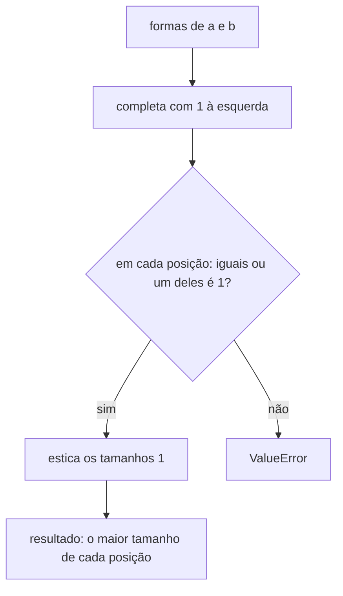

## Passo 1 · Leitura · As regras do broadcasting

Uma rede fictícia de 4 lojas vende 3 produtos, e a matriz `precos` tem forma `(4, 3)`: uma linha por loja, uma coluna por produto. O fornecedor deu um desconto diferente para cada produto, `desconto = np.array([0.10, 0.0, 0.25])`, de forma `(3,)`. A conta `precos * (1 - desconto)` funciona sem laço e sem repetir o vetor quatro vezes: o numpy **estica** o vetor sobre as linhas. Isso é o **broadcasting**, o mesmo mecanismo de `precos * 2`, em que o número é esticado sobre a matriz inteira.

Para decidir se duas formas combinam, o numpy as compara **pela direita**, posição por posição:

1. A forma com menos dimensões ganha dimensões 1 à esquerda: `(3,)` vira `(1, 3)`.
2. Em cada posição, os tamanhos combinam se forem iguais ou se um deles for 1.
3. O tamanho 1 é esticado até o outro; o resultado tem, em cada posição, o maior dos dois.
4. Se numa posição os tamanhos diferem e nenhum é 1, a operação falha.



```text
(4, 3) com (3,)        ->  (4, 3)      o vetor vale para cada linha
(4, 3) com (4,)        ->  erro        pela direita, 3 contra 4
(4, 1) com (3,)        ->  (4, 3)      os dois esticam
(2, 1, 5) com (3, 1)   ->  (2, 3, 5)
```

O segundo caso é o erro mais comum do assunto, e a mensagem mostra as duas formas: `ValueError: operands could not be broadcast together with shapes (4,3) (4,) `. Leia as formas da direita para a esquerda e procure a posição que não fecha.

"Esticar" é só um modo de pensar. O numpy não copia o vetor quatro vezes: ele percorre os mesmos três valores de novo a cada linha. Por isso o broadcasting é rápido e não gasta memória além da do resultado, que tem a forma completa.

Para que um vetor com um valor por **loja** (4 valores) valha por linha, ele precisa virar uma coluna de forma `(4, 1)`. `frete[:, np.newaxis]` acrescenta um eixo de tamanho 1 nessa posição (`frete[:, None]` é a mesma coisa), e aí `precos + frete[:, np.newaxis]` soma o frete de cada loja a todos os produtos dela. Os dois truques, alinhar pela direita e criar um eixo de tamanho 1, resolvem quase todas as contas desta lição.

## Passo 2 · Previsão · Que forma sai daqui

O programa imprime a forma de algumas operações entre arrays e, na última linha, o resultado de uma delas. Leia sem executar e digite exatamente o que ele imprime.

### Código
```python
import numpy as np

a = np.ones((4, 3))
print((a + np.arange(3)).shape)
print((a * 2).shape)

col = np.arange(4)[:, np.newaxis]
print(col.shape, (a + col).shape)

print((np.ones((2, 1, 5)) + np.ones((3, 1))).shape)
print((np.arange(3)[:, np.newaxis] * np.arange(4)).tolist())
```

### Dicas
1. Alinhe as formas pela direita e complete com 1 à esquerda a que tiver menos dimensões.
2. `np.newaxis` na segunda posição transforma um vetor `(4,)` numa coluna `(4, 1)`.
3. Uma coluna `(3, 1)` vezes um vetor `(4,)` dá uma tabela `(3, 4)`, como uma tabuada.

### Saída esperada
```text
(4, 3)
(4, 3)
(4, 1) (4, 3)
(2, 3, 5)
[[0, 0, 0, 0], [0, 1, 2, 3], [0, 2, 4, 6]]
```

## Passo 3 · Exercício · prever_shape
modo: ordenar

Escreva, em Python puro, a regra que o numpy usa para decidir a forma do resultado. Arraste as linhas para montar `prever_shape` e ajuste a indentação de cada uma. Três linhas estão sobrando.

### Instruções
1. `prever_shape(forma_a, forma_b)` recebe duas formas (listas ou tuplas de inteiros) e completa a mais curta com 1 à esquerda.
2. Compara as posições uma a uma: tamanhos iguais ou um deles 1 combinam, e o resultado fica com o tamanho que não é 1.
3. Devolve a forma do resultado como `tuple`, ou `None` se alguma posição não combina.

### Solução
```python
def prever_shape(forma_a, forma_b):
    n = max(len(forma_a), len(forma_b))
    a = (1,) * (n - len(forma_a)) + tuple(forma_a)
    b = (1,) * (n - len(forma_b)) + tuple(forma_b)
    resultado = []
    for x, y in zip(a, b):
        if x == y or y == 1:
            resultado.append(x)
        elif x == 1:
            resultado.append(y)
        else:
            return None
    return tuple(resultado)
```

### Distratores
```python
a = tuple(forma_a) + (1,) * (n - len(forma_a))
if x == y and y == 1:
resultado.append(max(x, y))
```

### Verificação
```json
[
  { "id": "vetor-por-linha", "checkpoint": 2, "kind": "call", "function": "prever_shape", "args": [[4, 3], [3]],
    "expected": [4, 3], "type": "tuple", "name": "prever_shape((4, 3), (3,)) é (4, 3)" },
  { "id": "incompativel", "checkpoint": 3, "kind": "call", "function": "prever_shape", "args": [[4, 3], [4]],
    "expected": null, "type": "NoneType", "name": "prever_shape((4, 3), (4,)) é None",
    "hint": "Pela direita, a última posição compara 3 com 4." },
  { "id": "coluna-e-vetor", "checkpoint": 2, "kind": "call", "function": "prever_shape", "args": [[4, 1], [3]],
    "expected": [4, 3], "type": "tuple", "name": "prever_shape((4, 1), (3,)) é (4, 3)" },
  { "id": "um-no-primeiro", "checkpoint": 2, "kind": "call", "function": "prever_shape", "args": [[1, 3], [4, 1]],
    "expected": [4, 3], "type": "tuple", "name": "prever_shape((1, 3), (4, 1)) é (4, 3)",
    "hint": "O 1 pode estar em qualquer uma das duas formas." },
  { "id": "tres-dimensoes", "checkpoint": 1, "kind": "call", "function": "prever_shape", "args": [[2, 1, 5], [3, 1]],
    "expected": [2, 3, 5], "type": "tuple", "name": "prever_shape((2, 1, 5), (3, 1)) é (2, 3, 5)",
    "hint": "Complete a forma mais curta à esquerda." },
  { "id": "escalar", "checkpoint": 1, "kind": "call", "function": "prever_shape", "args": [[5], []],
    "expected": [5], "type": "tuple", "name": "Um vetor (5,) com um número, de forma (), dá (5,)" },
  { "id": "dois-escalares", "checkpoint": 3, "kind": "call", "function": "prever_shape", "args": [[], []],
    "expected": [], "type": "tuple", "name": "Dois números dão a forma ()" },
  { "id": "transpostas", "checkpoint": 3, "kind": "call", "function": "prever_shape", "args": [[2, 3], [3, 2]],
    "expected": null, "type": "NoneType", "name": "prever_shape((2, 3), (3, 2)) é None" },
  { "id": "uns", "checkpoint": 2, "kind": "call", "function": "prever_shape", "args": [[1], [1]],
    "expected": [1], "type": "tuple", "name": "prever_shape((1,), (1,)) é (1,)" }
]
```

### Soluções erradas
```python name="completa pela direita"
def prever_shape(forma_a, forma_b):
    n = max(len(forma_a), len(forma_b))
    a = tuple(forma_a) + (1,) * (n - len(forma_a))
    b = tuple(forma_b) + (1,) * (n - len(forma_b))
    resultado = []
    for x, y in zip(a, b):
        if x == y or y == 1:
            resultado.append(x)
        elif x == 1:
            resultado.append(y)
        else:
            return None
    return tuple(resultado)
```
```python name="compara sem completar"
def prever_shape(forma_a, forma_b):
    resultado = []
    for x, y in zip(forma_a, forma_b):
        if x == y or y == 1:
            resultado.append(x)
        elif x == 1:
            resultado.append(y)
        else:
            return None
    return tuple(resultado)
```
```python name="exige tamanhos iguais"
def prever_shape(forma_a, forma_b):
    n = max(len(forma_a), len(forma_b))
    a = (1,) * (n - len(forma_a)) + tuple(forma_a)
    b = (1,) * (n - len(forma_b)) + tuple(forma_b)
    resultado = []
    for x, y in zip(a, b):
        if x == y:
            resultado.append(x)
        else:
            return None
    return tuple(resultado)
```
```python name="só aceita 1 na segunda forma"
def prever_shape(forma_a, forma_b):
    n = max(len(forma_a), len(forma_b))
    a = (1,) * (n - len(forma_a)) + tuple(forma_a)
    b = (1,) * (n - len(forma_b)) + tuple(forma_b)
    resultado = []
    for x, y in zip(a, b):
        if x == y or y == 1:
            resultado.append(x)
        else:
            return None
    return tuple(resultado)
```
```python name="maior tamanho sem conferir"
def prever_shape(forma_a, forma_b):
    n = max(len(forma_a), len(forma_b))
    a = (1,) * (n - len(forma_a)) + tuple(forma_a)
    b = (1,) * (n - len(forma_b)) + tuple(forma_b)
    resultado = []
    for x, y in zip(a, b):
        resultado.append(max(x, y))
    return tuple(resultado)
```
```python name="devolve lista"
def prever_shape(forma_a, forma_b):
    n = max(len(forma_a), len(forma_b))
    a = (1,) * (n - len(forma_a)) + tuple(forma_a)
    b = (1,) * (n - len(forma_b)) + tuple(forma_b)
    resultado = []
    for x, y in zip(a, b):
        if x == y or y == 1:
            resultado.append(x)
        elif x == 1:
            resultado.append(y)
        else:
            return None
    return resultado
```

## Passo 4 · Leitura · Por coluna e por linha

Uma tabela fictícia de medições tem uma linha por estação meteorológica e uma coluna por variável: temperatura em °C, umidade em % e pressão em hPa. As escalas são muito diferentes, e o primeiro passo de muitas análises (e de quase todo modelo do Nível 5) é **padronizar cada coluna**: subtrair a média da coluna e dividir pelo desvio da coluna.

```python
dados = np.array([[22.0, 60.0, 1012.0],
                  [25.0, 55.0, 1009.0],
                  [19.0, 80.0, 1015.0],
                  [30.0, 45.0, 1007.0]])      # (4, 3)
medias = dados.mean(axis=0)                  # (3,): uma por coluna
desvios = dados.std(axis=0)                  # (3,)
z = (dados - medias) / desvios               # (4, 3) com (3,): vale para cada linha
```

`axis=0` faz sumir o eixo das linhas e sobra um valor por coluna, de forma `(3,)`. Alinhado pela direita com `(4, 3)`, esse vetor vale para cada linha. É o caso fácil: o broadcasting já faz o que você quer.

Por linha é diferente. Numa tabela de vendas com uma linha por loja e uma coluna por produto, a participação de cada produto nas vendas da loja é a linha dividida pelo total da linha. O total sai de `vendas.sum(axis=1)`, com forma `(4,)`, e dividir direto falha: alinhando pela direita, `(4, 3)` contra `(4,)` compara 3 com 4, e vem `ValueError: operands could not be broadcast together with shapes (4,3) (4,) `. Pior ainda numa tabela quadrada: `(3, 3)` contra `(3,)` não dá erro, e cada **coluna** `j` é dividida pelo total da linha `j`, em silêncio.

A saída é manter o eixo reduzido, com tamanho 1:

```python
totais = vendas.sum(axis=1, keepdims=True)    # (4, 1)
participacao = vendas / totais                # cada linha soma 1
```

`keepdims=True` devolve `(4, 1)` em vez de `(4,)`, e a coluna de totais se estica sobre as colunas da tabela. `vendas.sum(axis=1)[:, np.newaxis]` chega ao mesmo lugar.

Dois cuidados. Uma coluna constante tem desvio zero, e uma loja sem vendas tem total zero; nos dois casos a divisão dá `nan`, sem exceção. Como o numerador também é zero, basta trocar o divisor zero por 1 com `np.where(d == 0, 1.0, d)`, e o resultado fica zero. E o desvio é o populacional, o padrão do `np.std`, como na lição anterior.

## Passo 5 · Exercício · Padronizar colunas e proporções por linha

Escreva as duas transformações só com broadcasting, sem laço.

### Instruções
1. `padronizar_colunas(m)` devolve um array `float64` da mesma forma de `m`, com cada coluna padronizada: menos a média da coluna, dividido pelo desvio populacional da coluna.
2. Numa coluna constante (desvio zero), o resultado é zero.
3. `proporcao_por_linha(m)` devolve um array da mesma forma, com cada linha dividida pelo total da linha; uma linha toda zero continua zero.
4. As duas funções não alteram o array recebido e não usam laço (`for`, `while` ou compreensão).

### Código inicial
```python
import numpy as np


def padronizar_colunas(m):
    pass


def proporcao_por_linha(m):
    pass
```

### Solução
```python
import numpy as np


def padronizar_colunas(m):
    m = np.asarray(m, dtype=float)
    desvios = m.std(axis=0)
    desvios = np.where(desvios == 0, 1.0, desvios)
    return (m - m.mean(axis=0)) / desvios


def proporcao_por_linha(m):
    m = np.asarray(m, dtype=float)
    totais = m.sum(axis=1, keepdims=True)
    totais = np.where(totais == 0, 1.0, totais)
    return m / totais
```

### Dicas
1. Para padronizar colunas, as médias e os desvios têm um valor por coluna: qual eixo some?
2. O total por linha precisa ter forma `(n, 1)` para se esticar sobre as colunas.
3. `x -= ...` escreve no array recebido quando ele já é `float`; prefira criar o resultado numa expressão nova.

### Verificação
```json
[
  { "id": "padronizar-valores", "checkpoint": 1, "kind": "expr",
    "expr": "padronizar_colunas([[1.0, 10.0], [2.0, 30.0], [3.0, 20.0]]).tolist()",
    "expected": [[-1.224744871391589, -1.224744871391589], [0.0, 1.224744871391589], [1.224744871391589, 0.0]],
    "tolerance": 1e-9, "name": "padronizar_colunas numa tabela 3 × 2", "hint": "Uma média e um desvio populacional por coluna." },
  { "id": "padronizar-propriedades", "checkpoint": 1, "kind": "expr",
    "setup": "T = np.random.default_rng(8).normal(50, 12, size=(40, 5))\nZ = padronizar_colunas(T)",
    "expr": "bool(np.all(np.abs(Z.mean(axis=0)) < 1e-9) and np.all(np.abs(Z.std(axis=0) - 1) < 1e-9))", "expected": true,
    "name": "Numa tabela 40 × 5, cada coluna sai com média 0 e desvio 1", "hint": "O desvio é o populacional." },
  { "id": "padronizar-constante", "checkpoint": 2, "kind": "expr",
    "expr": "padronizar_colunas([[5.0, 1.0], [5.0, 3.0]]).tolist()", "expected": [[0.0, -1.0], [0.0, 1.0]],
    "tolerance": 1e-9, "name": "Uma coluna constante vira zeros", "hint": "Teste o desvio antes de dividir." },
  { "id": "padronizar-nao-altera", "checkpoint": 4, "kind": "expr",
    "setup": "a = np.array([[1.0, 2.0], [3.0, 6.0]])\nr = padronizar_colunas(a)",
    "expr": "a.tolist()", "expected": [[1.0, 2.0], [3.0, 6.0]], "name": "padronizar_colunas não altera a tabela recebida" },
  { "id": "proporcao-valores", "checkpoint": 3, "kind": "expr",
    "expr": "proporcao_por_linha([[1, 3], [2, 2], [5, 0]]).tolist()", "expected": [[0.25, 0.75], [0.5, 0.5], [1.0, 0.0]],
    "tolerance": 1e-9, "name": "proporcao_por_linha numa tabela 3 × 2", "hint": "O total de cada linha precisa de forma (n, 1)." },
  { "id": "proporcao-soma-um", "checkpoint": 3, "kind": "expr",
    "setup": "V = np.random.default_rng(9).integers(1, 100, size=(30, 6))\nP = proporcao_por_linha(V)",
    "expr": "bool(np.all(np.abs(P.sum(axis=1) - 1) < 1e-9))", "expected": true,
    "name": "Numa tabela 30 × 6, cada linha soma 1" },
  { "id": "proporcao-quadrada", "checkpoint": 3, "kind": "expr",
    "expr": "proporcao_por_linha([[1, 1, 2], [3, 0, 1], [0, 2, 8]]).tolist()",
    "expected": [[0.25, 0.25, 0.5], [0.75, 0.0, 0.25], [0.0, 0.2, 0.8]], "tolerance": 1e-9,
    "name": "proporcao_por_linha numa tabela quadrada 3 × 3", "hint": "Numa tabela quadrada, o eixo errado não dá erro." },
  { "id": "proporcao-zero", "checkpoint": 3, "kind": "expr",
    "expr": "proporcao_por_linha([[0, 0], [1, 1]]).tolist()", "expected": [[0.0, 0.0], [0.5, 0.5]], "tolerance": 1e-9,
    "name": "Uma linha toda zero continua zero" },
  { "id": "proporcao-nao-altera", "checkpoint": 4, "kind": "expr",
    "setup": "a = np.array([[1.0, 3.0], [2.0, 2.0]])\nr = proporcao_por_linha(a)",
    "expr": "a.tolist()", "expected": [[1.0, 3.0], [2.0, 2.0]], "name": "proporcao_por_linha não altera a tabela recebida" },
  { "id": "sem-for", "checkpoint": 4, "kind": "source", "rule": { "type": "not_uses", "construct": "for" },
    "name": "Sem laço for" },
  { "id": "sem-compreensao", "checkpoint": 4, "kind": "source", "rule": { "type": "not_uses", "construct": "list_comprehension" },
    "name": "Sem compreensão de lista" }
]
```

### Soluções erradas
```python name="média por linha"
import numpy as np


def padronizar_colunas(m):
    m = np.asarray(m, dtype=float)
    desvios = m.std(axis=0)
    desvios = np.where(desvios == 0, 1.0, desvios)
    return (m - m.mean(axis=1)) / desvios


def proporcao_por_linha(m):
    m = np.asarray(m, dtype=float)
    totais = m.sum(axis=1, keepdims=True)
    totais = np.where(totais == 0, 1.0, totais)
    return m / totais
```
```python name="desvio amostral"
import numpy as np


def padronizar_colunas(m):
    m = np.asarray(m, dtype=float)
    desvios = m.std(axis=0, ddof=1)
    desvios = np.where(desvios == 0, 1.0, desvios)
    return (m - m.mean(axis=0)) / desvios


def proporcao_por_linha(m):
    m = np.asarray(m, dtype=float)
    totais = m.sum(axis=1, keepdims=True)
    totais = np.where(totais == 0, 1.0, totais)
    return m / totais
```
```python name="coluna constante vira nan"
import numpy as np


def padronizar_colunas(m):
    m = np.asarray(m, dtype=float)
    return (m - m.mean(axis=0)) / m.std(axis=0)


def proporcao_por_linha(m):
    m = np.asarray(m, dtype=float)
    totais = m.sum(axis=1, keepdims=True)
    totais = np.where(totais == 0, 1.0, totais)
    return m / totais
```
```python name="altera a tabela recebida"
import numpy as np


def padronizar_colunas(m):
    m = np.asarray(m, dtype=float)
    desvios = m.std(axis=0)
    desvios = np.where(desvios == 0, 1.0, desvios)
    m -= m.mean(axis=0)
    m /= desvios
    return m


def proporcao_por_linha(m):
    m = np.asarray(m, dtype=float)
    totais = m.sum(axis=1, keepdims=True)
    totais = np.where(totais == 0, 1.0, totais)
    return m / totais
```
```python name="total sem keepdims"
import numpy as np


def padronizar_colunas(m):
    m = np.asarray(m, dtype=float)
    desvios = m.std(axis=0)
    desvios = np.where(desvios == 0, 1.0, desvios)
    return (m - m.mean(axis=0)) / desvios


def proporcao_por_linha(m):
    m = np.asarray(m, dtype=float)
    totais = m.sum(axis=1)
    totais = np.where(totais == 0, 1.0, totais)
    return m / totais
```
```python name="divide pelo total geral"
import numpy as np


def padronizar_colunas(m):
    m = np.asarray(m, dtype=float)
    desvios = m.std(axis=0)
    desvios = np.where(desvios == 0, 1.0, desvios)
    return (m - m.mean(axis=0)) / desvios


def proporcao_por_linha(m):
    m = np.asarray(m, dtype=float)
    total = m.sum()
    return m / total
```
```python name="linha zero vira nan"
import numpy as np


def padronizar_colunas(m):
    m = np.asarray(m, dtype=float)
    desvios = m.std(axis=0)
    desvios = np.where(desvios == 0, 1.0, desvios)
    return (m - m.mean(axis=0)) / desvios


def proporcao_por_linha(m):
    m = np.asarray(m, dtype=float)
    return m / m.sum(axis=1, keepdims=True)
```
```python name="laço pelas colunas"
import numpy as np


def padronizar_colunas(m):
    m = np.asarray(m, dtype=float)
    colunas = []
    for j in range(m.shape[1]):
        c = m[:, j]
        d = c.std()
        colunas.append((c - c.mean()) / (d if d != 0 else 1.0))
    return np.column_stack(colunas)


def proporcao_por_linha(m):
    m = np.asarray(m, dtype=float)
    totais = m.sum(axis=1, keepdims=True)
    totais = np.where(totais == 0, 1.0, totais)
    return m / totais
```

## Passo 6 · Leitura · Distâncias entre todos os pares e empilhamento

Com `n` lojas fictícias espalhadas por uma cidade, cada uma com coordenadas em quilômetros, a **matriz de distâncias** guarda na posição `(i, j)` a distância entre a loja `i` e a loja `j`:

$$
d_{ij} = \lVert p_i - p_j \rVert = \sqrt{\sum_{k=1}^{d} \left(p_{ik} - p_{jk}\right)^2}
$$

Ela é simétrica ($d_{ij} = d_{ji}$) e tem zeros na diagonal. É a base de buscas pelo vizinho mais próximo e de agrupamentos, que voltam no Nível 5. Com laço, são dois `for` aninhados e $n^2$ voltas no interpretador. Com broadcasting, são duas linhas:

```python
p = np.array([[0.0, 0.0], [3.0, 4.0], [6.0, 8.0]])   # (n, d) = (3, 2)
dif = p[:, np.newaxis, :] - p[np.newaxis, :, :]      # (3, 1, 2) - (1, 3, 2) -> (3, 3, 2)
d = np.sqrt((dif ** 2).sum(axis=2))                  # some o eixo das coordenadas: (3, 3)
```

`dif[i, j]` é o vetor $p_i - p_j$. Somar os quadrados no eixo 2, o das coordenadas, e tirar a raiz dá a matriz `(3, 3)`. Somar no eixo errado dá uma forma errada, e esquecer a raiz dá o quadrado da distância, que ainda ordena os pares do mesmo jeito mas não é uma distância em quilômetros.

O preço é a memória: o array intermediário tem $n^2 d$ números. Com 500 pontos no plano são 500 000 números `float64`, cerca de 4 MB. Com 50 000 pontos seriam 5 bilhões, cerca de 40 GB. Nesse tamanho, a conta é feita em blocos de linhas, um pedaço da matriz por vez.

Para juntar arrays:

```python
a = np.ones((2, 3))
b = np.zeros((1, 3))
np.vstack([a, b])                 # (3, 3): empilha as linhas
np.concatenate([a, b], axis=0)    # o mesmo
np.hstack([a, a])                 # (2, 6): lado a lado
np.stack([a, a])                  # (2, 2, 3): cria um eixo novo
np.split(np.arange(6), 3)         # três pedaços de 2 elementos
```

`vstack` exige o mesmo número de colunas. Se não houver, a mensagem é precisa e longa: `ValueError: all the input array dimensions except for the concatenation axis must match exactly, but along dimension 1, the array at index 0 has size 3 and the array at index 1 has size 2`. Numa função sua, que outras pessoas vão chamar, vale conferir antes e levantar um erro que diga, nas palavras do problema, o que está errado.

## Passo 7 · Exercício · Distâncias e tabelas juntas

Escreva a matriz de distâncias com broadcasting e uma função que empilha duas tabelas conferindo as colunas.

### Instruções
1. `matriz_de_distancias(pontos)` recebe `n` pontos de `d` coordenadas (forma `(n, d)`) e devolve a matriz `(n, n)` das distâncias euclidianas entre todos os pares.
2. A matriz é calculada com broadcasting, sem laço (`for`, `while` ou compreensão).
3. `juntar_tabelas(a, b)` devolve um array com as linhas de `a` seguidas das linhas de `b`.
4. Se `a` e `b` têm números de colunas diferentes, `juntar_tabelas` levanta `ValueError` com uma mensagem que contém a palavra `colunas`.

### Código inicial
```python
import numpy as np


def matriz_de_distancias(pontos):
    pass


def juntar_tabelas(a, b):
    pass
```

### Solução
```python
import numpy as np


def matriz_de_distancias(pontos):
    p = np.asarray(pontos, dtype=float)
    dif = p[:, np.newaxis, :] - p[np.newaxis, :, :]
    return np.sqrt((dif ** 2).sum(axis=2))


def juntar_tabelas(a, b):
    a = np.asarray(a, dtype=float)
    b = np.asarray(b, dtype=float)
    if a.shape[1] != b.shape[1]:
        raise ValueError(f"as tabelas têm números de colunas diferentes: {a.shape[1]} e {b.shape[1]}")
    return np.vstack([a, b])
```

### Dicas
1. Dê aos pontos as formas `(n, 1, d)` e `(1, n, d)`: a diferença tem forma `(n, n, d)`.
2. O eixo que some na soma é o das coordenadas, o último.
3. Confira o número de colunas (`shape[1]`) antes de empilhar.

### Verificação
```json
[
  { "id": "tres-pontos", "checkpoint": 1, "kind": "expr", "expr": "matriz_de_distancias([[0, 0], [3, 4], [6, 8]]).tolist()",
    "expected": [[0, 5, 10], [5, 0, 5], [10, 5, 0]], "tolerance": 1e-9,
    "name": "Distâncias entre (0, 0), (3, 4) e (6, 8)", "hint": "A distância de (0, 0) a (3, 4) é 5." },
  { "id": "tres-coordenadas", "checkpoint": 1, "kind": "expr", "expr": "matriz_de_distancias([[1, 2, 2], [0, 0, 0]]).tolist()",
    "expected": [[0, 3], [3, 0]], "tolerance": 1e-9, "name": "Pontos com 3 coordenadas" },
  { "id": "um-ponto", "checkpoint": 1, "kind": "expr", "expr": "matriz_de_distancias([[2.5, -1.0]]).tolist()",
    "expected": [[0.0]], "tolerance": 1e-9, "name": "Um ponto só dá a matriz [[0.0]]" },
  { "id": "forma", "checkpoint": 1, "kind": "expr",
    "setup": "P = np.random.default_rng(3).random((200, 2)) * 100\nD = matriz_de_distancias(P)",
    "expr": "list(D.shape)", "expected": [200, 200], "name": "Com 200 pontos, a matriz é 200 × 200",
    "hint": "Some só o eixo das coordenadas." },
  { "id": "simetrica", "checkpoint": 1, "kind": "expr",
    "setup": "P = np.random.default_rng(3).random((200, 2)) * 100\nD = matriz_de_distancias(P)",
    "expr": "bool(np.all(np.abs(D - D.T) < 1e-9) and np.all(np.diag(D) == 0))", "expected": true,
    "name": "Com 200 pontos, a matriz é simétrica e tem zeros na diagonal" },
  { "id": "sem-for", "checkpoint": 2, "kind": "source", "rule": { "type": "not_uses", "construct": "for" },
    "name": "Sem laço for" },
  { "id": "sem-compreensao", "checkpoint": 2, "kind": "source", "rule": { "type": "not_uses", "construct": "list_comprehension" },
    "name": "Sem compreensão de lista" },
  { "id": "juntar-valores", "checkpoint": 3, "kind": "expr",
    "expr": "juntar_tabelas([[1, 2, 3], [4, 5, 6]], [[7, 8, 9]]).tolist()",
    "expected": [[1, 2, 3], [4, 5, 6], [7, 8, 9]], "tolerance": 1e-9,
    "name": "juntar_tabelas põe as linhas de b depois das de a", "hint": "Empilhe linhas, não colunas." },
  { "id": "juntar-forma", "checkpoint": 3, "kind": "expr", "expr": "list(juntar_tabelas(np.ones((2, 4)), np.zeros((3, 4))).shape)",
    "expected": [5, 4], "name": "Uma tabela 2 × 4 com uma 3 × 4 dá 5 × 4" },
  { "id": "juntar-colunas", "checkpoint": 4, "kind": "expr", "expr": "juntar_tabelas(np.ones((2, 3)), np.ones((2, 2)))",
    "raises": "ValueError", "message_contains": "colunas",
    "name": "Números de colunas diferentes levantam ValueError que fala de colunas",
    "hint": "A mensagem do numpy é longa e não fala de colunas; confira antes de empilhar." }
]
```

### Soluções erradas
```python name="sem a raiz"
import numpy as np


def matriz_de_distancias(pontos):
    p = np.asarray(pontos, dtype=float)
    dif = p[:, np.newaxis, :] - p[np.newaxis, :, :]
    return (dif ** 2).sum(axis=2)


def juntar_tabelas(a, b):
    a = np.asarray(a, dtype=float)
    b = np.asarray(b, dtype=float)
    if a.shape[1] != b.shape[1]:
        raise ValueError(f"as tabelas têm números de colunas diferentes: {a.shape[1]} e {b.shape[1]}")
    return np.vstack([a, b])
```
```python name="produto escalar no lugar da diferença"
import numpy as np


def matriz_de_distancias(pontos):
    p = np.asarray(pontos, dtype=float)
    return np.sqrt(p @ p.T)


def juntar_tabelas(a, b):
    a = np.asarray(a, dtype=float)
    b = np.asarray(b, dtype=float)
    if a.shape[1] != b.shape[1]:
        raise ValueError(f"as tabelas têm números de colunas diferentes: {a.shape[1]} e {b.shape[1]}")
    return np.vstack([a, b])
```
```python name="soma no eixo errado"
import numpy as np


def matriz_de_distancias(pontos):
    p = np.asarray(pontos, dtype=float)
    dif = p[:, np.newaxis, :] - p[np.newaxis, :, :]
    return np.sqrt((dif ** 2).sum(axis=1))


def juntar_tabelas(a, b):
    a = np.asarray(a, dtype=float)
    b = np.asarray(b, dtype=float)
    if a.shape[1] != b.shape[1]:
        raise ValueError(f"as tabelas têm números de colunas diferentes: {a.shape[1]} e {b.shape[1]}")
    return np.vstack([a, b])
```
```python name="soma dos módulos"
import numpy as np


def matriz_de_distancias(pontos):
    p = np.asarray(pontos, dtype=float)
    dif = p[:, np.newaxis, :] - p[np.newaxis, :, :]
    return np.abs(dif).sum(axis=2)


def juntar_tabelas(a, b):
    a = np.asarray(a, dtype=float)
    b = np.asarray(b, dtype=float)
    if a.shape[1] != b.shape[1]:
        raise ValueError(f"as tabelas têm números de colunas diferentes: {a.shape[1]} e {b.shape[1]}")
    return np.vstack([a, b])
```
```python name="laço duplo"
import numpy as np


def matriz_de_distancias(pontos):
    p = np.asarray(pontos, dtype=float)
    n = len(p)
    d = np.zeros((n, n))
    for i in range(n):
        for j in range(n):
            d[i, j] = np.sqrt(((p[i] - p[j]) ** 2).sum())
    return d


def juntar_tabelas(a, b):
    a = np.asarray(a, dtype=float)
    b = np.asarray(b, dtype=float)
    if a.shape[1] != b.shape[1]:
        raise ValueError(f"as tabelas têm números de colunas diferentes: {a.shape[1]} e {b.shape[1]}")
    return np.vstack([a, b])
```
```python name="hstack no lugar de vstack"
import numpy as np


def matriz_de_distancias(pontos):
    p = np.asarray(pontos, dtype=float)
    dif = p[:, np.newaxis, :] - p[np.newaxis, :, :]
    return np.sqrt((dif ** 2).sum(axis=2))


def juntar_tabelas(a, b):
    a = np.asarray(a, dtype=float)
    b = np.asarray(b, dtype=float)
    if a.shape[1] != b.shape[1]:
        raise ValueError(f"as tabelas têm números de colunas diferentes: {a.shape[1]} e {b.shape[1]}")
    return np.hstack([a, b])
```
```python name="não confere as colunas"
import numpy as np


def matriz_de_distancias(pontos):
    p = np.asarray(pontos, dtype=float)
    dif = p[:, np.newaxis, :] - p[np.newaxis, :, :]
    return np.sqrt((dif ** 2).sum(axis=2))


def juntar_tabelas(a, b):
    a = np.asarray(a, dtype=float)
    b = np.asarray(b, dtype=float)
    return np.vstack([a, b])
```

## Passo 8 · Quiz · Formas compatíveis

### Pergunta
`notas` tem forma `(30, 4)`: 30 alunos e 4 provas. `pesos = np.array([1, 2, 3, 4])` dá o peso de cada prova. Qual expressão dá a média ponderada de cada aluno?
- [ ] `(notas * pesos[:, np.newaxis]).sum(axis=1) / pesos.sum()`
- [x] `(notas * pesos).sum(axis=1) / pesos.sum()`
- [ ] `(notas * pesos).sum(axis=0) / pesos.sum()`
- [ ] `notas.mean(axis=1) * pesos`
> `(30, 4)` com `(4,)` alinha pela direita: cada prova é multiplicada pelo seu peso, e somar no eixo 1 dá um valor por aluno. `pesos[:, np.newaxis]` tem forma `(4, 1)`, que não combina com `(30, 4)` (4 contra 30); somar no eixo 0 dá um valor por prova; e `notas.mean(axis=1)`, de forma `(30,)`, não combina com `(4,)`.

### Pergunta
Uma tabela `t` de forma `(3, 3)` tem uma linha por loja e uma coluna por produto. Para obter a participação de cada produto nas vendas da loja, um colega escreveu `t / t.sum(axis=1)`. O código rodou sem erro. O que aconteceu?
- [ ] Deu o resultado certo, porque o broadcasting estica os totais sobre as colunas
- [x] Cada coluna `j` foi dividida pelo total da loja `j`, e as linhas não somam 1
- [ ] Cada valor foi dividido pelo total geral da tabela
- [ ] O numpy dividiu cada linha pelo total da coluna correspondente e as colunas somam 1
> `t.sum(axis=1)` tem forma `(3,)`, que se alinha com as **colunas** de `(3, 3)`: o elemento `(i, j)` foi dividido pelo total da linha `j`. Numa tabela retangular isso daria erro; na quadrada passa em silêncio. O correto é `t / t.sum(axis=1, keepdims=True)`, com totais de forma `(3, 1)`. As colunas também não somam 1: nenhum total de coluna entrou na conta.

### Pergunta
Você precisa da matriz de distâncias entre 50 000 pontos no plano e usou `p[:, np.newaxis, :] - p[np.newaxis, :, :]`, como na lição. O programa parou por falta de memória. Qual é a explicação e a saída?
- [ ] O broadcasting copia o array `p` 50 000 vezes; use `np.newaxis` só uma vez
- [ ] Faltou `dtype=float`; com inteiros a conta caberia
- [x] O intermediário tem $n^2 d$ = 5 bilhões de números (cerca de 40 GB); calcule a matriz em blocos de linhas
- [ ] O numpy não aceita arrays de 3 dimensões tão grandes; use listas
> O broadcasting não copia a entrada, mas o **resultado** da diferença tem forma `(50 000, 50 000, 2)`: 5 bilhões de `float64`, cerca de 40 GB. Calcular um bloco de linhas por vez mantém a memória sob controle. Inteiros de 64 bits ocupam o mesmo espaço que `float64`, e listas seriam ainda maiores e mais lentas.
