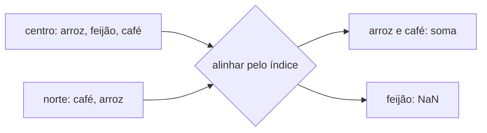

## Passo 1 · Leitura · Uma coluna com rótulos

Duas filiais de um mercado fictício mandaram as vendas do mês por produto. A filial Centro listou arroz, feijão e café; a filial Norte listou café e arroz, nessa ordem, e não vendeu feijão. Com duas listas, somar posição a posição junta o arroz de uma com o café da outra. O pandas resolve isso dando um **rótulo** a cada valor.

Uma `Series` é um array do numpy com um **índice**: um rótulo por posição.

```python
import pandas as pd

centro = pd.Series([10, 20, 30], index=["arroz", "feijão", "café"])
norte = pd.Series({"café": 5, "arroz": 15})   # de um dicionário: as chaves viram o índice
centro["café"]        # 30: acesso pelo rótulo
centro.index          # Index(['arroz', 'feijão', 'café'], dtype='str')
centro.to_numpy()     # só os valores, num array do numpy
```

A diferença aparece nas contas. Entre duas Series, o pandas **alinha pelo índice** antes de operar: arroz soma com arroz, onde quer que ele esteja. Um rótulo que só existe de um lado não tem par, e o resultado ali é `NaN` (*not a number*, o valor ausente do pandas):



Como `NaN` é um número de ponto flutuante, a soma de duas Series inteiras com um rótulo sem par sai `float64`. Quando "não vendeu" quer dizer zero, diga isso ao pandas: `centro.add(norte, fill_value=0)` trata o rótulo ausente de um lado como 0, e o feijão fica com 20.

Um `DataFrame` é uma tabela: várias Series, uma por coluna, que compartilham o mesmo índice. Ele nasce de um dicionário de listas (uma lista por coluna) ou de uma lista de dicionários (um por linha). Na lista de dicionários, uma chave que falta numa linha vira `NaN`, e `columns=` fixa quais colunas entram e em que ordem:

```python
linhas = [{"produto": "arroz", "preco": 4.5}, {"produto": "café", "estoque": 7}]
tabela = pd.DataFrame(linhas, columns=["produto", "preco", "estoque"])
por_produto = tabela.set_index("produto")   # a coluna vira o índice
de_volta = por_produto.reset_index()        # o índice volta a ser coluna
```

Sem `columns=`, a ordem das colunas segue a ordem em que as chaves aparecem nos dicionários.

## Passo 2 · Previsão · Soma alinhada pelo índice

O programa soma as vendas das duas filiais de três jeitos e depois soma duas Series com índices numéricos. Leia sem executar e digite exatamente o que ele imprime. O `to_dict()` mostra cada rótulo com o seu valor, e o `NaN` aparece como `nan`.

### Código
```python
import pandas as pd

centro = pd.Series([10, 20, 30], index=["arroz", "feijão", "café"])
norte = pd.Series([5, 15], index=["café", "arroz"])
soma = centro + norte
print(soma.to_dict())
print(soma.dtype)
print(soma.isna().sum())
print(centro.add(norte, fill_value=0).to_dict())
print((centro.to_numpy()[:2] + norte.to_numpy()).tolist())

a = pd.Series([1, 2])
b = pd.Series([10, 20], index=[1, 2])
print((a + b).to_dict())
```

### Dicas
1. O resultado de uma soma alinhada tem todos os rótulos dos dois lados, em ordem.
2. Basta um `NaN` para a Series inteira virar `float64`.
3. `to_numpy()` descarta o índice: o que sobra se soma por posição. E uma Series sem `index=` ganha os rótulos 0, 1, 2…

### Saída esperada
```text
{'arroz': 25.0, 'café': 35.0, 'feijão': nan}
float64
1
{'arroz': 25.0, 'café': 35.0, 'feijão': 20.0}
[15, 35]
{0: nan, 1: 12.0, 2: nan}
```

## Passo 3 · Exercício · Montar a tabela
modo: lacunas

Os cadastros chegam como listas de dicionários, e nem todo dicionário tem todas as chaves. Complete as lacunas (`___`) das três funções.

### Instruções
1. `serie_de_precos(produtos, precos)` devolve uma Series `float64` com os preços como valores e os nomes dos produtos como índice.
2. `criar_tabela(registros, colunas)` devolve um DataFrame com exatamente as colunas de `colunas`, nessa ordem; chave ausente num registro vira `NaN`, e uma lista vazia de registros dá uma tabela vazia com essas colunas.
3. `indexar_por(registros, coluna)` devolve um DataFrame cujo índice são os valores de `coluna`, que deixa de ser uma coluna da tabela.

### Código inicial
```python
import pandas as pd


def serie_de_precos(produtos, precos):
    return pd.Series(___, index=___, dtype=___)


def criar_tabela(registros, colunas):
    return pd.DataFrame(registros, ___)


def indexar_por(registros, coluna):
    return pd.DataFrame(registros).set_index(___)
```

### Solução
```python
import pandas as pd


def serie_de_precos(produtos, precos):
    return pd.Series(precos, index=produtos, dtype=float)


def criar_tabela(registros, colunas):
    return pd.DataFrame(registros, columns=colunas)


def indexar_por(registros, coluna):
    return pd.DataFrame(registros).set_index(coluna)
```

### Dicas
1. Os valores vêm primeiro; os rótulos vão no `index=`.
2. O segundo argumento posicional do `DataFrame` não é a lista de colunas.
3. Por padrão, `set_index` tira a coluna da tabela; existe um parâmetro que a mantém, e aqui você não quer usá-lo.

### Verificação
```json
[
  { "id": "serie-valores", "checkpoint": 1, "kind": "expr", "expr": "serie_de_precos([\"arroz\", \"café\"], [4.5, 12.0]).tolist()",
    "expected": [4.5, 12.0], "name": "Os preços são os valores da Series", "hint": "O primeiro argumento da Series são os valores." },
  { "id": "serie-indice", "checkpoint": 1, "kind": "expr", "expr": "serie_de_precos([\"arroz\", \"café\"], [4.5, 12.0]).index.tolist()",
    "expected": ["arroz", "café"], "name": "Os produtos são o índice" },
  { "id": "serie-dtype", "checkpoint": 1, "kind": "expr", "expr": "str(serie_de_precos([\"sal\", \"óleo\"], [3, 8]).dtype)",
    "expected": "float64", "name": "Preços inteiros também viram float64", "hint": "Um preço como 4.5 precisa caber na Series." },
  { "id": "serie-rotulo", "checkpoint": 1, "kind": "expr", "expr": "float(serie_de_precos([\"arroz\", \"café\", \"sal\"], [4.5, 12.0, 3.0])[\"café\"])",
    "expected": 12.0, "name": "O preço do café se acha pelo rótulo" },
  { "id": "tabela-ordem", "checkpoint": 2, "kind": "expr",
    "expr": "list(criar_tabela([{\"idade\": 20, \"nome\": \"Ana\"}, {\"nome\": \"Bia\", \"idade\": 22}], [\"nome\", \"idade\"]).columns)",
    "expected": ["nome", "idade"], "name": "As colunas seguem a ordem pedida, não a dos dicionários", "hint": "Sem dizer quais são as colunas, o pandas usa a ordem das chaves." },
  { "id": "tabela-valores", "checkpoint": 2, "kind": "expr",
    "expr": "criar_tabela([{\"idade\": 20, \"nome\": \"Ana\"}, {\"nome\": \"Bia\", \"idade\": 22}], [\"nome\", \"idade\"]).to_dict(\"list\")",
    "expected": { "nome": ["Ana", "Bia"], "idade": [20, 22] }, "name": "Uma linha por registro, com os valores certos" },
  { "id": "tabela-ausente", "checkpoint": 2, "kind": "expr",
    "expr": "criar_tabela([{\"nome\": \"Ana\", \"cidade\": \"Santos\"}, {\"nome\": \"Bia\"}], [\"nome\", \"cidade\"])[\"cidade\"].isna().tolist()",
    "expected": [false, true], "name": "Chave ausente num registro vira NaN" },
  { "id": "tabela-coluna-nova", "checkpoint": 2, "kind": "expr",
    "expr": "list(criar_tabela([{\"nome\": \"Ana\"}], [\"nome\", \"email\"]).shape)",
    "expected": [1, 2], "name": "Uma coluna pedida que nenhum registro tem também entra" },
  { "id": "tabela-vazia", "checkpoint": 2, "kind": "expr",
    "expr": "list(criar_tabela([], [\"nome\", \"idade\"]).columns)",
    "expected": ["nome", "idade"], "name": "Sem registros, a tabela vazia tem as colunas pedidas" },
  { "id": "indice-valores", "checkpoint": 3, "kind": "expr",
    "expr": "indexar_por([{\"nome\": \"Ana\", \"idade\": 20}, {\"nome\": \"Bia\", \"idade\": 22}], \"nome\").index.tolist()",
    "expected": ["Ana", "Bia"], "name": "O índice são os nomes" },
  { "id": "indice-colunas", "checkpoint": 3, "kind": "expr",
    "expr": "list(indexar_por([{\"nome\": \"Ana\", \"idade\": 20}, {\"nome\": \"Bia\", \"idade\": 22}], \"nome\").columns)",
    "expected": ["idade"], "name": "A coluna usada como índice sai da tabela", "hint": "Repetir o nome como coluna e como índice duplica a informação." },
  { "id": "indice-busca", "checkpoint": 3, "kind": "expr",
    "expr": "int(indexar_por([{\"nome\": \"Ana\", \"idade\": 20}, {\"nome\": \"Bia\", \"idade\": 22}], \"nome\")[\"idade\"][\"Bia\"])",
    "expected": 22, "name": "A idade da Bia se acha pelo rótulo" }
]
```

### Soluções erradas
```python name="valores e índice trocados"
import pandas as pd


def serie_de_precos(produtos, precos):
    return pd.Series(produtos, index=precos, dtype=float)


def criar_tabela(registros, colunas):
    return pd.DataFrame(registros, columns=colunas)


def indexar_por(registros, coluna):
    return pd.DataFrame(registros).set_index(coluna)
```
```python name="preços inteiros"
import pandas as pd


def serie_de_precos(produtos, precos):
    return pd.Series(precos, index=produtos, dtype=int)


def criar_tabela(registros, colunas):
    return pd.DataFrame(registros, columns=colunas)


def indexar_por(registros, coluna):
    return pd.DataFrame(registros).set_index(coluna)
```
```python name="colunas no lugar do índice"
import pandas as pd


def serie_de_precos(produtos, precos):
    return pd.Series(precos, index=produtos, dtype=float)


def criar_tabela(registros, colunas):
    return pd.DataFrame(registros, colunas)


def indexar_por(registros, coluna):
    return pd.DataFrame(registros).set_index(coluna)
```
```python name="colunas em ordem alfabética"
import pandas as pd


def serie_de_precos(produtos, precos):
    return pd.Series(precos, index=produtos, dtype=float)


def criar_tabela(registros, colunas):
    return pd.DataFrame(registros, columns=sorted(colunas))


def indexar_por(registros, coluna):
    return pd.DataFrame(registros).set_index(coluna)
```
```python name="mantém a coluna do índice"
import pandas as pd


def serie_de_precos(produtos, precos):
    return pd.Series(precos, index=produtos, dtype=float)


def criar_tabela(registros, colunas):
    return pd.DataFrame(registros, columns=colunas)


def indexar_por(registros, coluna):
    return pd.DataFrame(registros).set_index(coluna, drop=False)
```

## Passo 4 · Leitura · Colunas, dtypes e describe

Antes de fazer qualquer conta com uma tabela nova, olhe para ela. Cinco comandos respondem quase tudo:

```python
alunos = pd.DataFrame({
    "nome": ["Ana", "Bia", "Caio"],
    "nota": [7.5, 9.0, 6.0],
    "faltas": [2, 0, 5],
    "bolsista": [True, False, False],
})
alunos.shape        # (3, 4): linhas, colunas
alunos.dtypes       # nome str, nota float64, faltas int64, bolsista bool
alunos.head(2)      # as 2 primeiras linhas (o padrão é 5)
alunos.info()       # tipos, contagem de não ausentes e memória
alunos.describe()   # contagem, média, desvio, mínimo, quartis e máximo das colunas numéricas
```

Cada coluna tem **um** `dtype`. No pandas 3, texto é `str` (versões antigas mostravam `object`); inteiros são `int64`, decimais `float64` e verdadeiro/falso `bool`. Existe também `category`, para texto que se repete muito (UF, turno), que você vai ver no módulo 3.

Uma coluna é uma Series: `alunos["nota"]`. Uma **lista** de colunas é um DataFrame: `alunos[["nome", "nota"]]`. Os dois colchetes importam. `alunos["nome", "nota"]`, com um par só, procura uma coluna cujo nome é a tupla, e o erro é `KeyError: ('nome', 'nota')`. E `alunos[["nota"]]` é uma tabela de uma coluna, não uma Series.

As contas pedem tipos compatíveis. `alunos.mean()` tenta tirar a média da coluna de nomes e dá `TypeError: Cannot perform reduction 'mean' with string dtype`. `alunos.mean(numeric_only=True)` evita o erro, mas conta `bolsista` como número (a média dá a proporção de `True`). Para ficar só com medidas, escolha as colunas pelo tipo: `alunos.select_dtypes("number")` devolve só as inteiras e decimais.

Ao montar um DataFrame de um dicionário de listas, todas as listas precisam ter o mesmo tamanho: `pd.DataFrame({"a": [1, 2], "b": [1]})` dá `ValueError: All arrays must be of the same length`. O pandas não completa com `NaN`, porque não teria como saber qual linha falta.

Para sair do pandas, `to_dict("list")` dá uma lista por coluna, `to_dict("records")` um dicionário por linha (o índice fica de fora) e `to_numpy()` um array. Um valor isolado, como `alunos["faltas"].max()`, é `numpy.int64`, não `int`. Quando a função precisa devolver um número do Python, converta com `int(...)` ou `float(...)`.

## Passo 5 · Exercício · Resumo numérico

Uma planilha de turma mistura nomes, notas, faltas e marcações de bolsista. Você quer um resumo das colunas que são medidas.

### Instruções
1. `resumo(df)` devolve um dicionário com uma chave para cada coluna numérica de `df` (inteira ou decimal); colunas de texto e booleanas ficam de fora.
2. O valor de cada chave é `{"media": ..., "maximo": ...}`, calculados ignorando os valores ausentes (`NaN`) daquela coluna.
3. Os números do resumo são `float` do Python, não tipos do numpy.
4. Não altere `df`.

### Código inicial
```python
import pandas as pd


def resumo(df):
    pass
```

### Solução
```python
import pandas as pd


def resumo(df):
    numericas = df.select_dtypes(include="number")
    resultado = {}
    for coluna in numericas.columns:
        resultado[coluna] = {
            "media": float(numericas[coluna].mean()),
            "maximo": float(numericas[coluna].max()),
        }
    return resultado
```

### Dicas
1. Escolha as colunas pelo tipo; `numeric_only=True` ainda deixa passar as booleanas.
2. `mean` e `max` de uma Series já pulam os `NaN`; jogar fora linhas inteiras muda as contas das outras colunas.
3. O máximo de uma coluna inteira é `numpy.int64`.

### Verificação
```json
[
  { "id": "chaves", "checkpoint": 1, "kind": "expr",
    "setup": "import pandas as pd\nimport numpy as np\nD = pd.DataFrame({\"aluno\": [\"Ana\", \"Bia\", \"Caio\", \"Davi\"], \"nota\": [7.5, 9.0, np.nan, 6.0], \"faltas\": [2, 0, 5, 1], \"bolsista\": [True, False, False, True]})",
    "expr": "sorted(resumo(D))", "expected": ["faltas", "nota"],
    "name": "Só nota e faltas entram no resumo", "hint": "Texto fica de fora, e booleano também." },
  { "id": "nota", "checkpoint": 2, "kind": "expr",
    "setup": "import pandas as pd\nimport numpy as np\nD = pd.DataFrame({\"aluno\": [\"Ana\", \"Bia\", \"Caio\", \"Davi\"], \"nota\": [7.5, 9.0, np.nan, 6.0], \"faltas\": [2, 0, 5, 1], \"bolsista\": [True, False, False, True]})",
    "expr": "resumo(D)[\"nota\"]", "expected": { "media": 7.5, "maximo": 9.0 }, "tolerance": 1e-9,
    "name": "A média da nota ignora o NaN do Caio", "hint": "A média é das três notas que existem." },
  { "id": "faltas", "checkpoint": 2, "kind": "expr",
    "setup": "import pandas as pd\nimport numpy as np\nD = pd.DataFrame({\"aluno\": [\"Ana\", \"Bia\", \"Caio\", \"Davi\"], \"nota\": [7.5, 9.0, np.nan, 6.0], \"faltas\": [2, 0, 5, 1], \"bolsista\": [True, False, False, True]})",
    "expr": "resumo(D)[\"faltas\"]", "expected": { "media": 2.0, "maximo": 5.0 }, "tolerance": 1e-9,
    "name": "As faltas do Caio contam, mesmo sem a nota dele", "hint": "O NaN da nota não tira o Caio da conta das faltas." },
  { "id": "tipo-media", "checkpoint": 3, "kind": "expr",
    "setup": "import pandas as pd\nD = pd.DataFrame({\"nota\": [7.5, 9.0], \"faltas\": [2, 0]})",
    "expr": "type(resumo(D)[\"nota\"][\"media\"]).__name__", "expected": "float",
    "name": "A média é float do Python" },
  { "id": "tipo-maximo", "checkpoint": 3, "kind": "expr",
    "setup": "import pandas as pd\nD = pd.DataFrame({\"nota\": [7.5, 9.0], \"faltas\": [2, 0]})",
    "expr": "type(resumo(D)[\"faltas\"][\"maximo\"]).__name__", "expected": "float",
    "name": "O máximo de uma coluna inteira também é float do Python", "hint": "O máximo de uma coluna int64 é numpy.int64." },
  { "id": "so-texto", "checkpoint": 1, "kind": "expr",
    "setup": "import pandas as pd\nD = pd.DataFrame({\"nome\": [\"Ana\"], \"cidade\": [\"Santos\"]})",
    "expr": "resumo(D)", "expected": {}, "name": "Uma tabela só de texto dá um resumo vazio" },
  { "id": "uma-linha", "checkpoint": 2, "kind": "expr",
    "setup": "import pandas as pd\nD = pd.DataFrame({\"x\": [3]})",
    "expr": "resumo(D)", "expected": { "x": { "media": 3.0, "maximo": 3.0 } }, "tolerance": 1e-9,
    "name": "Uma linha só: média e máximo iguais" },
  { "id": "negativos", "checkpoint": 2, "kind": "expr",
    "setup": "import pandas as pd\nD = pd.DataFrame({\"saldo\": [-10.0, -2.5, 4.0]})",
    "expr": "resumo(D)[\"saldo\"]", "expected": { "media": -2.8333333333333335, "maximo": 4.0 }, "tolerance": 1e-9,
    "name": "Saldos negativos" },
  { "id": "nao-altera", "checkpoint": 4, "kind": "expr",
    "setup": "import pandas as pd\nimport numpy as np\nD = pd.DataFrame({\"aluno\": [\"Ana\", \"Bia\", \"Caio\", \"Davi\"], \"nota\": [7.5, 9.0, np.nan, 6.0], \"faltas\": [2, 0, 5, 1], \"bolsista\": [True, False, False, True]})\nr = resumo(D)",
    "expr": "[list(D.columns), len(D)]", "expected": [["aluno", "nota", "faltas", "bolsista"], 4],
    "name": "A tabela recebida não muda" }
]
```

### Soluções erradas
```python name="numeric_only deixa passar o booleano"
import pandas as pd


def resumo(df):
    medias = df.mean(numeric_only=True)
    maximos = df.max(numeric_only=True)
    resultado = {}
    for coluna in medias.index:
        resultado[coluna] = {"media": float(medias[coluna]), "maximo": float(maximos[coluna])}
    return resultado
```
```python name="só colunas decimais"
import pandas as pd


def resumo(df):
    numericas = df.select_dtypes(include="float")
    resultado = {}
    for coluna in numericas.columns:
        resultado[coluna] = {
            "media": float(numericas[coluna].mean()),
            "maximo": float(numericas[coluna].max()),
        }
    return resultado
```
```python name="máximo sem converter"
import pandas as pd


def resumo(df):
    numericas = df.select_dtypes(include="number")
    resultado = {}
    for coluna in numericas.columns:
        resultado[coluna] = {
            "media": float(numericas[coluna].mean()),
            "maximo": numericas[coluna].max(),
        }
    return resultado
```
```python name="média dividindo pelo total de linhas"
import pandas as pd


def resumo(df):
    numericas = df.select_dtypes(include="number")
    resultado = {}
    for coluna in numericas.columns:
        resultado[coluna] = {
            "media": float(numericas[coluna].sum() / len(numericas)),
            "maximo": float(numericas[coluna].max()),
        }
    return resultado
```
```python name="descarta linhas com qualquer NaN"
import pandas as pd


def resumo(df):
    numericas = df.select_dtypes(include="number").dropna()
    resultado = {}
    for coluna in numericas.columns:
        resultado[coluna] = {
            "media": float(numericas[coluna].mean()),
            "maximo": float(numericas[coluna].max()),
        }
    return resultado
```

## Passo 6 · Exercício · Alinhar e exportar

Agora as duas pontas do caminho: somar Series que não têm os mesmos rótulos e devolver uma tabela num formato que qualquer código Python entende.

### Instruções
1. `somar_alinhado(s1, s2, preenchimento=None)` devolve a soma das duas Series alinhada pelo índice, com todos os rótulos dos dois lados.
2. Com `preenchimento=None`, um rótulo que só existe de um lado dá `NaN`; com um número, o lado que falta vale esse número.
3. `para_registros(df)` devolve uma lista com um dicionário por linha; o índice de `df` tem nome (por exemplo, `produto`) e entra em cada dicionário como a primeira chave, seguida das colunas na ordem da tabela.

### Código inicial
```python
import pandas as pd


def somar_alinhado(s1, s2, preenchimento=None):
    pass


def para_registros(df):
    pass
```

### Solução
```python
import pandas as pd


def somar_alinhado(s1, s2, preenchimento=None):
    return s1.add(s2, fill_value=preenchimento)


def para_registros(df):
    return df.reset_index().to_dict("records")
```

### Dicas
1. O `+` alinha, mas não sabe o que fazer com o rótulo que falta; o método equivalente aceita um parâmetro para isso.
2. Preencher o `NaN` depois da soma joga fora o valor que existia do outro lado.
3. `to_dict` tem vários formatos, e o de registros deixa o índice de fora: traga o índice para as colunas antes.

### Verificação
```json
[
  { "id": "sem-preenchimento", "checkpoint": 1, "kind": "expr",
    "setup": "import pandas as pd\nA = pd.Series([10, 20, 30], index=[\"arroz\", \"feijão\", \"café\"])\nB = pd.Series([5.0, 15.0], index=[\"café\", \"arroz\"])",
    "expr": "somar_alinhado(A, B).dropna().to_dict()", "expected": { "arroz": 25.0, "café": 35.0 },
    "name": "Arroz soma com arroz e café com café", "hint": "A ordem das listas não importa; os rótulos sim." },
  { "id": "indice", "checkpoint": 1, "kind": "expr",
    "setup": "import pandas as pd\nA = pd.Series([10, 20, 30], index=[\"arroz\", \"feijão\", \"café\"])\nB = pd.Series([5.0, 15.0], index=[\"café\", \"arroz\"])",
    "expr": "somar_alinhado(A, B).index.tolist()", "expected": ["arroz", "café", "feijão"],
    "name": "O resultado tem os rótulos dos dois lados" },
  { "id": "tipo", "checkpoint": 1, "kind": "expr",
    "setup": "import pandas as pd\nA = pd.Series([10, 20, 30], index=[\"arroz\", \"feijão\", \"café\"])\nB = pd.Series([5.0, 15.0], index=[\"café\", \"arroz\"])",
    "expr": "type(somar_alinhado(A, B)).__name__", "expected": "Series", "name": "somar_alinhado devolve uma Series" },
  { "id": "nan", "checkpoint": 2, "kind": "expr",
    "setup": "import pandas as pd\nA = pd.Series([10, 20, 30], index=[\"arroz\", \"feijão\", \"café\"])\nB = pd.Series([5.0, 15.0], index=[\"café\", \"arroz\"])",
    "expr": "somar_alinhado(A, B).isna().tolist()", "expected": [false, false, true],
    "name": "Sem preenchimento, o feijão fica NaN" },
  { "id": "zero", "checkpoint": 2, "kind": "expr",
    "setup": "import pandas as pd\nA = pd.Series([10, 20, 30], index=[\"arroz\", \"feijão\", \"café\"])\nB = pd.Series([5.0, 15.0], index=[\"café\", \"arroz\"])",
    "expr": "somar_alinhado(A, B, 0).to_dict()", "expected": { "arroz": 25.0, "café": 35.0, "feijão": 20.0 },
    "name": "Com preenchimento 0, o feijão fica com as vendas do Centro", "hint": "O valor que existe de um lado não pode se perder." },
  { "id": "outro-valor", "checkpoint": 2, "kind": "expr",
    "setup": "import pandas as pd\nA = pd.Series([1.0, 2.0], index=[\"x\", \"y\"])\nB = pd.Series([10.0], index=[\"z\"])",
    "expr": "somar_alinhado(A, B, 100).to_dict()", "expected": { "x": 101.0, "y": 102.0, "z": 110.0 },
    "name": "Sem nenhum rótulo em comum, com preenchimento 100" },
  { "id": "registros", "checkpoint": 3, "kind": "expr",
    "setup": "import pandas as pd\nE = pd.DataFrame({\"preco\": [4.5, 12.0], \"qtd\": [3, 1]}, index=pd.Index([\"arroz\", \"café\"], name=\"produto\"))",
    "expr": "para_registros(E)",
    "expected": [{ "produto": "arroz", "preco": 4.5, "qtd": 3 }, { "produto": "café", "preco": 12.0, "qtd": 1 }],
    "name": "Um dicionário por linha, com o produto", "hint": "O nome do produto está no índice, não nas colunas." },
  { "id": "registros-chaves", "checkpoint": 3, "kind": "expr",
    "setup": "import pandas as pd\nE = pd.DataFrame({\"preco\": [4.5, 12.0], \"qtd\": [3, 1]}, index=pd.Index([\"arroz\", \"café\"], name=\"produto\"))",
    "expr": "list(para_registros(E)[0])", "expected": ["produto", "preco", "qtd"],
    "name": "O índice é a primeira chave de cada registro" },
  { "id": "registros-tipo", "checkpoint": 3, "kind": "expr",
    "setup": "import pandas as pd\nE = pd.DataFrame({\"preco\": [4.5, 12.0], \"qtd\": [3, 1]}, index=pd.Index([\"arroz\", \"café\"], name=\"produto\"))",
    "expr": "type(para_registros(E)[0]).__name__", "expected": "dict", "name": "Cada linha é um dicionário" },
  { "id": "registros-vazio", "checkpoint": 3, "kind": "expr",
    "setup": "import pandas as pd\nE = pd.DataFrame({\"preco\": []}, index=pd.Index([], name=\"produto\"))",
    "expr": "para_registros(E)", "expected": [], "name": "Tabela sem linhas dá lista vazia" }
]
```

### Soluções erradas
```python name="soma com + ignora o preenchimento"
import pandas as pd


def somar_alinhado(s1, s2, preenchimento=None):
    return s1 + s2


def para_registros(df):
    return df.reset_index().to_dict("records")
```
```python name="preenche depois de somar"
import pandas as pd


def somar_alinhado(s1, s2, preenchimento=None):
    return (s1 + s2).fillna(preenchimento)


def para_registros(df):
    return df.reset_index().to_dict("records")
```
```python name="soma por posição"
import pandas as pd


def somar_alinhado(s1, s2, preenchimento=None):
    return s1.reset_index(drop=True).add(s2.reset_index(drop=True), fill_value=preenchimento)


def para_registros(df):
    return df.reset_index().to_dict("records")
```
```python name="registros sem o índice"
import pandas as pd


def somar_alinhado(s1, s2, preenchimento=None):
    return s1.add(s2, fill_value=preenchimento)


def para_registros(df):
    return df.to_dict("records")
```
```python name="to_dict sem o formato de registros"
import pandas as pd


def somar_alinhado(s1, s2, preenchimento=None):
    return s1.add(s2, fill_value=preenchimento)


def para_registros(df):
    return df.reset_index().to_dict()
```
```python name="linhas como listas"
import pandas as pd


def somar_alinhado(s1, s2, preenchimento=None):
    return s1.add(s2, fill_value=preenchimento)


def para_registros(df):
    return df.reset_index().to_numpy().tolist()
```

## Passo 7 · Quiz · Índice e alinhamento

### Pergunta
`jan` e `fev` são Series com o faturamento de cada loja, indexadas pelo nome da loja. A loja Sul abriu em março e não está em `fev`, e `jan + fev` mostra `NaN` para ela. Você quer o total dos dois meses, com a Sul valendo só o de janeiro. O que escreve?
- [ ] `(jan + fev).fillna(0)`
- [x] `jan.add(fev, fill_value=0)`
- [ ] `jan.to_numpy() + fev.to_numpy()`
- [ ] `jan + fev.sort_index()`
> `add` com `fill_value=0` trata a loja que falta em `fev` como 0 **antes** de somar, e a Sul fica com o valor de janeiro. `fillna(0)` depois da soma troca o `NaN` por 0 e perde o janeiro da Sul. Os arrays do `to_numpy()` não têm rótulos: somam por posição (e, com tamanhos diferentes, dão erro de broadcasting). Ordenar o índice não muda nada, porque o `+` já alinha pelos rótulos.

### Pergunta
Uma colega quer só o nome e a nota de cada aluno e escreveu `df["nome", "nota"]`. O pandas respondeu `KeyError: ('nome', 'nota')`. O que aconteceu?
- [ ] A coluna `nota` não existe na tabela
- [ ] Com duas colunas é preciso usar `df.loc`, e não colchetes
- [x] Sem a lista, `"nome", "nota"` é uma tupla, e o pandas procurou uma coluna única com esse nome; o certo é `df[["nome", "nota"]]`
- [ ] O pandas só seleciona uma coluna por vez; é preciso juntar `df["nome"]` e `df["nota"]` depois
> Entre colchetes, a vírgula sozinha forma uma tupla, e o `DataFrame` trata a tupla como o nome de uma coluna (o `KeyError` mostra a tupla inteira). Uma lista de nomes, `[["nome", "nota"]]`, devolve um DataFrame com as duas colunas. Se `nota` não existisse, o erro citaria só `nota`; colchetes com lista funcionam sem `loc`.

### Pergunta
A tabela `alunos` tem `nome` (texto), `nota` (decimal), `faltas` (inteiro) e `bolsista` (booleano). Você quer a média só das colunas que são medidas, sem erro. Qual expressão dá isso?
- [ ] `alunos.mean()`
- [ ] `alunos.mean(numeric_only=True)`
- [x] `alunos.select_dtypes("number").mean()`
- [ ] `alunos.astype(float).mean()`
> `select_dtypes("number")` fica com as colunas inteiras e decimais e deixa de fora texto e booleanos. `alunos.mean()` tenta fazer a média dos nomes e dá `TypeError: Cannot perform reduction 'mean' with string dtype`. `numeric_only=True` evita o erro, mas inclui `bolsista` (a média vira a proporção de bolsistas). `astype(float)` tenta converter `"Ana"` em número e dá `ValueError`.
