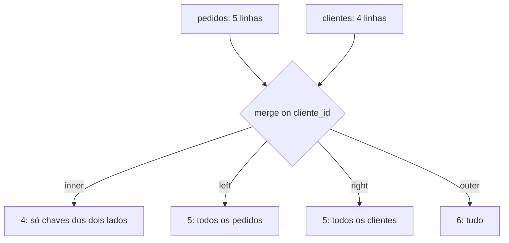

## Passo 1 · Leitura · merge e os quatro how

Uma loja virtual fictícia guarda os pedidos numa tabela e os clientes em outra, ligadas pela coluna `cliente_id`. Para saber quanto cada cliente gastou, ou para mandar um e-mail a quem comprou, as duas precisam virar uma só. É o `merge`:

```python
pedidos = pd.DataFrame({"pedido": [101, 102, 103, 104, 105],
                        "cliente_id": [1, 2, 2, 7, 3],
                        "valor": [50.0, 20.0, 35.0, 80.0, 15.0]})
clientes = pd.DataFrame({"cliente_id": [1, 2, 3, 4],
                         "nome": ["Ana", "Bruno", "Carla", "Davi"]})
juntos = pedidos.merge(clientes, on="cliente_id", how="left")
```

Para cada linha de um lado, o `merge` procura as linhas do outro lado com a mesma chave. Por baixo, ele monta uma tabela hash das chaves, como o `dict` do Nível 3, e não compara cada pedido com cada cliente. O visualizador faz um `left` à mão, com listas e um dicionário, para você ver a tabela de busca se formar e cada pedido procurar o seu par:

```python visualizar
pedidos = [(101, 1), (102, 2), (104, 7)]
clientes = [(1, "Ana"), (2, "Bruno"), (3, "Carla")]
por_id = {}
for cliente_id, nome in clientes:
    por_id.setdefault(cliente_id, []).append(nome)
juntos = []
for pedido, cliente_id in pedidos:
    for nome in por_id.get(cliente_id, [None]):
        juntos.append((pedido, cliente_id, nome))
print(juntos)
```

O `how` decide o que fazer com as chaves que só existem de um lado. O pedido 104 é de um cliente 7 que não está no cadastro, uma chave **órfã**, e a cliente Davi não comprou nada:



`inner` (o padrão) fica só com as chaves presentes nos dois lados e descarta o pedido 104 **sem aviso**: um relatório de faturamento feito assim perde 80 reais. `left` mantém todas as linhas da esquerda e põe `NaN` nas colunas da direita quando não acha par; `right` faz o mesmo pelo outro lado; `outer` mantém tudo. Para perguntas sobre pedidos, o certo quase sempre é `left` com os pedidos à esquerda.

O número de linhas também pode **crescer**. Uma chave que aparece $m$ vezes à esquerda e $n$ vezes à direita gera $m \cdot n$ linhas. Com a cliente 2 duas vezes no cadastro (uma importação duplicada), os dois pedidos dela viram quatro linhas, e a soma de `valor` passa a contar cada pedido duas vezes. Nenhum erro aparece: o `merge` fez exatamente o que mandaram.

Quando a mesma coluna existe dos dois lados sem ser a chave, o pandas acrescenta os sufixos `_x` e `_y`; escolha nomes que digam de onde veio cada uma com `suffixes=("_pedido", "_cliente")`. Se a chave tem nomes diferentes nas duas tabelas, use `left_on="cliente"` e `right_on="id"`. E o `join` é um atalho para juntar pelo índice: `a.join(b)` equivale a um `merge` com `how="left"` entre os índices das duas tabelas.

## Passo 2 · Previsão · Quantas linhas sai do merge

Duas tabelas pequenas com chaves repetidas e chaves que só existem de um lado. Leia sem executar e digite exatamente o que o programa imprime.

### Código
```python
import pandas as pd

a = pd.DataFrame({"k": ["x", "x", "y", "z"], "va": [1, 2, 3, 4]})
b = pd.DataFrame({"k": ["x", "x", "x", "y", "w"], "vb": [10, 20, 30, 40, 50]})
for how in ["inner", "left", "right", "outer"]:
    print(how, len(a.merge(b, on="k", how=how)))
print(a.merge(b, on="k", how="inner")["k"].tolist())
print(a.merge(b, on="k", how="outer")["k"].tolist())
print(a.merge(b, on="k", how="left")["vb"].isna().sum())
```

### Dicas
1. A chave `x` aparece 2 vezes em `a` e 3 vezes em `b`: cada par vira uma linha.
2. `z` só existe em `a` e `w` só existe em `b`; cada uma entra uma vez nas junções que mantêm o seu lado.
3. No `outer`, o pandas devolve as chaves em ordem alfabética.

### Saída esperada
```text
inner 7
left 8
right 8
outer 9
['x', 'x', 'x', 'x', 'x', 'x', 'y']
['w', 'x', 'x', 'x', 'x', 'x', 'x', 'y', 'z']
1
```

## Passo 3 · Exercício · Prever o número de linhas
modo: ordenar

Arraste as linhas para montar `prever_linhas` e ajuste a indentação. Duas linhas estão sobrando.

### Instruções
1. `prever_linhas(chaves_a, chaves_b, how)` recebe as listas de chaves das duas tabelas e o tipo de junção (`"inner"`, `"left"`, `"right"` ou `"outer"`) e devolve quantas linhas o `merge` produz, sem usar o pandas.
2. Uma chave que aparece $m$ vezes em `chaves_a` e $n$ vezes em `chaves_b` gera $m \cdot n$ linhas.
3. Uma chave que só existe em `chaves_a` entra com as suas linhas em `"left"` e `"outer"`; uma que só existe em `chaves_b`, em `"right"` e `"outer"`.

### Solução
```python
from collections import Counter


def prever_linhas(chaves_a, chaves_b, how):
    conta_a = Counter(chaves_a)
    conta_b = Counter(chaves_b)
    total = 0
    for chave in set(conta_a) | set(conta_b):
        if chave in conta_a and chave in conta_b:
            total += conta_a[chave] * conta_b[chave]
        elif chave in conta_a and how in ("left", "outer"):
            total += conta_a[chave]
        elif chave in conta_b and how in ("right", "outer"):
            total += conta_b[chave]
    return total
```

### Distratores
```python
total += conta_a[chave] + conta_b[chave]
elif how == "left":
```

### Dicas
1. Conte quantas vezes cada chave aparece em cada lado antes de percorrer as chaves.
2. Uma chave dos dois lados gera um par para cada combinação de linhas, não uma linha por ocorrência.
3. O `"outer"` mantém as órfãs dos dois lados; o `"left"`, só as da esquerda.

### Verificação
```json
[
  { "id": "inner", "checkpoint": 1, "kind": "call", "function": "prever_linhas", "args": [["a", "b", "c"], ["b", "c", "d"], "inner"],
    "expected": 2, "type": "int", "name": "inner sem repetições" },
  { "id": "left", "checkpoint": 3, "kind": "call", "function": "prever_linhas", "args": [["a", "b", "c"], ["b", "c", "d"], "left"],
    "expected": 3, "type": "int", "name": "left mantém a chave só da esquerda", "hint": "A chave a não tem par, mas o left a mantém." },
  { "id": "right", "checkpoint": 3, "kind": "call", "function": "prever_linhas", "args": [["a", "b", "c"], ["b", "c", "d"], "right"],
    "expected": 3, "type": "int", "name": "right mantém a chave só da direita" },
  { "id": "outer", "checkpoint": 3, "kind": "call", "function": "prever_linhas", "args": [["a", "b", "c"], ["b", "c", "d"], "outer"],
    "expected": 4, "type": "int", "name": "outer mantém as duas" },
  { "id": "repetidas-inner", "checkpoint": 2, "kind": "call", "function": "prever_linhas",
    "args": [["x", "x", "y", "z"], ["x", "x", "x", "y", "w"], "inner"], "expected": 7, "type": "int",
    "name": "Chave 2 vezes de um lado e 3 do outro", "hint": "Cada par de linhas com a mesma chave vira uma linha." },
  { "id": "repetidas-left", "checkpoint": 3, "kind": "call", "function": "prever_linhas",
    "args": [["x", "x", "y", "z"], ["x", "x", "x", "y", "w"], "left"], "expected": 8, "type": "int", "name": "left com chaves repetidas" },
  { "id": "repetidas-outer", "checkpoint": 3, "kind": "call", "function": "prever_linhas",
    "args": [["x", "x", "y", "z"], ["x", "x", "x", "y", "w"], "outer"], "expected": 9, "type": "int", "name": "outer com chaves repetidas" },
  { "id": "orfa-repetida", "checkpoint": 3, "kind": "call", "function": "prever_linhas", "args": [[1, 1, 1, 2], [2], "left"],
    "expected": 4, "type": "int", "name": "Chave órfã repetida entra com todas as linhas" },
  { "id": "vazia", "checkpoint": 1, "kind": "call", "function": "prever_linhas", "args": [["a", "b"], [], "inner"],
    "expected": 0, "type": "int", "name": "Direita vazia: inner sem linhas" },
  { "id": "contra-pandas", "checkpoint": 1, "kind": "expr",
    "setup": "import numpy as np\nimport pandas as pd\nrng = np.random.default_rng(5)\na = rng.integers(0, 12, 40).tolist()\nb = rng.integers(5, 20, 30).tolist()",
    "expr": "[prever_linhas(a, b, h) == len(pd.DataFrame({'k': a}).merge(pd.DataFrame({'k': b}), on='k', how=h)) for h in ['inner', 'left', 'right', 'outer']]",
    "expected": [true, true, true, true], "name": "Bate com o merge do pandas em 40 e 30 chaves sorteadas" }
]
```

### Soluções erradas
```python name="soma no lugar do produto"
from collections import Counter


def prever_linhas(chaves_a, chaves_b, how):
    conta_a = Counter(chaves_a)
    conta_b = Counter(chaves_b)
    total = 0
    for chave in set(conta_a) | set(conta_b):
        if chave in conta_a and chave in conta_b:
            total += conta_a[chave] + conta_b[chave]
        elif chave in conta_a and how in ("left", "outer"):
            total += conta_a[chave]
        elif chave in conta_b and how in ("right", "outer"):
            total += conta_b[chave]
    return total
```
```python name="ignora as repetições"
from collections import Counter


def prever_linhas(chaves_a, chaves_b, how):
    conta_a = Counter(set(chaves_a))
    conta_b = Counter(set(chaves_b))
    total = 0
    for chave in set(conta_a) | set(conta_b):
        if chave in conta_a and chave in conta_b:
            total += conta_a[chave] * conta_b[chave]
        elif chave in conta_a and how in ("left", "outer"):
            total += conta_a[chave]
        elif chave in conta_b and how in ("right", "outer"):
            total += conta_b[chave]
    return total
```
```python name="órfãs da esquerda em qualquer junção externa"
from collections import Counter


def prever_linhas(chaves_a, chaves_b, how):
    conta_a = Counter(chaves_a)
    conta_b = Counter(chaves_b)
    total = 0
    for chave in set(conta_a) | set(conta_b):
        if chave in conta_a and chave in conta_b:
            total += conta_a[chave] * conta_b[chave]
        elif chave in conta_a and how != "inner":
            total += conta_a[chave]
        elif chave in conta_b and how in ("right", "outer"):
            total += conta_b[chave]
    return total
```
```python name="esquece o outer"
from collections import Counter


def prever_linhas(chaves_a, chaves_b, how):
    conta_a = Counter(chaves_a)
    conta_b = Counter(chaves_b)
    total = 0
    for chave in set(conta_a) | set(conta_b):
        if chave in conta_a and chave in conta_b:
            total += conta_a[chave] * conta_b[chave]
        elif chave in conta_a and how == "left":
            total += conta_a[chave]
        elif chave in conta_b and how == "right":
            total += conta_b[chave]
    return total
```
```python name="or no lugar de and"
from collections import Counter


def prever_linhas(chaves_a, chaves_b, how):
    conta_a = Counter(chaves_a)
    conta_b = Counter(chaves_b)
    total = 0
    for chave in set(conta_a) | set(conta_b):
        if chave in conta_a or chave in conta_b:
            total += conta_a[chave] * conta_b[chave]
        elif chave in conta_a and how in ("left", "outer"):
            total += conta_a[chave]
        elif chave in conta_b and how in ("right", "outer"):
            total += conta_b[chave]
    return total
```

## Passo 4 · Leitura · Chaves que não casam

Antes de confiar numa junção, responda duas perguntas: quais chaves ficaram sem par, e alguma chave se repetiu onde não devia?

Para a primeira, `indicator=True` acrescenta a coluna `_merge`, que diz de onde veio cada linha: `"both"`, `"left_only"` ou `"right_only"`.

```python
juntos = pedidos.merge(clientes, on="cliente_id", how="left", indicator=True)
orfaos = juntos.loc[juntos["_merge"] == "left_only", "cliente_id"]
```

Parece equivalente procurar `NaN` numa coluna que veio da direita, como `juntos["nome"].isna()`, mas não é: uma cliente cadastrada sem nome também tem `NaN` ali, e seria contada como órfã. A `_merge` diz se o par existiu, não se os campos dele estão preenchidos. Depois do diagnóstico, apague a coluna com `drop(columns="_merge")`.

Para a segunda, `validate` declara a cardinalidade que você espera, e o `merge` confere antes de juntar. `"many_to_one"` diz que a chave pode repetir à esquerda (um cliente com vários pedidos) mas não à direita (o cadastro tem um cliente por id). Se o cadastro tem a cliente 2 duas vezes:

```text
MergeError: Merge keys are not unique in right dataset; not a many-to-one merge
```

As outras opções são `"one_to_one"`, `"one_to_many"` e `"many_to_many"` (que não confere nada). Escolher a errada também é um erro: `"one_to_one"` recusaria os pedidos, porque a cliente 2 tem dois. O `MergeError` é uma subclasse de `ValueError`; capture-o com `except pd.errors.MergeError` quando quiser trocar a mensagem por uma que explique o problema para quem usa a sua função.

Um terceiro problema aparece antes de qualquer junção: chaves de tipos diferentes. Se o cadastro veio de um CSV lido como texto, `"2"` não é `2`, e o pandas 3 recusa a junção:

```text
ValueError: You are trying to merge on int64 and str columns for key 'cliente_id'. If you wish to proceed you should use pd.concat
```

Converta antes, com `pd.to_numeric` ou `astype(str)` dos dois lados. A mensagem sugere `pd.concat`, mas o `concat` não procura pares por chave, como você verá adiante: a saída certa é igualar os tipos. Antes de juntar tabelas grandes, as três conferências custam pouco: `set(pedidos["cliente_id"]) - set(clientes["cliente_id"])` mostra as órfãs, `clientes["cliente_id"].duplicated().any()` mostra repetições e `dtypes` mostra os tipos.

## Passo 5 · Exercício · Pedidos e clientes

Junte pedidos e clientes sem perder pedidos e com as órfãs listadas, e escreva uma junção que recusa um cadastro com chave repetida.

### Instruções
1. `pedidos_com_clientes(pedidos, clientes)` devolve a tupla `(tabela, orfaos)`. `tabela` tem todas as linhas de `pedidos`, na ordem original, com as colunas de `pedidos` seguidas das de `clientes` (a chave `cliente_id` uma vez só) e nenhuma coluna a mais.
2. `orfaos` é a lista, em ordem crescente e sem repetições, dos `cliente_id` de `pedidos` que não existem em `clientes`. Um cliente cadastrado com algum campo ausente não é órfão.
3. `juntar_validado(esquerda, direita, chave)` devolve o `merge` com `how="left"` pela coluna `chave`. A chave pode repetir na esquerda; se ela repetir na direita, a função levanta `ValueError` com uma mensagem que contém a palavra `repetida` e o nome da chave.

### Código inicial
```python
import numpy as np
import pandas as pd


def pedidos_com_clientes(pedidos, clientes):
    pass


def juntar_validado(esquerda, direita, chave):
    pass
```

### Solução
```python
import numpy as np
import pandas as pd


def pedidos_com_clientes(pedidos, clientes):
    tabela = pedidos.merge(clientes, on="cliente_id", how="left", indicator=True)
    sem_par = tabela.loc[tabela["_merge"] == "left_only", "cliente_id"]
    orfaos = sorted(sem_par.unique().tolist())
    return tabela.drop(columns="_merge"), orfaos


def juntar_validado(esquerda, direita, chave):
    try:
        return esquerda.merge(direita, on=chave, how="left", validate="many_to_one")
    except pd.errors.MergeError:
        raise ValueError(f"chave {chave} repetida na tabela da direita") from None
```

### Dicas
1. Qual `how` mantém todos os pedidos, tenham ou não cliente?
2. A pergunta "o par existiu?" é respondida pelo `indicator`, não por um `NaN` numa coluna de clientes.
3. Repetir à esquerda e não à direita é uma das cardinalidades do `validate`; o erro dele já é um `ValueError`, mas a mensagem precisa ser a sua.

### Verificação
```json
[
  { "id": "linhas", "checkpoint": 1, "kind": "expr",
    "setup": "p = pd.DataFrame({'pedido': [101, 102, 103, 104, 105], 'cliente_id': [1, 2, 2, 7, 3], 'valor': [50.0, 20.0, 35.0, 80.0, 15.0]})\nc = pd.DataFrame({'cliente_id': [1, 2, 3, 4], 'nome': ['Ana', 'Bruno', 'Carla', 'Davi']})\nt, o = pedidos_com_clientes(p, c)",
    "expr": "t['pedido'].tolist()", "expected": [101, 102, 103, 104, 105], "name": "Todos os pedidos, na ordem original",
    "hint": "O pedido do cliente 7 não pode sumir." },
  { "id": "nomes", "checkpoint": 1, "kind": "expr",
    "setup": "p = pd.DataFrame({'pedido': [101, 102, 103, 104, 105], 'cliente_id': [1, 2, 2, 7, 3], 'valor': [50.0, 20.0, 35.0, 80.0, 15.0]})\nc = pd.DataFrame({'cliente_id': [1, 2, 3, 4], 'nome': ['Ana', 'Bruno', 'Carla', 'Davi']})\nt, o = pedidos_com_clientes(p, c)",
    "expr": "t['nome'].fillna('-').tolist()", "expected": ["Ana", "Bruno", "Bruno", "-", "Carla"], "name": "Cada pedido com o nome do cliente" },
  { "id": "colunas", "checkpoint": 1, "kind": "expr",
    "setup": "p = pd.DataFrame({'pedido': [101, 102], 'cliente_id': [1, 9], 'valor': [50.0, 20.0]})\nc = pd.DataFrame({'cliente_id': [1, 2], 'nome': ['Ana', 'Bruno'], 'cidade': ['Vale Azul', 'Lagoa Seca']})\nt, o = pedidos_com_clientes(p, c)",
    "expr": "list(t.columns)", "expected": ["pedido", "cliente_id", "valor", "nome", "cidade"], "name": "Colunas dos pedidos e depois dos clientes, sem sobras",
    "hint": "Tire a coluna de diagnóstico antes de devolver." },
  { "id": "orfaos", "checkpoint": 2, "kind": "expr",
    "setup": "p = pd.DataFrame({'pedido': [101, 102, 103, 104, 105], 'cliente_id': [1, 2, 2, 7, 3], 'valor': [50.0, 20.0, 35.0, 80.0, 15.0]})\nc = pd.DataFrame({'cliente_id': [1, 2, 3, 4], 'nome': ['Ana', 'Bruno', 'Carla', 'Davi']})\nt, o = pedidos_com_clientes(p, c)",
    "expr": "o", "expected": [7], "name": "O cliente 7 é órfão" },
  { "id": "orfaos-unicos", "checkpoint": 2, "kind": "expr",
    "setup": "p = pd.DataFrame({'pedido': [1, 2, 3, 4, 5], 'cliente_id': [9, 1, 7, 9, 7], 'valor': [1.0, 2.0, 3.0, 4.0, 5.0]})\nc = pd.DataFrame({'cliente_id': [1, 2], 'nome': ['Ana', 'Bruno']})\nt, o = pedidos_com_clientes(p, c)",
    "expr": "o", "expected": [7, 9], "name": "Órfãos em ordem crescente e sem repetição", "hint": "Um cliente com dois pedidos órfãos aparece uma vez." },
  { "id": "sem-orfaos", "checkpoint": 2, "kind": "expr",
    "setup": "p = pd.DataFrame({'pedido': [1, 2], 'cliente_id': [1, 2], 'valor': [1.0, 2.0]})\nc = pd.DataFrame({'cliente_id': [1, 2, 3], 'nome': ['Ana', 'Bruno', 'Carla']})\nt, o = pedidos_com_clientes(p, c)",
    "expr": "o", "expected": [], "name": "Sem órfãos, a lista é vazia" },
  { "id": "campo-ausente", "checkpoint": 2, "kind": "expr",
    "setup": "p = pd.DataFrame({'pedido': [101, 102, 103], 'cliente_id': [1, 2, 7], 'valor': [50.0, 20.0, 80.0]})\nc = pd.DataFrame({'cliente_id': [1, 2, 3], 'nome': ['Ana', None, 'Carla']})\nt, o = pedidos_com_clientes(p, c)",
    "expr": "o", "expected": [7], "name": "Cliente cadastrado sem nome não é órfão", "hint": "Um NaN numa coluna de clientes não prova que o par faltou." },
  { "id": "orfaos-tipo", "checkpoint": 2, "kind": "expr",
    "setup": "p = pd.DataFrame({'pedido': [101, 102], 'cliente_id': [1, 7], 'valor': [50.0, 80.0]})\nc = pd.DataFrame({'cliente_id': [1], 'nome': ['Ana']})\nt, o = pedidos_com_clientes(p, c)",
    "expr": "[type(o).__name__, [type(x).__name__ for x in o]]", "expected": ["list", ["int"]], "name": "orfaos é uma lista de int" },
  { "id": "validado", "checkpoint": 3, "kind": "expr",
    "setup": "e = pd.DataFrame({'cliente_id': [1, 2, 2, 5], 'valor': [10.0, 20.0, 30.0, 40.0]})\nd = pd.DataFrame({'cliente_id': [1, 2, 3], 'nome': ['Ana', 'Bruno', 'Carla']})",
    "expr": "juntar_validado(e, d, 'cliente_id').to_dict('list')",
    "expected": { "cliente_id": [1, 2, 2, 5], "valor": [10.0, 20.0, 30.0, 40.0], "nome": ["Ana", "Bruno", "Bruno", { "$float": "nan" }] },
    "name": "Chave repetida à esquerda é normal", "hint": "Um cliente pode ter vários pedidos." },
  { "id": "repetida", "checkpoint": 3, "kind": "expr",
    "setup": "e = pd.DataFrame({'cliente_id': [1, 2], 'valor': [10.0, 20.0]})\nd = pd.DataFrame({'cliente_id': [1, 2, 2], 'nome': ['Ana', 'Bruno', 'Bruno B.']})",
    "expr": "juntar_validado(e, d, 'cliente_id')", "raises": "ValueError", "message_contains": "repetida",
    "name": "Chave repetida à direita levanta ValueError", "hint": "Sem conferência, o pedido do cliente 2 seria duplicado." },
  { "id": "repetida-nome", "checkpoint": 3, "kind": "expr",
    "setup": "e = pd.DataFrame({'codigo': ['A', 'B'], 'qtd': [3, 4]})\nd = pd.DataFrame({'codigo': ['A', 'A', 'B'], 'produto': ['caneta', 'caneta azul', 'lápis']})",
    "expr": "juntar_validado(e, d, 'codigo')", "raises": "ValueError", "message_contains": "codigo",
    "name": "A mensagem cita o nome da chave" }
]
```

### Soluções erradas
```python name="inner perde os pedidos órfãos"
import numpy as np
import pandas as pd


def pedidos_com_clientes(pedidos, clientes):
    tabela = pedidos.merge(clientes, on="cliente_id", how="inner", indicator=True)
    sem_par = tabela.loc[tabela["_merge"] == "left_only", "cliente_id"]
    orfaos = sorted(sem_par.unique().tolist())
    return tabela.drop(columns="_merge"), orfaos


def juntar_validado(esquerda, direita, chave):
    try:
        return esquerda.merge(direita, on=chave, how="left", validate="many_to_one")
    except pd.errors.MergeError:
        raise ValueError(f"chave {chave} repetida na tabela da direita") from None
```
```python name="órfão pelo NaN do nome"
import numpy as np
import pandas as pd


def pedidos_com_clientes(pedidos, clientes):
    tabela = pedidos.merge(clientes, on="cliente_id", how="left")
    sem_par = tabela.loc[tabela["nome"].isna(), "cliente_id"]
    orfaos = sorted(sem_par.unique().tolist())
    return tabela, orfaos


def juntar_validado(esquerda, direita, chave):
    try:
        return esquerda.merge(direita, on=chave, how="left", validate="many_to_one")
    except pd.errors.MergeError:
        raise ValueError(f"chave {chave} repetida na tabela da direita") from None
```
```python name="órfãos repetidos e fora de ordem"
import numpy as np
import pandas as pd


def pedidos_com_clientes(pedidos, clientes):
    tabela = pedidos.merge(clientes, on="cliente_id", how="left", indicator=True)
    orfaos = tabela.loc[tabela["_merge"] == "left_only", "cliente_id"].tolist()
    return tabela.drop(columns="_merge"), orfaos


def juntar_validado(esquerda, direita, chave):
    try:
        return esquerda.merge(direita, on=chave, how="left", validate="many_to_one")
    except pd.errors.MergeError:
        raise ValueError(f"chave {chave} repetida na tabela da direita") from None
```
```python name="deixa a coluna _merge"
import numpy as np
import pandas as pd


def pedidos_com_clientes(pedidos, clientes):
    tabela = pedidos.merge(clientes, on="cliente_id", how="left", indicator=True)
    sem_par = tabela.loc[tabela["_merge"] == "left_only", "cliente_id"]
    orfaos = sorted(sem_par.unique().tolist())
    return tabela, orfaos


def juntar_validado(esquerda, direita, chave):
    try:
        return esquerda.merge(direita, on=chave, how="left", validate="many_to_one")
    except pd.errors.MergeError:
        raise ValueError(f"chave {chave} repetida na tabela da direita") from None
```
```python name="sem validate"
import numpy as np
import pandas as pd


def pedidos_com_clientes(pedidos, clientes):
    tabela = pedidos.merge(clientes, on="cliente_id", how="left", indicator=True)
    sem_par = tabela.loc[tabela["_merge"] == "left_only", "cliente_id"]
    orfaos = sorted(sem_par.unique().tolist())
    return tabela.drop(columns="_merge"), orfaos


def juntar_validado(esquerda, direita, chave):
    return esquerda.merge(direita, on=chave, how="left")
```
```python name="um para um"
import numpy as np
import pandas as pd


def pedidos_com_clientes(pedidos, clientes):
    tabela = pedidos.merge(clientes, on="cliente_id", how="left", indicator=True)
    sem_par = tabela.loc[tabela["_merge"] == "left_only", "cliente_id"]
    orfaos = sorted(sem_par.unique().tolist())
    return tabela.drop(columns="_merge"), orfaos


def juntar_validado(esquerda, direita, chave):
    try:
        return esquerda.merge(direita, on=chave, how="left", validate="one_to_one")
    except pd.errors.MergeError:
        raise ValueError(f"chave {chave} repetida na tabela da direita") from None
```
```python name="deixa o MergeError passar"
import numpy as np
import pandas as pd


def pedidos_com_clientes(pedidos, clientes):
    tabela = pedidos.merge(clientes, on="cliente_id", how="left", indicator=True)
    sem_par = tabela.loc[tabela["_merge"] == "left_only", "cliente_id"]
    orfaos = sorted(sem_par.unique().tolist())
    return tabela.drop(columns="_merge"), orfaos


def juntar_validado(esquerda, direita, chave):
    return esquerda.merge(direita, on=chave, how="left", validate="many_to_one")
```

## Passo 6 · Leitura · Empilhar com concat

O `merge` junta tabelas **lado a lado**, procurando pares por chave. Quando as tabelas têm as mesmas colunas e você quer **uma embaixo da outra**, como as vendas de janeiro e as de fevereiro de uma rede fictícia, o certo é o `pd.concat`:

```python
jan = pd.DataFrame({"loja": ["L1", "L2"], "vendas": [10, 20]})
fev = pd.DataFrame({"loja": ["L1", "L3"], "vendas": [11, 30], "devolucoes": [1, 0]})
juntas = pd.concat([jan, fev])
```

Três coisas acontecem. O índice é copiado de cada tabela, e o resultado fica com `[0, 1, 0, 1]`: dois rótulos 0, e um `juntas.loc[0]` devolve duas linhas. `ignore_index=True` numera de novo, de 0 a n − 1. As colunas são a **união** das colunas das tabelas, na ordem em que aparecem; a coluna que falta numa tabela vira `NaN` nas linhas dela, e por isso `devolucoes`, que era inteira, sai `float64`. Para ficar só com as colunas comuns, use `join="inner"`. E nada no resultado diz de que mês veio cada linha.

Para guardar a origem, marque cada tabela **antes** de empilhar, com `assign`, que devolve uma cópia e não mexe na tabela de quem chamou:

```python
partes = [jan.assign(mes="jan"), fev.assign(mes="fev")]
juntas = pd.concat(partes, ignore_index=True)
```

O parâmetro `keys=["jan", "fev"]` faz algo parecido, mas põe a origem num `MultiIndex`, e não numa coluna; `reset_index(level=0)` a traz para fora. Já `tabela["mes"] = "jan"` dentro de um laço sobre as tabelas recebidas **altera** as tabelas de quem chamou, como você viu nas lições de Copy-on-Write.

`pd.concat([jan, fev], axis=1)` empilha na horizontal, alinhando pelo **índice**, não por uma chave: a linha 0 de janeiro fica ao lado da linha 0 de fevereiro, mesmo sendo de lojas diferentes. Para juntar por loja, o certo é o `merge`.

O `DataFrame.append` de versões antigas não existe no pandas 3 (`AttributeError: 'DataFrame' object has no attribute 'append'`), e não faz falta. Ao ler 365 arquivos diários, não escreva `total = pd.concat([total, dia])` dentro do laço: cada volta copia tudo o que já foi juntado, e o custo total cresce com o quadrado do número de arquivos, como a concatenação de strings no Nível 3. Guarde as tabelas numa lista e chame o `concat` uma vez no fim. Com a lista vazia, ele recusa: `ValueError: No objects to concatenate`.

## Passo 7 · Exercício · Empilhar meses

Junte as tabelas mensais de vendas numa só, sem perder a origem de cada linha.

### Instruções
1. `empilhar_meses(tabelas, meses)` recebe uma lista de tabelas e uma lista de nomes de mês do mesmo tamanho e devolve uma tabela com todas as linhas, na ordem da lista, e uma coluna `mes` com o mês de origem de cada linha.
2. A coluna `mes` é a primeira; depois vêm as demais colunas na ordem em que aparecem pela primeira vez. Coluna que falta numa tabela vira `NaN`, e o índice vai de 0 a n − 1.
3. Se as duas listas têm tamanhos diferentes, ou se não há nenhuma tabela, a função levanta `ValueError`.
4. As tabelas recebidas não mudam.

### Código inicial
```python
import numpy as np
import pandas as pd


def empilhar_meses(tabelas, meses):
    pass
```

### Solução
```python
import numpy as np
import pandas as pd


def empilhar_meses(tabelas, meses):
    if len(tabelas) != len(meses):
        raise ValueError("tabelas e meses precisam ter o mesmo tamanho")
    marcadas = [tabela.assign(mes=mes) for tabela, mes in zip(tabelas, meses)]
    juntas = pd.concat(marcadas, ignore_index=True)
    colunas = ["mes"] + [coluna for coluna in juntas.columns if coluna != "mes"]
    return juntas[colunas]
```

### Dicas
1. Marque cada tabela com o seu mês antes de empilhar, sem alterar a original.
2. O `concat` copia os índices das tabelas; um parâmetro faz a numeração de novo.
3. O `zip` para no fim da lista mais curta, sem avisar.

### Verificação
```json
[
  { "id": "linhas", "checkpoint": 1, "kind": "expr",
    "setup": "jan = pd.DataFrame({'loja': ['L1', 'L2'], 'vendas': [10, 20]})\nfev = pd.DataFrame({'loja': ['L1', 'L3'], 'vendas': [11, 30], 'devolucoes': [1, 0]})\nr = empilhar_meses([jan, fev], ['jan', 'fev'])",
    "expr": "[r['loja'].tolist(), r['vendas'].tolist()]", "expected": [["L1", "L2", "L1", "L3"], [10, 20, 11, 30]],
    "name": "Todas as linhas, na ordem da lista" },
  { "id": "mes", "checkpoint": 1, "kind": "expr",
    "setup": "jan = pd.DataFrame({'loja': ['L1', 'L2'], 'vendas': [10, 20]})\nfev = pd.DataFrame({'loja': ['L1', 'L3'], 'vendas': [11, 30], 'devolucoes': [1, 0]})\nr = empilhar_meses([jan, fev], ['jan', 'fev'])",
    "expr": "r['mes'].tolist()", "expected": ["jan", "jan", "fev", "fev"], "name": "Cada linha sabe de que mês veio",
    "hint": "A origem precisa estar numa coluna, não no índice." },
  { "id": "colunas", "checkpoint": 2, "kind": "expr",
    "setup": "jan = pd.DataFrame({'loja': ['L1', 'L2'], 'vendas': [10, 20]})\nfev = pd.DataFrame({'loja': ['L1', 'L3'], 'vendas': [11, 30], 'devolucoes': [1, 0]})\nr = empilhar_meses([jan, fev], ['jan', 'fev'])",
    "expr": "list(r.columns)", "expected": ["mes", "loja", "vendas", "devolucoes"], "name": "mes primeiro, depois as colunas na ordem em que aparecem",
    "hint": "A coluna que só existe em fevereiro também entra." },
  { "id": "ausentes", "checkpoint": 2, "kind": "expr",
    "setup": "jan = pd.DataFrame({'loja': ['L1', 'L2'], 'vendas': [10, 20]})\nfev = pd.DataFrame({'loja': ['L1', 'L3'], 'vendas': [11, 30], 'devolucoes': [1, 0]})\nr = empilhar_meses([jan, fev], ['jan', 'fev'])",
    "expr": "r['devolucoes'].isna().tolist()", "expected": [true, true, false, false], "name": "Coluna que falta em janeiro vira NaN" },
  { "id": "indice", "checkpoint": 2, "kind": "expr",
    "setup": "jan = pd.DataFrame({'loja': ['L1', 'L2'], 'vendas': [10, 20]})\nfev = pd.DataFrame({'loja': ['L1', 'L3'], 'vendas': [11, 30]})\nr = empilhar_meses([jan, fev], ['jan', 'fev'])",
    "expr": "r.index.tolist()", "expected": [0, 1, 2, 3], "name": "Índice de 0 a n − 1", "hint": "Sem renumerar, o índice repete 0 e 1." },
  { "id": "tres-meses", "checkpoint": 1, "kind": "expr",
    "setup": "t = [pd.DataFrame({'loja': ['L1'], 'vendas': [v]}) for v in (5, 6, 7)]\nr = empilhar_meses(t, ['jan', 'fev', 'mar'])",
    "expr": "r.values.tolist()", "expected": [["jan", "L1", 5], ["fev", "L1", 6], ["mar", "L1", 7]], "name": "Três meses empilhados" },
  { "id": "tamanhos", "checkpoint": 3, "kind": "expr",
    "setup": "t = [pd.DataFrame({'loja': ['L1'], 'vendas': [v]}) for v in (5, 6, 7)]",
    "expr": "empilhar_meses(t, ['jan', 'fev'])", "raises": "ValueError", "name": "Listas de tamanhos diferentes levantam ValueError",
    "hint": "Sem conferir, a tabela de março sumiria em silêncio." },
  { "id": "vazia", "checkpoint": 3, "kind": "expr", "expr": "empilhar_meses([], [])", "raises": "ValueError",
    "name": "Nenhuma tabela levanta ValueError" },
  { "id": "entrada", "checkpoint": 4, "kind": "expr",
    "setup": "jan = pd.DataFrame({'loja': ['L1', 'L2'], 'vendas': [10, 20]})\nfev = pd.DataFrame({'loja': ['L1', 'L3'], 'vendas': [11, 30]})\nr = empilhar_meses([jan, fev], ['jan', 'fev'])",
    "expr": "[list(jan.columns), list(fev.columns)]", "expected": [["loja", "vendas"], ["loja", "vendas"]],
    "name": "As tabelas recebidas não ganham a coluna mes", "hint": "Marque uma cópia de cada tabela." }
]
```

### Soluções erradas
```python name="índices repetidos"
import numpy as np
import pandas as pd


def empilhar_meses(tabelas, meses):
    if len(tabelas) != len(meses):
        raise ValueError("tabelas e meses precisam ter o mesmo tamanho")
    marcadas = [tabela.assign(mes=mes) for tabela, mes in zip(tabelas, meses)]
    juntas = pd.concat(marcadas)
    colunas = ["mes"] + [coluna for coluna in juntas.columns if coluna != "mes"]
    return juntas[colunas]
```
```python name="mes no meio das colunas"
import numpy as np
import pandas as pd


def empilhar_meses(tabelas, meses):
    if len(tabelas) != len(meses):
        raise ValueError("tabelas e meses precisam ter o mesmo tamanho")
    marcadas = [tabela.assign(mes=mes) for tabela, mes in zip(tabelas, meses)]
    return pd.concat(marcadas, ignore_index=True)
```
```python name="origem no índice"
import numpy as np
import pandas as pd


def empilhar_meses(tabelas, meses):
    if len(tabelas) != len(meses):
        raise ValueError("tabelas e meses precisam ter o mesmo tamanho")
    return pd.concat(tabelas, keys=meses)
```
```python name="altera as tabelas recebidas"
import numpy as np
import pandas as pd


def empilhar_meses(tabelas, meses):
    if len(tabelas) != len(meses):
        raise ValueError("tabelas e meses precisam ter o mesmo tamanho")
    for tabela, mes in zip(tabelas, meses):
        tabela["mes"] = mes
    juntas = pd.concat(tabelas, ignore_index=True)
    colunas = ["mes"] + [coluna for coluna in juntas.columns if coluna != "mes"]
    return juntas[colunas]
```
```python name="zip corta em silêncio"
import numpy as np
import pandas as pd


def empilhar_meses(tabelas, meses):
    marcadas = [tabela.assign(mes=mes) for tabela, mes in zip(tabelas, meses)]
    juntas = pd.concat(marcadas, ignore_index=True)
    colunas = ["mes"] + [coluna for coluna in juntas.columns if coluna != "mes"]
    return juntas[colunas]
```
```python name="só as colunas comuns"
import numpy as np
import pandas as pd


def empilhar_meses(tabelas, meses):
    if len(tabelas) != len(meses):
        raise ValueError("tabelas e meses precisam ter o mesmo tamanho")
    marcadas = [tabela.assign(mes=mes) for tabela, mes in zip(tabelas, meses)]
    juntas = pd.concat(marcadas, ignore_index=True, join="inner")
    colunas = ["mes"] + [coluna for coluna in juntas.columns if coluna != "mes"]
    return juntas[colunas]
```
```python name="lado a lado"
import numpy as np
import pandas as pd


def empilhar_meses(tabelas, meses):
    if len(tabelas) != len(meses):
        raise ValueError("tabelas e meses precisam ter o mesmo tamanho")
    marcadas = [tabela.assign(mes=mes) for tabela, mes in zip(tabelas, meses)]
    juntas = pd.concat(marcadas, axis=1)
    colunas = ["mes"] + [coluna for coluna in juntas.columns if coluna != "mes"]
    return juntas[colunas]
```

## Passo 8 · Quiz · Junções

### Pergunta
Uma loja fictícia tem 1 000 pedidos, que somam R\$ 50 000. Para incluir a forma de pagamento, alguém fez `pedidos.merge(pagamentos, on="pedido")`, e a soma de `valor` na tabela juntada deu R\$ 61 000. O que provavelmente aconteceu?
- [ ] O `merge` converteu `valor` para `float` e acumulou erros de arredondamento
- [x] Alguns pedidos têm mais de um pagamento (parcelas); cada um deles virou várias linhas, e o `valor` do pedido passou a ser somado várias vezes
- [ ] O `inner` padrão incluiu pagamentos sem pedido
- [ ] O `merge` duplicou a tabela de pedidos inteira por causa dos sufixos `_x` e `_y`
> Uma chave que aparece $m$ vezes de um lado e $n$ do outro gera $m \cdot n$ linhas; com parcelas, o pedido se repete à direita, e cada repetição carrega o mesmo `valor`. `validate="one_to_one"` teria recusado a junção. A saída é somar os pagamentos por pedido antes de juntar, ou somar `valor` na tabela de pedidos. Erros de arredondamento não chegam a 11 mil reais, o `inner` descarta chaves sem par em vez de incluí-las, e os sufixos só renomeiam colunas.

### Pergunta
O faturamento por cidade foi calculado com `pedidos.merge(clientes, on="cliente_id")` seguido de uma soma, e o total ficou R\$ 3 200 abaixo da soma de `pedidos["valor"]`. Qual é o diagnóstico mais direto?
- [ ] Os clientes sem pedidos puxaram o total para baixo
- [ ] O `merge` arredonda os valores ao juntar
- [x] O `how` padrão é `inner`: os pedidos de clientes que não estão no cadastro sumiram. `how="left"` com `indicator=True` mostra quais são
- [ ] A coluna `valor` existia nas duas tabelas e o pandas somou só a `valor_y`
> Com `inner`, um pedido cujo `cliente_id` não existe em `clientes` é descartado sem aviso. Com `how="left"`, todos os pedidos ficam, e `_merge == "left_only"` lista os órfãos, que precisam de uma decisão (cadastro faltando, id digitado errado). Clientes sem pedidos não entram num `inner` e não somariam nada; o `merge` não arredonda; e uma coluna repetida viraria `valor_x` e `valor_y`, e a soma de `valor` daria `KeyError`.

### Pergunta
Para juntar 365 arquivos diários fictícios, um script faz `total = pd.concat([total, dia])` dentro do laço, e fica cada vez mais lento. O que você sugere?
- [ ] Trocar o `concat` por `total.append(dia)`, que é mais rápido
- [ ] Usar `pd.concat(..., axis=1)`, que não copia as linhas
- [x] Ler os dias numa lista e chamar `pd.concat(lista, ignore_index=True)` uma vez só, no fim
- [ ] Ordenar os arquivos antes, para o `concat` encontrar a posição certa mais rápido
> Cada `concat` dentro do laço copia todas as linhas já juntadas: no dia 365, copia 364 dias de novo, e o custo total cresce com o quadrado do número de arquivos, como concatenar strings num laço no Nível 3. Com uma lista, cada tabela é copiada uma vez. O `append` não existe mais no pandas 3, `axis=1` empilharia na horizontal, alinhando pelo índice, e a ordem dos arquivos não muda o custo.
