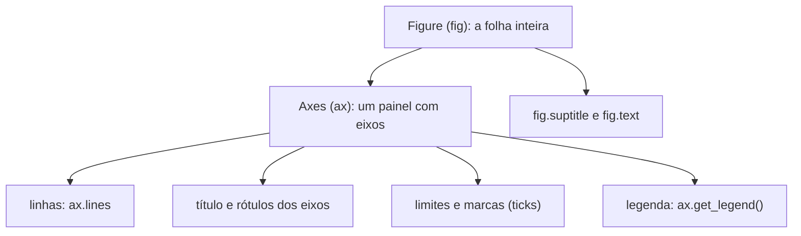

## Passo 1 · Leitura · Figure, Axes e artistas

A estação meteorológica fictícia de Vila Azul mede a temperatura a cada hora, e a equipe quer um gráfico do dia para o boletim. Com o matplotlib, um gráfico não é uma imagem que você desenha de uma vez: é uma árvore de objetos, e cada parte visível é um objeto que você pode consultar e alterar depois.



A **Figure** é a folha; um **Axes** é um painel dentro dela, com eixo x, eixo y e tudo o que foi desenhado ali. O que aparece no painel (linhas, barras, textos) são os **artistas**. A forma recomendada de começar é pedir os dois de uma vez:

```python
import matplotlib.pyplot as plt

horas = [0, 6, 12, 18]
temperaturas = [17.5, 16.0, 26.5, 22.0]
fig, ax = plt.subplots()
ax.plot(horas, temperaturas)
ax.set_title("Temperatura em Vila Azul")
ax.set_xlabel("hora do dia")
ax.set_ylabel("temperatura (°C)")
```

Esse é o estilo **orientado a objetos**: cada chamada diz em qual `ax` agir. O matplotlib tem também o estilo **pyplot**, de funções soltas (`plt.plot`, `plt.title`), que agem sobre a figura e o Axes "atuais", isto é, os últimos criados ou usados. Ele é prático para um gráfico rápido, mas, com duas figuras abertas, `plt.title` vai para a mais recente, que pode não ser a que você queria. Neste módulo, toda função cria a figura com `plt.subplots`, desenha só pelo `ax` e devolve `(fig, ax)`.

Na plataforma, o matplotlib roda com o backend `agg`, que desenha em memória e não abre janela. Por isso a correção não olha pixels: ela consulta os objetos. `ax.get_title()` devolve o título, `ax.get_xlabel()` o rótulo do eixo x, `len(ax.lines)` quantas linhas existem e `ax.lines[0].get_ydata()` os valores da primeira. Dois gráficos com os mesmos dados podem diferir em alguns pixels por causa da fonte instalada ou da versão; as propriedades não mudam. É também assim que você testa um gráfico no seu próprio código.

## Passo 2 · Previsão · O que o Axes guarda

O programa monta uma figura com duas linhas, depois cria uma segunda figura e usa funções do pyplot. Leia sem executar e digite exatamente o que ele imprime.

### Código
```python
import matplotlib.pyplot as plt

fig, ax = plt.subplots()
ax.plot([0, 6, 12, 18], [17.5, 16.0, 26.5, 22.0])
ax.plot([0, 6, 12, 18], [15.0, 14.5, 21.0, 19.5])
ax.set_title("Temperatura em Vila Azul")
ax.set_xlabel("hora do dia")
print(len(ax.lines), len(fig.axes))
print(repr(ax.get_title()), repr(ax.get_ylabel()))
print(ax.lines[1].get_ydata().tolist())

fig2, ax2 = plt.subplots()
plt.title("Chuva")
plt.plot([0, 6], [0.0, 2.5])
print(repr(ax.get_title()), repr(ax2.get_title()))
print(len(ax.lines), len(ax2.lines))
print(len(plt.get_fignums()))
```

### Dicas
1. Cada `ax.plot` acrescenta uma linha ao mesmo Axes; o que nunca foi definido volta como texto vazio.
2. `plt.title` e `plt.plot` agem sobre o Axes atual: o último criado.
3. Criar uma figura nova não fecha a anterior.

### Saída esperada
```text
2 1
'Temperatura em Vila Azul' ''
[15.0, 14.5, 21.0, 19.5]
'Temperatura em Vila Azul' 'Chuva'
2 1
2
```

## Passo 3 · Exercício · Gráfico de linha
modo: lacunas

Escreva a função que desenha a temperatura do dia. Complete as lacunas (`___`) com a interface orientada a objetos.

### Instruções
1. `grafico_de_linha(x, y, titulo, rotulo_x, rotulo_y)` cria uma figura com um único Axes usando `plt.subplots` e devolve a tupla `(fig, ax)`, nessa ordem.
2. O Axes tem uma linha só, com `x` no eixo horizontal e `y` no vertical.
3. Título e rótulos dos eixos são exatamente os textos recebidos.

### Código inicial
```python
import matplotlib.pyplot as plt


def grafico_de_linha(x, y, titulo, rotulo_x, rotulo_y):
    fig, ax = plt.___()
    ax.___(x, y)
    ax.___(titulo)
    ax.set_xlabel(___)
    ax.set_ylabel(___)
    return ___
```

### Solução
```python
import matplotlib.pyplot as plt


def grafico_de_linha(x, y, titulo, rotulo_x, rotulo_y):
    fig, ax = plt.subplots()
    ax.plot(x, y)
    ax.set_title(titulo)
    ax.set_xlabel(rotulo_x)
    ax.set_ylabel(rotulo_y)
    return fig, ax
```

### Dicas
1. Uma função do pyplot devolve a figura e o Axes de uma vez; a outra, `plt.figure`, devolve só a figura.
2. No Axes, todo método que define algo começa com `set_`.
3. A ordem da tupla devolvida é a mesma da linha que cria a figura.

### Verificação
```json
[
  { "id": "tipos", "checkpoint": 1, "kind": "expr",
    "setup": "import matplotlib.pyplot as plt\nplt.close(\"all\")\nr = grafico_de_linha([0, 6, 12, 18], [17.5, 16.0, 26.5, 22.0], \"Temperatura em Vila Azul\", \"hora do dia\", \"temperatura (°C)\")",
    "expr": "[type(parte).__name__ for parte in r]", "expected": ["Figure", "Axes"],
    "name": "Devolve (fig, ax), nessa ordem", "hint": "Devolva os dois objetos que plt.subplots criou, na mesma ordem." },
  { "id": "um-axes", "checkpoint": 1, "kind": "expr",
    "setup": "import matplotlib.pyplot as plt\nplt.close(\"all\")\nfig, ax = grafico_de_linha([0, 6, 12, 18], [17.5, 16.0, 26.5, 22.0], \"Temperatura em Vila Azul\", \"hora do dia\", \"temperatura (°C)\")",
    "expr": "[len(fig.axes), ax.figure is fig]", "expected": [1, true],
    "name": "A figura tem um Axes, e é o Axes devolvido" },
  { "id": "uma-linha", "checkpoint": 2, "kind": "expr",
    "setup": "import matplotlib.pyplot as plt\nplt.close(\"all\")\nfig, ax = grafico_de_linha([0, 6, 12, 18], [17.5, 16.0, 26.5, 22.0], \"Temperatura em Vila Azul\", \"hora do dia\", \"temperatura (°C)\")",
    "expr": "len(ax.lines)", "expected": 1,
    "name": "O Axes tem exatamente uma linha", "hint": "Pontos ligados por uma linha: o tipo de gráfico mais simples do Axes." },
  { "id": "x", "checkpoint": 2, "kind": "expr",
    "setup": "import matplotlib.pyplot as plt\nplt.close(\"all\")\nfig, ax = grafico_de_linha([0, 6, 12, 18], [17.5, 16.0, 26.5, 22.0], \"Temperatura em Vila Azul\", \"hora do dia\", \"temperatura (°C)\")",
    "expr": "[float(v) for v in ax.lines[0].get_xdata()]", "expected": [0.0, 6.0, 12.0, 18.0],
    "name": "As horas estão no eixo x" },
  { "id": "y", "checkpoint": 2, "kind": "expr",
    "setup": "import matplotlib.pyplot as plt\nplt.close(\"all\")\nfig, ax = grafico_de_linha([0, 6, 12, 18], [17.5, 16.0, 26.5, 22.0], \"Temperatura em Vila Azul\", \"hora do dia\", \"temperatura (°C)\")",
    "expr": "[float(v) for v in ax.lines[0].get_ydata()]", "expected": [17.5, 16.0, 26.5, 22.0],
    "name": "As temperaturas estão no eixo y" },
  { "id": "titulo", "checkpoint": 3, "kind": "expr",
    "setup": "import matplotlib.pyplot as plt\nplt.close(\"all\")\nfig, ax = grafico_de_linha([0, 6, 12, 18], [17.5, 16.0, 26.5, 22.0], \"Temperatura em Vila Azul\", \"hora do dia\", \"temperatura (°C)\")",
    "expr": "ax.get_title()", "expected": "Temperatura em Vila Azul",
    "name": "O título é o texto recebido", "hint": "O rótulo de um artista (usado pela legenda) não é o título do Axes." },
  { "id": "rotulo-x", "checkpoint": 3, "kind": "expr",
    "setup": "import matplotlib.pyplot as plt\nplt.close(\"all\")\nfig, ax = grafico_de_linha([0, 6, 12, 18], [17.5, 16.0, 26.5, 22.0], \"Temperatura em Vila Azul\", \"hora do dia\", \"temperatura (°C)\")",
    "expr": "ax.get_xlabel()", "expected": "hora do dia", "name": "O rótulo do eixo x" },
  { "id": "rotulo-y", "checkpoint": 3, "kind": "expr",
    "setup": "import matplotlib.pyplot as plt\nplt.close(\"all\")\nfig, ax = grafico_de_linha([0, 6, 12, 18], [17.5, 16.0, 26.5, 22.0], \"Temperatura em Vila Azul\", \"hora do dia\", \"temperatura (°C)\")",
    "expr": "ax.get_ylabel()", "expected": "temperatura (°C)", "name": "O rótulo do eixo y, com a unidade" },
  { "id": "outro-grafico", "checkpoint": 3, "kind": "expr",
    "setup": "import matplotlib.pyplot as plt\nplt.close(\"all\")\nfig, ax = grafico_de_linha([1, 2, 3], [0.0, 4.5, 1.0], \"Chuva em Porto Claro\", \"dia\", \"chuva (mm)\")",
    "expr": "[ax.get_title(), ax.get_xlabel(), ax.get_ylabel(), [float(v) for v in ax.lines[0].get_ydata()]]",
    "expected": ["Chuva em Porto Claro", "dia", "chuva (mm)", [0.0, 4.5, 1.0]],
    "name": "Outro gráfico, com outros textos e dados" }
]
```

### Soluções erradas
```python name="plt.figure no lugar de plt.subplots"
import matplotlib.pyplot as plt


def grafico_de_linha(x, y, titulo, rotulo_x, rotulo_y):
    fig, ax = plt.figure()
    ax.plot(x, y)
    ax.set_title(titulo)
    ax.set_xlabel(rotulo_x)
    ax.set_ylabel(rotulo_y)
    return fig, ax
```
```python name="barras no lugar da linha"
import matplotlib.pyplot as plt


def grafico_de_linha(x, y, titulo, rotulo_x, rotulo_y):
    fig, ax = plt.subplots()
    ax.bar(x, y)
    ax.set_title(titulo)
    ax.set_xlabel(rotulo_x)
    ax.set_ylabel(rotulo_y)
    return fig, ax
```
```python name="set_label no lugar de set_title"
import matplotlib.pyplot as plt


def grafico_de_linha(x, y, titulo, rotulo_x, rotulo_y):
    fig, ax = plt.subplots()
    ax.plot(x, y)
    ax.set_label(titulo)
    ax.set_xlabel(rotulo_x)
    ax.set_ylabel(rotulo_y)
    return fig, ax
```
```python name="ax.title como no pyplot"
import matplotlib.pyplot as plt


def grafico_de_linha(x, y, titulo, rotulo_x, rotulo_y):
    fig, ax = plt.subplots()
    ax.plot(x, y)
    ax.title(titulo)
    ax.set_xlabel(rotulo_x)
    ax.set_ylabel(rotulo_y)
    return fig, ax
```
```python name="rótulos trocados"
import matplotlib.pyplot as plt


def grafico_de_linha(x, y, titulo, rotulo_x, rotulo_y):
    fig, ax = plt.subplots()
    ax.plot(x, y)
    ax.set_title(titulo)
    ax.set_xlabel(rotulo_y)
    ax.set_ylabel(rotulo_x)
    return fig, ax
```
```python name="devolve só o Axes"
import matplotlib.pyplot as plt


def grafico_de_linha(x, y, titulo, rotulo_x, rotulo_y):
    fig, ax = plt.subplots()
    ax.plot(x, y)
    ax.set_title(titulo)
    ax.set_xlabel(rotulo_x)
    ax.set_ylabel(rotulo_y)
    return ax
```
```python name="tupla na ordem trocada"
import matplotlib.pyplot as plt


def grafico_de_linha(x, y, titulo, rotulo_x, rotulo_y):
    fig, ax = plt.subplots()
    ax.plot(x, y)
    ax.set_title(titulo)
    ax.set_xlabel(rotulo_x)
    ax.set_ylabel(rotulo_y)
    return ax, fig
```

## Passo 4 · Leitura · Legenda, limites, ticks e grade

Com duas séries no mesmo Axes (a temperatura de Vila Azul e a de Porto Claro), o leitor precisa saber qual linha é qual. A **legenda** lê o `label` de cada artista:

```python
fig, ax = plt.subplots()
ax.plot(horas, vila_azul, label="Vila Azul")
ax.plot(horas, porto_claro, label="Porto Claro")
ax.legend()
ax.set_ylim(bottom=0)
ax.set_xticks([0, 6, 12, 18])
ax.grid(True, alpha=0.3)
```

Sem `label`, o `ax.legend()` não tem o que mostrar e o matplotlib avisa, sem interromper o programa:

```text
UserWarning: No artists with labels found to put in legend.  Note that artists whose label start with an underscore are ignored when legend() is called with no argument.
```

O mesmo aviso aparece quando `ax.legend()` vem **antes** dos `ax.plot`: a legenda é montada na hora da chamada, com os artistas que já existem, e as linhas desenhadas depois ficam de fora. Na correção, `[t.get_text() for t in ax.get_legend().get_texts()]` lista os textos da legenda; se nunca houve `legend()`, `ax.get_legend()` é `None`.

Os **limites** dos eixos são escolhidos sozinhos, com uma pequena margem em volta dos dados. `ax.set_ylim(bottom=0)` fixa só o piso e mantém o topo calculado. A ordem importa: quem define um limite desliga o ajuste automático daquele eixo. Chamar `ax.set_ylim(bottom=0)` com o Axes ainda vazio fixa o topo em 1, e uma temperatura de 26,5 desenhada depois fica fora da área visível, sem erro nenhum. Defina limites **depois** de desenhar.

As **marcas** (*ticks*) são as posições numeradas do eixo. `ax.set_xticks([0, 6, 12, 18])` escolhe onde ficam, e `ax.set_xticks([0, 12], labels=["meia-noite", "meio-dia"])` troca o texto. `ax.grid(True, alpha=0.3)` desenha linhas de grade discretas, que ajudam a ler valores sem roubar a atenção.

Por fim, o erro de misturar estilos. Num script que cria duas figuras, `plt.title("Porto Claro")` vai para a última criada, mesmo que a linha esteja logo abaixo do código da primeira. Ele pode também ficar escondido: dentro de uma função que acabou de chamar `plt.subplots`, `plt.plot` acerta por acaso, porque o Axes atual é o recém-criado, e o defeito só aparece quando alguém cria outra figura no meio. Usando sempre o `ax`, a dúvida não existe. Só não leve o nome do pyplot junto: no Axes, `ax.title` é o objeto de texto do título, e `ax.title("Vila Azul")` termina em `TypeError: 'Text' object is not callable`; o método é `ax.set_title`.

## Passo 5 · Exercício · Duas séries com legenda

A estação quer comparar duas cidades no mesmo gráfico, com o eixo y a partir de zero e uma marca por hora medida.

### Instruções
1. `duas_series(x, y1, y2, rotulos)` cria uma figura com um Axes e devolve `(fig, ax)`.
2. O Axes tem duas linhas: a primeira com `y1` e a segunda com `y2`, as duas contra `x`.
3. A legenda mostra os dois textos de `rotulos` (uma tupla com dois nomes), na ordem: o primeiro para `y1`, o segundo para `y2`.
4. O eixo y começa em 0 e o topo fica acima do maior valor das duas séries.
5. As marcas do eixo x ficam exatamente nos valores de `x`.

### Código inicial
```python
import matplotlib.pyplot as plt


def duas_series(x, y1, y2, rotulos):
    pass
```

### Solução
```python
import matplotlib.pyplot as plt


def duas_series(x, y1, y2, rotulos):
    fig, ax = plt.subplots()
    ax.plot(x, y1, label=rotulos[0])
    ax.plot(x, y2, label=rotulos[1])
    ax.legend()
    ax.set_ylim(bottom=0)
    ax.set_xticks(x)
    ax.grid(True, alpha=0.3)
    return fig, ax
```

### Dicas
1. A legenda lê um texto guardado em cada linha no momento em que ela é desenhada.
2. Um limite definido antes de desenhar desliga o ajuste automático do eixo.
3. As marcas são posições do eixo, não índices das medidas.

### Verificação
```json
[
  { "id": "tipos", "checkpoint": 1, "kind": "expr",
    "setup": "import matplotlib.pyplot as plt\nplt.close(\"all\")\nr = duas_series([0, 6, 12, 18], [17.5, 16.0, 26.5, 22.0], [15.0, 14.5, 21.0, 19.5], (\"Vila Azul\", \"Porto Claro\"))",
    "expr": "[type(parte).__name__ for parte in r]", "expected": ["Figure", "Axes"], "name": "Devolve (fig, ax)" },
  { "id": "duas-linhas", "checkpoint": 2, "kind": "expr",
    "setup": "import matplotlib.pyplot as plt\nplt.close(\"all\")\nfig, ax = duas_series([0, 6, 12, 18], [17.5, 16.0, 26.5, 22.0], [15.0, 14.5, 21.0, 19.5], (\"Vila Azul\", \"Porto Claro\"))",
    "expr": "len(ax.lines)", "expected": 2, "name": "O Axes tem duas linhas" },
  { "id": "linha-1", "checkpoint": 2, "kind": "expr",
    "setup": "import matplotlib.pyplot as plt\nplt.close(\"all\")\nfig, ax = duas_series([0, 6, 12, 18], [17.5, 16.0, 26.5, 22.0], [15.0, 14.5, 21.0, 19.5], (\"Vila Azul\", \"Porto Claro\"))",
    "expr": "[float(v) for v in ax.lines[0].get_ydata()]", "expected": [17.5, 16.0, 26.5, 22.0], "name": "A primeira linha é y1" },
  { "id": "linha-2", "checkpoint": 2, "kind": "expr",
    "setup": "import matplotlib.pyplot as plt\nplt.close(\"all\")\nfig, ax = duas_series([0, 6, 12, 18], [17.5, 16.0, 26.5, 22.0], [15.0, 14.5, 21.0, 19.5], (\"Vila Azul\", \"Porto Claro\"))",
    "expr": "[float(v) for v in ax.lines[1].get_ydata()]", "expected": [15.0, 14.5, 21.0, 19.5],
    "name": "A segunda linha é y2", "hint": "Confira os dados da segunda chamada de desenho." },
  { "id": "legenda", "checkpoint": 3, "kind": "expr",
    "setup": "import matplotlib.pyplot as plt\nplt.close(\"all\")\nfig, ax = duas_series([0, 6, 12, 18], [17.5, 16.0, 26.5, 22.0], [15.0, 14.5, 21.0, 19.5], (\"Vila Azul\", \"Porto Claro\"))",
    "expr": "[t.get_text() for t in ax.get_legend().get_texts()]", "expected": ["Vila Azul", "Porto Claro"],
    "name": "A legenda mostra as duas cidades, na ordem",
    "hint": "Se este caso falhar com AttributeError, não há legenda; se a lista vier vazia, as linhas não têm rótulo quando a legenda é montada." },
  { "id": "legenda-outra", "checkpoint": 3, "kind": "expr",
    "setup": "import matplotlib.pyplot as plt\nplt.close(\"all\")\nfig, ax = duas_series([1, 2, 3], [2.0, 8.0, 5.0], [6.0, 3.0, 12.0], (\"sensor A\", \"sensor B\"))",
    "expr": "[t.get_text() for t in ax.get_legend().get_texts()]", "expected": ["sensor A", "sensor B"],
    "name": "A legenda usa os rótulos recebidos" },
  { "id": "piso", "checkpoint": 4, "kind": "expr",
    "setup": "import matplotlib.pyplot as plt\nplt.close(\"all\")\nfig, ax = duas_series([0, 6, 12, 18], [17.5, 16.0, 26.5, 22.0], [15.0, 14.5, 21.0, 19.5], (\"Vila Azul\", \"Porto Claro\"))",
    "expr": "float(ax.get_ylim()[0])", "expected": 0.0, "type": "float", "tolerance": 1e-9,
    "name": "O eixo y começa em 0" },
  { "id": "topo", "checkpoint": 4, "kind": "expr",
    "setup": "import matplotlib.pyplot as plt\nplt.close(\"all\")\nfig, ax = duas_series([0, 6, 12, 18], [17.5, 16.0, 26.5, 22.0], [15.0, 14.5, 21.0, 19.5], (\"Vila Azul\", \"Porto Claro\"))",
    "expr": "float(ax.get_ylim()[1]) > 26.5", "expected": true,
    "name": "O topo do eixo y fica acima da maior temperatura",
    "hint": "Um limite definido com o Axes vazio, ou calculado com uma série só, pode esconder pontos." },
  { "id": "topo-y2", "checkpoint": 4, "kind": "expr",
    "setup": "import matplotlib.pyplot as plt\nplt.close(\"all\")\nfig, ax = duas_series([1, 2, 3], [2.0, 8.0, 5.0], [6.0, 3.0, 12.0], (\"sensor A\", \"sensor B\"))",
    "expr": "float(ax.get_ylim()[1]) > 12.0", "expected": true,
    "name": "O topo também cobre a segunda série" },
  { "id": "ticks", "checkpoint": 5, "kind": "expr",
    "setup": "import matplotlib.pyplot as plt\nplt.close(\"all\")\nfig, ax = duas_series([0, 6, 12, 18], [17.5, 16.0, 26.5, 22.0], [15.0, 14.5, 21.0, 19.5], (\"Vila Azul\", \"Porto Claro\"))",
    "expr": "[float(t) for t in ax.get_xticks()]", "expected": [0.0, 6.0, 12.0, 18.0],
    "name": "Uma marca no eixo x para cada hora medida", "hint": "As marcas ficam nos valores de x, não nas posições 0, 1, 2…" }
]
```

### Soluções erradas
```python name="legenda sem label"
import matplotlib.pyplot as plt


def duas_series(x, y1, y2, rotulos):
    fig, ax = plt.subplots()
    ax.plot(x, y1)
    ax.plot(x, y2)
    ax.legend()
    ax.set_ylim(bottom=0)
    ax.set_xticks(x)
    ax.grid(True, alpha=0.3)
    return fig, ax
```
```python name="legenda antes das linhas"
import matplotlib.pyplot as plt


def duas_series(x, y1, y2, rotulos):
    fig, ax = plt.subplots()
    ax.legend()
    ax.plot(x, y1, label=rotulos[0])
    ax.plot(x, y2, label=rotulos[1])
    ax.set_ylim(bottom=0)
    ax.set_xticks(x)
    ax.grid(True, alpha=0.3)
    return fig, ax
```
```python name="rótulos trocados"
import matplotlib.pyplot as plt


def duas_series(x, y1, y2, rotulos):
    fig, ax = plt.subplots()
    ax.plot(x, y1, label=rotulos[1])
    ax.plot(x, y2, label=rotulos[0])
    ax.legend()
    ax.set_ylim(bottom=0)
    ax.set_xticks(x)
    ax.grid(True, alpha=0.3)
    return fig, ax
```
```python name="limite antes de desenhar"
import matplotlib.pyplot as plt


def duas_series(x, y1, y2, rotulos):
    fig, ax = plt.subplots()
    ax.set_ylim(bottom=0)
    ax.plot(x, y1, label=rotulos[0])
    ax.plot(x, y2, label=rotulos[1])
    ax.legend()
    ax.set_xticks(x)
    ax.grid(True, alpha=0.3)
    return fig, ax
```
```python name="topo pela primeira série"
import matplotlib.pyplot as plt


def duas_series(x, y1, y2, rotulos):
    fig, ax = plt.subplots()
    ax.plot(x, y1, label=rotulos[0])
    ax.plot(x, y2, label=rotulos[1])
    ax.legend()
    ax.set_ylim(0, max(y1) * 1.05)
    ax.set_xticks(x)
    ax.grid(True, alpha=0.3)
    return fig, ax
```
```python name="marcas nas posições"
import matplotlib.pyplot as plt


def duas_series(x, y1, y2, rotulos):
    fig, ax = plt.subplots()
    ax.plot(x, y1, label=rotulos[0])
    ax.plot(x, y2, label=rotulos[1])
    ax.legend()
    ax.set_ylim(bottom=0)
    ax.set_xticks(range(len(x)))
    ax.grid(True, alpha=0.3)
    return fig, ax
```
```python name="segunda linha com y1"
import matplotlib.pyplot as plt


def duas_series(x, y1, y2, rotulos):
    fig, ax = plt.subplots()
    ax.plot(x, y1, label=rotulos[0])
    ax.plot(x, y1, label=rotulos[1])
    ax.legend()
    ax.set_ylim(bottom=0)
    ax.set_xticks(x)
    ax.grid(True, alpha=0.3)
    return fig, ax
```

## Passo 6 · Leitura · Salvar e o plt.show

O gráfico pronto vai para o boletim como arquivo. Quem salva é a figura:

```python
from pathlib import Path

Path("boletim").mkdir(parents=True, exist_ok=True)
fig.savefig("boletim/temperatura.png", dpi=150)
plt.close(fig)
```

O formato sai da extensão: `.png` para imagem, `.svg` e `.pdf` para gráficos vetoriais, que não serrilham ao ampliar. O tamanho em pixels é o tamanho da figura em polegadas vezes o `dpi`: a figura padrão tem 6,4 × 4,8 polegadas, e com `dpi=100` vira um PNG de 640 × 480. `plt.subplots(figsize=(4, 3))` com `dpi=50` dá 200 × 150. O argumento `bbox_inches="tight"` corta as margens em branco; é útil num relatório, mas muda o tamanho final, então não o use quando alguém pediu um tamanho exato.

A pasta precisa existir. `fig.savefig("boletim/temperatura.png")` sem a pasta `boletim` termina em `FileNotFoundError: [Errno 2] No such file or directory: 'boletim/temperatura.png'` (no executor, o número aparece como 44; a mensagem é a mesma). `Path(...).mkdir(parents=True, exist_ok=True)`, do Nível 2, cria as pastas que faltam e não reclama das que já existem.

Duas armadilhas do pyplot aparecem na hora de salvar. A primeira: `plt.savefig` salva a figura **atual**, não necessariamente a que você montou; com o `fig` em mãos, use `fig.savefig`. A segunda: no seu computador, `plt.show()` abre uma janela e espera você fechá-la; ao fechar, a figura é descartada, e um `plt.savefig` depois disso grava uma imagem em branco. Salve **antes** de mostrar.

Na plataforma não há tela. `plt.show()` não quebra nada; só escreve no stderr:

```text
UserWarning: FigureCanvasAgg is non-interactive, and thus cannot be shown
```

No executor, o `savefig` também escreve dois avisos que começam com `MatplotlibDeprecationWarning: The x parameter as float was deprecated in Matplotlib 3.10`. Eles vêm da montagem do matplotlib usada pela plataforma, não do seu código, e podem ser ignorados.

Por fim, feche o que abriu. O pyplot guarda toda figura criada por `plt.subplots` até alguém fechá-la, e depois da vigésima ele avisa com `RuntimeWarning: More than 20 figures have been opened.` Num laço que gera um gráfico por estação, isso vira memória presa. `plt.close(fig)` fecha aquela figura; `plt.close()` sem argumento fecha a **atual**, que pode ser outra; `plt.close("all")` fecha todas, e é por isso que cada caso da correção começa com ele.

## Passo 7 · Exercício · Salvar a figura

O boletim gera várias figuras por dia e grava cada uma numa pasta. Escreva a função que salva uma figura sem deixar nada aberto.

### Instruções
1. `salvar(fig, caminho, dpi=100)` cria as pastas de `caminho` que ainda não existem (e não falha se já existirem).
2. Salva a figura `fig` recebida (não a "atual" do pyplot) em PNG, com o `dpi` recebido e sem cortar margens: o arquivo tem largura × `dpi` por altura × `dpi` pixels.
3. Fecha a figura `fig` depois de salvar, sem fechar as outras.
4. Devolve `caminho` como `str`.

### Código inicial
```python
from pathlib import Path

import matplotlib.pyplot as plt


def salvar(fig, caminho, dpi=100):
    pass
```

### Solução
```python
from pathlib import Path

import matplotlib.pyplot as plt


def salvar(fig, caminho, dpi=100):
    destino = Path(caminho)
    destino.parent.mkdir(parents=True, exist_ok=True)
    fig.savefig(destino, dpi=dpi)
    plt.close(fig)
    return str(destino)
```

### Dicas
1. `Path(caminho).parent` é a pasta onde o arquivo vai ficar.
2. Funções soltas do pyplot agem sobre a figura atual; métodos da figura agem sobre ela.
3. Um `Path` não é um `str`, mesmo quando o texto é o mesmo.

### Verificação
```json
[
  { "id": "png", "checkpoint": 2, "kind": "expr",
    "setup": "import matplotlib.pyplot as plt\nplt.close(\"all\")\nA, ax = plt.subplots(figsize=(4, 3))\nax.plot([0, 6, 12], [17.5, 26.5, 22.0])\nsalvar(A, \"linha.png\")\nwith open(\"linha.png\", \"rb\") as arquivo:\n    cabecalho = arquivo.read(8)",
    "expr": "cabecalho == b\"\\x89PNG\\r\\n\\x1a\\n\"", "expected": true,
    "name": "O arquivo é um PNG", "hint": "A extensão do caminho decide o formato." },
  { "id": "devolve", "checkpoint": 4, "kind": "expr",
    "setup": "import matplotlib.pyplot as plt\nplt.close(\"all\")\nA, ax = plt.subplots(figsize=(4, 3))\nax.plot([0, 6, 12], [17.5, 26.5, 22.0])",
    "expr": "salvar(A, \"devolve.png\")", "expected": "devolve.png", "type": "str",
    "name": "Devolve o caminho como str" },
  { "id": "tamanho-padrao", "checkpoint": 2, "kind": "expr",
    "setup": "import matplotlib.pyplot as plt\nplt.close(\"all\")\nA, ax = plt.subplots(figsize=(4, 3))\nax.plot([0, 6, 12], [17.5, 26.5, 22.0])\nsalvar(A, \"padrao.png\")\nwith open(\"padrao.png\", \"rb\") as arquivo:\n    d = arquivo.read(24)",
    "expr": "[int.from_bytes(d[16:20], \"big\"), int.from_bytes(d[20:24], \"big\")]", "expected": [400, 300],
    "name": "Com dpi=100, uma figura de 4 × 3 polegadas vira 400 × 300 pixels",
    "hint": "Cortar as margens muda o tamanho do arquivo." },
  { "id": "dpi", "checkpoint": 2, "kind": "expr",
    "setup": "import matplotlib.pyplot as plt\nplt.close(\"all\")\nA, ax = plt.subplots(figsize=(4, 3))\nax.plot([0, 6, 12], [17.5, 26.5, 22.0])\nsalvar(A, \"dpi50.png\", dpi=50)\nwith open(\"dpi50.png\", \"rb\") as arquivo:\n    d = arquivo.read(24)",
    "expr": "[int.from_bytes(d[16:20], \"big\"), int.from_bytes(d[20:24], \"big\")]", "expected": [200, 150],
    "name": "Com dpi=50, 200 × 150 pixels", "hint": "Use o dpi recebido." },
  { "id": "figura-certa", "checkpoint": 2, "kind": "expr",
    "setup": "import matplotlib.pyplot as plt\nplt.close(\"all\")\nA, ax = plt.subplots(figsize=(4, 3))\nax.plot([0, 6, 12], [17.5, 26.5, 22.0])\nB, bx = plt.subplots(figsize=(6, 2))\nsalvar(A, \"certa.png\", dpi=50)\nwith open(\"certa.png\", \"rb\") as arquivo:\n    d = arquivo.read(24)",
    "expr": "[int.from_bytes(d[16:20], \"big\"), int.from_bytes(d[20:24], \"big\")]", "expected": [200, 150],
    "name": "Salva a figura recebida, mesmo com outra figura aberta depois dela",
    "hint": "Com duas figuras abertas, a atual é a última criada." },
  { "id": "pasta-nova", "checkpoint": 1, "kind": "expr",
    "setup": "import os\nimport matplotlib.pyplot as plt\nplt.close(\"all\")\nA, ax = plt.subplots(figsize=(4, 3))\nax.plot([0, 6, 12], [17.5, 26.5, 22.0])\nsalvar(A, \"boletim/dia-01/temperatura.png\")",
    "expr": "os.path.isfile(\"boletim/dia-01/temperatura.png\")", "expected": true,
    "name": "Cria as pastas que faltam", "hint": "A pasta do arquivo pode ainda não existir; crie também as intermediárias." },
  { "id": "pasta-existente", "checkpoint": 1, "kind": "expr",
    "setup": "import os\nimport matplotlib.pyplot as plt\nplt.close(\"all\")\nA, ax = plt.subplots(figsize=(4, 3))\nB, bx = plt.subplots(figsize=(4, 3))\nsalvar(A, \"saida/a.png\")\nsalvar(B, \"saida/b.png\")",
    "expr": "sorted(os.listdir(\"saida\"))", "expected": ["a.png", "b.png"],
    "name": "Duas figuras na mesma pasta", "hint": "A segunda chamada encontra a pasta já criada." },
  { "id": "fecha", "checkpoint": 3, "kind": "expr",
    "setup": "import matplotlib.pyplot as plt\nplt.close(\"all\")\nA, ax = plt.subplots(figsize=(4, 3))\nax.plot([0, 6, 12], [17.5, 26.5, 22.0])\nsalvar(A, \"fecha.png\")",
    "expr": "plt.fignum_exists(A.number)", "expected": false,
    "name": "A figura salva fica fechada", "hint": "O pyplot guarda a figura até alguém fechá-la." },
  { "id": "outras-abertas", "checkpoint": 3, "kind": "expr",
    "setup": "import matplotlib.pyplot as plt\nplt.close(\"all\")\nA, ax = plt.subplots(figsize=(4, 3))\nB, bx = plt.subplots(figsize=(6, 2))\nsalvar(A, \"outras.png\")",
    "expr": "[plt.fignum_exists(A.number), plt.fignum_exists(B.number)]", "expected": [false, true],
    "name": "Fecha a figura recebida e mantém as outras abertas",
    "hint": "Sem argumento, o fechamento age sobre a figura atual, que aqui é outra." }
]
```

### Soluções erradas
```python name="salva a figura atual"
from pathlib import Path

import matplotlib.pyplot as plt


def salvar(fig, caminho, dpi=100):
    destino = Path(caminho)
    destino.parent.mkdir(parents=True, exist_ok=True)
    plt.savefig(destino, dpi=dpi)
    plt.close(fig)
    return str(destino)
```
```python name="ignora o dpi"
from pathlib import Path

import matplotlib.pyplot as plt


def salvar(fig, caminho, dpi=100):
    destino = Path(caminho)
    destino.parent.mkdir(parents=True, exist_ok=True)
    fig.savefig(destino)
    plt.close(fig)
    return str(destino)
```
```python name="corta as margens"
from pathlib import Path

import matplotlib.pyplot as plt


def salvar(fig, caminho, dpi=100):
    destino = Path(caminho)
    destino.parent.mkdir(parents=True, exist_ok=True)
    fig.savefig(destino, dpi=dpi, bbox_inches="tight")
    plt.close(fig)
    return str(destino)
```
```python name="não cria a pasta"
from pathlib import Path

import matplotlib.pyplot as plt


def salvar(fig, caminho, dpi=100):
    destino = Path(caminho)
    fig.savefig(destino, dpi=dpi)
    plt.close(fig)
    return str(destino)
```
```python name="mkdir sem exist_ok"
from pathlib import Path

import matplotlib.pyplot as plt


def salvar(fig, caminho, dpi=100):
    destino = Path(caminho)
    destino.parent.mkdir(parents=True)
    fig.savefig(destino, dpi=dpi)
    plt.close(fig)
    return str(destino)
```
```python name="fecha a figura atual"
from pathlib import Path

import matplotlib.pyplot as plt


def salvar(fig, caminho, dpi=100):
    destino = Path(caminho)
    destino.parent.mkdir(parents=True, exist_ok=True)
    fig.savefig(destino, dpi=dpi)
    plt.close()
    return str(destino)
```
```python name="não fecha"
from pathlib import Path

import matplotlib.pyplot as plt


def salvar(fig, caminho, dpi=100):
    destino = Path(caminho)
    destino.parent.mkdir(parents=True, exist_ok=True)
    fig.savefig(destino, dpi=dpi)
    return str(destino)
```
```python name="devolve o Path"
from pathlib import Path

import matplotlib.pyplot as plt


def salvar(fig, caminho, dpi=100):
    destino = Path(caminho)
    destino.parent.mkdir(parents=True, exist_ok=True)
    fig.savefig(destino, dpi=dpi)
    plt.close(fig)
    return destino
```

## Passo 8 · Quiz · Figure e Axes

### Pergunta
```python
fig1, ax1 = plt.subplots()
ax1.plot(horas, temperaturas)
fig2, ax2 = plt.subplots()
ax2.bar(dias, chuva)
plt.title("Temperatura em Vila Azul")
```
O autor queria o título no gráfico de temperatura. Onde ele foi parar, e como corrigir?
- [ ] Em `ax1`, porque `plt.title` procura o Axes que tem uma linha
- [x] Em `ax2`, o Axes atual; o certo é `ax1.set_title("Temperatura em Vila Azul")`
- [ ] Nos dois Axes, porque `plt.title` vale para todas as figuras abertas
- [ ] Em nenhum: o `plt.title` só funciona antes de `plt.subplots`
> Funções soltas do pyplot agem sobre o Axes atual, que é o último criado: `ax2`. O pyplot não procura pelo conteúdo do Axes nem copia o título para todas as figuras. E `plt.title` funciona a qualquer momento: o problema não é a ordem em relação ao `subplots`, é qual Axes está "atual". Com o `ax1` em mãos, `ax1.set_title` não deixa dúvida.

### Pergunta
Um colega escreveu, nesta ordem, `ax.legend()`, `ax.plot(x, a, label="Norte")` e `ax.plot(x, b, label="Sul")`. O gráfico saiu sem legenda e o terminal mostrou `UserWarning: No artists with labels found to put in legend.` O que resolve?
- [ ] Trocar `label=` por `title=` nas duas chamadas de `plot`
- [ ] Passar `ax.legend(True)` para forçar a legenda
- [x] Chamar `ax.legend()` depois das duas linhas
- [ ] Nada: o aviso só aparece no executor sem tela, e no computador a legenda sai certa
> A legenda é montada com os artistas que existem no momento da chamada; antes das linhas, não há nenhum, daí o aviso e a legenda vazia. `label=` é exatamente o que a legenda lê, e `plot` não tem `title=`. `ax.legend(True)` tenta usar `True` como lista de rótulos e termina em `TypeError: 'bool' object is not iterable`. O aviso não depende do backend: aparece igual no computador.

### Pergunta
Num script no seu computador, as últimas linhas são `plt.show()` e `plt.savefig("relatorio.png")`. A janela mostra o gráfico certo, mas o PNG sai em branco. Por quê?
- [ ] O PNG precisa de `dpi=300` para mostrar as linhas
- [ ] `plt.savefig` só grava arquivos `.pdf`
- [x] Ao fechar a janela, a figura é descartada, e o `plt.savefig` grava uma figura nova e vazia; salve com `fig.savefig` antes do `plt.show()`
- [ ] Faltou `bbox_inches="tight"`, que inclui as linhas no recorte
> `plt.show()` espera a janela fechar, e fechar a janela fecha a figura; o `plt.savefig` seguinte age sobre a figura atual, que agora é uma nova, em branco. O `dpi` muda o tamanho em pixels, não o conteúdo; o PNG é o formato mais comum do `savefig`; e o `bbox_inches="tight"` só corta margens de uma figura que já tem conteúdo.
