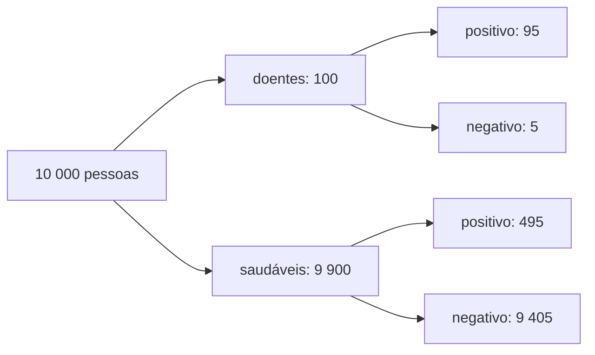

## Passo 1 · Leitura · Regras e independência

Num jogo de tabuleiro fictício, você ganha um bônus se tirar pelo menos um 6 em quatro lançamentos de um dado. Um raciocínio rápido diz: cada lançamento tem chance $1/6$, quatro lançamentos dão $4/6$. Com sete lançamentos, a mesma conta daria $7/6$, mais que 1, o que já mostra que ela está errada.

Quando os resultados são igualmente prováveis, a probabilidade de um evento é uma contagem, como no Nível 3: casos favoráveis sobre casos possíveis. Dois dados somam 7 em 6 dos 36 pares, então $P = 6/36$. Para eventos compostos, três regras resolvem quase tudo:

$$
P(A \cup B) = P(A) + P(B) - P(A \cap B), \qquad P(\bar A) = 1 - P(A)
$$

$$
P(A \cap B) = P(A)\,P(B) \quad \text{quando } A \text{ e } B \text{ são independentes}
$$

A regra da soma só vira $P(A) + P(B)$ quando os eventos são **disjuntos** (não acontecem juntos). "Sair 6 no primeiro lançamento" e "sair 6 no segundo" podem acontecer juntos, e somar conta duas vezes as partidas com dois seis. Por isso a conta $4/6$ erra.

**Independentes** é outra coisa: saber que um aconteceu não muda a chance do outro. Lançamentos de dado são independentes; eventos disjuntos com chance positiva nunca são, porque saber que um aconteceu zera a chance do outro. Para conferir independência numa tabela, compare $P(A \cap B)$ com $P(A)\,P(B)$.

O atalho para "pelo menos um" é o complemento. O contrário de "pelo menos um 6" é "nenhum 6", e como os lançamentos são independentes, a chance de nenhum 6 é o produto $(5/6)^4$:

```python
from fractions import Fraction

p_seis = Fraction(1, 6)
errado = 4 * p_seis               # 2/3: soma eventos que não são disjuntos
certo = 1 - (1 - p_seis) ** 4     # 671/1296, cerca de 0,518
```

O mesmo atalho resolve o **problema do aniversário**: numa sala com $n$ pessoas, qual a chance de duas fazerem aniversário no mesmo dia (ignorando 29 de fevereiro e supondo os 365 dias igualmente prováveis)? O complemento é "todos diferentes": a primeira pessoa tem 365 dias livres, a segunda 364, a terceira 363, e a chance de todos diferentes é o produto $\frac{365}{365} \cdot \frac{364}{365} \cdots \frac{365 - n + 1}{365}$. Com 23 pessoas a resposta já passa de 50 %, bem menos do que a intuição costuma sugerir.

## Passo 2 · Exercício · Pelo menos um seis e aniversários
modo: lacunas

Complete as lacunas (`___`) usando o complemento: calcule a chance de o evento **não** acontecer e subtraia de 1.

### Instruções
1. `prob_pelo_menos_um_seis(n_dados)` devolve, como `float`, a chance de sair pelo menos um 6 em `n_dados` lançamentos independentes de um dado honesto. Com zero lançamentos, a chance é 0.
2. `prob_aniversario_igual(n)` devolve, como `float`, a chance de pelo menos duas de `n` pessoas fazerem aniversário no mesmo dia, com 365 dias igualmente prováveis. Com 366 pessoas ou mais, a chance é 1.

### Código inicial
```python
import math


def prob_pelo_menos_um_seis(n_dados):
    p_nenhum_seis = (___) ** n_dados
    return ___


def prob_aniversario_igual(n):
    p_todos_diferentes = math.prod((365 - k) / 365 for k in range(___))
    return ___
```

### Solução
```python
import math


def prob_pelo_menos_um_seis(n_dados):
    p_nenhum_seis = (5 / 6) ** n_dados
    return 1 - p_nenhum_seis


def prob_aniversario_igual(n):
    p_todos_diferentes = math.prod((365 - k) / 365 for k in range(n))
    return 1 - p_todos_diferentes
```

### Dicas
1. O contrário de "pelo menos um 6" é "nenhum 6"; qual é a chance de um lançamento não dar 6?
2. Na sala, a pessoa de número `k` (contando do zero) precisa evitar os `k` dias já ocupados: o fator é `(365 - k) / 365`, e há um fator por pessoa.
3. As duas funções terminam do mesmo jeito: 1 menos a chance do complemento.

### Verificação
```json
[
  { "id": "seis-1", "checkpoint": 1, "kind": "call", "function": "prob_pelo_menos_um_seis", "args": [1],
    "expected": 0.16666666666666666, "type": "float", "tolerance": 1e-9, "name": "Com um lançamento, a chance é 1/6",
    "hint": "Calcule a chance de não sair 6 e subtraia de 1." },
  { "id": "seis-4", "checkpoint": 1, "kind": "call", "function": "prob_pelo_menos_um_seis", "args": [4],
    "expected": 0.5177469135802469, "tolerance": 1e-9, "name": "Com quatro lançamentos, a chance é cerca de 0,518",
    "hint": "Os lançamentos não são disjuntos: somar as chances conta duas vezes as partidas com mais de um 6." },
  { "id": "seis-10", "checkpoint": 1, "kind": "call", "function": "prob_pelo_menos_um_seis", "args": [10],
    "expected": 0.8384944171101543, "tolerance": 1e-9, "name": "Com dez lançamentos, a chance é cerca de 0,838" },
  { "id": "seis-0", "checkpoint": 1, "kind": "call", "function": "prob_pelo_menos_um_seis", "args": [0],
    "expected": 0.0, "type": "float", "tolerance": 1e-12, "name": "Sem lançamentos, a chance é 0" },
  { "id": "aniv-1", "checkpoint": 2, "kind": "call", "function": "prob_aniversario_igual", "args": [1],
    "expected": 0.0, "type": "float", "tolerance": 1e-12, "name": "Com uma pessoa, a chance é 0" },
  { "id": "aniv-2", "checkpoint": 2, "kind": "call", "function": "prob_aniversario_igual", "args": [2],
    "expected": 0.0027397260273972603, "tolerance": 1e-9, "name": "Com duas pessoas, a chance é 1/365",
    "hint": "Há um fator do produto para cada pessoa da sala." },
  { "id": "aniv-23", "checkpoint": 2, "kind": "call", "function": "prob_aniversario_igual", "args": [23],
    "expected": 0.5072972343239854, "type": "float", "tolerance": 1e-9, "name": "Com 23 pessoas, a chance passa de 50 %",
    "hint": "O complemento é \"todos os aniversários diferentes\"." },
  { "id": "aniv-50", "checkpoint": 2, "kind": "call", "function": "prob_aniversario_igual", "args": [50],
    "expected": 0.9703735795779884, "tolerance": 1e-9, "name": "Com 50 pessoas, a chance é cerca de 0,970" },
  { "id": "aniv-366", "checkpoint": 2, "kind": "call", "function": "prob_aniversario_igual", "args": [366],
    "expected": 1.0, "tolerance": 1e-12, "name": "Com 366 pessoas, a coincidência é certa" }
]
```

### Soluções erradas
```python name="complemento do evento errado"
import math


def prob_pelo_menos_um_seis(n_dados):
    p_nenhum_seis = (1 / 6) ** n_dados
    return 1 - p_nenhum_seis


def prob_aniversario_igual(n):
    p_todos_diferentes = math.prod((365 - k) / 365 for k in range(n))
    return 1 - p_todos_diferentes
```
```python name="esquece o complemento nos dados"
import math


def prob_pelo_menos_um_seis(n_dados):
    p_nenhum_seis = (5 / 6) ** n_dados
    return p_nenhum_seis


def prob_aniversario_igual(n):
    p_todos_diferentes = math.prod((365 - k) / 365 for k in range(n))
    return 1 - p_todos_diferentes
```
```python name="soma as chances de cada lançamento"
import math


def prob_pelo_menos_um_seis(n_dados):
    p_nenhum_seis = (5 / 6) ** n_dados
    return n_dados / 6


def prob_aniversario_igual(n):
    p_todos_diferentes = math.prod((365 - k) / 365 for k in range(n))
    return 1 - p_todos_diferentes
```
```python name="um fator a menos no produto"
import math


def prob_pelo_menos_um_seis(n_dados):
    p_nenhum_seis = (5 / 6) ** n_dados
    return 1 - p_nenhum_seis


def prob_aniversario_igual(n):
    p_todos_diferentes = math.prod((365 - k) / 365 for k in range(n - 1))
    return 1 - p_todos_diferentes
```
```python name="esquece o complemento nos aniversários"
import math


def prob_pelo_menos_um_seis(n_dados):
    p_nenhum_seis = (5 / 6) ** n_dados
    return 1 - p_nenhum_seis


def prob_aniversario_igual(n):
    p_todos_diferentes = math.prod((365 - k) / 365 for k in range(n))
    return p_todos_diferentes
```
```python name="soma as chances de cada par"
import math


def prob_pelo_menos_um_seis(n_dados):
    p_nenhum_seis = (5 / 6) ** n_dados
    return 1 - p_nenhum_seis


def prob_aniversario_igual(n):
    p_todos_diferentes = math.prod((365 - k) / 365 for k in range(n))
    return math.comb(n, 2) / 365
```

## Passo 3 · Leitura · Condicional e Bayes

Um exame fictício detecta uma doença que atinge 1 % da população. Ele acerta 95 % dos doentes (**sensibilidade**) e 95 % dos saudáveis (**especificidade**). Uma pessoa recebe um resultado positivo. Qual a chance de ela estar doente? A resposta mais comum é 95 %. A certa é perto de 16 %.

A **probabilidade condicional** de $A$ dado $B$ é a fração de $B$ em que $A$ também acontece:

$$
P(A \mid B) = \frac{P(A \cap B)}{P(B)}
$$

Os 95 % do exame são $P(+ \mid D)$: entre os doentes, quantos dão positivo. A pergunta é sobre $P(D \mid +)$: entre os positivos, quantos estão doentes. As duas condicionais olham para populações diferentes. Imagine 10 000 pessoas:



São $95 + 495 = 590$ positivos, e só 95 deles estão doentes: $95/590 \approx 0{,}161$. Os falsos positivos vencem porque saem de um grupo 99 vezes maior. O **teorema de Bayes** é essa conta em fórmula, com a **probabilidade total** de dar positivo no denominador:

$$
P(D \mid +) = \frac{P(+ \mid D)\,P(D)}{P(+)}, \qquad P(+) = P(+ \mid D)\,P(D) + P(+ \mid \bar D)\,P(\bar D)
$$

Aqui $P(+ \mid \bar D) = 1 - \text{especificidade}$ é a taxa de falsos positivos. O resultado, chamado de **valor preditivo positivo**, depende da prevalência: o mesmo exame aplicado num grupo em que metade está doente dá 95 %.

```python
prevalencia, sensibilidade, especificidade = 0.01, 0.95, 0.95
positivo = prevalencia * sensibilidade + (1 - prevalencia) * (1 - especificidade)
prevalencia * sensibilidade / positivo     # 0.1610...
```

Trocar $P(A \mid B)$ por $P(B \mid A)$ tem nome: **falácia do promotor**. "Se o réu fosse inocente, a chance de essa evidência aparecer seria de 1 em 1 000; logo, há 99,9 % de chance de ele ser culpado." A primeira frase é $P(\text{evidência} \mid \text{inocente})$; a conclusão é sobre $P(\text{inocente} \mid \text{evidência})$, que depende de quantos inocentes poderiam produzir a mesma evidência. Numa cidade de 1 milhão de pessoas, 1 em 1 000 são mil inocentes compatíveis com ela.

## Passo 4 · Previsão · O valor preditivo positivo

Outro exame fictício: prevalência de 2 %, sensibilidade de 90 % e especificidade de 95 %. O programa conta as pessoas de uma população de 10 000, como na árvore da leitura, e calcula a chance de um positivo estar doente. Digite a saída.

### Código
```python
populacao = 10_000
doentes = populacao * 2 // 100
saudaveis = populacao - doentes
verdadeiros_positivos = doentes * 90 // 100
falsos_positivos = saudaveis * 5 // 100
positivos = verdadeiros_positivos + falsos_positivos

print("doentes:", doentes)
print("verdadeiros positivos:", verdadeiros_positivos)
print("falsos positivos:", falsos_positivos)
print("positivos:", positivos)
print("P(doente | positivo):", round(verdadeiros_positivos / positivos, 3))
```

### Dicas
1. Os falsos positivos saem dos saudáveis: 5 % deles, porque a especificidade é 95 %.
2. A última linha divide os verdadeiros positivos pelo total de positivos; $180/670$ fica entre $1/4$ e $1/3$.

### Saída esperada
```text
doentes: 200
verdadeiros positivos: 180
falsos positivos: 490
positivos: 670
P(doente | positivo): 0.269
```

## Passo 5 · Exercício · Bayes

Escreva as duas contas da leitura como funções: a probabilidade total de um resultado positivo e o valor preditivo positivo.

### Instruções
1. `prob_positivo(prevalencia, sensibilidade, especificidade)` devolve, como `float`, a chance de um resultado positivo: $P(+ \mid D)\,P(D) + P(+ \mid \bar D)\,P(\bar D)$.
2. `bayes(prevalencia, sensibilidade, especificidade)` devolve, como `float`, a chance de estar doente dado um resultado positivo.
3. As duas funções levantam `ValueError` se algum dos três valores estiver fora do intervalo fechado $[0, 1]$ (0 e 1 são válidos).
4. `bayes` levanta `ValueError` quando nenhum resultado positivo é possível ($P(+) = 0$).

### Código inicial
```python
def prob_positivo(prevalencia, sensibilidade, especificidade):
    pass


def bayes(prevalencia, sensibilidade, especificidade):
    pass
```

### Solução
```python
def prob_positivo(prevalencia, sensibilidade, especificidade):
    for valor in (prevalencia, sensibilidade, especificidade):
        if not 0 <= valor <= 1:
            raise ValueError("as probabilidades precisam estar entre 0 e 1")
    return prevalencia * sensibilidade + (1 - prevalencia) * (1 - especificidade)


def bayes(prevalencia, sensibilidade, especificidade):
    positivo = prob_positivo(prevalencia, sensibilidade, especificidade)
    if positivo == 0:
        raise ValueError("nenhum resultado positivo é possível")
    return prevalencia * sensibilidade / positivo
```

### Dicas
1. Os falsos positivos são os saudáveis, $1 - \text{prevalência}$, vezes a taxa de erro neles, $1 - \text{especificidade}$.
2. `bayes` pode chamar `prob_positivo`: o numerador é a parte dos positivos que vem dos doentes.
3. Com prevalência 0 e especificidade 1 ninguém dá positivo, e a divisão não tem sentido.

### Verificação
```json
[
  { "id": "pp-1", "checkpoint": 1, "kind": "call", "function": "prob_positivo", "args": [0.01, 0.95, 0.95],
    "expected": 0.059, "type": "float", "tolerance": 1e-12, "name": "prob_positivo(0.01, 0.95, 0.95) é 0.059",
    "hint": "Some os positivos dos doentes e os falsos positivos dos saudáveis." },
  { "id": "pp-2", "checkpoint": 1, "kind": "call", "function": "prob_positivo", "args": [0.02, 0.9, 0.95],
    "expected": 0.067, "tolerance": 1e-12, "name": "prob_positivo(0.02, 0.9, 0.95) é 0.067" },
  { "id": "b-raro", "checkpoint": 2, "kind": "call", "function": "bayes", "args": [0.01, 0.95, 0.95],
    "expected": 0.16101694915254236, "type": "float", "tolerance": 1e-9,
    "name": "Doença rara: um positivo indica doença em cerca de 16 % dos casos",
    "hint": "A sensibilidade é P(+ | doente); a pergunta é P(doente | +)." },
  { "id": "b-muito-raro", "checkpoint": 2, "kind": "call", "function": "bayes", "args": [0.001, 0.99, 0.98],
    "expected": 0.04721030042918455, "tolerance": 1e-9, "name": "Prevalência de 0,1 %: menos de 5 %" },
  { "id": "b-metade", "checkpoint": 2, "kind": "call", "function": "bayes", "args": [0.5, 0.9, 0.9],
    "expected": 0.9, "tolerance": 1e-9, "name": "Com metade doente, o valor preditivo é 0,9" },
  { "id": "b-sem-doentes", "checkpoint": 2, "kind": "call", "function": "bayes", "args": [0.0, 0.9, 0.95],
    "expected": 0.0, "type": "float", "tolerance": 1e-12, "name": "Sem doentes, todo positivo é falso" },
  { "id": "b-sem-falsos", "checkpoint": 2, "kind": "call", "function": "bayes", "args": [0.01, 0.8, 1.0],
    "expected": 1.0, "tolerance": 1e-12, "name": "Com especificidade 1, todo positivo é verdadeiro" },
  { "id": "b-todos-doentes", "checkpoint": 3, "kind": "call", "function": "bayes", "args": [1.0, 0.9, 0.95],
    "expected": 1.0, "tolerance": 1e-12, "name": "Prevalência 1 é válida e dá 1",
    "hint": "O intervalo é fechado: 0 e 1 são probabilidades válidas." },
  { "id": "pp-fora", "checkpoint": 3, "kind": "expr", "expr": "prob_positivo(0.5, 1.1, 0.9)", "raises": "ValueError",
    "name": "Sensibilidade 1,1 é recusada" },
  { "id": "b-fora", "checkpoint": 3, "kind": "expr", "expr": "bayes(-0.1, 0.9, 0.9)", "raises": "ValueError",
    "name": "Prevalência negativa é recusada" },
  { "id": "b-sem-positivo", "checkpoint": 4, "kind": "expr", "expr": "bayes(0.0, 0.9, 1.0)", "raises": "ValueError",
    "name": "Sem resultado positivo possível, bayes levanta ValueError",
    "hint": "Confira P(+) antes de dividir." }
]
```

### Soluções erradas
```python name="confunde P(+ | doente) com P(doente | +)"
def prob_positivo(prevalencia, sensibilidade, especificidade):
    for valor in (prevalencia, sensibilidade, especificidade):
        if not 0 <= valor <= 1:
            raise ValueError("as probabilidades precisam estar entre 0 e 1")
    return prevalencia * sensibilidade + (1 - prevalencia) * (1 - especificidade)


def bayes(prevalencia, sensibilidade, especificidade):
    positivo = prob_positivo(prevalencia, sensibilidade, especificidade)
    if positivo == 0:
        raise ValueError("nenhum resultado positivo é possível")
    return sensibilidade
```
```python name="falso positivo com a especificidade"
def prob_positivo(prevalencia, sensibilidade, especificidade):
    for valor in (prevalencia, sensibilidade, especificidade):
        if not 0 <= valor <= 1:
            raise ValueError("as probabilidades precisam estar entre 0 e 1")
    return prevalencia * sensibilidade + (1 - prevalencia) * especificidade


def bayes(prevalencia, sensibilidade, especificidade):
    positivo = prob_positivo(prevalencia, sensibilidade, especificidade)
    if positivo == 0:
        raise ValueError("nenhum resultado positivo é possível")
    return prevalencia * sensibilidade / positivo
```
```python name="esquece o peso dos saudáveis"
def prob_positivo(prevalencia, sensibilidade, especificidade):
    for valor in (prevalencia, sensibilidade, especificidade):
        if not 0 <= valor <= 1:
            raise ValueError("as probabilidades precisam estar entre 0 e 1")
    return prevalencia * sensibilidade + (1 - especificidade)


def bayes(prevalencia, sensibilidade, especificidade):
    positivo = prob_positivo(prevalencia, sensibilidade, especificidade)
    if positivo == 0:
        raise ValueError("nenhum resultado positivo é possível")
    return prevalencia * sensibilidade / positivo
```
```python name="divide só pelos falsos positivos"
def prob_positivo(prevalencia, sensibilidade, especificidade):
    for valor in (prevalencia, sensibilidade, especificidade):
        if not 0 <= valor <= 1:
            raise ValueError("as probabilidades precisam estar entre 0 e 1")
    return prevalencia * sensibilidade + (1 - prevalencia) * (1 - especificidade)


def bayes(prevalencia, sensibilidade, especificidade):
    positivo = prob_positivo(prevalencia, sensibilidade, especificidade)
    if positivo == 0:
        raise ValueError("nenhum resultado positivo é possível")
    return prevalencia * sensibilidade / ((1 - prevalencia) * (1 - especificidade))
```
```python name="divide sem conferir P(+)"
def prob_positivo(prevalencia, sensibilidade, especificidade):
    for valor in (prevalencia, sensibilidade, especificidade):
        if not 0 <= valor <= 1:
            raise ValueError("as probabilidades precisam estar entre 0 e 1")
    return prevalencia * sensibilidade + (1 - prevalencia) * (1 - especificidade)


def bayes(prevalencia, sensibilidade, especificidade):
    positivo = prob_positivo(prevalencia, sensibilidade, especificidade)
    return prevalencia * sensibilidade / positivo
```
```python name="intervalo aberto recusa 0 e 1"
def prob_positivo(prevalencia, sensibilidade, especificidade):
    for valor in (prevalencia, sensibilidade, especificidade):
        if not 0 < valor < 1:
            raise ValueError("as probabilidades precisam estar entre 0 e 1")
    return prevalencia * sensibilidade + (1 - prevalencia) * (1 - especificidade)


def bayes(prevalencia, sensibilidade, especificidade):
    positivo = prob_positivo(prevalencia, sensibilidade, especificidade)
    if positivo == 0:
        raise ValueError("nenhum resultado positivo é possível")
    return prevalencia * sensibilidade / positivo
```
```python name="não valida as entradas"
def prob_positivo(prevalencia, sensibilidade, especificidade):
    return prevalencia * sensibilidade + (1 - prevalencia) * (1 - especificidade)


def bayes(prevalencia, sensibilidade, especificidade):
    positivo = prob_positivo(prevalencia, sensibilidade, especificidade)
    if positivo == 0:
        raise ValueError("nenhum resultado positivo é possível")
    return prevalencia * sensibilidade / positivo
```

## Passo 6 · Leitura · Conferir por simulação

Num programa de auditório fictício há três portas: atrás de uma está um carro, atrás das outras, bodes. Você escolhe uma porta. O apresentador, que sabe onde está o carro, abre uma das outras duas e mostra um bode. Depois oferece a troca pela porta que sobrou. Trocar ajuda? Esse é o **problema de Monty Hall**, e a intuição de "agora é 50 %" costuma resistir à conta.

A conta é curta. A primeira escolha acerta o carro com chance $1/3$; nesse caso, trocar perde. Com chance $2/3$ a primeira escolha é um bode; aí o apresentador é obrigado a abrir o outro bode, e a porta que sobra é o carro: trocar ganha. Logo $P(\text{ganhar trocando}) = 2/3$.

Quando um resultado parece contraintuitivo, uma simulação é a segunda opinião. Ela não substitui a conta, mas pega erros de raciocínio e de código. Vetorizada, ela sorteia todos os jogos de uma vez e simula também o apresentador:

```python
rng = np.random.default_rng(7)
n = 100_000
carro = rng.integers(0, 3, size=n)
escolha = rng.integers(0, 3, size=n)
salto = rng.integers(1, 3, size=n)                     # 1 ou 2: qual bode abrir quando há dois
abre = np.where(escolha == carro, (escolha + salto) % 3, 3 - escolha - carro)
troca = 3 - escolha - abre                             # as portas 0, 1 e 2 somam 3
(troca == carro).mean(), (escolha == carro).mean()     # cerca de 0,667 e 0,333
```

Quando a escolha e o carro estão em portas diferentes, a porta aberta é a terceira, `3 - escolha - carro`; quando coincidem, o apresentador sorteia uma das outras duas. Repare que `troca == carro` acontece exatamente quando `escolha != carro`: a simulação confirma o argumento.

O resultado de uma simulação traz o **erro de simulação** da lição de números aleatórios: com $n$ jogos, a taxa estimada oscila em torno de $2/3$ com erro padrão $\sqrt{p(1-p)/n}$. Com 100 000 jogos isso dá cerca de 0,0015; com 30 jogos, 0,086. Trinta jogos com 17 vitórias trocando (0,57) não desmentem a conta nem confirmam o "50 %": é variação esperada. Conclusões fortes pedem $n$ grande, e o erro padrão diz quão grande.

## Passo 7 · Exercício · Monty Hall

Simule o jogo com qualquer número de portas. Com `portas` portas, depois da sua escolha o apresentador abre **todas as outras menos uma**, sempre com bode, e oferece a troca pela porta que ficou fechada.

### Instruções
1. `simular_monty_hall(n, semente, portas=3)` simula `n` jogos com um gerador criado a partir de `semente` e devolve a tupla `(taxa_trocar, taxa_manter)`, com dois `float`: a fração de jogos ganhos por quem sempre troca e por quem sempre mantém a escolha.
2. O carro e a primeira escolha são sorteados entre as portas `0` a `portas - 1`, todas igualmente prováveis.
3. A função não usa o gerador global (`np.random.seed`, `np.random.randint`): a mesma semente sempre dá o mesmo resultado.
4. Não use laço (`for`, `while` ou compreensão).

### Código inicial
```python
import numpy as np


def simular_monty_hall(n, semente, portas=3):
    pass
```

### Solução
```python
import numpy as np


def simular_monty_hall(n, semente, portas=3):
    rng = np.random.default_rng(semente)
    carro = rng.integers(0, portas, size=n)
    escolha = rng.integers(0, portas, size=n)
    ganha_mantendo = escolha == carro
    ganha_trocando = ~ganha_mantendo
    return float(ganha_trocando.mean()), float(ganha_mantendo.mean())
```

### Dicas
1. Com o apresentador abrindo todas as outras portas com bode, a porta que sobra fechada só não é o carro quando a sua escolha era o carro.
2. Sorteie o carro e a escolha de todos os jogos de uma vez, como arrays de tamanho `n`.
3. A média de um array de booleanos é a fração de `True`; converta com `float(...)`.

### Verificação
```json
[
  { "id": "tipos", "checkpoint": 1, "kind": "expr", "setup": "r = simular_monty_hall(100, 1)",
    "expr": "[type(r).__name__, type(r[0]).__name__, type(r[1]).__name__]", "expected": ["tuple", "float", "float"],
    "name": "Devolve uma tupla de dois float", "hint": "A média de um array é um número do numpy; converta com float(...)." },
  { "id": "trocar-3", "checkpoint": 1, "kind": "expr", "expr": "simular_monty_hall(100000, 1)[0]",
    "expected": 0.6666666666666666, "tolerance": 0.0075, "name": "Com três portas, trocar ganha cerca de 2/3 dos jogos",
    "hint": "Trocar ganha exatamente quando a primeira escolha não era o carro." },
  { "id": "manter-3", "checkpoint": 1, "kind": "expr", "expr": "simular_monty_hall(100000, 2)[1]",
    "expected": 0.3333333333333333, "tolerance": 0.0075, "name": "Com três portas, manter ganha cerca de 1/3 dos jogos" },
  { "id": "soma-1", "checkpoint": 1, "kind": "expr", "expr": "bool(abs(sum(simular_monty_hall(1000, 3)) - 1) < 1e-12)",
    "expected": true, "name": "Em cada jogo exatamente uma das estratégias ganha" },
  { "id": "um-jogo", "checkpoint": 1, "kind": "expr", "expr": "simular_monty_hall(1, 4) in [(1.0, 0.0), (0.0, 1.0)]",
    "expected": true, "name": "Com um jogo só, as taxas são 1 e 0" },
  { "id": "dez-portas", "checkpoint": 2, "kind": "expr", "expr": "simular_monty_hall(100000, 5, portas=10)[0]",
    "expected": 0.9, "tolerance": 0.005, "name": "Com dez portas, trocar ganha cerca de 90 % dos jogos",
    "hint": "Use o parâmetro portas no sorteio do carro e da escolha." },
  { "id": "mesma-semente", "checkpoint": 3, "kind": "expr",
    "expr": "simular_monty_hall(500, 6) == simular_monty_hall(500, 6)", "expected": true,
    "name": "Mesma semente, mesmo resultado", "hint": "Crie o gerador dentro da função." },
  { "id": "sementes-diferentes", "checkpoint": 3, "kind": "expr",
    "expr": "simular_monty_hall(500, 6) != simular_monty_hall(500, 7)", "expected": true,
    "name": "Sementes diferentes, resultados diferentes" },
  { "id": "estado-global", "checkpoint": 3, "kind": "expr",
    "setup": "np.random.seed(0)\na = np.random.random()\nnp.random.seed(0)\nr = simular_monty_hall(100, 1)",
    "expr": "np.random.random() == a", "expected": true, "name": "O gerador global do numpy não é tocado" },
  { "id": "sem-for", "checkpoint": 4, "kind": "source", "rule": { "type": "not_uses", "construct": "for" },
    "name": "Sem laço for" },
  { "id": "sem-while", "checkpoint": 4, "kind": "source", "rule": { "type": "not_uses", "construct": "while" },
    "name": "Sem laço while" },
  { "id": "sem-compreensao", "checkpoint": 4, "kind": "source",
    "rule": { "type": "not_uses", "construct": "list_comprehension" }, "name": "Sem compreensão de lista" }
]
```

### Soluções erradas
```python name="troca para uma porta qualquer"
import numpy as np


def simular_monty_hall(n, semente, portas=3):
    rng = np.random.default_rng(semente)
    carro = rng.integers(0, portas, size=n)
    escolha = rng.integers(0, portas, size=n)
    nova = rng.integers(0, portas, size=n)
    return float((nova == carro).mean()), float((escolha == carro).mean())
```
```python name="taxas na ordem trocada"
import numpy as np


def simular_monty_hall(n, semente, portas=3):
    rng = np.random.default_rng(semente)
    carro = rng.integers(0, portas, size=n)
    escolha = rng.integers(0, portas, size=n)
    ganha_mantendo = escolha == carro
    ganha_trocando = ~ganha_mantendo
    return float(ganha_mantendo.mean()), float(ganha_trocando.mean())
```
```python name="ignora o número de portas"
import numpy as np


def simular_monty_hall(n, semente, portas=3):
    rng = np.random.default_rng(semente)
    carro = rng.integers(0, 3, size=n)
    escolha = rng.integers(0, 3, size=n)
    ganha_mantendo = escolha == carro
    ganha_trocando = ~ganha_mantendo
    return float(ganha_trocando.mean()), float(ganha_mantendo.mean())
```
```python name="devolve números do numpy"
import numpy as np


def simular_monty_hall(n, semente, portas=3):
    rng = np.random.default_rng(semente)
    carro = rng.integers(0, portas, size=n)
    escolha = rng.integers(0, portas, size=n)
    ganha_mantendo = escolha == carro
    ganha_trocando = ~ganha_mantendo
    return ganha_trocando.mean(), ganha_mantendo.mean()
```
```python name="gerador global"
import numpy as np


def simular_monty_hall(n, semente, portas=3):
    np.random.seed(semente)
    carro = np.random.randint(0, portas, size=n)
    escolha = np.random.randint(0, portas, size=n)
    ganha_mantendo = escolha == carro
    ganha_trocando = ~ganha_mantendo
    return float(ganha_trocando.mean()), float(ganha_mantendo.mean())
```
```python name="gerador criado fora da função"
import numpy as np

rng = np.random.default_rng(0)


def simular_monty_hall(n, semente, portas=3):
    carro = rng.integers(0, portas, size=n)
    escolha = rng.integers(0, portas, size=n)
    ganha_mantendo = escolha == carro
    ganha_trocando = ~ganha_mantendo
    return float(ganha_trocando.mean()), float(ganha_mantendo.mean())
```
```python name="laço jogo a jogo"
import numpy as np


def simular_monty_hall(n, semente, portas=3):
    rng = np.random.default_rng(semente)
    carro = rng.integers(0, portas, size=n)
    escolha = rng.integers(0, portas, size=n)
    vitorias = 0
    for c, e in zip(carro.tolist(), escolha.tolist()):
        if c == e:
            vitorias += 1
    return 1 - vitorias / n, vitorias / n
```

## Passo 8 · Quiz · Condicional e independência

### Pergunta
Numa padaria fictícia, 40 % dos clientes compram café, 30 % compram pão de queijo e 12 % compram os dois. Comprar café e comprar pão de queijo são eventos independentes?
- [ ] Não, porque 12 % é diferente de 40 % + 30 %
- [ ] Não, porque há clientes que compram os dois, e eventos que acontecem juntos não são independentes
- [x] Sim, porque $0{,}40 \times 0{,}30 = 0{,}12$: entre quem compra pão de queijo, a fração que compra café também é 40 %
- [ ] Não dá para saber sem a probabilidade condicional, que a tabela não informa
> Independência é $P(A \cap B) = P(A)\,P(B)$, e aqui vale: $0{,}4 \cdot 0{,}3 = 0{,}12$. Do mesmo jeito, $P(\text{café} \mid \text{pão}) = 0{,}12/0{,}30 = 0{,}40 = P(\text{café})$, então a condicional sai da própria tabela. A soma $P(A) + P(B)$ é a regra de eventos disjuntos, que não tem nada a ver com independência. E acontecer junto não impede a independência; o que a impede é um evento mudar a chance do outro.

### Pergunta
O alarme de um depósito fictício dispara sem invasão em 1 % das noites e sempre dispara quando há invasão. Invasões acontecem em cerca de 1 noite a cada 10 000. O alarme disparou. O vigia diz: "como o alarme só erra 1 % das vezes, há 99 % de chance de ser invasão". O que está errado?
- [ ] Nada: o alarme acerta 99 % das noites sem invasão, então 99 % dos disparos são invasões
- [x] Ele trocou $P(\text{disparo} \mid \text{sem invasão})$ por $P(\text{sem invasão} \mid \text{disparo})$; em 10 000 noites há cerca de 100 disparos falsos para 1 verdadeiro, então a chance de invasão é perto de 1 %
- [ ] A chance é 50 %, porque o alarme só tem duas explicações possíveis
- [ ] A chance é ainda maior que 99 %, porque invasões são raras e o alarme quase nunca erra
> É a falácia do promotor. Em 10 000 noites, cerca de 9 999 não têm invasão, e 1 % delas, quase 100, disparam o alarme à toa; a única invasão também dispara. Dos ~101 disparos, só 1 é invasão: $P \approx 1/101$. "Duas explicações" não quer dizer chances iguais, e a raridade das invasões puxa a chance para baixo, não para cima.

### Pergunta
Uma colega simulou o problema de Monty Hall com 30 jogos e quem trocou ganhou 17 vezes (0,57). Ela conclui que a resposta $2/3$ está errada e que trocar dá "uns 57 %". O que você diz?
- [ ] Ela está certa: a simulação é mais confiável que a conta
- [ ] O resultado prova que a chance é 50 %, porque 0,57 está mais perto de 0,5 do que de 0,67
- [x] Com 30 jogos o erro padrão é cerca de $\sqrt{(2/3)(1/3)/30} \approx 0{,}086$; 0,57 está a pouco mais de um erro padrão de $2/3$, então a simulação não contradiz a conta. Com 100 000 jogos ela fica a poucos milésimos de 0,667
- [ ] O gerador dela está com defeito, porque uma simulação correta daria exatamente 20 vitórias
> Uma simulação estima com erro, e com 30 jogos o erro é grande: resultados entre 0,49 e 0,84 (dois erros padrão) são esperados. Nenhuma simulação dá exatamente $2/3$ de vitórias; ela chega perto à medida que $n$ cresce, com erro que cai como $1/\sqrt n$. Tirar conclusão forte de 30 jogos, para qualquer lado, é o erro.
