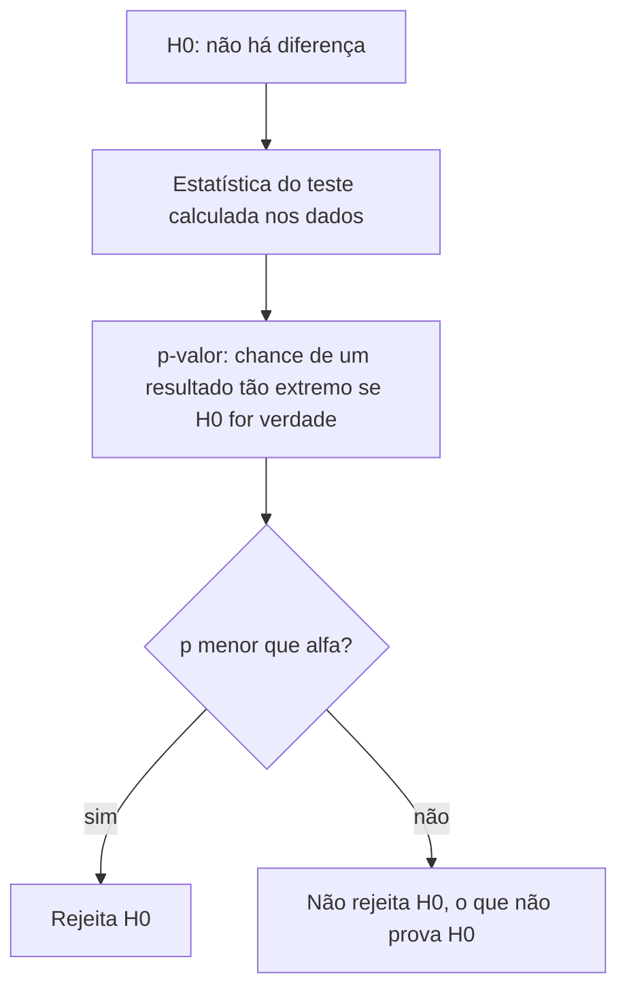

## Passo 1 · Leitura · A lógica do teste

Uma padaria fictícia testou uma receita nova: mediu o tempo de crescimento da massa em 6 fornadas da receita antiga e 7 da nova. A média da nova foi 2,2 minutos maior. Isso mostra que a receita muda o tempo, ou diferenças desse tamanho aparecem por acaso entre fornadas da mesma receita?

O **teste de hipótese** responde com um raciocínio por contradição. Supõe-se a **hipótese nula** $H_0$, "não há diferença entre as receitas", e pergunta-se: se $H_0$ fosse verdade, quão surpreendentes seriam os dados?



O **p-valor** é a probabilidade de obter um resultado pelo menos tão extremo quanto o observado **supondo $H_0$ verdadeira**. Ele **não** é a probabilidade de $H_0$ ser verdadeira. Um p-valor de 0,03 diz: "se as receitas fossem iguais, diferenças assim apareceriam em 3 % das comparações".

Fixa-se antes um limiar $\alpha$, em geral 0,05, e rejeita-se $H_0$ quando $p < \alpha$. Dois erros são possíveis. O **erro tipo I** é rejeitar uma $H_0$ verdadeira, e sua chance é o próprio $\alpha$. O **erro tipo II** é não rejeitar uma $H_0$ falsa, que fica menos provável com mais dados. "Não rejeitar" não é "provar que não há diferença": com poucos dados, um efeito real escapa.

A estatística $t$ divide a diferença das médias pelo seu erro padrão. A versão de **Welch** não supõe variâncias iguais nos dois grupos:

$$
t = \frac{\bar x_A - \bar x_B}{\sqrt{\dfrac{s_A^2}{n_A} + \dfrac{s_B^2}{n_B}}}, \qquad d = \frac{\bar x_A - \bar x_B}{s_p}, \quad s_p = \sqrt{\frac{(n_A - 1)s_A^2 + (n_B - 1)s_B^2}{n_A + n_B - 2}}
$$

O $t$ de **Student** clássico supõe variâncias iguais e, quando elas diferem e os grupos têm tamanhos diferentes, erra o p-valor; o Welch funciona nos dois casos, e por isso é o padrão recomendado. No `scipy`, `stats.ttest_ind(a, b, equal_var=False)` faz o Welch; sem o `equal_var=False`, faz o Student. O teste é **bicaudal** por padrão (`alternative="two-sided"`): procura diferença nos dois sentidos. Um teste unicaudal só se justifica se a direção for decidida antes de ver os dados.

O p-valor depende do tamanho da amostra; o **tamanho de efeito** não. O $d$ de Cohen mede a diferença em desvios padrão: perto de 0,2 é pequeno, 0,5 médio, 0,8 grande.

## Passo 2 · Exercício · Teste t de Welch com efeito
modo: lacunas

Complete as lacunas (`___`) para rodar o teste $t$ de Welch bicaudal e calcular o $d$ de Cohen.

### Instruções
1. `teste_t_duas_amostras(a, b)` roda o teste $t$ de Welch (sem supor variâncias iguais), **bicaudal**, de `a` contra `b`.
2. A função calcula o $d$ de Cohen com o desvio combinado $s_p$ da leitura (desvios amostrais), com o sinal de $\bar x_A - \bar x_B$.
3. Devolve o dicionário `{"t": ..., "p": ..., "d": ...}` com três `float`.

### Código inicial
```python
import numpy as np
from scipy import stats


def teste_t_duas_amostras(a, b):
    a = np.asarray(a, dtype=float)
    b = np.asarray(b, dtype=float)
    resultado = stats.ttest_ind(a, b, equal_var=___, alternative=___)
    na, nb = len(a), len(b)
    s_p = np.sqrt(((na - 1) * a.var(ddof=___) + (nb - 1) * b.var(ddof=1)) / (___))
    d = (___) / s_p
    return {"t": float(resultado.statistic), "p": float(resultado.pvalue), "d": float(d)}
```

### Solução
```python
import numpy as np
from scipy import stats


def teste_t_duas_amostras(a, b):
    a = np.asarray(a, dtype=float)
    b = np.asarray(b, dtype=float)
    resultado = stats.ttest_ind(a, b, equal_var=False, alternative="two-sided")
    na, nb = len(a), len(b)
    s_p = np.sqrt(((na - 1) * a.var(ddof=1) + (nb - 1) * b.var(ddof=1)) / (na + nb - 2))
    d = (a.mean() - b.mean()) / s_p
    return {"t": float(resultado.statistic), "p": float(resultado.pvalue), "d": float(d)}
```

### Dicas
1. O Welch é o teste que **não** supõe variâncias iguais.
2. Bicaudal procura diferença nos dois sentidos.
3. O denominador de $s_p^2$ soma os graus de liberdade dos dois grupos, um a menos de cada lado.

### Verificação
```json
[
  { "id": "chaves", "checkpoint": 3, "kind": "expr",
    "setup": "r = teste_t_duas_amostras([21.0, 23.5, 22.1, 24.8, 22.9, 23.3], [24.2, 25.1, 23.9, 26.4, 25.5, 24.7, 26.0])",
    "expr": "[sorted(r), type(r['t']).__name__, type(r['p']).__name__, type(r['d']).__name__]",
    "expected": [["d", "p", "t"], "float", "float", "float"], "name": "Devolve t, p e d como float" },
  { "id": "receitas", "checkpoint": 1, "kind": "expr",
    "setup": "r = teste_t_duas_amostras([21.0, 23.5, 22.1, 24.8, 22.9, 23.3], [24.2, 25.1, 23.9, 26.4, 25.5, 24.7, 26.0])",
    "expr": "[r['t'], r['p']]", "expected": [-3.4492880876152046, 0.00743609313290341], "tolerance": 1e-9,
    "name": "Receita antiga contra a nova: t e p do Welch bicaudal",
    "hint": "O Student (variâncias iguais) daria p = 0,0046; o unicaudal, outro valor." },
  { "id": "receitas-d", "checkpoint": 2, "kind": "expr",
    "setup": "r = teste_t_duas_amostras([21.0, 23.5, 22.1, 24.8, 22.9, 23.3], [24.2, 25.1, 23.9, 26.4, 25.5, 24.7, 26.0])",
    "expr": "r['d']", "expected": -1.9729320087323095, "tolerance": 1e-9,
    "name": "d de Cohen negativo quando a média de a é menor",
    "hint": "O d mantém o sinal da diferença e usa o desvio combinado com ddof=1." },
  { "id": "invertido", "checkpoint": 1, "kind": "expr",
    "setup": "r = teste_t_duas_amostras([24.2, 25.1, 23.9, 26.4, 25.5, 24.7, 26.0], [21.0, 23.5, 22.1, 24.8, 22.9, 23.3])",
    "expr": "[r['t'], r['p'], r['d']]", "expected": [3.4492880876152046, 0.00743609313290341, 1.9729320087323095],
    "tolerance": 1e-9, "name": "Trocando a ordem, t e d mudam de sinal e p não muda",
    "hint": "No teste bicaudal, o p-valor não depende da ordem dos grupos." },
  { "id": "variancias-diferentes", "checkpoint": 1, "kind": "expr",
    "setup": "r = teste_t_duas_amostras([30, 12, 45, 8, 38], [18, 19, 20, 21, 19, 20, 18, 21, 20, 19, 20, 19])",
    "expr": "[r['t'], r['p']]", "expected": [0.9841828575061157, 0.3805796124328151], "tolerance": 1e-9,
    "name": "Grupo pequeno e espalhado contra grupo grande e concentrado: Welch dá p = 0,38",
    "hint": "Com variâncias tão diferentes, o Student daria p = 0,13: o pressuposto de variâncias iguais falha." },
  { "id": "variancias-diferentes-d", "checkpoint": 2, "kind": "expr",
    "setup": "r = teste_t_duas_amostras([30, 12, 45, 8, 38], [18, 19, 20, 21, 19, 20, 18, 21, 20, 19, 20, 19])",
    "expr": "r['d']", "expected": 0.8485315039510827, "tolerance": 1e-9, "name": "d de Cohen com tamanhos 5 e 12" },
  { "id": "iguais", "checkpoint": 1, "kind": "expr",
    "setup": "r = teste_t_duas_amostras([3.0, 5.0, 4.0, 6.0], [3.0, 5.0, 4.0, 6.0])",
    "expr": "[r['t'], r['p'], r['d']]", "expected": [0.0, 1.0, 0.0], "tolerance": 1e-9,
    "name": "Amostras iguais: t = 0, p = 1 e d = 0" }
]
```

### Soluções erradas
```python name="Student (variâncias iguais)"
import numpy as np
from scipy import stats


def teste_t_duas_amostras(a, b):
    a = np.asarray(a, dtype=float)
    b = np.asarray(b, dtype=float)
    resultado = stats.ttest_ind(a, b, equal_var=True, alternative="two-sided")
    na, nb = len(a), len(b)
    s_p = np.sqrt(((na - 1) * a.var(ddof=1) + (nb - 1) * b.var(ddof=1)) / (na + nb - 2))
    d = (a.mean() - b.mean()) / s_p
    return {"t": float(resultado.statistic), "p": float(resultado.pvalue), "d": float(d)}
```
```python name="unicaudal no lugar de bicaudal"
import numpy as np
from scipy import stats


def teste_t_duas_amostras(a, b):
    a = np.asarray(a, dtype=float)
    b = np.asarray(b, dtype=float)
    resultado = stats.ttest_ind(a, b, equal_var=False, alternative="greater")
    na, nb = len(a), len(b)
    s_p = np.sqrt(((na - 1) * a.var(ddof=1) + (nb - 1) * b.var(ddof=1)) / (na + nb - 2))
    d = (a.mean() - b.mean()) / s_p
    return {"t": float(resultado.statistic), "p": float(resultado.pvalue), "d": float(d)}
```
```python name="desvio populacional em a"
import numpy as np
from scipy import stats


def teste_t_duas_amostras(a, b):
    a = np.asarray(a, dtype=float)
    b = np.asarray(b, dtype=float)
    resultado = stats.ttest_ind(a, b, equal_var=False, alternative="two-sided")
    na, nb = len(a), len(b)
    s_p = np.sqrt(((na - 1) * a.var(ddof=0) + (nb - 1) * b.var(ddof=1)) / (na + nb - 2))
    d = (a.mean() - b.mean()) / s_p
    return {"t": float(resultado.statistic), "p": float(resultado.pvalue), "d": float(d)}
```
```python name="graus de liberdade sem descontar"
import numpy as np
from scipy import stats


def teste_t_duas_amostras(a, b):
    a = np.asarray(a, dtype=float)
    b = np.asarray(b, dtype=float)
    resultado = stats.ttest_ind(a, b, equal_var=False, alternative="two-sided")
    na, nb = len(a), len(b)
    s_p = np.sqrt(((na - 1) * a.var(ddof=1) + (nb - 1) * b.var(ddof=1)) / (na + nb))
    d = (a.mean() - b.mean()) / s_p
    return {"t": float(resultado.statistic), "p": float(resultado.pvalue), "d": float(d)}
```
```python name="d sem sinal"
import numpy as np
from scipy import stats


def teste_t_duas_amostras(a, b):
    a = np.asarray(a, dtype=float)
    b = np.asarray(b, dtype=float)
    resultado = stats.ttest_ind(a, b, equal_var=False, alternative="two-sided")
    na, nb = len(a), len(b)
    s_p = np.sqrt(((na - 1) * a.var(ddof=1) + (nb - 1) * b.var(ddof=1)) / (na + nb - 2))
    d = (abs(a.mean() - b.mean())) / s_p
    return {"t": float(resultado.statistic), "p": float(resultado.pvalue), "d": float(d)}
```

## Passo 3 · Leitura · Pareado, qui-quadrado e o teste A/B

Nem toda comparação é entre grupos independentes. Uma escola fictícia de digitação mediu a velocidade de 8 alunos antes e depois de um curso. Cada aluno aparece duas vezes, e alunos rápidos continuam rápidos: as duas medidas de um aluno estão ligadas. O **teste $t$ pareado** usa essa ligação: calcula a diferença $d_i = \text{depois}_i - \text{antes}_i$ de cada aluno e testa se a média das diferenças é zero, com $t = \bar d / (s_d / \sqrt n)$ e $n - 1$ graus de liberdade.

```python
antes = [82, 75, 91, 68, 77, 85, 72, 80]
depois = [85, 79, 92, 74, 78, 90, 75, 83]
stats.ttest_rel(depois, antes)       # t = 5.25, p = 0.0012
stats.ttest_ind(depois, antes)       # p = 0.37: trata como grupos independentes
```

Os mesmos números dão p = 0,0012 no teste certo e 0,37 no errado. Tratados como independentes, a grande diferença **entre** alunos (de 68 a 91) entra no erro e esconde a melhora pequena e consistente **dentro** de cada aluno. A ordem dos argumentos define o sinal: `ttest_rel(depois, antes)` dá $t$ positivo quando houve aumento.

Para variáveis categóricas, como "converteu ou não", a ferramenta é o **qui-quadrado de independência**. Num teste A/B de um site fictício, a versão A teve 120 compras em 1 000 visitas e a B, 150 em 1 000. Monta-se a tabela de contingência com **sucessos e fracassos** (não sucessos e totais), e o teste compara cada contagem observada $O$ com a esperada $E$ se a taxa fosse a mesma nos dois grupos:

$$
\chi^2 = \sum \frac{(O - E)^2}{E}, \qquad E = \frac{\text{total da linha} \cdot \text{total da coluna}}{\text{total geral}}
$$

```python
tabela = [[120, 880], [150, 850]]
res = stats.chi2_contingency(tabela)
res.statistic, res.pvalue            # 3.60, 0.0577
res.expected_freq.min()              # 135.0
```

Numa tabela 2 × 2, o `chi2_contingency` aplica por padrão a **correção de continuidade de Yates**, que deixa o teste um pouco mais conservador. Sem ela (`correction=False`), o mesmo teste dá p = 0,0496. Um resultado tão perto de 0,05 que muda de lado com uma escolha técnica deve ser relatado como evidência fraca, não como "funcionou" ou "não funcionou".

A aproximação do qui-quadrado vale quando as frequências esperadas não são pequenas; a regra usual pede todas pelo menos 5. Com 2 de 20 contra 5 de 20, a menor esperada é 3,5, e o p-valor do qui-quadrado não é confiável; para tabelas assim, use o teste exato de Fisher (`stats.fisher_exact`).

## Passo 4 · Exercício · Antes e depois, A e B

Escreva o teste pareado e o teste A/B da leitura, com as conferências.

### Instruções
1. `teste_pareado(antes, depois)` roda o teste $t$ pareado das diferenças `depois - antes` e devolve `{"t": ..., "p": ..., "media_diferenca": ...}` com três `float` (o `t` é positivo quando os valores aumentam).
2. `teste_ab(conversoes_a, n_a, conversoes_b, n_b)` monta a tabela 2 × 2 de sucessos e fracassos, roda o `chi2_contingency` com a correção padrão e devolve `{"qui2": ..., "p": ..., "taxa_a": ..., "taxa_b": ...}` com quatro `float`.
3. `teste_ab` levanta `ValueError` se alguma frequência esperada for menor que 5.

### Código inicial
```python
import numpy as np
from scipy import stats


def teste_pareado(antes, depois):
    pass


def teste_ab(conversoes_a, n_a, conversoes_b, n_b):
    pass
```

### Solução
```python
import numpy as np
from scipy import stats


def teste_pareado(antes, depois):
    antes = np.asarray(antes, dtype=float)
    depois = np.asarray(depois, dtype=float)
    resultado = stats.ttest_rel(depois, antes)
    return {
        "t": float(resultado.statistic),
        "p": float(resultado.pvalue),
        "media_diferenca": float((depois - antes).mean()),
    }


def teste_ab(conversoes_a, n_a, conversoes_b, n_b):
    tabela = [[conversoes_a, n_a - conversoes_a], [conversoes_b, n_b - conversoes_b]]
    resultado = stats.chi2_contingency(tabela)
    if resultado.expected_freq.min() < 5:
        raise ValueError("frequência esperada menor que 5: use o teste exato de Fisher")
    return {
        "qui2": float(resultado.statistic),
        "p": float(resultado.pvalue),
        "taxa_a": conversoes_a / n_a,
        "taxa_b": conversoes_b / n_b,
    }
```

### Dicas
1. O pareado compara cada medida com a sua par, não os dois grupos inteiros.
2. Cada linha da tabela é um grupo; as colunas são "converteu" e "não converteu".
3. O resultado do `chi2_contingency` traz as frequências esperadas em `expected_freq`.

### Verificação
```json
[
  { "id": "pareado-digitacao", "checkpoint": 1, "kind": "expr",
    "setup": "r = teste_pareado([82, 75, 91, 68, 77, 85, 72, 80], [85, 79, 92, 74, 78, 90, 75, 83])",
    "expr": "[r['t'], r['p'], r['media_diferenca']]", "expected": [5.245152801108538, 0.0011925186213417134, 3.25],
    "tolerance": 1e-9, "name": "Digitação antes e depois: t = 5,25 e p = 0,0012",
    "hint": "As medidas são do mesmo aluno: o teste é o pareado (ttest_rel)." },
  { "id": "pareado-queda", "checkpoint": 1, "kind": "expr",
    "setup": "r = teste_pareado([10, 12, 9, 11], [9, 10, 9, 10])",
    "expr": "[r['t'], r['media_diferenca']]", "expected": [-2.449489742783178, -1.0], "tolerance": 1e-9,
    "name": "Quando os valores caem, t e a diferença média são negativos",
    "hint": "A diferença é depois menos antes; a ordem dos argumentos do ttest_rel define o sinal." },
  { "id": "pareado-tipos", "checkpoint": 1, "kind": "expr", "setup": "r = teste_pareado([1, 2, 3], [2, 4, 5])",
    "expr": "sorted((k, type(v).__name__) for k, v in r.items())",
    "expected": [["media_diferenca", "float"], ["p", "float"], ["t", "float"]], "name": "teste_pareado devolve três float" },
  { "id": "ab-site", "checkpoint": 2, "kind": "expr", "setup": "r = teste_ab(120, 1000, 150, 1000)",
    "expr": "[r['qui2'], r['p'], r['taxa_a'], r['taxa_b']]",
    "expected": [3.6009419824448727, 0.057746841509689, 0.12, 0.15], "tolerance": 1e-9,
    "name": "120 de 1 000 contra 150 de 1 000: qui² = 3,60 e p = 0,058 com a correção de Yates",
    "hint": "A tabela tem sucessos e fracassos, e a correção padrão fica ligada." },
  { "id": "ab-tamanhos", "checkpoint": 2, "kind": "expr", "setup": "r = teste_ab(45, 500, 30, 520)",
    "expr": "[r['qui2'], r['p']]", "expected": [3.4457816849816854, 0.06341341859271611], "tolerance": 1e-9,
    "name": "Grupos de tamanhos diferentes" },
  { "id": "ab-tipos", "checkpoint": 2, "kind": "expr", "setup": "r = teste_ab(120, 1000, 150, 1000)",
    "expr": "sorted((k, type(v).__name__) for k, v in r.items())",
    "expected": [["p", "float"], ["qui2", "float"], ["taxa_a", "float"], ["taxa_b", "float"]],
    "name": "teste_ab devolve quatro float" },
  { "id": "ab-esperada-baixa", "checkpoint": 3, "kind": "expr", "expr": "teste_ab(2, 20, 5, 20)", "raises": "ValueError",
    "name": "Frequência esperada abaixo de 5 é recusada", "hint": "Confira resultado.expected_freq antes de devolver." }
]
```

### Soluções erradas
```python name="trata como grupos independentes"
import numpy as np
from scipy import stats


def teste_pareado(antes, depois):
    antes = np.asarray(antes, dtype=float)
    depois = np.asarray(depois, dtype=float)
    resultado = stats.ttest_ind(depois, antes)
    return {
        "t": float(resultado.statistic),
        "p": float(resultado.pvalue),
        "media_diferenca": float((depois - antes).mean()),
    }


def teste_ab(conversoes_a, n_a, conversoes_b, n_b):
    tabela = [[conversoes_a, n_a - conversoes_a], [conversoes_b, n_b - conversoes_b]]
    resultado = stats.chi2_contingency(tabela)
    if resultado.expected_freq.min() < 5:
        raise ValueError("frequência esperada menor que 5: use o teste exato de Fisher")
    return {
        "qui2": float(resultado.statistic),
        "p": float(resultado.pvalue),
        "taxa_a": conversoes_a / n_a,
        "taxa_b": conversoes_b / n_b,
    }
```
```python name="ordem trocada no ttest_rel"
import numpy as np
from scipy import stats


def teste_pareado(antes, depois):
    antes = np.asarray(antes, dtype=float)
    depois = np.asarray(depois, dtype=float)
    resultado = stats.ttest_rel(antes, depois)
    return {
        "t": float(resultado.statistic),
        "p": float(resultado.pvalue),
        "media_diferenca": float((depois - antes).mean()),
    }


def teste_ab(conversoes_a, n_a, conversoes_b, n_b):
    tabela = [[conversoes_a, n_a - conversoes_a], [conversoes_b, n_b - conversoes_b]]
    resultado = stats.chi2_contingency(tabela)
    if resultado.expected_freq.min() < 5:
        raise ValueError("frequência esperada menor que 5: use o teste exato de Fisher")
    return {
        "qui2": float(resultado.statistic),
        "p": float(resultado.pvalue),
        "taxa_a": conversoes_a / n_a,
        "taxa_b": conversoes_b / n_b,
    }
```
```python name="tabela com totais no lugar dos fracassos"
import numpy as np
from scipy import stats


def teste_pareado(antes, depois):
    antes = np.asarray(antes, dtype=float)
    depois = np.asarray(depois, dtype=float)
    resultado = stats.ttest_rel(depois, antes)
    return {
        "t": float(resultado.statistic),
        "p": float(resultado.pvalue),
        "media_diferenca": float((depois - antes).mean()),
    }


def teste_ab(conversoes_a, n_a, conversoes_b, n_b):
    tabela = [[conversoes_a, n_a], [conversoes_b, n_b]]
    resultado = stats.chi2_contingency(tabela)
    if resultado.expected_freq.min() < 5:
        raise ValueError("frequência esperada menor que 5: use o teste exato de Fisher")
    return {
        "qui2": float(resultado.statistic),
        "p": float(resultado.pvalue),
        "taxa_a": conversoes_a / n_a,
        "taxa_b": conversoes_b / n_b,
    }
```
```python name="sem a correção de Yates"
import numpy as np
from scipy import stats


def teste_pareado(antes, depois):
    antes = np.asarray(antes, dtype=float)
    depois = np.asarray(depois, dtype=float)
    resultado = stats.ttest_rel(depois, antes)
    return {
        "t": float(resultado.statistic),
        "p": float(resultado.pvalue),
        "media_diferenca": float((depois - antes).mean()),
    }


def teste_ab(conversoes_a, n_a, conversoes_b, n_b):
    tabela = [[conversoes_a, n_a - conversoes_a], [conversoes_b, n_b - conversoes_b]]
    resultado = stats.chi2_contingency(tabela, correction=False)
    if resultado.expected_freq.min() < 5:
        raise ValueError("frequência esperada menor que 5: use o teste exato de Fisher")
    return {
        "qui2": float(resultado.statistic),
        "p": float(resultado.pvalue),
        "taxa_a": conversoes_a / n_a,
        "taxa_b": conversoes_b / n_b,
    }
```
```python name="não confere a frequência esperada"
import numpy as np
from scipy import stats


def teste_pareado(antes, depois):
    antes = np.asarray(antes, dtype=float)
    depois = np.asarray(depois, dtype=float)
    resultado = stats.ttest_rel(depois, antes)
    return {
        "t": float(resultado.statistic),
        "p": float(resultado.pvalue),
        "media_diferenca": float((depois - antes).mean()),
    }


def teste_ab(conversoes_a, n_a, conversoes_b, n_b):
    tabela = [[conversoes_a, n_a - conversoes_a], [conversoes_b, n_b - conversoes_b]]
    resultado = stats.chi2_contingency(tabela)
    return {
        "qui2": float(resultado.statistic),
        "p": float(resultado.pvalue),
        "taxa_a": conversoes_a / n_a,
        "taxa_b": conversoes_b / n_b,
    }
```
```python name="confere a frequência observada"
import numpy as np
from scipy import stats


def teste_pareado(antes, depois):
    antes = np.asarray(antes, dtype=float)
    depois = np.asarray(depois, dtype=float)
    resultado = stats.ttest_rel(depois, antes)
    return {
        "t": float(resultado.statistic),
        "p": float(resultado.pvalue),
        "media_diferenca": float((depois - antes).mean()),
    }


def teste_ab(conversoes_a, n_a, conversoes_b, n_b):
    tabela = [[conversoes_a, n_a - conversoes_a], [conversoes_b, n_b - conversoes_b]]
    resultado = stats.chi2_contingency(tabela)
    if min(conversoes_a, conversoes_b) < 1:
        raise ValueError("frequência esperada menor que 5: use o teste exato de Fisher")
    return {
        "qui2": float(resultado.statistic),
        "p": float(resultado.pvalue),
        "taxa_a": conversoes_a / n_a,
        "taxa_b": conversoes_b / n_b,
    }
```

## Passo 5 · Previsão · Vinte testes sem efeito

Uma equipe fictícia testou 20 variações de um site contra o original, e nenhuma muda nada de verdade. Cada teste, isolado, tem chance $\alpha = 0{,}05$ de dar um falso positivo. O programa calcula quantos falsos positivos se esperam, a chance de aparecer pelo menos um, o limiar corrigido por Bonferroni e a chance de pelo menos um falso positivo com esse limiar. Digite a saída.

### Código
```python
alfa = 0.05
m = 20

print(round(m * alfa, 2))
print(round(1 - (1 - alfa) ** m, 3))
print(round(alfa / m, 4))
print(round(1 - (1 - alfa / m) ** m, 3))
```

### Dicas
1. "Pelo menos um" é o complemento de "nenhum", como na m6-01, e os testes são independentes.
2. $0{,}95^{20} \approx 0{,}358$.
3. $0{,}9975^{20} \approx 0{,}9512$.

### Saída esperada
```text
1.0
0.642
0.0025
0.049
```

## Passo 6 · Leitura · Poder, múltiplas comparações e tamanho de efeito

A Previsão mostrou o problema das **múltiplas comparações**: com 20 testes sem efeito nenhum, a chance de ao menos um "significativo" é de 64 %. Quem roda muitos testes e relata só o que deu $p < 0{,}05$ está relatando ruído. A versão mais comum disso tem nome, **p-hacking**: testar várias métricas, subgrupos ou recortes até algum passar. A correção de **Bonferroni** divide o limiar pelo número de testes:

$$
\text{rejeita } H_0^{(i)} \ \text{ quando } \ p_i \le \frac{\alpha}{m}
$$

Com $m = 20$, cada teste precisa de $p \le 0{,}0025$, e a chance de algum falso positivo volta para menos de 5 %. O preço é perder **poder**: fica mais difícil detectar um efeito real.

O **poder** é a chance de o teste rejeitar $H_0$ quando existe um efeito de verdade, $1 - P(\text{erro tipo II})$. Ele cresce com o tamanho do efeito, com $n$ e com $\alpha$. O jeito mais direto de calculá-lo é simular: gerar muitos pares de amostras com uma diferença conhecida, testar cada par e contar quantas vezes $p < \alpha$. Com a forma `(repeticoes, n)`, o `ttest_ind` testa todas as linhas de uma vez com `axis=1`:

```python
rng = np.random.default_rng(1)
a = rng.normal(0, 10, size=(5000, 64))
b = rng.normal(5, 10, size=(5000, 64))       # diferença de 5, d = 0,5
p = stats.ttest_ind(b, a, axis=1, equal_var=False).pvalue
(p < 0.05).mean()                             # 0.81
```

Com 64 por grupo e $d = 0{,}5$, o poder é cerca de 80 %, a meta usual no planejamento de estudos; a conta teórica, pela distribuição $t$ não central, dá 0,80. Sem o `axis=1`, o padrão `axis=0` testaria as **colunas**, cada uma com 5 000 valores, e o "poder" sairia quase 1.

Do outro lado está a **significância prática**. Com um milhão de visitas por grupo, uma diferença de conversão de 5,00 % para 5,05 % dá p-valor minúsculo; o efeito continua irrelevante para o negócio. O p-valor responde "dá para distinguir do zero?", o tamanho de efeito responde "quanto?". Um relatório completo traz a diferença (ou o $d$ de Cohen), o intervalo de confiança dela e o p-valor, e diz quantos testes foram feitos.

## Passo 7 · Exercício · Bonferroni e poder

Aplique a correção de Bonferroni a uma lista de p-valores e estime o poder de um teste $t$ por simulação.

### Instruções
1. `corrigir_bonferroni(p_valores, alpha=0.05)` devolve uma lista de `bool`, um por p-valor, `True` quando o teste é rejeitado: $p_i \le \alpha/m$, com $m$ o número de p-valores. Uma lista vazia dá lista vazia.
2. `poder_simulado(diferenca, sigma, n, alpha, repeticoes, semente)` sorteia, com um gerador criado a partir de `semente`, `repeticoes` pares de amostras de tamanho `n`: o grupo A de uma normal com média 0 e o grupo B de uma normal com média `diferenca`, ambos com desvio `sigma`. Roda o teste $t$ de Welch **bicaudal** em cada par e devolve, como `float`, a fração com p-valor menor que `alpha`.
3. As funções não usam o gerador global, e `poder_simulado` não usa laço (`for`, `while` ou compreensão).

### Código inicial
```python
import numpy as np
from scipy import stats


def corrigir_bonferroni(p_valores, alpha=0.05):
    pass


def poder_simulado(diferenca, sigma, n, alpha, repeticoes, semente):
    pass
```

### Solução
```python
import numpy as np
from scipy import stats


def corrigir_bonferroni(p_valores, alpha=0.05):
    p = np.asarray(p_valores, dtype=float)
    return (p <= alpha / len(p)).tolist() if len(p) else []


def poder_simulado(diferenca, sigma, n, alpha, repeticoes, semente):
    rng = np.random.default_rng(semente)
    a = rng.normal(0, sigma, size=(repeticoes, n))
    b = rng.normal(diferenca, sigma, size=(repeticoes, n))
    p = stats.ttest_ind(b, a, axis=1, equal_var=False).pvalue
    return float((p < alpha).mean())
```

### Dicas
1. O limiar de cada teste é o $\alpha$ dividido pelo número de testes, e o limite exato também rejeita.
2. Com a forma `(repeticoes, n)`, cada linha é uma amostra; diga ao `ttest_ind` para testar ao longo das linhas.
3. A fração de rejeições é a média de um array de booleanos.

### Verificação
```json
[
  { "id": "bonf-cinco", "checkpoint": 1, "kind": "call", "function": "corrigir_bonferroni",
    "args": [[0.001, 0.02, 0.009, 0.3, 0.04]], "expected": [true, false, true, false, false], "type": "list",
    "name": "Cinco testes: o limiar é 0,01", "hint": "Divida o alpha pelo número de testes." },
  { "id": "bonf-limite", "checkpoint": 1, "kind": "call", "function": "corrigir_bonferroni",
    "args": [[0.01, 0.2, 0.5, 0.7, 0.9]], "expected": [true, false, false, false, false],
    "name": "p igual ao limiar corrigido é rejeitado", "hint": "A regra é p ≤ α/m." },
  { "id": "bonf-alpha", "checkpoint": 1, "kind": "call", "function": "corrigir_bonferroni", "args": [[0.004, 0.006]],
    "kwargs": { "alpha": 0.01 }, "expected": [true, false], "name": "Com alpha = 0,01 e dois testes, o limiar é 0,005" },
  { "id": "bonf-um", "checkpoint": 1, "kind": "call", "function": "corrigir_bonferroni", "args": [[0.04]],
    "expected": [true], "name": "Um teste só: o limiar é o próprio alpha" },
  { "id": "bonf-vazio", "checkpoint": 1, "kind": "call", "function": "corrigir_bonferroni", "args": [[]],
    "expected": [], "type": "list", "name": "Lista vazia dá lista vazia" },
  { "id": "poder-meio", "checkpoint": 2, "kind": "call", "function": "poder_simulado", "args": [5, 10, 64, 0.05, 5000, 1],
    "expected": 0.8014595579222541, "type": "float", "tolerance": 0.0283,
    "name": "d = 0,5 com 64 por grupo: poder perto de 0,80",
    "hint": "Teste bicaudal, uma linha por repetição (axis=1)." },
  { "id": "poder-sem-efeito", "checkpoint": 2, "kind": "call", "function": "poder_simulado",
    "args": [0, 10, 30, 0.05, 5000, 2], "expected": 0.05, "tolerance": 0.0154,
    "name": "Sem efeito, a taxa de rejeição é o alpha" },
  { "id": "poder-grande", "checkpoint": 2, "kind": "call", "function": "poder_simulado",
    "args": [10, 10, 20, 0.05, 10000, 3], "expected": 0.8689530277239899, "tolerance": 0.0169,
    "name": "d = 1 com 20 por grupo: poder perto de 0,87" },
  { "id": "poder-alpha", "checkpoint": 2, "kind": "call", "function": "poder_simulado",
    "args": [5, 10, 64, 0.01, 5000, 4], "expected": 0.5852510203720295, "tolerance": 0.0349,
    "name": "Com alpha = 0,01 o poder cai para perto de 0,59", "hint": "Use o alpha recebido." },
  { "id": "poder-semente", "checkpoint": 3, "kind": "expr",
    "expr": "[poder_simulado(3, 10, 30, 0.05, 2000, 5) == poder_simulado(3, 10, 30, 0.05, 2000, 5), poder_simulado(3, 10, 30, 0.05, 2000, 5) != poder_simulado(3, 10, 30, 0.05, 2000, 6)]",
    "expected": [true, true], "name": "Mesma semente repete; outra semente muda" },
  { "id": "estado-global", "checkpoint": 3, "kind": "expr",
    "setup": "np.random.seed(0)\na = np.random.random()\nnp.random.seed(0)\nr = poder_simulado(1, 1, 5, 0.05, 100, 1)",
    "expr": "np.random.random() == a", "expected": true, "name": "O gerador global do numpy não é tocado" },
  { "id": "sem-for", "checkpoint": 3, "kind": "source", "rule": { "type": "not_uses", "construct": "for" },
    "name": "Sem laço for" }
]
```

### Soluções erradas
```python name="multiplica o alpha em vez de dividir"
import numpy as np
from scipy import stats


def corrigir_bonferroni(p_valores, alpha=0.05):
    p = np.asarray(p_valores, dtype=float)
    return (p <= alpha * len(p)).tolist() if len(p) else []


def poder_simulado(diferenca, sigma, n, alpha, repeticoes, semente):
    rng = np.random.default_rng(semente)
    a = rng.normal(0, sigma, size=(repeticoes, n))
    b = rng.normal(diferenca, sigma, size=(repeticoes, n))
    p = stats.ttest_ind(b, a, axis=1, equal_var=False).pvalue
    return float((p < alpha).mean())
```
```python name="sem correção"
import numpy as np
from scipy import stats


def corrigir_bonferroni(p_valores, alpha=0.05):
    p = np.asarray(p_valores, dtype=float)
    return (p <= alpha).tolist() if len(p) else []


def poder_simulado(diferenca, sigma, n, alpha, repeticoes, semente):
    rng = np.random.default_rng(semente)
    a = rng.normal(0, sigma, size=(repeticoes, n))
    b = rng.normal(diferenca, sigma, size=(repeticoes, n))
    p = stats.ttest_ind(b, a, axis=1, equal_var=False).pvalue
    return float((p < alpha).mean())
```
```python name="limite exato não rejeita"
import numpy as np
from scipy import stats


def corrigir_bonferroni(p_valores, alpha=0.05):
    p = np.asarray(p_valores, dtype=float)
    return (p < alpha / len(p)).tolist() if len(p) else []


def poder_simulado(diferenca, sigma, n, alpha, repeticoes, semente):
    rng = np.random.default_rng(semente)
    a = rng.normal(0, sigma, size=(repeticoes, n))
    b = rng.normal(diferenca, sigma, size=(repeticoes, n))
    p = stats.ttest_ind(b, a, axis=1, equal_var=False).pvalue
    return float((p < alpha).mean())
```
```python name="teste unicaudal"
import numpy as np
from scipy import stats


def corrigir_bonferroni(p_valores, alpha=0.05):
    p = np.asarray(p_valores, dtype=float)
    return (p <= alpha / len(p)).tolist() if len(p) else []


def poder_simulado(diferenca, sigma, n, alpha, repeticoes, semente):
    rng = np.random.default_rng(semente)
    a = rng.normal(0, sigma, size=(repeticoes, n))
    b = rng.normal(diferenca, sigma, size=(repeticoes, n))
    p = stats.ttest_ind(b, a, axis=1, equal_var=False, alternative="greater").pvalue
    return float((p < alpha).mean())
```
```python name="testa as colunas (axis padrão)"
import numpy as np
from scipy import stats


def corrigir_bonferroni(p_valores, alpha=0.05):
    p = np.asarray(p_valores, dtype=float)
    return (p <= alpha / len(p)).tolist() if len(p) else []


def poder_simulado(diferenca, sigma, n, alpha, repeticoes, semente):
    rng = np.random.default_rng(semente)
    a = rng.normal(0, sigma, size=(repeticoes, n))
    b = rng.normal(diferenca, sigma, size=(repeticoes, n))
    p = stats.ttest_ind(b, a, equal_var=False).pvalue
    return float((p < alpha).mean())
```
```python name="alpha fixo em 0,05"
import numpy as np
from scipy import stats


def corrigir_bonferroni(p_valores, alpha=0.05):
    p = np.asarray(p_valores, dtype=float)
    return (p <= alpha / len(p)).tolist() if len(p) else []


def poder_simulado(diferenca, sigma, n, alpha, repeticoes, semente):
    rng = np.random.default_rng(semente)
    a = rng.normal(0, sigma, size=(repeticoes, n))
    b = rng.normal(diferenca, sigma, size=(repeticoes, n))
    p = stats.ttest_ind(b, a, axis=1, equal_var=False).pvalue
    return float((p < 0.05).mean())
```
```python name="gerador global"
import numpy as np
from scipy import stats


def corrigir_bonferroni(p_valores, alpha=0.05):
    p = np.asarray(p_valores, dtype=float)
    return (p <= alpha / len(p)).tolist() if len(p) else []


def poder_simulado(diferenca, sigma, n, alpha, repeticoes, semente):
    np.random.seed(semente)
    a = np.random.normal(0, sigma, size=(repeticoes, n))
    b = np.random.normal(diferenca, sigma, size=(repeticoes, n))
    p = stats.ttest_ind(b, a, axis=1, equal_var=False).pvalue
    return float((p < alpha).mean())
```
```python name="laço nas repetições"
import numpy as np
from scipy import stats


def corrigir_bonferroni(p_valores, alpha=0.05):
    p = np.asarray(p_valores, dtype=float)
    return (p <= alpha / len(p)).tolist() if len(p) else []


def poder_simulado(diferenca, sigma, n, alpha, repeticoes, semente):
    rng = np.random.default_rng(semente)
    rejeicoes = 0
    for _ in range(repeticoes):
        a = rng.normal(0, sigma, size=n)
        b = rng.normal(diferenca, sigma, size=n)
        if stats.ttest_ind(b, a, equal_var=False).pvalue < alpha:
            rejeicoes += 1
    return rejeicoes / repeticoes
```

## Passo 8 · Quiz · O que o p-valor diz

### Pergunta
Um teste A/B fictício comparou dois botões e deu p = 0,03. Qual frase está correta?
- [ ] Há 3 % de chance de a hipótese nula (os botões são iguais) ser verdadeira
- [ ] Há 97 % de chance de o botão novo ser melhor
- [x] Se os botões fossem iguais, uma diferença pelo menos tão grande quanto a observada apareceria em cerca de 3 % dos testes
- [ ] O efeito do botão novo é pequeno, porque o p-valor é pequeno
> O p-valor é calculado supondo $H_0$ verdadeira: é $P(\text{dados tão extremos} \mid H_0)$, não $P(H_0 \mid \text{dados})$, a mesma troca da falácia do promotor da m6-01. A chance de o botão novo ser melhor não sai do p-valor. E p-valor pequeno não diz nada sobre o tamanho do efeito: com amostras enormes, efeitos minúsculos dão p pequeno.

### Pergunta
Uma loja virtual fictícia testou 2 milhões de visitas por versão. A conversão passou de 5,00 % para 5,05 %, com p = 0,001. O gerente quer anunciar "a versão nova aumenta muito as vendas". O que você diz?
- [ ] Está certo: p = 0,001 é um resultado muito forte, então o efeito é grande
- [x] A diferença é estatisticamente clara, mas pequena: 0,05 ponto percentual, cerca de 1 % a mais de conversões. Relate a diferença com o seu intervalo de confiança e decida se ela compensa o custo da mudança
- [ ] O resultado é suspeito: com amostras grandes o p-valor deveria ser maior
- [ ] O teste não vale porque a conversão é uma proporção, e proporções não têm p-valor
> Com $n$ enorme, o erro padrão fica minúsculo, e qualquer diferença, por menor que seja, vira "significativa". Significância estatística diz que a diferença provavelmente não é zero; significância prática pergunta se ela importa, e quem responde é o tamanho do efeito. Amostras grandes dão p-valores **menores** para o mesmo efeito, e proporções têm testes próprios, como o qui-quadrado.

### Pergunta
Um analista fictício comparou dois grupos em 20 métricas diferentes. Uma delas deu p = 0,04 e as outras não. Ele escreve no relatório: "o grupo B tem tempo de sessão significativamente maior (p = 0,04)". Qual é o problema?
- [ ] Nenhum, desde que o teste usado tenha sido o de Welch
- [ ] O certo seria um teste unicaudal, que daria p = 0,02 e um resultado mais forte
- [ ] O relatório deveria citar as 19 métricas como prova de que não há diferença nelas
- [x] Com 20 testes, a chance de ao menos um $p < 0{,}05$ sem efeito nenhum é de cerca de 64 %. Pela correção de Bonferroni o limiar seria 0,0025, e 0,04 não passa; o relatório também precisa dizer que 20 métricas foram testadas
> É o problema das múltiplas comparações: procurar em muitas métricas e relatar só a que passou transforma ruído em achado. Trocar para unicaudal depois de ver os dados é outra forma de p-hacking. E "não significativo" nas outras 19 não prova ausência de diferença; só diz que esses dados não a detectaram.
